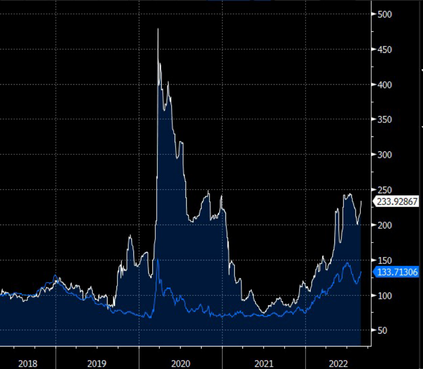
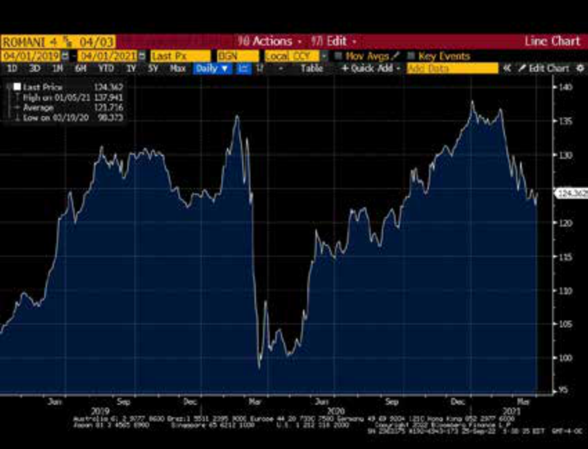
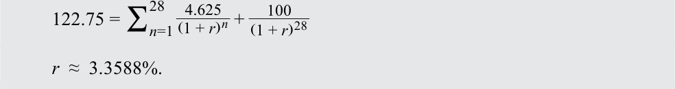
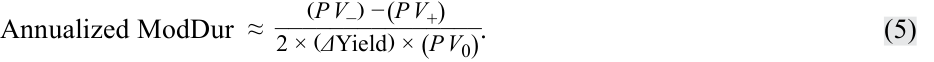

# Volume 6: Fixed Income
## Learning Module 14 Credit Risk
### Part 3/4: Factors Impacting Yield Spreads (PDF Pages 375–390)

---

<!-- PDF Page 375 -->

### **FACTORS IMPACTING YIELD SPREADS** 

# **<mark>4</mark>** 

describe macroeconomic, market, and issuer-specific factors that influence the level and volatility of yield spreads 

Corporate bonds and other “credit-risky” debt instruments typically trade at a yield premium, or spread, to bonds that have been considered “default-risk free,” such as US Treasury bonds or German government bonds. Credit spreads, expressed in basis points, widen based on issuer-specific factors, such as a decline in creditworthiness, sometimes referred to as credit migration or downgrade risk, or market-based factors, such as a greater risk aversion during periods of financial distress. **Credit spread risk** is the risk of greater expected loss due to changes in credit conditions as a result of macroeconomic, market, and/or issuer-related factors. 

#### **Macroeconomic Factors** 

Changing macroeconomic conditions and changes in the credit cycle often go in lockstep: As the business cycle improves, credit spreads narrow and investors are willing to assume more credit risk. A deteriorating credit cycle will cause credit spreads to widen. Spreads are narrowest at or near the top of the credit cycle, when market participants perceive credit risk to be at its lowest; they are widest at or near the bottom of the credit cycle, when financial markets believe credit risk has reached its peak. Beyond the higher coupons typically offered by high-yield bonds to compensate for their greater risk, reasons for investing in HY bonds include the following: 

- _Portfolio diversification_ – HY bonds often have lower correlation with IG bonds and default risk-free interest rates. Their inclusion in a fixed-income portfolio may therefore increase diversification and risk-adjusted return. 

- _Capital appreciation_ – Economic recovery, or improved issuer-specific performance, often has a more sizeable positive impact on HY than IG bond prices. In addition to improved cash flow, other issuer-specific events that may drive capital appreciation include rating upgrades, mergers or acquisitions, or favorable management changes. 

- _Equity-like return with lower volatility_ – While HY bond and equity prices tend to fluctuate in a similar way over the economic cycle, HY bond returns typically exhibit more stability given their larger income component versus stocks. Some empirical studies suggest that HY bonds offer a more attractive risk–return profile than equities over the long term. They may also be preferable for yield-seeking investors with a limited ability to assume equity volatility. 

Credit ratings estimate expected loss by considering not only the POD but also the LGD, establishing a clear relationship between credit ratings and bond yields. The relationship between credit ratings and composite bond yields of different ratings and maturities are shown in Exhibit 8. 

<!-- PDF Page 376 -->

**Exhibit 8: U.S. Composite Bond Yields by Rating and Tenor** 

_Source:_ Bloomberg as of 23 September 2022. 

Exhibit 8 shows three important relationships. First, the higher the credit rating, the lower the yield for a given maturity. Investors require less compensation for the risk of higher rated bonds with lower default risk. Second, in general, the longer the maturity, the higher the yield, as default risk tends to rise for longer maturities. Third, the yield spread difference between IG bond ratings is generally narrower than the difference between IG and HY. 

Over the cycle, HY bond spreads are more susceptible to widening under adverse market conditions when investors tend to sell riskier assets and buy default risk-free assets, known as a “flight to quality.” In addition, HY bonds may face liquidity risk, which also widens bid–offer spreads in times of financial stress. The benefits and considerations of adding HY bonds to a portfolio are addressed in Example 4. 

##### **EXAMPLE 4** 

#### **Benefits and Considerations of High-Yield Bond Investments** 

A pension fund manager made the economic forecasts for the following year: 

||**Last Year**|**This Year**|
|---|---|---|
||**(Actual)**|**(Forecast)**|
|Economic growth|2.5%|3.2%|
|Long-term interest rate|1.5%|2.0%|

<!-- PDF Page 377 -->

||**Last Year** **(Actual)**|**This Year** **(Forecast)**|
|---|---|---|
|High-yield default rate|3.3%|2.1%|
|||(Historical low)|
|Financial market volatility|16.5%|20.0%|

Despite improving economic and market conditions, financial market volatility is expected to increase. 

1. Describe the benefits and considerations of adding high-yield bonds to the investment portfolio under this scenario. 

##### **Solution:** 

_Benefits:_ Investing in high-yield bonds should improve the risk-adjusted return of the overall portfolio in an expected environment of: 

- accelerating economic growth, 

- rising interest rates, and 

- falling HY default risk to a historical low. 

_Considerations:_ The additional market risk arising from higher expected market volatility may temper the diversification benefit. In times of heightened volatility, HY bonds may also be exposed to market liquidity risk when cash is needed from the portfolio (for example, to meet regular pension payments). 

Exhibit 9 presents a stylized view of these credit spread curve level and shape changes for investment-grade (IG) and high-yield (HY) issuers over the economic cycle moving clockwise across the four scenarios shown. The spread change in spread for IG bonds is narrower than that for HY bonds. HY bonds are more sensitive to changing macroeconomic and credit conditions. 

<!-- PDF Page 378 -->

**Exhibit 9: Credit Spread Curves over the Economic Cycle** 

<!-- Start of picture text -->
Early expansion Late expansion Spread Spread HY HY IG IG Tenor Tenor Contraction Peak Spread Spread HY HY IG IG Tenor Tenor <!-- End of picture text -->

There may be other systematic reasons why spreads change. Corporate bonds trade primarily over the counter using broker–dealers who must commit their own capital for market-making purposes. Tighter financial regulations increase the cost of holding capital for trading in credit-risky bonds, particularly for large global banks that are the most dominant market participants. Funding stresses also naturally translate into wider credit spreads. The availability of funding is related to overall macroeconomic and credit cycle conditions but may also be driven by market sentiment, such as the willingness to take on risk. Additionally, in periods of heavy new issue supply, credit spreads will widen if there is insufficient demand. In periods of high demand for bonds, spreads will move tighter. 

#### **Market Factors** 

For the most liquid bonds with the lowest default risk, such as developed market sovereign debt, the yield for a given maturity is a combination of real interest rates plus an expected inflation rate premium. The yield spread on corporate bonds includes an additional risk premium that compensates investors for credit and liquidity risks as well as the potential tax impact of investing in a specific bond. Changes in any of these components will alter the yield, price, and return on the bond. The total yield spread over the government benchmark bond captures these risk components. 

Market liquidity risk refers to the transaction costs associated with selling a bond. This is the risk that the price at which investors can actually transact may differ from the price indicated in the market through bid–ask spreads. The ability and willingness of broker–dealers to make markets, as reflected in the bid–ask spread, is an important determinant of market liquidity and associated risks to transact in the market. 

Two main issuer-specific factors affect market liquidity risk. First, issuer size, or more specifically the aggregate value of publicly traded debt an issuer has outstanding, is an important liquidity factor. Second, the issuer’s credit quality is critical. In general, the less debt an issuer has outstanding and the less frequently its debt trades, the 

<!-- PDF Page 379 -->

higher the market liquidity risk and the bid–ask spread. The lower the credit quality of an issuer, the higher the market liquidity risk. To compensate investors for the risk that there may not be sufficient market liquidity for them to buy or sell bonds in the quantity they desire, the spread or yield premium on corporate bonds includes both a market liquidity and a credit risk component. 

Typically, a bond that trades more frequently and with higher volume provides investors more opportunity to purchase or sell the security and thus has less liquidity risk. The difference between the _bid_ (or purchase) and the _offer_ (or sale) price depends on the type of bond, the size of the transaction, and the time of execution, among other factors. For instance, the most liquid government bonds often trade at a fraction of a basis point between the purchase and sale prices, while less liquid corporate bonds can have a much wider difference between the bid and offer prices. 

During times of financial stress or crisis, market liquidity can decline sharply, causing bond prices to fall and yield spreads on corporate and other spread-based debt to widen significantly. In most crises, not only does credit deterioration result in wider bid–ask spreads, but it also may cause spillover effects from one fixed-income market segment to others. For example, risk aversion among HY bond investors may lead to significant spread widening among lower rated IG bonds as well. 

#### **Issuer-Specific Factors** 

Beyond macroeconomic and market factors, the expected financial performance of individual issuers has a significant effect on both the level and volatility of yields and yield spreads. 

In particular, factors common to all issuers include debt coverage and leverage. Debt coverage refers to the sufficiency of a borrower’s resources or cash flows to make necessary interest and principal payments, while leverage measures a borrower’s relative reliance on debt versus other sources of financing. The source of repayment and use of proceeds differ among issuer types. Corporate issuers typically invest in long-term assets and repay debt from operating cash flow, while sovereign borrowers conduct fiscal policy and provide public goods while collecting tax revenue as a primary source of repayment. These factors are evaluated in detail for sovereign and non-sovereign government as well as corporate issuers in later lessons. 

Investors often evaluate the yield and yield spread of a specific issuer’s bond using a comparison to bonds within the same credit rating category, within the same sector due to similar performance drivers, or to companies with a similar business model or other common features. Example 5 illustrates the use of such a comparison to allow an investor to distinguish between macroeconomic and issuer-specific factors. 

##### **EXAMPLE 5** 

#### **WeWork Yields versus B-Rated Corporates** 

WeWork is a US-based real estate company that leases commercial properties to provide co-working spaces for firms and individuals. The company enjoyed a meteoric rise during its first several years of existence as a rapidly expanding office space lessee financed by private equity capital. Despite its asset light business model and negative cash flow, WeWork issued debt in April 2018, a privately placed USD700 million seven-year senior unsecured bond with a fixed coupon of 7.875% priced at par and rated Caa1 by Moody’s, B+ by S&P, and BB– by Fitch. The following diagram shows the relationship between the average five-year yield of corporate bonds with high credit risk with a similar maturity and WeWork’s bond yield following the issuance. 

<!-- PDF Page 380 -->

**WeWork 7.875% 2025 Bond Yield versus Five-Year B Corporate Yield** 

_Source:_ Bloomberg, Normalized Yields with April 2018 = 100. 

We see that B-rated corporate bond yields fluctuated between 75% and 150% of their April 2018 levels over the period, but WeWork’s bond yield exhibited far greater volatility, reaching a yield nearly five times that of April 2018 in early 2020. While a detailed analysis is beyond the scope of this example, three noteworthy issuer-specific events may be used to explain the relative yield relationship over the period: 

_WeWork’s Failed IPO (September 2019):_ The failure of WeWork’s widely anticipated IPO was caused by weak governance and inflated growth and earnings expectations, which resulted in a company valuation of USD50 billion. As the failure increased WeWork’s relative reliance on existing debt versus anticipated new equity, its bond yield nearly doubled, while average B-rated corporate bond yields fell in a favorable macroeconomic environment through 2019. 

_COVID-19 Pandemic (March 2020):_ Economic shutdowns and work-fromhome policies had a disproportionately negative effect on WeWork’s co-working business model and expected cash flows as compared to other HY issuers. The company’s bonds traded at distressed prices as low as 35% of par value and were downgraded to CCC+ (negative outlook) by S&P, the only credit rating agency that had retained a B rating for WeWork to date. 

_Recovery and WeWork’s IPO (October 2021):_ The decline in WeWork’s bond yields was disproportionately large in 2021 as compared to B-rated corporate yields as the economy reopened and employees returned to work. This improved outlook allowed the company to revisit its plans to issue equity at a more realistic valuation. News of a possible second IPO attempt in mid-2021 caused WeWork bond yields to decline. Its bonds traded at a premium when the IPO was completed via a combination with special purpose acquisition company 

<!-- PDF Page 381 -->

(SPAC) BowX, which valued WeWork at USD9 billion and raised USD1.3 billion in cash. WeWork’s reduced reliance on debt and improved cash flow caused its bond yields to trade close to those of B-rated bonds, despite its lower rating. 

This simplified WeWork example ignores duration differences and compares bonds across sectors within a ratings category rather than within the commercial real estate sector or among comparable asset light, negative cash companies, such as Uber. Later fixed-income lessons will introduce greater detail in comparing issuer-specific, macroeconomic, and market factors. 

#### **The Price Impact of Spread Changes** 

In an earlier module, we explained how bond duration and convexity are used to approximate a bond’s price change given a change in yield-to-maturity. We now address the _source_ of the yield-to-maturity change. Since the yield-to-maturity on a corporate bond consists of a government _benchmark_ yield and a _spread_ , a change in the bond’s yield-to-maturity can originate in either component or a combination of the two. The key point is that for an option-free fixed-rate bond, the same duration and convexity statistics that apply for a change in benchmark yield also apply for a change in spread. 

Importantly, the modified duration and convexity measures give an approximate change in the full price of a bond for a change in yield-to-maturity, regardless of the _source_ of the change. However, changes in the yield-to-maturity components do not occur in isolation. In practice, the analyst is concerned with the _interaction_ between benchmark yield and spread changes, between changes in expected inflation and the expected real rate, and between changes in credit and liquidity risk. For example, a “flight to quality” described earlier can cause government benchmark yields to fall as credit spreads widen and liquidity declines for bonds of low credit-quality issuers. 

Example 6 shows the risk/return components of a bond via a hypothetical spread decomposition. 

##### **EXAMPLE 6** 

#### **Decomposition of a Romanian Eurobond Yield** 

In 2019, the Government of Romania issued its first-ever 4.625% 30-year Eurobond, which was priced at a spread of 411.4 bps over the 1.25% Federal Republic of Germany bond maturing 15 August 2048. The initial yield spread indicated the combined credit and liquidity risk of the bond. The 4.625% Romania bond subsequently traded in a wide price range, reflecting the prevailing market assessment of its credit risk and yield spread as well as the benchmark German yield, as shown in the chart below: 

<!-- PDF Page 382 -->

_Source:_ Bloomberg. 

Suppose that two years after issuance, the bond was traded at 122.25/125.75 (bid/offer). This meant that a buyer would have to pay the offer price of 125.75 for the bond and a seller would receive the bid price of 122.25. 

Bond mid-market price = (122.25 + 125.75)/2 = 124.00. 

With 28 years remaining to maturity, the Romanian bond yield based on its mid-market price is equivalent to 3.2988%: 

<!-- Formula Text: 124.00 = ∑ n=1 28     4.625 _ (1 + r) n  +   100 _ (1 + r) 28 r  ≈  3.2988%. -->

Assume we observe a Federal Republic of Germany benchmark bund yield of 0.2350% on the same day. The current spread of the Romania bond may be shown as: 

<!-- Formula Text: = 3.2988% − 0.2350% = 3.0638% or 306.38 bps. -->

<!-- Formula Text: To further break down this spread, we can compute the liquidity spread using the bid/offer prices. At the offer price, the yield is equivalent to 3.2396%: 125.25 = ∑ n=1 28     4.625 _ (1 + r) n  +   100 _ (1 + r) 28 r  ≈  3.2396%. -->

At the bid price, the yield is equivalent to 3.3588%: 

<!-- Formula Text: 122.75 = ∑ n=1 28     4.625 _ (1 + r) n  +   100 _ (1 + r) 28 r  ≈  3.3588%. -->

Therefore: Liquidity spread = 3.3588% − 3.2396% = 0.1192% or 11.92 bps. Credit spread = 306.38 bps − 11.92 bps = 294.46 bps. These “building blocks” of the Romania bond yield are summarized below: 

<!-- PDF Page 383 -->

<!-- Start of picture text -->
Liquidity spread: 11.92bp Yield spread: 306.38bps Credit spread: 294.46bp Bond yield: 3.2988% Benchmark Yield: 23.50bps <!-- End of picture text -->

While IG debt investors are less likely to be impacted by default, they are more focused on **spread risk** —that is, the effect on prices and returns from changes in spreads. The price impact from spread changes is driven by two main factors: (1) the modified duration of the bond and (2) the magnitude of the spread change. The effect on return to the bondholder depends on the holding period used to calculate the return. 

In the case of a small, instantaneous change in yield spread, the price impact can be approximated, as shown in Equation 3, by 

%∆PVFull = −AnnModDur × ∆Spread, 

~~(3)~~ 

where AnnModDur is the annualized modified duration and PVFull is the bond’s full price. Note that lower (higher) spreads have a positive (negative) impact on bond prices and thus returns. 

For larger spread changes, the effect of convexity needs to be incorporated into the approximation, as seen in Equation 4: 

%∆PVFull = −(AnnModDur × ∆Spread) + ½AnnConvexity × (∆Spread)2 , ~~(4)~~ 

where AnnConvexity is annualized convexity. Care is required to ensure convexity is properly scaled to be consistent with how the spread change is expressed. For option-free bonds, convexity should be scaled so it has the same order of magnitude as duration squared and the spread change is expressed as a decimal. For example, if a bond has duration of 5.0 and reported convexity of 0.235, then first re-scale convexity to 23.5, and then apply the formula. For a 1% increase in spread, the result would be 

%∆PVFull = (−5.0 × 0.01) + ½ × 23.5 × (0.01)2 = −0.048825 or −4.8825%. 

The price impact of instantaneous spread changes is illustrated in Exhibit 10 using the two semiannual coupon BRWA bonds with a price of par highlighted in the preceding lessons: 

**Exhibit 10: Price Impact of Instantaneous Spread Changes** 

|**Tenor and**|||**Modified**||
|---|---|---|---|---|
|**Coupon**|**Settlement**|**Maturity**|**Duration**|**Convexity**|
|5-year, 3.20%|15 October 2025|15 October 2030|4.58676|24.23895|
|10-year, 6.20%|15 October 2025|15 October 2035|7.29085|68.74440|

From the initial spread, in increments of 50 bps and for both wider and narrower spreads, the new price and actual return for each spread change are calculated. Moreover, the estimated returns without and then with the convexity term are presented. As shown, the approximation using only duration is reasonably accurate for small spread changes, but for larger changes, the convexity term generally provides a meaningful improvement, as in Exhibit 11. 

<!-- PDF Page 384 -->

**Exhibit 11: Price Impact of Duration & Convexity for Given Spread Change** 

|**5-Year BRWA Bond**|||**Scenarios**|||
|---|---|---|---|---|---|
|Spread (bps)|−100|−50|0|50|100|
|Spread over 5-year UST (bps)|0|50|100|150|200|
|Bond yield|2.20%|2.70%|3.20%|3.70%|4.20%|
|Actual bond price|104.71|102.32|100.00|97.73|95.53|
|Actual return|4.71%|2.32%|—|−2.26%|−4.46%|
|Approx. return: duration only|4.58%|2.29%|—|−2.29%|−4.59%|
|Approx. return: duration & convexity|4.70%|2.32%|—|−2.26%|−4.46%|

|**10-Year BRWA Bond**|||**Scenarios**|||
|---|---|---|---|---|---|
|Spread (bps)|−100|−50|0|50|100|
|Spread over 10-Year UST||||||
|(bps)|100|150|200|250|300|
|Bond yield|5.20%|5.70%|6.20%|6.70%|7.20%|
|Actual bond price|107.72|103.77|100.00|96.39|92.95|
|Actual return|7.72%|3.77%|—|−3.60%|−7.04%|
|Approx return: duration only|7.29%|3.64%|—|−3.64%|−7.29%|
|Approx return: duration & convexity|7.63%|3.73%|—|−3.55%|−6.94%|

_(Note:_ Assume 5-year UST: 2.20%, 10-year UST: 4.20% on the bond settlement date.) 

Note the price change for a given spread change is higher for the longer-duration bond than for the shorter-duration bond. As with yield changes, longer-duration corporate bonds have “higher spread sensitivity,” meaning their prices, and returns, are more volatile with respect to spread changes. 

Additionally, investors must be compensated for greater uncertainty about an issuer’s future creditworthiness in longer-dated bonds. An investor might be confident in assessing issuer default risk in the near term; however, investor uncertainty grows over time due to factors that are increasingly difficult to forecast (e.g., poor management strategy or execution, technological obsolescence, natural or man-made disasters, corporate leveraging events). 

Example 7 shows the impact on price of a bond due to changes in credit quality or liquidity. Here we apply the methodology from an earlier lesson to approximate modified duration and convexity. We estimated the modified duration by increasing and decreasing the yield-to-maturity by the same amount (ΔYield) to calculate corresponding bond prices _PV_ + and _PV__ for a given initial price ( _PV_ 0), as shown in Equation 5: 

<!-- Formula Text: Annualized ModDur  ≈ (P V −) − (P V +) _______________ 2 × (ΔYield) × (P V 0) . (5) -->

This approximate _annualized_ modified duration (or ApproxModDur) includes the frequency of coupon payments and the periodicity of the yield-to-maturity in the bond price calculations. Recall that approximate annualized convexity (ApproxCon) uses similar inputs and may be calculated as follows. 

<!-- Formula Text: ApproxCon  = (P V −) + (P V +) − [2 × (P V 0)] ____________________ (ΔYield) 2 × (P V 0) . (6) -->

<!-- PDF Page 385 -->

##### **EXAMPLE 7** 

#### **Bond Price Sensitivity to Spread Changes** 

Show the price impact on the 4.625% 30-year Romania Eurobond versus a new shorter-term Romania bond (details below) if the spread changes due to changes in credit quality and/or liquidity. Show estimated price and return changes (using modified duration and convexity), approximate modified duration and convexity versus actual price changes and returns (using the Excel PRICE function), and discuss the results. 

On 13 July 2021, Romania issued another EUR2 billion 1.75% Eurobond: 

- Coupon: 1.75% (annual) 

- Priced at 99.95% of par 

- Yield: 1.756% 

- Maturity date: 13 July 2030 

- Settlement date: 13 July 2021 

- Benchmark 10-year German bund yield: –0.292% 

( _Note:_ ApproxModDur: 8.2600; ApproxCon: 79.2963.) 

The modified duration and convexity of this bond are computed using the approximation shown above. The spread sensitivity to changes in credit quality and/or bond liquidity on the settlement date are listed in the table below: 

|**2030 Bond**|||**Scenarios**|||
|---|---|---|---|---|---|
|Spread change (bps)|–100|–50|0|50|100|
|Spread (bps)|105|155|205|255|305|
|Yield|0.7561%|1.2561%|1.7561%|2.2561%|2.7561%|
|Actual clean price|108.617|104.179|99.950|95.919|92.077|
|Actual return|8.67%|4.23%|0.00%|–4.03%|–7.88%|
|Estimated price: ApproxModDur & ApproxCon|108.602|104.177|99.950|95.921|92.090|
|Estimated return: ApproxModDur & ApproxCon|8.66%|4.23%|0.00%|–4.03%|–7.86%|

In contrast, the 4.625% 30-year Eurobond has greater spread sensitivity as reflected by its higher modified duration and convexity: 

- Coupon: 4.625% (annual) 

- Traded at 125.13% of par 

- Yield: 3.2373% 

- Maturity date: 3 April 2049 

- Settlement date: 13 July 2021 

- Benchmark 30-year German bund yield: 0.206% 

- ( _Note:_ ApproxModDur: 17.2569; ApproxCon: 389.1376.) 

<!-- PDF Page 386 -->

|**2049 Bond**|||**Scenarios**|||
|---|---|---|---|---|---|
|Spread change||||||
| (bps)|–100|–50|0|50|100|
|Spread (bps)|203|253|303|353|403|
|Yield|2.2373%|2.7373%|3.2373%|3.7373%|4.2373%|
|Actual clean price|148.923|136.332|125.130|115.147|106.236|
|Actual return|19.01%|8.95%|0.00%|–7.98%|–15.10%|
|Estimated price: ApproxModDur & ApproxCon|149.158|136.535|125.130|114.942|105.971|
|Estimated return: ApproxModDur & ApproxCon There are two ma **a.**The estimated      i convexity are cially for the s _tion, the great_ _changes._|19.20% h   in observat h  price chan    i quite close horter-dur _er the discr_|9.11% h    ions from t h   ges and ret  i to actual p ation 2030 _epancy bet_|0.00% h      he tables a h     urns using i rice change bond._The l_ _ween estima_|–8.14% h        bove: h       modified d s and retur _h onger a bon_ _ted and act_|–15.31% h       i uration an ns, espe- _h   d’s dura-_ _ual price_|
|**b.**The 2049 bon bond._The lon_ _changes in cre_ 5% 10% 15% 20% 25% **ctual Return**|h  d is far mor _h ger the dur_ _dit quality_|h     e sensitive _h   ation, the m_ _and bond li_|h       to spread c _h     ore sensitiv_ _quidity._|h         hanges tha _h      e a bond’s p_|h          n the 2030 _h         rice is to_|
|–5% 0% –100 **Change/A**|–50|0||50|100|
|–15% –10%  **Price**||||||
|–20%||**Spread Chan** 2030s|**ge (bps)** 2049s|||

- **a.** The estimated price changes and returns using modified duration and convexity are quite close to actual price changes and returns, especially for the shorter-duration 2030 bond. _The longer a bond’s duration, the greater the discrepancy between estimated and actual price changes._ 

- **b.** The 2049 bond is far more sensitive to spread changes than the 2030 bond. _The longer the duration, the more sensitive a bond’s price is to changes in credit quality and bond liquidity._ 

Taking on more default risk in fixed income offers higher potential return but at the cost of higher volatility and less certainty of earning that return. The lower the credit quality, the higher the quoted yield. The realized yield, or return, will almost always differ because of changes in interest rates, coupon re-investment rates, holding period changes, and the credit-related risks discussed earlier. Additionally, the volatility of returns will vary by rating. Example 8 shows the impact on bond prices due to a credit downgrade. 

<!-- PDF Page 387 -->

##### **EXAMPLE 8** 

#### **Changes in BRWA Bond Price Following a Credit Downgrade** 

The 3.2% BRWA senior unsecured five-year note was originally offered with few covenants. Suppose that BRWA is downgraded by one notch by the rating agencies due to rising technological and environmental risk and BRWA’s focus on the legacy technology of internal combustion engines. Based on the current market environment, the differences in credit spread in the same industry due to the one-notch lower rating, applicable to the 2030 and 2035 bond tenors, are observed to be 1.0% and 2.2%, respectively. 

Assume that when the rating downgrade happens: 

||**Modified Duration**|**Convexity**|
|---|---|---|
|3.20% 2030s|3.82250|20.22640|
|6.20% 2035s|6.57882|58.43082|

Using Equation 3, the price impact on the 3.20% BRWA 2030 bond can be estimated as: 

%∆PVFull = −(AnnModDur × ∆Spread) + ½AnnConvexity × (∆Spread)2 

- = −(3.82250 × 0.01) + ½(20.2264) × (0.01)2 

= −0.037214 or −3.7214%. 

For the 6.20% BRWA 2035 bond, the price impact is estimated as: 

%∆PVFull = −(6.57882×0.022) + ½(58.43082) × (0.0220)2 

= −0.130594 or −13.0594%. 

As in the earlier examples, the negative price impact on the longer-duration bond is expected to be much larger due to credit migration. 

##### **QUESTION SET** 

1. Which of the following statements best describes the relative performance of HY bonds over the economic cycle? 

   - **A.** HY bonds often have lower correlation with IG bonds and default riskfree interest rates. 

   - **B.** HY bond and equity prices tend to fluctuate similarly over the economic cycle, but HY bond returns exhibit more stability given their smaller income component versus stocks. 

   - **C.** Economic recovery or improved issuer-specific performance often has a similar positive impact on HY and IG bond prices. 

##### **Solution:** 

A is correct. B is incorrect since HY exhibit more stability due to a higher income component versus stocks. C is incorrect since economic recovery or improved issuer-specific performance usually has a greater positive impact on HY versus IG bond prices. 

<!-- PDF Page 388 -->

2. A bond investor observes a bid/offer quote for a 5-year French government zero-coupon bond of 93.75/93.775. The bond’s liquidity spread is closest to: 

   - **A.** 25 bps. 

   - **B.** 5 bps. 

**C.** 0.54 bps. 

- **Solution:** 

C is correct. We first calculate the respective bid and offer yields as follows: _ Bid yield:  93.75 =100( 1 + _r_)5 

_r_ bid = 1.2991% 

_ Offer yield:  93.7755 =( 1 +100 _r_)5 

_r_ offer = 1.2937% 

The liquidity spread of 0.54 bps (0.0054%) is equal to the difference in the bid yield and the offer yield (= 1.2991% − 1.2937%). 

3. _Determine the correct answers to fill in the blanks:_ The longer a bond's duration, the __________ the discrepancy between estimated and actual price changes and the __________ sensitive a bond's price is to changes in credit quality and bond liquidity. 

##### **Solution:** 

The longer a bond's duration, the **greater** the discrepancy between estimated and actual price changes and the **more** sensitive the bond's price is to changes in credit quality and bond liquidity. 

4. For a bond with a modified duration of 4 and a convexity of 0.25, which of the following changes in credit spread would result in a price decrease closest to 7.5%? 

   - **A.** 1% decrease 

   - **B.** 1% increase 

   - **C.** 2% increase 

##### **Solution:** 

The correct answer is C, as shown by solving for ∆Spread in Equation 4: 

%∆PVFull = −(AnnModDur × ∆Spread) + ½AnnConvexity × (∆Spread)2 

- (4 × 0.02) + ½(25) × (0.02)2 = –0.075 or –7.5%. 

The spread change is inversely related to the price effect, with a spread increase leading to a fall in bond price. Note that since duration was 4, we had to rescale the convexity from 0.25 to 25. 

<!-- PDF Page 389 -->

## **~~PRACTICE PROBLEMS~~** 

**1.** _Determine the correct answers to fill in the blanks:_ ____________ is the risk that a bond issuer’s creditworthiness deteriorates, leading investors to believe the risk of default is __________ and causing the yield spreads on the issuer’s bonds to _________ and the price of its bonds to _______. 

**2.** An uncollateralized USD200,000 note has the following characteristics: Recovery rate 95% Exposure at default USD150,000 

If the note’s expected loss in the event of default is USD2,500, its probability of default is _closest to:_ 

**A.** 15%. 

**B.** 25%. 

   - **C.** 33%. 

**3.** _Determine the correct answers to fill in the blanks:_ While the likelihood of default for IG borrowers is typically __________ that of an HY issuer, an investor’s loss in the event of a default for secured debt is usually __________ than unsecured debt due to the secondary source of repayment. 

**4.** A bond investor is considering the credit risk components and observed yield spreads for two IG bonds of similar maturity and liquidity: 

||**POD**|**LGD**|**Yield Spread**|
|---|---|---|---|
|**Bond 1**|1.25%|75%|100 bps|
|**Bond 2**|1.1%|85%|95 bps|

Which of the following conclusions about the relationship between these bonds is most correct? 

   - **A.** An investor should be indifferent between purchasing Bond 1 and Bond 2, since Bond 1’s higher spread is sufficient compensation for the higher POD versus Bond 2. 

   - **B.** An investor should prefer Bond 2 over Bond 1, since they may earn a spread that is more than sufficient for assuming the credit risk. 

   - **C.** An investor should prefer Bond 1 over Bond 2, since it offers the highest spread relative to the expected loss. 

**5.** Pitfalls of relying solely on credit ratings when making bond investment decisions may be best described as the following: 

   - **A.** Rating agencies may change their rating in response to changing market and credit conditions for a given issuer. 

   - **B.** Credit agencies may issue a positive or negative outlook for an issuer as credit risk rises or falls, but a rating change is not yet warranted. 

   - **C.** Ratings may involve miscalculations or unforeseen changes not fully captured in a rating agency’s forward-looking analysis. 

<!-- PDF Page 390 -->

**6.** An investment-grade bond with modified duration of 7 and reported convexity of 0.51 increases in price by 9.93% after a yield spread change. The value of the spread change would be _closest to:_ 

   - **A.** −1.5%. 

**B.** 0.15%. 

- **C.** 1.5%. 

