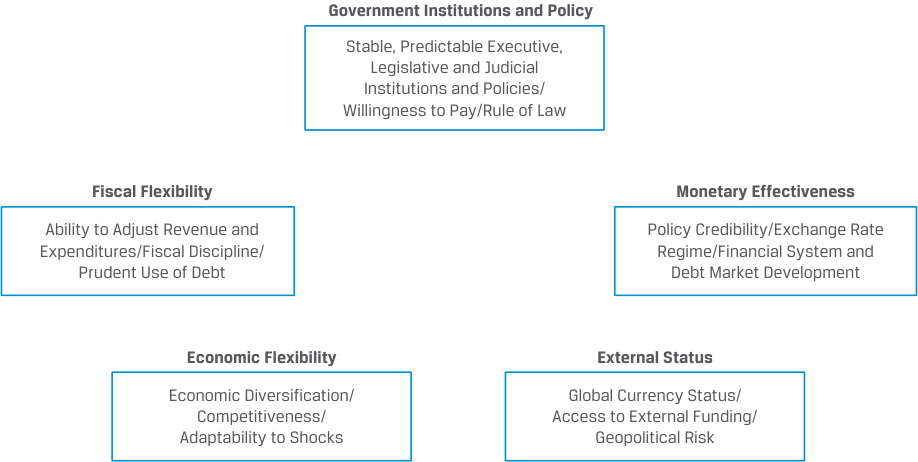
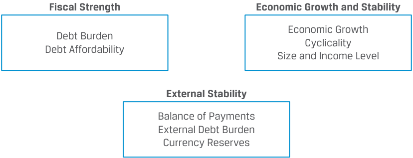
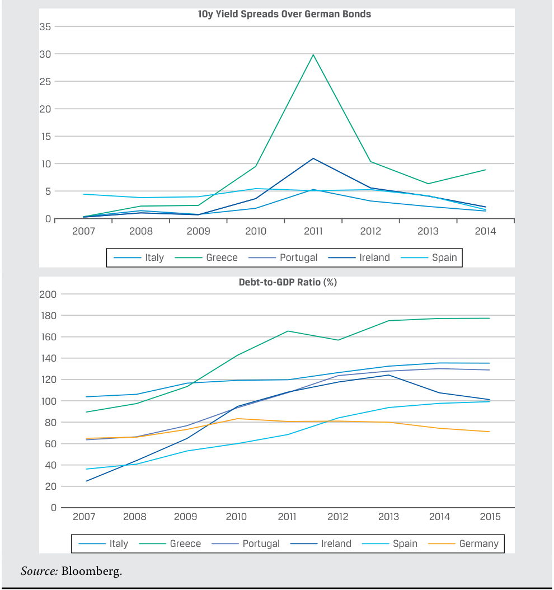
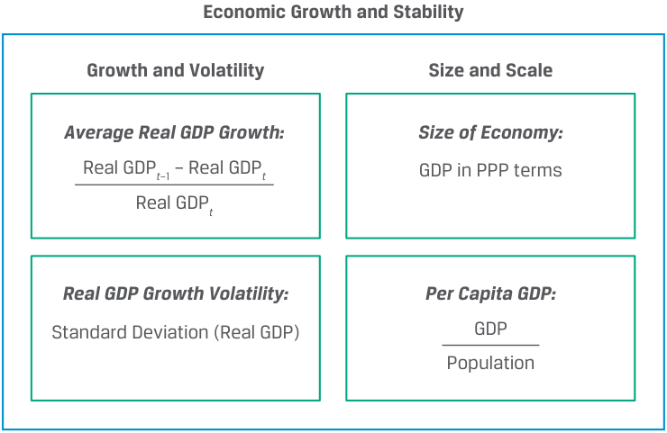
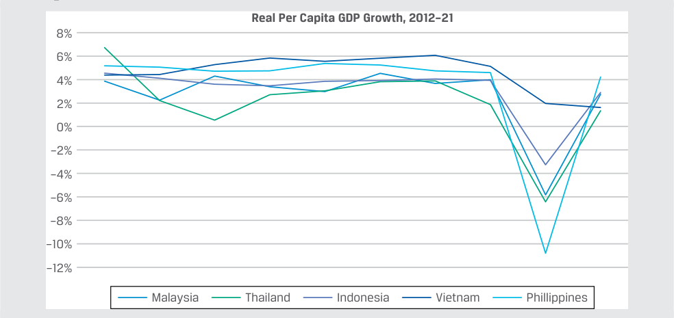
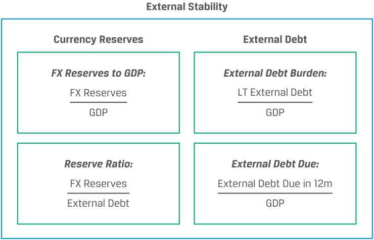

# Volume 6: Fixed Income
## Learning Module 15 Credit Analysis for Government Issuers
### Part 1/2: Introduction (PDF Pages 393–408)

---

<!-- PDF Page 393 -->

#### L E A R N I N G M O D U L E 

# **<mark>15</mark>** 

### **Credit Analysis for Government Issuers** 

###### **<mark>LEARNING OUTCOMES</mark>** 

**_Mastery The candidate should be able to:_** explain special considerations when evaluating the credit of sovereign and non-sovereign government debt issuers and issues 

##### **INTRODUCTION** 

**<mark>1</mark>** 

This learning module explores special considerations for the credit evaluation of sovereign and other public issuers that often access fixed-income markets to finance their activities. 

A major difference between corporate and sovereign issuers is the use of proceeds and source of repayment of debt obligations. In contrast to corporations that fund working capital and fixed assets to generate profits, sovereign and other government issuers use debt to conduct fiscal policy, supply public goods and services, and fund other government expenditures. While companies primarily rely on operating cash flow to repay debt, governments use tax revenues and other government revenues, such as tariffs and fees, to pay interest and principal. 

We analyze sovereign bonds using a combination of qualitative and quantitative factors to assess their ability and willingness to pay. Sovereign defaults are not uncommon, particularly as countries transition from emerging to advanced economies. However, in contrast to corporate issuers, sovereign bondholders are generally unable to force governments to declare bankruptcy and liquidate assets. Non-sovereign issuers, such as certain local governments or quasi-government entities, also issue debt to finance their expenditures or develop infrastructure. This debt is backed by their ability to levy local taxes or generate specific project revenue. 

###### **LEARNING MODULE OVERVIEW** 

- Governments borrow in public markets to conduct fiscal policy and meet budgetary needs, such as the provision of <u>public goods.</u> 

<!-- PDF Page 394 -->

- A sovereign government’s ability to tax private economic activity causes these bonds to normally have the lowest credit risk of any issuer in a specific country. In advanced economies, sovereign debt is often considered default risk-free. 

- A combination of qualitative and quantitative factors is used to analyze a sovereign issuer’s ability and willingness to pay. 

- Greater central bank independence from the sovereign issuing entity reduces the likelihood that a national government will simply increase the money supply by purchasing domestic debt. 

- A key distinction for sovereign creditworthiness is whether its domestic currency is considered to be a reserve currency, that is, one that is fully convertible and held by foreign central banks and other investors. 

- Non-sovereign government debt is issued by local governments or quasi-government entities, backed by their tax revenue or specific project revenue. 

- The credit analysis of non-sovereign debt backed by tax revenue has similar considerations to sovereign bonds, while project-based revenue bonds are typically evaluated based upon the cash flows associated with the underlying project. 

###### **LEARNING MODULE SELF-ASSESSMENT** 

These initial questions are intended to help you gauge your current level of understanding of this learning module. 

1. Identify the debt type that corresponds to the correct example: 

- A) sovereign debt, B) non-sovereign debt, C) corporate debt 

1. Issued by an entity backed by cash flow from its business operations 2. Issued by a country’s government, backed by its ability and willingness to tax 3. Issued by a local government or entity, backed by its ability and willingness to tax, or revenue from a specific public project 

###### **Solution:** 

1. C is correct. Corporate debt is issued by non-government corporations to finance business operations, and payments are made from operating cash flow. 

2. A is correct. Sovereign debt is issued by national governments to conduct fiscal policy and finance their budgets. This debt is paid based on the government’s ability and willingness to collect taxes from within a jurisdiction. 

3. B is correct. Non-sovereign debt is issued by sub-sovereign or local governments and related entities. These bonds are supported by the local taxing authority of the issuer or specific public project revenue. 

<!-- PDF Page 395 -->

|2. The principle of sovereign immunity is related to the sovereign government’s:|
|---|
|**A.**ability to pay.|
|**B.**ability to tax.|
|**C.**willingness to pay. **Solution:**|
|C is correct. Under the principle of sovereign immunity, national laws limit investors’ ability to force a sovereign government into bankruptcy or liquidate its assets to settle debt claims as would be the case for a corporate issuer.|
|3. The creditworthiness of sovereign and other government borrowers is based upon qualitative and quantitative factors. Which of the following is_not_a quantitative factor?|
|**A.**External stability|
|**B.**Economic growth and flexibility|
|l **C.**Fiscal strength **Solution:**|
|B is correct. The quantitative factor is actually economic growth and stabili- ty, not flexibility.|
|4. Which of the following statements best describes characteristics of external strength associated with higher credit quality?|
|**A.**A government that is able to impose and enforce capital controls|
|**B.**A government that has established free trade agreements with neigh- boring countries|
|**C.**A government whose central bank issues a reserve currency **Solution:**|
|C is correct. A key distinction for sovereign creditworthiness is whether|
|its domestic currency is considered to be a reserve currency, fully convert- ible and frequently held by foreign central banks and other investors. A is|
| incorrect as capital controls may not support debt capacity. B is incorrect fi|
|since free trade is a necessary, but not a sufficient, condition for establishing external strength.|

5. Match the following debt issuances to the correct issuer type: 

A) agency bonds, B) general obligation bonds, C) revenue bonds 

|1. Bonds issued for building a regional highwaytoll road|
|---|
|2. Bonds issued by the national mortgage finance corporation, under national law.|
|3. Bonds issued by a state govern- ment to fund apension deficit|

###### **Solution:** 

1. C is correct. Revenue bonds are issued to finance a specific public benefit <u>project, mostly supported by the local/regional government. The revenue</u> 

<!-- PDF Page 396 -->

from the project supported by the economic base for utilization of the project determines its credit worthiness. 

2. A is correct. Agencies are quasi-government entities whose primary activities are to fulfill a government-sponsored mission to provide public services that are often based upon a specific sovereign law or statute. In many cases, either the law or statute creating the entity authorizes it to finance its activities using debt. 

   3. B is correct. General obligation (GO) bonds are unsecured bonds backed by the general revenues of the issuing non-sovereign government. These bonds are supported by the taxing authority of the issuer, rather than the revenue from a specific project. 

6. Which of the following is a relevant qualitative factor for assessing the sovereign rating for a country’s debt issue? 

   - **A.** Natural resources 

**B.** Trading partnership with a strong economy 

- **C.** Economic diversification 

- **Solution:** 

C is correct. One of the key factors for assessing the creditworthiness of a sovereign issuer’s debt is the degree of economic diversification, as well as growth potential. The economies in countries with the highest-rated sovereign borrowers typically have an advanced and highly diversified domestic economy with strong, sustainable growth prospects. Emerging or frontier market economies, on the other hand, often depend upon a single industry or commodity and/or fewer trading partners, causing the tax revenues available to these sovereign borrowers to be more susceptible to an economic downturn, key commodity price fluctuations, and/or trade interruptions. 

## **<mark>2</mark>** 

##### **SOVEREIGN CREDIT ANALYSIS** 

explain special considerations when evaluating the credit of sovereign and non-sovereign government debt issuers and issues 

As outlined in earlier lessons, both sovereign and non-sovereign governments issue debt to finance their activities. In contrast to corporate debt, this debt is used to conduct fiscal policy and meet budgetary needs, such as providing public goods and services including infrastructure, health care, and education. The primary source of repayment for sovereign debt is usually taxes and other government revenue, which can include fees, tariffs, and in some cases the profits of state-owned enterprises. A sovereign government’s ability to tax all private economic activity under its jurisdiction is the primary reason why such bonds usually have the lowest credit risk of any issuer within a specific country. While sovereign bonds in the most advanced economies are often considered default risk-free, those issued by emerging and frontier market governments involve greater default risk. 

Bond investors evaluate the creditworthiness of both corporate and public issuers by the stability and predictability of issuer cash flows, the sufficiency of those cash flows to meet required interest and principal payments, and the issuer’s relative reliance 

<!-- PDF Page 397 -->

on debt financing versus other available resources. The creditworthiness of sovereign and other government borrowers is based upon qualitative and quantitative factors unique to the public sector, as shown in the following sections. 

###### **Qualitative Factors** 

Sovereign government policies affecting the macroeconomy and financial markets include monetary and fiscal policies that typically seek to create an economic environment with positive, stable growth and stable, low inflation. Domestic and foreign investors evaluate the creditworthiness of a sovereign issuer by considering a government’s taxation and spending policies and the underlying economy as a primary source of tax revenue for repayment. Qualitative factors included in this assessment are shown in Exhibit 1. 

###### **Exhibit 1: Qualitative Factors in Sovereign Creditworthiness** 

<!-- Start of picture text -->
Government Institutions and Policy Fiscal Flexibility Monetary Effectiveness Economic Flexibility External Status <!-- End of picture text -->

<u>Government Institutions & Policy: This factor addresses the role of sovereign gov-</u> ernment institutions and policies in fostering political and economic stability. From an economic standpoint, these policies range from basic legal protections, such as maintaining the rule of law and the enforcement of property rights, to promoting a culture of debt repayment, transparency, the consistency of financial data reporting, and the relative ease of doing business within a jurisdiction. Political factors include stability of domestic political institutions and the absence of conflict with neighboring countries. These factors are often captured using a relative ranking or scoring approach. 

In addition to a sovereign government’s ability to pay, we must also consider its _willingness_ to pay. Willingness to pay is important for sovereign issuers because of the principle of **sovereign immunity** , under which investors face limitations in forcing a sovereign government to declare bankruptcy or liquidate its assets to settle debt claims as would be the case for a corporate issuer. Sovereign immunity limits the legal recourse of bondholders in many instances, preventing external creditors from fully enforcing debt claims. In most cases, given the involvement of multiple lenders and multilateral agencies such as the International Monetary Fund (IMF), investors agree to restructure debt to provide extended terms and/or favorable interest rates for a specified period to recover their investment, as in the following example. 

<!-- PDF Page 398 -->

###### **EXAMPLE 1** 

###### **Uruguay’s 2003 Sovereign Debt Exchange** 

After years of economic stagnation compounded by a banking crisis resulting from large deposit withdrawals first by neighboring Argentines and then by its own residents, Uruguay was forced to float its currency in June 2002. This caused a large depreciation of the Uruguayan peso (UYI) which, together with the fiscal cost of the banking crisis, led to a sharp rise in debt that pushed the country to the brink of default. With the support of the IMF, in March 2003 the authorities announced their intention to carry out a market-friendly debt restructuring to moderate short-term liquidity pressures and improve the medium-term servicing profile of foreign currency-denominated sovereign debt. A debt exchange to extend Uruguay’s bond maturities by five years was successfully agreed to in May 2003 with the consent of 90% of bondholders. Although the transaction was voluntary, it was deemed by analysts to be a default in substance given a lack of sufficient bondholder compensation for the delayed debt payment as well as the subordination of bondholders who did not participate in the exchange. 

<u>Fiscal Flexibility: Sovereign governments are also evaluated on how well they estab-</u> lish and maintain fiscal discipline over time and under different economic conditions. The management of public finances extends from the enforceability of tax collection to the prudent allocation of government budget expenditures on public goods to managing sovereign debt outstanding relative to economic activity. This assessment is based upon past experience in adjusting spending over economic cycles and the expected effect of fiscal policy changes, as in the following example. 

###### **EXAMPLE 2** 

###### **Government of Romania’s Improved Ratings Outlook** 

In October 2021, Moody’s Investors Service changed its ratings outlook on the Government of Romania from negative to stable with a Baa3 issuer and senior unsecured debt rating. In addition to solid economic growth prospects, Moody’s cited an expectation of consistent and sustained fiscal consolidation as a reason for the improved outlook. As part of Romania’s goal to become a full-fledged member state after joining the EU in 2007, the government was expected to prepare and implement fiscal reforms to reduce its annual deficit to below 3% of GDP within three years. The incentive to reduce the deficit was strengthened by the possible suspension of EU structural and investment grants in the case of non-compliance. 

<u>Monetary Efectiveness:f</u> Monetary policy involves central bank activity directed toward influencing the quantity of money and credit in an economy. Central banks establish short-term interest rates and reserve requirements, and they buy and sell sovereign bonds using open market operations—all to encourage stable and sustainable growth amid relative price stability. At one extreme, central banks may implement policy almost completely independent of government interference and influence; at the other extreme, they may simply act as the agent of the government. Central bank independence from the public Treasury reduces the likelihood that a sovereign government will monetize their domestic debt, driving domestic inflation higher and reducing the external value of the domestic currency. 

<!-- PDF Page 399 -->

<u>Economic Flexibility:</u> The economic activity under a sovereign government’s jurisdiction available to tax and service debt is usually the primary source of debt repayment. Key factors important in gauging creditworthiness include not only the size of an economy and level of per capital income, but also the degree of economic diversification and growth potential. 

Economies in countries with the highest-rated sovereign borrowers typically have an advanced and highly diversified domestic economy with strong, sustainable growth prospects. Emerging or frontier market economies, on the other hand, often depend upon a single industry or commodity or have fewer trading partners, causing the tax revenues available to these sovereign borrowers to be more susceptible to an economic downturn, key commodity price fluctuations, and/or trade interruptions. In many cases, such countries have a sizable informal economy or face challenges in collecting tax revenue. 

<u>External Status:</u> External status or governance refers to how a sovereign government’s international trade, capital, and foreign exchange policies influence its ability to support and service outstanding debt. Monetary policy credibility and the exchange rate regime have a significant effect on international capital flows. A key distinction for the creditworthiness of a sovereign government is whether its domestic currency is considered to be a **reserve currency** , that is, one that is fully convertible and frequently held by foreign central banks and other investors as a portion of their foreign exchange reserves. When foreign investors are able and willing to hold assets in a country’s currency in the form of cash, sovereign bonds, and other investments, it greatly expands the government’s ability to access foreign investors using domestic currency debt. This greater flexibility minimizes the likelihood of sovereign default and increases a government’s ability to sustain structural budget deficits and a higher level of debt. 

In contrast, many emerging and frontier market countries have exchange rate restrictions, capital controls, and/or a lack of full convertibility that constrains their ability to borrow from foreign entities by issuing bonds in foreign currencies. In cases where such debt markets are unavailable, these countries are more likely to access foreign currency funding from supranational organizations, such as the IMF, in order to meet development needs or implement economic reforms. 

While a country’s internal and external strength are usually determined by its economic growth dynamics, competitiveness, and diversification, geopolitical risk is also often a factor to consider, as in the following example. 

###### **EXAMPLE 3** 

###### **Moldova’s IMF Credit Facility** 

Russia’s military invasion of Ukraine in February 2022 caused a deterioration in the creditworthiness of several East European countries due to heightened political and economic risk. Given its proximity to the conflict and the influx of far more refugees on a per capita basis than its neighbors, the Republic of Moldova faced the greatest adverse economic impact. Rising inflation, stagnant growth, and a higher current account deficit due to falling exports and rising energy prices led Moldovan authorities to request and receive permission from the IMF to partially draw down an extended credit facility to meet immediate external obligations, such as energy purchases, in May 2022. The Moldovan government received IMF approval for the temporary funding by both submitting a budget to meet immediate fiscal needs due to the crisis and reinforcing its commitment to pursue structural economic reforms in order to avert a default. 

<!-- PDF Page 400 -->

The combinations of qualitative institutional (including fiscal and monetary policy), economic, and external factors used to evaluate sovereign creditworthiness are shown in detail in Exhibit 2. 

**Exhibit 2: Detailed Qualitative Factors in Sovereign Creditworthiness** 

<!-- Start of picture text -->
Government Institutions and Policy Stable, Predictable Executive, Legislative and Judicial Institutions and Policies/ Willingness to Pay/Rule of Law Fiscal Flexibility Monetary Effectiveness Ability to Adjust Revenue and Policy Credibility/Exchange Rate Expenditures/Fiscal Discipline/ Regime/Financial System and Prudent Use of Debt Debt Market Development Economic Flexibility External Status Economic Diversification/ Global Currency Status/ Competitiveness/ Access to External Funding/ Adaptability to Shocks Geopolitical Risk <!-- End of picture text -->

In practice, many of these qualitative factors are interrelated; for example, a weak legal system often goes hand in hand with a limited ability to collect taxes due or enforce debt contracts. The use of these qualitative factors in assessing creditworthiness is best understood using an example, such as the following country comparison. 

###### **EXAMPLE 4** 

###### **Moldova and Romania** 

Three decades after emerging from central planning to a market economy, Romania and Moldova share linguistic, cultural, and historical ties as well as a common border, but they have different sovereign credit risk profiles. Romania is an investment-grade sovereign issuer (rated Baa3 by Moody’s, and BBB– by S&P and Fitch), while Moldova is a non-investment-grade issuer (rated B3 by Moody’s, and B– by S&P and Fitch) based in part upon the following factors: 

<u>Government Institutions & Policy: While both Romania and Moldova</u> established representative democracies following one-party rule under socialism, Romania signed an Association Agreement with the EU in 1992 and formally joined in 2007, codifying its access to European markets and economic integration. Moldova’s political transition was slower, and its government is still considered by many analysts to be an unstable democracy, with weak governance and institutions and widespread corruption. Moldova faces economic and political hurdles in joining the EU, including an unresolved conflict within the Transnistria region as well as internal resistance to EU membership. It did not formally apply to join the EU until 2022. 

Given its aspiration to join the euro currency area, Romania’s fiscal and monetary policy is focused on meeting strict EU convergence criteria, including limiting fiscal deficits and government debt outstanding, stabilizing exchange rates, and managing inflation and long-term interest 

<!-- PDF Page 401 -->

rates. Romania has a financial and banking system with an active, but small, domestic currency government and corporate bond market. Moldova’s financial system is less well developed, and it faces near-term fiscal and monetary challenges compounded by the Ukraine conflict as outlined above. Moldova’s domestic currency government debt issuance is concentrated in short-term maturities, and its ability to borrow is limited, while domestic inflation is well above the central bank’s target despite its monetary tightening measures. 

<u>Economy: Romania has a much larger, more diversified, and competitive</u> industrial economy due to the influx of foreign direct investment from EU countries since its transition to a market economy as well as abundant natural resources. Moldova in contrast was slower to privatize its economy following socialism, facing a limited ability to attract capital over the transition period with a high degree of dependence on Russia for energy imports. The domestic economy remains dependent upon agriculture and food processing (which comprise 40% of GDP). 

<u>External Status: While both countries increased access to foreign cur-</u> rency bond markets after emerging from socialism, Moldova rescheduled its foreign currency debt in 2002 to avoid default and remains dependent upon IMF credit facilities as outlined earlier. In contrast, Romania has maintained access to international capital markets, issuing foreign currency (EUR and USD) bonds both before and after the 2022 invasion of Ukraine. As Moldova is more dependent on regional trading partners, has less well diversified exports and fewer trading partners, it has faced greater trade disruption due to the war in Ukraine. 

###### **Quantitative Factors** 

Quantitative credit analysis seeks to estimate the likelihood that an issuer can meet its fixed debt obligations. Unlike corporations that issue periodic financial statements based upon generally accepted accounting principles, sovereign credit analysts must rely on government economic data, which varies in terms of quality and timing, lacks comparability across countries and over time, and faces periodic revision as well as political considerations. As a result, detailed public sector financial balance sheets tend to be of limited use in forecasting creditworthiness, with analysts focusing on a top-down, macroeconomic approach based upon the quantitative factors shown in Exhibit 3. 

**Exhibit 3: Quantitative Factors in Sovereign Creditworthiness** 

<!-- Start of picture text -->
Fiscal Strength Economic Growth and Stability Economic Growth Debt Burden Cyclicality Debt Affordability Size and Income Level External Stability Balance of Payments External Debt Burden Currency Reserves <!-- End of picture text -->

<!-- PDF Page 402 -->

Financial ratios allow the comparison across sovereign issuers and over time in a similar way as for corporate issuers. While the relevant numerator for such ratios is often debt size or the level of periodic fixed payments as for corporate issuers, the denominator is not total sales or total assets but often either government revenue or domestic GDP as the primary measure of economic activity subject to taxation. 

<u>Fiscal Strength: Measuring a sovereign issuer’s relative fiscal strength depends upon</u> both its current and expected future debt burden, as well as the relative reliance on debt versus other financial resources. Some of the key financial ratios that measure sovereign fiscal strength are shown in Exhibit 4. 

**Exhibit 4: Key Financial Ratios to Measure Fiscal Strength** 

<!-- Start of picture text -->
Fiscal Strength Debt Burden Debt Affordability Debt to GDP: Interest to GDP: General Government Debt Government Interest Payments GDP GDP Debt to Revenue: Interest to Revenue: General Government Debt Government Interest Payments Revenue Revenue <!-- End of picture text -->

Debt burden measures are similar to leverage and provide an indication of a government’s solvency. In each case, a higher debt burden ratio is associated with lower credit quality. In addition, annual fiscal surpluses or deficits as a percentage of GDP are often used to measure fiscal discipline and to determine whether a country’s debt burden is improving or deteriorating over time. Debt affordability, on the other hand, provides a measure of debt coverage, with a higher ratio also a sign of lower credit quality. 

###### **EXAMPLE 5** 

###### **Fiscal Deficits and Debt-to-GDP in the Eurozone Crisis** 

The European debt crisis of 2010 arose as several European Union member states (including Greece, Portugal, Ireland, Spain, and Cyprus) were no longer able to meet their financial obligations without the assistance of other EU member states, the European Central Bank, and/or the International Monetary Fund. The situation stemmed largely from the aftermath of the Global Financial Crisis of 2008–09, as governments provided financial assistance to failing domestic banks while their domestic economies stalled and tax revenue fell. As members of the euro currency zone under the direction of the European Central Bank, these countries were prevented from using monetary policy tools, such as devaluing the domestic currency, in response to the crisis. As shown in the following figures, relatively high pre-existing debt-to-GDP ratios coupled with rising fiscal deficits caused sovereign credit spreads among these countries relative to Germany, the largest and most creditworthy member of the EU, to widen dramatically. Later, 

<!-- PDF Page 403 -->

some of these EU members adopted austerity measures to improve their fiscal governance and obtain support from stronger EU member states, which resulted in tighter sovereign credit spreads over time. 

<!-- Start of picture text -->
10y Yield Spreads Over German Bonds 35 30 25 20 15 10 5 0 2007 2008 2009 2010 2011 2012 2013 2014 Italy Greece Portugal Ireland Spain Debt-to-GDP Ratio (%) 200 180 160 140 120 100 80 60 40 20 0 2007 2008 2009 2010 2011 2012 2013 2014 2015 Italy Greece Portugal Ireland Spain Germany Source:  Bloomberg. <!-- End of picture text -->

The ratios in Exhibit 4 are used by rating agencies to gauge a country’s relative debt burden and debt affordability in a similar manner to corporate financial ratios. Exhibit 5 shows how these fiscal strength metrics align to Moody’s sovereign ratings, for example. In the case of Moody’s and other rating agencies, these and other financial metrics are not considered in isolation but rather are weighted and combined with other factors in a comprehensive credit analysis. 

<!-- PDF Page 404 -->

**Exhibit 5: Debt Burden and Debt Affordability** 

<!-- Start of picture text -->
Government Government Interest Debt/Revenue Payments/GDP Ca Ca 600% 30% 500% Caa 25% Caa 400% B 20% B 300% Ba 15% Ba 200% BaaA 10% BaaA 100% Aa 5% Aa 0 Aaa 0 Aaa <!-- End of picture text -->

<u>Economic Growth and Stability: As larger, wealthier economies are better positioned</u> to achieve sustainable growth and withstand economic and political shocks, the economy’s size as measured by GDP as well as its per capita income are important factors in gauging a country’s economic prospects. Historical and projected future real economic growth levels as well as their variability are also key quantitative measures, which are summarized in Exhibit 6. 

**Exhibit 6: Key Financial Measures of Economic Growth and Stability** 

<!-- Start of picture text -->
Economic Growth and Stability Growth and Volatility Size and Scale Average Real GDP Growth: Size of Economy: Real GDP t –1 – Real GDP t GDP in PPP terms Real GDP t Real GDP Growth Volatility: Per Capita GDP: Standard Deviation (Real GDP) GDP Population <!-- End of picture text -->

###### **EXAMPLE 6** 

###### **Sovereign Credit Risk of Southeast Asian Economies** 

A junior analyst is conducting a comparative credit analysis of several upper-medium to non-investment-grade Southeast Asian sovereign issuers (Malaysia, Thailand, Indonesia, Vietnam, and the Philippines) in the aftermath of the COVID-19 pandemic. As a first step, she compares the relative size of these five economies based on GDP as well as per capita GDP: 

<!-- PDF Page 405 -->

<!-- Start of picture text -->
Real GDP(PPP) Southeast Asia, Real GDP and Real Per Capita GDP (PPP), 2021 GDP per capita USD trillion 4.00 $35 USD thousands 3.50 $30 3.00 $25 2.50 $20 2.00 $15 1.50 $10 1.00 0.50 $5 0.00 $– Malaysia Thailand Indonesia Vietnam Phillippines GDP per capita GDP(PPP) <!-- End of picture text -->

_Source:_ World Bank (data.worldbank.org). 

While Indonesia is the largest economy in Southeast Asia in terms of GDP on a purchasing power parity (PPP) basis, Malaysia has the smallest economy but by far the highest per capita GDP. Despite its size relative to its neighbors, the Malaysian economy is a relatively high-growth, competitive export-based economy focused on high technology products, such as electronics and health care. Malaysia’s growth, competitiveness, and stability are among the economic factors that have earned it the highest credit rating among the five countries (A3 from Moody’s and A from S&P). 

GDP growth rates over the past decade and volatility are key indicators of relative trends among economies, as shown in the following comparison over the past decade: 

<!-- Start of picture text -->
Real Per Capita GDP Growth, 2012–21 8% 6% 4% 2% 0% –2% –4% –6% –8% –10% –12% Malaysia Thailand Indonesia Vietnam Phillippines <!-- End of picture text -->

_Source:_ World Bank (data.worldbank.org). 

While Vietnam is among the smallest of the five economies with the second-lowest per capita GDP, it enjoyed the highest growth rate over the decade and was the only Southeast Asian economy that grew in 2020. The following summarizes average GDP growth and volatility (as measured by standard deviation of annual GDP changes): 

<!-- PDF Page 406 -->

<!-- Start of picture text -->
Avg GDP Real Per Capital GDP Growth and Volatility Growth p.a. 2012–21 5% Vietnam 4% Indonesia Philippines 3% Malaysia Thailand 2% 1% 0% 0% 1% 2% 3% 4% 5% Standard Deviation of GDP Growth <!-- End of picture text -->

Despite being the lowest rated of the five countries (rated Ba3 by Moody’s and BB+ by Standard & Poor’s), Vietnam’s stable and high growth relative to its neighbors contributed to a positive outlook from Moody’s and ratings upgrades from BB– to BB+ over the past decade from S&P. 

<u>External Stability: A country’s external stability depends critically upon whether</u> foreign investors are able and willing to hold assets in a country’s currency. Countries with actively traded currencies where foreign entities are significant investors in domestic currency assets or those whose domestic currency is held in reserve by other countries tend to exhibit greater external stability. 

Key factors influencing whether a sovereign government with a non-reserve currency can meet external debt obligations include its external liquidity and solvency, that is, the short- and long-term ability to generate sufficient, stable foreign currency cash inflows that may be used to meet interest and principal payments on external debt as well as other obligations to foreign investors. 

**Exhibit 7: Key Financial Ratios to Measure External Stability** 

<!-- Start of picture text -->
External Stability Currency Reserves External Debt FX Reserves to GDP: External Debt Burden: FX Reserves LT External Debt GDP GDP Reserve Ratio: External Debt Due: FX Reserves External Debt Due in 12m External Debt GDP <!-- End of picture text -->

Quantitative measures of external stability focus on the relative size of external debt as compared to available sources of repayment. These sources include broad measures, such as GDP, as well as foreign currency balances (i.e., reserves), or foreign currency cash flows, often measured as currency account receipts. Current account deficits and surpluses based on the international trade of goods and services offset changes 

<!-- PDF Page 407 -->

in a country’s capital account through capital inflows or outflows from abroad. Many countries with FX reserves accumulate such balances through a current account surplus with developed countries, while others benefit from foreign currency remittances from citizens working abroad. Declining or volatile foreign currency balances or cash flows reduce a sovereign borrower’s ability to service foreign currency debt. While quantitative ratios provide a basis for comparison, it is important to consider a number of factors, as outlined in the following example. 

###### **EXAMPLE 7** 

###### **FX Reserves of Southeast Asian Economies** 

|**Country**|**Reserve Ratio**|**FX Reserves to GDP**|
|---|---|---|
|**Malaysia**|54%|11.9%|
|**Thailand**|102%|16.4%|
|**h** **Indonesia**|31%|3.9%|
|**Vietnam**|84%|9.9%|
|**Philippines**|96%|10.3%|

_Source:_ Bloomberg, FYE 2020. 

A cursory comparison of ratios based upon currency reserves among the five Southeast Asian countries shown above suggests that Thailand should have the highest external creditworthiness among the five countries. In fact, Malaysia’s greater economic competitiveness and lower reliance on foreign currency-denominated debt actually results in higher external creditworthiness as measured by rating agencies (with a Moody’s external long-term foreign currency rating of A3 versus Baa1 for Thailand). Despite Thailand’s higher FX reserves to GDP, its foreign currency credit rating is the same as that for the Philippines. This is due in large part to the far greater proportion of Philippine workers abroad sending foreign currency to the country, which in 2020 comprised nearly 10% of GDP in the Philippines versus less than 2% in Thailand. 

In the case of emerging and frontier market countries where commodity exports generate the bulk of foreign currency reserves, commodity demand and prices can be primary factors driving sovereign creditworthiness. While countries facing strong, stable commodity demand, such as oil-producing nations, often accumulate substantial reserves and establish sovereign wealth funds to increase economic diversification, adverse commodity price fluctuations can contribute to sovereign default, as in the following case. 

###### **EXAMPLE 8** 

###### **Zambia’s Default in 2020** 

The Republic of Zambia defaulted on a USD42.5 million Eurobond payment in November 2020, the first sovereign default following the COVID-19 pandemic. Zambia is Africa’s second-largest producer of copper, which comprises 60% of its exports. An economic slowdown due to COVID-19 accelerated a decline in copper prices beginning in 2014. By November 2020, Zambia’s annual inflation rate climbed to 17.4%, its highest level in four years. Additionally, the national currency, the kwacha (ZMK), depreciated 33% against the US dollar in 2020, creating more pain for Zambian consumers. Zambia’s total external debt had more than doubled in just five years, increasing from USD4.8 billion, or 18% of 

<!-- PDF Page 408 -->

gross domestic product, at the end of 2014 to USD11.2 billion, or 48% of GDP, in 2019. At the same time, external reserves fell from over 50% of external debt to just 5% due to falling prices for its copper exports. This led to the inevitable default on external debt and the consequent restructuring. 

###### **QUESTION SET** 

1. Which of the following statements best describes debt burden versus debt affordability measures? 

   - **A.** Debt burden measures are similar to leverage, indicating a government’s relative solvency, while debt affordability measures provide a measure of debt coverage. 

   - **B.** A higher interest-to-GDP measure is associated with higher credit quality, while a lower debt-to-GDP ratio signals less credit risk. 

   - **C.** Higher debt to revenue is associated with greater credit risk, while a higher interest-to-revenue ratio signals higher credit quality. 

   - **Solution:** A is correct. B is incorrect, since a higher interest-to-GDP measure is associated with _lower_ credit quality, while a lower debt-to-GDP ratio signals less credit risk. C is incorrect, as higher debt to revenue is associated with greater credit risk, while a higher interest-to-revenue ratio signals _lower_ credit quality. 

2. **Determine the correct answers to fill in the blanks:** A key distinction for the creditworthiness of a sovereign government is whether its domestic currency is considered to be a __________ currency, that is, one that is fully convertible and held by foreign central banks and other investors. When foreign investors are able and willing to hold assets in a country’s currency, it greatly ___________ the government’s ability to access foreign investors using domestic currency debt. 

   - **Solution:** 

A key distinction for the creditworthiness of a sovereign government is whether its domestic currency is considered to be a _reserve_ currency, that is, one that is fully convertible and held by foreign central banks and other investors. When foreign investors are able and willing to hold assets in a country’s currency, it greatly _expands_ the government’s ability to access foreign investors using domestic currency debt. 

3. Which of the following is a key ratio to measure the fiscal strength of a sovereign government? 

   - **A.** FX reserves to GDP 

   - **B.** Government interest payments to GDP 

   - **C.** GDP to population 

###### **Solution:** 

B is correct. Measuring a sovereign issuer’s relative fiscal strength depends upon both its current debt burden as well as the relative reliance on debt versus other financial resources. Debt burden measures provide an indication of a government’s solvency, one of which is the level of government interest payments as a percentage of GDP. 

