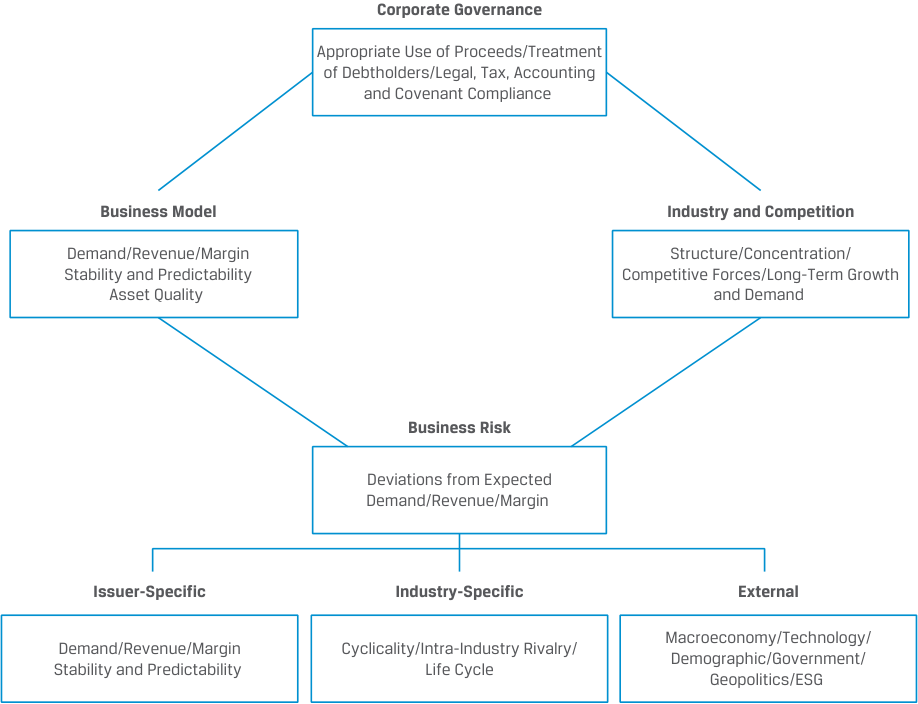
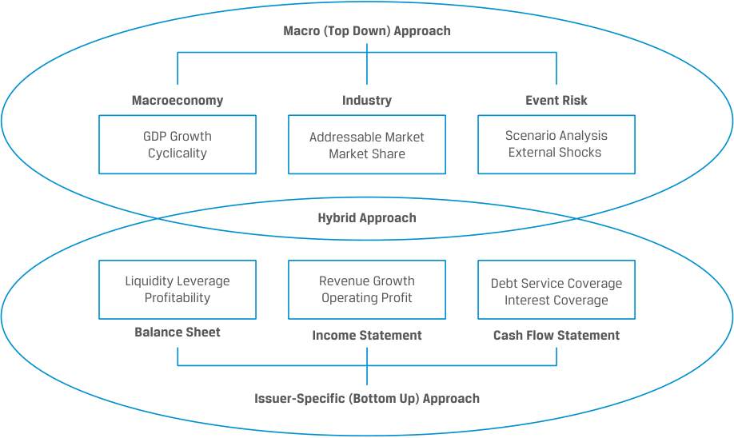

# Volume 6: Fixed Income
## Learning Module 16 Credit Analysis for Corporate Issuers
### Part 1/3: Introduction (PDF Pages 421–430)

---

<!-- PDF Page 421 -->

# L E A R N I N G M O D U L E **<mark>16</mark>** 

### **Credit Analysis for Corporate Issuers** 

##### **<mark>LEARNING OUTCOMES</mark>** 

- **_Mastery The candidate should be able to:_** describe the qualitative and quantitative factors used to evaluate a corporate borrower’s creditworthiness calculate and interpret financial ratios used in credit analysis describe the seniority rankings of debt, secured versus unsecured debt and the priority of claims in bankruptcy, and their impact on credit ratings 

#### **INTRODUCTION** 

**<mark>1</mark>** 

In this learning module, we focus on the relative creditworthiness of non-financial corporate borrowers, building on earlier learning modules on corporate issuers as well as the earlier fixed-income module on credit risk and its components. 

In particular, we assess a company’s activities, or its business model, and how this affects the company’s ability to meet its debt obligations. While a company’s probability of default (POD) and loss given default (LGD) are not directly observable, in the first lesson we consider qualitative and quantitative factors that affect these credit risk components. Financial statement analysis and cash flow projections are important tools used to conduct corporate credit analysis. The second lesson applies these tools to calculate and interpret a variety of financial ratios, including profitability, leverage, and coverage metrics, to assess an issuer’s probability of default. The seniority rankings of specific debt issues and use of collateral are of particular importance in determining credit ratings for a corporate issue and assessing the LGD in an event of default, which is addressed in the third and final lesson. 

###### **LEARNING MODULE OVERVIEW** 

- The credit risk of a borrower can be evaluated using qualitative and quantitative criteria that affect a company’s likelihood of default and the investor’s loss in the event of a default. 

<!-- PDF Page 422 -->

- Qualitative factors important in gauging creditworthiness include a company’s business model, its industry, and its competitive position and business risks, as well as its corporate governance 

- Quantitative factors in measuring creditworthiness involve financial statement analysis and forecasts, which use profitability, liquidity, leverage, and coverage measures to gauge a company’s ability to meet its fixed debt obligations. 

- Financial ratios are a critical tool used to assess the financial health of a company, identify trends over time, and compare companies within and across industries. 

- Seniority rankings determine the priority of claims on an issuer’s assets and are important determinants of the loss given default for a specific issue. Rating agencies typically provide both issuer and issue ratings for corporate credit. 

- While an issuer credit rating captures the probability of default or expected loss of the issuer’s senior unsecured bonds, an issue rating refers to specific financial obligations of an issuer and takes such factors as seniority into account. 

###### **LEARNING MODULE SELF-ASSESSMENT** 

1. Which of the following is _<u>not</u>_ a characteristic of higher corporate creditworthiness? 

   - **A.** Lower leverage 

   - **B.** Higher coverage 

   - **C.** Lower liquidity 

   - **Solution:** 

The correct answer is C. All else held equal, a company with higher liquidity has a greater ability to meet its short-term obligations, including debt interest and principal. 

2. All else being equal, a borrower will have higher capacity to repay its debt in an industry where the: 

   - **A.** barriers to entry are higher. 

   - **B.** threat of substitutes is higher. 

   - **C.** bargaining power of buyers is higher. 

   - **Solution:** 

The correct answer is A. An industry with higher barriers to entry tend to have lower threat of new entrants and lower competition. All else being equal, a borrower in such an industry has higher capacity to support its debt. 

3. Identify the key credit metrics used in credit analysis: 

EBIT margin. 

Debt/EBITDA. 

<!-- PDF Page 423 -->

###### EBIT/interest expense. 

|1. Coverage metric|
|---|
|2. Leverage metric|
|3. Profitability metric|

###### **Solution:** 

|1. Coverage metric|**C. EBIT/interest expense**|
|---|---|
|2. Leverage metric|**B. Debt/EBITDA**|
|3. Profitability metric|**A. EBIT margin**|

4. Companies X, Y, and Z belong to the same industry with the following financial ratios: 

||**Company X**|**Company Y**|**Company Z**|
|---|---|---|---|
|EBITDA margin|15%|18%|18%|
|Free cash flow (FCF) after dividends/||||
|l debt|10%|10%|8%|
|Debt/EBITDA|1.5|1.5|1.8|
|Debt/capital|35%|35%|38%|
|EBITDA/interest|5.6|6.2|6.2|

Based on the following financial ratios only, which company has the lowest credit risk? 

- **A.** Company X 

- **B.** Company Y 

- **C.** Company Z 

###### **Solution:** 

The correct answer is B. Compared to Company X, Company Y has similar leverage metrics but better profitability and coverage. Compared to Company Z, Company Y has similar profitability and coverage but better leverage ratios. Also, when viewing all the metrics, Company Y has either the same value or better than the other two companies. Therefore, Company Y has the lowest credit risk among the three companies. 

5. Rank the recovery rate of the following bonds in the capital structure of a company in bankruptcy from the highest to the lowest: 

   - Junior subordinated debt 

   - Senior unsecured debt 

   - Subordinated debt 

   - Second lien debt 

   - First lien debt 

###### **Solution:** 

**1.** First lien debt 

**2.** Second lien debt 

**3.** Senior unsecured debt 

<!-- PDF Page 424 -->

   **4.** Subordinated debt 

   **5.** Junior subordinated debt 

6. Two senior unsecured bonds of the same issuer of different maturities have the same: 

   - **A.** issue credit rating only. 

   - **B.** issuer credit rating only. 

   - **C.** issuer and issue credit rating. 

   - **Solution:** 

The correct answer is C. An issuer rating usually applies to its senior unsecured debt and is meant to address an obligor’s overall creditworthiness. All senior unsecured bonds are treated as one class and rank pari passu irrespective of maturity. Therefore, both the issuer and the issue credit ratings are the same. 

## **<mark>2</mark>** 

#### **ASSESSING CORPORATE CREDITWORTHINESS** 

describe the qualitative and quantitative factors used to evaluate a corporate borrower’s creditworthiness 

A company’s creditworthiness depends primarily on its ability to generate profits and cash flow sufficient to meet interest and principal payments. Analysts rely on both qualitative and quantitative factors to evaluate both the likelihood of corporate default as well as an investor’s loss in the event of a default. While several different analytical models measure credit risk, here we focus on broad qualitative and quantitative factors. 

##### **Qualitative Factors** 

Earlier Corporate Issuer learning modules covered many of the key qualitative factors used to gauge a company’s ability to satisfy its debt obligations, which include a company’s business model and the industry within which it operates, as well as the competitive forces and business risks it faces. These factors are summarized in Exhibit 1. 

<!-- PDF Page 425 -->

**Exhibit 1: Qualitative Factors in Corporate Creditworthiness** 

<!-- Start of picture text -->
Corporate Governance Appropriate Use of Proceeds/Treatment of Debtholders/Legal, Tax, Accounting and Covenant Compliance Business Model Industry and Competition Demand/Revenue/Margin Structure/Concentration/ Stability and Predictability Competitive Forces/Long-Term Growth Asset Quality  and Demand Business Risk Deviations from Expected Demand/Revenue/Margin Issuer-Specific Industry-Specific External Macroeconomy/Technology/ Demand/Revenue/Margin Cyclicality/Intra-Industry Rivalry/ Demographic/Government/ Stability and Predictability  Life Cycle Geopolitics/ESG <!-- End of picture text -->

Financial analysts evaluating a company’s business model, its industry, and its competitive position and business risks from a debtholder’s perspective must not only consider whether a firm generates an acceptable return over its cost of capital, but also whether the timing and size of cash flows are sufficient to adequately cover debt obligations. 

Established firms with a business model characterized by stable and predictable cash flows, low business risk, and less-competitive pressures have a higher capacity to use debt in their capital structure and a lower likelihood of default than those firms with lower and less stable cash flows, higher business risk, and/or greater competition. In contrast to an equity analyst’s valuation of all future cash flows, fixed-income analysts often focus on how a company’s creditworthiness may change over time given the finite nature of short- and long-term debt claims, as shown in the following example. 

###### **EXAMPLE 1** 

##### **Qualitative Factors Affecting BRWA Creditworthiness** 

Bright Wheel Automotive (BRWA), a hypothetical auto manufacturing firm mentioned in an earlier lesson, has a product line based on traditional internal combustion engine (“ICE”) technology. Having introduced its first electric vehicle (EV) two years ago, which comprises 5% of current revenue, BRWA’s management has ambitious plans to convert over half of its models to all-electric over the coming decade, while adopting hybrid (ICE and electric) technology for its remaining fleet over the same period. BRWA’s debt profile as an investment-grade corporate issuer is as follows: 

<!-- PDF Page 426 -->

<!-- Start of picture text -->
Debt Outstanding/ Availability 0.12% BRWA 150-day Commercial Paper Unsecured 364 Day Facility Unsecured 3.2% BRWA 3-year Five-Year Revolving Notes Credit Facility 3.95% BRWA Fifteen-Year Notes Years to 1 2 5 10 30 Maturity <!-- End of picture text -->

Qualitative factors, including BRWA’s business model, industry, and competition and business risk, affect the creditworthiness of its outstanding 150-day commercial paper, five-year notes and fifteen-year notes. 

BRWA’s planned shift to a mostly EV-based product line over the next decade mirrors changes announced by other global automobile producers as policymakers seek to reduce vehicle emissions in the wake of climate change. The impact of BRWA’s business model, industry, and competitive forces and business risk on its outstanding debt may be described as follows: 

_Business Model:_ BRWA’s established customer base and acclaimed ICE vehicle lineup have enabled it to maintain stable revenue growth and profitability to date, but the company’s technology and products must evolve over time to meet EV market demand. This business model change results in higher business risk. 

_Industry and Competitive Environment:_ BRWA faces growing competition within a fragmented global auto industry, with some competitors moving faster in establishing EV market share. Competition will intensify as other traditional ICE producers pursue a similar EV strategy amid potentially lower barriers to entry for pure EV companies, such as Tesla and software technology companies. 

_Business Risk:_ The execution risk of the EV strategy significantly increases BRWA’s business risk. This is because the EV technology platform is not based on ICE technology, but rather on the integration of batteries, hardware, and software, increasing the bargaining power of BRWA’s supplier base. 

Consider BRWA’s debt outstanding as follows: 

_Commercial Paper:_ Commercial paper investors face little to no exposure to BRWA’s long-term business strategy given the very short tenor of this debt. Investors will primarily focus on the company’s liquidity position based upon its existing ICE revenue base when assessing credit risk. 

_Five-Year Notes:_ Investors in BRWA’s medium-term bonds face growing exposure to the greater competitive pressures and business risk associated with BRWA’s EV strategy, but the company expects to generate most of its revenue from its traditional ICE customer base when the bond matures. 

<!-- PDF Page 427 -->

_Fifteen-Year Notes:_ Investors in BRWA’s long-term bonds face the greatest risk to the company’s EV strategy and the associated competitive pressures and elevated business risk, as the company will make later interest and principal payments from cash flows that depend upon a successful EV transition. 

The BRWA debt issues highlighted in Example 1 are for general, unsecured claims where company cash flows are the primary source of repayment. Secured debt, on the other hand, designates specific company assets as collateral as a secondary source of interest and principal payments. While the quality of a company’s assets is an important factor for both unsecured and secured debt, secured lenders prefer to have tangible (or hard collateral) rather than intangible (or soft collateral) assets promised or pledged to secure debt. The value of collateral is most relevant for companies with lower credit quality and of greatest importance to creditworthiness when a borrower’s POD rises to a level where the collateral is necessary to protect the exposure. Tangible assets are identifiable physical assets like property, plant and equipment, inventory, cash, and marketable securities, whereas intangible assets include patents, intellectual property rights, and goodwill. The use of collateral and secured debt can either reduce the cost of borrowing versus unsecured alternatives or offer corporate issuers access to debt markets that may otherwise not be available at all, as in the case of the following example. 

###### **EXAMPLE 2** 

##### **Royal Caribbean Cruise Lines Secured Debt** 

In the wake of the COVID-19 pandemic, Royal Caribbean Cruises Ltd. (RCL) suspended its cruise operations in March 2020. Given the uncertainty surrounding the length and severity of the health crisis, RCL took immediate steps to enhance liquidity, preserve cash, and obtain additional financing. 

The first of several RCL financings in that year took place in May 2020, when the company initiated a private offering of $3.3 billion in senior secured notes due in 2023 and 2025. The notes were secured by 28 of Royal Caribbean’s fleet of over 60 vessels and also included material intellectual property of the company. RCL used the proceeds of the bond to repay a $2.35 billion 364-day senior secured term loan agreement, with the remainder of the bond proceeds available for general corporate purposes. While the continued suspension of cruises due to the ongoing pandemic led to subsequent RCL convertible bond and equity issuances later in the year, the initial issuance of secured debt at the outset of the COVID-19 crisis represented a cost-effective alternative for the company to preserve liquidity and financial flexibility in the near term by pledging its tangible assets as collateral. Despite the increase in RCL’s POD due to the pandemic, investors were willing to provide debt financing in part due to the reduced LGD of the secured notes. 

Corporate governance is an important qualitative factor to consider when evaluating corporate creditworthiness. While the assessment of an individual borrower’s character is a common element of consumer credit analysis, it is more difficult in practice to evaluate management’s character and the expected treatment of debtholders for a publicly owned corporation or one that is privately held by investors and private equity firms. Unlike equity investors with voting rights on important company matters, debtholders seek to specify the use of debt proceeds as well as any borrower restrictions at the time of issuance. 

<!-- PDF Page 428 -->

Highly rated issuers of unsecured debt are usually able to raise debt proceeds for general corporate purposes with few restrictions that usually include affirmative covenants only, such as compliance with applicable laws and regulations, maintaining current lines of business, insuring and maintaining company assets, and paying taxes. Credit analysts must evaluate management signals to make appropriate judgments about the treatment of debtholders versus shareholders and the potential for dilution. 

For high-yield issuers of secured debt, investors usually impose additional restrictions to protect bondholders if an issuer’s financial condition deteriorates, including covenants restricting dividends or additional debt as well as financial covenants. Management’s past track record in the treatment of bondholders is an important consideration. For example, if management pursued business or financial strategies that resulted in major credit rating downgrades—such as an overleveraged debt-financed acquisition, a large debt-financed special dividend to shareholders, or a major debt-financed stock buyback program—credit analysts should look closely at the borrower’s character. 

As in the case of equity analysts, credit analysts should also evaluate accounting policies. Aggressive accounting policies mask the performance and the risk of the underlying business and are potential warning flags to the true character of the business and its leaders. Examples may include the use of significant off-balance-sheet financing, the preference for capitalizing versus immediately expensing items, and early and premature revenue recognition. Perhaps the most important red flag is changing auditors or CFOs frequently. These potential warning flags, as well as any evidence of fraud or malfeasance, may signal other behaviors or actions that may adversely impact an issuer’s creditworthiness. A well-known example of accounting fraud is provided below in Example 3. 

###### **EXAMPLE 3** 

##### **Wirecard AG’s Accounting Fraud** 

Wirecard AG, a German payments firm that processed credit card and online payments, enjoyed a meteoric rise following its 2005 listing on the Frankfurt Stock Exchange. It joined the DAX index of the 30 most valuable companies in Germany and reached a peak market capitalization of over EUR27 billion in 2018 before filing for insolvency in June 2020. 

A qualitative analysis of its management strategy and accounting policy in the years prior to insolvency raises the following red flags about the company’s character: 

After Wirecard received a banking license in 2006, it showed a significant revenue growth and a rapid international expansion through acquiring legitimate existing businesses, such as Citibank’s Asia-Pacific credit card processing arm. 

Wirecard’s opaque and overly complex business model masked rapidly rising revenue and profit figures, giving rise to market rumors of suspicious transactions and money laundering. 

While the company claimed thousands of small and medium-sized business customers and dozens of partners globally as sources of revenue growth, just three third-party partner companies provided a large share of Wirecard’s reported revenue and most of its profits. Additionally, many of the firm’s assets were held through external offshore trust accounts. 

Wirecard used its bank subsidiary as a lender to fintech partner companies, as evidenced by the following excerpt from its half-year financial report dated 30 June 2019: 

<!-- PDF Page 429 -->

“Wirecard does not only provide risk management, technology, and banking services (to its fintech partner companies) but also sometimes provides the financing based on detailed individual assessments and suitable security measures – often in the form of cash securities. This enables the Group, on the one hand, to increase the added value from its cooperation with FinTech companies and, on the other, to also significantly increase interest income.” 

The company filed for insolvency in June 2020 when auditors could not confirm the existence of EUR1.9 billion in cash, which comprised the bulk of Wirecard’s profits. It was later discovered that Wirecard’s revenue was deposited in escrow accounts held by third-party trustees, rather than paid to the company itself. 

After Wirecard was declared insolvent with debts of EUR3.2 billion, its share price immediately fell by over 70% and the price of its unsecured bonds fell to 20 cents per EUR. CEO Markus Braun was arrested and later charged with fraud, breach of trust, and accounting manipulation following a criminal investigation. It was the biggest accounting fraud and bankruptcy in Germany’s post-World War II corporate history. 

###### **_Quantitative Factors_** 

Financial statement modeling and forecasting are a quantitative expression of analyst expectations for a company’s future performance. Model inputs are based on an understanding of a company’s fundamental business drivers and an assessment of future risks and opportunities. These inputs are derived using a top-down, macroeconomic or a bottom-up, issuer-specific approach at the company level. In contrast to equity models, which seek to value a firm’s stock based upon all cash flows available to shareholders, quantitative credit analysis aims to estimate the likelihood that a company can meet its debt obligations in the future. Exhibit 2 summarizes key quantitative factors used to measure a corporate issuer’s credit risk. 

###### **Exhibit 2: Quantitative Approaches in Corporate Credit Risk Assessment** 

<!-- Start of picture text -->
Macro (Top Down) Approach Macroeconomy Industry Event Risk GDP Growth Addressable Market Scenario Analysis Cyclicality Market Share External Shocks Hybrid Approach Liquidity Leverage Revenue Growth Debt Service Coverage Profitability Operating Profit Interest Coverage Balance Sheet Income Statement Cash Flow Statement Issuer-Specific (Bottom Up) Approach <!-- End of picture text -->

<!-- PDF Page 430 -->

Top-down analysis typically begins with a macroeconomic forecast, gauging a company’s growth relative to GDP, addressing a firm’s addressable market and market share, and assessing the likelihood and impact of possible adverse events that may be incorporated in a scenario analysis. For example, the economic cycle has a relationship with the timing and severity of the credit cycle; thus, the credit cycle’s expected impact on a specific company or industry is commonly used to gauge credit risk on a macro level. Bottom-up analysis involves forecasting key revenue drivers and balance sheet positions, while a hybrid approach might combine expected cyclicality with changing bottom-up features to forecast a company’s cash flows. The goal of quantitative analysis is to identify key factors that drive a corporate issuer’s POD and how they change over the credit cycle. These include the following factors: 

_Profitability:_ Strong and stable earnings are important in generating the cash flows that are a primary source of debt repayment. Analysts gauging a company’s ability to make periodic fixed debt payments typically focus on operating profits and recurring revenues as opposed to non-recurring or one-time gains. Macro factors, such as an expected economic downturn for cyclical companies or a declining market share, can adversely impact future profitability. 

_Leverage:_ Financial leverage measures a company’s relative reliance on debt financing in its operations. Measures of leverage typically compare the total level of debt to a firm’s resources as gauged by assets, capital, or a measure of profitability or cash flow. Given the fixed nature of debt claims, debt investors prefer lower leverage—that is, more resources per unit of debt— while equity investors usually benefit from more debt and higher financial leverage. 

_Coverage:_ Lenders gauge creditworthiness by comparing periodic income measures or cash flows to debt service (interest and principal), interest, or debt-like payments, which include leases. Greater coverage means that debt investors benefit from higher income or cash flows from which fixed debt obligations can be paid. 

_Liquidity:_ Debtholders evaluating near-term debt obligations for issuers with less stable cash flows often consider the availability of short-term resources to pay interest or principal. While a firm may be solvent (i.e., have assets in excess of liabilities and equity), it may nevertheless fail to meet its fixed obligations if it lacks cash or assets that can be readily converted into cash, such as marketable securities. Measures of liquidity also include committed bank facilities if a corporate borrower has the contractual right to draw down cash for the period in question. 

The calculation and interpretation of these quantitative factors using financial ratios is addressed in the next lesson. While investors in senior unsecured investment-grade debt are almost solely focused on POD, high-yield investors in companies that use subordination in their debt structure and/or collateral as a secondary source of repayment also consider historical LGD rates and other factors in assessing credit risk, which is the subject of the third lesson. 

###### **QUESTION SET** 

1. Match the key quantitative factors: 

   - Coverage 

   - Leverage 

   - ■ Liquidity 

