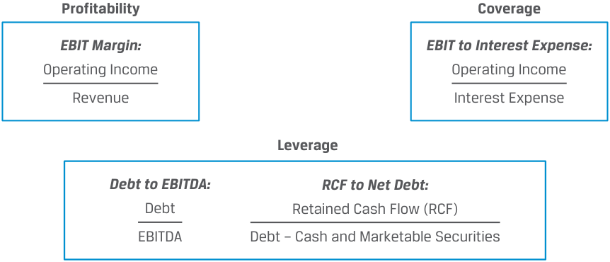
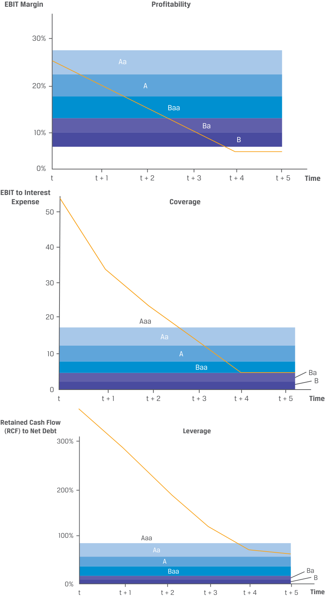

# Volume 6: Fixed Income
## Learning Module 16 Credit Analysis for Corporate Issuers
### Part 2/3: Financial Ratios in Corporate Credit Analysis (PDF Pages 431–446)

---

<!-- PDF Page 431 -->

- Relative reliance on debt to finance operations Borrower ability to meet short-term obligations Comparison of periodic earnings or cash flow to debt service **Solution:** 

- Relative reliance on debt to finance operations **Leverage** Borrower ability to meet short-term obligations **Liquidity** Comparison of periodic earnings or cash flow to debt service **Coverage** 

- 2. **Determine the correct answers to fill in the blanks:** Secured lenders prefer to have _______ assets (or _____ collateral) rather than _______ assets (or _____ collateral) promised or pledged to secure debt. **Solution:** Secured lenders prefer to have _tangible_ assets (or _hard_ collateral) rather than _intangible_ assets (or _soft_ collateral) promised or pledged to secure debt. 

- 3. Which of the following statements about shareholders and debtholders is <u>not true?</u> **A.** Both shareholders and debtholders benefit from higher profitability. **B.** Shareholders generally benefit from higher leverage, while debtholders prefer lower leverage. 

- **C.** Both shareholders and debtholders benefit from lower coverage. 

- **Solution:** The correct answer is C. Both shareholders and debtholders benefit from <u>higher coverage, which is the income or cash flow available to pay debt</u> service. 

- 4. **Determine the correct answers to fill in the blanks:** Firms with a business model characterized by stable and predictable cash flows, _____ business risk, and _____ competitive pressures have a higher capacity to use debt in their capital structure and a lower likelihood of default. **Solution:** Firms with a business model characterized by stable and predictable cash flows, _low_ business risk, and _less_ competitive pressures have a higher capacity to use debt in their capital structure and a lower likelihood of default. 

calculate and interpret financial ratios used in credit analysis 

<!-- PDF Page 432 -->

The use of financial ratios based upon the quantitative factors outlined in the prior lesson allows credit analysts to assess the relative financial health of a company, identify trends over time, and compare companies within and across industries with a focus on profitability, coverage, and leverage. Common financial ratios used to evaluate a corporate issuer’s credit risk are outlined in Exhibit 3. 

**Exhibit 3: Key Financial Ratios for Corporate Creditworthiness** 

<!-- Start of picture text -->
Profitability Coverage EBIT Margin: EBIT to Interest Expense: Operating Income Operating Income Revenue Interest Expense Leverage Debt to EBITDA: RCF to Net Debt: Debt Retained Cash Flow (RCF) EBITDA Debt – Cash and Marketable Securities <!-- End of picture text -->

In general, credit risk analysis using profitability, coverage, and leverage ratios seeks to establish a firm’s ability to service cash flows from operating activities, as opposed to asset disposals or financing activities. Cash flow measures used in credit analysis, such as free cash flow (FCF, or net income less working capital increases, investment in fixed assets, and net interest paid), funds from operations (FFO, or net income from continuing operations, depreciation and amortization, deferred income tax, and other non-cash items), or retained cash flow (RCF, or net cash flow from operating activities less dividends paid) are more conservative than others because they make certain adjustments for cash used in managing and maintaining the business or distributed to shareholders. Debt and interest expense measures used in credit analysis also may be adjusted for operating leases, debt-like fixed lease payments, and/or other fixed off-balance-sheet obligations that impact a company’s ability to service its debt. 

These measures and the ratios developed based upon these measures are non-IFRS in the sense that they do not have official IFRS definitions; the concepts, names, and definitions given should be viewed as one usage among several possible, in most cases. 

_EBIT Margin:_ Credit analysts focus on EBIT (earnings before interest and taxes) to determine a company’s operating performance prior to capital costs and taxes, since interest expense is paid before income taxes are calculated. In some cases, EBITDA (or earnings before interest, taxes, depreciation, and amortization expense) is used as a broader measure, which adds back (non-cash) depreciation and amortization expense. Higher EBIT margins increase profits available to service debt. 

_EBIT to Interest Expense:_ This measures the degree to which operating profit covers periodic interest payments, with a higher coverage ratio representing less credit risk. In some cases, the numerator is changed to include depreciation and amortization (EBITDA) as well as rental expense (EBITDAR), while the denominator may be increased to include lease payments or reduced by interest earned on marketable securities and cash. 

_Debt to EBITDA:_ Leverage ratios are often expressed with debt either in the numerator or denominator, so care must be taken to reflect whether a greater or lesser number reflects increased leverage. For example, a higher debt-to-EBITDA ratio represents higher leverage, and debt may be adjusted to reflect operating leases or off-balance-sheet commitments. Rating agencies often use it as a trigger for rating 

<!-- PDF Page 433 -->

actions, and banks reference it in loan covenants. A higher ratio indicates more leverage and thus higher credit risk. Note that this ratio can be very volatile for companies with high cash flow variability, such as those in cyclical industries and with high operating leverage (fixed costs). 

_Retained Cash Flow (RCF) to Net Debt:_ Use of cash flow rather than earnings measures is also common in measuring leverage, while here the debt measure is reduced by available cash. A higher RCF to net debt measure implies lower leverage. 

While financial ratios used in credit analysis vary across industries, the values of financial ratios themselves for a given rating or level of credit quality may also range widely across industries due to different business models, competitive pressures, and other factors. 

Credit analysts use financial modeling to evaluate how these ratios might change over time as revenue drivers change, as in the following example: 

#### **EXAMPLE 4** 

### **Bowstream Corporation Credit Risk Assessment** 

A credit analyst has created a financial statement model to evaluate the credit risk of Bowstream Corporation, a mid-sized, investment-grade consumer durables company. While Bowstream’s most recent financial results show a solid 10% sales growth and a robust 35% operating profit margin, the analyst would like to assess Bowstream’s performance under a downside scenario where the company’s production and interest costs rise due to inflation amid slower sales growth. Model assumptions used for Bowstream’s sales growth, cost of goods sold as a percentage of sales, interest rates, and debt growth over the next five years are as follows: 

||**Reported** **Year 0**|**Projected** **Year 1**|**Year 2**|**Year 3**|**Year 4**|**Year 5**|
|---|---|---|---|---|---|---|
|Sales growth|10%|5%|5%|5%|5%|5%|
|Cost of goods sold/Sales|65%|70%|75%|80%|85%|85%|
|Interest rate on|||||||
|debt|6%|7%|7%|7%|8%|8%|
|Debtgrowth rate|10%|10%|10%|10%|10%|10%|

Selected financial data and projections from these three-statement model results based on these assumptions and stable ratios of balance sheet and other positions to sales are as follows: 

|**Income Statement**|**Year 0**|**Year 1**|**Year 2**|**Year 3**|**Year 4**|**Year 5**|
|---|---|---|---|---|---|---|
|**Sales**|**5,225**|**5,486**|**5,761**|**6,049**|**6,351**|**6,669**|
|Cost of goods sold **i**|(3,396)|(3,840)|(4,320)|(4,839)|(5,398)|(5,668)|
|**Gross profit**|**1,829**|**1,646**|**1,440**|**1,210**|**953**|**1,000**|
|_Gross profit (%)_|35%|30%|25%|20%|15%|15%|
|Selling, general, and administrative|(499)|(524)|(550)|(577)|(606)|(637)|
|Interest payments on debt|(38)|(46)|(51)|(56)|(72)|(83)|
|Interest earned on cash and mktable sec|12|12|12|12|12|12|
|Depreciation|(400)|(467)|(517)|(547)|(559)|(552)|

<!-- PDF Page 434 -->

|**Income Statement** |**Year 0**|**Year 1**|**Year 2**|**Year 3**|**Year 4**|**Year 5**|
|---|---|---|---|---|---|---|
|**Profit before tax**|**905**|**621**|**335**|**41**|**(273)**|**(259)**|
|**i** Taxes|(317)|(217)|(117)|(14)|95|90|
|**Net income**|**588**|**404**|**218**|**27**|**(177)**|**(168)**|
|_Net income (% of sales)_|11%|7%|4%|0%|−3%|−3%|
|Dividends|(118)|(81)|(44)|(5)|—|—|
|**Retained earnings**|**470**|**323**|**174**|**21**|**(177)**|**(168)**|
|**Balance Sheet**|**Year 0**|**Year 1**|**Year 2**|**Year 3**|**Year 4**|**Year 5**|
|**Cash and marketable**|||||||
|**securities**|400|400|400|400|400|400|
|**Current assets**|627|658|691|726|762|800|
|Fixed assets|||||||
|Cost basis|5,993|6,840|7,594|8,233|8,735|9,256|
|Accumulated depreciation **i**|(2,400)|(2,867)|(3,383)|(3,931)|(4,490)|(5,042)|
|**Net fixed assets**|3,593|3,973|4,211|4,303|4,244|4,214|
|**Total assets:**|**4,620**|**5,032**|**5,302**|**5,428**|**5,407**|**5,414**|
|**Current liabilities**|523|549|576|605|635|667|
|**Debt**|627|690|759|835|960|1,104|
|**Stock (225 shares issued** **@ 10)**|2,250|2,250|2,250|2,250|2,250|2,250|
|**Accumulated retained** **earnings**|1,220|1,543|1,718|1,739|1,562|1,394|
|**Total liabilities and** **equity**|**4,620**|**5,032**|**5,302**|**5,428**|**5,407**|**5,414**|
|**Consolidated Statement of**|||||||
|**Cash Flows**|**Year 0**|**Year 1**|**Year 2**|**Year 3**|**Year 4**|**Year 5**|
|Net cash from operating activities|978|866|729|568|376|377|
|Net cash used in investing activities|(918)|(847)|(754)|(639)|(501)|(521)|
|Net cash from financing|||||||
|i activities|(61)|(18)|25|71|125|144|

The analyst uses data from these three-statement model results to solve for recent and projected profitability, coverage, and leverage ratios in Exhibit 3: 

||**Year 0**|**Year 1**|**Year 2**|**Year 3**|**Year 4**|**Year 5**|
|---|---|---|---|---|---|---|
|EBIT|1,330|1,122|890|632|346|364|
|EBITDA|1,730|1,589|1,407|1,180|906|916|
|FFO (Net cash from operating activities)|978|866|729|568|376|377|
|RCF (FFO − Dividends)|861|785|685|563|376|377|
|EBIT margin|25%|20%|15%|10%|5%|5%|
|EBIT to Interest expense|51.9|32.9|23.0|14.4|5.8|5.2|

<!-- PDF Page 435 -->

||**Year 0**|**Year 1**|**Year 2**|**Year 3**|**Year 4**|**Year 5**|
|---|---|---|---|---|---|---|
|Debt to EBITDA|0.36|0.43|0.54|0.71|1.06|1.21|
|RCF to Net debt|379%|271%|191%|130%|67%|54%|

Under this scenario, Bowstream faces declining profitability (as EBIT margin falls), weaker debt coverage (lower EBIT-to-interest expense), and increased leverage (a higher debt to EBITDA and lower RCF to net debt), which is likely to lead to wider credit spreads and a potential ratings downgrade. 

In order to measure these changes, analysts often compare existing and projected ratios to industry and credit rating peers to determine expected future credit quality changes as categorized by expected rating. For example, consider the following comparisons based upon Moody’s ratings methodology and these ratios for consumer durables: 

<!-- PDF Page 436 -->

<!-- Start of picture text -->
EBIT Margin Profitability 30% Aa 20% A Baa Ba 10% B 0% t t + 1 t + 2 t + 3 t + 4 t + 5 Time EBIT to Interest Expense Coverage 50 40 30 20 Aaa Aa 10 A Baa Ba B 0 t t + 1 t + 2 t + 3 t + 4 t + 5 Time Retained Cash Flow (RCF) to Net Debt Leverage 300% 200% 100% Aaa Aa A Baa Ba B 0% t t + 1 t + 2 t + 3 t + 4 t + 5 Time <!-- End of picture text -->

<!-- PDF Page 437 -->

|**Debt to**|3x 2x 1x **EBITDA** Aa A Baa **Leverage**|
|---|---|
||0 Aaa|
|_Source:_  for Rati|**Time** t t + 3 t + 4 t + 2 t + 1 t + 5 Moody’s Investors Service, “Methodology Announcement: Moody’s Updates Its Methodology ng Consumer Durables Companies” (10 September 2021).|
|**QUES**|**TION SET**|
|1. Ide of|ntify the key credit analysis ratios that correspond to the types metrics:|
|**A.**|RCF/Debt|
|**B.**|EBITDA/Interest Expense|
|**C.**|Debt/Capital|
|**D.**|EBITDA|
|**E.**|Debt/EBITDA|
|**F.**|FCF|
|**G.**|EBIT/Interest Expense|
|**1.**|Profitability and cash flow metrics|
|**2.**|i   l Leverage metrics|
|**3.**|Coverage metrics|
|**Sol**|**ution**:|
|**1.**|Profitability and cash flow metrics: D, F|
|**2.**|i   l Leverage metrics: A, C, E|
|**3.**|Coverage metrics: B, G|
|2. Sta The **Sol**|te true or false to the following statement and explain your reasoning: h higher the coverage ratios, the higher the credit risk of the borrower. **ution:**|
|Fal h|se. Coverage ratios measure an issuer’s ability to cover its interest h|
|pay h bor|ments. The higher the coverage ratios, the_lower_the credit risk of the rower.|

_Source:_ Moody’s Investors Service, “Methodology Announcement: Moody’s Updates Its Methodology for Rating Consumer Durables Companies” (10 September 2021). 

<!-- PDF Page 438 -->

3. Calculate FFO/debt based on the following financial information: 

|Net income from continuing operations|180|
|---|---|
|Depreciation & amortization|30|
|Deferred income taxes|18|
|Other non-cash items|28|
|Increase in working capital|(52)|
|Dividend paid|(60)|
|Capital expenditure|(100)|
|Debt|1,280|

#### **Solution:** 

FFO = Net income from continuing operations + Depreciation & amortization + Deferred income taxes + Other non-cash items = 180 + 30 + 18 + 28 = 256. 

FFO/debt = 256/1,280 = 0.2 or 20%. 

4. Company X and Company Y operate in the same industry. Based on the financial information below, which company has lower credit risk? 

||**Company X**|**Company Y**|
|---|---|---|
|EBITDA margin|15%|15%|
|FCF|(20)|20|
|FCF before dividends|(45)|18|
|Debt/EBITDA|2.5|1.6|
|EBITDA/interest expense|3.0|3.5|

#### **Solution:** 

Company Y has lower credit risk. While Company X and Company Y have the same EBITDA margin, Company Y has positive FCF and FCF before dividends, a lower leverage ratio, and a higher coverage ratio than Company X. 

# **<mark>4</mark>** 

## **SENIORITY RANKINGS, RECOVERY RATES, AND CREDIT RATINGS** 

- describe the seniority rankings of debt, secured versus unsecured debt and the priority of claims in bankruptcy, and their impact on credit ratings 

The debt obligations of a corporate borrower often have different seniority rankings. Some companies and industries have straightforward capital structures, with all the debt equally ranked and issued by one main operating entity. Other companies and industries, due to acquisitions and divestitures (e.g., media companies or conglomerates) or regulation (e.g., banks and utilities), have more complex debt structures. Firms 

<!-- PDF Page 439 -->

in these industries often have many different subsidiaries, or operating companies, that have their own debt outstanding and parent holding companies that also issue debt with different seniority levels. 

### **Seniority Rankings** 

A seniority ranking refers to the priority of payment, with the most senior or highest-ranking debt having the first claim on the cash flows and assets of the issuer. The level of seniority affects the value of an investor’s claim in the event of default and restructuring. Secured debt involves a debtholder claim—a pledge from the issuer—to certain assets and their associated cash flows. This collateral reduces the lender’s potential loss in the event of default, as the lender may take possession of and sell these assets to offset their losses. Seniority rankings involving secured and unsecured debt are shown in Exhibit 4. 

**Exhibit 4: Seniority Rankings** 

<!-- Start of picture text -->
Seniority Highest Ranking First Lien/Mortgage Secured Debt (Lower LGD) Senior Secured Bondholder has  direct claim on certain assets Junior Secured and associated cash flows Senior Unsecured Unsecured Debt Senior Subordinated (Higher LGD) Bondholder has  general Subordinated claim on certain assets and associated cash flows Junior Subordinated Lowest Ranking <!-- End of picture text -->

### **Secured versus Unsecured Debt** 

First mortgage and first lien debt are ranked highest among secured creditors in terms of priority of repayment. **First mortgage debt** or loan refers to the pledge of specific property (e.g., a power plant for a utility). **First lien debt** or loan refers to a pledge of certain assets that could include buildings but might also include property and equipment, licenses, patents, brands, or inventory. As the name implies, _second lien_ secured debt has a secured interest in the pledged assets that ranks below first lien debt in both collateral protection and priority of payment. Most second lien loans are senior secured obligations of the borrower, which rank above junior secured obligations. 

Unsecured bondholders have only a general claim on an issuer’s assets and cash flows. In the event of default, unsecured debtholders’ claims rank below (i.e., get paid after) those of secured creditors under what is known as the **priority of claims** . 

<!-- PDF Page 440 -->

The highest-ranked unsecured debt is **senior unsecured debt** . It is the most common type of corporate bond, ranking below senior secured debt but above subordinated debt. Other, lower-ranked debt includes **subordinated debt** and junior subordinated debt. Among the various creditor classes, these obligations have the lowest priority of claims and frequently have little or no recovery in the event of default (i.e., an LGD of 100%). 

Different seniority rankings satisfy the needs and demands of both issuers and investors. Issuers seek to optimize their cost of capital—in some cases offering secured debt to meet investor requirements, as in the earlier Royal Caribbean example, and in other cases offering subordinated debt, which is less costly than equity and non-dilutive. The seniority of debt drives decisions in the case of bankruptcy or liquidation. Senior creditors with a secured claim have the right to the value of specific assets before any other claim. If the value of the pledged property is less than the amount of the claim, then the difference becomes a senior unsecured claim. Senior unsecured creditors take priority over all subordinated creditors, who in turn have the right to be paid in full before shareholders receive any compensation. Example 5 shows differences in repayment seniority. 

#### **EXAMPLE 5** 

### **VIVU Bond** 

The 6.5% VIVU seven-year callable notes were introduced earlier in the curriculum. 

|**6.5**|**% Vivivyu Inc. (VIVU) 7-Year Callable Notes**|
|---|---|
|**Issuer:**|Vivivyu Incorporated|
|**Maturity Date:**|7 Years|
|**Principal**|USD400 million|
|**Amount:**||
|**Interest:**|6.5% fixed coupon|
|**Interest Payment:**|i Semi-annual|
|**Seniority:**|The Notes are secured and unsubordinated obligations of VIVU and rank pari passu with all other secured and unsubordinated debt.|
|**Security:**|The Notes are secured by a pledge of certain assets as iden- tified in the Indenture.|

Assume VIVU also has a 10-year subordinated bond outstanding with the following terms: 

|**10.0%**|**Vivivyu Inc. (VIVU) 10-Year Subordinated Notes**|
|---|---|
|**Issuer:**|Vivivyu Incorporated|
|**Maturity Date:**|10 years|
|**Principal**|USD300 million|
|**Amount:**||
|**Interest:**|10.0% fixed coupon|
|**Interest**|i Semi-annual|
|**Payment:**||
|**Seniority:**|The Notes will constitute direct, unsecured, and subordi- nated obligations of the Issuer and shall rank pari passu and without any preference among themselves.|
|**Security:**|None|

<!-- PDF Page 441 -->

While the 6.5% notes are senior secured debts, the 10.0% notes are unsecured subordinated debt. 

In an insolvency or a restructuring event, the 6.5% notes rank highest in the payment priority as they are backed by certain specified assets as a secondary source of repayment. If the value of the collateral falls short of the total amount of pari passu secured debt, the balance will rank pari passu with senior unsecured creditors in insolvency or restructuring. 

The 10.0% subordinated notes rank below senior secured and senior unsecured debt in the priority of claims, but above junior subordinated debts (if any) and shareholders. These notes have among the lowest priority of claims in an event of default and often have the lowest recovery rate. 

### **Recovery Rates** 

All creditors at the same debt seniority level are treated as one class; thus, a senior unsecured bondholder whose debt is due in 30 years has the same pro rata (pari passu) claim in bankruptcy as one whose debt matures in six months. Defaulted debt often continues to trade near the expected recovery rate for bonds expected to enter bankruptcy or liquidation. Recovery rates vary by seniority ranking based upon the priority of claims. 

Historical default data provide statistically meaningful recovery rates by seniority ranking. Exhibit 5 shows recovery rates by seniority ranking for North American non-financial companies. For example, as shown in Exhibit 5, investors recovered 45.9% of the value of defaulted senior secured debt in 2019 but only 31.3% of defaulted senior unsecured issues that year. 

**Exhibit 5: Average Corporate Debt Recovery Rates (%)** 

|||**Emergen**|**ce Year**||**Defaul**|**t Year**|
|---|---|---|---|---|---|---|
|**Priority Position**|**2020**|**2019**|**1987–2020**|**2020**|**2019**|**1987–2020**|
|**Term Loans***|48.5|58.1|72.6|50.1|52.7|86.3|
|**Senior Secured**|||||||
|**Bonds**|34.8|45.9|61.4|34.8|44.6|61.4|
|**Senior Unsecured**|||||||
|**Bonds**|8.6|31.3|46.9|8.6|40.5|46.9|
|**Subordinated** **Bonds**|0.9|24.7|27.9|0.9|24.7|27.9|

_* Includes all types of term loans:_ first, second-lien, unsecured. _Notes:_ Emergence year is typically the year the defaulted company emerges from bankruptcy. Default year data refer to the recovery rate of debt that defaulted in that year (i.e., 2019 and 2020) or range of years (i.e., 1987–2020). Data are for North American nonfinancial companies. _Source:_ Moody’s Investors Service, “Default Trends — Global: Annual Default Study: Following a Sharp Rise in 2020, Corporate Defaults Will Drop in 2021” (28 January 2021). 

Recovery rates: 

**1.** vary widely by industry, 

**2.** vary depending on when they occur in the cycle, and 

**3.** represent averages across industries and companies. 

<!-- PDF Page 442 -->

Companies entering bankruptcy in industries in secular decline usually have lower recovery rates than those merely facing cyclical economic downturn. Exhibit 6 shows the distribution of selected recovery rates between 1983 and 2020 across industries and debt seniority levels. 

**Exhibit 6: Recovery Rates across Selected Industries, 1983–2020, Measured by Trading Prices before Default (%)** 

|||**Senior Unsecured**|**Subordinated**|
|---|---|---|---|
|**Industry Groups**|**1st Lien Bond**|**Bond**|**Bond**|
|Automotive|57.94|46.08|49.46|
|Capital Equipment|62.34|36.69|45.48|
|Energy: Electricity|81.48|58.24|39.45|
|Energy: Oil & Gas|56.55|36.33|39.10|
|Environmental|13.00|29.73|5.44|
|Finance|47.60|45.68|27.80|
|High-Tech Industries|53.51|33.08|23.71|
|Retail|57.78|36.30|21.68|
|Services: Business|71.14|46.83|46.22|
|Telecommunications|56.80|26.22|31.61|
|Average recovery rate*|53.04|41.80|34.69|
|Highest recovery rate*|96.25|92.00|63.56|
|Lowest recovery rate*|7.00|22.18|1.47|

_* Calculated for all the 33 industries identified by Moody’s. Note:_ Average defaulted corporate bond and loan recoveries by selected industries, 1983–2020. _Source:_ Moody’s Investors Service, “Default Trends — Global: Annual Default Study: Following a Sharp Rise in 2020, Corporate Defaults Will Drop in 2021” (28 January 2021). 

Recovery rates also vary depending upon when they occur in the credit cycle. When the economy is strong or improving, robust markets exist for the resale of collateral and recovery rates are therefore higher. Conversely, when the economy is weak or weakening, lenders’ ability to liquidate assets at or near the original value is diminished and recovery rates fall. 

Importantly, these recovery rates are averages, with high variability across industries and companies within a given industry. Factors include the composition and proportion of debt across an issuer’s capital structure. An abundance of secured debt will lead to smaller recovery rates on lower-ranked debt. Understanding recovery rates is important because they are a key component of credit analysis and risk, as shown in the following knowledge check. 

<!-- PDF Page 443 -->

#### **KNOWLEDGE CHECK: EXPECTED LOSS** 

|1. The one-year forward default rate for an issuer in the automotive industry is expected to be 0.8%. What is the expected percentage credit loss of the issuer’s bonds under the historical recovery rate assumptions (see Exhibit 5)?|
|---|
|Senior secured bond 58%|
|Senior unsecured bond 46%|
|Subordinated bond 23%|

**Solution:** Recall from an earlier lesson that: Expected loss (EL) = POD × LGD Senior secured bond: EL = 0.008 × (1 – 0.58) = 0.00336 = 0.336% Senior unsecured bond: EL = 0.008 × (1 – 0.46) = 0.00432 = 0.432% Subordinated bond: EL = 0.008 × (1 – 0.23) = 0.00616 = 0.616% 

The priority of claims in bankruptcy under which the highest-ranked creditors get paid out first, followed by the next level, and so on, is a well-established legal standard. However, creditors with lower seniority and even shareholders may receive consideration without more senior creditors being satisfied in full, since bankruptcy resolution takes time. By compensating subordinated debt holders, senior debt holders can accelerate the bankruptcy process. 

During bankruptcy, legal and accounting fees can be substantial, and the company value may decline as key employees and customers leave and competitors actively gain market share. Claimants therefore have an incentive to negotiate and compromise, leading to creditors with lower seniority and other claimants receiving more consideration than they are legally entitled to. 

While a bias in the United States toward reorganization and recovery of companies in bankruptcy exists, elsewhere it is more common to liquidate companies in bankruptcy and maximize value to bank lenders and other senior creditors. Since bankruptcy and bankruptcy laws are very complex and can vary greatly by country, it is difficult to generalize how creditors will fare under a default scenario. 

### **Issuer and Issue Ratings** 

Rating agencies typically provide both issuer and issue ratings for corporate debt. Terminology used to distinguish between issuer and issue ratings includes corporate family rating (CFR) and corporate credit rating (CCR), or issuer credit rating and individual issue credit rating. An **issuer rating** usually applies to its senior unsecured debt and addresses an obligor’s overall creditworthiness. On the other hand, an individual **issue rating** refers to specific financial obligations of an issuer and takes such factors as seniority into account. While the probability of default (POD) for an issuer and its issues may be the same due to cross-default provisions, issuer ratings may differ due to loss given default (LGD) differences because of seniority, subordination, and sources of repayment. This rating adjustment methodology is known as **notching** . 

<!-- PDF Page 444 -->

#### **EXAMPLE 6** 

### **Royal Caribbean Unsecured Debt** 

As the COVID-19 pandemic began to subside and Royal Caribbean (RCL) announced its resumption of cruise operations in 2021, the company once again approached the debt markets in March, this time with a $1.5 billion 7-year unsecured note issuance used primarily to repay existing debt and to raise cash for other debt maturities. At the time of issuance, RCL had a Moody’s B1 corporate family rating (CFR), while the new unsecured debt issue was rated B2. The company’s senior secured notes, on the other hand, were rated three notches higher, or Ba2, due to the vessels and intellectual property used as collateral, as described in Example 2. 

While POD and LGD are the primary factors in assigning ratings, another factor considered by rating agencies is **structural subordination** , which can arise when a corporation with a holding company structure has debt at both its parent holding company and operating subsidiaries. Operating subsidiary debt is serviced by the cash flow and assets of the subsidiaries before funds can be passed (“upstreamed”) to the holding company to service parent level debt. 

Different payment priorities and possible higher (or lower) LGDs give rise to a rating agency notching process where issue credit ratings are moved up or down from the issuer rating. Generally, the higher the senior unsecured rating, the smaller the notching adjustment due to a lower perceived risk of default. That is, the need to “notch” the rating to capture the potential difference in loss severity is greatly reduced. For lower-rated credits, however, the risk of default is greater and thus the potential LGD difference in loss from a lower (or higher) priority ranking carries greater weight in assessing an issue’s credit riskiness. Thus, the rating agencies will typically apply larger rating adjustments. Rating agencies differ in their approaches, as discussed in Example 7 below. 

#### **EXAMPLE 7** 

### **Different Approaches to Credit Ratings** 

While all the major rating agencies consider POD and EL in assigning their credit ratings, which ultimately reflect the agencies’ forward-looking opinion of the relative level of credit risk, nuanced differences exist between credit rating agencies. 

For example, Moody’s defines credit risk as “the risk that an entity may not meet its contractual financial obligations as they come due and any estimated financial loss in the event of default or impairment.” In so doing, the rating agency considers recovery as a rating factor in evaluating the creditworthiness of debt (especially for speculative-grade debt). In other words, its rating scale principally reflects EL. 

On the other hand, S&P Global Ratings assigns credit ratings that primarily reflect POD. The agency issues separate recovery ratings in addition to rating specific debt issues. These recovery ratings consider the relative seniority and loss severity of particular issues in the event of default. S&P may also consider recovery ratings in making its notching adjustments. 

<!-- PDF Page 445 -->

Fitch Ratings takes a similar approach to S&P. Fitch assigns Issuer Default Ratings (“IDRs”) reflecting a POD view. Notching adjustments then apply to issue ratings by considering recovery expectations for specific issues. 

_(Sources:_ Moody’s, S&P, and Fitch.) 

#### **QUESTION SET** 

1. A company with the following simplified balance sheet faces impairment on its net current assets (other than cash) of USD90. Identify the potential recovery of the company’s debt according to the priority of claims in an event of default: 

|**Assets**|**USD**|**Liabilities & Equity**|**USD**|
|---|---|---|---|
|||Secured bank loans (secured||
|Cash|40|by cash collateral)|30|
|Net Current Assets (other than||||
|Cash)|100|Unsecured bonds|90|
|Net Fixed Assets|60|Subordinated bonds|10|
|||Common shares|40|
|||Retained earnings|30|
|Total Assets|**200**|Total Liabilities & Equity|**200**|

- **A.** Shareholders and subordinated debtholders receive zero recovery, while unsecured bondholders receive partial recovery. 

- **B.** Unsecured debtholders receive zero recovery as the impairment equals the amount of unsecured debt outstanding. 

- **C.** Subordinated and unsecured bondholders both face partial recovery, as the impairment is greater than the sum of these bonds outstanding. 

#### **Solution:** 

A is correct. The seniority ranking of the capital structure is as follows: Secured bank loans > Unsecured bonds > Subordinated bonds > Equity 

The USD90 impairment will initially be absorbed by the company’s most junior claim, equity (including common shares and retained earnings), with a total equity value of USD70 (40 + 30 = 70). 

The remaining USD20 (USD90 – USD70) impairment balance will be borne by the next junior claim, subordinated bonds. As subordinated bonds total just USD10, they have zero recovery. 

The remaining USD10 impairment is allocated to the unsecured bonds. The USD10 impairment reduces the recovery to USD80 (USD90 – USD10). The USD30 bank loans secured by cash collateral are unaffected, as the cash collateral value of USD40 fully covers this loan. 

2. State true/false to the following statement and explain your reasoning: Notching is the rating adjustment process whereby the credit rating of a corporate issuer can be moved up or down from the sovereign credit rating. **Solution:** 

False. Notching is the rating adjustment process whereby the credit rating of a _bond_ can be moved up or down from the _issuer_ credit rating. 

<!-- PDF Page 446 -->

3. Why is the probability of default likely to be the same for all unsubordinated bonds of an issuer? 

#### **Solution:** 

Cross-default provisions exist where an event of default on one bond triggers default on all outstanding debt, implying the same default probability for all issues. However, issue ratings may differ due to LGD differences. 

4. An issuer credit rating assigned by the rating agencies reflects the: 

   - **A.** recovery rate of a specific debt of the issuer. 

   - **B.** expected credit loss of all the issuer’s outstanding debt. 

   - **C.** probability of default of the issuer’s senior unsecured debt. 

   - **Solution:** 

The correct answer is C. An issuer credit rating usually applies to the issuer’s senior unsecured debt and is meant to address the issuer’s overall creditworthiness in the form of probability of default (and for some rating agencies, both probability of default and expected recovery). 

