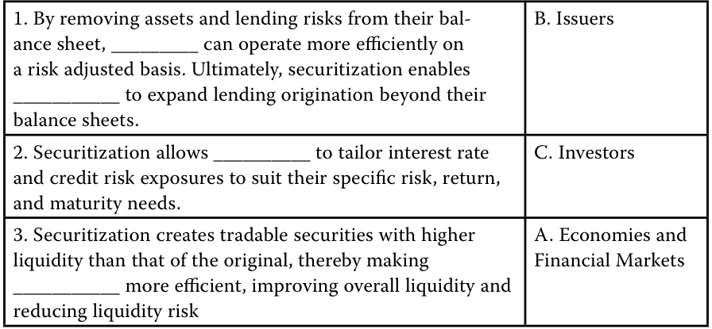

# Volume 6: Fixed Income
## Learning Module 17 Fixed-Income Securitization
### Part 1/2: Introduction (PDF Pages 453–461)

---

<!-- PDF Page 453 -->

# L E A R N I N G M O D U L E **<mark>17</mark>** 

### **Fixed-Income Securitization** 

##### **<mark>LEARNING OUTCOMES</mark>** 

**_Mastery The candidate should be able to:_** explain benefits of securitization for issuers, investors, economies, and financial markets describe securitization, including the parties and the roles they play 

#### **INTRODUCTION** 

## **<mark>1</mark>** 

Asset-backed securities (ABS) are securities backed by and repaid from a pooled group of loans or receivables. Creating securities that are repaid from particular types of loans or receivables transfers risk, provides flexibility to issuers and investors, and efficiently allocates capital. In a securitization, cash flows from a designated pool of assets are redistributed by a special purpose issuer to pay interest and principal to investors in a predetermined manner. Thus, ABS transactions create an entire new subordination structure on the designated pool of assets. Securitization takes place around the world — in the Americas, Asia, and Europe. This first of three Fixed-Income Learning Modules describes the benefits of securitization, the securitization process, and typical securitization structures. 

###### **LEARNING MODULE OVERVIEW** 

- Securitization benefits investors by redistributing payment risks, enhancing the predictability of payments, diminishing the impact of unexpected changes in payment patterns (such as defaults, prepayments, or payment extensions), helping investors match risk, return and maturity needs, and reducing risk through various credit enhancements. 

- Securitization enables issuers to operate more efficiently on a risk-adjusted basis by removing assets and lending risks from their balance sheets (thereby reducing their leverage), expanding their capacity to originate loans and to secure lower funding costs. 

- Securitization enhances financial market efficiency, improving overall liquidity in the financial system and reducing liquidity risk. 

<!-- PDF Page 454 -->

- Several parties participate in a securitization, including the original corporate issuers of the assets (for example, loans, receivables, leases, or debt) to be securitized; a special purpose entity (SPE) created to buy/own these corporate assets, create new assets from them, and sell the new assets to investors; the servicer of the underlying loans or debt; and other (third-party) entities (for example, accountants, attorneys, and underwriters). 

- When an original issuer elects to securitize assets, it first establishes an SPE to which it sells the assets. The SPE then issues and sells to investors securities backed by these assets. Interest and principal payments on the assets are used to pay the investors in the new securities. 

- The separate legal entity structure of the SPE is designed to protect the underlying assets from any claims by creditors of the issuer should the issuer go into financial distress. However, ABS investors should evaluate the legal considerations of the actual jurisdiction where they purchase an ABS, since legal frameworks vary by country. 

###### **LEARNING MODULE SELF-ASSESSMENT** 

These initial questions are intended to help you gauge your current level of understanding of this learning module. 

1. Which of the following asset-backed securities (ABS) is _most_ complex? 

   - **A.** Covered bonds 

   - **B.** Pass-through securities 

   - **C.** Collateralized mortgage obligations 

   - **Solution** 

C is correct. Collateralized mortgage obligations enhance the predictability of payment patterns of pass-through securities by redistributing the cash flows in the pool across the different tranches according to a preset schedule. A is incorrect because covered bonds are the simplest securitization structure. The issuer segregates (but retains) the underlying loans/assets and then uses the segregated loans/assets as collateral for the covered bonds it issues. B is incorrect because pass-through securities, while true securitizations (meaning that the pool of assets is removed from the balance sheet and transferred into a separate and independent legal entity), are not as complex as collateralized mortgage obligations. 

2. Which of the following legal documents in the securitization process describes the structure of the securitization, including the priority of payments and the credit enhancements to be used? 

   - **A.** Prospectus 

   - **B.** Notes issued by the SPE 

   - **C.** Purchase agreement between the seller of the collateral and the SPE 

   - **Solution** 

The correct answer is A. The prospectus describes the structure of the securitization, including the priority and amount of payments to be made to the servicer, administrators, and the ABS holders, as well as the credit enhancements used in the securitization. B is incorrect because the notes issued by the SPE are the actual asset-backed-securities (ABS), not legal documents 

<!-- PDF Page 455 -->

supporting the securitization process. C is incorrect because the purchase agreement between the seller of the collateral and the SPE outlines the representations and warranties that the seller makes about the assets sold. 

3. Identify the role that corresponds to each of the following participants in a securitization: 

|1. Seller|A. The entitythat issues the ABS|
|---|---|
|2. Servicer|h B. The entity that wishes to increase liquidity, lower funding|
||h costs, and operate more efficientlyon a risk-adjusted basis|
|3. SPE|fi C. The entity that collects payments from borrowers|

###### **Solution** 

   **1.** B is correct. By removing assets and lending risks from their balance sheet, the seller can operate more efficiently on a risk-adjusted basis. And, by selling the assets to an SPE, investors can rely on the default risk associated with collecting payments from customers, rather than the seller’s credit quality and default risk. As a result, in aggregate, the funding cost of a securitization may be lower than that of a corporate bond issue. 

   **2.** C is correct. Loan servicing refers to administering any aspect of a loan, including collecting payments from borrowers, notifying borrowers who may be delinquent, and recovering and disposing of the underlying asset if the borrower does not make the payments as scheduled. 

   **3.** A is correct. The SPE purchases the assets from the seller and then issues and sells ABS backed by the pool of securitized assets. 

4. Identify the benefit of securitization that corresponds most closely to each of the following parties: (A. Economies and Financial Markets, B. Issuers, C. Investors): 

|1. By removing assets and lending risks from their bal- ance sheet, _________ can operate more efficiently on a risk adjusted basis. Ultimately, securitization enables ___________ to expand lending origination beyond their balance sheets.|
|---|
|2. Securitization allows __________ to tailor interest rate and credit risk exposures to suit their specific risk, return, and maturityneeds.|
|3. Securitization creates tradable securities with higher liquidity than that of the original, thereby making ___________ more efficient, improving overall liquidity and reducingliquidityrisk|

###### **Solution** 

<!-- PDF Page 456 -->

<!-- Start of picture text -->
1. By removing assets and lending risks from their bal- B. Issuers ance sheet, _________ can operate more efficiently on a risk adjusted basis. Ultimately, securitization enables ___________ to expand lending origination beyond their balance sheets. 2. Securitization allows __________ to tailor interest rate  C. Investors and credit risk exposures to suit their specific risk, return, and maturity needs. 3. Securitization creates tradable securities with higher  A. Economies and liquidity than that of the original, thereby making  Financial Markets ___________ more efficient, improving overall liquidity and reducing liquidity risk <!-- End of picture text -->

**1.** B is correct. By removing assets and lending risks from their balance sheet, _issuers_ can operate more efficiently on a risk adjusted basis. Ultimately, securitization enables _issuers_ to expand lending origination beyond their balance sheets. 

**2.** C is correct. Securitization allows _investors_ to tailor interest rate and credit risk exposures to suit their specific risk, return, and maturity needs. 

**3.** A is correct. Securitization creates tradable securities with higher liquidity than that of the original, thereby making _economies and financial markets_ more efficient, improving overall liquidity and reducing liquidity risk. 

## **<mark>2</mark>** 

#### **THE BENEFITS OF SECURITIZATION** 

explain benefits of securitization for issuers, investors, economies, and financial markets 

The securitization process pools and transfers the ownership of cash flow generating assets, such as loans or receivables, from the original lender into a specially created legal entity. The pool of assets are the securitized assets, also called the reference portfolio or collateral. In turn, that legal entity issues securities backed by these pooled assets to investors and uses the cash flows to pay interest and repay the principal to investors. Securitization creates a direct link between investors and borrowers for many types of loans and receivables, and it provides benefits for issuers and investors as well as economies and financial markets. The steps of the securitization process are outlined in Exhibit 1. 

<!-- PDF Page 457 -->

###### **Exhibit 1: The Securitization Process** 

<!-- Start of picture text -->
Pooled assets Original source with similar Special purpose Asset-backed ABS investors of assets features entity (SPE) securities (ABS) Asset transfer from originator to SPE SPE issues ABS to investors <!-- End of picture text -->

There are several different types of securitized products. In order of increasing complexity, the following products are examples of ABS. 

- Covered bonds are the simplest securitization structure. The issuers, mainly European banks, create a specific pool of mortgage loans on the balance sheet of the bank and segregate it from other bank assets. This pool then serves as collateral (“cover”) for bonds issued by the bank. Should the issuing bank default on a covered bond issue, investors can use the collateral underlying the pool to receive payment. Covered bonds are not considered full securitizations because the underlying assets are not transferred to a separate independent SPE but rather remain on the issuing bank’s balance sheet. Moreover, covered bond investors receive payment directly from the bank and not from the cash flow generated by the specific pool of mortgage loans. 

- Pass-through securities are true securitizations: The specific pool of assets is removed from the balance sheet and transferred into a separate and independent legal entity. That legal entity then issues securities backed by these pooled assets. The investors in these securities receive the principal and interest payments from the assets (often loans) in the pool as they are “passed through” the legal entity. Pass-through securities pass through the payments proportionally across the different tranches and redistribute the payment risks to investors seeking differing levels of risk exposures. The payments investors receive vary and depend directly on the overall credit risk of the pool and payment patterns. 

- Bonds with structural enhancements enhance the predictability of payment patterns of pass-through securities by redistributing the cash flows in the pool across specified tranches according to a preset schedule. The set payment schedule mitigates the impact of unexpected changes in payment patterns, such as defaults, prepayments, or extended repayment periods. Additionally, tranches are subordinated with lower tranches assuming greater risks of defaults and changes in repayment patterns than higher tranches. They may further mitigate and redistribute the potential credit risk of a risky pool of securitized loans by adding various types of credit enhancements to further reduce the risk investors are exposed to. 

- Mortgage-backed securities (MBS) are ABS backed by a pool of mortgages. A distinction is sometimes made between MBS and ABS backed by non-mortgage assets. This distinction is common in the United States and is shown in Exhibit 2. 

<!-- PDF Page 458 -->

**Exhibit 2: Pass-Through Securities** 

<!-- Start of picture text -->
Pass-Through Securities Subgroup Mortgage-backed securities ■ Residential Mortgage-Backed Securities (RMBS) ■ Commercial Mortgage-Backed Securities (CMBS) ■ Collateralized Mortgage Obligation (CMO) Non-Mortgage-backed securities ■ Collateralized Debt Obligation (CDO) ■ Collateralized Loan Obligation (CLO) ■ Collateralized Bond Obligation (CBO) ■ Collateralized Debt Obligation Squared (CDO Squared) <!-- End of picture text -->

**Exhibit 3: Securitization Structure and Tranche Cash Flows** 

<!-- Start of picture text -->
Bonds with Structural Enhancements Example—SPV (Trust) Assets Many Assets ($100) (purchased by SPV) Yield = MRR + 250 Cash flows Liabilities Aaa/AAA Senior ($70) (securities issued by SPV) MRR + 40 Baa/BBB Mezzanine ($20) MRR + 250 Residual cash Equity ($10) flows <!-- End of picture text -->

**Subordination** , or tranching, in the securitization transaction involves creating more than one bond class or tranche, and the bond classes differ in how they receive cash flows from the underlying pool of assets. The bond classes are classified as senior bond classes or subordinated bond classes, and this structure is also referred to as a senior/subordinated structure as seen in Exhibit 3. The subordinated bond classes are sometimes called “non-senior bond classes” or “junior bond classes.” Since all investors in a securitization are paid from the same underlying cash flow pool, the tranching dictates the order of payments made to investors and the order in which losses are absorbed by the investors. 

##### **Benefits to Issuers** 

Traditionally, banks underwrite loans to allow borrowers to finance various purchases and direct investments. These bank loans, which typically remain on the balance sheet of the bank until the loans are fully repaid, are relatively illiquid. 

Banks act as the intermediary between borrowers and investors. If they can separate loan origination from loan financing, they can improve their profitability, earning origination fees and reducing capital requirements for loans that are sold to investors, as shown in Exhibit 4. As we learned in the example on asset-backed commercial paper (ABCP) in an earlier learning module, by removing assets and lending risks 

<!-- PDF Page 459 -->

from their balance sheet, banks sell illiquid assets and operate more efficiently on a risk-adjusted basis. Selling assets also generates fee income. Ultimately, securitization enables banks to expand lending origination beyond their balance sheets. 

**Exhibit 4: Banks and Securitization** 

<!-- Start of picture text -->
Bank Special Purpose Entity Assets Liabilities Assets Liabilities Investors pay cash Cash Deposits for the ABS Loans Debt Loans ABS issued issued by the SPE Oth er assets Equity Bank sells loans to the Special Purpose Entity and receives cash <!-- End of picture text -->

Without ABS as an investment instrument, investors wanting to gain exposure to private debts would have to directly underwrite loans, hold some combination of bank debt and common equity, or purchase loans from bank outright. Direct debt underwriting requires specialized skills in credit evaluation, origination, underwriting, and servicing, and one has to assume the operational costs and business risks of banking. ABS investment breaks down the wide range of skills and risks and redistributes them to appropriate parties. 

##### **Benefits to Investors** 

Securitization provides a direct conduit between borrowers and investors, allowing investors to tailor interest rate and credit risk exposures to suit their specific risk, return, and maturity needs. Securitization transactions allow issuers to design risk– return characteristics to satisfy the risk tolerance of investors. 

Although few institutional or individual investors have the specialized resources and expertise needed to originate, monitor, and collect the payments from the underlying loans and receivables, many can invest in securities backed by such loans or receivables. The ABS that are created by pooling these loans and receivables have characteristics similar to those of a standard bond. 

For example, a pension fund with a long-term horizon can use securitized debt to achieve higher returns, match asset maturities to anticipated liability payout dates, and increase diversity in its asset pool while maintaining the option to adjust holdings quickly and cost-effectively. Thus, holding securitized debt helps pension fund investors increase exposure to the risk–return characteristics of a wider range of underlying assets. 

###### **EXAMPLE 1** 

##### **Benefits of Securitized Debt for Long-term Investors** 

Pawas Singhvi, an investment manager for a defined benefit pension fund at a large manufacturer, is discussing investment options and expectations with a new associate, Kevin Epstein. Epstein asks why Singhvi holds a significant portion of fund assets in securitized debt. Singhvi explains that a number of parameters and expectations influence the investments selected for the pension fund, starting with asset and income diversification. The fund seeks safe, diversified assets and income streams, which offer low risk. Anticipated pension payments or outflows 

<!-- PDF Page 460 -->

from the fund drive the need for liquid and stable investments, which mature or can be sold easily to match the timing of required cash outflows. Any fund investments must be highly rated. 

Because pension payouts take place over many years into the future, pension assets must be invested long-term, too. And the fund’s assets must grow over time in order to produce promised pension payments at the levels required in the future. While public, government-issued debt is highly rated and typically safe, it alone may not produce sufficient returns to meet future obligations. By contrast, holding investment-grade, publicly traded, securitized debt, which can be traded, allows us to garner higher returns and to respond quickly to changes in market sentiment, risk sensitivity, or funding needs at low transaction costs. 

##### **Benefits to Economies and Financial Markets** 

Securitization creates tradable securities with higher liquidity than that of the original loans on the bank’s balance sheet, and trading securities in the secondary market allows investors to determine equilibrium prices—thereby making financial markets more efficient. Securitization also improves overall liquidity in the financial system and reduces liquidity risk. 

An important benefit of securitization is that it provides an alternative means of funding business operations beyond traditional financing tools, such as bonds, preferred equity, and common equity. Companies can use securitization to reduce their funding costs by pooling securitizable assets (often receivables and loans), which increases their return on capital versus borrowing though traditional financing methods. 

Securitization is beneficial to financial markets. Corporate issuers can facilitate the process of selling their products by extending credit to their customers, usually through their financing subsidiary. These subsidiaries specialize in financing and leasing and often issue much of the corporation's consolidated debt, selling receivables either to a bank or directly to an SPE. The company can then securitize these loans, receiving cash from the SPE that then sells them to investors. A company can use these proceeds to fund financing for new customers and sell even more of their product. If the company instead kept these loans to customers on their own balance sheet, they would have to issue additional debt. That would increase their leverage, increase their overall financing and funding costs, and reduce their credit quality. Securitizing loans for their products allows companies to directly tap the financial markets and move loans off their balance sheet. They can thus capture the benefits of a cheaper source of funding without reducing the company’s overall credit quality. 

Securitizations may involve any number of revenue-generating assets owned by companies from a variety of industries. Securitization provides efficiencies to the entire system, benefiting many parties. Manufacturers are able to outsource debt servicing, consumers benefit from reduced costs, and investors benefit from diversified investment opportunities. The following are some interesting examples of securitizations. 

###### **EXAMPLE 2** 

##### **Examples of Securitizations** 

Notes securitized by music royalties and licensing agreements (which allow places such as restaurants or retail stores to play popular music) have been issued. In 2019, the performing-rights company, SESAC, issued securitized bonds backed by its music royalties and licensing agreements with more than 30,000 artists, including Adele, Bob Dylan, Kesha, Gabriel Mann, and R.E.M. The largest piece of the securitization was a fixed-rate note, worth $530 million with a weighted 

<!-- PDF Page 461 -->

average life of 6.7 years. The note offered a yield of 5.25%. The smaller portion of the deal was a floating-rate note, worth $30 million with a weighted average life of 4.9 years, which was not publicly offered. This type of offering is known as a “whole-business securitization.” This type of bond usually is backed by such assets as restaurant franchise agreements or other unusual assets and typically pays higher rates than more traditional ABS tied to consumer debt. 

In 2021, Yum! Brands, the parent company of such fast-food chains as KFC, Pizza Hut, and Taco Bell, issued USD2.3 billion in notes securitized by cash flows from franchised Taco Bell locations through a special purpose subsidiary, Taco Bell Funding. 

Although securitization brings many benefits to economies, it is not without risks. Broadly, these risks fall into two categories: risks that relate primarily to the timing of the ABS’s cash flows, such as contraction risk and extension risk, and risks related to the inherent credit risk of the loans and receivables backing the ABS. Later modules will address how securitization structures reduce these risks. Some of these risks are widely attributed to have precipitated the turmoil in financial markets during 2007–2009. 

###### **QUESTION SET** 

1. Identify three benefits of securitization to issuers of ABS. **Solution** 

   **1.** By removing assets and lending risks from their balance sheet, banks can sell illiquid assets and _operate more efficiently_ on a risk-adjusted basis. 

   **2.** Selling assets also _generates fee income_ . 

   **3.** Ultimately, securitization enables banks to _expand lending origination beyond their balance sheets_ . 

2. Identify two benefits of securitization to investors. **Solution** 

   **1.** Securitization allows investors to tailor interest rate and credit risk exposures to suit their specific risk, return, and maturity needs. 

   **2.** Securitization allows investors to gain exposure to a wider range of imperfectly correlated assets to build more efficient and diversified portfolios. 

3. Matching asset maturities to anticipated liability payout dates and increasing diversity in an asset pool while maintaining the option to adjust holdings quickly and cost-effectively is _most likely_ a benefit to: 

   - **A.** issuers. 

   - **B.** investors. 

   - **C.** economies and financial markets. 

   - **Solution** 

The correct answer is B. Matching asset maturities to anticipated liability payout dates and increasing diversity in an asset pool while maintaining the option to adjust holdings quickly and cost-effectively is most likely a benefit to investors. For example, a pension fund with a long-term horizon can use securitized debt gains to achieve higher returns, match asset maturities to 

