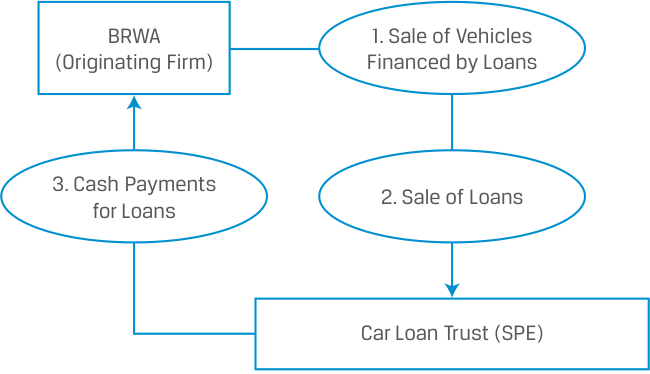
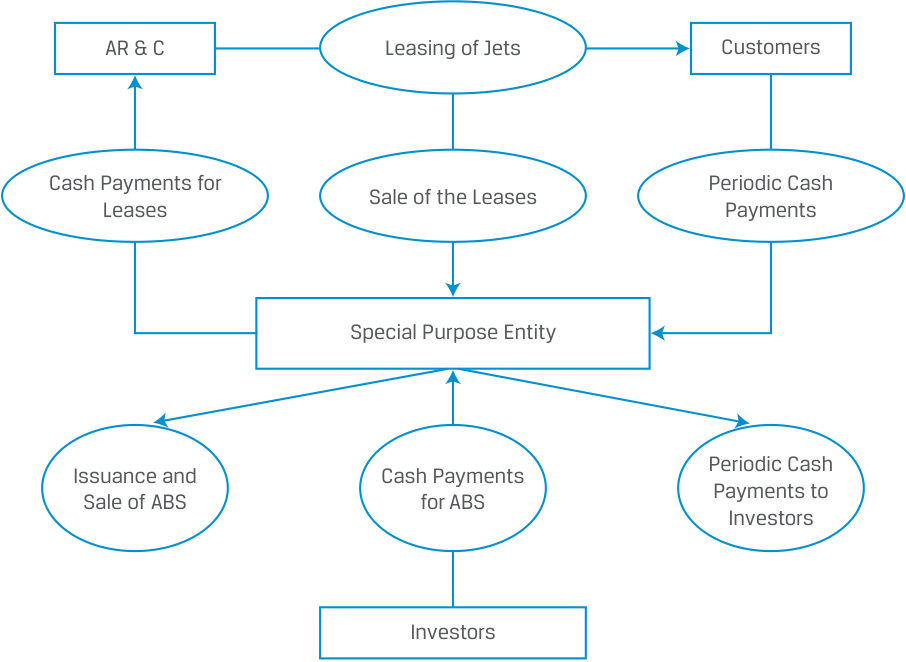

# Volume 6: Fixed Income
## Learning Module 17 Fixed-Income Securitization
### Part 2/2: The Securitization Process (PDF Pages 462–474)

---

<!-- PDF Page 462 -->

anticipated liability payout dates, and increase diversity in its asset pool while maintaining the option to adjust holdings quickly and cost-effectively. 

4. Determine if the following events associated with an ABS are _more likely_ to result in a benefit or a risk and identify for whom (issuers, investors, financial markets): 

|**Event**|**Benefit or Risk**|**For Whom**|
|---|---|---|
|A. Change in the timing of the cash flows|||
|l B. Change in the credit worthiness of the associ- ated ABS loans|||
|C. Sellingilliquid assets|||
|D. Securitizing assets|||

###### **Solution** 

|**Event**|**Benefit or Risk**|**For Whom**|
|---|---|---|
|A. Change in the timing of the cash flows|Risk|Investors – Prepayment risk, the uncertainty that cash flows will differ from the schedule set forth in the initial loan agreement, can result either when interest rates decline and borrowers pay off part or all of their loans early or when borrowers experience financial duress and slow down their loanpayments.|
|B. Change in the credit worthiness of the associ- ated ABS loans|Risk|Investors – If the borrowers default on their loans, then the SPE may not be able to make cash payments to the security holders. On the other hand, if the borrow- ers’ credit worthiness improves, there is no direct benefit to the investors.|
|C. Sellingilliquid assets|Benefit|Issuer|
|D. Securitizing assets|i Benefit|Issuer, Investors Financial Markets|

# **<mark>3</mark>** 

#### **THE SECURITIZATION PROCESS** 

describe securitization, including the parties and the roles they play 

<!-- PDF Page 463 -->

Securitization requires that several legal and regulatory conditions are satisfied and involves multiple parties to facilitate the transaction and ensure that these conditions are met. This section describes a typical securitization process, the parties, and their roles. 

##### **An Example of a Securitization** 

Let’s revisit Bright Wheel Automotive (BRWA), the hypothetical car manufacturer introduced earlier. BRWA’s financing company subsidiary provides loans to BRWA customers with the vehicles serving as collateral. These fixed-rate loans represent an asset to the company with maturities averaging four years. They are fully amortizing with the principal repaid in 48 monthly payments (12 months × 4 years). The borrowers make equal payments each month consisting of interest payment and principal repayment, as shown in Exhibit 5. 

###### **Exhibit 5: Bright Wheel Automotive Securitization** 

<!-- Start of picture text -->
Investors receive a $32.7 payment equal to the sum of interest and principal payments 27.9 28.4 28.8 29.3 29.7 30.2 30.7 31.2 31.7 32.2 4.8 4.4 3.9 3.4 3.0 2.5 2.0 1.5 1.0 0.5 0.5 1.0 1.5 2.0 2.5 3.0 3.5 4.0 4.5 5.0 Years Issuer receives par value of bond upon issuance 300 Principal Interest <!-- End of picture text -->

BRWA’s financing subsidiary decides whether to extend credit to customers, and it also services the loans. Loan servicing refers to administering any aspect of a loan, including collecting payments from borrowers, notifying borrowers who may be delinquent, and recovering and disposing of a vehicle if the borrower does not make the payments as scheduled. If a customer defaults, BRWA can seize the car and sell it to recoup the remaining principal on the loan. The role of the servicer can vary: In this example, the issuer continues to service the loan, but at other times, the servicing may be provided by another entity. 

<!-- PDF Page 464 -->

The following is an illustration of how these loans can be securitized. In this simplified example, the costs and fees associated with the securitization are ignored. Exhibit 6 shows a summary of the terms for a securitization transaction where BRWA sold car loans to a hypothetical SPE named Car Loan Trust (CLT), which then uses the loans as collateral for ABS it issues. 

**Exhibit 6: Notes Issued by Car Loan Trust Collateralized by Car Loans – Brief Summary of Terms** 

|**Four-**|**Year Asset-Backed Notes — Car Loan Trust**|
|---|---|
|**Issuer:**|Car Loan Trust (CLT), a special purpose entity.|
|**Underlying Assets/** **Collateral:**|Portfolio of loans by which new cars and vehicles are financed.|
|**Description:**|Car finance receivables originated by Bright Wheel Automotive (BRWA), sold by BRWA to CLT, purchased by CLT, and fully transferred from BRWA to CLT. There are 45,000 loans in the outstanding pool, with an aver- age balance of EUR22,222.|
|**Outstanding Principal** **Balance of the Pool:**|EUR1,000 million|
|**Settlement Date:**|[T + 3 Business Days]|
|**Maturity Date:**|[Four Years from Settlement Date]|
|**Security:**|The Notes are secured obligations of CLT.|
|**Business Days:**|Frankfurt.|

Assume that BRWA wants to raise EUR1,000 million and faces two choices. One is to issue a four-year corporate bond; the other is to issue an ABS backed by the car loans. BRWA seeks to achieve the lowest possible interest rate relative to its benchmark interest rate, where the difference is the credit spread. 

Unlike banks and finance companies, car manufacturers are more capital-intensive. Tying up capital on their balance sheet to finance car purchases may be a suboptimal use of their capital. Selling off loans frees up capital and recognizes profits that can finance the core business. 

First, BRWA sets up a separate legal entity called Car Loan Trust (CLT), a **special purpose entity (SPE)** , sometimes also called a special purpose vehicle (SPV) or a special purpose company, to which it sells the EUR1,000 million worth of car loans. CLT, a legally independent and bankruptcy-remote entity from BRWA, acquires these loans from BRWA and becomes the ultimate owner of the loans. The separate legal entity structure ensures that if BRWA, the originator of the loans, files for bankruptcy, the loans backing the ABS that are issued by BRWA are secure within CLT, the SPE, and BRWA’s creditors cannot have any claim on them. Creating the required separate and bankruptcy-remote legal structures for the SPE and fully transferring the loans from the issuer to the SPE can be a complicated process that varies across jurisdictions. 

Exhibit 7 reflects BRWA’s business: (1) selling cars financed by loans, (2) BRWA sells to CLT EUR1,000 million worth of car loans, and (3) BRWA receives from CLT EUR1,000 million in cash. 

<!-- PDF Page 465 -->

**Exhibit 7: Setting up the Securitized Pool** 

<!-- Start of picture text -->
BRWA 1. Sale of Vehicles (Originating Firm) Financed by Loans 3. Cash Payments 2. Sale of Loans for Loans Car Loan Trust (SPE) <!-- End of picture text -->

Exhibit 8 shows how CLT then (4) issues and sells securities that are backed by the pool of securitized loans and (5) receives cash from investors. These securities are the ABS mentioned earlier with the EUR1,000 million in car loans representing the collateral. 

**Exhibit 8: Issuing the ABS** 

<!-- Start of picture text -->
BRWA 1. Sale of Vehicles (Originating Firm) Financed by Loans 3. Cash Payments 2. Sale of Loans for Loans Car Loan Trust (SPE) 4. Issuance 5. Cash and Payments Sale of ABS for ABS Investors <!-- End of picture text -->

Exhibit 9 shows (6) how the monthly payments made by BRWA’s customers, which include both interest payment and principal repayment, go to the special purpose entity CLT, which then (7) directs the agreed periodic cash payments to the investors in the ABS. Exhibit 9 also summarizes the full set of steps in a typical securitization. It shows the parts played by all parties, including the company wanting to securitize its assets, the issuer (SPE), as well as customers and investors. 

<!-- PDF Page 466 -->

**Exhibit 9: Periodic Payments on the ABS** 

<!-- Start of picture text -->
BRWA 1. Sale of Vehicles Customers (Originating Firm) Financed by Loans 3. Cash Payments 6. Periodic Cash 2. Sale of Loans for Loans Payments Car Loan Trust (SPE) 4. Issuance 5. Cash and Payments Sale of ABS for ABS 7. Periodic Investors Cash Payments <!-- End of picture text -->

##### **Parties to a Securitization** 

The three main parties to a securitization are: 

- the _seller_ of the collateral, sometimes called the depositor (BRWA in our example); 

- the _SPE_ that purchases the loans or receivables and uses them as collateral to issue the ABS, CLT in our example (the SPE is often referred to as the issuer in the prospectus because it is the entity that issues the securities); and 

- the _servicer_ of the loans (BRWA’s financing subsidiary in our example). 

Other parties, such as independent accountants, lawyers/attorneys, trustees, underwriters, rating agencies, and sometimes financial guarantors, are also involved in these transactions. Since these parties are different from the seller of the collateral, they are referred to as third parties to the securitization. 

Besides the standard bond indenture and its covenants, two additional legal documents play an important role in the securitization process. One is the **purchase agreement** between the seller of the collateral (the original lender) and the SPE, which outlines the representations and warranties that the seller makes about the assets sold. These representations and warranties assure investors about the quality of the assets, an important consideration when assessing the risks associated with the ABS. The other is the **prospectus** , which describes the structure of the securitization, including the priority and amount of payments to be made to the servicer, administrators, and the ABS holders, as well as the credit enhancements used in the securitization. 

A trustee or trustee agent is known as a “disinterested trustee” and is typically a financial institution that safeguards the assets after they have been sold to the SPE, holds the funds due to the ABS holders until they are paid, and provides periodic 

<!-- PDF Page 467 -->

cash flow reports to ABS holders as agreed to in the terms of the prospectus. These reports are the only source of information for investors to update the credit standing of the ABS. 

##### **The Role of the SPE** 

The legal protection the SPE creates for the originator or issuer and the investors in an ABS transaction plays a pivotal role in securitization. Without an SPE, securitizations would not be possible. Securitization can be a cheaper way to raise funds than a corporate bond issue secured by the same collateral because the SPE is not affected by the bankruptcy of the seller of the collateral. 

In a securitization, the courts in most jurisdictions have no discretion to change seniority because the bankruptcy of the originating company does not affect the SPE. Hence removing assets from the balance sheet into an SPE is an important decoupling of the credit risk of the entity needing funds from the SPE and the bond classes issued by it. This explains why the SPE is structured as a bankruptcy-remote entity and why the legal separation from the issuer and the SPE is critical. 

The only credit risk that the investors face is the risk that the borrowers whose loans are included in the SPE default on their loans. The SPE’s ability to make cash payments to the security holders remains intact if the borrowers make the interest payments and/or the principal repayments on their loans. 

In many countries, the creditors are protected in the recognition of the securitization as a true sale, where all rights of the lender are irrevocably, unqualifiedly, and fully transferred to the SPE according to the laws of the jurisdiction. The SPE has full legal ownership of the securitized assets, which are de-recognized from the seller’s balance sheet. Note that it is possible that transfers made to bankruptcy-remote vehicles, such as an SPE, can be challenged as fraudulent transactions or conveyances in court and if so determined, potentially unwound. 

It is also important to note that not all countries have the same legal framework. Impediments with respect to ABS issuance have arisen in some countries where the concept of trust law is less well developed. Thus, investors should evaluate the legal considerations that apply in the jurisdictions where they purchase ABS. 

###### **QUESTION SET** 

Questions 1 to 4 are based on the following example: 

Ahbaling Industries (Ahbaling), a manufacturer of industrial machine tools based in Johor, Malaysia, has SGD500 million of corporate bonds outstanding. These bonds have a credit rating below investment grade. Ahbaling has SGD400 million of receivables on its balance sheet that it would like to securitize. The receivables represent payments Ahbaling expects to receive for machine tools it has sold to various customers in Europe. Ahbaling’s finance subsidiary sells the receivables to Ahbaling Trust, an SPE. Ahbaling Trust then issues ABS, backed by the pool of receivables, with the following structure: 

|**Bond Class**|**Par Value (SGD millions)**|
|---|---|
|A (senior)|280|
|B (subordinated)|60|
|C (subordinated)|60|
|Total|400|

<!-- PDF Page 468 -->

1. Identify the correct order for the following steps related to securitizing receivables of Ahbaling Industries: 

|A. Investors buy securities based on their preferred level of risk and return.|
|---|
|B. Ahbaling pools SGD400 million in receivables.|
|C. Ahbalingsells machine tools on credit.|
|D. ABS are issued.|
|E. Segregated receivables are sold to Ahbaling Trust.|

###### **Solution** 

|Step1|C. Ahbalingsells machine tools on credit.|
|---|---|
|Step2|B. Ahbaling pools SGD400 million in receivables.|
|Step3|E. Segregated receivables are sold to AhbalingTrust.|
|Step4|D. ABS are issued.|
|Step 5|A. Investors buy securities with their preferred level of risk and return.|

2. If Ahbaling Industries issues SGD400 million in corporate bonds one year from now: 

   - **A.** the new bonds will be senior to the ABS. 

   - **B.** the ABS will be senior to the new bonds. 

   - **C.** seniority will not apply between the new bonds and the ABS. 

   - **Solution** 

The correct answer is C. Since the new bonds are issued by Ahbaling Industries and the ABS are issued by Ahbaling Trust, two distinct entities, seniority will not apply. 

3. Investors considering the purchase of the ABS bonds will rely most on: 

   - **A.** the financial health of Ahbaling Trust. 

   - **B.** the financial health of Ahbaling Industries. 

   - **C.** the default risk associated with collecting payments from Ahbaling customers. 

###### **Solution** 

The correct answer is C. As long as Ahbaling’s customers make the interest payments and/or principal repayments on their loans, Ahbaling Trust will be able to make cash payments to the ABS investors. The legal implication of setting up Ahbaling Trust is that investors contemplating the purchase of any ABS backed by the cash flows from the pool of Ahbaling receivables will evaluate the default risk associated with collecting the payments from the machine tool customers. The credit quality and default risk of Ahbaling Industries are no longer directly relevant. 

4. Identify the _most important_ reason why the ABS issued by Ahbaling Trust offers a lower interest rate than the existing Ahbaling Industries corporate bonds outstanding. 

   - **A.** Ahbaling Industries’ existing bonds are rated below investment grade. 

<!-- PDF Page 469 -->

**B.** Ahbaling Trust would not be affected if Ahbaling Industries files for bankruptcy. 

**C.** The ABS issued by Ahbaling Trust are secured by collateral, the receivables purchased from Ahbaling Industries. **Solution** 

The correct answer is C. A secured bond is secured by collateral and is considered less risky than an unsecured bond without collateral backing, and accordingly, has a lower credit spread than an unsecured bond. A is incorrect because the credit rating on Ahbaling Industries’ existing bonds does not dictate the interest rate on the ABS issued by Ahbaling Trust. B is incorrect because even though Ahbaling Trust, as a separate legal entity, would not be affected if Ahbaling Industries files for bankruptcy, this is not the _most important_ reason that the ABS require a lower interest rate. 

<!-- PDF Page 470 -->

## **~~PRACTICE PROBLEMS~~** 

**1.** Which of the following benefits of securitization is most likely to be important for investors? 

   - **A.** Increased efficiency 

   - **B.** Reduced liquidity risk 

   - **C.** The ability to tailor interest rate and credit risk exposures 

### **The following information relates to questions 2-4** 

AR&C Limited leases private jets to corporations in North America for a fixed term of five years. AR&C retains ownership of the jets. The corporations make equal interest payments each month. If a customer defaults, AR&C can repossess the jet. AR&C has been in business for approximately fifteen years and has a B3 credit rating, meaning that its debt is non-investment grade. AR&C has CAD500 million in leases on its balance sheet, which it wants to securitize into ABS. 

**2.** Determine which of the following is the _best_ next step for AR&C. 

   - **A.** AR&C issues and sells securities backed by the pool of leases. 

   - **B.** AR&C sets up a separate legal entity to which it sells the CAD500 million in leases. 

   - **C.** AR&C discontinues servicing the leases, shifting this responsibility to a special purpose company. 

**3.** Which shape _best_ represents the cash payments for the Leases? 

<!-- Start of picture text -->
AR & C 1. Customers 3. 2. 6. 9. 4. 5. 7. Investors <!-- End of picture text -->

<!-- PDF Page 471 -->

   - **A.** Shape 2 

   - **B.** Shape 3 

   - **C.** Shape 5 

**4.** Which of the following _best_ describes the entity shown in shape 9? 

<!-- Start of picture text -->
AR & C 1. Customers 3. 2. 6. 9. 4. 5. 7. Investors <!-- End of picture text -->

The entity in shape 9 is the: 

   - **A.** seller of the collateral. 

   - **B.** servicer of the leases. 

   - **C.** SPE that purchases the leases and uses them as collateral for the ABS. 

**5.** Which of the following statements about securitization’s impact on economies and financial markets is correct? 

   - **A.** Securitization decreases overall liquidity in the financial system. 

   - **B.** Securitization provides an alternative means of funding business operations beyond traditional financing. 

   - **C.** Securitization allows companies to directly access the financial markets and purchase loans that will be held on their balance sheet. 

**6.** Which of the following statements about securitization is incorrect? 

   - **A.** The ABS that are created by securitization have characteristics similar to those of equity investments. 

   - **B.** Buying securitized debt helps investors increase exposure to the risk–return characteristics of a wider range of underlying assets. 

   - **C.** Securitization transactions allow issuers to create risk–return characteristics to satisfy the risk tolerance of different investors. 

<!-- PDF Page 472 -->

**7.** In the event of a bankruptcy of the originator in a loan securitization, the investors would _most likely_ experience: 

   - **A.** gains. 

   - **B.** losses. 

   - **C.** no impact. 

**8.** In a securitization, the party that purchases the loans or receivables and uses them as collateral to issue ABS is the: 

   - **A.** SPE. 

   - **B.** seller. 

   - **C.** servicer. 

<!-- PDF Page 473 -->

## **~~SOLUTIONS~~** 

1. The correct answer is C. Securitization provides a direct conduit between borrowers and investors. It also allows investors to tailor interest rate and credit risk exposures to suit their specific risk, return, and maturity needs. A is incorrect because securitization creates efficiency for issuers and financial markets more directly than for investors. Securitization allows issuers to sell illiquid assets and operate more efficiently on a risk-adjusted basis. Moreover, because securitization creates tradable securities with higher liquidity than the original underlying assets, it makes financial markets more efficient. B is incorrect because securitization improves overall liquidity in the financial system and reduces liquidity risk, which benefits participants in financial markets. 

2. The correct answer is B. In order for these assets (leases) to be securitized, they must be held in a separate legal entity structure distinct from AR&C. The separate legal entity structure ensures that if AR&C, the originator of the leases, files for bankruptcy, the leases backing the ABS that are issued by the separate legal entity are secure there, thus AR&C’s creditors cannot have any claim on them. A is incorrect because if AR&C issues the securities, the leases remain on AR&C’s balance sheet and thus could still be accessible to AR&C’s creditors in the event of a bankruptcy. C is incorrect because servicing the leases must continue whether or not by AR&C or another entity, but servicing the leases is separate from securitizing them. 

3. The correct answer is B. As shown in the diagram below, the SPE (in rectangle 9 above), pays AR&C for the leases (as noted in shape 3 above). A is incorrect because shape 2 above represents the sale of the leases (as shown in the diagram below), not the payment for them, and C is incorrect because shape 5 above represents payments from the investors for the ABS sold by the SPE (as shown in the diagram below). 

<!-- Start of picture text -->
AR & C Leasing of Jets Customers Cash Payments for Periodic Cash Sale of the Leases Leases Payments Special Purpose Entity Periodic Cash Issuance and Cash Payments Sale of ABS for ABS Payments to Investors Investors <!-- End of picture text -->

4. The correct answer is C. The SPE purchases the leases from AR&C and uses them as collateral for the ABS, which it issues and sells to the investors. A is incorrect because AR&C is the seller of the collateral, not the SPE. C is incorrect because 

<!-- PDF Page 474 -->

the diagram does not show clearly who services the leases, but it does show that the entity in shape 9 is the SPE. 

5. The correct answer is B. An important benefit of securitization is that it provides an alternative means of funding business operations beyond traditional financing tools, such as bonds, preferred equity, and common equity. A is incorrect because securitization improves overall liquidity in the financial system and reduces liquidity risk. C is incorrect because securitization allows companies to directly access the financial markets and move loans off their balance sheet. 

6. The correct answer is A. The ABS that are created by pooling loans and receivables have characteristics similar to those of a standard bond. B is incorrect because it is a correct statement. Holding securitized debt helps pension fund investors increase exposure to the risk–return characteristics of a wider range of underlying assets. C is incorrect because it is a correct statement. Securitization transactions allow issuers to design risk–return characteristics to satisfy the risk tolerance of different investors. 

7. The correct answer is C. Since the SPE, which owns the loans, is bankruptcy remote from the seller of the collateral, the bankruptcy of the seller of the collateral will not affect the holders of securities issued by the SPE and backed by the collateral. The only credit risk that the investors face is the risk that the borrowers whose loans are included in the SPE default on their loans. 

8. The correct answer is A. The SPE is often referred to as the issuer in the prospectus because it is the entity that issues the securities to investors. B is incorrect because the seller of the collateral, also called the depositor, is the party that originally aggregated the assets and sold them to the SPE. C is incorrect because the servicer has an administrative function and is the entity that collects payments from borrowers. 

