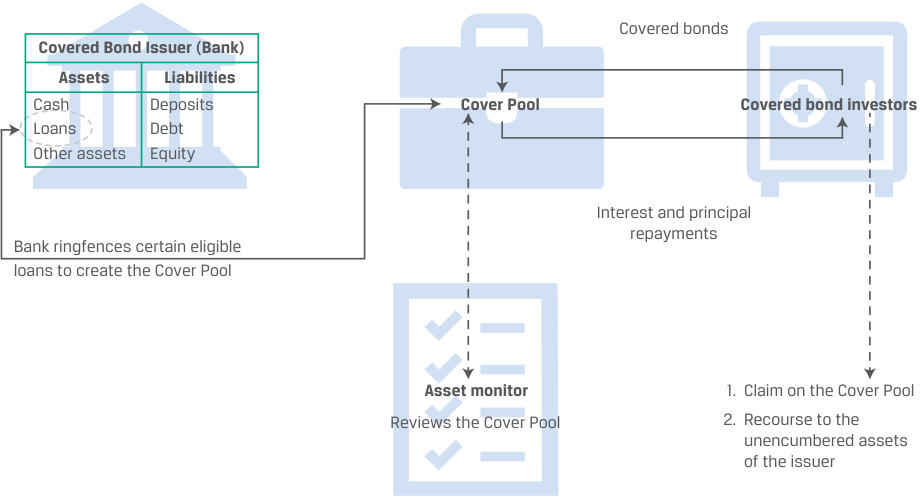
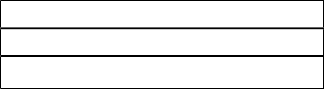
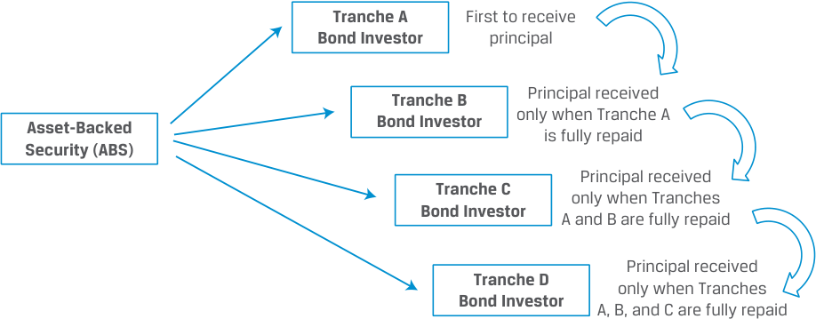

# Volume 6: Fixed Income
## Learning Module 18 Asset-Backed Security (ABS) Instrument and Market Features
### Part 1/3: Introduction (PDF Pages 475–488)

---

<!-- PDF Page 475 -->

# L E A R N I N G M O D U L E **<mark>18</mark>** 

### **Asset-Backed Security (ABS) Instrument and Market Features** 

##### **<mark>LEARNING OUTCOMES</mark>** 

|**_Mastery_**|**_The candidate should be able to:_**|
|---|---|
||describe characteristics and risks of covered bonds and how they differ from other asset-backed securities|
||describe typical credit enhancement structures used in securitizations|
||describe types and characteristics of non-mortgage asset-backed securities, including the cash flows and risks of each type|
||l describe collateralized debt obligations, including their cash flows and risks|

<!-- Start of picture text -->
1 <!-- End of picture text -->

#### **INTRODUCTION** 

Prior Learning Modules have shown the funding technique of securitization can be backed by diverse types of assets, including loans and receivables as well as residential or commercial mortgages. A unifying principle in all asset-backed security (ABS) structures is that their underlying cash flows can be reconfigured into various tranches, each with its particular payment pattern to investors and associated risks. The advantage of this targeted partitioning includes a reduction in the variability of cash flows and the reallocation of risks, such as default and early repayment across specific tranches, with associated returns. Overall, ABS securitization provides risk transfer, flexibility to issuers and investors, and efficiency of capital allocation. 

###### **LEARNING MODULE OVERVIEW** 

- Covered bonds are issued by financial institutions as senior debt obligations. Backed by a segregated pool of assets typically consisting of commercial or residential mortgages, or public sector assets, these assets remain on the issuer’s balance sheet. 

<!-- PDF Page 476 -->

- Non-mortgage ABS are securitizations that remove the pool of assets from the original issuer’s balance sheet. They are generally collateralized by non-amortizing loans, such as credit card receivables, that retain their original loan value during a specific period of their life before the stated maturity date, known as the lockout or revolving period. During this time, principal that is repaid is reinvested to replenish the collateral pool. 

- Collateralized debt obligation (CDO) is a generic term describing securitization backed by diversified collateral pools of non-mortgage debt (such as bonds or loans) that redistribute segmented cash flows to investors. The CDO’s tranches receive the cash flows according to an order of priority, with senior claims having lower bond-like payouts and junior claims receiving potentially higher but more variable returns. 

- The most common CDO structure is a collateralized loan obligation (CLO) and is subject to uniquely complex non-linear risks in cases of collateral defaults. 

- Credit tranching, which involves creating distinct senior and subordinated bond classes (“tranches”), offers credit protection for the more senior bond classes in a securitization. Senior bond classes are paid from the underlying asset pool before subordinated tranches; subordinated bond classes absorb any cash flow losses resulting from defaults in the asset pool before senior tranches. 

- Creating a set of bond classes allows investors to choose the level of risk, expected maturity, and the associated returns they prefer. Each bond class created in a securitization is typically rated based on both the quality of the underlying collateral and the seniority of the class. 

###### **LEARNING MODULE SELF-ASSESSMENT** 

1. Which of the following types of descriptive information is typically excluded from an ABS term sheet? 

   - **A.** Conditions for early amortization 

   - **B.** Market values of the tranche notes 

   - **C.** Aggregate amount of collateral pool assets 

   - **Solution:** 

The correct answer is B. The term sheet typically provides the face value of the tranche notes at the time of the transaction, not their market value. Both A and C are incorrect as these items are typically included in the term sheet. 

2. After the lockout period for ABS with non-amortizing collateral, how are the cash flows for loan repayments directed? 

   - **A.** All of the principal is reinvested to acquire additional loans. 

   - **B.** Part of the principal is reinvested if the collateral pool is depleted. 

   - **C.** No principal is reinvested, and all is distributed to different tranches. 

   - **Solution:** 

The correct answer is C. When the lockout period is over and the amortization period starts, any principal that is repaid will not be reinvested in new loans but will be distributed to the different tranches. 

<!-- PDF Page 477 -->

3. The prevailing CDO structure is the: **A.** CLO. **B.** CMO. **C.** Structured finance CDO. 

**Solution:** The correct answer is A. Collateralized loan obligations (CLOs) have a collateral pool composed of loans. B is incorrect because while similar, CMOs are based on mortgages. C is incorrect because it is based on a portfolio of other CDOs. 

4. Which of the following statements about CLOs is accurate? **A.** The CLO replicates the firm’s capital structure. **B.** Purchases of a CLO’s collateral are funded by issuing equity. **C.** A CLO’s junior tranche earns a potentially higher yield than comparable corporate bonds. 

**Solution:** The correct answer is A. Fundamentally, a CLO replicates the capital structure of the firm. B is incorrect because CLO collateral purchases rely on funds obtained from the issuance of debt. C is incorrect because it is the senior of mezzanine tranches that earn a potentially higher yield than comparable corporate bonds. 

5. Which of the following aspects of their transaction structures is _most likely_ shared by solar ABS, CLOs, and covered bonds? **A.** A pre-funding period **B.** An unstable collateral pool **C.** A diversity of default exposures 

**Solution:** The correct answer is B. All these ABS lack a stable initial asset pool and require ongoing collateral management. A is incorrect because a pre-funding period is used by solar ABS post transaction to acquire additional qualifying assets that meet certain eligibility criteria. C is incorrect because covered bonds have only one bond class with its associated default exposure in its cover pool. 

6. Which internal credit enhancement involves creating bond classes that differ in how they share any losses resulting from defaults in the collateral pool? **A.** Subordination **B.** Overcollateralization **C.** Cash collateral accounts 

**Solution:** 

The correct answer is A. Subordination or credit tranching in the securitization transaction involves creating more than one bond class or tranche, and the bond classes differ in how they share any losses resulting from defaults in the collateral pool. B is incorrect because overcollateralization is an internal credit enhancement in which the collateral underlying the transaction is larger than the face value of the issued bonds, so that even if defaults are in the pool, the transaction has sufficient cushion to continue paying <u>principal</u> 

<!-- PDF Page 478 -->

and interest payments on the bonds. C is incorrect because it is a type of external, not internal, credit enhancement. 

7. Which of the following statements about covered bonds is _incorrect_ ? 

   - **A.** The LTV on the mortgages included in the transactions must meet certain standards to be eligible for inclusion in the pool. 

   - **B.** Covered bond transactions typically involve collateral underlying the transaction that is less than the face value of the issued bonds. 

   - **C.** Redemption regimes exist to align the covered bond’s cash flows with the original maturity schedule in the event of default of a covered bond’s sponsor. 

###### **Solution:** 

The correct answer is B. Covered bond transactions typically involve collateral underlying the transaction, which exceeds the face value of the issued bonds referred to as overcollateralization. A is incorrect because it is a correct statement. The loan to value (LTV) on the mortgages included in the transactions must meet certain standards to be eligible for inclusion in the pool. If a mortgage fails to meet the LTV criteria, it is replaced with another mortgage that meets the criteria. C is incorrect because it is a correct statement. Redemption regimes exist to align the covered bond’s cash flows as closely as possible with the original maturity schedule in the event of default of a covered bond’s financial sponsor. 

8. Which of the following bonds experiences a bond default and accelerated bond payments if payments are not made according to the original schedule? 

   - **A.** Soft-bullet covered bonds 

   - **B.** Hard-bullet covered bonds 

   - **C.** Conditional pass-through covered bonds 

###### **Solution:** 

The correct answer is B. For hard-bullet covered bonds, if payments do not occur according to the original schedule, a bond default is triggered and bond payments are accelerated. A is incorrect because soft-bullet covered bonds delay the bond default and payment acceleration of bond cash flows until a new final maturity date, which is usually up to a year after the original maturity date. C is incorrect because conditional pass-through covered bonds convert to pass-through securities after the original maturity date if all bond payments have not been made. 

## **<mark>2</mark> COVERED BONDS** 

describe characteristics and risks of covered bonds and how they differ from other asset-backed securities 

<!-- PDF Page 479 -->

Covered bonds, which we touched on in earlier readings, are senior debt obligations issued by a financial institution and backed by a segregated pool of assets that typically consist of commercial or residential mortgages, or public sector assets. Covered bonds that are backed by ships and commercial aircraft have also been issued. 

The covered bond (or _Pfandbrief_ in German) originated over 250 years ago in Prussia and has been adopted by issuers in Europe, Asia, and Australia. Each country or jurisdiction specifies eligible collateral and structures permissible in the covered bond market, and the European Union is taking steps to harmonize these elements among its member states. Exhibit 1 provides a typical structure for a covered bond transaction. 

**Exhibit 1: Covered Bond Transaction Structure** 

<!-- Start of picture text -->
Covered bonds Covered Bond Issuer (Bank) Assets Liabilities Cash Deposits Cover Pool Covered bond investors Loans Debt Oth er assets Equity Interest and principal repayments Bank ringfences certain eligible loans to create the Cover Pool Asset monitor 1. Claim on the Cover Pool Reviews the Cover Pool 2. Recourse to the unencumbered assets of the issuer <!-- End of picture text -->

Covered bonds are similar to ABS. However, the loans remain on the issuer’s balance sheet and are ringfenced into a separate cover pool. The investors in the covered bonds have dual recourse in case of bankruptcy: first on the ringfenced loans in the cover pool that underlie the covered bond transaction, and second on the unencumbered assets of the issuing institution. 

Covered bond transactions financing environmental remediation projects and investments in renewable energy production and infrastructure are increasingly popular. The cover pools for these green covered bonds are largely made up of mortgages to green buildings, which can be identified through various green building certification standards. 

Typical covered bond terms issued by Commercial Finance Partners are found in Exhibit 2. The mortgages underlying the transaction remain on its balance sheet. 

**Exhibit 2: Covered Bond Term Sheet** 

||**Issue of EUR30 Million 2.00%** **Prospectus Summary**|
|---|---|
|**Issuer:**|Commercial Finance Partners AG|
|**Issue Size:**|EUR30,000,000|
|**Tranche Size:**|EUR30,000,000|
|**Interest Rate:**|2.00%, payable annually on June 30.|

<!-- PDF Page 480 -->

|**Settlement Date:**|[T + 3 Business Days]|
|---|---|
|**Maturity Date:**|[Twenty Years from Settlement Date]|
|**The Collateral:**|Security in a pool of prime, fully amortizing mortgages.|
|**h** **LTV Cut-off:**|80%|
|**f** **Format:**|Soft bullet|

Covered bonds usually consist of one bond class per cover pool. Another important feature lies in the dynamic nature of the cover pool. The assets in the pool are monitored by a third party for performance and adherence to underwriting standards. Moreover, the covered bond issuer must replace any prepaid or non-performing assets (i.e., assets that do not generate the promised cash flows) to ensure sufficient cash flows until the maturity of the covered bond. 

Covered bonds offer two additional tools to mitigate the risks of investors. First, covered bond transactions typically involve collateral underlying the transaction which exceeds the face value of the issued bonds, referred to as **overcollateralization** . For instance, Germany requires that all covered loan collateral pools are overcollateralized by at least 2% of the economic value of the outstanding covered bonds and some German issuers voluntarily overcollateralize their covered bond issues. Second, the loan to value (LTV) on the mortgages included in the transactions must meet certain standards to be eligible for inclusion in the pool. If a mortgage fails to meet the LTV criteria, it is replaced with another mortgage that meets the criteria. 

Redemption regimes exist to align the covered bond’s cash flows as closely as possible with the original maturity schedule in the event of default of a covered bond’s financial sponsor. For example, in the case of **hard-bullet covered bonds** , if payments do not occur according to the original schedule, a bond default is triggered and bond payments are accelerated. **Soft-bullet covered bonds** delay the bond default and payment acceleration of bond cash flows until a new final maturity date, which is usually up to a year after the original maturity date. **Conditional pass-through covered bonds** , in contrast, convert to pass-through securities after the original maturity date if all bond payments have not yet been made. 

Covered bonds have remained a relatively stable and reliable source of funding over time because of their dual recourse nature, strict eligibility criteria, dynamic cover pool, and redemption regimes in the event of sponsor default. As a result, covered bonds usually carry lower credit risks and offer lower yields than otherwise similar ABS. 

###### **EXAMPLE 1** 

##### **Comparing Covered Bonds and ABS at Banks** 

“Ultimately, covered bonds and ABS are complements, not substitutes. ABS are a vehicle for packaging and selling exposure to private credit risk, with the promise of the higher returns that holding such risk entails. Covered bonds are a means for banks to raise long-term funding at a lower cost than if they issued unsecured debt. The assets underlying a covered bond simply enhance the issuer’s promise to pay back the loan and are not intended to offer exposure to the underlying pool of assets. “These differences between the two instruments are reflected in their payment structure: ABS typically pay floating interest rates and pass through any early payments; covered bonds typically pay a fixed interest rate and mature on a fixed date, like any other type of bond. 

“Although there may be disadvantages to banks selling the loans that they originate, there are also advantages. Securitization increases the financial system’s capacity to lend in a way that covered bonds do not. By moving loans off the originating bank’s balance sheet, securitization reduces the amount of capital 

<!-- PDF Page 481 -->

(reserves) that the bank must hold to back its loans. As a result, banks can make more loans with the same amount of capital. Covered bonds, which keep the loans on the banks’ balance sheets, do not offer this benefit.” 

_Source:_ Brett W. Fawley and Luciana Juvenal, “Coming to America: Covered Bonds?” Federal Reserve Bank of St. Louis _Economic Synopses_ 20 (July 2012). https:// research .stlouisfed .org/ publications/ economic -synopses/ 2012/ 07/ 27/ coming -to -america -covered -bonds/ . 

###### **QUESTION SET** 

1. _Determine whether the following statement is true or false, and explain your reasoning._ 

In covered bond transactions, loans in the cover pool stay on the issuer’s balance sheet. 

###### **Solution:** 

True. While covered bonds are similar to ABS, the loans composing the covered bond collateral remain on the issuer’s balance sheet and are ringfenced into a separate cover pool. 

2. _Determine the correct answers to fill in the blanks:_ To further _______ investor risks, covered bond transactions are typically _______ to some _______ percentage of their cover pool’s economic value. 

###### **Solution:** 

To further _<u>reduce</u>_ investor risks, covered bond transactions are typically _<u>overcollateralized</u>_ to some _<u>greater</u>_ percentage of their cover pool’s economic value. 

3. Identify the covered bond type that corresponds to its correct characteristic: 

   - **i.** New form with payment lapse 

   - **ii.** Quickest triggering of defaults 

   - **iii.** New maturity date with payment lapse 

|A. Hard-bullet|
|---|
|B. Soft-bullet|
|C. Conditional pass-through|

###### **Solution:** 

|A. Hard-bullet|ii. Quickest triggeringof defaults|
|---|---|
|B. Soft-bullet|iii. New maturitydate withpayment lapse|
|C. Conditional pass-through|i. New form with payment lapse|

- **A.** ii is correct. With hard-bullet bonds, if payments do not occur according to the original schedule, a bond default is triggered and bond payments are accelerated. 

- **B.** iii is correct. Soft-bullet bonds delay the bond default and payment acceleration of bond cash flows until a new final maturity date, which is usually up to a year after the original maturity date. 

<!-- PDF Page 482 -->

   - **C.** i is correct. Conditional pass-through bonds convert to pass-through securities after the original maturity date if all bond payments have not yet been made. 

4. Which of the following statements about covered bonds is correct? 

   - **A.** Covered bonds have a single recourse nature. 

   - **B.** Covered bonds have lower credit risk and offer lower yields than otherwise similar ABS. 

   - **C.** Covered bonds are removed from the issuer’s balance sheet and are ringfenced into a separate cover pool. 

###### **Solution:** 

The correct answer is B. Covered bonds have remained a relatively stable and reliable source of funding over time because of their dual recourse nature, strict eligibility criteria, dynamic cover pool, and redemption regimes in the event of sponsor default. As a result, covered bonds usually carry lower credit risks and offer lower yields than otherwise similar ABS. 

A is incorrect because covered bonds have a dual recourse nature. The investors in the covered bonds have dual recourse in case of bankruptcy: first on the ringfenced loans in the cover pool that underlie the covered bond transaction, and second on the unencumbered assets of the issuing institution. C is incorrect because the loans remain on the issuer’s balance sheet and are ringfenced into a separate cover pool. 

## **<mark>3</mark> ABS STRUCTURES TO ADDRESS CREDIT RISK** 

describe typical credit enhancement structures used in securitizations 

A simple securitization transaction may involve the sale of only one class of ABS: Let us call this class Bond Class A. Returning to the Bright Wheel Automotive (BRWA) and Car Loan Trust (CLT) hypothetical example, CLT may raise EUR1,000 million by issuing 1,000,000 certificates for ABS Bond Class A with a par value of EUR1,000 per certificate. Thus, each certificate holder is entitled to 1/1,000,000 of the payments from the collateral, after payment of servicing and other administrative fees. In this case, the investors will be exposed directly to the default risk of the assets of the pool as well as other risks that impact the payments to the pool. There are different credit enhancement approaches the SPE can pursue to mitigate the impact of these risks on the investors. 

These are achieved by creating securitization structures with multiple classes of ABS debt issued. 

##### **Credit Enhancement** 

Most securitization structures involve multiple different tranches where each of the tranches plays a different role; often, one tranche assumes risk from other tranches. Credit risk is a core risk that securitization structures seek to mitigate through **credit** 

<!-- PDF Page 483 -->

**enhancement** , a type of financial support that absorbs losses from defaults on the underlying loans. Three main types of **internal credit enhancements** are widely used in securitization transactions: 

As introduced in Lesson 1 on covered bonds, overcollateralization involves a provision that a bond’s collateral value exceeds the face value of the issued bonds. Even if there are defaults in the pool, the transaction has sufficient cushion to continue paying principal and interest payments on the bonds. Revisiting our previous example of the notes issued by Car Loan Trust, if the value of the loans and leases underlying the EUR1,000 million securitization is EUR1,200 million, there is EUR200 million overcollateralization. If the car loans perform poorly, let’s say 10% default, there is still EUR1,080 million collateral to cover losses from other defaults. This additional cushion makes both the senior and subordinated tranches more attractive to potential investors. 

**Excess spread** is the difference between the coupon on the underlying collateral and the coupon paid on the securities. For example, if the average loan in the CLT example generates 8% but the securities issued from the pool earn 6%, then the excess spread of 2% can absorb collateral shortfall or be used to build up reserves. 

**Subordination** or **credit tranching** in the securitizationtransaction involves creating more than one bond class or tranche, and the bond classes differ in how they share any losses resulting from defaults in the collateral pool. The bond classes are classified as senior bond classes or subordinated bond classes; this structure is also referred to as a senior/subordinated structure. The subordinated bond classes are sometimes called “non-senior bond classes” or “junior bond classes.” Since all investors in a securitization are paid from the same underlying cash flow pool, the tranching dictates the order of payments made to investors and the order in which losses are absorbed by the investors. 

There are also **external credit enhancements** , such as financial guarantees by banks or insurance companies, letters of credit, and cash collateral accounts, which we do not cover here. 

###### **EXAMPLE 2** 

##### **Overcollateralization** 

In November 2013, SolarCity, a predecessor organization of Tesla Energy, issued the first-ever US public solar ABS (SOCTY 2013-1) backed by USD54.425 million of bundled cash payments. This ABS allowed SolarCity to access a relatively cheap source of funding. Normal monthly payments by customers purchasing solar power from SolarCity generated the income stream used to pay ABS investors. The collateral comprised 5,033 photovoltaic (PV) systems located across 14 states, 143 counties, and 53 utility service territories. The bonds had a weighted average life of 7.05 years and a BBB+ credit rating from S&P, and they provided a 4.8% annual return to investors through 2026. The investment-grade rating meant pension funds and other regulated investment vehicles could own the ABS. 

The ABS were overcollateralized versus the face value of the bonds, which meant that the ABS buyers received more collateral in case of default than the USD54.425 million purchase value. This overcollateralization was one of the reasons that the ABS received an investment-grade credit rating (BBB+ by S&P). The overcollateralization was also significant in facilitating the offering’s 4.8% interest rate, which was a low cost of capital for solar developers. The 4.8% interest rate was only about 0.50% higher than the 30-year fixed-rate mortgage at that time. Lastly, the high amount of overcollateralization was required given that this was the first publicly known solar ABS, and investors needed to be comfortable in purchasing a new structured finance product. 

<!-- PDF Page 484 -->

SolarCity’s 10-K for the fiscal year ending 31 December 2014 describes the assets backing these securities, as follows: 

In November 2013, we pooled and transferred qualifying solar energy systems and the associated customer contracts into a special purpose entity, or SPE, and issued $54.4 million in aggregate principal of Solar Asset-backed Notes, Series 2013-1, backed by these solar assets to certain investors. The SPE is wholly owned by us and is consolidated in our financial statements. Accordingly, we did not recognize a gain or loss on the transfer of these solar assets. As of December 31, 2014, these solar assets had a carrying value of $143.9 million and are included under solar energy systems, leased and to be leased — net, in our consolidated balance sheets. 

Thus, collateral for these ABS was worth approximately 2.7 times the value of the ABS themselves, calculated as follows: 

Total collateral USD143.9 million/Total value of ABS USD54.4 million 

= 2.66 times. 

Solar ABS securities such as this one can offer an attractive risk/reward profile for fixed-income investors. The securities are typically well-structured, with high levels of collateralization and credit enhancement, relatively low risk of default, and an attractive spread. 

##### **Credit Tranching** 

Subordination functions as credit protection for the more senior bond classes; that is, losses are realized by the subordinated bond classes before any losses are realized by the senior bond classes. This type of protection is also commonly referred to as a “waterfall” structure because of the cascading flow of payments between bond classes in the event of default, as shown in Exhibit 3. 

**Exhibit 3: Waterfall and Capital Structure** 

<!-- Start of picture text -->
Tranche A First to receive Bond Investor principal Tranche B Principal received Asset-Backed Bond Investor only when Tranche Ais fully repaid Security (ABS) Principal received Tranche C only when Tranches Bond Investor A and B are fully repaid Principal received Tranche D only when Tranches Bond Investor A, B, and C are fully repaid <!-- End of picture text -->

Let’s revisit the BRWA securitization from an earlier module. In this case, CLT, the SPE, acquired the pool of car loans from BRWA. Assume that CLT then issues four bond classes with a total par value of EUR1,000 million: Bond Class A, the senior tranche, with a par value of EUR825 million; Bond Class B, the mezzanine tranche, with a par value of EUR100 million; Bond Class C, the junior tranche, with a par value 

<!-- PDF Page 485 -->

of EUR50 million; and Bond Class D, a junior tranche that is subordinated to all the other bond classes and has a value of EUR25 million. In this structure, the four bond classes determine the capital structure of the securitization transaction. 

In the securitization structure shown in Exhibit 4, there is a prioritization of payments that determines the timing of interest and principal cash flows to the different tranches. The most senior investor tranche, with the highest ranking in the capital structure, Class A, receives principal payments first, carries the lowest risk, and offers the lowest return. The mezzanine tranche, Class B, assumes a slightly higher degree of risk but offers higher returns. Class D absorbs losses first and has the highest risk, with potentially the highest yield. The lowest tranche is sometimes referred to as the “equity” tranche because of the residual nature of its claims to cash flows from the asset pool. 

The four tranches carry different yields and degrees of risk, and they are impacted differently in case of default. The specific terms and conditions are outlined in Exhibit 4. This structure is typical of securitizations. 

###### **Exhibit 4: Overview of Notes Issued by Car Loan Trust – Brief Summary of Terms** 

||**Four-Year Asset-Backed**|**Notes Issued by CLT**|
|---|---|---|
|**Issuer:**|Car Loan Trust (CLT)||
|**Tranches:**|Tranche A Notes||
||Face value:|EUR825 million|
||Interest rate:|MRR + 0.50%|
||Credit enhancement|Subordination of the Class B Notes,|
||features:|the Class C Notes, and the Class D Notes|
||Tranche B Notes||
||Face value:|EUR100 million|
||Interest rate:|MRR + 1.50%|
||Credit enhancement features:|Subordination of the Class C Notes and the Class D Notes|
||Tranche C Notes||
||Face value:|EUR50 million|
||Interest rate:|MRR + 2.50%|
||Credit enhancement features:|Subordination of the Class D Notes|
||Tranche D Notes||
||Face value:|EUR25 million|
||Interest rate:|Variable (higher spread than Tranche C)|
||Credit enhancement features:|None|

**Status and** The Class A Notes are senior to the Class B, C, & D Notes. **Ranking of** The Class B Notes are senior to the Class C & D Notes and junior to **Payments:** the Class A Notes. The Class C Notes are senior to the Class D Notes and junior to the Class A & B Notes. 

The Class D Notes are junior to the Class A, B, & C Notes. 

<!-- PDF Page 486 -->

||**Four-Year Asset-Backed Notes Issued by CLT**|
|---|---|
|**Interest Payment:**|Monthly commencing 30 days from [Settlement Date] to be paid each month, with final payment on [Maturity Date]|
|**Seniority:**|The Notes are secured obligations of CLT|
|**Business Days:**|Frankfurt|

This senior/subordinated structure is an example of **credit tranching** . The most junior tranche, Class D, will absorb all losses up to EUR25 million. Should the credit losses exceed that threshold, Bond Class C will absorb all losses beyond the first EUR25 million, up to an additional EUR50 million. Consequently, Bond Class B will absorb losses beyond EUR75 million and up to an additional EUR100 million. Thus, if defaults in the CLT pool do not exceed EUR175 million, Bond Class A will be fully repaid its EUR825 million. 

For example, if the total loss on the collateral in CLT is EUR70 million, then Class D Notes absorb the first EUR25 million of losses and are wiped out, and the Class D investors lose their investment. Then Bond Class C absorbs an additional EUR45 million of losses, and the Class C investors are repaid only the remaining EUR5 million. However, both Bond Class A and B continue to receive payments from the pool as agreed: They do not realize any loss in this scenario. Clearly, Bond Class A realizes a loss only if the total loss on the collateral exceeds EUR175 million and all the more junior tranches are wiped out. 

This waterfall structure redistributes the credit risk associated with the collateral. The creation of a set of bond classes allows investors to choose the level of risk that they prefer to bear and receive a return accordingly. Moreover, by adjusting the features of the various tranches, investors can pick an appropriate combination of maturity, risk, and return characteristics. 

###### **EXAMPLE 3** 

##### **Waterfall Calculation for ABS of Car Loan Trust** 

Similarly, if market reference rate (MRR) is 4.0%, an investor who purchased the following ABS issued by CLT would receive the following interest payments in the order shown. 

|**Investor’s Initial CL**|**T ABS Purchases**|**Interest Paid If No** **Defaults in the CLT Pool**|**Interest Paid If Defaults** **in the CLT Pool Are** **EUR20 Million**|**Interest Paid If Defaults** **in the CLT Pool Are EUR90** **Million**|
|---|---|---|---|---|
|Class A Notes|EUR0 million||||
|Class B Notes|EUR3 million|EUR165 thousand|EUR165 thousand|EUR140 thousand|
|Class C Notes|EUR2 million|EUR130 thousand|EUR130 thousand|EUR0 thousand|
|Class D Notes|EUR0 million||||
|Total|EUR5 million|EUR295 thousand|EUR295 thousand|EUR140 thousand|

Risk ratings are assigned to each bond class created in the securitization, and these ratings depend on both the quality of the collateral and the seniority of the class. The risk ratings reflect the credit risk of the pool of securitized loans or receivables as well as the priority of how they absorb losses. In our example, the two subordinated classes would be considered risker than the senior class and would carry a much higher credit spread, with the Class D bonds carrying a higher spread than the Class C bonds. Depending on the structure of the securitization, each bond class in the transaction receives a risk rating that reflects 

<!-- PDF Page 487 -->

its credit risk, and some of the bond classes may have a better credit rating than the company that is seeking to raise funds because of collateralization or credit enhancement. 

###### **QUESTION SET** 

1. _Determine the correct answers to complete the following sentences:_ 

It is common for securitizations to include a form of internal credit enhancement called ______________, also referred to as ______________. In such a structure, there is more than one bond class, and the bond classes differ as to how they will share any losses resulting from defaults of the borrowers whose loans are in the collateral. 

###### **Solution:** 

It is common for securitizations to include a form of internal credit enhancement called subordination, also referred to as credit tranching. In such a structure, there is more than one bond class, and the bond classes differ as to how they will share any losses resulting from defaults of the borrowers whose loans are in the collateral. 

For Questions 2 and 3, please refer to the additional information below regarding the ABS issued by Ahbaling Trust. 

|**Bond Class**|**Par Value (SGD** **millions)**|**Interest Rate**|**When Principal Is Repaid If** **No Prepayments in the Pool**|
|---|---|---|---|
|A (senior)|280|MRR + 1.0%|One year, per ABS terms|
|B (subordinated)|60|MRR + 2.0%|Two years, per ABS terms|
|C (subordinated)|60|MRR + 4.0%|Three years, per ABS terms|
|Total|400||h|

###### **Credit Enhancement Features** 

Subordination of the Class B and the Class C Notes 

Subordination of the Class C Notes None 

2. Calculate the value for each of the three bond classes _if_ SGD140 million of the securitized receivables backing the ABS default. 

###### **Solution:** 

||**Initial Value**|**After Default**|
|---|---|---|
|**Bond Class**|**(SGD millions)**|**(SGD millions)**|
|A (senior)|280|260|
|B (subordinated)|60|0|
|C (subordinated)|60|0|

The rules for the distribution of losses are as follows. All losses on the collateral are absorbed by Bond Class C before any losses are realized by Bond Class B and then Bond Class A. Consequently, if the losses on the collateral are SGD140 million, then the entire SGD60 million par value of Bond Class C is lost, as is the entire SGD60 million par value of Bond Class B. Bond Class A loses SGD20 million of its original SGD280 million par value. 

<!-- PDF Page 488 -->

3. Identify the new maturity dates for the three bond classes if economic conditions worsen, driving up interest rates in year three. 

###### **Solution:** 

|**Bond Class**|**When Principal Is Repaid If** **No Prepayments in the ABS** **Pool**|**When Principal Is Repaid If** **Interest Rates Increase, Caus-** **ing Some Borrowers to Slow** **Their Payments**|
|---|---|---|
|A (senior)|One year, per ABS terms|One year, per ABS terms|
|B (subordinated)|Two years, per ABS terms|Two years, per ABS terms|
|C (subordinated)|Three years, per ABS terms|Potentially more than three years|

If an increase in interest rates results in financial distress for borrowers, some of them may slow down the speed of their payments. Since this takes place in year three, Class A and Class B bondholders already would have been repaid their principal. Only Class C bondholders would be impacted in this instance. 

4. _Determine the correct answers to complete the following sentences:_ 

There are three main types of internal credit enhancements that are widely used in securitization transactions. _______________ is a provision that the collateral underlying the transaction is larger than the face value of the issued bonds, providing a cushion for continued payments even with defaults in the pool. Excess spread is the difference between the coupon on the underlying collateral and the coupon paid on the securities, which can absorb collateral shortfall or build up reserves. With _______________ or 

_______________, the securitization transaction involves creating more than one bond class or tranche, and the bond classes differ in how they share any losses resulting from defaults in the collateral pool. The ___________ determines the order of payments made to investors and the order losses are absorbed by the investors. 

###### **Solution:** 

There are three main types of internal credit enhancements that are widely used in securitization transactions. Overcollateralization is a provision that the collateral underlying the transaction is larger than the face value of the issued bonds, providing a cushion for continued payments even with defaults in the pool. Excess spread is the difference between the coupon on the underlying collateral and the coupon paid on the securities, which can absorb collateral shortfall or build up reserves. With subordination or credit tranching, the securitization transaction involves creating more than one bond class or tranche, and the bond classes differ in how they share any losses resulting from defaults in the collateral pool. The tranching determines the order of payments made to investors, and the order losses are absorbed by the investors. 

5. Which of the following statements about credit tranching is _incorrect_ ? 

   - **A.** The waterfall structure redistributes the credit risk associated with the underlying collateral. 

   - **B.** Some of the bond classes may have a better credit rating than the company that is seeking to raise funds. 

