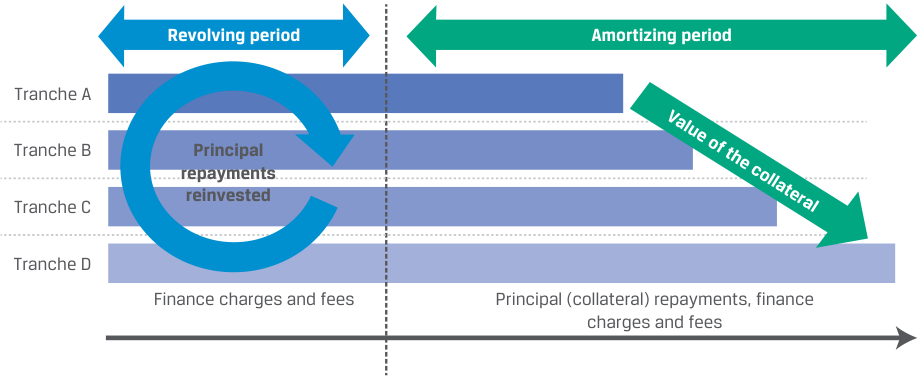
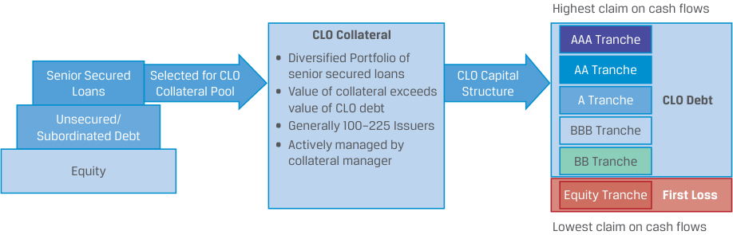

# Volume 6: Fixed Income
## Learning Module 18 Asset-Backed Security (ABS) Instrument and Market Features
### Part 2/3: Non-Mortgage Asset-Backed Securities (PDF Pages 489–503)

---

<!-- PDF Page 489 -->

- **C.** Risk ratings are based on the market risk of the pool of securitized loans or receivables as well as the priority of how they absorb losses. 

##### **Solution:** 

The correct answer is C. Risk ratings are based on the credit risk (not market risk) of the pool of securitized loans or receivables as well as the priority of how they absorb losses. 

A is incorrect because it is a correct statement. The waterfall structure redistributes the credit risk associated with the collateral. The creation of a set of bond classes allows investors to choose the level of risk that they prefer to bear and receive return accordingly. B is incorrect because it is a correct statement. Each bond class in the transaction receives a risk rating that reflects its credit risk, and some of the bond classes may exhibit a better credit rating than the company that is seeking to raise funds because of collateralization or credit enhancement. 

### **NON-MORTGAGE ASSET-BACKED SECURITIES** 

**<mark>4</mark>** 

describe types and characteristics of non-mortgage asset-backed securities, including the cash flows and risks of each type 

As we have seen earlier, non-mortgage assets, such as auto loans, have been used as collateral in securitization. Securitizations can also involve credit card receivables, personal loans, receivables, and commercial loans. 

ABS can be categorized whether the collateral is amortizing or non-amortizing. Traditional residential mortgages and auto loans are examples of amortizing loans, where the periodic payments include both principal and interest. In amortizing ABS, as the loans are paid off, the investors receive the scheduled principal repayments, and any prepayments will be distributed to the bond classes based on the payment rule. Over time as loans mature, the number of loans and their total value shrinks. 

In contrast, **non-amortizing loans** , such as credit card debt, do not involve scheduled principal repayments. For a non-amortizing collateral pool, the situation is different. Over time, some of these loans will be repaid before the stated maturity date of the ABS. If the loans are paid off during the **lockout or revolving period** , then the principal repaid is reinvested to acquire additional loans with a principal equal to the principal repaid. This reinvestment during the lockout period replenishes the collateral pool. At the end of the lockout period, the amortization period starts, and any principal that is repaid will not be reinvested in new loans but will be distributed to the ABS holders. 

A large variety of assets can be securitized as non-mortgage ABS. This module focuses on a credit card receivable ABS and a residential solar ABS. 

#### **Credit Card Receivable ABS** 

Credit cards, issued by banks, credit card companies, retailers, and travel and entertainment companies, provide a convenient way to pay and extend credit. When a purchase is made on a credit card, the issuer of the credit card (the lender) extends credit to the cardholder (the borrower). The cardholder agrees to repay the amount 

<!-- PDF Page 490 -->

borrowed plus any applicable finance charges. From the lender’s perspective, the borrowed amount is a receivable. These receivables can be pooled and used as the underlying collateral for credit card receivable ABS. 

A term sheet for a typical credit card ABS can be found in Exhibit 5. In this particular securitization, Commercial Finance Partners AG (CFP), a European bank, pools credit card receivables denominated in CHF. Credit card issuers, such as CFP, benefit from credit card securitization. First, it removes the credit card receivables from their balance sheet, which provides both capital efficiency and reduces the cost of funding. Second, it reduces the cost of default risk from credit card debt. Third, it generates additional fee income. 

This particular ABS has a 3-year revolving period when the pool uses balance repayments to purchase new credit card receivables, and this is followed by a 6-year amortization period. 

|**Exhibit 5: Credit Card** **Nin**|**ABS Term Sheet Summary** **e-Year Credit Card-Backed Notes I** **Commercial Finance Partners** **Prospectus Summary**|**ssued by** **AG**|
|---|---|---|
|**Issuer:**|Commercial Finance Partners|AG|
|**Issue Size:**|CHF900,000,000||
|**Maturity Date:**|[Nine Years from Settlement D|ate]|
|**Revolving Period**|[Starts on the Settlement Date   h Settlement Date]|and Ends Three Years from|
|**Amortization Period:**|[Starts Three Years and One B Settlement Date and Ends Nin|h    usiness Day After the e Years from Settlement Date]|
|**The Collateral:**|Portfolio comprises credit card in, and to individuals in, Switz are CHF925 million, with an a CHF2,300, with a weighted ave|loan receivables originated erland. Aggregate receivables verage principal balance of rage interest rate of 12%.|
|**Tranches**|Tranche A Notes||
||Face value:|EUR400 million|
||Interest rate:|7.00%|
||Credit enhancement features:|Subordination of the Class B, C, & D Notes|
||Tranche B Notes||
||Face value:|EUR300 million|
||Interest rate:|8.00%|
||Credit enhancement features:|Subordination of the Class C & D Notes|
||Tranche C Notes||
||Face value:|EUR150 million|
||Interest rate:|10.50%|
||Credit enhancement features:|Subordination of the Class D Notes|
||Tranche D Notes||
||Face value: Interest rate:|EUR50 million Variable|

<!-- PDF Page 491 -->

|**Ni**|**ne-Year Credit Card-Backed Notes Issued by** **Commercial Finance Partners AG** **Prospectus Summary** Credit enhancement features: None|
|---|---|
|**Interest Payment:**|Monthly commencing 30 days from [Settlement Date] to be paid each month, with final payment on [Maturity Date]|

For a pool of credit card receivables, the cash flows consist of finance charges collected, fees, and principal repayments. Finance charges collected are the periodic interest rate the lender charges the borrower on the unpaid balance on the credit card. That interest rate may be fixed or floating. Typically, the floating rate is capped: There is an upper limit of how much the lender can charge the borrower. The fees the lender collects from the borrower include late payment fees and any annual membership fees. 

As credit cards are non-amortizing loans, during the revolving period––in this case the first 3 years of the structure––the security holders receive only payments from the finance charges and fees the lender collects. The impact of the revolving period and the amortization period on the cash flows that noteholders receive from ABS that securitizes receivables are depicted in Exhibit 6. 

**Exhibit 6: Cash Flows from a Credit Card ABS** 

<!-- Start of picture text -->
Revolving period Amortizing period Tranche A Tranche B Principal repayments reinvested Tranche C Tranche D Finance charges and fees Principal (collateral) repayments, finance charges and fees Value of the collateral <!-- End of picture text -->

Some provisions in credit card receivable ABS may require early principal amortization if specific events occur. Such provisions are referred to as early amortization or **rapid amortization provisions** and are included to safeguard the credit quality of the issue, particularly during the revolving period. If the repayments during the revolving periods are not sufficient to replenish the pool, or if the defaults significantly alter the pool, the economics of the transaction may no longer be there. This triggers a rapid amortization clause that accelerates and alters principal cash flows. Noteholders will receive their investments earlier, which they can then reallocate to other investments offering more attractive risk/return characteristics. These rapid amortization clauses can be particularly beneficial to investors during periods when there are growing uncertainties about the macroeconomic environment. 

Moreover, credit card ABS typically combine various sources of credit enhancements to support the various tranches. ABS structures normally provide credit enhancements through subordination. For instance, in the CFP example, there are four tranches in addition to the overcollateralization (CHF25 million), the rapid amortization provision, and other tools to support investor appetite for an appropriate risk/ 

<!-- PDF Page 492 -->

return trade-off. In this particular case, losses from the pool have to exceed CHF75 million, or 8.33% of the face value of the ABS issue, before holders of the Tranche C Notes are impacted by the collateral losses. 

##### **EXAMPLE 4** 

#### **Contrasting Non-Mortgage ABS: Credit Card Receivable ABS vs. Auto Loan ABS** 

For credit card receivable ABS, the collateral is a pool of non-amortizing loans. During the lockout period, the cash proceeds from principal repayments are reinvested in additional credit card receivables. During this period, there is no prepayment risk and potential default risk is generally limited or is absorbed by credit enhancements. When the lockout period is over, principal repayments are used to pay off the outstanding principal on the ABS. 

For auto loan-backed securities, the collateral is a pool of amortizing loans and occasionally leases. Security holders receive regular principal repayments. As a result, the outstanding principal balance declines over time. Additionally, the investors in the pool are exposed to both prepayment and default risk from the inception of the pool. 

US credit card ABS ratings performed strongly through both the Global Financial Crisis of 2008–09 (GFC) and the COVID-19 pandemic: Less than 2% of related ratings were downgraded during the GFC, and none were downgraded during the pandemic’s onset in 2020. ABS performance is supported by the consistent quality of securitized assets and structural features that protect against weaker performance resulting from a stressed environment. 

_Source:_ Fitch Ratings, “US Auto, Credit Card ABS Performed Well Through Crises,” Fitch Wire (7 April 2021). https:// www .fitchratings .com/ research/ structured -finance/ us -auto -credit -card -abs -performed -well -through -crises -07 -04 -2021. 

#### **Solar ABS** 

With an increasing number of homeowners installing solar energy systems and other home energy efficiency improvements, many specialty finance companies have begun to offer specialized home improvement financing options: solar loans or solar leases. Solar loans allow consumers to borrow the cost of purchasing and the system from an installer. Solar leases involve renting the solar equipment directly from a solar company. 

Switching to solar energy not only improves environmental sustainability, but it also reduces overall household utility and electricity expenses. The economics are straightforward: The utility cost savings from switching to solar energy are expected to typically exceed the costs of investing in solar energy systems. Institutional investors have become interested in purchasing solar ABS as these structures offer the opportunity to contribute to sustainability while generating attractive risk-adjusted yields. 

Al-Shims Enterprises decides to securitize its solar energy systems loans via its financing subsidiary using a solar ABS. The solar ABS issues EUR300 million notes secured by 10,000 sustainable, residential, home improvement loans with a face value of EUR320 million. The average loan balance of the home improvement loans is EUR32,500, paying a weighted average rate of 7.5% with a weighted average maturity of 17 years. All loans are amortizing. The net proceeds of the offering will be allocated, in whole or in part, to the purchase and installation of residential solar energy systems, which are eligible green projects. 

From Al-Shims’ perspective, the securitization transaction removes receivables from its balance sheet, increases capital efficiency, and generates fee income. 

<!-- PDF Page 493 -->

An additional feature of the solar ABS transaction is that the proceeds are directed to financing green or environmentally friendly projects. Because solar loans facilitate environmentally sustainable benefits through the installation of a renewable and efficient energy source, they may qualify as green bonds. For institutional investors looking for environmental, social, and governance (ESG) or climate finance investment alternatives, solar ABS can offer an attractive investment alternative. 

The precise legal structure of the solar ABS transaction and its collateral depend on the jurisdiction. Normally, ABS are collateralized by the underlying debt: mortgages, loans, or receivables. The loans can be further collateralized by a lien pledged on the installed systems, on the property itself, or both. When the solar energy system loans are structured as residential home improvement loans, the solar ABS effectively securitizes a subordinated (junior) mortgage on the property. 

That is why solar ABS investors look for this type of debt: Usually, solar loan borrowers are prime borrowers that own their homes and have good payment records. Additionally, solar ABS investors are typically protected through overcollateralization, subordination, and excess spreads. Collectively, these features further reduce the default risk in these securitizations. 

Finally, many solar ABS contain a **pre-funding period** , which allows the trust to acquire during a certain period of time after the close of the transaction additional qualifying transactions that meet certain eligibility criteria. 

##### **EXAMPLE 5** 

#### **Potential Investment Strengths of Solar ABS** 

Solar ABS can offer an attractive risk/reward profile for fixed income investors. The securities are typically well-structured, with high levels of collateralization and credit enhancement, relatively low risk of default, and an attractive spread. Solar ABS are collateralized by the underlying PV systems, with credit enhancement consisting of (i) overcollateralization, (ii) subordinate bonds, (iii) general reserve account, (iv) inverter replacement reserve account, and (v) excess spread. Additionally, to date, all solar ABS transactions through 2019 have been comprised of pools of consumers with weighted-average FICO consumer credit scores above 700.a 

Solar lease or loan payments often displace a consumer’s former energy payment thus losses in this sector will likely remain low. Defaulting on a solar loan is unlikely to reduce a consumer’s overall payment obligation as they need to purchase energy in some form, and defaulting on a solar loan could revert them to paying higher monthly energy expenses. While this asset class has not been through a full credit cycle (the first solar ABS was issued in November 2013 by SolarCity), a combination of a higher credit quality consumer and the desire for a budget-saving power source may reduce the risk of default/loss on the underlying loan/lease payment.a 

With a focus on combatting climate change, consumers and utilities are continuing to shift away from traditional fossil fuels and are moving towards renewable energy sources such as solar, wind, and geothermal. Unlike coal, petroleum, and other fossil fuels, solar power contributes to a more sustainable environment as a clean, carbon-free form of green energy. Solar ABS directly supports a sustainable future by offering solar energy providers a term funding source. Solar loan/lease payments primarily displace the homeowner’s former energy bill, with the average system generally sized to provide more than 90% of the home’s current usage.a 

<!-- PDF Page 494 -->

Solar ABS may offer opportunities for institutions to accomplish dual investment goals of furthering sustainability as part of their ESG initiatives and generating incremental yield.b 

a _Institutional Investor, “Solar ABS:_ A Growing Sector Offered Sunny Side Up” (17 September 2019). https:// www .i nstitution alinvestor .com/ article/ b1h4mybwwjy5p7/ Solar -ABS -A -Growing -Sector -Offered -Sunny -Side -Up. 

b _Tim Zawacki, “Solar Securitizations Present Yield, ESG Play for Institutional Investors,” S&P Global Market Intelligence (16 December 2020).https:_ // www .spglobal .com/ marketintelligence/ en/ news -insights/ latest -news -headlines/ solar -securitizations -present -yield -esg -play -for -institutional -investors -61756315. 

##### **QUESTION SET** 

1. _Determine the correct answers to fill in the blanks:_ During the ___________ of a credit card receivable ABS, the security holders receive only ________________________________. 

##### **Solution:** 

During the revolving period of a credit card receivable ABS, the _security holders_ receive only _payments from the finance charges and fees the lender collects_ . 

2. Describe institutional investor motivations for investing in solar ABS. 

##### **Solution:** 

Institutional investors have become interested in purchasing solar ABS as these structures offer the opportunity to contribute to sustainability while generating attractive risk-adjusted yields. Solar loans have clear environmentally sustainable benefits through the installation of renewable energy and energy efficiency, which can make them appropriate for investors seeking ESG or climate finance investment alternatives. 

3. Explain the potential investment advantage from including a pre-funding period into the structure of a solar ABS. 

##### **Solution:** 

A Solar ABS that includes a pre-funding period allows its underlying trust to acquire during a certain period of time after the close of the transaction additional qualifying transactions that meet certain eligibility criteria for sustainable investment. This enhances the overall environmental benefit. In addition, there is a direct investor benefit due to diversification benefits from a broader pool. 

4. Describe a similarity of solar ABS and green covered bonds. 

##### **Solution:** 

Both types of securities are popular means of financing environmental investments in infrastructure. Solar ABS have clear environmentally sustainable benefits through the installation of renewable energy and energy efficiency. The cover pool for green covered bonds are largely made up of mortgages to green buildings, identified through various green building certification standards. 

<!-- PDF Page 495 -->

5. Which of the following statements about credit card securitization is correct? 

   - **A.** Additional fee income is generated for the issuer. 

   - **B.** The credit card receivables are kept on the issuer’s balance sheet. 

   - **C.** The cost of default risk from credit card debt to the issuer increases. 

   - **Solution:** 

The correct answer is A. Credit card securitization generates additional fee income for the issuer. B is incorrect because the credit card receivables are removed from the issuer’s balance sheet, which provides both capital efficiency and reduces the cost of funding. C is incorrect because the cost of default risk from credit card debt is reduced. 

# **COLLATERALIZED DEBT OBLIGATIONS** **<mark>5</mark>** 

describe collateralized debt obligations, including their cash flows and risks 

**Collateralized debt obligations (CDOs)** issue securities backed by a diversified pool of one or more debt obligations. CDOs can be backed by a broad range of debt. CDOs backed by corporate and emerging market bonds are **collateralized bond obligations (CBOs)** ; those backed by leveraged bank loans are **collateralized loan obligations (CLOs)** ; those backed by other CDOs are structured finance CDOs; and those backed by a portfolio of credit default swaps for other structured securities are synthetic CDOs. The prevailing CDO structure is the CLO structure, where the collateral pool is made up of leveraged bank loans. 

Exhibit 7 summarizes features of CDOs, covered bonds, mortgage-backed securities (MBS), and non-mortgage ABS: 

**Exhibit 7: Overview of CDOs and Other Securitized Products** 

||**Covered Bonds**|**CDO**|**MBS**|**Non-Mortgage ABS**|
|---|---|---|---|---|
|Collateral|Commercial or residen- tial mortgages, or public sector assets|Leveraged bank loans (CLOs)|Commercial and resi- dential mortgage loans|Credit card receivables (non-amortizing) and Solar lease/loan payments|
|Impact on Issuer Balance Sheet|Collateral remains on the balance sheet and ringfenced into a separate cover pool|Collateral removed from balance sheet|Collateral removed from balance sheet|Collateral removed from balance sheet|
|Number of Bond Classes|One bond class with its associated default expo- sure in its cover pool|Typically several|Typically several|Typically several|

<!-- PDF Page 496 -->

||**Covered Bonds**|**CDO**|**MBS**|**Non-Mortgage ABS**|
|---|---|---|---|---|
|Collateral Pool|Unstable with ongoing collateral management|Unstable with ongoing collateral management|Stable|Unstable with ongoing collateral management; a pre-funding period is used by solar ABS post-transaction|
|Recourse|Dual recourse nature: first on the ringfenced loans in the cover pool and second on the unen- cumbered assets of the issuinginstitution|Single recourse nature|Single recourse nature|Single recourse nature|

Similar to the ABS structures discussed earlier, the CDO structures redistribute the cash flows the underlying collateral pool generates and redistribute them to the tranches. For the majority of CDOs, the collateral pools are not static, so there is a need for a **collateral manager** that buys and sells debt obligations for and from the CDO’s collateral pool to generate sufficient cash flows to meet the obligations to the CDO bondholders. Otherwise, the steps and the structure of the securitization process are largely the same. The structure of a generic CDO transaction is shown in Exhibit 8. 

**Exhibit 8: The Structure of a Generic CDO Transaction** 

<!-- Start of picture text -->
Collateral Manager Special Purpose Entity Underlying Collateral Pool Assets Liabilities Principal, coupon, and Mortgages Class A Notes pre-payments, proceeds CDO bond investors Loans Class B Notes from sales, less fees Bonds Collateral Pool Class C Notes Asset-backed Securities Class D Notes Principal, interest, and pre-payments <!-- End of picture text -->

The proceeds to pay the CDO bond classes can come from interest payments from collateral assets, maturing of collateral assets, and sale of collateral assets. The basic economics of these CDO transactions is to ensure that the return on the collateral pool is higher than the funding costs, the aggregate cost of the bond classes issued to finance the transaction. Holders of senior and mezzanine bonds earn fixed returns, while the equity tranche holders and the CDO manager earn more equity-like returns. Essentially, a CDO is a leveraged transaction, where equity tranche holders use borrowed funds (the bond classes issued) to generate a return above the funding cost. 

The CDO market has changed significantly since the 2003–2007 period. The collateral today is primarily leveraged bank loans (i.e., CLOs), while during the 2003–2007 period, it consisted of a wide range of products, including different types of real estate debt and commercial mortgage-backed securities (CMBS). While subsequent regulatory and legal changes made arranging and investing in CDOs less attractive, the underlying securitization framework remains similar today. It can be best explored through CLOs, collateralized by senior secured bank loans creating a diversified portfolio of company loans. 

<!-- PDF Page 497 -->

#### **Generic CLO Structure** 

The capital structure of a generic CLO transaction is shown in Exhibit 9. The funds to purchase the collateral assets for a CLO are obtained from the issuance of debt obligations. These tranches include senior, mezzanine, and subordinated/junior/ equity tranches. 

Investors in senior or mezzanine bond classes earn a potentially higher yield than comparable corporate bonds offer, or they gain exposure to debt products that they may not otherwise be able to acquire. Investors in equity tranches take on equity-like risks with the potential to earn returns comparable to equities. Moreover, the residual tranche plays a key role in whether a CLO is viable or not; the CLO structure has to offer competitive returns for this tranche. 

CLOs come in multiple flavors. These are the most common: 

- Cash Flow CLOs, where the cash flows from interest payments and principal repayments are redistributed across the tranches. This is the most common CLO structure. 

- Market Value CLOs, where the value accruing to the tranches depends on the market value of the portfolio. 

- Synthetic CLOs, where the collateral pool is created synthetically through credit derivatives. 

**Exhibit 9: The Capital Structure of a Generic CLO Transaction** 

<!-- Start of picture text -->
Highest claim on cash flows CLO Collateral AAA Tranche • Diversified Portfolio of Senior Secured Selected for CLO senior secured loans CLO Capital AA Tranche Loans Collateral Pool • Value of collateral exceeds Structure A Tranche CLO Debt  value of CLO debt Subordinated DebtUnsecured/ • Generally 100–225 Issuers BBB Tranche • Actively managed by collateral manager BB Tranche Equity Equity Tranche First Loss Lowest claim on cash flows <!-- End of picture text -->

The ability of the manager to make the interest payments and principal repayments depends on collateral performance. The collateral manager must continually meet various performance tests and collateral limits for the underlying collateral. If the manager fails pre-specified tests, a provision is triggered that requires the payoff of the principal to the senior bond class until the tests are met. This process effectively deleverages the CLO because the cheapest funding source for the CLO, the senior bond class, is reduced. 

A typical feature of CLO transactions is that the collateral portfolio is not finalized until after the transaction closes. While the collateral manager acquires most of the loans before the transaction closes, there is a subsequent ramp-up period when additional assets are added to the collateral pool. After this period, the manager may replace loans in the portfolio as long as the new asset meets the portfolio selection criteria. The final phase of the CLO lifecycle is when the underlying loans mature and the collateral manager uses the proceeds to pay off the tranches according to the order of payments. Recourse is typically limited to the collateral pool, with minimal recourse to the original issuers. 

<!-- PDF Page 498 -->

The cash flow waterfall, in connection with performance-based tests, provides varying degrees of protection to the CLO’s debt tranches. The most senior and highest-rated AAA tranche has the lowest yield but enjoys the highest claim on the cash flow distributions and is the most loss-remote. Mezzanine tranches pay higher coupons but are more exposed to loss and have lower ratings. The most junior tranche, equity, is the riskiest, is not rated, and does not have a set coupon. Instead, the equity tranche represents a claim on all excess cash flows once the obligations for each debt tranche have been met. 

CLOs face a series of coverage tests to help ensure the cash flows generated by the underlying bank loan collateral meet the distribution obligations in the various CLO tranches. One such test is an overcollateralization test, which helps to keep the principal value of a CLO’s underlying bank loan pool above the total principal value of the notes issued by the various CLO debt tranches as long as the CLO debt remains outstanding. If the principal value declines below the overcollateralization test trigger value, cash will be diverted away from equity and junior CLO debt tranches toward senior debt tranche investors. 

Consider a hypothetical CLO created with USD700 million of principal promised to the owners of its various debt tranches. To meet this USD700 million obligation, investors and rating agencies may require that the CLO manager use the capital raised from the CLO’s debt and equity issuance to purchase USD840 million of bank loans. This would result in an overcollateralization ratio of 1.20. 

Each CLO debt tranche has its own targeted overcollateralization ratio. The overcollateralization ratios for each tranche act as covenants and, when tripped, redirect cash flows to purchase additional bank loan collateral or repay the senior-most CLO debt tranche. 

CLOs are also subject to a variety of other tests that act in concert in an effort to help protect debt investors from loss. Examples of these tests include a measurement of the industry diversification in the underlying collateral pool of bank loans and the CLO’s exposure to non-senior secured loans. Other tests consider the diversity of borrowers underlying each CLO and set single obligor limits. There are also limitations on the amount of CCC-rated debt that can be included in the underlying collateral pool, which help contain negative credit drift. 

For CLO transactions, the role of the collateral manager is key. The skill the manager displays in selecting, managing, and exchanging assets in the pool directly impacts the performance of the CLO. In a way, the collateral manager acts as an active bond portfolio manager by determining the asset mix and the risk and exposures in the collateral pool. 

##### **EXAMPLE 6** 

#### **CLOs and Systematic Risk** 

Institutional investors, such as banks, insurance companies, hedge funds, mutual funds, and pension plans, are the primary buyers in the CLO market. Each of these investors targets different CLO tranches. Due to regulations, many banks almost exclusively buy the AAA-rated tranche. Other investors, such as hedge funds and endowments, may be more speculative and thus take more risk to earn higher returns. Current CLO structures are typically simpler than the CDO structures that played a pivotal role in the GFC. Structured finance CDOs, which are made up of other CDOs, are no longer common, and even synthetic CLOs that use derivatives are less prevalent. 

After the GFC, the underlying asset quality of CLOs has received more scrutiny than was previously common. This is a reflection of the need to understand the unique characteristics of the complex asset pool in a CLO. 

<!-- PDF Page 499 -->

##### **QUESTION SET** 

1. Describe how a CDO is distinguished from a CMO by the function of the CDO’s collateral manager. 

##### **Solution:** 

While CDOs are similar to CMOs in that both issue securities backed by a diversified pool of one or more debt obligations, CDO collateral pools usually are not static. Their volatility generates a need for a collateral managerthat buys and sells debt obligations for and from the CDO’s collateral pool to generate sufficient cash flows to meet the obligations to the CDO bondholders. 

2. Identify the CLO type that corresponds to its correct characteristic: 

   - **i.** Relies on OTC contracts 

   - **ii.** Most common CLO structure 

   - **iii.** Sizes of tranches have greatest variability 

|A. Cash flow CLO|
|---|
|l B. Market value CLO|
|C. Synthetic CLO|

##### **Solution:** 

|A. Cash flow CLO|ii. Most common CLO structure|
|---|---|
|l B. Market value CLO|iii. Sizes of tranches have greatest variability|
|C. Synthetic CLO|i. Relies on OTC contracts|

   - **A.** ii is correct. Cash flow CLOs are the most common CLO structure. 

   - **B.** iii. is correct. For market value CLOs, the value accruing to the tranches depends on the market value of the portfolio and thus cannot be stated with certainty. 

   - **C.** i is correct. The collateral pool of synthetic CLOs are created synthetically through credit derivatives, which are financial contracts traded OTC. 

3. Explain why a CDO’s equity tranche holders are _most likely_ to earn the highest returns when the CDO works as designed. 

##### **Solution:** 

The basic economics of CDO transactions is to ensure the return on the collateral pool is higher than the funding costs, the aggregate cost of the bond classes issued to finance the transaction. Holders of senior and mezzanine tranches earn fixed returns, while the equity tranche holders and the CDO manager earn more equity-like returns. The equity tranche represents a claim on all excess cash flows once the obligations for each debt tranche have been met, so it is the riskiest tranche and should earn the highest return. Essentially, a CDO is a leveraged transaction, where equity tranche 

<!-- PDF Page 500 -->

holders use borrowed funds (the bond classes issued) to generate a return above the funding cost. 

4. Describe the effect of collateral performance test failure on a CLO’s financial structure. 

##### **Solution:** 

In making interest and principal payments, a CLO collateral manager must continually meet various performance tests and collateral limits for the underlying collateral. Upon a test failure, a provision is triggered requiring payoff of the principal to the senior bond class until the tests are met. This effectively deleverages the CLO because the cheapest funding source for the CLO, the senior bond class, is reduced. 

5. In certain CLOs, the motivation is to capture a spread between the potential collateral return and the funding cost. An additional risk of this type of securitization relative to an investment in an asset-backed security is: 

   - **A.** the default risk on the collateral assets. 

   - **B.** the risk that the CLO manager will fail to earn a return sufficient to pay off the investors in the senior and the mezzanine tranches. 

   - **C.** the risk due to the mismatch between the collateral making fixed-rate payments and the bond classes making floating-rate payments. 

##### **Solution:** 

B is correct. In addition to the risks associated with investments in ABS, such as the default risk on the collateral assets (answer A) and the risk due to the potential mismatch between the collateral making fixed-rate payments and the bond classes making floating-rate payments (answer C), investors in CLOs face the risk that the CLO manager will fail to earn a return sufficient to pay off the investors in the senior and the mezzanine tranches. With an ABS, the cash flows from the collateral are used to pay off the holders of the bond classes without the active management of the collateral—that is, without a manager altering the composition of the debt obligations in the pool that is backing the securitization. In contrast, in a CLO, the manager buys and sells debt obligations with the dual purpose of not only paying off the holders of the bond classes but also generating an attractive/ competitive return for the equity tranche and for the manager. 

6. Which of the following statements about collateralized loan obligations (CLOs) is _incorrect_ ? 

   - **A.** Recourse is limited to the collateral pool, with minimal recourse to the original issuers. 

   - **B.** Investors in senior or mezzanine bond classes typically earn a lower yield than comparable corporate bonds. 

   - **C.** After the ramp-up period, the collateral manager may replace loans in the portfolio as long as the new asset meets the portfolio selection criteria. 

##### **Solution:** 

The correct answer is B. Investors in senior or mezzanine bond classes earn a potentially _higher_ yield than comparable corporate bonds offer. A is incorrect because it is a correct statement. Recourse is limited to the collateral pool, with minimal recourse to the original issuers. C is incorrect because it is a correct statement. The collateral manager acquires most of the loans 

<!-- PDF Page 501 -->

before the transaction closes. In the subsequent ramp-up period, additional assets are added to the collateral pool. After this ramp-up period, the manager may replace loans in the portfolio as long as the new asset meets the portfolio selection criteria. 

<!-- PDF Page 502 -->

## **~~PRACTICE PROBLEMS~~** 

**1.** Which of the following statements regarding securitized products is correct? 

   - **A.** Credit tranching offers credit protection for the equity tranche in a securitization. 

   - **B.** Pass-through securities are the simplest securitized structure and involve issuers retaining the underlying assets. 

   - **C.** In a true securitization, the underlying pool of assets is removed from the balance sheet and transferred into an independent legal entity that issues securities backed by these assets. 

**2.** Upon a bankruptcy affecting a covered bond, the first available safeguards to protect against potential losses are the: 

   - **A.** ringfenced loans. 

   - **B.** unencumbered assets of the issuer. 

   - **C.** assets added by the collateral manager during ramp-up. 

**3.** Consider the following potential reasons to explain why covered bonds usually carry lower credit risks and offer lower yields than otherwise similar ABS: 

   **1.** Eligibility criteria 

   **2.** Dynamic cover pool 

   **3.** Redemption regime in event of sponsor default Which of the following factors accurately explain(s) this result? 

   - **A.** Reason 1 only **B.** Reasons 1 and 2 only 

   - **C.** Reasons 1, 2, and 3 

**4.** Select the internal credit enhancement that seeks to improve the overall credit quality of a risky pool of securitized loans. **A.** Letters of credit **B.** Overcollateralization 

   - **C.** Cash collateral accounts 

**5.** For an issuer, which of the following outcomes is _most likely_ afteroffering a credit card ABS? **A.** Increased cost of funding **B.** Increased income from fees 

   - **C.** Increased cost of default risk 

**6.** An action affecting the cash flow received by a credit card ABS holder during its 

<!-- PDF Page 503 -->

revolving period is the: 

   - **A.** early repayment of principal by cardholders. 

   - **B.** card’s floating-rate cap exceeding the periodic rate. 

   - **C.** triggering of an ABS rapid amortization provision. 

**7.** A characteristic of solar loans that makes them attractive to potential solar ABS investors is their: 

   - **A.** universal availability to any homeowners. 

   - **B.** ability to combine multiple liens to mitigate default risk. 

   - **C.** flexibility in allowing either purchase or rental of solar systems. 

**8.** Which investor tranche plays a key role in determining CLO viability? 

   - **A.** Senior 

   - **B.** Equity 

   - **C.** Mezzanine 

**9.** The inclusion of assets into a CLO collateral pool is completed: 

   - **A.** during a subsequent ramp-up period. 

   - **B.** prior to the close of the CLO transaction. 

   - **C.** between ramp-up and loan maturity on meeting certain requirements. 

**10.** When a CLO transaction experiences a collateral pool default: 

   - **A.** senior tranche holders are guaranteed full repayment. 

   - **B.** call features embedded in bonds likely affect junior tranches. 

   - **C.** losses are distributed proportionately across all the tranches. 

**11.** The feature of a covered bond transaction _most likely_ shared with both CDOs and non-mortgage ABS is its: 

   - **A.** specified LTV cutoff. 

   - **B.** multiple tranches for the cover pool. 

   - **C.** distinct maturity and settlement dates. 

**12.** Which of the following statements about CDOs is correct? 

   - **A.** The collateral pools for CDOs are static. 

   - **B.** The proceeds to pay the CDO bond classes can only come from interest payments from collateral assets. 

   - **C.** A CDO is a leveraged transaction, where equity tranche holders use borrowed funds to generate a return above the funding cost. 

