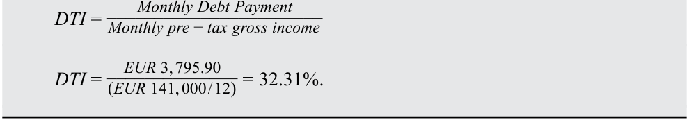

# Volume 6: Fixed Income
## Learning Module 19 Mortgage-Backed Security (MBS) Instrument and Market Features
### Part 1/3: Introduction (PDF Pages 507–521)

---

<!-- PDF Page 507 -->

# L E A R N I N G M O D U L E **<mark>19</mark>** 

### **Mortgage-Backed Security (MBS) Instrument and Market Features** 

|**LEARNI** |**NG OUTCOMES** |
|---|---|
|**_Mastery_**|**_The candidate should be able to:_**|
||define prepayment risk and describe time tranching structures in securitizations and their purpose|
||describe fundamental features of residential mortgage loans that are securitized|
||describe types and characteristics of residential mortgage-backed securities, including mortgage pass-through securities and collateralized mortgage obligations, and explain the cash flows and risks for each type|
||describe characteristics and risks of commercial mortgage-backed securities|

<!-- Start of picture text -->
1 <!-- End of picture text -->

#### **INTRODUCTION** 

This module builds on the prior ones that provided an overview of asset-backed securities (ABS) and described the benefits of securitization, the securitization process, and typical securitization structures. This module focuses on the largest ABS market in the world, mortgage-backed securities (MBS). It introduces mortgage loans and their characteristic features; discusses residential MBS (RMBS), including mortgage pass-through securities and collateralized mortgage obligations (CMOs); and describes commercial MBS (CMBS). It shows how to measure, mitigate, and share securitization-related risks across different tranches and their characteristics, and it examines MBS cash flows and risks. 

<!-- PDF Page 508 -->

###### **LEARNING MODULE OVERVIEW** 

- Prepayment risk is the risk that the borrower does not repay the principal (or a portion of the principal) as scheduled. Contraction risk occurs when the borrower repays the principal faster than anticipated, while extension risk occurs when the borrower repays the principal more slowly than planned. 

- Mortgage-backed securities (MBS) are bonds created from securitizing mortgage loans. Mortgage loans provide borrowers the funds to purchase property and require borrowers to repay lenders on a mutually agreed schedule, otherwise the lender has the right to seize the property. 

- MBS can be created based on either residential or commercial mortgages. Bonds created from the securitization of mortgages backed by residential properties are residential mortgage-backed securities (RMBS). 

- Because both scheduled principal repayments and unscheduled prepayments are made over the life of an MBS, the contractual maturity for an MBS does not reveal its actual payments and prepayments. The weighted average life is a measure widely used to assess when an MBS can be expected to be paid off. 

- A mortgage pass-through security is a security created when mortgage lenders pool mortgages together and use them to back securities that they sell to investors. The cash flows of a mortgage pass-through security depend on the monthly cash flows of the underlying pool of mortgages. 

- Collateralized mortgage obligations (CMOs) securitize mortgage pass-through securities or multiple pools of loans and are structured to redistribute the cash flows to different bond classes or tranches, thereby creating securities that have different exposures to prepayment risk. 

- The tranching structure of a CMO can redistribute prepayment risk across the different tranches; the more senior a tranche is, the less exposure it has to prepayment risk and default risk. 

- Commercial mortgage-backed securities (CMBS) can consist of just a few underlying commercial mortgages, and so one default in a CMBS pool may significantly impact the CMBS investors. Investors must evaluate this unique concentration risk by analyzing the individual loans and properties backing the CMBS, the owners of the commercial properties themselves, as well as the CMBS structure. 

- Unlike RMBS, CMBS offer investors call protection at either the structural or individual loan level and thus trade more like corporate bonds than RMBS. However, commercial mortgages often include a large balloon payment at maturity, making CMBS more vulnerable to a type of extension risk, balloon risk. 

<!-- PDF Page 509 -->

###### **SELF-ASSESSMENT** 

1. Which of the following statements regarding the loan-to-value ratio (LTV) is _most_ accurate? 

   - **A.** The LTV for a given mortgage remains static for the life of the loan. 

   - **B.** The higher the LTV, the more protection a lender has in the event of default. 

   - **C.** LTV serves as a key measure in both residential and commercial mortgages. 

###### **Solution:** 

The correct answer is C. LTV serves as a key measure both in residential and commercial mortgages. LTV is calculated as the ratio of the amount of the mortgage to the property’s value. A is incorrect because over time, the LTV changes: As the borrower makes mortgage payments, including principal repayments, the outstanding balance on the loan is reduced and also, fluctuations in the market value of the property cause the borrower’s equity to change. B is incorrect because the higher the LTV, the less protection a lender has in the event of default. 

2. Which of the following statements regarding mortgage-backed securities (MBS) is _most accurate_ ? MBS: 

   - **A.** must be backed or guaranteed by a government or a quasi-government entity. 

   - **B.** can be created by securitizing mortgages backed by residential or by commercial properties. 

   - **C.** that use credit enhancements to reduce credit risk for securities backed by residential mortgages typically are agency RMBS. 

###### **Solution:** 

The correct answer is B. The mortgages in MBS can either be residential mortgages or commercial mortgages. A is incorrect because MBS do not have to be guaranteed by the government or a quasi-government entity. But, when these mortgages or the securities issued backed by these mortgages are guaranteed by the government, there is a credit support. MBS backed by residential mortgages that are issued by private entities and not guaranteed by a federal agency or a government-sponsored enterprise (GSE) are called “non-agency RMBS.” C is incorrect because non-agency RMBS, not agency RMBS, typically use credit enhancements, such as insurance, letters of credit, guarantees, or subordinated interests, to mitigate the credit risk and improve the overall quality of the mortgage pool. These securities include credit enhancements because they are not guaranteed or insured by a government agency or by a GSE. 

3. When a mortgage is used as collateral for a mortgage pass-through security, the mortgage is _most likely_ said to be: 

   - **A.** enhanced. 

   - **B.** securitized. 

<!-- PDF Page 510 -->

###### **C.** subordinated. **Solution:** 

The correct answer is B. When a mortgage is used as collateral for a mortgage pass-through security, the mortgage is said to be securitized. A and C are incorrect because a mortgage that is used as collateral for a mortgage pass-through security is said to be _securitized_ , not enhanced or subordinated. 

4. Which of the following structures is created through time tranching? 

   - **A.** Z-tranches 

   - **B.** Floating-rate tranches 

   - **C.** Principal-only (PO) securities 

###### **Solution:** 

The correct answer is A. Z-tranches and residual tranches are created through time tranching, which means they do not pay interest payments until a pre-set date. B is incorrect because floating-rate tranches carry interest rates that are linked to an index or a market reference rate (MRR) and are used to hedge interest rate risk in portfolios. C is incorrect because principal-only (PO) securities pay only the principal repayments from the pool and can be created either from mortgage pass-throughs or as a tranche in a CMO. 

5. Which of the following risks _most likely_ explains why the maturity of an MBS declines when interest rates decline? 

   - **A.** Balloon risk 

   - **B.** Extension risk 

   - **C.** Contraction risk 

###### **Solution:** 

The correct answer is C. Contraction risk is the risk that the borrower might pay back the money borrowed more quickly than anticipated, reducing the amount of future payments the investor receives. When interest rates decline, actual prepayments will be higher than forecasted because homeowners will be more likely to refinance their mortgages. A is incorrect because balloon risk occurs when the borrower fails to make the balloon payment at the maturity of a loan with a balloon payment; it is a form of extension risk. B is incorrect because extension risk is the risk that the borrower might pay back the money borrowed more slowly than anticipated, extending rather than shortening the time of repayment and the maturity of the bond. 

6. Which of the following statements related to mortgage-backed securities (MBS) is true? 

   - **A.** The contractual maturity for an MBS accurately predicts future payments and prepayments. 

   - **B.** A measure widely used by market participants for MBS is the weighted average life, or simply the average life, of the MBS. 

<!-- PDF Page 511 -->

|**C.**A 30-year, option-free corporate bond and an MBS with a 30-year legal maturity with the same coupon rate offer equivalent interest rate risk. **Solution:** The correct answer is B. A measure widely used by market participants for MBS is the weighted average life, or simply the average life, of the MBS. This measure gives investors an indication of how long they can expect to hold the MBS before it is paid off, assuming interest rates stay at current levels and thus expected prepayments are realized. A is incorrect because the contractual maturity for an MBS does_not_reveal its actual payments and prepayments. Unscheduled principal repayments will shorten the maturi- ty of an MBS, but the pattern of repayments is driven by shifts in interest rates that are not known with certainty. C is incorrect because a 30-year, option-free corporate bond would not have the same prepayments/prepay- ment rates as an MBS with a 30-year legal maturity with the same coupon rate and thus would not offer equivalent interest rate risk.|
|---|
|7. A major difference between residential and commercial mortgage-backed securities is that:|
|**A.**CMBS securitize conforming mortgages and are collateralized by homogeneous properties as compared to properties backing an RMBS. **B.**investors must evaluate the individual loans and properties backing a CMBS as well as the owners of the commercial properties themselves. **C.**a CMBS pool may consist of thousands of mortgages from various parts of a country, while an RMBS may consist of a few homogenous residential mortgages. **Solution:** The correct answer is B. CMBS can consist of a few underlying commercial mortgages, whereas an RMBS pool may consist of thousands of mortgages from various parts of a country. Thus, one default in a CMBS pool may have a significant impact on the CMBS investors. Investors in the CMBS must consider explicitly this unique concentration risk by not only analyzing the CMBS structure but also the individual loans and properties backing the CMBS as well as the owners of the commercial properties themselves. A is incorrect because RMBS, not CMBS, securitize conforming mortgages and are collateralized by homogeneous (single-family) residential properties. C is incorrect because an RMBS pool, not a CMBS pool, may consist of thou- sands of mortgages from various parts of a country, while CMBS can consist of a few underlying commercial mortgages.|
|8. Which of the following statements related to the debt service coverage (DSC) ratio, a key indicator of potential credit performance in commercial real estate lending, is_most accurate_? A DSC ratio:|
|**A.**is equal to the property’s annual net operating income (NOI) divided by its debt service.|
|**B.**is calculated as the ratio of the amount of the loan to the underlying property’s value.|

<!-- PDF Page 512 -->

- **C.** that exceeds 1.0 indicates that the cash flows from the property are insufficient to cover the debt service while maintaining the property in its initial state of repair. 

###### **Solution:** 

The correct answer is A. The DSC ratio is equal to the property’s annual NOI divided by its debt service. NOI is defined as the rental income reduced by cash operating expenses and a replacement reserve. Debt service is the annual amount of interest payments and principal repayments. B is incorrect because the ratio of the amount of the loan to the underlying property’s value is the LTV ratio, another key indicator of potential credit performance, not the DSC. C is incorrect because a DSC ratio that exceeds 1.0 indicates that the cash flows from the property are sufficient, not insufficient, to cover the debt service while maintaining the property in its initial state of repair. 

## **<mark>2</mark>** 

#### **TIME TRANCHING** 

define prepayment risk and describe time tranching structures in securitizations and their purpose 

ABS and MBS pass-through security cash flows are uncertain because scheduled and actual payments frequently differ. Borrower behavior, such as the early payment of interest and principal as well as payment delinquencies over the life of a loan, depends upon a number of factors, including the income of the borrower (household income or cash flows for a corporation), the terms and conditions of the loan (such as the original interest rate versus current rates and any prepayment penalties), and the sale of the underlying asset being financed. To correctly value these securities, investors make certain assumptions about the predicted contractual payments after factoring in prepayment risk. **Prepayment risk** is the risk that the principal or a proportion of the principal is paid back at a different pace from the contractually agreed scheduled payment plan by the borrower. Prepayment risk has two components: contraction risk and extension risk, both of which reflect changes in the general level of interest rates. 

##### **Prepayment Risk** 

When interest rates decline, actual prepayments for fixed-rate mortgages will be higher than forecasted because homeowners will refinance at lower interest rates. Mortgage refinancing is particularly common in the US given the absence of loan prepayment penalties, which are more prevalent in other countries. Thus, the maturity of an MBS will be shorter than what was anticipated at the time of purchase. **Contraction risk** is the risk that the borrower repays the principal or a portion of the principal in a shorter period of time than the contractually agreed scheduled payment, reducing the amount of future payments the investor receives. For investors, this has two adverse consequences. First, investors must reinvest the proceeds at lower interest rates. Second, the prepayment option reduces the potential price appreciation for the bond. 

When interest rates increase, actual prepayments will be lower than forecasted because homeowners will become less likely to refinance their mortgages and may even delay new home purchases. Thus, the maturity of an MBS will be longer than what was anticipated at the time of purchase. **Extension risk** is the risk that the borrower 

<!-- PDF Page 513 -->

repays the principal or a proportion of the principal in a longer time period than the contractually agreed scheduled payment. For investors, this has adverse consequences: Higher interest rates reduce the value of the cash flows investors receive. Therefore, payments the investors receive will be discounted at a higher interest rate, and the extension stretches out the payments the investors receive. 

The structure of a securitization may also allow the redistribution of “prepayment risk” among bond classes. An approach for reducing this risk is to create bond classes that possess different expected maturities. This is referred to as **time tranching** . For instance, a securitization pool may contain sequential tranching, where the principal repayments flow first to one tranche until the principal is fully repaid for that tranche and then to the sequential tranche until the principal is repaid for that tranche. 

###### **EXAMPLE 1** 

##### **Time Tranching with Waterfall for RLT MBS** 

If the Residential Loan Trust (RLT) had issued the MBS with different expected maturities by bond class, rather than all the MBS being due in four years, the MBS investors also could select bonds based on their expected maturity. However, the investors could face prepayment or extension risk in this instance. The specific maturity dates are noted in Exhibit 1. 

**Exhibit 1: Overview of Notes Issued by Residential Loan Trust – Brief Summary of Maturity Terms** 

|**Maturity of Mortgage-Backed Notes I**|**ssued by the Residential Loan Trust**|
|---|---|
|Issuer:|Residential Loan Trust (RLT)|
|**Status and Ranking of Payments**|**Tranches**|
|Class A Notes rank senior to the Class|Tranche A Notes|
|B, C, & D Notes.|Face value: EUR825 million Interest rate: MRR + 0.50% Maturity: One year|
|Class B Notes rank senior to Class C|Tranche B Notes|
|& D Notes and rank junior to Class A Notes.|Face value: EUR100 million Interest rate: MRR + 1.50% Maturity: Two years|
|Class C Notes rank senior to the Class|Tranche C Notes|
|D Notes and rank junior to Class A &|Face value: EUR50 million|
|B Notes.|Interest rate: MRR + 2.50% Maturity: Three years|
|Class D Notes will rank junior to|h Tranche D Notes|
|Class A, B, & C Notes.|Face value: EUR25 million Interest rate: Variable Maturity: Four years|
|**Principal Payment:**|To be paid on [Maturity Date]|
|**Seniority:**|The Notes are secured obligations of RLT.|
|**Business Days:**|Frankfurt|

For the investor purchasing EUR5 million across Tranche B and Tranche C notes, loan prepayments could impact principal repayment as noted below: 

<!-- PDF Page 514 -->

|||**Timing of Prin**|**cipal Repaid**|
|---|---|---|---|
|Investor’s Initial|RLT MBS|When principal is repaid|When principal is|
|Purchases||if no prepayments in the RLT collateral pool|repaid if interest rates decline early in year two, thereby driving immediate prepay- ments in the RLT pool|
|Class A|EUR0|One year, per MBS terms|One year, per MBS|
|Notes|million||terms|
|Class B|EUR3|Two years, per MBS terms|Less than two years|
|Notes|million|||
|Class C|EUR2|Three years, per MBS|Less than three years|
|Notes|million|h terms||
|Class D|EUR0|Four years, per MBS terms|Less than four years|
|Notes|million|||

We would require additional information about the value of all prepayments and their exact timing to identify the exact principal repayment date. As seen in Exhibit 1, it is possible and quite common for a securitization to have structures with both credit tranching (subordinated structures) and time tranching (different expected maturities). 

###### **EXAMPLE 2** 

##### **Volkswagen Emissions Scandal** 

Investors are exposed to certain types of idiosyncratic risks when buying assetbacked securities (ABS). For buyers of auto ABS, major automaker recalls are a known risk to bond investors. In 2015, the US Securities and Exchange Commission (SEC) accused Volkswagen (VW), one of the world’s largest carmakers, and its CEO Martin Winterkorn with defrauding American investors during an emissions scandal (the “Dieselgate” scandal). Volkswagen later admitted that it cheated on diesel emission tests, and this admission wiped billions of euros from the company’s market value and led to the resignation of Winterkorn. The emissions scandal that rocked Volkswagen also impacted ABS tied to car loans and leases. Sales of auto ABS were booming in the years just prior to the scandal as investors sought higher-yielding products given the low interest-rate environment. 

About USD5.6 billion worth of VW auto ABS were outstanding in 2015, with USD4.39 billion coming from bonds backed by loans and leases. Volkswagen, facing potential fines and litigation, found its ability to attract new business temporarily crimped, forcing down the values of the cars backing such loans. There were USD1.25 billion worth of bonds that were backed by car dealer inventories of VW cars, known as dealer floorplan ABS. For dealer floorplan ABS, the ABS trust benefits from VW financing assistance, including but not limited to VW’s pledge to repurchase unsold new vehicles and inventory. Car dealers, told to immediately halt sales of popular 2015 and 2016 models, including Volkswagen's Jetta and Beetle convertible, were saddled with unsalable product. Dealers had a number of cars that they could not sell, so inventory did not turn over as rapidly. The ABS most adversely affected by VW’s sales stoppage of certain 2015 and 2016 diesel models was the dealer floorplan securitization. 

<!-- PDF Page 515 -->

Debt investors were demanding greater compensation from Volkswagen after the company said its emissions-cheating scandal would cost the firm more than EUR6.5 billion. Volkswagen, a frequent issuer in Europe’s asset-backed securities market, said that EUR2.6 billion of loans or leases for vehicles built with engines using cheating software were packaged into its securitizations. 

Late in 2015, Volkswagen was marketing a new auto ABS with a yield premium that was three times bigger than a similar deal earlier that year. The German carmaker was offering to pay about 60 bps to 65 bps more than benchmark rates for top-ranking notes of the securitization of auto leases. In comparison, Volkswagen paid a spread of 20 bps over the one-month euro interbank offered rate for similar debt in April 2015. 

###### **QUESTION SET** 

1. Creating bond classes that possess different expected maturities is referred to as: 

   - **A.** subordination. 

   - **B.** time tranching. 

   - **C.** credit tranching. 

###### **Solution:** 

The correct answer is B. An approach for reducing “prepayment risk” or “extension risk” among bond classes is to create bond classes that possess different expected maturities. This is referred to as time tranching. A and C are incorrect because subordination, also commonly referred to as a “waterfall” structure, involves directing losses to the subordinated bond classes before the senior bond classes, not creating bond classes that possess different expected maturities. 

2. Identify which of the following statements regarding securitized products is most accurate: 

   - **A.** With time tranching, the tranches of a CMO amortize over time and all tranches mature at the same time. 

   - **B.** Pass-through securities are the simplest securitized structure and involve issuers retaining the underlying assets. 

   - **C.** In a true securitization, the underlying pool of assets is removed from the balance sheet and transferred into an independent legal entity that issues securities backed by these assets. 

###### **Solution:** 

The correct answer is C. In a true securitization, the specific pool of assets is removed from the balance sheet and transferred into a separate and independent legal entity that then issues securities backed by these pooled assets. A is incorrect because time tranching is an approach to reduce prepayment or extension risk by creating bond classes that possess different expected maturities. B is incorrect because covered bonds, not pass-through securities, are the simplest securitization structure; they involve the issuer retaining the underlying assets on its balance sheet. 

<!-- PDF Page 516 -->

3. Issuing the collateralized bond classes with different expected maturities is _most likely_ designed to mitigate: 

   - **A.** credit risk. 

   - **B.** default risk. 

   - **C.** prepayment risk. 

###### **Solution:** 

The correct answer is C. Prepayment risk is the uncertainty that the cash flows will be different from the scheduled cash flows as set forth in the lease agreement because of the lessors’ ability to alter payments. The creation of bond classes with different expected maturities, referred to as time tranching, allows prepayment risk to be redistributed among bond classes. A is incorrect because credit risk pertains to the risk of default in the assets backing the collateralized bonds, not to the timing of payments, and B is incorrect because default risk again pertains to the risk of default in the assets backing the collateralized bonds. 

4. _Determine the correct answers to complete the following sentences:_ 

_______ is the risk that the borrower might pay back the money borrowed more quickly than anticipated, reducing the amount of future payments the investor receives. _______ is the risk that the borrower might pay back the money borrowed more slowly than anticipated, extending the time of repayment and the maturity of the bond. 

###### **Solution:** 

_Contraction risk_ is the risk that the borrower might pay back the money borrowed more quickly than anticipated, reducing the amount of future payments the investor receives. _Extension risk_ is the risk that the borrower might pay back the money borrowed more slowly than anticipated, extending the time of repayment and the maturity of the bond. 

## **<mark>3</mark>** 

#### **MORTGAGE LOANS AND THEIR CHARACTERISTIC FEATURES** 

describe fundamental features of residential mortgage loans that are securitized 

This lesson describes fundamental features of mortgage loans, the building block of the largest ABS market, the **mortgage-backed securities (MBS)** market. **MBS** are bonds created from the securitization of mortgages. A **mortgage loan** is secured by the collateral of a specified real estate property that obliges the borrower to make a predetermined series of payments to the lender. The mortgage lender has a **first lien** and security interest in the property, which gives the lender the right to seize the collateral if the borrower does not pay as agreed. Upon a **default** on the mortgage loan, the lender can potentially foreclose on the property. The **foreclosure** would allow the lender to take possession of the property and ultimately sell the property to recover funds toward satisfying the outstanding debt obligation. 

<!-- PDF Page 517 -->

Typically, the amount of the loan advanced to buy the property is less than the property’s purchase price: The difference is the down payment. The ratio of the amount of the mortgage to the property’s value is called the **loan-to-value ratio (LTV)** . The lower the LTV, the higher the borrower’s equity. From the lender’s perspective, the higher the borrower’s equity, the less likely the borrower is to default. Moreover, the lower the LTV, the more protection the lender has if the borrower does default and the lender repossesses and sells the property. When the loan is first taken out, the borrower’s equity in the property is equal to the down payment. Over time, the LTV changes: As the borrower makes mortgage payments, including principal repayments, the outstanding balance on the loan is reduced and as the market value of the property changes, the borrower’s equity also changes. LTV serves as a key measure both in residential and commercial mortgages. 

The capacity to sustain debt payments is another consideration. For residential lending, the metric is the **debt-to-income ratio (DTI)** , which compares an individual’s monthly debt payments to their monthly pre-tax, gross income. Lenders, including mortgage lenders, use the DTI to measure an individual’s ability to manage monthly payments and repay debts. A low DTI shows a balance between income and debt and suggests that the borrower could sustain additional debt. A high DTI ratio signals that the borrower may carry too much debt for the amount of income earned each month. Typically, lenders want to see low DTI ratios before extending loans to a potential borrower. 

###### **EXAMPLE 3** 

##### **LTV and DTI Calculation** 

A borrower wishes to secure a mortgage loan to purchase a house. Information regarding the house, the desired loan, and the buyer’s finances is shown below: 

- House Price: EUR800,000 

- Desired Loan Amount: EUR600,000 

- Annual interest rate: 4.50% 

- Loan term: 20 years/240 months 

- Borrower’s annual pre-tax gross income EUR141,000 

The associated loan-to-value ratio (LTV) can be calculated using the desired loan value and the anticipated house price, as shown here: 

<!-- Formula Text: LTV =  Loan Amount _ House Price -->

<!-- Formula Text: LTV =  EUR 600, 000 _ EUR 800, 000   =  75%. -->

To calculate the debt-to-income ratio (DTI), we use the monthly debt payment and the borrower’s monthly pre-tax gross income: 

|**Month**|**Total Monthly** **Payment**|**Monthly Interest** **Payment**|**Monthly Principal** **Payment**|**Remaining** **Principal**|
|---|---|---|---|---|
|1|3,795.90|2,250.00|1,545.90|598,454.10|
|2|3,795.90|2,244.20|1,551.69|596,902.41|
|3|3,795.90|2,238.38|1,557.51|595,344.90|
|4|3,795.90|2,232.54|1,563.35|593,781.55|
|5|3,795.90|2,226.68|1,569.22|592,212.33|
|236|3,795.90|70.38|3,725.52|15,042.30|

<!-- PDF Page 518 -->

|**Month**|**Total Monthly** **Payment**|**Monthly Interest** **Payment**|**Monthly Principal** **Payment**|**Remaining** **Principal**|
|---|---|---|---|---|
|237|3,795.90|56.41|3,739.49|11,302.81|
|238|3,795.90|42.39|3,753.51|7,549.30|
|239|3,795.90|28.31|3,767.59|3,781.71|
|240|3,795.90|14.18|3,781.71|(0.00)|

We calculate the monthly debt payment, with the first five and final five monthly payments of the 20-year mortgage. Putting the borrower’s monthly pre-tax gross income and the monthly mortgage payment into the DTI formula provides the following DTI ratio: 

<!-- Formula Text: DTI = Monthly Debt Payment _______________________ Monthly pre − tax gross income DTI =   EUR 3, 795.90 ______________ (EUR 141, 000 / 12)  = 32.31%. -->

In the United States, market participants typically identify two types of mortgages based on the credit quality of the borrower: prime loans and subprime loans. **Prime loans** have borrowers of high credit quality with strong employment and credit histories, a low DTI, substantial equity in the underlying property, and a first lien on the mortgaged property serving as the collateral for the loan. **Subprime loans** have borrowers with lower credit quality, high DTI, and/or are loans with higher LTV, and include loans that are secured by second liens otherwise subordinated to other loans. 

##### **Agency and Non-Agency RMBS** 

The mortgages in MBS can either be residential mortgages or commercial mortgages. The bonds created from the securitization of mortgages backed by residential properties are residential mortgage-backed securities (RMBS). 

In the United States, Canada, Japan, and South Korea, there is a distinction between RMBS that are guaranteed by the government or a quasi-government entity and RMBS that are not. In the United States, securities backed by residential mortgages are divided into three sectors: 

**1.** Guaranteed by a federal agency; 

**2.** Guaranteed by government-sponsored enterprises (GSEs); and 

**3.** Issued by private entities and thus not guaranteed by a federal agency or a GSE. 

The first two sectors are referred to as **agency RMBS** , and the third sector is referred to as **non-agency RMBS** . Agency RMBS include securities issued by government agencies. These RMBS carry the full faith and credit of the government, essentially a guarantee with respect to timely payment of interest and repayment of principal. Agency RMBS also include RMBS issued by GSEs. RMBS issued by GSEs do not carry the full faith and credit of the government, but rather the GSEs’ guarantee of the timely payment of interest and principal for the securities. The GSE’s charge a fee for this guarantee. 

Due to changing regulatory guidance and increased scrutiny, non-agency-RMBS all but disappeared after the global financial crisis. They were issued by banks, financial institutions, and other private businesses and were not beneficiaries of government guarantees. These private pass-throughs or private label MBS gained credit enhancement through pool insurance, letters of credit, guarantees, or subordination. 

<!-- PDF Page 519 -->

Non-agency RMBS securitized mortgages were collateralized by non-conforming mortgages, or by subprime, highly risky mortgages. Some residential home improvement loans, such as solar ABS discussed in an earlier lesson, that are subordinated to primary mortgage liens are now securitized in increasing volume. 

##### **Mortgage Contingency Features** 

Mortgages contain certain features that give the borrower and the lender certain rights throughout the contract. The most important right a borrower has is the option to prepay a mortgage by making any payment on the principal that exceeds the scheduled principal repayment. The **prepayment option** or an **early repayment option** may entitle the borrower to prepay all or part of the outstanding mortgage principal prior to maturity. This creates a risk from the lender’s or investor’s viewpoint: the cash flow amounts and timing cannot be known with certainty. This prepayment risk affects all mortgages that allow prepayment, not only the level-payment, fixed-rate, fully amortizing mortgages. 

Lenders reduce this risk by stipulating a monetary penalty for prepayment that compensates the lender for the difference between the contract rate and the prevailing mortgage rate if the borrower prepays when interest rates decline. It is an effective mechanism that provides some certainty for the lender and reduces the incentive to prepay a mortgage. Prepayment penalty mortgages are quite common in Europe, while in the United States few mortgages have prepayment penalties. 

When the borrower fails to make the contractual loan payments as stipulated in the note and loan documents, it may trigger a default on the mortgage loan that would allow the lender to potentially foreclose on the property and sell it. But the proceeds received from the sale of the property may be insufficient to recoup the losses. In a **recourse loan** , the lender has a claim against the borrower for the shortfall (deficiency) between the amount of the outstanding mortgage balance and the proceeds received from the sale of the property. In a **non-recourse loan** , the lender does not have such a claim against the borrower and thus can look only to the property to recover the outstanding mortgage balance. In the United States, recourse is typically determined by the state, and residential mortgages are non-recourse loans in many states. In contrast, residential mortgages in most European countries are recourse loans. 

The recourse/non-recourse feature of a mortgage has implications for projecting the likelihood of defaults by borrowers, particularly for mortgages where the LTV exceeds 100%—sometimes referred to as “underwater mortgages.” 

###### **EXAMPLE 4** 

##### **Underwater Mortgages during the 2008–09 Global Financial Crisis** 

A mortgage is said to be in negative equity, or “underwater,” when a home is valued for less than the amount their owners owe the banks holding their mortgage loans. Being underwater is typically a precursor to foreclosure. 

The most extreme example of widespread underwater mortgages occurred during the Global Financial Crisis of 2008–09 (GFC). At the end of 2009, almost 10.7 million, or 23% of, US residential properties were underwater. An additional 2.3 million mortgages were approaching negative equity, meaning they had less than 5% equity. 

<!-- PDF Page 520 -->

This phenomenon existed primarily because of loose credit underwriting standards and inflated home prices from 2004–06, followed by declining home prices and high leverage on non-recourse mortgage loans provided by banks and other debt capital providers. 

The distribution of negative equity was heavily concentrated in five states: Nevada (65%), followed by Arizona (48%), Florida (45%), Michigan (37%), and California (35%). Among the top five states, the average negative equity share was 40%, compared to 14% for the remaining states. 

The rise in negative equity is closely tied to increases in pre-foreclosure activity. At one end of the spectrum, borrowers with equity tend to have very low default rates. At the other end, investors tend to more commonly default on their mortgages once in negative equity, as their default rate is typically 2% to 3% higher than owner-occupied homes with similar degrees of negative equity. For the highest level of negative equity, investors and owners behave very similarly and default at similar rates. Strategic default on the part of the owner occupier becomes more likely at such high levels of negative equity, especially when the mortgage loan is non-recourse. 

If the mortgage is non-recourse, the borrower may have an incentive to strategically default on an underwater mortgage and allow the lender to foreclose on the property, even if the borrower has resources available to continue to make mortgage payments. Although there are negative consequences to a “strategic default,” such as lower credit scores and a reduced ability to borrow in the future, some borrowers may make use of this approach. Where mortgages are recourse loans, a strategic default is less likely because the lender can recover the shortfall from the borrower’s other assets and/or income. 

###### **QUESTION SET** 

1. _Determine the correct answers to complete the following sentences:_ 

___________ are bonds created from the securitization of mortgages. A ____________ is secured by the collateral of some specified real estate property that obliges the borrower to make a predetermined series of payments to the lender. 

###### **Solution:** 

_MBS_ are bonds created from the securitization of mortgages. A _mortgage loan_ is secured by the collateral of some specified real estate property that obliges the borrower to make a predetermined series of payments to the lender. 

2. A borrower procures a JPY33,165,000 loan for a JPY36,850,000 house in Tokyo. Calculate the LTV for this transaction and explain why the lender uses this measure. 

###### **Solution:** 

The LTV (loan-to-value ratio) is the ratio of the amount of the mortgage to the property’s value. 

__________________Amount of the mortgage _LTV_ = Property's value  LTV_ =33, 165, 000 36, 850, 000 

<!-- PDF Page 521 -->

###### _LTV_ = 90.0% . 

The lender uses the LTV ratio to assess the likelihood that a borrower will default. The lower the LTV, the higher a borrower’s equity. The higher the borrower’s equity, the less likely a default. 

3. Identify the mortgage feature below that corresponds to its description. (Matching) 

|1. Maturity|A. The contract or note rate|
|---|---|
|2. Mortgage Interest Rate|h B. The right of a borrower to pay more than the scheduledprincipal required|
|3. Amortization|C. The rights of a lender when the borrower fails to make required loan payments|
|4. Right to Prepay|D. The typical term|
|5. Rights in a Foreclosure|h E. The set schedule for repayment of the mortgage|

###### **Solution:** 

   **1.** D is correct. Maturity is the typical term or number of years to maturity of a mortgage. 

   **2.** A is correct. The interest rate on a mortgage is called the mortgage rate, contract rate, or note rate, and it varies among countries. 

   **3.** E is correct. Amortization pertains to the pace at which the balance of a loan is gradually reduced over time according to a set schedule. 

   **4.** B is correct. A prepayment option (or early repayment option) may entitle the borrower to prepay all or part of a mortgage’s outstanding principal prior to maturity. 

   **5.** C is correct. When a borrower fails to make the contractual loan payments, the lender’s rights in a foreclosure allow foreclosure and sale of the property. 

4. A real estate investor has obtained a recourse mortgage loan on a shopping center from a bank. The loan has an outstanding balance of USD7,000,000, while the property is valued at only USD5,000,000. In the event of a default on the loan, the bank has a claim on: 

   - **A.** the property. 

   - **B.** the borrower’s personal assets. 

   - **C.** both the property and the borrower’s personal assets. 

###### **Solution:** 

The correct answer is C. In a recourse loan, the lender has a claim against the borrower for the shortfall (deficiency) between the amount of the outstanding mortgage balance and the proceeds received from the sale of the property. A is incorrect because in a non-recourse loan, the lender has a claim against only the property for any shortfall between the amount of the outstanding mortgage balance and the proceeds received from the sale of the property. B is incorrect because mortgage lending entails a first lien and security interest in the property, which is the lender’s collateral. 

