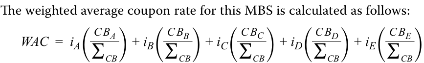
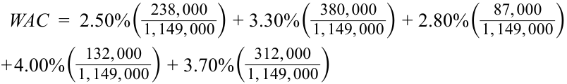
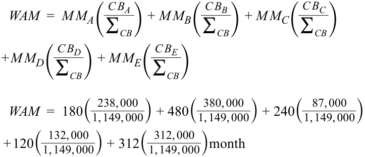
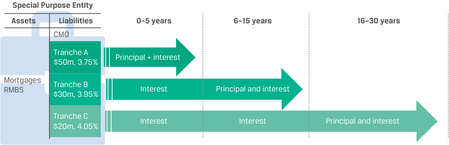
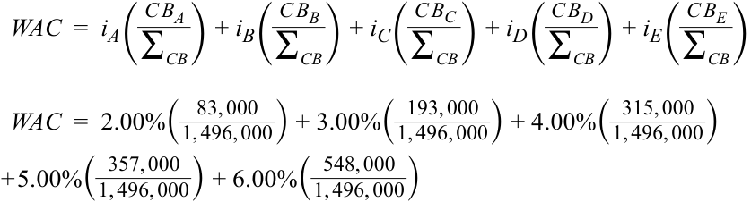

# Volume 6: Fixed Income
## Learning Module 19 Mortgage-Backed Security (MBS) Instrument and Market Features
### Part 2/3: Residential Mortgage-Backed Securities (RMBS) (PDF Pages 522–536)

---

<!-- PDF Page 522 -->

# **<mark>4</mark>** 

## **RESIDENTIAL MORTGAGE-BACKED SECURITIES (RMBS)** 

describe types and characteristics of residential mortgage-backed securities, including mortgage pass-through securities and collateralized mortgage obligations, and explain the cash flows and risks for each type 

This section starts with a discussion of different RMBS types, to continue with an overview of mortgage pass-through securities and non-agency RMBS. It concludes with collateralized mortgage obligations. 

A **mortgage pass-through security** is a security created when mortgage lenders pool mortgages together and sell securities to investors. The cash flow from the mortgage pool––monthly payments of principal, interest, and prepayments––are “passed through” to the security holders. A pool can consist of several thousand or only a few mortgages. When a mortgage is used as collateral for a mortgage pass-through security, the mortgage is said to be securitized. 

### **Mortgage Pass-Through Securities** 

The cash flows of a mortgage pass-through security depend on the monthly cash flows of the underlying pool of mortgages. The amount and the timing of the cash flows from the pool of mortgages cover both the cash flow passed through to the security holders and administrative charges for servicing the pool; the structure is depicted in Exhibit 2. 

**Exhibit 2: Mortgage Pass-Through** 

<!-- Start of picture text -->
Special Purpose Entity Assets Liabilities Principal,  coupon, and Principal, interest, and Mortgages RMBS pre-payments less fees pre-payments WAC = 4.55% Pass through rate = 4.00% Servicing fees = 0.55% <!-- End of picture text -->

_Note:_ WAC = weighted average coupon rate. 

These administrative charges include collecting monthly payments from borrowers, forwarding proceeds to owners of the loan, sending payment notices to borrowers, maintaining records of the outstanding mortgage balance, initiating foreclosure proceedings if necessary, and providing tax information to borrowers when applicable. Additionally, the issuer or financial guarantor of the mortgage pass-through security may charge fees for guaranteeing the issue. All these fees are typically calculated as a portion of the mortgage rate. 

- A comparison of MBS and RMBS can be found in Exhibit 3. 

<!-- PDF Page 523 -->

**Exhibit 3: Comparison of MBS and RMBS** 

||**Mortgage-Backed Securi-** **ties (MBS)**|**Residential Mortgage-Backed Securities** **(RMBS)**|
|---|---|---|
|Underlying collateral|Residential or commercial mortgages|Residential mortgages and/or mortgage pass-through securities|
|Subtype|■RMBS|■Mortgage pass-through securities|
||■CMBS|■Collateralized mortgage obligations (CMOs), including sequential pay, planned amortization class (PAC), and support tranches ■Agency RMBS ■Non-Agency RMBS|

A mortgage pass-through security’s coupon rate is called the **pass-through rate** and is lower than the weighted average mortgage rate earned on the underlying pool of mortgages because of administrative charges. The pass-through rate that the investor receives is said to be “net interest” or “net coupon.” 

The mortgages in a securitization pool are heterogeneous: outstanding principal, interest rates, and maturities vary across the mortgages. Consequently, for each mortgage pass-through security, a **weighted average coupon rate (WAC)** and a **weighted average maturity (WAM)** are determined. The WAC is calculated by weighting the mortgage rate of each mortgage in the pool by the percentage of the outstanding mortgage balance relative to the outstanding amount of all the mortgages in the pool. Similarly, the WAM is calculated by weighting the remaining number of months to maturity of each mortgage in the pool by the outstanding mortgage balance relative to the outstanding amount of all the mortgages in the pool. 

Exhibit 4 shows the five mortgages underlying a specific mortgage-backed security. 

**Exhibit 4: Weighted Average Coupon Rate and Weighted Average Maturity** 

|**Mortgage**|**Interest** **rate** **(****_i_)**|**Beginning** **Balance** **(BB)**|**Current Bal-** **ance** **(CB)**|**Original** **Term** **(months)**|**Number of** **Months to** **Maturity** **(MM)**|
|---|---|---|---|---|---|
|**A**|2.50%|EUR300,000|EUR238,000|240|180|
|**B**|3.30%|EUR420,000|EUR380,000|600|480|
|**C**|2.80%|EUR100,000|EUR87,000|288|240|
|**D**|4.00%|EUR280,000|EUR132,000|360|120|
|**E**|3.70%|EUR350,000|EUR312,000|384|312|
|||EUR1,450,000|EUR1,149,000|||

<!-- Formula Text: The weighted average coupon rate for this MBS is calculated as follows: WAC  =  i A( C B A _ ∑ CB  ) + i B( C B B _ ∑ CB  ) + i C( C B C _ ∑ CB  ) + i D( C B D _ ∑ CB  ) + i E( C B E _ ∑ CB  ) -->

<!-- PDF Page 524 -->

<!-- Formula Text: WAC  =  2.50%(  238, 000 _ 1, 149, 000 ) + 3.30%(  380, 000 _ 1, 149, 000 ) + 2.80%(  87, 000 _ 1, 149, 000 ) + 4.00%(  132, 000 _ 1, 149, 000 ) + 3.70%(  312, 000 _ 1, 149, 000 ) -->

_WAC_ = 3.29%. 

The weighted average maturity for this MBS is calculated as follows: 

<!-- Formula Text: WAM  =  M M A( C B A _ ∑ CB  ) + M M B( C B B _ ∑ CB  ) + M M C( C B C _ ∑ CB  ) + M M D( C B D _ ∑ CB  ) + M M E( C B E _ ∑ CB  ) WAM  =  180(  238, 000 _ 1, 149, 000 ) + 480(  380, 000 _ 1, 149, 000 ) + 240(  87, 000 _ 1, 149, 000 ) + 120(  132, 000 _ 1, 149, 000 ) + 312(  312, 000 _ 1, 149, 000 )month -->

_WAM_ =313 months. 

### **Collateralized Mortgage Obligations (CMOs)** 

**Collateralized mortgage obligations** securitize mortgage pass-through securities or multiple pools of loans. CMOs are structured to redistribute the cash flows to different bond classes or tranches and create securities that have different exposures to prepayment risk. Exhibit 5 depicts a simplified CMO structure where the cash flows are pooled and redistributed across the different tranches. 

**Exhibit 5: Collateralized Mortgage Obligation (CMO)** 

<!-- Start of picture text -->
Pass-Through SPE 1 Assets Liabilities Principal, interest, and Mortgages RMBS 1 pre-payments pass-throughs Principal, coupon, and CMO SPE 3 pre-payments less fees Assets Liabilities Mortgage CMO Passthrough Tranche A Principal, coupon, Pass-Through SPE 2 RMBS 1 and 2 Tranche B and pre-payments Principal, interest, and Mortgages Assets RMBS 2 Liabilities pre-payments less feesPrincipal, coupon, and Tranche CTranche DTranche E less fees pre-payments pass-throughs Tranche F Principal, interest, and pre-payments <!-- End of picture text -->

The tranching structure in the CMOs cannot eliminate prepayment risk, but it can redistribute the prepayment risk across the different tranches, insulating some tranches more than others. The CMO tranche structures reduce the uncertainties of the size and timing of payments investors receive. The features of these tranches are designed to specifically meet the various needs of institutional investors. Across the range of CMO structures, the more senior a tranche is, the less exposure it has to prepayment risk and default risk. 

<!-- PDF Page 525 -->

#### **_Sequential-Pay CMO_** 

In sequential-pay CMO structures, each tranche would be retired sequentially. This is an example of time tranching. One class begins to receive principal payments from the underlying securities only after the principal on any previous class has been completely paid off and retired. All principal payments are made to Tranche A until the principal balance for Tranche A is zero. After Tranche A is paid off, the principal payments go to Tranche B until the principal balance for Tranche B is zero. This continues until all the tranches are repaid. 

To illustrate a sequential-pay CMO, let us use a hypothetical transaction with the terms outlined above. The collateral for this CMO is the mortgage pass-through security described in Exhibit 2, where the total par value of the collateral is USD100 million, the pass-through coupon rate is 4%, the WAC is 4.55%, and the WAM is 360 months (about 30 years). From this collateral, three tranches are created, as shown in Exhibit 6. The coupon rate varies with the differences in maturity and reflects the term structure of interest rates, among other factors. Exhibit 6 shows the resulting structure. 

**Exhibit 6: Sequential-Pay CMO** 

<!-- Start of picture text -->
Special Purpose Entity Assets Liabilities 0–5 years 6–15 years 16–30 years CMO Tranche A Principal + interest $50m, 3.75% Mortgages Tranche B RMBS Interest Principal and interest $30m, 3.95% Tranche C Interest Interest Principal and interest $20m, 4.05% <!-- End of picture text -->

Some protection against prepayment risk is provided for each tranche. The protection arises because prioritizing the distribution of principal (that is, establishing the payment rule for the principal repayment) effectively protects the shorter-term tranche (A in this structure) against extension risk. This protection comes from the longer-term tranches B and C. At the same time, Tranches B and C benefit because they are provided protection against contraction risk from Tranche A. Thus, the sequential-pay CMO structure allows investors concerned about extension risk to invest in Tranche A, and those concerned about contraction risk to invest in Tranches B and C. 

Although the payment rules for the distribution of the principal repayments are known, the actual principal repayment amount in each month is not, as it depends on the actual prepayment rate of the collateral. In the sequential-pay CMO structure, the tranches have average lives that are shorter or longer than the collateral, thereby attracting investors who have preferences for different average lives. A pension fund that expects a significant increase in the number of retirements after several years may opt for a tranche with a longer average life, such as Tranche B. An endowment that looks to finance large building projects over the next few years may choose a tranche with lower average life, such as Tranche A. And long-term investors willing to assume more risk may select Tranche C. 

<!-- PDF Page 526 -->

#### **KNOWLEDGE CHECK** 

1. Referring to the sequential-pay CMO in Exhibit 6, match each investor type to the tranche that _most closely_ fits its needs. 

#### **_Investor Types:_** 

- **a.** A pension fund looking for higher returns in exchange for accepting more risk 

- **b.** A mutual fund seeking safe returns for a small portion of its portfolio. 

- **c.** An insurance company that sells annuities to clients expected to retire starting in approximately fifteen years 

|**Tranche**|**Investor Type**|
|---|---|
|_Tranche A Notes_||
|Principal Amount: USD50 million Coupon Rate: 3.75%||
|Maturity Date: [Five Years from Settlement Date]||
|_Tranche B Notes_ Principal Amount: USD30 million Coupon Rate: 3.95%||
|Maturity Date: [Fifteen Years from Settlement Date]||
|_Tranche C Notes_||
|Principal Amount: USD20 million Coupon Rate: 4.05% h||
|Maturity Date: [Thirty Years from Settlement Date]||

#### **Solution:** 

|**Tranche**|**Investor Type**|
|---|---|
|_Tranche A Notes_ Principal Amount: USD50 million Coupon Rate: 3.75%|b) A mutual fund seeking safe returns for a small portion of its portfolio.|
|Maturity Date: [Five Years from Settlement Date]||
|_Tranche B Notes_ Principal Amount: USD30 million Coupon Rate: 3.95% Maturity Date: [Fifteen Years from Settlement Date]|c) An insurance company that sells annuities to clients expected to retire starting in approximately fifteen years.|
|_Tranche C Notes_ Principal Amount: USD20 million Coupon Rate: 4.05% h|a) A pension fund looking for higher returns in exchange for accepting more risk.|
|Maturity Date: [Thirty Years from Settlement Date]||

<!-- PDF Page 527 -->

### **Other CMO Structures** 

The cash flows from an underlying mortgage pool can be structured in additional ways. The structures below describe various tranches that are created through time tranching (Z-tranche and residual tranche) or by splitting up cash flows from the pool. 

- _Z-Tranches_ do not pay interest payments until a pre-set date, when both principal and accrued interest payments start. During the accrual period at each payment date, the principal value of the Z-tranche is credited by the stated coupon rate. Typically, Z-tranches are the last tranche in a series of sequential or PAC and companion tranches. A Z-tranche benefits the other tranches because it frees up cash flows that other tranches can distribute. At the same time, holders of the Z-tranche do not face reinvestment risk when market yields decline. Z-tranches usually have average lives in excess of 20 years. This makes these tranches risky and hard to value. Z-tranches are also known as accretion bonds or accrual bonds. 

- _Principal-Only (PO) securities_ pay only the principal repayments from the pool. These securities can be created either from mortgage pass-throughs or as a tranche in a CMO. Because PO investors receive the face value of their securities through scheduled principal payments and prepayments, the value of these securities is very sensitive to prepayment rates and interest rates. With falling interest rates or when prepayments accelerate, the value of the PO will increase. 

- _Interest-Only (IO) securities_ pay their holders only the interest payments from the pool. IO securities are a companion of the PO securities in a CMO transaction. These securities have no face or par value. With increased prepayments, the cash flows paid to the IO investors decline. That is why investors use IOs to hedge their portfolios against interest rate risk. 

- _Floating-Rate tranches_ carry interest rates that are linked to an index or a market reference rate. The interest rates are variable and are often subject to both a cap and a floor rate. These tranches are impacted by how interest rate movements affect prepayment rates. Floating-rate tranches can also be structured as inverse floaters, where the interest paid changes in the opposite direction of the change in interest rates. They are used to hedge interest rate risk in portfolios. 

- _Residual tranches_ collect any remaining cash flow from the pool after all the obligations to the other tranches are met. These investments are appropriate for investors that can assume the risk and hedge it. Such investors include hedge funds and long-term institutional investors. Banks typically avoid such investments due to capital requirements. 

- A further evolution of the sequential pay CMO are CMOs that include Planned Amortization Class (PAC) tranches, occasionally accompanied by support tranches. PAC tranches offer greater predictability and stability of the cash flows. These tranches make scheduled and fixed principal payments over a predetermined time period to their investors if the prepayment levels in the pool are within a certain maximum and minimum range. If the prepayment rate is within the specified range, all prepayment risk is absorbed by the support tranche. 

The following table is used for questions 1, 2, and 3: 

<!-- PDF Page 528 -->

Shown below are five mortgages that comprise the entire pool in a mortgage-backed security. 

|**Mort-** **gage**|**Interest** **Rate** **(****_i_)**|**Beginning** **Balance** **(BB)**|**Current Bal-** **ance** **(CB)**|**Original** **Term** **(Months)**|**Number of** **Months to** **Maturity**|
|---|---|---|---|---|---|
|**A**|2.00%|CAD200,000|CAD83,000|420|140|
|**B**|3.00%|CAD300,000|CAD193,000|360|192|
|**C**|4.00%|CAD400,000|CAD315,000|360|240|
|**D**|5.00%|CAD500,000|CAD357,000|240|144|
|**E**|6.00%|CAD600,000|CAD548,000|420|324|
|||CAD2,000,000|CAD1,496,000|||

1. The WAC for this security is _closest_ to: 

   - **A.** 4.00%. 

   - **B.** 4.50%. 

   - **C.** 4.73%. 

#### **Solution:** 

The correct answer is C. The weighted average coupon is calculated by weighting the mortgage rate of each mortgage in the pool by the percentage of the outstanding mortgage balance relative to the outstanding amount of all the mortgages in the pool, as shown in the equation below. 

<!-- Formula Text: WAC  =  i A( C B A _ ∑ CB  ) + i B( C B B _ ∑ CB  ) + i C( C B C _ ∑ CB  ) + i D( C B D _ ∑ CB  ) + i E( C B E _ ∑ CB  ) WAC  =  2.00%(  83, 000 _ 1, 496, 000 ) + 3.00%(  193, 000 _ 1, 496, 000 ) + 4.00%(  315, 000 _ 1, 496, 000 ) + 5.00%(  357, 000 _ 1, 496, 000 ) + 6.00%(  548, 000 _ 1, 496, 000 ) -->

#### _WAC_ = 4.73%. 

A is incorrect because it is calculated as a straight average of the five interest rates of the five mortgages in the pool. 

B is incorrect because it is calculated by weighting the mortgage rate of each mortgage in the pool by its percentage of the pool’s total beginning mort- <u>gage balance, not by its percentage of the pool’s current mortgage balance.</u> 

<!-- PDF Page 529 -->

2. Referring to the Summary of Terms for the Sequential-Pay CMO Structure with Three Tranches Government Housing Trust, pool 917-37 shown in Exhibit 3, identify the investor _most likely_ to select each tranche. 

|**Investor**|**Tranche**|
|---|---|
|1. A fund that is expected to provide retirement benefits beginning in about tenyears|A. Tranche A|
|2. A long-term fund seeking high returns|B. Tranche B|
|3. A foundation that expects to award sizeable grants for medical research within the next few years and wants to avoid extension risk|C. Tranche C|

#### **Solution:** 

   **1.** B is correct. A fund that expects to provide retirement benefits in about ten years may opt for a tranche, such as Tranche B. (In the sequential-pay CMO structure, the tranches have average lives that are shorter or longer than the underlying collateral, thereby attracting investors who have preferences for different average lives.) 

   **2.** C is correct. A long-term fund seeking high returns would _most likely_ be willing to assume more risk in order to achieve those higher returns. Tranche C has the longest term and is the riskiest of the three tranches. 

   **3.** A is correct. A foundation that requires funding within the next few years and thus wants to avoid extension risk (the risk that borrowers will slow down payments and not meet scheduled payment timelines) _most likely_ would opt for Tranche A. 

3. _Determine the correct answers to complete the following sentences:_ 

The tranching structure in the CMOs cannot eliminate _________________ but can redistribute it across the different tranches, insulating some more than others. Across the range of CMO structures, the more senior a tranche is, the less exposure it has to _____________________ and 

_________________. 

#### **Solution:** 

The tranching structure in the CMOs cannot eliminate _prepayment risk_ but can redistribute it across the different tranches, insulating some more than others. Across the range of CMO structures, the more senior a tranche is, the less exposure it has to _prepayment risk_ and _default risk_ . 

<!-- PDF Page 530 -->

# **<mark>5</mark>** 

## **COMMERCIAL MORTGAGE-BACKED SECURITIES (CMBS)** 

describe characteristics and risks of commercial mortgage-backed securities 

Commercial mortgage-backed securities (CMBS) are backed by a pool of commercial mortgages on income-producing property, such as multifamily properties (e.g., apartment buildings), office buildings, industrial properties (including warehouses), shopping centers, hotels, and health care facilities (e.g., senior housing care facilities). Repayment can be made from leases and other revenue the property generates. The collateral is a pool of commercial loans that were originated either to finance a commercial property acquisition or to refinance a prior mortgage obligation. Exhibit 7 provides an example of a CMBS structure where the mortgages on several properties owned by the hypothetical car manufacturer Bright Wheel Automotive (BRWA), used in previous lessons, are securitized. 

**Exhibit 7: Sequential Pay CMBS, Summary of Terms** 

<!-- Start of picture text -->
CMBS SPE Commercial Finance Partners Assets Liabilities WAC = 4.66% GBP 100 million WAM = 88 mos. Office Bldg: GBP 21m Tranche A: GBP 25m FMV: GBP 27m, 4.0% 2.5%, Maturity 3 Yrs Maturity: 5 Yrs Factory Bldg: GBP 32m Tranche B: GBP 25m FMV: GBP 40m, 6.0% 4.25%, Maturity 10 Yrs Maturity: 5 Yrs Office Bldg: GBP 30m Tranche C: GBP 25m FMV: GBP 36m, 3.5% 4.75%, Maturity 10 Yrs Maturity: 10 Yrs Warehouse: GBP 17m Tranche D: GBP 25m FMV: GBP 20m, 5.0% 5.75%, Maturity 10 Yrs Maturity: 10 Yrs <!-- End of picture text -->

In this specific transaction, properties valued at GBP123 million serve as collateral for GBP100 million mortgages, giving an LTV of 81.3%, which provides GBP23 million excess collateral for the mortgage lender. The lender then transfers the GBP100 million mortgages to an independent entity, Commercial Finance Associates, which then through the securitization process issues securities backed by the mortgages. Effectively, the weighted average proceeds from the mortgages (WAMP) are 4.66% and the weighted coupon payment 4.075%, where the spread provides compensation for arranging the securitization. For simplicity, all the mortgages are fully amortizing; in practice, commercial mortgages are balloon loans and not fully amortizing. 

<!-- PDF Page 531 -->

An additional feature of this transaction is that the cash flows do not immediately match across time horizons, including a Tranche A that is repaid in 3 years and carries a lower interest rate than any of the mortgages. However, the pool generates sufficient cash flows to make these payments, and the mortgages do not allow any prepayment during their first 5 years. 

CMBS transactions are common in many markets. In the United States, CMBS transactions pool a larger number of commercial mortgages. Some transactions focus on mortgages on specific property types (such as warehouses and multi-family residential) or specific geographic areas (such as the Northeast or the Southwest United States). Others pool commercial mortgages from one lender. A small, but sizable, portion of the US market focuses on securitizing a single loan backed typically by one high value, marquee property in a major city. Akin to these single asset deals are single borrower deals where the CMBS transaction securitizes multiple commercial mortgage loans from one borrower. 

Outside the United States, the volume of CMBS transactions is growing, particularly in Europe. European CMBS transactions have some structural differences reflecting differences in legal standards, commercial credit conventions, and bankruptcy. For instance, many European CMBS securitize a few loans in each transaction, but these loans can originate from different European countries. This introduces legal risk to the transaction because in the event of foreclosure or bankruptcy, the sale of the property must follow local rules that can be vastly different across Europe. Typically, European CMBS carry a floating rate, but that rate may be capped, while US CMBS usually pay a fixed rate and only occasionally offer a floating rate. Overall, CMBS deals require more direct understanding of the legal, financial, and commercial structures underlying each mortgage in the securitization transaction. 

### **CMBS Structure** 

Both the CMBS and RMBS securitization processes and securitization structures, respectively are highly similar. However, two features specific to CMBS structures are worth mentioning: the presence of call protection and the balloon maturity provision. 

#### **_Call Protection_** 

A critical investment feature that distinguishes CMBS from RMBS is the protection against early prepayments. Call protection is available to investors in CMBS, which results in CMBS trading more like corporate bonds than RMBS. The call protection comes either at the structure level or at the loan level. 

Structural call protection is achieved through sequential-pay tranches in the CMBS: A lower-rated tranche cannot be paid down until the higher-rated tranche is completely retired. Principal losses are always borne by the junior tranches first. 

Call protection on the individual loan level relies on three mechanisms, usually through covenants. The first is prepayment lockout, a contractual agreement that prohibits any prepayments during a specified period. Second, the loan agreement can also stipulate prepayment penalty points, predetermined penalties that a borrower who wants to refinance must pay to the CMBS SPE. A point is equal to 1.00% of the outstanding loan balance. 

Third, **defeasance** is a mechanism that allows prepayment, but the borrower must purchase a portfolio of government securities that fully replicates the cash flows of the remaining scheduled principal and interest payments, including the balloon loan balance, on the loan. When the last obligation is paid off, the value of the portfolio is zero (that is, no funds remain). The cost of assembling such a portfolio is the cost of defeasing the loan that must be paid by the issuer. 

<!-- PDF Page 532 -->

#### **_Balloon Maturity Provision_** 

Another material difference lies in the structure of commercial mortgages. Unlike most residential mortgages, which are self-amortizing, commercial real estate loans are not fully amortizing. They usually pay interest payments and some principal repayments throughout the loan with the balance of the unamortized principal repaid at maturity through a large “balloon” payment. At loan maturity (e.g., the end of year 5 or year 10), the borrower must make the remaining balloon payment to pay down the principal. 

Many commercial loans backing CMBS are balloon loans that require a substantial principal repayment at the maturity of the loan. There are several reasons why a borrower may fail to make the balloon payment at maturity. First, the borrower may not be able to refinance the existing mortgage to roll the balloon loan into a new loan due to the borrower’s deteriorating debt service coverage or LTV ratios. Lenders also may not be able to extend the terms of the existing loan given the economic environment. Finally, the borrower may not be able to sell the property to generate sufficient funds to pay off the outstanding principal balance. 

Balloon risk is the risk that the borrower fails to make the balloon payment at maturity and is in default. In this case, the lender may extend the loan over a period known as the “workout period,” and modify the original terms of the loan during the workout period. Because the life of the loan is extended by the lender during the workout period, balloon risk is a type of extension risk. 

### **CMBS Risks** 

Another significant difference between RMBS and CMBS is that a RMBS pool may consist of thousands of mortgages from various parts of a country, while CMBS can consist of a few underlying commercial mortgages. With RMBS collateralized by relatively homogeneous single-family residential properties, individual defaults can be frequent but have minimal impact on security holders due to the small size of any one mortgage in the RMBS pool. A single default in a CMBS pool, on the other hand, can have a significant impact on the CMBS investors. Investors in the CMBS must explicitly consider this unique concentration risk by not only analyzing the CMBS structure but also by analyzing the individual loans and properties backing the CMBS and the owners of the commercial properties themselves. 

In commercial real estate lending, the key indicators of potential credit performance are the loan-to-value ratio (LTV), which was discussed earlier, and the debt service coverage ratio (DSCR or DSC ratio), like the debt-to-income ratio. The **DSC ratio** is equal to the property’s annual net operating income (NOI) divided by the debt service. 

<!-- Formula Text: DSC = Net Operating Income ________________ Debt Service -->

<!-- Formula Text: Debt Service -->

NOI is defined as the rental income reduced by cash operating expenses and a non-cash replacement reserve reflecting the depreciation of the property over time. 

_NOI_ =  ( _Rental income_ − _cash operating expenses_ ) − _replacement reserves_ . 

NOI excludes principal and interest payments on loans, capital expenditures, depreciation, and amortization. 

Note that debt service is the annual amount of interest payments and principal repayments. A DSC ratio that exceeds 1.0× indicates that the cash flows from the property are sufficient to cover the debt service while maintaining the property in its initial state of repair. The higher the DSC ratio, the more likely it is that the borrower will be able to meet debt-servicing requirements from the property’s cash flows. 

<!-- PDF Page 533 -->

#### **EXAMPLE 5** 

### **Debt Service Coverage Ratio Calculation** 

The first property listed in Exhibit 7 has an estimated fair market value of GBP27 million. Its net operating income is GBP7,590,000 million. With annual debt service of GBP4,717,169 its DSC ratio is 1.61×, as shown below. This DSC level indicates that the property’s cash flows are more than sufficient to cover the debt service while maintaining the property in its initial state of repair. 

- ____________ 

- _DSC_ =_GBP_7, 590, 000 _GBP_ 4, 717, 169_=_1.61×. 

Lenders must evaluate the cash flow generating capacity of the property closely because commercial mortgages are non-recourse loans, where the lenders can look only to the income-producing property serving as collateral for the loan to satisfy the debt in foreclosure. 

Exhibit 8 compares representative aspects of CMBS and RMBS. 

**Exhibit 8: CMBS vs. RMBS** 

||**CMBS**|**RMBS**|
|---|---|---|
|Underlying assets|From one to a pool of com- mercial mortgages on income-producing property|A pool of mortgages backed by residential properties or a pool of RMBS|
|Issuer|■Lenders, commercial banks, investment banks, or syndi- cates of banks|■A government or a qua- si-government entity or by a bank, financial institution, or other private business|
|Rate for security|■Europe – Floating rate; may be capped ■US – typically fixed rate|■Either fixed or floating rate|
|Risk aspect: Credit Risk|i ■May be high, since the assets backing the CMBS can be con- centrated in one mortgage or a small number (as compared to the number backing an RMBS)|■Agency RMBS – Issued and fully guaranteed by the government or a quasi-gov- ernment entity ■Non-agency RMBS – Issued by banks, financial insti- tutions, or other private businesses that use credit enhancements to reduce credit risk|

<!-- PDF Page 534 -->

||**CMBS**|**RMBS**|
|---|---|---|
|Risk aspect: Prepayment Risk|■_contraction risk_– Low No pre- payment risk since commercial loans either do not offer a prepayment option or make prepayment uneconomical ■_extension risk_- High Balloon risk – Many commercial loans backing CMBS are balloon. If balloon payment not made, the lender may extend the life of the loan, leading to extension risk|■_contraction risk_– High Particularly during periods of declining or persistently low interest rates, or when the value of the underlying properties increase. ■_extension risk_– High Particularly during periods of increasing interest rates or high interest rates, or when the value of the under- lying properties stays stable or declines.|
|Risk aspect: Default Risk|Depends on: ■Security held: Pool based on few mortgages (high) or RMBS pools (lower) ■Concentration of pool: Pool of few mortgages (high) vs. a diversifiedpool (lower)|■Aggregate risk may be lower due to diversification from many small, uniform under- lying mortgages.|

#### **QUESTION SET** 

1. _Determine the correct answers to complete the following sentences:_ 

   - A critical investment feature that distinguishes CMBS from RMBS is the protection against early prepayments. Call protection is available to investors in _______, which results in the securities trading more like corporate bonds than _______. 

#### **Solution:** 

A critical investment feature that distinguishes CMBS from RMBS is the protection against early prepayments. Call protection is available to investors in _CMBS_ , which results in the securities trading more like corporate bonds than _RMBS_ . 

2. Using the information below for a 3,000 square foot warehouse and its loan, determine if the debt service coverage (DSC) ratio in year 5 is _most likely_ : 

##### **5.0%, Ten-Year CAD450,000 Loan with Twenty Year Amortization** 

|Rental Rate|USD20/square foot/year|
|---|---|
|Rental Income|USD60,000|
|Cash Operating Expenses||
|■Property Taxes|USD6,000|
|■Insurance|USD2,000|
|■Property Maintenance|USD1,500|
|Depreciation|USD10,000|

<!-- PDF Page 535 -->

**5.0%, Ten-Year CAD450,000 Loan with Twenty Year Amortization** Annual payment (principal & interest) – years 1–10 USD36,110 **A.** above 1. **B.** 1. **C.** below 1. **Solution:** The correct answer is A. The debt service coverage ratio (DSC) is calculated as: _______________ Net Operating Income DSC_ = _Debt Service_ _____________________________________( _Rental Income_ − _Cash Operating Expenses_ ) _DSC_ = _Annual Debt Service_ ( _principal_ + _interest payments_ ) _____________(60, 000 − 9, 500 ) _DSC_ = 36, 110  DSC_ =_USD_50, 500 = 1.3985 ×. 36, 110 B and C are incorrect because the calculated DSC ratio is above 1.0×, not equal to or below 1. 3. Which of the following mechanisms is _least likely_ to offer investors protection from default on the individual loan level? **A.** Defeasance **B.** Balloon payment structure **C.** Prepayment penalty points **Solution:** The correct answer is B. Typically, commercial real estate loans are not fully amortizing and thus require the unamortized principal to be repaid at maturity through a large “balloon” payment. If the borrower fails to make the balloon payment at maturity and is in default, then balloon risk results. Thus, the balloon payment structure increases risk to investors, rather than protecting against it. A is incorrect because defeasance, a mechanism that requires the borrower to purchase a portfolio of government securities that replicates the cash flows of the remaining scheduled principal and interest payments remaining on the loan, protects the investor. C is incorrect because prepayment penalty points (i.e., predetermined penalties that a borrower who wants to refinance must pay to the lender) offer investors call protection on the individual loan level. 

4. Relative to RMBS loan pools, CMBS loan pools exhibit less: **A.** credit risk. **B.** prepayment risk. **C.** concentration risk. 

**Solution:** The correct answer is B. CMBS loans exhibit less prepayment risk because commercial loans either do not offer prepayment options or make prepay- 

<!-- PDF Page 536 -->

ment uneconomical. Conversely, RMBS loans are freely prepayable, thus prepayment risk is higher. A is incorrect because CMBS loans have higher credit risk because the assets backing the CMBS can be concentrated in one mortgage or a small number of mortgages (as compared to the large number backing an RMBS). In addition, agency RMBS are issued and fully guaranteed by the government or a quasi-government entity, and non-agency RMBS are issued by banks, financial institutions, or other private businesses, which use credit enhancements to reduce credit risk. C is incorrect because CMBS loan pools exhibit more concentration risk than RMBS loan pools. CMBS loan pools exhibit a fewer number of loans and will have some larger loans that create concentration risk. 

