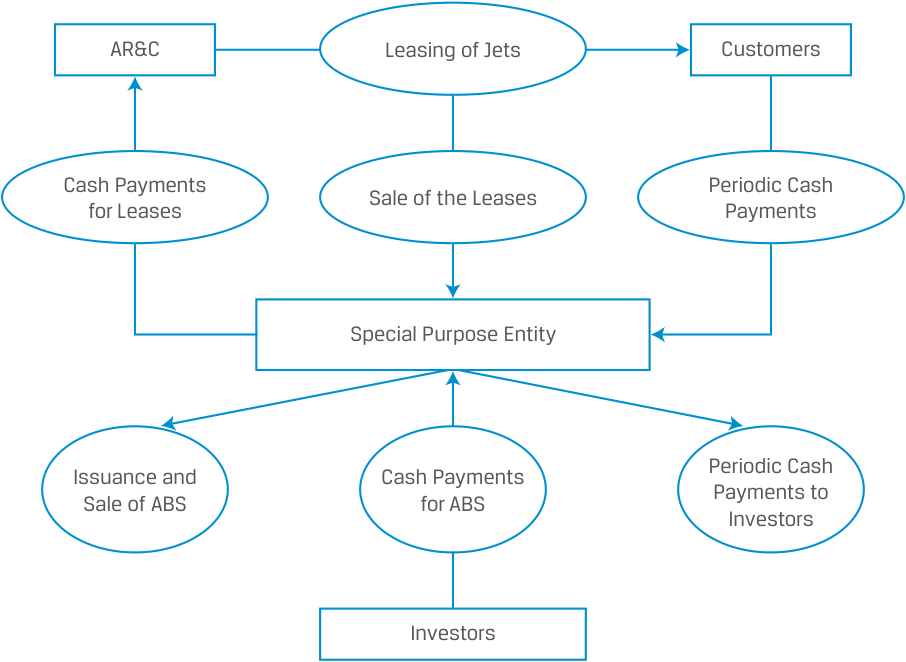
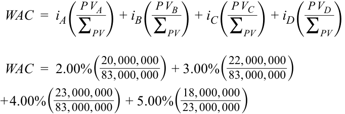
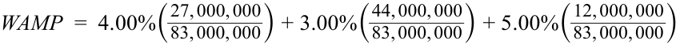

# Volume 6: Fixed Income
## Learning Module 19 Mortgage-Backed Security (MBS) Instrument and Market Features
### Part 3/3: Practice Problems (PDF Pages 537–546)

---

<!-- PDF Page 537 -->

# **~~PRACTICE PROBLEMS~~** 

## **The following information relates to questions 1-2** 

Please refer to the information below to answer questions 1 and 2 regarding the bonds securitized by the AR&C leases. 

### **AR&C Limited Securitization of Private Jet Leases** 

AR&C Limited leases private jets to corporations in North America for a fixed term of five years. AR&C retains ownership of the jets. The corporations make equal interest payments each month. If a customer defaults, AR&C can repossess the jet. AR&C has been in business for approximately fifteen years and has a B3 credit rating, meaning that its debt is non-investment grade. AR&C has CAD500 million in leases on its balance sheet that it wants to securitize into ABS. 

<!-- Start of picture text -->
AR&C Leasing of Jets Customers Cash Payments Periodic Cash Sale of the Leases for Leases Payments Special Purpose Entity Periodic Cash Issuance and Cash Payments Sale of ABS for ABS Payments to Investors Investors <!-- End of picture text -->

**Bond Class** A (senior) _Tranche A Notes_ Face value: CAD250 million Interest rate: MRR + 1.00% Maturity: One year B (subordinated) _Tranche B Notes_ Face value: CAD100 million Interest rate: MRR + 2.00% Maturity: Two years C (subordinated) _Tranche C Notes_ Face value: CAD100 million Interest rate: MRR + 3.00% Maturity: Three years 

<!-- PDF Page 538 -->

**Bond Class** D (subordinated) _Tranche D Notes_ Face value: CAD50 million Interest rate: MRR + 4.00% Maturity: Four years Total CAD500 million 

**1.** Compare the credit rating of the Class A bonds issued by the SPE and the uncollateralized bonds issued directly by AR&C. The Class A bonds are _most likely_ rated: 

   - **A.** lower than AR&C bonds. 

   - **B.** the same as AR&C bonds. 

   - **C.** higher than AR&C bonds. 

**2.** Select which of the following statements related to the collateralized bonds issued directly by the SPE is _most_ accurate. 

   - **A.** This senior/subordinated structure is an example of time tranching. 

   - **B.** Losses are realized by the subordinated bond classes before any losses are realized by Class A bonds. 

   - **C.** In a waterfall structure such as this one, losses are shared proportionally across all subordinated bond classes. 

## **The following information relates to questions 3-4** 

A borrower wishes to procure a mortgage loan to purchase a property. Information regarding the property, the desired loan, and the buyer’s finances is shown below: 

   - Property price: CAD750,000 

   - Desired loan amount: CAD525,000 

   - Annual interest rate: 5.00% 

   - Loan term: 30 years/360 months 

   - Monthly payment: CAD2,818.31 

   - Borrower’s annual pre-tax gross income: CAD210,000 

**3.** The loan-to-value (LTV) ratio is _closest to_ : 

   - **A.** 54%. 

**B.** 66%. 

- **C.** 70%. 

<!-- PDF Page 539 -->

**4.** The debt-to-income (DTI) ratio is _closest to_ : 

   - **A.** 1.30%. 

**B.** 16.10%. 

**C.** 250.00%. 

**5.** For a CMO that includes Planned Amortization Class (PAC) tranches, if the prepayment rate is within the anticipated range, which of the following tranches _most likely_ protects investors from prepayment risk? 

   - **A.** PAC tranche 

   - **B.** Senior tranche 

   - **C.** Support tranche 

**6.** Which of the following approaches redistributes prepayment risk? 

   - **A.** Tranching 

   - **B.** Excess spread 

   - **C.** Overcollateralization 

**7.** Shown below are five mortgages that comprise the entire pool in a mortgage-backed security. 

|**Mortgage**|**Interest** **Rate** **(****_i_)**|**Beginning** **Balance** **(BB)**|**Current Balance** **(CB)**|**Original** **Term** **(months)**|**Number of** **Months to** **Maturity**|
|---|---|---|---|---|---|
|**A**|2.00%|CAD200,000|CAD83,000|420|140|
|**B**|3.00%|CAD300,000|CAD193,000|360|192|
|**C**|4.00%|CAD400,000|CAD315,000|360|240|
|**D**|5.00%|CAD500,000|CAD357,000|240|144|
|**E**|6.00%|CAD600,000|CAD548,000|420|324|
|||**CAD2,000,000**|**CAD1,496,000**|||

The WAM for this security is _closest_ to: 

   - **A.** 208 months. 

   - **B.** 224 months. 

   - **C.** 236 months. 

**8.** Which of the following adverse consequences is most likely associated with extension risk? 

   - **A.** Investors must reinvest the proceeds at lower interest rates. 

   - **B.** Higher interest rates reduce the value of the cash flows investors receive. 

   - **C.** The prepayment option reduces the potential price appreciation for the bond. 

<!-- PDF Page 540 -->

## **The following information relates to questions 9-11** 

Use the following information for questions 9, 10, and 11: 

Shown below are three properties whose mortgages are securitized to create a sequential-pay CMBS and information related to the four tranches comprising the CMBS. 

|**Property** **Type**|**Fair Market** **Value**|**Property In** **Mortgaged** **Amount**|**formation** **Coupon** **Rate**|**Maturity**|**Repayment**|
|---|---|---|---|---|---|
|Office Building|35,000,000|27,000,000|4.00%|Four years from settle- ment date|Fully amortizing|
|Office Building|60,000,000|44,000,000|3.00%|Four years from settle- ment date|Fully amortizing|
|Warehouse|15,000,000|12,000,000|5.00%|Eight years from settle- ment date|Fully amortizing|

Prepayment: No prepayment on the underlying mortgages is allowed in the first 5 years. 

||**Tranche Information**|
|---|---|
|**Tranche**|**Coupon Rate** **Principal Value**|
|**A**|2.00% 20,000,000|
|**B**|3.00% 22,000,000|
|**C**|4.00% 23,000,000|
|**D**|5.00% 18,000,000|

**9.** The associated loan to value ratio is _closest to_ : 

   - **A.** 0.75. 

**B.** 0.77. 

**C.** 0.80. 

**10.** The weighted average coupon payment is _closest to_ : 

   - **A.** 3.47%. 

**B.** 3.50%. 

**C.** 3.61%. 

**11.** The weighted average proceeds from the mortgages is _closest to_ : **A.** 3.47%. 

   - **B.** 3.50%. 

<!-- PDF Page 541 -->

   - **C.** 3.61%. 

**12.** Which of the following would _most likely_ increase balloon risk for a commercial mortgage loan that is maturing? 

   - **A.** High DSCR 

   - **B.** Low LTV ratio 

   - **C.** Lack of property buyers in market 

**13.** Which of the following provides call protection for CMBS investors at the structural level? 

   - **A.** Defeasance 

   - **B.** Prepayment lockout 

   - **C.** Sequential-pay tranches 

<!-- PDF Page 542 -->

# **~~SOLUTIONS~~** 

1. The correct answer is C. The Class A bonds issued by the SPE are backed by collateral, the leases sold by AR&C to the SPE, and they are the most senior of the bonds issued by the SPE. A secured bond is secured by collateral and is considered less risky than a bond without collateral backing. The Class A bonds issued by the SPE would _most likely_ be rated higher than any unsecured corporate bonds issued directly by AR&C. 

2. The correct answer is B. Losses are realized by the subordinated bond classes before any losses are realized by the senior Class A bonds. A is incorrect because this senior/subordinated structure is an example of credit tranching, not time tranching. C is incorrect because in a waterfall structure such as this one, the most junior tranche, Class D, will absorb all losses up to its full CAD50 million par value first. Then, if credit losses exceed that threshold, Bond Class C will absorb all losses up to its full CAD100 million par value. The losses are not shared proportionally across all subordinated bond classes; instead, they are absorbed by the most junior classes first and subsequently by the more senior ones up to the value of the loss. 

3. The correct answer is C. The loan-to-value ratio (LTV) is the ratio of the amount of the loan/mortgage to the property’s value. 

____________________ Amount of the loan_ / _mortgage LTV_ = _Property_ ' _s value_ 

 LTV_ =525, 000 750, 000 

_LTV_ = 70% . 

A is incorrect because it was calculated as the monthly payment divided by the beginning loan value, not the loan to property value, as follows: 

_2, 818.31 525, 000= 0.54% . 

Note: This is 0.54%, not 54%. Choice A was adjusted to 54% to make the correct answer less obvious. 

B is incorrect because it was calculated as the monthly payment for a 20-year loan, not a 30-year loan, divided by the beginning loan value, not the loan to property value, as follows: 

_3, 464.77 525, 000= 0.66% . 

Note: This is 0.66%, not 66%. Choice B was adjusted to 66% to make the correct answer less obvious. 

4. The correct answer is B. The DTI is calculated using the monthly debt payment and the borrower’s monthly pre-tax gross income, as follows: ______________________ Monthly Debt Payment_ 

_DTI_ = _Monthly pre_ − _tax gross income_ 

_____________ DTI_ =_CAD_2, 818.31 ( _CAD_ 210, 000 / 12)= 16.10% . 

A is incorrect because it was calculated as the monthly payment divided by the annual pre-tax gross income, as follows: 

<!-- PDF Page 543 -->

_2, 818.31 210, 000= 1.30% . 

C is incorrect because it was calculated as the starting loan value divided by the annual pre-tax gross income, as follows: 

_525, 000 210, 000= 250.00% . 

5. The correct answer is C. If the prepayment rate is within the specified range, all prepayment risk is absorbed by the support tranche. This provides greater predictability of the size and timing of cash flows paid to investors in the PAC tranches. 

A is incorrect because in a CMO that includes a PAC tranche, the PAC tranche is protected from prepayment risk because all prepayment risk is absorbed by the support tranche. 

B is incorrect because in a CMO that includes a PAC tranche, the senior (PAC) tranche is protected from prepayment risk because all prepayment risk is absorbed by the support tranche. 

6. The correct answer is A. The tranching structure in CMOs cannot eliminate prepayment risk, but it can redistribute prepayment risk across the different tranches, insulating some tranches more than others. CMO tranche structures reduce the uncertainties of the size and timing of payments investors receive. B and C are incorrect because excess spread and overcollateralization are both common forms of credit enhancement, but they do not redistribute prepayment risk. 

7. The correct answer is C. The weighted average maturity is calculated by weighting the number of months to maturity for each mortgage in the pool by the percentage of the outstanding mortgage balance relative to the outstanding amount of all the mortgages in the pool, as shown in the following equation: 

<!-- Formula Text: WAM  =  M M A( C B A _ ∑ CB  ) + M M B( C B B _ ∑ CB  ) + M M C( C B C _ ∑ CB  ) + M M D( C B D _ ∑ CB  ) + M M E( C B E _ ∑ CB  ) WAM  =  140(  83, 000 _ 1, 496, 000 ) + 192(  193, 000 _ 1, 496, 000 ) + 240(  315, 000 _ 1, 496, 000 ) + 144(  357, 000 _ 1, 496, 000 ) + 324(  548, 000 _ 1, 496, 000 ) -->

_WAM_ = 236 months. 

A is incorrect because it is calculated by averaging the months to maturity for the five mortgages, rather than calculating their weighted average. 

B is incorrect because it is calculated by weighting the number of months to maturity for each mortgage in the pool by the percentage of the beginning mortgage balance relative to the beginning amount of all the mortgages in the pool, not by the current balances. 

8. The correct answer is B. Extension risk is the risk that the borrower might pay back the money borrowed more slowly than anticipated, extending the time of repayment and the maturity of the bond. For investors, this has one adverse consequence: Higher interest rates reduce the value of the cash flows investors receive. The payments the investors receive will be discounted at a higher interest 

<!-- PDF Page 544 -->

rate, and the extension stretches out the payments the investors receive. A is incorrect because contraction risk (the risk that the borrower might pay back the money borrowed more quickly than anticipated, reducing the amount of future payments the investor receives), not extension risk, has the adverse consequence that investors must reinvest the proceeds at lower interest rates. 

C is incorrect because contraction risk (the risk that the borrower might pay back the money borrowed more quickly than anticipated, reducing the amount of future payments the investor receives), not extension risk, has the adverse consequence that the prepayment option reduces the potential price appreciation for the bond. 

9. The correct answer is A. The associated loan to value ratio is calculated as the total value of all loans (mortgages) divided by the total value of the properties associated with the mortgages, as follows: 

___________________________ Total value of all loans_ ( _mortgages_ ) _LTV_ = _Total value of all properties mortgaged_ 

<!-- Formula Text: LTV =  83, 000, 000 _ 110, 000, 000   =  0.75. -->

B is incorrect because 0.77 is the value of just the mortgage on the first property (27,000,000) divided by the first property’s total value (35,000,000). 

C is incorrect because 0.80 is the value of just the mortgage on the third property (11,400,000) divided by the third property’s total value (15,000,000). 

10. The correct answer is A. The weighted average coupon payment is calculated as the value of each tranche’s coupon rate weighted by the principal value of that tranche as a percentage of the total value of all tranches: 

<!-- Formula Text: WAC  =  i A( P V A _ ∑ PV  ) + i B( P V B _ ∑ PV  ) + i C( P V C _ ∑ PV  ) + i D( P V D _ ∑ PV  ) WAC  =  2.00%( 20, 000, 000 _ 83, 000, 000 ) + 3.00%( 22, 000, 000 _ 83, 000, 000 ) + 4.00%( 23, 000, 000 _ 83, 000, 000 ) + 5.00%( 18, 000, 000 _ 23, 000, 000 ) -->

### _WAC_ = 3.47% . 

B is incorrect because 3.50% is calculated as a straight average of the four coupon rates (of the four tranches), rather than a weighted average. 

C is incorrect because 3.61% is the weighted proceeds from the three mortgages, not the weighted average coupon payment. 

11. The correct answer is C. The weighted average proceeds from the mortgages ( _WAMP_ shown below) is calculated as the coupon rate of each mortgage weighted by that mortgage’s value/amount as a percentage of the total value of all the mortgages: 

<!-- Formula Text: WAMP  =  i A( M A A _ ∑ MA  ) + i B( M A B _ ∑ MA  ) + i C( M A C _ ∑ MA  ) -->

<!-- PDF Page 545 -->

<!-- Formula Text: WAMP  =  4.00%( 27, 000, 000 _ 83, 000, 000 ) + 3.00%( 44, 000, 000 _ 83, 000, 000 ) + 5.00%( 12, 000, 000 _ 83, 000, 000 ) -->

_WAMP_ = 3.61% . 

A is incorrect because 3.47% is the weighted average coupon payment for the four tranches, not the weighted average proceeds from the mortgages. 

B is incorrect because 3.50% is calculated as a straight average of the four coupon rates (of the four tranches), not the weighted average proceeds from the mortgages. 

12. The correct answer is C. A lack of property buyers in the market will make it challenging for a borrower to sell a property to generate sufficient funds to pay off the outstanding principal balance. A is incorrect because a high DSCR would reduce the balloon risk. B is incorrect because a low LTV ratio would also reduce the balloon risk of a maturing loan. 

13. The correct answer is C. Structural call protection is achieved through sequential-pay tranches in the CMBS as a lower-rated tranche cannot be paid down until the higher-rated tranche is completely retired. A is incorrect because defeasance provides call protection at the individual loan level. Defeasance allows prepayment, but the borrower must purchase a portfolio of government securities that fully replicates the cash flows of the remaining scheduled principal and interest payments, including the balloon loan balance, on the loan. B is incorrect because prepayment lockout provides call protection at the individual loan level. Prepayment lockout is a contractual agreement that prohibits any prepayments during a specified period. 

<!-- PDF Page 546 -->

