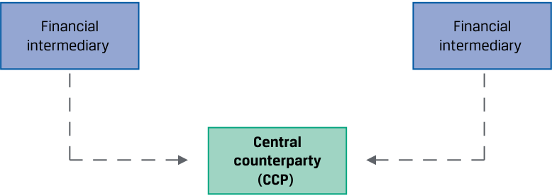

# Volume 7: Derivatives
## Learning Module 1 Derivative Instrument and Derivative Market Features
### Part 1/2: Introduction (PDF Pages 11–26)

---

<!-- PDF Page 11 -->

# L E A R N I N G M O D U L E **<mark>1</mark>** 

### **Derivative Instrument and Derivative Market Features** 

##### **<mark>LEARNING OUTCOMES</mark>** 

|**_Mastery_**|**_The candidate should be able to:_**|
|---|---|
||define a derivative and describe basic features of a derivative instrument|
||describe the basic features of derivative markets, and contrast over-the-counter and exchange-traded derivative markets|

#### **INTRODUCTION** 

**<mark>1</mark>** 

Earlier lessons described markets for financial assets related to equities, fixed income, currencies, and commodities. These markets are known as **cash markets** or **spot markets** in which specific assets are exchanged at current prices referred to as **cash prices** or **spot prices** . Derivatives involve the future exchange of cash flows whose value is derived from or based on an underlying value. The following lessons define and describe features of derivative instruments and derivative markets. 

###### **LEARNING MODULE OVERVIEW** 

- A derivative is a financial contract that derives its value from the performance of an underlying asset, which may represent a firm commitment or a contingent claim. 

- Derivative markets expand the set of opportunities available to market participants beyond the cash market to create or modify exposure to an underlying. 

- ■ The most common derivative underlyings include equities, fixed income and interest rates, currencies, commodities, and credit. 

- ■ Over-the-counter (OTC) derivative markets involve the initiation of customized, flexible contracts between derivatives end users and financial intermediaries. 

<!-- PDF Page 12 -->

- Exchange-traded derivatives (ETDs) are standardized contracts traded on an organized exchange, which requires collateral on deposit to protect against counterparty default. 

- For derivatives that are centrally cleared, a central counterparty (CCP) assumes the counterparty credit risk of the derivative counterparties and provides clearing and settlement services. 

###### **LEARNING MODULE SELF-ASSESSMENT** 

These initial questions are intended to help you gauge your current level of understanding of this learning module. 

1. Which of the following statements does **not** provide an argument for using a derivative instrument? 

   - **A.** Issuers may offset the financial market exposure associated with a commercial transaction. 

   - **B.** Derivatives typically have lower transaction costs than transacting directly in the underlying. 

   - **C.** Large exposures to an underlying can be created with derivatives for a similar cash outlay. 

###### **Solution:** 

C is correct. Derivative contracts create an exposure to the underlying with a small cash outlay, so this is the statement that does not provide an argument for using a derivative instrument. Statements A and B are statements that are valid arguments for using derivatives. 

2. Which of the following words makes the following statement correct? Market participants use derivative agreements to exchange cash flows in the future based on a(n) _________________. 

   - **A.** Underlying 

   - **B.** Option 

   - **C.** Hedge 

###### **Solution:** 

A is correct. Market participants use derivative agreements to exchange cash flows in the future based on an _underlying_ .  B is incorrect because _option_ refers to a specific derivative contract type. C is incorrect because _hedge_ refers to a specific purpose of using a derivative contract. 

3. Which of the following is a significant difference between exchange-traded derivative (ETD) and over the counter (OTC) derivative contracts? 

   - **A.** ETDs create counterparty credit risk for derivative users, while OTC derivatives do not. 

   - **B.** ETDs are standardized contracts, while OTC derivatives are customized. 

   - **C.** ETDs have higher transaction costs compared to OTC derivatives. 

   - **Solution:** 

B is correct. Exchanges standardize contracts to facilitate trading volume. However, users often require specific customized features, and the OTC market can accommodate these needs. A is incorrect because exchanges 

<!-- PDF Page 13 -->

bear the counterparty credit risk of derivatives. C is incorrect because ETDs have lower transaction costs compared to OTC derivatives. 

4. If a corporate issuer enters into a centrally cleared OTC derivative contract, which of the following risks is likely of most concern to the issuer and other participants in this market? 

   - **A.** Interest rate risk 

   - **B.** Counterparty credit risk 

   - **C.** Systemic risk 

   - **Solution:** 

C is correct. Because all the credit risk is taken on by the CCP, all participants in this market are most concerned that the CCP is able to satisfy its obligations to all contracts. A is incorrect because interest rate risk is an underlying risk that can be hedged or managed with certain OTC derivative contracts. B is incorrect because the CCP assumes the credit risk from all parties to the contracts. 

#### **DERIVATIVE FEATURES** 

## **<mark>2</mark>** 

define a derivative and describe basic features of a derivative instrument 

##### **Definition and Features of a Derivative** 

A **derivative** is a financial instrument that derives its value from the performance of an underlying asset. The asset in a derivative is called the **underlying** . The underlying may not be an individual asset but rather a group of standardized assets or variables, such as interest rates or a credit index. 

Market participants use derivative agreements to exchange cash flows in the future based on an underlying value. For example, Exhibit 1 shows the one-time future exchange of publicly traded shares of stock at a fixed price in a derivative known as a **forward contract** . 

<!-- PDF Page 14 -->

**Exhibit 1: Forward Contract** 

<!-- Start of picture text -->
Time t = 0 t = T AMY AMY investments investments €30 per share 1,000 AIR Contract 1,000 Airbus €30,000 shares where (AIR) shares ST = €25 at ST Financial Financial intermediary intermediary <!-- End of picture text -->

A derivative does not directly pass through the returns of the underlying but transforms the performance of the underlying. In Exhibit 1, AMY Investments agrees today ( _t_ = 0) to deliver 1,000 shares of Airbus (AIR) at a fixed price of €30 per share on a future date ( _t_ = _T_ ), which in our example is in six months. The forward contract allows AMY to transfer the price risk of underlying AIR shares to a second party, or a **counterparty** , by entering into this derivative contract. If the spot price of AIR ( _ST_ ) is €25 per share at time _T_ in six months, AMY will either receive €30,000 from its counterparty, a financial intermediary, for 1,000 AIR shares now worth just €25,000, or simply settle with the intermediary the €5,000 difference in cash. Derivative transactions usually involve at least one financial intermediary as a counterparty. As we will see later, **counterparty credit risk** , or the likelihood that a counterparty is unable to meet its financial obligations under the contract, is an important consideration for these instruments. 

A **derivative contract** is a legal agreement between counterparties with a specific **maturity** , or length of time until the closing of the transaction, or **settlement** . The buyer of a derivative enters a contract whose value changes in a way similar to a **long** position in the underlying, and the seller has exposure similar to a **short** position. The **contract size** (sometimes referred to as notional principal or amount) is agreed upon at the outset and may remain constant or change over time. 

Exhibit 1 is an example of a **stand-alone derivative** , a distinct derivative contract, such as a derivative on a stock or bond. An **embedded derivative** is a derivative within an underlying, such as a callable, puttable, or convertible bond. Exhibit 2 provides a sample term sheet that includes key features of AMY Investment’s stand-alone forward contract with a financial intermediary. 

**Exhibit 2: Sample Forward Contract Term Sheet** 

|**Contract Type:**|**Forward Transac**|**tion Term Sheet**|
|---|---|---|
|Firm commitment or contin-|||
|gent right to exchange future cash flows|||
|l **Maturity:**|**Start Date:**|[Spot start]|
|Final date upon which payment|**Maturity Date:**|[Six months from Start Date]|
|or settlement occurs|||

<!-- PDF Page 15 -->

|**Counterparties:**|**Forward**|[Financial Intermediary]|
|---|---|---|
|Legal entities entering the|**Purchaser:**||
|derivative contract|**Forward Seller:**|AMY Investments|
|**Underlying:**|**Forward**|1,000 shares of Airbus (AIR) com-|
|Reference asset or variable used as source for contract value **Contract Size:** Amount(s) used for calculation to price and value the derivative|**Delivery:**|mon stock traded on the Frankfurt Stock Exchange|
|**Underlying Price:**|**Forward Price:**|€30 per share|
|Pre-agreed price for com- mitment or contingent claim settlement|||
|**Contract Details**|**Business Days:** **Documentation:**|Frankfurt ISDA Agreement and credit terms acceptable to both parties|

The derivative between AMY and the financial intermediary is a **firm commitment** , in which a pre-determined amount is agreed to be exchanged at settlement. Firm commitments include forward contracts, futures contracts, and **swaps** involving a periodic exchange of cash flows. Another type of derivative is a **contingent claim** , in which one of the counterparties determines whether and when the trade will settle. An **option** is the primary contingent claim. 

Derivative markets expand the set of opportunities available to market participants to create or modify exposure to an underlying in several ways: 

- Investors can sell short to benefit from an expected decline in the value of the underlying. 

- Investors may use derivatives as a tool for portfolio diversification. 

- Issuers may offset the financial market exposure associated with a commercial transaction. 

- Market participants may create large exposures to an underlying with a relatively small cash outlay. 

- Derivatives typically have lower transaction costs and are often more liquid than underlying spot market transactions. 

Issuers and investors use derivatives to increase or decrease financial market exposures. For example, use of a derivative to offset or neutralize existing or anticipated exposure to an underlying is referred to as **hedging** , with the derivative itself commonly described as a **hedge** of the underlying transaction. 

###### **QUESTION SET** 

##### **Derivative Features** 

1. Identify one reason why an issuer may use a derivative instrument. 

**Solution:** 

An issuer may use a derivative to offset the financial market exposure associated with a commercial transaction. An issuer may also use a derivative to offset or neutralize existing or anticipated exposure to an underlying. 

<!-- PDF Page 16 -->

2. Identify which example corresponds to each of the following stand-alone or embedded derivative contract types: 

A. Firm commitment 1. Callable bond 

B. Contingent claim 

   2. Fixed-price natural gas delivery 

   - contract 

- C. Neither a firm commitment nor a contingent claim exchange-traded fund (ETF) 

3. Purchase of a FTSE 100 Index 

###### **Solution:** 

1. B is correct. A callable bond is an example of an embedded derivative within an underlying, which is a contingent claim. 

2. A is correct. A fixed-price gas delivery contract is an example of a contract, which is a firm commitment with natural gas as the underlying. 

3. C is correct. A FTSE 100 Index exchange-traded fund (ETF) is neither a firm commitment nor a contingent claim but rather an example of a cash or spot market transaction. 

3. Determine the correct answers to fill in the blanks: Equities are an example of a derivative ____________, and a _______________ is a legal entity entering a derivative contract. 

###### **Solution:** 

Equities are an example of a derivative _underlying_ , and a _counterparty_ is a legal entity entering a derivative contract. 

4. Describe the use of a derivative for hedging purposes. 

###### **Solution:** 

Use of a derivative for hedging purposes involves offsetting or neutralizing an existing or anticipated exposure to an underlying, referred to as hedging. 

5. Explain the settlement of a forward contract. 

###### **Solution:** 

A forward contract is a firm commitment. This contract results in a settlement payment on the maturity date equal to the difference between the current market price and a pre-agreed forward price. 

## **<mark>3</mark> DERIVATIVE UNDERLYINGS** 

define a derivative and describe basic features of a derivative instrument 

Derivatives are typically grouped by the underlying from which their value is derived. A derivative contract may reference more than one underlying. The most common derivative underlyings include equities, fixed income and interest rates, currencies, commodities, and credit. 

<!-- PDF Page 17 -->

##### **Equities** 

Equity derivatives usually reference an individual stock, a group of stocks, or a stock index, such as the FTSE 100. Options are the most common derivatives on individual stocks. Index derivatives are commonly traded as options, forwards, futures, and swaps. 

Index swaps, or equity swaps, allow the investor to pay the return on one stock index and receive the return on another index or interest rate. An investment manager can use index swaps to increase or reduce exposure to an equity market or sector without trading the individual shares. These swaps are widely used in top-down asset allocation strategies. Finally, options, futures, and swaps are available based upon the realized _volatility_ of equity index prices over a certain period. These contracts allow market participants to manage the risk, or dispersion, of price changes separately from the direction of equity price changes. 

Options on individual stocks are purchased and sold by investors and frequently used by issuers as compensation for their executives and employees. Stock options are granted to provide incentives to work toward stronger corporate performance in the expectation of higher stock prices. Stock options can result in companies paying lower cash compensation. Companies may also issue warrants, which are options granted to employees or sold to the public that allow holders to purchase shares at a fixed price in the future directly from the issuer. 

##### **Fixed-Income Instruments** 

Bonds are a widely used underlying, and related derivatives include options, forwards, futures, and swaps. Government issuers, such as the US Treasury or Japanese Ministry of Finance, usually have many bond issues outstanding. A single standardized futures contract associated with such bonds therefore often specifies parameters that allow more than one bond issue to be delivered to settle the contract. 

An interest rate is not an asset but rather a fixed-income underlying used in many interest rate derivatives, such as forwards, futures, and options. Interest rate swaps are a type of firm commitment frequently used by market participants to convert from fixed to floating interest rate exposure over a certain period. For example, an investment manager can use interest rate swaps to increase or reduce portfolio duration without trading bonds. An issuer, on the other hand, might use an interest rate swap to alter the interest rate exposure profile of its liabilities. 

A **market reference rate (MRR)** is the most common interest rate underlying used in interest rate swaps. These rates typically match those of loans or other short-term obligations. Survey-based Libor rates used as reference rates in the past have been replaced by rates based on a daily average of observed market transaction rates. For example, the Secured Overnight Financing Rate (SOFR) is an overnight cash borrowing rate collateralized by US Treasuries. Other MRRs include the euro short-term rate (€STR) and the Sterling Overnight Index Average (SONIA). 

##### **Currencies** 

Market participants frequently use derivatives to hedge the exposure of commercial and financial transactions that arise due to foreign exchange risk. For example, exporters often enter into forward contracts to sell foreign currency and purchase domestic currency under terms matching those of a delivery contract for goods or services in a foreign country. Alternatively, an investor might sell futures on a particular currency while retaining a securities portfolio denominated in that currency to benefit from a temporary decline in the value of that currency. Options, forwards, futures, and swaps based upon sovereign bonds and exchange rates are used to manage currency risk. 

<!-- PDF Page 18 -->

##### **Commodities** 

Cash or spot markets for soft and hard commodities involve the physical delivery of the underlying upon settlement. **Soft commodities** are agricultural products, such as cattle and corn, and **hard commodities** are natural resources, such as crude oil and metals. Commodity derivatives are widely used to manage either the price risk of an individual commodity or a commodity index separate from physical delivery. For example, an airline, shipping, or freight company might purchase oil futures as a hedge against rising operating expenses due to higher fuel costs. An investor might purchase a commodity index futures contract to increase exposure to commodity prices without taking physical delivery of the underlying. 

##### **Credit** 

Credit derivative contracts are based upon the default risk of a single issuer or a group of issuers in an index. Credit default swaps (CDS) allow an investor to manage the risk of loss from borrower default separately from the bond market. CDS contracts trade on a spread that represents the likelihood of default. For example, an investor might buy or sell a CDS contract on a high-yield index to change its portfolio exposure to high-yield credit without buying or selling the underlying bonds. Alternatively, a bank may purchase a CDS contract to offset existing credit exposure to an issuer’s potential default. 

##### **Other** 

Other derivative underlyings include weather, cryptocurrencies, and longevity, all of which can influence the financial performance of various market participants. For example, longevity risk is important to insurance companies and defined benefit pension plans that face exposure to increased life expectancy. Derivatives based upon these underlyings are less common and more difficult to price. Exhibit 3 provides a summary of common underlyings. 

**Exhibit 3: Common Derivative Underlyings** 

|**Asset Class**|**Examples**|**Sample Uses**|
|---|---|---|
|**Equities**|Individual stocks Equity indexes Equity price volatility|Change exposure profile (Investors) Employee compensation (Issuers)|
|**Interest Rates**|Sovereign bonds (domestic) Market reference rates|Change duration exposure (Investors) Alter debt exposure profile (Issuers)|
|**Foreign**|Sovereign bonds (for-|Manage global portfolio risks (Investors)|
|**Exchange**|eign) Market exchange rates|Manage global trade risks (Issuers)|
|**Commodities**|Soft and hard commod- ities Commodity indexes|Manage operating risks (Consumers/ Producers) Portfolio diversification (Investors)|

<!-- PDF Page 19 -->

|**Asset Class**|**Examples**|**Sample Uses**|
|---|---|---|
|**Credit**|Individual refence|Portfolio diversification (Investors)|
||entities Credit indexes|i Manage credit risk (Financial Intermediaries)|
|**Other**|Weather Cryptocurrencies Longevity|Manage operating risks (Issuers) Manage portfolio risks (Investors)|

###### **RARE EARTH FUTURES AND THE LME LITHIUM CONTRACT** 

Derivative underlyings continue to adapt to the growing importance of environmental, social, and governance (ESG) factors affecting commercial and financial markets. For example, as the automotive industry shifts from internal combustion engine technology to electric vehicle (EV) production due to environmental concerns, demand for rare earth metals, such as lithium, as inputs into the EV battery production process are of increasing importance. 

In response to growing demand from commodity producers and end users as well as investors, the London Metal Exchange (LME) introduced a lithium futures contract in 2021. The LME lithium contract is cash settled in USD against a weekly published spot price for battery-grade lithium hydroxide monohydrate deliverable in China, Japan, and Korea based upon a lot size of one metric ton per contract. 

##### **Investor Scenarios** 

The following scenarios consider the specific goals of two parties and review the most appropriate derivative contract for each. 

###### **_Scenario 1: Hightest Capital_** 

Hightest Capital is a US-based investment fund with a well-diversified domestic equity portfolio. Hightest’s senior portfolio manager believes that health care stocks will significantly outperform the overall index over the next six months. Ace Limited is a financial intermediary and member of the Chicago Board Options Exchange (CBOE). 

Hightest purchases an option based upon a standardized contract on the S&P 500 Health Care Select Sector Index (SIXV) with Ace as the financial intermediary and the spot SIXV price as the underlying. SIXV is comprised of approximately 60 health care equities included in the S&P 500 Index. The contract is a contingent claim, which grants Hightest the right to purchase SIXV at a 5% premium to the current market price (spot SIXV × 1.05) in six months. 

###### **_Scenario 2: Esterr Inc._** 

Esterr Inc. is a Toronto-based public company with a CAD250 million floating-rate term loan. The loan has a remaining maturity of three and a half years and is priced at three-month MRR (which is CORRA, or the Canadian Overnight Reference Rate Average) plus 150 bps. Esterr’s treasurer is concerned about higher Canadian interest rates over the remaining life of the loan and would like to fix Esterr’s interest expense. 

Esterr enters into a CAD250 million interest rate swap contract with a financial intermediary with MRR as the underlying. Under the swap, Esterr agrees to pay a fixed interest rate and receive three-month MRR on a notional principal of CAD250 million for three and a half years based upon payment dates that match the term loan. The swap contract is a firm commitment. 

<!-- PDF Page 20 -->

###### **QUESTION SET** 

##### **Derivative Underlyings** 

1. Describe how and why an underlying may be used in employee compensation. 

   - **Solution:** 

Derivatives with an equity underlying, in particular the stock of a particular issuer, may be included in the compensation of that company’s employees. Stock options are granted to provide incentives to work toward stronger corporate performance in the expectation of a higher stock price, which will cause the options to increase in value. 

2. Explain how a UK-based importer of goods from the euro zone might use a derivative with a currency underlying to mitigate risk. 

   - **Solution:** 

A UK-based importer of goods from the euro zone will likely pay EUR for goods that she intends to sell for GBP. To address this currency mismatch, she may consider entering a firm commitment to purchase EUR in exchange for GBP at a pre-determined price in the future based upon terms matching the import contract to offset risk to changes in the underlying spot exchange rate (i.e., GBP depreciation against EUR). 

3. Identify A, B, and C in the following diagram, as in Exhibit 1, for the interest rate swap in Scenario 2 for Esterr Inc. 

###### **Solution:** 

<!-- Start of picture text -->
Esterr Inc. C B A Esterr Inc. CORRA Fixed (market interest reference rate rate) Financial intermediary <!-- End of picture text -->

<!-- PDF Page 21 -->

4. Identify and describe the derivative features for the Esterr Inc. interest rate swap using the following term sheet, as in Exhibit 2. 

###### **Interest Rate Swap Term Sheet** 

|**Start Date:**|[Spot start]|
|---|---|
|**Maturity Date:**|[Three years and six months from Start Date]|
|**Notional Principal:**|CAD250,000,000|
|**Fixed-Rate Payer:**|Esterr Inc.|
|**Fixed Rate:**|2.05% on a semiannual, Act/365 basis|
|**Floating-Rate Payer:**|[Financial Intermediary]|
|**Floating Rate:**|Three-month Canadian Overnight Repo Rate Average (CORRA) as published each Business Day by the Bank of Canada|
|**Payment Dates:**|Semiannual exchange on a net basis|
|**Business Days:**|Toronto|
|**Documentation:**|ISDA Agreement and credit terms to match Esterr Inc. Term Loan|

A. Underlying: ___________________________ 

B. Counterparties: ___________________ and _____________________ 

C. Contract size: ___________________________ 

- D. Contract type: __________________________ 

###### **Solution:** 

   - A. Underlying: Interest rate (Canadian market reference rate, CORRA) 

   - B. Counterparties: Esterr Inc. and Financial Intermediary 

   - C. Contract size: CAD250,000,000 

   - D. Contract type: Firm commitment (interest rate swap) 

5. Identify which example corresponds to each derivative underlying type. 

|A. Soft commodities|1. Aluminum futures|
|---|---|
|B. Hard commodities|2. SOFR futures|
|C. Neither soft nor hard commodities|3. Soybean options|

###### **Solution:** 

1. B is correct. Aluminum futures are an example of a metals contract, which is a derivative with a hard commodity underlying. 

2. C is correct. SOFR futures are an example of an interest rate contract, not a commodity-based derivative contract. 

3. A is correct. Soybean options are an example of a derivative contract with an agricultural, or soft, commodity underlying. 

<!-- PDF Page 22 -->

## **<mark>4</mark>** 

#### **DERIVATIVE MARKETS** 

describe the basic features of derivative markets, and contrast over-the-counter and exchange-traded derivative markets 

Derivatives usage was historically dominated by exchange-traded futures markets in soft and hard commodities. Derivatives were expanded to **over-the-counter (OTC)** financial derivatives in interest rates and currencies in the 1980s, then credit derivatives in the 1990s. 

##### **Over-the-Counter (OTC) Derivative Markets** 

OTC markets can be formal organizations, such as NASDAQ, or informal networks of parties that buy from and sell to one another, as in the US fixed-income markets. OTC derivative markets involve contracts entered between derivatives end users and **dealers** , or financial intermediaries, such as commercial banks or investment banks. OTC dealers, known as **market makers** , typically enter into offsetting bilateral transactions with one another to transfer risk to other parties. The terms of OTC contracts can be customized to match a desired risk exposure profile. This flexibility is important to end users seeking to hedge a specific existing or anticipated underlying exposure based upon non-standard terms. The structure of the OTC derivative markets is shown in Exhibit 4. 

**Exhibit 4: Over-the-Counter Derivative Markets** 

<!-- Start of picture text -->
Derivatives Derivatives end user end user Derivatives Financial Financial Derivatives end user intermediary intermediary end user Derivatives Derivatives end user end user Financial intermediary Derivatives Derivatives Derivatives end user end user end user <!-- End of picture text -->

##### **Exchange-Traded Derivative (ETD) Markets** 

An **exchange-traded derivative (ETD)** includes futures, options, and other financial contracts available on exchanges, such as the National Stock Exchange (NSE) in India or the Brasil, Bolsa, Balcão (B3) exchange in Brazil. ETD contracts are more formal and standardized, which facilitates a more liquid and transparent market. Terms and conditions—such as the size of each contract, type, quality, and location of underlying for commodities and maturity date—are set by the exchange. Exhibit 5 shows the key terms of the London Metals Exchange (LME) lithium futures contract described earlier. 

<!-- PDF Page 23 -->

**Exhibit 5: LME Lithium Futures Contract Specifications** 

|**Contract Maturities:**|Monthly [from 1 month to 15 months]|
|---|---|
|**Contract Size:**|One metric ton|
|**Delivery Type:**|Cash settled|
|**Price Quotation:**|USD per metric ton|
|**Final Maturity:**|Last LME business day of contract month|
|**Daily Settlement:**|LME Trading Operations calculates daily settlement values based on its published procedures|
|**Final Settlement:**|Based on the reported arithmetic monthly average of Fastmarkets’ lithium hydroxide monohydrate 56.5% LiOH. H2O min, battery grade, spot price cif China, Japan, and Korea, USD/kg price, which is available from Fastmarkets from 16.30 London time on the last trading day|

Exchange memberships are held by market makers (or dealers) that stand ready to buy at one price and sell at a higher price. With standard terms and an active market, they are often able to buy and sell simultaneously, earning a small bid–offer spread. When dealers cannot find a counterparty, risk takers (sometimes referred to as speculators) are often willing to take on exposure to changes in the underlying price. 

Standardization also leads to an efficient clearing and settlement process. **Clearing** is the exchange’s process of verifying the execution of a transaction, exchange of payments, and recording the participants. Settlement involves the payment of final amounts and/or delivery of securities or physical commodities between the counterparties based upon exchange rules. Derivative exchanges require collateral on deposit upon inception and during the life of a trade in order to minimize counterparty credit risk. This deposit is paid by each counterparty via a financial intermediary to the exchange, which then provides a guarantee against counterparty default. Finally, ETD markets have transparency, which means that full information on all transactions is disclosed to exchanges and national regulators. 

OTC and ETD markets differ in several ways. OTC derivatives offer greater flexibility and customization than ETD. However, OTC instruments have less transparency, usually involve more counterparty risk, and may be less liquid. ETD contracts are more standardized, have lower trading and transaction costs, and may be more liquid than those in OTC markets, but their greater transparency and reduced flexibility may be a disadvantage to some market participants. The structure of the ETD markets is shown in Exhibit 6. 

<!-- PDF Page 24 -->

###### **Exhibit 6: Exchange-Traded Derivative Markets** 

<!-- Start of picture text -->
Derivatives Derivatives end user end user Derivatives Financial Financial Derivatives end user intermediary intermediary end user Exchange/ Derivatives Central Derivatives end user counterparty end user Financial intermediary Derivatives Derivatives Derivatives end user end user end user <!-- End of picture text -->

##### **Central Clearing** 

Following the 2008 global financial crisis, global regulatory authorities instituted a **central clearing mandate** for most OTC derivatives. This mandate requires that a **central counterparty (CCP)** assume the credit risk between derivative counterparties, one of which is typically a financial intermediary. CCPs provide clearing and settlement for most derivative contracts. Issuers and investors are able to maintain the flexibility and customization available in the OTC markets when facing a financial intermediary, while the management of credit risk, clearing, and settlement of transactions between financial intermediaries occurs in a way similar to ETD markets. This arrangement seeks to benefit from the transparency, standardization, and risk reduction features of ETD markets. However, the systemic credit risk transfer from financial intermediaries to CCPs also leads to centralization and concentration of risks. Proper safeguards must be in place to avoid excessive risk being held in CCPs. 

Exhibit 7 shows the central clearing process for interest rate swaps which also applies to other swaps and derivative instruments. Under central clearing, a derivatives trade is executed in Step 1 on a **swap execution facility (SEF)** , a swap trading platform accessed by multiple dealers. The original SEF transaction details are shared with the CCP in Step 2, and the CCP replaces the existing trade in Step 3. This **novation process** substitutes the initial SEF contract with identical trades facing the CCP. The CCP serves as counterparty for both financial intermediaries, eliminating bilateral counterparty credit risk and providing clearing and settlement services. 

**Exhibit 7: Central Clearing for Interest Rate Swaps** 

###### **Step 1: Trade executed on an SEF** 

<!-- Start of picture text -->
Financial Swap Financial execution intermediary  intermediary facility (SEF) <!-- End of picture text -->

<!-- PDF Page 25 -->

###### **Step 2: SEF trade information submitted to CCP** 

<!-- Start of picture text -->
Financial Financial intermediary  intermediary Central counterparty (CCP) <!-- End of picture text -->

###### **Step 3: CCP replaces (novates) existing trade, acting as new counterparty to both financial intermediaries** 

<!-- Start of picture text -->
Swap execution Financial facility (SEF) Financial intermediary  intermediary Central counterparty (CCP) <!-- End of picture text -->

##### **Investor Scenarios** 

In this section, we assess the most appropriate derivative markets for the scenarios presented in the previous lesson. 

###### **_Scenario 1. Hightest Capital._** 

Hightest’s index option contract would most likely be traded on the ETD derivative market. The trade has a standard size, exercise price, and maturity date. 

###### **_Scenario 2. Esterr Inc._** 

Esterr’s interest rate swap is likely to be traded in the OTC market. The swap contract terms are tailored to match the payment dates and remaining maturity of Esterr’s term loan. Esterr’s counterparty will be a financial intermediary that executes the offsetting hedge on an SEF and then novates the original SEF trade to face a CCP, which serves as the credit risk intermediary between dealers. 

###### **QUESTION SET** 

##### **Derivative Markets** 

1. Describe the risk transfer process in OTC derivative markets. 

###### **Solution:** 

OTC dealers, known as market makers, typically enter into offsetting transactions with one another to transfer the risk of derivative contracts entered with end users. 

<!-- PDF Page 26 -->

2. Identify which of the following derivative markets corresponds to the following characteristics. 

A. ETD 1. Standardized contracts B. OTC 2. Includes market makers C. Both ETD and OTC 3. Greater confidentiality 

###### **Solution:** 

   **1.** A—ETD markets use standardized contracts. 

   **2.** C—Both ETD and OTC markets use market makers. 

   **3.** B—OTC markets have greater privacy. 

3. Determine the correct answers to fill in the blanks: ____________ involves the payment of final amounts and/or delivery of securities or physical commodities, while __________ is the process of verifying the execution of a transaction, exchange of payments, and recording the participants. 

###### **Solution:** 

_<u>Settlement</u>_ involves the payment of final amounts and/or delivery of securities or physical commodities, while _<u>clearing</u>_ is the process of verifying the execution of a transaction, exchange of payments, and recording the participants. 

4. Identify one potential risk concern about the central clearing of derivatives. 

###### **Solution:** 

The central clearing mandate transfers the systemic risk of derivatives transactions from the counterparties, typically financial intermediaries, to the CCPs. One concern is the centralization and concentration of risks in CCPs. Careful oversight must occur to ensure that these risks are properly managed. 

5. Describe the steps for clearing a credit default swap. 

###### **Solution:** 

The counterparties are financial intermediaries that first execute the trade on an SEF (swap execution facility). Then, trade details are shared with a CCP; the novation process substitutes the original contract with another where the CCP steps into the trade and acts as the new counterparty for each original party. The CCP clears and settles the trade. 

