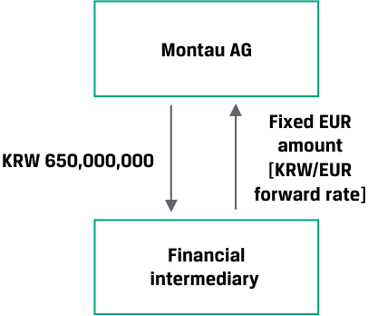

# Volume 7: Derivatives
## Learning Module 1 Derivative Instrument and Derivative Market Features
### Part 2/2: Practice Problems (PDF Pages 27–30)

---

<!-- PDF Page 27 -->

# **~~PRACTICE PROBLEMS~~** 

## **The following information relates to questions 1-5** 

Montau AG is a German capital goods producer that manufactures its products domestically and delivers its products to clients globally. Montau’s global sales manager shares the following draft commercial contract with his Treasury team: 

### **Montau AG Commercial Export Contract** 

|**Contract Date:**|[Today]|
|---|---|
|**Goods Seller:**|Montau AG, Frankfurt, Germany|
|**Goods Buyer:**|Jeon Inc., Seoul, Korea|
|**Description of Goods:**|A-Series Laser Cutting Machine|
|**Quantity:**|One|
|**Delivery Terms:**|Freight on Board (FOB), Busan Korea with all shipping, tax and delivery costs payable by Goods Buyer|
|**Delivery Date:**|[75 Days from Contract Date]|
|**Payment Terms:**|100% of Contract Price payable by Goods Buyer to Good Seller on Delivery Date|
|**Contract Price:**|KRW650,000,000|

Montau AG’s Treasury manager is tasked with addressing the financial risk of this prospective transaction. 

**1.** Which of the following statements best describes why Montau AG should consider a derivative rather than a spot market transaction to manage the financial risk of this commercial contract? 

   - **A.** Montau AG is selling a machine at a contract price in KRW and incurs costs based in EUR. 

   - **B.** Montau AG faces a 75-day timing difference between the commercial contract date and the delivery date when Montau AG is paid for the machine in KRW. 

   - **C.** Montau AG is unable to sell KRW today in order to offset the contract price of machinery delivered to Jeon Inc. 

**2.** Which of the following types of derivative and underlyings are best suited to hedge Montau’s financial risk under the commercial transaction? 

   - **A.** Montau AG should consider a firm commitment derivative with currency as an underlying, specifically the sale of KRW at a fixed EUR price. 

   - **B.** Montau AG should consider a contingent claim derivative with the price of the machine as its underlying, specifically an A-series laser cutting machine. 

<!-- PDF Page 28 -->

   - **C.** Montau AG should consider a contingent claim derivative with currency as an underlying, specifically the sale of EUR at a fixed KRW price. 

**3.** Identify A, B, and C in the correct order in the following diagram, as in Exhibit 1, for the derivative to hedge Montau's financial risk under the commercial transaction. 

### **Exhibit 1** 

<!-- Start of picture text -->
Montau AG C B A <!-- End of picture text -->

   - **A.** A: Financial intermediary, B: KRW650,000,000, C: Fixed EUR amount 

   - **B.** A: Jeon Inc., B: KRW650,000,000, C: Fixed EUR amount 

   - **C.** A: Financial intermediary, B: Fixed EUR amount, C: KRW650,000,000. 

**4.** Which of the following statements about the most appropriate derivative market to hedge Montau AG’s financial risk under the commercial contract is most accurate? 

   - **A.** The OTC market is most appropriate for Montau, as it is able to customize the contract to match its desired risk exposure profile. 

   - **B.** The ETD market is most appropriate for Montau, as it offers a standardized and transparent contract to match its desired risk exposure profile. 

   - **C.** Both the ETD and OTC markets are appropriate for Montau AG to hedge its financial risk under the transaction, so it should choose the market with the best price. 

**5.** If Montau enters into a centrally cleared derivative contract on the OTC market, which of the following statements about credit risk associated with the derivative is most likely correct? 

   - **A.** Montau faces credit risk associated with the possibility that its counterparty to the contract may not fulfill its contractual obligation. 

   - **B.** Montau poses a credit risk to its counterparty because it may fail to fulfill its contractual obligation. 

   - **C.** Montau poses a credit risk to a derivative contract end user holding a contract with the opposite features of Montau’s. 

<!-- PDF Page 29 -->

# **~~SOLUTIONS~~** 

1. B is correct. A 75-day timing difference exists between the commercial contract date and the delivery date when Montau AG is paid for the machine in KRW. A is true but does not explain why the use of a derivative is preferable to a spot market transaction. If as in C Montau were to sell the KRW it receives and buy EUR in a spot market transaction on the delivery date, it would be exposed to unfavorable changes in the KRW/EUR exchange rate over the 75-day period. A derivative contract in which the underlying KRW/EUR forward rate is agreed today and exchanged on the delivery date allows Montau to hedge or offset the EUR value of the future KRW payment. The derivative is therefore a more suitable contract to address the financial risk of the commercial transaction than a spot market sale of KRW. 

2. A is correct. The derivative best suited to hedge Montau’s financial risk is a firm commitment derivative in which a pre-determined amount is exchanged at settlement. The derivative underlying should be currencies, specifically the sale of KRW at a fixed EUR price in the future to offset or hedge the financial risk of the commercial contract. The machine price referenced under B is not considered an underlying, and C hedges the opposite of Montau’s underlying exposure. 

3. C is correct as per the following diagram: 

### **Exhibit 1** 

<!-- Start of picture text -->
Montau AG Fixed EUR amount KRW 650,000,000 [KRW/EUR forward rate] Financial intermediary <!-- End of picture text -->

4. A is correct. The OTC market is most appropriate for Montau, as OTC contracts may be customized to match Montau’s desired risk exposure profile. This is important to end users seeking to hedge a specific underlying exposure based upon non-standard terms. Montau would be unlikely to find an ETD contract under B that matches the exact size and maturity date of its desired hedge, which also makes C incorrect. 

5. B is correct. In a centrally cleared OTC derivative contract, the central counterparty becomes the counterparty in all contracts and assumes the credit risk associated with individual derivative contracts. A is likely incorrect because the CCP takes actions to ensure that it can fulfill its obligations to its counterparties. C is incorrect because the CCP inserts itself between parties with opposite positions. 

<!-- PDF Page 30 -->

