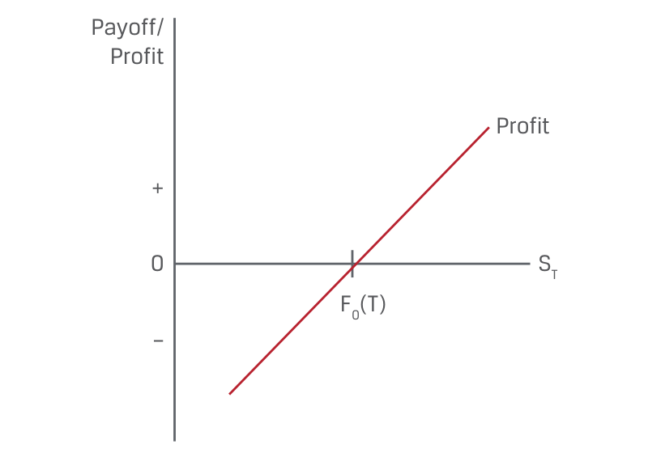
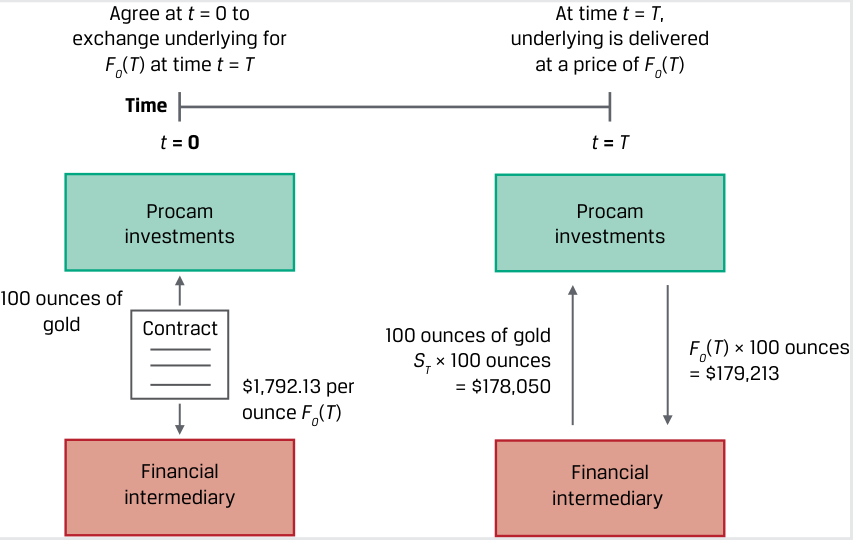
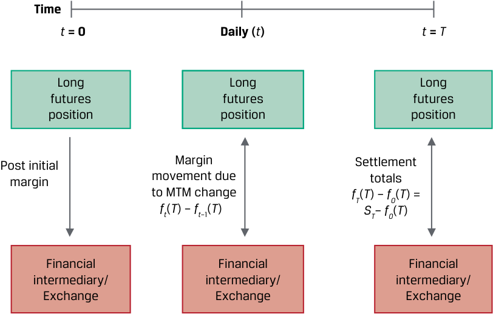
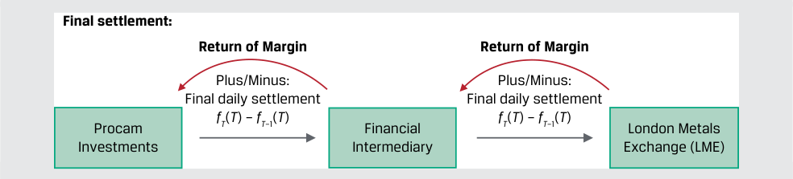
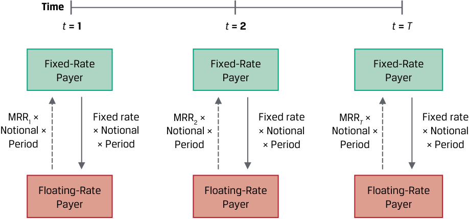

# Volume 7: Derivatives
## Learning Module 2 Forward Commitment and Contingent Claim Features and Instruments
### Part 1/2: Introduction (PDF Pages 31–45)

---

<!-- PDF Page 31 -->

# L E A R N I N G M O D U L E **<mark>2</mark>** 

### **Forward Commitment and Contingent Claim Features and Instruments** 

##### **<mark>LEARNING OUTCOMES</mark>** 

###### **_Mastery The candidate should be able to:_** 

define forward contracts, futures contracts, swaps, options (calls and puts), and credit derivatives and compare their basic characteristics determine the value at expiration and profit from a long or a short position in a call or put option contrast forward commitments with contingent claims 

#### **INTRODUCTION** 

## **<mark>1</mark>** 

An earlier lesson established a derivative as a financial instrument that derives its performance from an underlying asset, index, or other financial variable, such as equity price volatility. Primary derivative types include a firm commitment in which a predetermined amount is agreed to be exchanged between counterparties at settlement and a contingent claim in which one of the counterparties determines whether and when the trade will settle. The following lessons define and compare the basic features of forward commitments and contingent claims and explain how to calculate their values at maturity. 

###### **LEARNING MODULE OVERVIEW** 

- Forwards, futures, and swaps represent firm commitments, or derivative contracts that require counterparties to exchange an underlying in the future based on an agreed-on price. 

- Forwards are a flexible over-the-counter (OTC) derivative instrument, while futures are standardized and traded on an exchange with a daily settlement of contract gains and losses. 

- Swap contracts are a firm commitment to exchange a series of cash flows in the future. Interest rate swaps are the most common type and involve the exchange of fixed interest payments for floating interest <u>payments.</u> 

CFA Institute would like to thank Don Chance, PhD, CFA, for his contribution to this section, which includes material derived from material that appeared in _Derivative Markets and Instruments_ , featured in the 2022 CFA® Program curriculum. 

<!-- PDF Page 32 -->

- Option contracts are contingent claims in which one of the counterparties determines whether and when a trade will settle. The option buyer pays a premium to the seller for the right to transact the underlying in the future at a pre-agreed exercise price. 

- Option contract payoff and profit profiles are non-linear as the underlying price changes, as opposed to firm commitments, such as forwards, futures, and swaps, which are linear in underlying price changes. 

- Market participants often create similar exposures to an underlying using firm commitments and contingent claims, although these derivative instrument types involve different payoff and profit profiles. 

###### **LEARNING MODULE SELF-ASSESSMENT** 

These initial questions are intended to help you gauge your current level of understanding of this learning module. 

1. Which of the following statements correctly describes a difference between a forward contract and a futures contract? 

   - **A.** A forward contract sets an agreed-on price for buyer and seller, while a futures contract does not. 

   - **B.** A forward contract sets an agreed-on transaction date for the seller to deliver the underlying to the buyer, while a futures contract does not. 

   - **C.** A forward contract does not require daily settlement of gains and losses, while a futures contract does. 

###### **Solution:** 

C is correct. Futures contracts require daily settlement through the exchange clearinghouse mark-to-market process. Forward contracts are settled at their maturity date, although the two parties to the contract may customize alternative settlement procedures. A is incorrect because both forward and futures contracts set an agreed-on price for a future transaction. B is incorrect because both forwards and futures contracts include a maturity date when the underlying will be exchanged. 

2. Identify which example fits each of the following firm commitments: 

|A. Futures contract purchaser|1. Agrees to make a single exchange in the future at a pre-agreed price under an OTC contract|
|---|---|
|B. Forward contract seller|2. Agrees to a single exchange in the future based on standardized terms set by an exchange|
|C. Fixed-rate payer on an interest rate swap|3. Agrees to a series of exchanges of interest fixed for floating interest payments|

###### **Solution:** 

1. B is correct. A forward contract seller agrees to make a single exchange in the future at a pre-agreed price under an OTC contract. 

2. A is correct. A futures contract purchaser agrees to a single exchange in the future based on standardized terms set by an exchange. 

<!-- PDF Page 33 -->

   3. C is correct. A fixed-rate payer on an interest rate swap agrees to a series of exchanges of fixed for floating interest payments. 

3. Identify which example fits each of the following contingent claims: 

|A. Put option purchaser|1. Seeks to gain from an increase in the underlying price|
|---|---|
|B. Call option purchaser|2. Allows the option to expire at matu- rity of the underlying price is above the exercise price|
|C. Both a put option purchaser and a call option purchaser|3. Pays an option premium to the option seller when the contract is agreed on|

**Solution:** 

   1. B is correct. A call option purchaser seeks to gain from an increase in the underlying price. 

   2. A is correct. A put option purchaser will allow an option to expire at maturity without exercise if the underlying price is above the exercise price. 3. C is correct. Both a put option purchaser and a call option purchaser will pay a premium to the option seller when the option contract is executed. 

4. An option to buy an underlying security at an exercise price of USD45 in three months trades at a premium of USD6. After three months, the underlying trades at USD50. Which of the following responses correctly describes the profit/loss position of the option buyer and seller? 

   - **A.** Option buyer earns USD5 profit, and option seller earns USD5 loss. 

   - **B.** Option buyer earns USD1 loss, and option seller earns USD1 profit. **C.** Option buyer earns USD5 profit, and option seller earns USD0. 

   - **Solution:** 

B is correct. The option buyer’s position generates a payoff of USD5, equal to max(0, 50 – 45). The option buyer paid USD6 to buy the option position, and this cash flow more than offsets the positive payoff. Thus, the option buyer’s overall profit is a loss of USD1 (i.e., 5 – 6). For the option seller, the option position creates a negative payoff of –USD5, equal to –max(0, 50 – 45). However, the option seller received the option premium of USD6, so the overall profit is USD1 (i.e., 6 – 5). A is incorrect because the USD5 amount reflects the option payoff only, not profits and losses accounting for the option premium. C is incorrect because the buyer’s profit incorrectly states the payoff only to the option position, not the profit. The seller’s profit would be correct only if the underlying traded at 51, not 50. 

5. A put option buyer earns a positive profit in which of the following conditions? 

   - **A.** The price of the underlying at option expiration is less than the option’s exercise price. 

   - **B.** The price of the underlying at option expiration is greater than the option’s exercise price. 

<!-- PDF Page 34 -->

- **C.** The price of the underlying is less than the option’s exercise price minus the option’s premium. 

- **Solution:** 

C is correct. For a put option buyer to earn a positive profit, the underlying price must be sufficiently below the put option’s exercise price such that (1) the put option can be exercised with a positive payoff and (2) the positive payoff is greater than the option premium paid. Thus, only if the underlying price falls below the exercise price minus the premium can this occur. A is incorrect because this condition only implies a positive payoff on the option but would include prices at which the payoff is not greater than the premium. B is incorrect because the put option would be out of the money and would generate zero payoff. 

6. Which of the following positions on the same underlying benefit from opposite price movements in an underlying? 

   - **A.** Long forward contract, short put option 

   - **B.** Short forward contract, long put option 

   - **C.** Short forward contract, short put option 

   - **Solution:** 

C is correct. A short forward position benefits as the underlying price declines, while a short put benefits only when the underlying price increases. A is incorrect because both a long forward and a short put benefit from underlying price increases. B is incorrect because both a short forward and a long put option benefit from underlying price decreases. 

## **<mark>2</mark>** 

#### **FORWARDS, FUTURES, AND SWAPS** 

define forward contracts, futures contracts, swaps, options (calls and puts), and credit derivatives and compare their basic characteristics 

Forwards, futures, and swaps are the most common derivative contracts which represent a firm commitment. This firm commitment is an obligation of both counterparties to perform under the terms of the derivative contract. Key common features of this type of derivative include the following: 

- A specific contract size 

- A specific underlying 

- One or more exchanges of cash flows or underlying on a specific future date or dates 

- Exchange(s) based on a pre-agreed price 

Despite their similarities, forwards, futures, and swaps each have different features, which are the subject of this lesson. 

A forward contract is an over-the-counter (OTC) derivative in which two counterparties agree that one counterparty, the buyer, will purchase an underlying from the other counterparty, the seller, in the future at a pre-agreed fixed price. As noted earlier, OTC derivatives offer greater flexibility and customization than exchange-traded derivatives (ETD), but also usually involve more counterparty risk. Forward contracts 

<!-- PDF Page 35 -->

are advantageous for derivative end users seeking to hedge an existing or forecasted underlying exposure based on specific terms. For example, an importer may enter a forward contract to buy the foreign currency needed to satisfy the commercial terms of a future goods delivery contract. Forward contracts are more flexible as to the size, underlying details, maturity, and/or credit terms than a similar ETD. A forward contract buyer has a long position and will therefore benefit from price appreciation of the underlying over the life of the contract. 

To gain a better understanding of forwards, we must examine their payoff profile. Assume a forward contract is agreed at time _t_ = 0 and matures at time _T_ . At time _t_ = 0, the counterparties do not exchange a payment upfront but, rather, agree on delivery of the underlying at time _T_ for a **forward price** of _F_ 0( _T_ ). The subscript refers to the date on which the underlying price in the future is set ( _t_ = 0), and the _T_ in parentheses refers to the date of exchange ( _t_ = _T_ ). The spot price of the underlying at time _T_ is _ST_ . Exhibit 1 shows the payoff from the forward buyer’s perspective, which is a long forward position. Note that the payoff equals the profit, as no upfront payment is made. 

**Exhibit 1: Long Forward (Forward Buyer) Payoff Profile** 

<!-- Start of picture text -->
Payoff/ Profit Profit + 0 ST F0(T) – <!-- End of picture text -->

|**Outcome**|**Buyer Payoff**|**Seller Payoff**|
|---|---|---|
|_ST_>_F_0(_T_)|[_ST_– F0(T)] > 0|[_F_0(_T_) -_ST_] < 0|
|_ST_<_F_0(_T_)|[_ST_– F0(T)] < 0|[_F_0(_T_) -_ST_] > 0|

The symmetric payoff profile shown in Exhibit 1 is a common feature of firm commitments. Since the derivative price is a linear function of the underlying, firm commitments are also referred to as **linear derivatives** . At time _T_ , the transaction is settled based on the difference between the forward price, _F_ 0( _T_ ), and the underlying price of _ST_ , or [ _ST_ – _F_ 0( _T_ )] from the buyer’s perspective. That is, the buyer realizes a gain if she is able to take delivery of the underlying at a market value, _ST_ , that exceeds the pre-agreed price, _F_ 0( _T_ ). If the forward price exceeds the current market value [ _F_ 0( _T_ ) > _ST_ ], the buyer realizes a loss and must either take delivery of an asset at a loss of [ _F_ 0( _T_ ) – _ST_ ] or pay the seller this amount in cash. Forward contracts usually involve a single exchange in the future, as in Example 1. 

<!-- PDF Page 36 -->

###### **EXAMPLE 1** 

##### **Forward Gold Purchase** 

An investor, Procam Investments, enters a cash-settled forward contract with a financial intermediary to buy 100 ounces of gold at a forward price, F0(T), of $1,792.13 per ounce in three months. 

**1.** Today’s spot gold price ( _S_ 0) is $1,770 per ounce. 

**2.** At contract maturity, the gold price ( _ST_ ) is $1,780.50 per ounce. 

**3.** The payoff, _ST_ – _F_ 0( _T_ ), is –$11.63 = $1,780.50 – $1,792.13 per ounce. 

**4.** Procam (the buyer) must pay the financial intermediary (the seller) $1,163 (= 100 × $11.63) to settle the forward contract at maturity. 

<!-- Start of picture text -->
Agree at  t  = 0 to At time  t  =  T , exchange underlying for underlying is delivered F0 ( T ) at time  t  =  T at a price of  F0 ( T ) Time t  = 0 t  =  T Procam Procam investments investments 100 ounces of gold Contract 100 ounces of gold F0 ( T ) × 100 ounces ST  × 100 ounces = $179,213 $1,792.13 per = $178,050 ounce  F0 ( T ) Financial Financial intermediary intermediary <!-- End of picture text -->

The contract may specify either the actual delivery of the underlying or a cash settlement. The settlement amount is equal to [ _ST_ – _F_ 0( _T_ )] from a buyer’s perspective and –[ _ST_ – _F_ 0( _T_ )] = [ _F_ 0( _T_ ) – _ST_ ] from a seller’s perspective. Note that a buyer would have to pay _S_ 0 at _t_ = 0 and realize a return of ( _ST_ – _S_ 0) at time _T_ in order to create a similar exposure to the long forward position in the cash market. 

###### **QUESTION SET** 

##### **Forwards** 

1. Describe a scenario in which a forward contract has cash settlement of zero at maturity and neither counterparty has defaulted. **Solution:** 

   - A forward contract will have a cash settlement of zero at maturity if _ST_ = _F_ 0( _T_ ) or the payoff from the buyer’s perspective is [ _ST_ – _F_ 0( _T_ )] = 0. This is often referred to as the **breakeven point** for the forward contract for both buyer and seller in the absence of transaction costs and is visually represented by the _x_ -axis intercept of the profit line in Exhibit 1. 

2. Determine the correct answers to fill in the blanks: An oil producer enters a derivative contract with an investor to sell 1,000 barrels of oil in two months at a forward price of $64 per barrel. If the spot oil price at maturity 

<!-- PDF Page 37 -->

is $58.50 per barrel, the investor realizes a __________ at maturity equal to 

__________. 

###### **Solution:** 

An oil producer enters a derivative contract with an investor to sell 1,000 barrels of oil in two months at a forward price of $64 per barrel. If the spot oil price at maturity is $58.50 per barrel, the investor realizes a _loss_ at maturity equal to _$5,500_ . 

The oil forward price, _F_ 0( _T_ ), under the contract equals $64 per barrel. At contract maturity, the spot oil price ( _ST_ ) is $58.50 per barrel. 

- Investor payoff per barrel: 

- [ _ST_ – _F_ 0( _T_ )] = $58.50 – $64.00 = –$5.50 per barrel. 

- Total amount the investor pays the oil producer to settle the forward contract for 1,000 barrels at maturity: 

1,000 × $5.50 = $5,500. 

3. Identify the most likely forward contract participants that correspond to the following statements: 

|A. forward contract purchaser|1. Seeks to benefit from underlying price depreciation|
|---|---|
|B. Forward contract seller|2. Realizes a gain if the initial spot price of the underlying,_S_0, exceelds the forward price of_F_0(_T_)|
|C. Neither a forward contract purchaser nor a seller|3. Receives a positive payoff at maturity if the spot price,_ST_, exceeds the forward price of_F_0(_T_)|

###### **Solution:** 

1. The correct answer is B. A forward seller pays [ _F_ 0( _T_ ) – _ST_ ] to the forward contract buyer at maturity and therefore benefits as the underlying spot price _ST_ declines over time. 

2. The correct answer is C. Neither the buyer nor the seller of a forward contract realizes a gain if the initial spot price, _S_ 0, exceeds the forward price of _F_ 0( _T_ ), as settlement is based on the future spot price, _ST_ . 

3. The correct answer is A. The forward contract buyer realizes a gain at maturity if _ST_ > _F_ 0( _T_ ). 

#### **FUTURES** 

<!-- Start of picture text -->
3 <!-- End of picture text -->

define forward contracts, futures contracts, swaps, options (calls and puts), and credit derivatives and compare their basic characteristics 

**Futures contracts** are forward contracts with standardized sizes, dates, and underlyings that trade on futures exchanges. Futures markets offer both greater liquidity and protection against loss by default by combining contract uniformity with an organized market with rules, regulations, and a central clearing facility. 

<!-- PDF Page 38 -->

###### **Forward Commitment and Contingent Claim Features and Instruments** 

The futures contract buyer creates a long exposure to the underlying by agreeing to purchase the underlying at a later date at a pre-agreed price. The seller makes the opposite commitment, creating a short exposure to the underlying by agreeing to sell the underlying asset in the future at an agreed-on price. This agreed-on price is called the **futures price** , _f_ 0( _T_ ). The frequency of futures contract maturities, contract sizes, and other details are established by the exchange based on buyer and seller interest. 

The most important feature of futures contracts is the daily settlement of gains and losses and the associated credit guarantee provided by the exchange through its clearinghouse. At the end of each day, the clearinghouse engages in a practice called **mark to market (MTM)** , also known as the **daily settlement** . The clearinghouse determines an average of the final futures trading price of the day and designates that price as the end-of-day **settlement price** . All contracts are then said to be marked to the end-of-day settlement price. 

As with forward contracts, no cash is exchanged when a futures contract is initiated by a buyer or seller. However, each counterparty must deposit a required minimum sum (or **initial margin** ) into a **futures margin account** held at the exchange that is used by the clearinghouse to settle the daily mark to market. Futures contracts must be executed with specialized financial intermediaries that clear and settle payments at the exchange on behalf of counterparties, as shown in Example 2. 

###### **EXAMPLE 2** 

##### **Purchase of a Gold Futures Contract** 

<!-- Start of picture text -->
Trade initiation: 100 ounces of gold 100 ounces of gold Procam Financial London metals investments intermediary exchange (LME) $1,792.13 per ounce $1,792.13 per ounce Initial margin Initial margin <!-- End of picture text -->

As in Example 1, Procam Investments enters a cash-settled contract to buy 100 ounces of gold at a price of $1,792.13 per ounce in three months. Instead of the forward in Example 1, Procam purchases a futures contract [ _f_ 0( _T_ ) = $1,792.13] on the exchange via a financial intermediary. London Metals Exchange rules require an initial cash margin of $4,950 per gold contract (100 ounces) sold or purchased: 

- Procam deposits $4,950 in required initial margin with the exchange. 

- Today’s spot gold price ( _S_ 0) is $1,770 per ounce, and the opening gold futures price, _f_ 0( _T_ ), is $1,792.13 per ounce. 

- At today’s close, the gold futures price, _f_ 1( _T_ ), settles at $1,797.13 per ounce. 

- Procam realizes a $500 MTM gain, or $5 per ounce × 100 ounces. It receives a $500 futures margin account deposit from the clearinghouse. 

- Procam’s futures margin account has an ending balance for the day of $5,450, or $4,950 initial margin plus the $500 MTM gain. 

Each futures contract specifies a **maintenance margin** , or minimum balance set below the initial margin, that each contract buyer and seller must hold in the futures margin account from trade initiation until final settlement at maturity. The 

<!-- PDF Page 39 -->

clearinghouse moves funds daily between the buyer and seller margin accounts, crediting the accounts of those with mark to market gains and charging those with mark-to-market losses. 

For example, London Metals Exchange rules require a maintenance margin of $4,500 per 100-ounce gold contract sold or purchased. Now consider the _seller_ of a futures contract with a position that offsets that of Procam in Example 2. 

- Seller deposits $4,950 in required initial margin with the exchange. 

- Today’s opening gold futures price, _f_ 0( _T_ ), is $1,792.13 per ounce. 

- At the close, the gold futures price, _f_ 1( _T_ ), settles at $1,797.13 per ounce. 

- Seller realizes a $500 MTM loss, or $5 per ounce × 100 ounces; $500 is deducted from its futures margin account by the clearinghouse. 

- Seller’s futures margin account has an ending balance of $4,450, or $4,950 initial margin less the $500 MTM loss. 

- Seller’s margin account is $50 below the required maintenance margin ($4,450 – $4,500) = –$50 

The seller receives a **margin call** , or request to immediately deposit funds to return the account balance to the _initial margin_ . The seller must deposit $500 in order to bring the margin account back to the $4,950 initial margin. The amount required to replenish the futures margin account is sometimes referred to as **variation margin** . If a counterparty fails to meet the margin call, it must close out the contract as soon as possible and cover any additional losses. If the counterparty cannot meet its obligations, the clearinghouse provides a guarantee that it will cover the loss itself by maintaining an insurance fund. Exhibit 2 shows the futures margining and settlement process, where _f_ 0( _T_ ) is the futures price at inception and _ft_ ( _T_ ) represents the futures price on day _t_ . 

**Exhibit 2: Futures Margin and Settlement Process** 

<!-- Start of picture text -->
Time t  = 0 Daily ( t ) t  =  T Long Long Long futures futures futures position position position Post initial Margin Settlement margin movement due totals to MTM change fT ( T ) –  f0 ( T ) = ft ( T ) –  ft –1( T )   ST –  f0 ( T ) Financial Financial Financial intermediary/ intermediary/ intermediary/ Exchange Exchange Exchange <!-- End of picture text -->

Exchanges reserve the right to impose more strict requirements than standard futures margin account rules to limit potential losses from counterparty default. For example, for large positions or a significant increase in price volatility of the underlying, an exchange may increase required margins and/or make margin calls on an intraday basis. Some futures contracts also limit daily price changes. These rules, called **price** 

<!-- PDF Page 40 -->

**limits** , establish a band relative to the previous day’s settlement price within which all trades must occur. If market participants wish to trade at a price outside these bands, trading stops until two parties agree on a trade at a price within the prescribed range. In other cases, exchanges use what is called a **circuit breaker** to pause intraday trading for a brief period if a price limit is reached. 

Similar to forward contracts, final settlement at maturity for futures contracts is based on the difference between the futures price, _f_ 0( _T_ ), and the underlying price of _ST_ , or [ _ST_ – _f_ 0( _T_ )] from the buyer’s perspective. Because Procam has agreed to purchase gold now (at _t_ = _T_ ) valued at $1,780.50 per ounce at a price of $1,792.13 per ounce, it owes $11.63 per ounce, or $1,163 [($1,780.50 – $1,792.13) × 100 oz.] under both the forward from Example 1 and this futures contract. The _net_ payoff profile shown in Exhibit 1 is the same for a futures contract as for a forward assuming they have the same maturity date, with the difference being the _timing_ of the cash flows due to the daily futures contract mark-to-market settlement, as shown in Example 3. 

###### **EXAMPLE 3** 

<!-- Start of picture text -->
Final Settlement of a Gold Futures Contract <!-- End of picture text -->

<!-- Start of picture text -->
Final settlement: Return of Margin Return of Margin Plus/Minus: Plus/Minus: Final daily settlement Final daily settlement fT ( T ) –  fT –1( T ) fT ( T ) –  fT –1( T ) Procam Financial London Metals Investments Intermediary Exchange (LME) <!-- End of picture text -->

For purposes of exposition, we compress the three months of gold futures price changes from Example 2 into six days of trading in the following spreadsheet: 

###### **Exhibit 3** 

###### **Procam’s Futures Margin Account** 

|Gold Contract|100|ounces|
|---|---|---|
|# of Contracts|1||
|Initial Futures Price_f_0(_T_)|$1,792.13|per ounce|
|Initial Position Value|$179,213||
|Initial Margin|$4,950||
|Maintenance Margin|$4,500||

|**Day**|**Futures** **Price**|**Day Gain** **(Loss)**|**Total Gain** **(Loss)**|**Margin** **Balance**|**Margin Call**|
|---|---|---|---|---|---|
|_T_– 6|$1,792.13|||$4,950||
|_T_– 5|$1,797.13|$500|$500|$5,450|—|
|_T_– 4|$1,786.25|($1,088)|($588)|$4,362|$588|
|_T_– 3|$1,782.19|($406)|($994)|$4,544|—|
|_T_– 2|$1,777.45|($474)|($1,468)|$4,070|$880|
|_T_– 1|$1,779.50|$205|($1,263)|$5,155|—|
|_T_|$1,780.50|$100|**($1,163)**|$5,255|$1,468|

<!-- PDF Page 41 -->

|**Procam’s Results from the Fut**|**ures Contract**|
|---|---|
|Gold Contract|100|
|# of Contracts|1|
|Initial Futures Price_f_0(_T_)|$1,792.13|
|Initial Position Value|$179,213|
|Total Gain (Loss)|($1,163)|
|Final Futures Price_FT_(_T_)|$1,780.50|
|Final Position Value|$178,050|
|Sum of Margin Calls|$1,468|
|Beginning less Ending Margin Balance|($305)|
|Total Payments to Margin Account|$1,163|

As the gold futures price, _f_ 0( _t_ ), falls and the margin balance drops below the $4,500 maintenance margin minimum over time, Procam must immediately replenish its balance to the $4,950 initial margin each time this occurs: 

- On Day _T_ – 4, gold futures fall $10.88 per ounce ($1,797.13 – $1,786.25). Procam’s balance falls $1,088 (100 × $10.88) to $4,362 ($5,450 – $1,088). Procam faces a margin call of $588 ($4,950 – $4,362). 

- On Day _T_ – 2, gold futures fall $4.74 per ounce ($1,782.19 – $1,777.45). Procam’s balance falls $474 (100 × $4.74) to $4,070 ($4,544 – $474). Procam faces a margin call of $880 ($4,950 – $4,070). 

On the final trading day, Procam has paid a total of $1,468 ($588 + $880) in margin calls and its futures margin account balance is $5,155, or $205 in excess of the $4,950 initial margin. Procam has a cumulative MTM loss of $1,263 ($1,468 – $205) at the start of the last trading day. 

- The prior day’s gold futures settlement price, _fT_ –1( _T_ ), is $1,779.50. 

- Gold futures rise $1 per ounce on the final trading day to settle at _fT_ ( _T_ ) = $1,780.50 per ounce, the same as for the forward in Example 1. 

- The daily change in Procam’s margin account is an increase of $100 ($1 per ounce × 100 ounces), bringing the margin account to $5,255. 

- Procam’s futures margin balance of $5,255 is returned at settlement for a net return of $305 ($5,255 – $4,950) in margin. 

- Procam receives a net return of $305 in margin at settlement for a cumulative loss upon settlement of $1,163 ($305 – $1,468). 

Both the forward and futures contracts involve a $1,163 settlement loss, but the forward is fully settled at maturity while the futures contract is settled based on the daily MTM. The time value of money principle suggests that these forward and futures settlements are not equivalent amounts of money, but the differences are small for shorter maturities and low interest rates. Also note that under the forward contract in Example 1, the financial intermediary bears counterparty risk to Procam for the forward settlement. In practice, financial intermediaries often use collateral arrangements similar to futures margining for forwards or other derivatives to reduce counterparty credit risk. 

At maturity, the number of outstanding contracts, or **open interest** , is settled via cash or physical delivery. A counterparty may instead choose to enter an offsetting futures contract before expiration to close out a position; for example, a futures 

<!-- PDF Page 42 -->

contract buyer may simply sell the open contract. The clearinghouse marks the contract to the current price relative to the previous settlement price and closes out the participant’s position. 

Futures contracts specify whether physical delivery of an underlying or cash settlement occurs at expiration. For example, a commodity futures contract with physical delivery obligates the seller to deliver an underlying asset of a specific type, amount, and quality to a designated location. The buyer must accept and pay for delivery, which ensures that the futures price converges with the spot price at expiration. 

###### **QUESTION SET** 

##### **Futures** 

1. Determine the correct answers to fill in the blanks: If a futures contract buyer’s margin account falls below the __________ __________, or minimum balance that each contract buyer and seller must hold in the account from trade initiation until final settlement, the buyer must immediately deposit funds to return the account balance to the __________ __________. 

###### **Solution:** 

If a futures contract buyer’s margin account falls below the _maintenance margin_ , or minimum balance that each contract buyer and seller must hold in the account from trade initiation until final settlement, the buyer must immediately deposit funds to return the account balance to the _initial margin_ . 

2. Describe the mark-to-market process for a futures contract. 

###### **Solution:** 

The exchange clearinghouse determines an average of the final futures prices of the day and designates that price as the end-of-day settlement price. The daily settlement of gains and losses takes place via each counterparty’s futures margin account. 

3. Identify these futures contract participants that correspond to the following statements: 

A Futures contract purchaser 1. Must make a margin deposit at contract initiation and maintain a minimum balance until maturity B. Futures contract seller 2. Receives a margin account deposit if the futures price increases on any trading day C. Both a futures contract purchaser and a 3. Receives a positive payoff if the seller spot price _ST_ is below the futures price, _f_ 0( _T)_ , at maturity 

###### **Solution:** 

1. The correct answer is C. Both futures contract buyers and sellers must deposit margin and maintain a minimum margin balance (maintenance margin) over the life of a contract. 

2. The correct answer is A. The futures contract buyer realizes a markto-market gain on any trading day when the futures price increases and receives a corresponding margin account deposit. 

<!-- PDF Page 43 -->

3. The correct answer is B. The futures contract seller realizes a positive payoff at maturity if _ST_ < _f_ 0( _T_ ). 

#### **SWAPS** 

## **<mark>4</mark>** 

define forward contracts, futures contracts, swaps, options (calls and puts), and credit derivatives and compare their basic characteristics 

A swap is a firm commitment under which two counterparties exchange a series of cash flows in the future. One set of cash flows is typically variable, or floating, and determined by a market reference rate that resets each period. The other cash flow stream is usually fixed or may vary based on a different underlying asset or rate. In this case, we refer to the counterparty paying the variable cash flows as the **floating-rate payer** (or fixed-rate receiver) and the counterparty paying fixed cash flows as the **fixed-rate payer** (floating-rate receiver), as shown in Exhibit 4. 

**Exhibit 4: Swap Mechanics** 

<!-- Start of picture text -->
Floating Market Reference Rate Fixed-Rate Payer Floating-Rate Payer (Floating-Rate Receiver) (Fixed-Rate Receiver) Fixed Rate <!-- End of picture text -->

Swaps and forwards have similar features, such as a start date, a maturity date, and an underlying that are negotiated between counterparties and specified in a contract. Interest rate swaps in which a fixed rate is exchanged for a floating rate are the most common swap contract. For each period in the future, the market reference rate (MRR) paid by the floating-rate payer resets, while the fixed rate (referred to as the **swap rate** ) is constant, as shown in Exhibit 5. 

<!-- PDF Page 44 -->

- **Forward Commitment and Contingent Claim Features and Instruments** 

**Exhibit 5: Swap as a Series of Forward Exchanges** 

<!-- Start of picture text -->
Time t  = 1 t  = 2 t  =  T Fixed-Rate Fixed-Rate Fixed-Rate Payer Payer Payer MRR1 × Fixed rate MRR2 × Fixed rate MRR T  × Fixed rate Notional × × Notional Notional × × Notional Notional × × Notional Period × Period Period × Period Period × Period Floating-Rate Floating-Rate Floating-Rate Payer Payer Payer <!-- End of picture text -->

Counterparties usually exchange a net payment on fixed- and floating-rate payments on the swap as in Example 4. 

###### **EXAMPLE 4** 

##### **Fyleton Investments Swap** 

Fyleton Investments has entered a five-year, receive-fixed GBP200 million interest rate swap with a financial intermediary to increase the duration of its fixed-income portfolio. Under terms of the swap, Fyleton has agreed to receive a semiannual GBP fixed rate of 2.25% and pay six-month MRR. 

<!-- Start of picture text -->
6-Month MRR Fyleton Financial Investments Intermediary 2.25% Semiannual <!-- End of picture text -->

Calculate the first swap cash flow exchange if six-month MRR is set at 1.95%. 

- The financial intermediary owes Fyleton a fixed cash flow payment of GBP2,250,000 (= GBP200 million × 0.0225/2). 

- Fyleton owes the financial intermediary a floating cash flow payment of GBP1,950,000 (= GBP 200 million × 0.0195/2). 

- The fixed and floating payments are netted against one another, and the net result is that the financial intermediary pays Fyleton GBP300,000 (= GBP2,250,000 – GBP1,950,000). 

The notional principal is usually not exchanged but, rather, is used for fixed and floating interest payment calculations, as in Example 4. The example demonstrates how an investment manager might use an interest rate swap to change portfolio duration without trading bonds. Issuers often use swaps to alter the exposure profile of a liability, such as a term loan. 

As with futures and forward contracts, no money is exchanged when a swap contract is initiated. The value of a swap at inception is therefore effectively zero, ignoring transaction costs. In an earlier fixed-income lesson, it was shown that implied forward rates may be derived from spot rates. Forward MRRs may be used to determine the expected future cash flows for the floating leg of an interest rate swap. The swap rate for the fixed leg payments is determined by solving for a constant fixed yield that equates the present value of the fixed and floating leg payments. 

<!-- PDF Page 45 -->

As market conditions change and time passes, the mark-to-market value of a swap will deviate from zero, resulting in a positive MTM to one counterparty and an offsetting negative MTM to the other. Swap credit terms are privately negotiated between counterparties in an over-the-counter agreement and may range from uncollateralized exposure, where each counterparty bears the full default risk of the other, to terms similar to futures margining for one or both counterparties. An event of counterparty default usually triggers swap termination and MTM settlement as for any other debt claim. Centrally cleared swaps between financial intermediaries and a central counterparty (CCP) include margin provisions similar to futures in order to standardize and reduce counterparty risk. 

###### **QUESTION SET** 

##### **Swaps** 

1. Describe a similarity of and a difference between forward and swap contracts. 

###### **Solution:** 

**Similarities:** Both forwards and swaps represent firm commitments with an initial value of zero where cash flows are exchanged in the future at a preagreed price. 

**Difference:** Forwards usually involve one future exchange of cash flows, while a swap contract involves more than one exchange of future cash flows. 

2. Determine the correct answers to fill in the blanks: Under a swap contract, we refer to the counterparty paying the variable cash flows as the ___-___ ___ and the counterparty paying fixed cash flows as the ___-___ ___. 

###### **Solution:** 

Under a swap contract, we refer to the counterparty paying the variable cash flows as the _floating-rate payer_ (or _fixed-rate receiver_ ) and the counterparty paying fixed cash flows as the _fixed-rate payer_ (or _floating-rate receiver_ ). 

3. Identify the interest rate swap participants that correspond to the following statements: 

|A. Fixed-rate payer|1. Makes a payment each interest period based on a market reference rate|
|---|---|
|B. Floating-rate payer|2. May face a positive or a negative mark to market over the life of an interest rate swap contract|
|C. Both a fixed-rate payer and a l|3. Receives a net payment on the swap|
|i floating-rate payer|for any interest period for which the market reference rate exceeds the fixed rate|

###### **Solution:** 

1. The correct answer is B. A floating-rate payer on a swap makes a payment each period based on a market reference rate. 

2. The correct answer is C. Both a fixed-rate payer and a floating-rate payer may face a positive MTM or negative MTM on a swap contract. 

