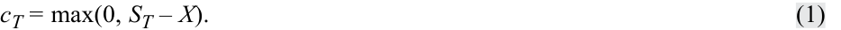
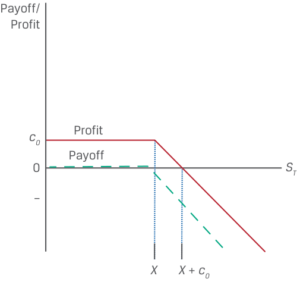
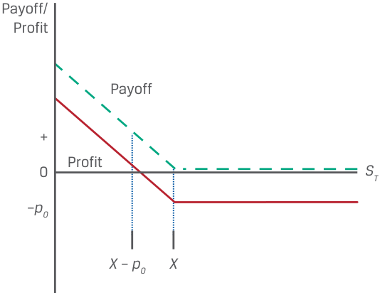
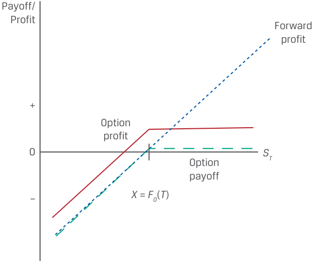

# Volume 7: Derivatives
## Learning Module 2 Forward Commitment and Contingent Claim Features and Instruments
### Part 2/2: Options (PDF Pages 46–60)

---

<!-- PDF Page 46 -->

3. The correct answer is A. A fixed-rate payer (also known as the floating-rate receiver) receives a net payment if the market reference rate exceeds the fixed rate for a given period. 

# **<mark>5</mark>** 

#### **OPTIONS** 

define forward contracts, futures contracts, swaps, options (calls and puts), and credit derivatives and compare their basic characteristics determine the value at expiration and profit from a long or a short position in a call or put option contrast forward commitments with contingent claims 

Contingent claims are a type of ETD or OTC derivative contract in which one of the counterparties has the right to determine whether a trade will settle based on the underlying value. Option contracts are the most common contingent claim. Similar to forwards and futures, options are derivative contracts between a buyer and a seller that specify an underlying, contract size, a pre-agreed execution price, and a maturity date. The option buyer has the right but not the obligation to transact the trade, and the option seller has the obligation to fulfill the transaction as chosen by the option buyer. As a consequence, the payoff to an option buyer is always zero or positive. It can never be negative. 

Assume an option buyer pays a premium ( _c_ 0) of $5 at _t_ = 0 for the right—but not the obligation—to buy stock _S_ at time _T_ at a pre-agreed price ( _X_ ) of $30. The option buyer’s decision at maturity depends on the stock price at maturity ( _ST_ ), as shown in the following two scenarios: 

##### **Scenario 1: Transact (** **_ST_ >** **_X_ )** 

- If _ST_ = $40, the option buyer chooses to exercise the option and buy the stock for _X_ = $30. 

- The option buyer gains $10 [( _ST_ – _X_ ) = $40 – $30] on the transaction. 

- The option buyer realizes a $5 profit [( _ST_ – _X_ ) – _c_ 0 = ($40 – $30) – $5]. 

##### **Scenario 2: Do Not Transact (** **_ST_ <** **_X_ )** 

- If _ST_ = $25, the option buyer chooses not to exercise the option and buy the stock for _X_ = $30. 

- The option buyer realizes a $5 loss ( _c_ 0 = $5). 

Exhibit 6 shows the option mechanics for the case where the option buyer pays for the right to purchase an underlying stock _S_ at a pre-agreed execution price of _X_ in the future ( _t_ = _T_ ). 

<!-- PDF Page 47 -->

**Exhibit 6: Call Option Mechanics** 

<!-- Start of picture text -->
Time t  = 0 t  =  T Underlying  ST  ≤  X Buyer does not purchase underlying Option buyer Right to purchase Option buyer Option seller underlying at  X Upfront premium Underlying  ST  >  X Buyer purchases underlying X Option seller Obligated to sell Option buyer Option seller underlying at  X Underlying ( ST ) <!-- End of picture text -->

The decision to transact the underlying is referred to as an **exercise** , and the pre-agreed execution price is called the **exercise price** (or strike price). Option buyers may transact the underlying in the future at their sole discretion at the exercise price, a pre-agreed future spot price that may be above, at, or below the forward price, as shown in an earlier lesson. This right to exercise in the future has a value that is paid upfront to the option seller in the form of an **option premium** . 

Option contract terms, such as the right to buy or sell, exercise price, maturity, and size, may either be agreed on between the counterparties in an over-the-counter transaction or executed on an exchange based on standardized terms. This lesson focuses on **European options** , or options that may be exercised only at maturity, although other option styles exist. **American options** , for example, may be exercised at any time from contract inception until maturity. Note the labels “European” and “American” refer not to where these options are used but, rather, to the difference in when they can be exercised. 

Two primary option types exist—namely, (1) the right to buy an underlying known as a **call option** and (2) the right to sell the underlying, or a **put option** . An option buyer will exercise a call or put option only if it returns a positive payoff. If not exercised, the option expires worthless, and the option buyer’s loss equals the premium paid. 

One factor in an option’s value prior to maturity ( _t_ < _T_ ) is the option’s exercise value at time _t_ , which is referred to as an option’s **intrinsic value** . 

We can say a call option is **in-the-money** at time _t_ if the spot price, _St_ , exceeds _X_ , with an intrinsic value equal to ( _St_ – _X_ ). Both **out-of-the-money** options (where _St_ < _X_ ) and **at-the-money** options ( _St_ = _X_ ) have zero intrinsic value, so their price, _ct_ , consists solely of time value. 

Call option buyers will gain from a rise in the price of the underlying. Exhibit 7 shows the payoff and profit at maturity for a call option buyer. 

<!-- PDF Page 48 -->

**Exhibit 7: Long Call Payoff Profile** 

<!-- Start of picture text -->
Payoff/ Profit + Payoff 0 ST Profit – c0 X X  +  c0 <!-- End of picture text -->

The option buyer pays a call option premium, _c_ 0, at time _t_ = 0 to the option seller and has the right to purchase the underlying, _ST_ , at an exercise price of _X_ at time _t_ = _T_ . The exercise _payoff_ ( _ST_ – _X_ ) is positive if _ST_ > _X_ and zero if _ST_ ≤ _X_ . The call option value at maturity, _cT_ , may be expressed as follows: 

<!-- Formula Text: cT = max(0, ST – X). (1) -->

The call option buyer’s _profit_ equals the _payoff_ minus the call premium, _c_ 0 (ignoring the time value of money in this lesson): 

<!-- Formula Text: Π = max(0, ST – X) – c0. (2) -->

This asymmetric payoff profile is a common feature of contingent claims, which are sometimes referred to as **non-linear derivatives** . 

###### **EXAMPLE 5** 

##### **Hightest Capital—Call Option Purchase** 

Hightest Capital purchases a call option on the S&P 500 Health Care Select Sector Index (SIXV). This six-month exchange-traded option contract has a size of 100 index units and an exercise price of $1,240 per unit versus the initial SIXV spot price of $1,180.95. The option premium paid upfront is $24.85 per unit, or $2,485 (= $24.85 × 100). As the option nears maturity, a Hightest analyst is asked to determine the expected option payoff and profit per unit at maturity under different scenarios for the SIXV spot price on the exercise date. She compiles the following table: 

- _c_ 0 = Call option premium = $24.85 per unit. 

- = Exercise price at time _T_ = $1,240 per unit. 

- _ST_ = Spot price per unit at time _T_ . 

|**SIXV Spot**|**Exercise**|**Payoff**|**Profit**|
|---|---|---|---|
|**Price (****_ST_)**|**Price (****_X_)**|**max(0,****_ST_ –****_X_)**|**max(0,****_ST_ –****_X_) –****_c_0**|
|$1,280|$1,240|$40|$15.15|
|$1,260|$1,240|$20|−$4.85|

<!-- PDF Page 49 -->

|**SIXV Spot**|**Exercise**|**Payoff**|**Profit**|
|---|---|---|---|
|**Price (****_ST_)**|**Price (****_X_)**|**max(0,****_ST_ –****_X_)**|**max(0,****_ST_ –****_X_) –****_c_0**|
|$1,240|$1,240|$0|−$24.85|
|$1,220|$1,240|$0|−$24.85|

Example 5 raises another question regarding an option’s value prior to maturity ( _t_ < _T_ ). The longer the time to option maturity, the more likely it is that a favorable change in the underlying price will increase both the likelihood and profitability of exercise. This **time value** of an option is always positive and declines to zero as an option reaches maturity. 

In contrast to the call option buyer with unlimited upside potential and a loss limited to the premium paid, the call option seller receives a maximum of the premium and faces unlimited downside risk as the underlying appreciates above the exercise price. The short call payoff profile in Exhibit 8 is a mirror image of Exhibit 7. 

###### **Exhibit 8: Short Call Payoff Profile** 

<!-- Start of picture text -->
Payoff/ Profit Profit c0 Payoff 0 ST – X X  +  c0 <!-- End of picture text -->

The option buyer and seller payoff profiles demonstrate the one-sided nature of counterparty credit risk for contingent claims. That is, the option seller has no credit exposure to the option buyer once the premium is paid. However, the option buyer faces the counterparty credit risk of the option seller equal to the option payoff at maturity. 

Put option buyers benefit from a lower underlying price by selling the underlying at a pre-agreed exercise price. A put option buyer exercises when the underlying price is below the exercise price ( _ST_ < _X_ ), as shown in Exhibit 9. 

<!-- PDF Page 50 -->

**Exhibit 9: Long Put Payoff Profile** 

<!-- Start of picture text -->
Payoff/ Profit Payoff + Profit 0 ST – p0 X  –  p0 X <!-- End of picture text -->

The put option buyer pays a premium of _p_ 0 at inception to the option seller and will exercise the option only if ( _X_ – _ST_ ) > 0. As in Equations 1 and 2, we may show the long put option _payoff_ and _profit_ , Π, as follows: 

<!-- Formula Text: pT = max(0, X – ST). (3) -->

<!-- Formula Text: Π = max(0, X – ST) – p0. (4) -->

The payoff or profit from a put option seller’s perspective is the opposite of the put option buyer’s gain or loss for a given underlying price at expiration. As in the case of the call option seller, the put option seller has a maximum gain equal to the premium. However, although a call option seller faces unlimited potential loss as the underlying appreciates beyond the exercise price, the put option seller’s loss is usually limited because the underlying price cannot fall below zero. The short put option _payoff_ and _profit_ are as follows: 

- _pT_ = –max(0, _X_ – _ST_ ). ~~(5)~~ 

<!-- Formula Text: Π = –max(0, X – ST) + p0. (6) -->

###### **QUESTION SET** 

##### **Options** 

1. Calculate the SIXV spot price at maturity from Example 5 at which Hightest Capital will reach a breakeven point and earn zero profit. 

###### **Solution:** 

The call purchaser has a profit equal to max(0, _ST_ – _X_ ) – _c_ 0. In the case of Hightest in Example 5, the SIXV exercise price is $1,240 and the initial call premium is $24.85. The breakeven or zero profit point is therefore equal to $1,240 + $24.85, or $1,264.85. 

<!-- PDF Page 51 -->

2. A put option seller receives a $5 premium for a put option sold on an underlying with an exercise price of $30. What is the option seller’s maximum profit under the contract? What is the maximum loss under the contract? 

- **Solution:** 

- A put option seller receives a $5 premium ( _p_ 0) for a put option sold on an underlying with an exercise price ( _X_ ) of $30. The put option seller’s profit is Π = –max(0, _X_ – _ST_ ) + _p_ 0. If the option is unexercised, –max(0, _X_ – _ST_ ) = 0 and the put seller earns _p_ 0 = $5. If the option is exercised and _ST_ = 0, then Π = –max(0, 30 – 0) + 5 = –$25. Therefore, the option seller’s maximum profit under the contract is $ _5_ and the maximum loss under the contract is $ _25_ . 

3. Identify the option contract participants that correspond to the following statements: 

- A. Put option seller 1. Has no counterparty credit risk to the option buyer once the upfront premium has been paid 

- B. Call option seller 2. Earns a profit equal to the premium if the underlying price at maturity is less than the exercise price 

- C. Both a put option seller and a call 3. Earns a profit equal to the premium if option seller the underlying price at maturity exceeds the exercise price 

###### **Solution:** 

1. The correct answer is C. An option seller has no counterparty credit risk to the option buyer once the upfront premium has been paid. 

2. The correct answer is B. A call option seller earns a profit equal to the premium if the underlying price at maturity is less than the exercise price. 

3. The correct answer is A. A put option seller earns a profit equal to the premium if the underlying price at maturity is greater than the exercise price. 

#### **CREDIT DERIVATIVES** 

<!-- Start of picture text -->
6 <!-- End of picture text -->

define forward contracts, futures contracts, swaps, options (calls and puts), and credit derivatives and compare their basic characteristics 

Credit derivative contracts are based on a credit underlying, or the default risk of a single debt issuer or a group of debt issuers in an index. The most common credit derivative contract is a credit default swap. CDS contracts allow an investor to manage the risk of loss from issuer default separately from a cash bond. CDS contracts trade based on a credit spread ( **CDS credit spread** ) similar to that of a cash bond. Credit spreads depend on the probability of default (POD) and the loss given default (LGD), as shown in an earlier lesson. A _higher_ credit spread (or higher likelihood of issuer financial distress) corresponds to a _lower_ cash bond price, and vice versa. 

<!-- PDF Page 52 -->

Despite their name, CDS contracts are contingent claims that share some features of firm commitments. Unlike the call and put options discussed earlier, both the timing of exercise and payment upon exercise under a CDS contract vary depending on the underlying issuer(s). As in the case of a standard interest rate swap, a CDS contract priced at a par spread has a zero net present value, and the notional amount is not exchanged but, rather, serves as a basis for spread and settlement calculations. 

In a CDS contract, the credit protection buyer pays the credit protection seller to assume the risk of loss from the default of an underlying third-party issuer. If an issuer **credit event** occurs—usually defined as bankruptcy, failure to pay an obligation, or an involuntary debt restructuring—the credit protection seller pays the credit protection buyer to settle the contract. This contingent payment equals the issuer loss given default for the CDS contract notional amount. Exhibit 10 shows the periodic cash flows under a CDS contract. 

**Exhibit 10: Periodic Payments under a Credit Default Swap** 

<!-- Start of picture text -->
Fixed CDS Spread Protection Buyer Protection Seller (Short Risk)  (Long Risk) Contingent Payment Upon Credit Event <!-- End of picture text -->

The underlying may be a corporate or sovereign issuer, an index of issuers, or a special purpose entity with a portfolio of loans, mortgages, or bonds. 

A buyer can use a CDS contract as a hedge of existing credit exposure to the underlying issuer. The credit protection afforded by a CDS is similar to insurance for a buyer with an existing fixed-income exposure to the third-party issuer. The buyer may suffer a loss in value on its fixed-income exposure from the credit event but will receive a payment from the CDS contract that will offset that loss. 

A credit protection buyer without the corresponding fixed-income exposure who buys a CDS is seeking to gain from higher credit spreads (which correspond to lower cash bond prices) for an underlying issuer and is therefore short credit risk. 

The credit protection seller receives a periodic fixed spread payment in exchange for assuming the contingent risk of paying the credit protection buyer to offset the loss under a credit event. The contract structure is similar to insurance, with the periodic premium over the life of the contract agreed to upfront and with the timing and size of the loss under the credit event being unknown. The seller’s position is therefore similar to that of a long risk position in the issuer’s underlying bond. 

For example, Exhibit 11 shows the CDS contract for an underlying issuer that experiences credit migration ( _t_ = 1) followed by a credit event ( _t_ = 2). 

<!-- PDF Page 53 -->

**Exhibit 11: CDS Contract with Credit Migration and Credit Event** 

<!-- Start of picture text -->
Credit Credit Migration Event Time t  = 0 t  = 1 t  = 2 Protection Protection Protection Buyer Buyer Buyer CDS Spread0 CDS Spread0 Payment 100 bps p.a. 100 bps p.a. ≈ LGD (%) × Notional Protection Protection Protection Seller Seller Seller Credit migration Credit event CDS Spread1 = 250 bps Issuer default/Failure to pay MTM Gain to buyer CDS Contract terminates MTM Loss to seller CDS MTM Change ≈ Payment from seller to buyer Δ CDS Spread × Notional × ≈ LGD (%) × Notional EffDurCDS <!-- End of picture text -->

The protection buyer agrees to pay a fixed spread of 100 bps p.a. at _t_ = 0 for the contract term. As the issuer’s CDS spread widens to 250 bps p.a. at _t_ = 1, the buyer gains on the CDS contract due to the low fixed spread paid while the seller loses due to the low fixed spread received relative to the current higher CDS market spread. As for any fixed-income instrument, the effective duration of the remaining contract may be used to approximate the MTM change. An issuer credit event at _t_ = 2 causes the contract to terminate, and the seller must make a payment to the buyer equal to the percentage of loss (LGD) multiplied by the CDS contract notional. 

###### **QUESTION SET** 

##### **Credit Derivatives** 

1. Determine the correct answer to fill in the blanks: The contingent payment under a credit default swap equals the ____ ____ ____ for the CDS notional amount specified in the contract. **Solution:** The contingent payment under a credit default swap equals the _loss given default_ for the CDS notional amount specified in the contract. 

2. Describe how a credit protection seller’s position is similar to that of an underlying cash bond investment. **Solution:** 

A credit protection seller receives a periodic CDS spread payment in exchange for the contingent risk of payment to the buyer under an issuer credit event. A cash bond investor receives a periodic coupon that incorporates 

<!-- PDF Page 54 -->

an issuer’s credit spread in exchange for a potential loss if the issuer defaults. Under the CDS contract and the cash bond, this potential payment or loss equals the LGD. The credit protection seller’s position is therefore similar to that of a long risk position in the issuer’s underlying bond. 

3. Identify the CDS contract participants that correspond to the following statements: 

- A. Credit protection buyer 1. Seeks to gain from higher issuer credit spreads 

- B. Credit protection seller 2. Enters into a derivative contract that transfers the risk of loss from a credit event of an underlying third-party issuer 

- C. Both a credit protection buyer and a 3. Faces an MTM gain on the CDS credit protection seller contract if the CDS spread of the underlying issuer falls 

###### **Solution:** 

1. The correct answer is A. A credit protection buyer seeks to gain from higher issuer credit spreads. 

2. The correct answer is C. Both the credit protection buyer and credit protection seller enter into a derivative contract that transfers the risk of loss from a credit event of an underlying third-party issuer. 

3. The correct answer is B. A credit protection seller faces an MTM gain on the CDS contract if the CDS spread of the underlying issuer falls. The decline in the issuer’s CDS spread versus the original fixed spread on the CDS contract means that the protection seller is receiving an above-market spread. This above-market CDS spread more than compensates the seller for the new, lower level of credit risk and results in an MTM gain. 

# **<mark>7</mark>** 

#### **FORWARD COMMITMENTS VS. CONTINGENT CLAIMS** 

contrast forward commitments with contingent claims 

A firm commitment requires both counterparties to perform under a derivative contract, while an option buyer can decide whether to perform under the contract at maturity depending on the underlying price relative to the exercise price. Market participants often create similar exposures to an underlying using these different derivative instrument types. For example, both a long forward position and a long call option position will gain from an increase in the underlying price. Exhibit 12 contrasts the payoff and profit of these two derivative contracts, where the exercise price, _X_ , equals the forward price, _F_ 0( _T_ ). 

<!-- PDF Page 55 -->

###### **Exhibit 12: Long Forward and Long Call Option Payoff Profiles** 

<!-- Start of picture text -->
Payoff/ Forward profit profit + Option payoff 0 ST Option – profit X  =  F0 ( T ) <!-- End of picture text -->

As shown earlier, both the long forward and the call option payoffs increase as _ST_ rises. In the case of a forward, this linear relationship is equal to [ _ST_ – _F_ 0( _T_ )], with the payoff equal to profit because no cash is exchanged at inception. For the buyer of a call option with an exercise price of _F_ 0( _T_ ), Equation 2 changes to 

Π = max[0, _ST_ – _F_ 0( _T_ )] – _c_ 0. 

Setting the forward payoff/profit [ _ST_ – _F_ 0( _T_ )] equal to the call option profit, Π, gives us the following relative profit profile between the forward and option: 

- _ST_ – _F_ 0( _T_ ) > – _c_ 0 Forward profit exceeds option profit 

- _ST_ – _F_ 0( _T_ ) = – _c_ 0 Forward profit equals call option profit 

- _ST_ – _F_ 0( _T_ ) < – _c_ 0 Option profit exceeds forward profit 

The side-by-side comparison in Exhibit 12 between the forward and call option profit diagrams shows the long call option’s similarity to a long position in the underlying with downside protection in exchange for paying a premium. 

Another contingent claim that benefits from a rise in the underlying price is the sold put option. While the long call option and long forward payoffs both rise when the underlying price is above the exercise price, the put option seller’s profit is limited to the upfront premium. Exhibit 13 contrasts the short put payoff and profit with a long forward if the exercise price, _X_ , equals _F_ 0( _T_ ). 

<!-- PDF Page 56 -->

- **Forward Commitment and Contingent Claim Features and Instruments** 

###### **Exhibit 13: Long Forward and Short Put Option Payoff Profile** 

<!-- Start of picture text -->
Payoff/ Profit Forward profit + Option profit 0 ST Option payoff – X  =  F0 ( T ) <!-- End of picture text -->

We can compare the long forward payoff/profit of [ _ST_ – _F_ 0( _T_ )] to a modified version of Equation 6: 

- Π = –max[0, _F_ 0( _T_ ) – _ST_ ] + _p_ 0. 

Setting the forward profit [ _ST_ – _F_ 0( _T_ )] equal to the put option profit, Π, gives us the following relative profit profile between the forward and option: 

- _ST_ – _F_ 0( _T_ ) > _p_ 0 Forward profit exceeds option profit 

- _ST_ – _F_ 0( _T_ ) = _p_ 0 Forward profit equals option profit) 

- _ST_ – _F_ 0( _T_ ) < _p_ 0 Option profit exceeds forward profit 

The side-by-side comparison in Exhibit 13 of the forward and sold put option profit diagrams shows the sold put option’s similarity to a long position in the underlying, with gains from price appreciation forgone in exchange for receiving a premium. The apparent symmetry between long call and short put positions and the long forward position will be examined in greater detail in a later lesson. 

###### **QUESTION SET** 

##### **Firm Commitments and Contingent Claims** 

1. Determine the correct answers to fill in the blanks: A _____ forward position, a _____ call option position, and a _____ put option position will gain from a decrease in the underlying price. 

###### **Solution:** 

- A _short_ forward position, a _short_ call option position, and a _long_ put option <u>position will gain from a decrease in the underlying price.</u> 

<!-- PDF Page 57 -->

2. Identify the derivative positions that correspond to the following profit profiles at maturity assuming that the exercise price ( _X_ ) equals _F_ 0( _T_ ): 

<!-- Start of picture text -->
A. Short forward position 1. Profit Profit + 0 ST – F0 ( T ) B. Long put position 2. Profit Profit + 0 ST – F0 ( T ) C. Short call position 3. Profit + Profit 0 ST – F0 ( T ) <!-- End of picture text -->

###### **Solution:** 

   1. The correct answer is B. 

   2. The correct answer is A. 

   3. The correct answer is C. 

3. Describe the point at which a short forward and a long put with an exercise price ( _X_ ) equal to the forward price, _F_ 0( _T_ ) have the same profit. 

###### **Solution:** 

The short forward and long put positions will have the same profit when _F_ 0( _T_ ) – _ST_ = – _p_ 0. A short forward position gains from a decline in the underlying price with a payoff/profit of [ _F_ 0( _T_ ) – _ST_ ], and a long put position has a profit of Π = max[0, _F_ 0( _T_ ) – _ST_ ] – _p_ 0, from Equation 4, with an exercise price equal to the forward price, _X_ = _F_ 0( _T_ ). 

<!-- PDF Page 58 -->

## **~~PRACTICE PROBLEMS~~** 

### **The following information relates to questions 1-4** 

Biomian Limited is a Mumbai-based biotech company with common stock and listed futures and options on the National Stock Exchange (NSE). The Viswan Family Office (VFO) currently owns 10,000 Biomian common shares. VFO would like to reduce its long Biomian position and diversify its equity market exposure but will delay a cash sale of shares for tax reasons for six months. 

**1.** Which of the following derivative contracts available to VFO’s chief investment officer is best suited to reduce exposure to a decline in Biomian’s stock price in the next six months? 

   - **A.** A short put position on Biomian stock that expires in six months 

   - **B.** A long call position on Biomian stock that expires in six months 

   - **C.** A short futures position in Biomian stock that settles in six months 

**2.** VFO’s market strategist believes that Biomian’s share price will rise over the next six months but would like to protect against a decline in Biomian’s share price over the period. Which of the following positions is best suited for VFO to manage its existing Biomian exposure based on this view? 

   - **A.** A long put position on Biomian stock that expires in six months 

   - **B.** A short call position on Biomian stock that expires in six months 

   - **C.** A long futures position in Biomian stock that settles in six months 

**3.** Assume that Biomian shares rise over the next six months. Which of the following statements about VFO’s derivative strategies under this scenario is most accurate? 

   - **A.** A forward sale of Biomian shares in six months would be more profitable than purchasing the right to sell Biomian shares in six months. 

   - **B.** Purchasing the right to sell Biomian shares in six months would be more profitable than a forward sale of Biomian shares in six months. 

   - **C.** We do not have enough information to determine whether a forward sale or the right to sell Biomian shares will be more profitable in six months. 

**4.** VFO’s market strategist is considering a six-month call option strategy on the NIFTY 50 benchmark Indian stock market index to increase broad market equity exposure. The NIFTY 50 price today is INR15,200, and the strategist observes that a call option with a INR16,000 exercise price ( _X_ ) is trading at a premium of INR1,500. Which of the following represents the payoff and profit of this strategy just prior to maturity if the NIFTY 50 is trading at INR16,500? 

   - **A.** Payoff is INR500; profit is –INR1,000. 

   - **B.** Payoff is INR1,300; profit is INR800. 

<!-- PDF Page 59 -->

**C.** Payoff is INR1,300; profit is INR500. 

<!-- PDF Page 60 -->

## **~~SOLUTIONS~~** 

1. C is correct. VFO may consider either a short futures position in (or a forward sale of) Biomian shares in six months to achieve its objective. This firm commitment allows VFO to offset its long position with a short position in six months at a pre-agreed price. The futures contract is an exchange-traded derivative with standardized terms set by the exchange and requires initial margin and daily settlement. Answers A and B are contingent claims that can both potentially increase, not decrease, VFO’s exposure to Biomian stock in six months. 

2. A is correct. VFO should purchase a six-month put option on Biomian shares to manage its exposure based on the market strategist’s view. This contingent claim grants VFO the right but not the obligation to sell Biomian shares at a pre-agreed exercise price in exchange for a premium. A put option buyer exercises the option at maturity when the underlying price is below the exercise price. This allows VFO to continue to benefit from a rise in Biomian’s share price over the next six months with a limited downside. Neither B nor C provides VFO with downside protection if Biomian stock declines in six months. 

3. C is correct. Under a forward sale of Biomian shares, the profit is [ _F_ 0( _T_ ) – _ST_ ]. If the shares rise significantly over the next six months—that is, _ST_ > _F_ 0( _T_ )—then VFO’s loss on the derivative is the difference between the Biomian forward price, _F_ 0( _T_ ), and the spot price, _ST_ . Under the long put option on Biomian shares, VFO’s profit is max(0, _X_ – _ST_ ) – _p_ 0. If Biomian shares rise significantly over the next six months (i.e., _ST_ > _X_ ), then the option expires worthless and VFO’s loss is limited to the put premium paid, _p_ 0. If [ _F_ 0( _T_ ) – _ST_ ] > – _p_ 0, then VFO’s loss would be greater under the firm commitment than under the contingent claim. 

4. A is correct. The profit is equal to Π = max(0, _ST_ – _X_ ) – _c_ 0, and the payoff is equal to max(0, _ST_ – _X_ ). The exercise price is INR16,000, and the spot price just prior to maturity is INR16,500, so Π = –1,000 [= (16,500 – 16,000) – 1,500], and the payoff is equal to INR500 [= (16,500 – 16,000)]. 

