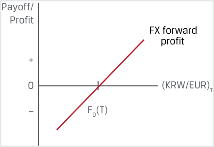
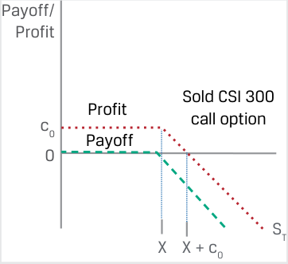
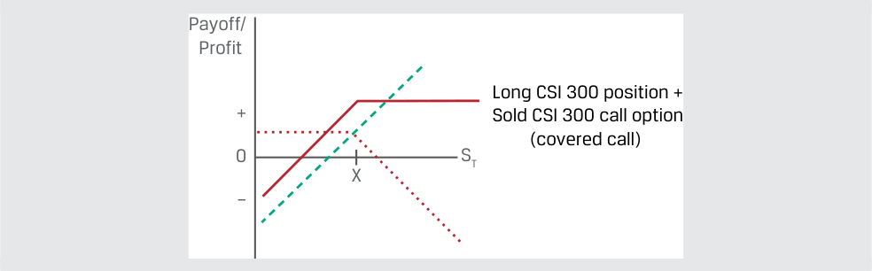
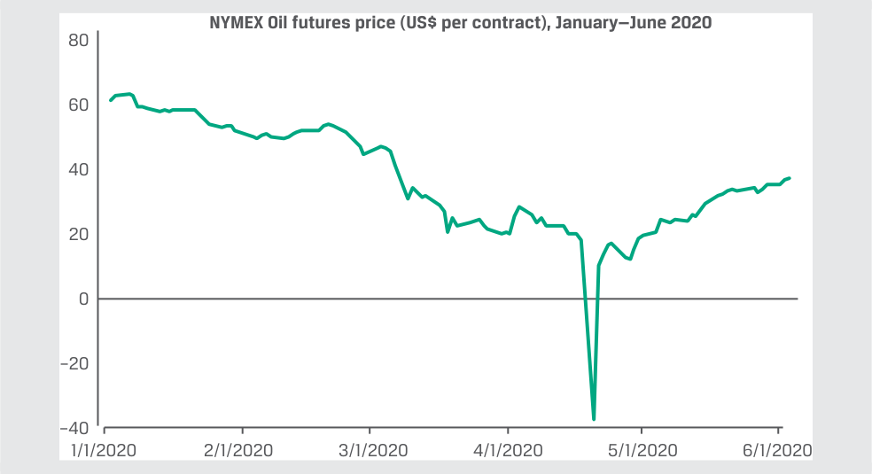

# Volume 7: Derivatives
## Learning Module 3 Derivative Benefits, Risks, and Issuer and Investor Uses
### Part 1/2: Introduction (PDF Pages 61–74)

---

<!-- PDF Page 61 -->

# L E A R N I N G M O D U L E **<mark>3</mark>** 

### **Derivative Benefits, Risks, and Issuer and Investor Uses** 

##### **<mark>LEARNING OUTCOMES</mark>** 

**_Mastery The candidate should be able to:_** describe benefits and risks of derivative instruments compare the use of derivatives among issuers and investors 

#### **INTRODUCTION** 

## **<mark>1</mark>** 

Earlier lessons described how derivatives expand the set of opportunities available to market participants to create or modify exposure or to hedge the price of an underlying. This learning module describes the benefits and risks of using derivatives and compares their use among issuers and investors. 

###### **LEARNING MODULE OVERVIEW** 

- Derivatives allow market participants to allocate, manage, or trade exposure without exchanging an underlying in the cash market. 

- ■ Derivatives also offer greater operational and market efficiency than cash markets and allow users to create exposures unavailable in cash markets. 

- ■ Derivative instruments can involve risks such as a high degree of implicit leverage and less transparency in some cases than cash instruments, as well as basis, liquidity, and counterparty credit risks. Excessive risk taking in the past by market participants through the use of derivatives has contributed to market destabilization and systemic risk. 

- ■ Issuers typically use derivative instruments to offset or hedge market-based underlying exposures that impact their assets, liabilities, and earnings. 

<!-- PDF Page 62 -->

- Issuers usually seek hedge accounting treatment for derivatives to minimize income statement and cash flow volatility. 

- Investors use derivatives to modify investment portfolio cash flows, replicate investment strategy returns in cash markets, and/or create exposures unavailable to cash market participants. 

###### **LEARNING MODULE SELF-ASSESSMENT** 

These initial questions are intended to help you gauge your current level of understanding of this learning module. 

1. Which of the following statements does **not** describe a likely operational advantage of a futures market transaction as compared to a cash market transaction? 

   - **A.** It is easier to take a short position in the futures market than in the cash market. 

   - **B.** There is greater liquidity in the futures market than in the cash market. 

   - **C.** Cash requirements to buy in the cash market are lower than margin requirements to buy in the futures market. 

###### **Solution:** 

C is correct. The opposite is true: Margin requirements of a futures contract are typically only a small percentage of the cash requirement to buy the same amount of underlying in the cash market. A and B are both incorrect because both of these statements describe operational advantages of futures markets over cash markets. 

2. Identify which derivative risk fits each of the following statements: 

|A. Basis risk|1. Potential divergence between the cash flow timing of a derivative versus an underlying or hedged transaction|
|---|---|
|B. Liquidity risk|2. Potential divergence between the expected value of a derivative versus an underlying or hedged transaction|
|C. Counterparty credit risk|3. Potential for a derivatives contract partici- pant to fail to meet their obligations under an agreement|

###### **Solution** 

**1.** B is correct. Liquidity risk is the potential divergence between the cash flow timing of a derivative versus an underlying or hedged transaction. 

**2.** A is correct. Basis risk is the potential divergence between the expected value of a derivative versus an underlying or hedged transaction. 

**3.** C is correct. Counterparty credit risk is the potential for a derivatives contract participant to fail to meet their obligations under an agreement. 

<!-- PDF Page 63 -->

3. Identify which benefit of derivatives use fits each of the following examples: 

|A. Price discovery function|1. Equity market participants monitor index futures prior to the market open for an indication of the direction of cash market prices in early trading.|
|---|---|
|B. Operational advantages|2. An issuer may wish to lock in its future debt costs in advance of the maturity of an outstanding debt issuance.|
|C. Ability to allocate, trans-|3. Futures contracts in physical commodities elim-|
|fer, and manage risk|inate the need to directly transport, insure, and store a physical asset in order to take a position in its underlying price.|

###### **Solution** 

   **1.** A is correct. Equity market participants monitoring index futures prior to the market open for an indication of the direction of cash market prices in early trading is an example of the derivatives price discovery function. 

   **2.** C is correct. An issuer locking in its future debt costs in advance of the maturity of an outstanding debt issuance is an example of the ability to allocate, transfer, and manage risk. 

   **3.** B is correct. Futures contracts in physical commodities eliminating the need to directly transport, insure, and store a physical asset in order to take a position in its underlying price is an example of the operational advantages of a derivative. 

4. Which of the following hedge accounting designations is appropriate for categorizing a corporate issuer’s use of an interest swap converting a floating-rate debt into a fixed-rate debt? 

   - **A.** Fair value hedge 

**B.** Cash flow hedge 

**C.** Net investment hedge 

###### **Solution:** 

B is correct. Cash flow hedge treatment is appropriate for instances in which a variable cash flow is converted to a fixed cash flow through the use of a derivative. A is incorrect because a fair value hedge is appropriate accounting treatment for derivative contracts that offset fluctuations in the fair value of the underlying. C is incorrect because a net investment hedge offsets the foreign currency risk of the value of a foreign subsidiary. 

#### **DERIVATIVE BENEFITS** 

describe benefits and risks of derivative instruments 

<!-- PDF Page 64 -->

Earlier lessons demonstrated how market participants use derivative instruments as an alternative to cash markets to hedge or offset commercial risk as well as create or modify exposure to the price of an underlying. We now take a more detailed look at these and other benefits of the use of derivatives, while also considering several risks unique to derivative instruments. 

Derivative instruments provide users the opportunity to allocate, transfer, and/or manage risk without trading an underlying. Cash or spot market prices for financial instruments and commercial goods and services are a critical source of information for the decision to buy or sell. However, in many instances, issuers and investors face a timing difference between an economic decision and the ability to transact in a cash market. 

For example, issuers face the following timing differences when making operational and financing decisions: 

- A manufacturer may need to order commodity inputs for its production process in advance of receiving finished-goods orders. 

- A retailer may await a shipment of goods priced in a foreign currency before selling domestic currency to make payment. 

- An issuer may wish to lock in its future debt costs in advance of the maturity of an outstanding debt issuance. 

Investors may face similar timing issues when making portfolio decisions that are separate from cash market transactions, as in the following cases: 

- An investor may seek to capitalize on a market view but lack the necessary cash on hand to transact in the spot market. 

- In anticipation of a future stock dividend, debt coupon, or principal repayment, an investor may decide today how it will reinvest the proceeds in the future. 

The ability to buy or sell a derivative instrument today at a pre-agreed price at a future date can bridge the timing gap between an economic decision and the ability to transact in underlying price risk under these scenarios. The use of forward commitments or contingent claims to allocate or transfer risk across time and among market participants able and willing to accept those exposures is a consistent theme in derivative markets. Example 1 builds on an earlier illustration of how an issuer may benefit from the use of a derivative associated with a commercial contract. 

###### **EXAMPLE 1** 

##### **Foreign Exchange Risk Transfer of an Export Contract** 

Recall Montau AG, the German capital goods producer introduced earlier, which signs a commercial contract with Jeon, Inc., a Korean manufacturer, to deliver a laser cutting machine at a price of KRW650,000,000 in 75 days. Montau has fixed domestic currency (EUR) costs and therefore faces a timing mismatch between EUR costs incurred and EUR revenue realized upon the delivery of the machine and sale of KRW received in exchange for EUR in the spot FX market. 

Describe Montau’s currency exposure and how an FX forward contract may be used to mitigate its FX price risk. 

Montau will receive KRW in 75 days, which it must sell to cover its EUR costs. This exposes the firm to KRW/EUR exchange rate changes for 75 days. Specifically, if the KRW depreciates versus the EUR, Montau will be able to 

<!-- PDF Page 65 -->

purchase fewer EUR than expected with the KRW proceeds, resulting in a loss due to the FX timing mismatch. Montau’s exposure profile due to the mismatch is as follows: 

<!-- Start of picture text -->
Payoff/ Profit Export contract exposure + 0 (KRW/EUR)T – <!-- End of picture text -->

In order to mitigate its export contract exposure, Montau enters an FX forward to sell KRW and purchase EUR at a fixed price [F0(T)] in 75 days to eliminate the KRW/EUR exchange rate mismatch arising from the export contract. The FX forward payoff and profit profile is as follows: 

<!-- Start of picture text -->
Payoff/ Profit FX forward profit + 0 (KRW/EUR)T – F0(T) <!-- End of picture text -->

The FX forward payoff and profit profile offsets Montau’s export contract exposure as a hedge, as shown in the following combined diagram: 

<!-- Start of picture text -->
Payoff/ Profit FX  gain  on FX  gain  on export forward contract  contract + 0 (KRW/EUR)T – F0(T) FX  loss  on FX  loss  on forward export contract  contract <!-- End of picture text -->

The ability to trade and/or manage risk using derivatives extends to the creation of exposure profiles, which are unavailable in cash markets. The following example combines a long cash position with a sold derivative to increase an investor’s expected return, based on a specific market view. 

###### **EXAMPLE 2** 

##### **Covered Call Option Strategy** 

South China Sprintwyck Investments (SCSI) has a Chinese equity portfolio that has outperformed in the first half of the year due to an overweight position in health care industry shares. SCSI holds a long position in the Shenzhen China Securities Index (CSI) 300 Health Care Index (CSI 300) traded on the China Financial Futures Exchange (CFFEX). SCSI’s CIO expects volatility in the CSI 

<!-- PDF Page 66 -->

300 to decline and the CSI 300 price at year-end to be at or slightly above the current spot price. Rather than sell the CSI 300 position today in the cash market, she decides to sell a CSI 300 call option at an exercise price 5% above the current spot market price for the remaining six months of the year. 

Describe the _difference_ in SCSI’s CSI 300 payoff profile between 1.) the long cash position and 2.) the sold call option plus long cash position (referred to as a **covered call** strategy) at the end of the year. 

**1.** SCSI’s long cash position will rise or fall in value as the CSI 300 spot price changes until the end of the year. 

<!-- Start of picture text -->
Payoff/ Long CSI Profit  300 position + 0 ST X – <!-- End of picture text -->

The _difference_ between 1.) and 2.) is the sale of a CSI 300 call option. SCSI sells the call and receives an upfront premium. SCSI assumes unlimited downside risk as the CSI 300 price rises above the exercise price: 

<!-- Start of picture text -->
Payoff/ Profit Sold CSI 300 Profit call option c0 Payoff 0 ST X X + c0 <!-- End of picture text -->

**2.** The combination of the long CSI 300 cash position and the short CSI 300 call option results in the profit profile represented by the solid line below: 

<!-- Start of picture text -->
Payoff/ Profit Long CSI 300 position + + Sold CSI 300 call option (covered call) 0 ST X – <!-- End of picture text -->

The covered call strategy payoff may be described as follows: 

- **CSI 300 appreciates by less than 5%:** The call option expires unexercised. SCSI’s profit equals the long CSI 300 position plus the call premium. 

- **CSI 300 appreciates by more than 5%:** The call option is exercised. SCSI must pay the option buyer an amount equal to the gain on its long CSI 300 position above the exercise price. The option payoff is said to be “covered” by the long cash position. SCSI retains the call <mark>p</mark> remium. 

<!-- PDF Page 67 -->

Derivative instrument prices serve a price discovery function beyond the underlying cash or spot market. For example, futures prices are often seen as revealing information about the direction of cash markets in the future, although they cannot be strictly considered an unbiased forecast of future spot prices. 

Market participants often use futures prices to gauge the direction of cash markets in the future in the following ways: 

- Equity market participants frequently monitor equity index futures prices prior to the stock market open for an indication of the direction of cash market prices in early trading. 

- Analysts often use interest rate futures markets to extract investor expectations of a central bank benchmark interest rate increase or decrease at a future meeting. 

- Commodity futures prices are a gauge of supply and demand dynamics between producers, consumers, and investors across maturities. 

Example 3 provides a case of supply and demand effects on futures prices. 

###### **EXAMPLE 3** 

##### **Negative Oil Futures Prices in 2020** 

In April 2020, the West Texas Intermediate (WTI) crude oil futures price fell below zero for the first time ever. The New York Mercantile Exchange (NYMEX) WTI crude oil futures contract has an underlying of 1,000 barrels of crude oil delivered to Cushing, Oklahoma, where energy companies store nearly 80 million barrels of oil. Widespread lockdowns in the wake of the COVID-19 pandemic caused demand to plummet, while producers could not cut oil production quickly enough in anticipation of the severe decline. Oil inventory in Cushing skyrocketed as a result. 

###### **NYMEX Oil Futures Price (USD per contract), January–June 2020** 

<!-- Start of picture text -->
NYMEX Oil futures price (US$ per contract), January—June 2020 80 60 40 20 0 –20 –40 1/1/2020 2/1/2020 3/1/2020 4/1/2020 5/1/2020 6/1/2020 <!-- End of picture text -->

_Source:_ Bloomberg. 

As the May futures contract approached expiration in late April 2020, investors assuming the financial risk of oil prices were surprised as oil refiners avoided physical delivery of oil upon contract settlement due to a sharp rise in storage costs. This forced the May futures price sharply lower, to a closing price of −USD37.63 on 20 April 2020. Oil producers and refiners used this futures pricing information to adjust supply more quickly and reduce pressure on storage facilities. 

<!-- PDF Page 68 -->

The price discovery function of derivatives extends to contingent claims. As we will see in a later lesson, option prices reflect several characteristics of the underlying, including the expected price risk of the underlying, known as **implied volatility** . The implied volatility of an option may be derived from its current price and other option features and provides a measure of the general level of uncertainty in the price of the underlying. 

Derivative transactions offer a number of operational advantages to cash or spot markets in many instances. 

**1. Transaction Costs:** Commodity derivatives eliminate the need to transport, insure, and store a physical asset in order to take a position in its underlying price. 

**2. Increased Liquidity:** Derivative markets typically have greater liquidity as a result of the reduced capital required to trade derivatives versus an equivalent cash position in an underlying. 

**3. Upfront Cash Requirements:** Initial futures margin requirements and option premiums are low relative to the cost of a cash market purchase. 

**4. Short Positions:** In the absence of a liquid derivative market, taking a short position involves the costly process of locating a cash owner willing to lend the underlying for a period sufficient to facilitate a short sale. 

Example 4 contrasts the cash outlay of a spot trade with a futures contract based on transaction details familiar from an earlier lesson. 

###### **EXAMPLE 4** 

##### **Purchase of Spot Gold versus a Gold Futures Contract** 

In an earlier example, Procam Investments enters a futures contract to buy 100 ounces of gold at a futures price [f0(T)] of USD1,792.13 per ounce that expires in three months and must post USD4,950 in initial margin as required by the exchange. The spot gold price (S0) at the time Procam enters the futures contract is USD1,770 per ounce. Assume that Procam is able to borrow funds from a financial intermediary at a rate of 5% per year. Contrast the expected opportunity cost of the initial margin for the three-month futures contract with a cash purchase of 100 ounces of gold for the same three-month period. 

<!-- PDF Page 69 -->

<!-- Start of picture text -->
Futures contract purchase for settlement at time T 100 ounces of gold Financial Procam Financial intermediary  $4,950 investments intermediary $1,792.13 per ounce f0(T) Initial margin $4,950 Spot market purchase 100 ounces of gold Financial Procam Financial intermediary  $177,000 investments intermediary $1,770 per ounce (S0) <!-- End of picture text -->

**1.** Procam borrows the USD4,950 initial margin from a financial intermediary at 5% for three months. 

Opportunity (interest) cost of the initial margin: 

- = (USD4,950 × .05)/4 = USD61.88 

**2.** Procam borrows USD177,000 (USD1,770 × 100 ounces) for the spot gold purchase from a financial intermediary at 5% for three months. 

Opportunity (interest) cost of the cash gold purchase price: 

- = (USD177,000 × .05)/4 = USD2,212.50 

Procam gains exposure to the underlying price of 100 ounces of gold in the futures market at a fraction of the spot market cost. This comparison ignores three points about the futures contract and spot gold transactions: 

**1.** Procam’s margin requirements change as the futures price fluctuates between t = 0 and t = T. Specifically, Procam faces margin calls if a lower futures price causes its margin account balance to fall below the maintenance margin. However, as the underlying price is usually bounded by zero, it is unlikely that Procam’s borrowing cost for margin will exceed that of the spot cash purchase. 

**2.** Procam’s spot gold purchase involves physical gold. It must therefore cover the cost of delivery, storage, and insurance for three months. 

**3.** The spot gold purchase takes place at a price of S0 = USD1,770 per ounce, while the pre-agreed futures price [f0(T)] = USD1,792.13 per ounce. At time T in three months, both the futures contract and the spot purchase result in a long position for Procam at a price of ST. The expected cost and return for these two transactions should therefore be equal, but the prices agreed at t = 0 are not. In a later lesson, we will explore the relationship between the spot gold price (S0) and the gold futures price [f0(T)] and the effect of both borrowing and storage costs. 

The operational efficiency of derivative markets also leads to greater market efficiency. When prices deviate from fundamental values, derivative markets offer less costly ways to exploit the mispricing. As noted earlier, less capital is required, 

<!-- PDF Page 70 -->

transaction costs are lower, and short selling is easier. As a result of these market features, fundamental value is often reflected in derivative markets before it is restored in the underlying cash market. The existence of derivative markets therefore often causes financial markets in general to function more effectively. Exhibit 1 summarizes derivative market benefits for market participants. 

**Exhibit 1: Benefits of Derivative Instruments** 

|**Purpose**|**Description**|
|---|---|
|Risk Allocation, Transfer, and Management|Allocate, trade, and/or manage underlying exposure without trading the underlying Create exposures unavailable in cash markets|
|Information Discovery|Deliver information regarding expected price in the future and information regarding expected risk of underlying|
|Operational Advantages|Reduced cash outlay, lower transaction costs versus the underlying, increased liquidity and ability to “short”|
|Market Efficiency|Less costly to exploit arbitrage opportunities or mispricing|

###### **QUESTION SET** 

##### **Derivative Benefits** 

1. Describe a scenario in which an issuer faces a timing difference between an economic decision and an ability to transact in cash markets to manage price risk. 

###### **Solution:** 

An issuer may need to 1.) order commodity inputs for its production process in advance of receiving finished-goods orders, 2.) await a shipment of goods in a foreign currency before selling domestic currency to make payment, or 3.) lock in its future debt costs in advance of the maturity of an outstanding debt issuance. 

2. Determine the correct answers to fill in the blanks: Derivative markets typically have greater _________ than the underlying spot markets, a result of the reduced _______ required to trade derivatives versus an equivalent cash position in an underlying. 

###### **Solution:** 

Derivative markets typically have greater _liquidity_ than the underlying spot markets, a result of the reduced _capital_ required to trade derivatives versus an equivalent cash position in an underlying. 

<!-- PDF Page 71 -->

3. Identify the proper derivative market benefits that correspond to the following statements: 

|A. Price discovery function|1. Futures margin requirements are quite low ver- sus the cost of a cash market purchase.|
|---|---|
|B. Operational advantages|2. The ability to buy or sell a derivative today elim- inates the timing mismatch between an economic decision and the ability to transact.|
|C. Risk transfer|3. Investors track an equity index futures price to gauge sentiment before the market opens.|

###### **Solution:** 

**1.** The correct answer is B. The low level of futures margin requirements versus the cost of a cash market purchase is an example of the operational advantage of using derivatives. 

**2.** The correct answer is C. The ability to buy or sell a derivative contract today eliminates the timing mismatch between an economic decision and the ability to transact, which is an example of the risk transfer function of derivatives. 

**3.** The correct answer is A. Investors use derivatives in a price discovery function when tracking an equity index futures price to gauge sentiment before the market opens. 

#### **DERIVATIVE RISKS** 

## **<mark>3</mark>** 

describe benefits and risks of derivative instruments 

While derivatives offer benefits such as the ability to efficiently hedge, allocate, and/ or transfer risk as well as greater operational and market efficiency, the greater complexity of derivative instruments and positions also gives rise to greater potential risks associated with their use. 

The greater operational efficiency of derivative strategies that limit an investor’s initial cash outlay translates to a high degree of implicit leverage versus a similar cash market position. To illustrate this effect, we return to an earlier example to measure and compare the leverage between a futures contract and a cash market purchase with and without the use of borrowing. 

###### **EXAMPLE 5** 

##### **Implicit Leverage of Spot versus Futures Purchases** 

In Example 4, we compared a spot purchase and a three-month futures contract purchase of 100 ounces of gold by Procam Investments. 

- Procam’s spot market purchase at S0 = USD1,770 per ounce results in a purchase price of USD177,000 (USD1,770 × 100) paid in cash. 

<!-- PDF Page 72 -->

- Procam’s three-month futures contract purchase at f0(T) = USD1,792.13 per ounce results in a purchase price of USD179,213 (USD1,792.13 × 100). This purchase requires a USD4,950 initial margin deposit at the exchange. 

In three months, the spot gold price (ST) is USD1,780.50 per ounce, and both the long cash position and the long futures contract position are valued at USD178,050 (USD1,780.50 × 100). We divide the value change by the initial cash outlay for each transaction to compare implicit leverages: 

- Spot value change: 0.593% gain [(USD178,050 − USD177,000)/ USD177,000]. 

- Futures value change: 23.5% loss [(USD178,050 − USD179,213)/ USD4,950]. 

Note the large order-of-magnitude difference between the cash and futures transactions. As mentioned earlier, we will explore the relationship between borrowing costs, gold storage costs (ignored in this example), the spot gold price (S0), and the gold futures price [f0(T)] in a later lesson.0), and the gold futures price [f0(T)] in a later lesson.), and the gold futures price [f0(T)] in a later lesson.0(T)] in a later lesson.(T)] in a later lesson. 

price (S0), and the gold futures price [f0(T)] in a later lesson.0), and the gold futures price [f0(T)] in a later lesson.), and the gold futures price [f0(T)] in a later lesson.0(T)] in a later lesson.(T)] in a later lesson. Implicit leverage is further magnified in an extreme case where only borrowed funds are used to enter the cash and futures transactions, as in Example 4: 

- Spot value change versus borrowing cost: 47.5% gain [(USD178,050 − USD177,000)/ USD2,212.50]. 

- Futures value change versus borrowing cost: 1,879% loss [(USD178,050 − USD179,213)/ USD61.88]. 

This example emphasizes a very important point about derivatives: their inherent leverage magnifies the realized returns and risks and contributes to the severity of derivative-related losses. 

Procam gains exposure to USD177,000 in underlying gold price risk with just USD61.88, implying a leverage ratio of 2,860. Procam benefits from this high leverage as gold prices rise, but its losses are rapidly magnified as gold prices decline. For example, as the futures price falls from USD179,213 to USD178,050, the modest −0.649% gold price change translates to a loss of USD1,163. Procam’s actual loss on this transaction is both the interest payment (USD61.88) and the loss on the trade (USD1,163), for a total loss of USD1,224.88, nearly 20 times (USD1,224.88/ USD61.88) the cost of financing. 

The same principle holds for non-linear derivatives such as sold options, where an option seller may face unlimited downside risk as underlying price changes make it more favorable for an option buyer to exercise for a gain far in excess of the premium paid. 

Leverage in derivatives creates significant exposures for the counterparties involved. These risks are mitigated through a combination of trading and exposure risk management, daily marking to market, the use of collateral arrangements, transaction and exposure limits, and centralized counterparties. 

Derivatives offer the flexibility to create exposures beyond cash markets, which can add significant portfolio complexity and involve risks that are not well understood by stakeholders. This risk increases when a combination of derivatives and/or embedded derivatives is involved. For example, **structured notes** are a broad category of securities that incorporate the features of debt instruments and one or more embedded derivatives designed to achieve a particular issuer or investor objective. For instance, 

<!-- PDF Page 73 -->

structured notes designed to create a derivative-based payoff profile for individual investors may involve greater cost, lower liquidity, and less transparency than an equivalent stand-alone derivative instrument. 

Derivative users hedging commercial or financial exposure usually assume that a derivative will be highly effective in offsetting the price risk of an underlying. However, in some instances, the expected value of a derivative differs unexpectedly from that of the underlying, in what is known as **basis risk** . Basis risk may arise if a derivative instrument references a price or index that is similar to, but does not exactly match, an underlying exposure such as a different market reference rate or an issuer CDS spread versus that of an actual bond. Basis risk is affected by supply and demand dynamics in derivative markets, among other factors. 

A related risk that can arise for both hedgers and risk takers is **liquidity risk** , or a divergence in the cash flow timing of a derivative versus that of an underlying transaction. The daily settlement of gains and losses in the futures market can give rise to liquidity risk. If an investor or issuer using a futures contract to hedge an underlying transaction is unable to meet a margin call due to a lack of funds, the counterparty’s position is closed out and the investor or issuer must cover any losses on the derivative trade. 

Counterparty credit risk is of critical importance to derivative market participants. Unlike loan and bond markets, where credit exposures are predictably based on notional outstanding plus accrued interest, daily swings in the price of an underlying, among other factors affecting derivative prices, require more frequent exposure monitoring and management. Counterparty credit exposure varies by the derivative type and market in which a derivative is transacted. Exhibit 2 contrasts the counterparty credit risk of a contingent claim with that of a forward commitment, using the example of a purchased call option and a long forward position. 

###### **Exhibit 2: Counterparty Credit Risk of an Option versus a Forward** 

<!-- Start of picture text -->
Purchased Payoff/ call option Profit Buyer faces counterparty credit + risk of seller Seller faces no 0 ST counterparty credit risk to buyer once – F0(T) = X premium is paid Long forward Payoff/ contract Profit Buyer faces + counterparty credit risk of seller Seller faces 0 ST counterparty credit – F0(T) = X risk of buyer <!-- End of picture text -->

As for market type, the daily settlement of MTM gains and losses, which characterizes exchange-traded derivatives, substantially reduces counterparty credit risk. Exchanges reserve the right to increase margin requirements or require intraday margining for highly volatile or concentrated positions. In over-the-counter (OTC) 

<!-- PDF Page 74 -->

markets, credit terms privately arranged between counterparties vary from uncollateralized exposure to terms similar to futures margining for one or both counterparties using collateral. 

Broader derivatives use among market participants has increased the focus of financial market supervisory authorities on the potential market-wide impact, or **systemic risk** , associated with these instruments. Regulators continue to specifically focus on the impact of financial innovation and financial conditions to ensure financial stability as they monitor risk taking and leverage among derivative market participants. Market reforms such as the central clearing mandate for swaps between financial intermediaries and a central counterparty (CCP), outlined earlier, include margin provisions similar to futures in order to standardize and reduce counterparty credit risk. 

Exhibit 3 summarizes the key risks associated with derivative instruments and markets. 

**Exhibit 3: Risks of Derivative Instruments** 

|**Risk**|**Description**|
|---|---|
|Greater Potential for Speculative Use|High degree of implicit leverage for some derivative strat- egies may increase the likelihood of financial distress.|
|Lack of Transparency|Derivatives add portfolio complexity and may cre- ate an exposure profile that is not well understood by stakeholders.|
|Basis Risk|Potential divergence between the**expected value**of a derivative instrument versus an underlying or hedged transaction|
|Liquidity Risk|Potential divergence between the**cash flow timing**of a derivative instrument versus an underlying or hedged transaction|
|Counterparty Credit Risk|Derivative instruments often give rise to**counterparty** **credit exposure**, resulting from differences in the current price versus the expected future settlement price.|
|Destabilization and Systemic Risk|Excessive risk taking and use of leverage in derivative markets may contribute to market stress, as in the 2008 financial crisis.|

###### **QUESTION SET** 

##### **Derivative Risks** 

1. Determine the correct answers to fill in the blanks: The _______ operational efficiency of derivative strategies that limit an investor’s initial cash outlay translates to a ____ degree of implicit leverage versus a similar cash market position. 

###### **Solution:** 

The _greater_ operational efficiency of derivative strategies that limit an investor’s initial cash outlay translates to a _high_ degree of implicit leverage versus a similar cash market position. 

