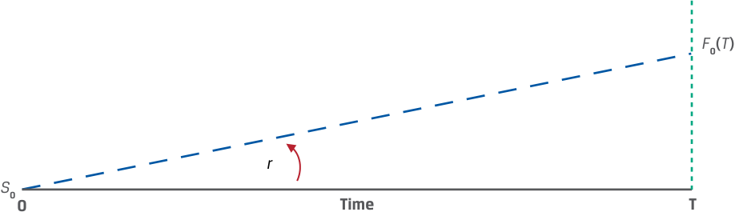
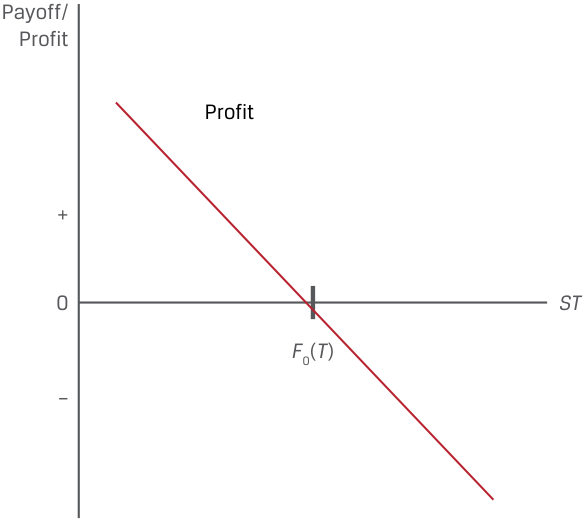
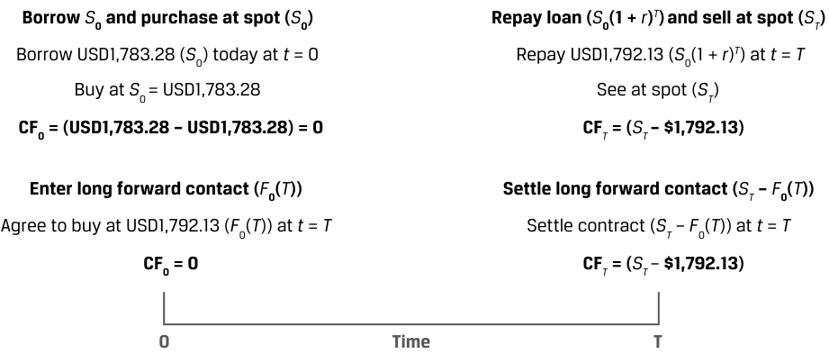
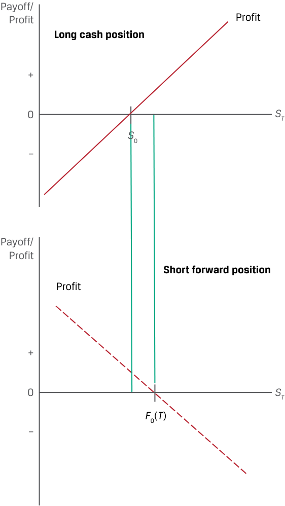

# Volume 7: Derivatives
## Learning Module 4 Arbitrage, Replication, and the Cost of Carry in Pricing Derivatives
### Part 1/2: Introduction (PDF Pages 85–95)

---

<!-- PDF Page 85 -->

#### L E A R N I N G M O D U L E 

# **<mark>4</mark>** 

### **Arbitrage, Replication, and the Cost of Carry in Pricing Derivatives** 

###### **<mark>LEARNING OUTCOMES</mark>** 

|**_Mastery_** **_The candidate should be able to:_**|
|---|

explain how the concepts of arbitrage and replication are used in pricing derivatives explain the difference between the spot and expected future price of an underlying and the cost of carry associated with holding the underlying asset 

##### **INTRODUCTION** 

## **<mark>1</mark>** 

Earlier derivative lessons established the features of derivative instruments and markets and addressed both the benefits and risks associated with their use. Forward commitments and contingent claims were distinguished by their different payoff profiles and other characteristics. We now turn our attention to the pricing and valuation of these instruments. As a first step, we explore how the price of a forward commitment is related to the spot price of an underlying asset in a way that does not allow for arbitrage opportunities. Specifically, the strategy of replication shows that identical payoffs to a forward commitment can be achieved from spot market transactions combined with borrowing or lending at the risk-free rate. Finally, the second lesson demonstrates how costs or benefits associated with owning an underlying asset affect the forward commitment price. 

###### **LEARNING MODULE OVERVIEW** 

- Forward commitments are an alternative means of taking a long or short position in an underlying asset. A link between forward prices and spot prices exists to prevent investors from taking advantage of arbitrage opportunities across cash and derivative instruments. 

CFA Institute would like to thank Don Chance, PhD, CFA, for his contribution to this section, which includes material derived from material that appeared in _Derivative Markets and Instruments_ , featured in the 2022 CFA® Program curriculum. 

<!-- PDF Page 86 -->

- A forward commitment may be replicated with a long or short spot position in the underlying asset and borrowing or lending at a risk-free rate. Investors can recreate a variety of positions by using appropriate combinations of spot, forward, and risk-free positions. 

- The risk-free rate provides a fundamental link between spot and forward prices for underlying assets with no additional costs or benefits of ownership. 

- The cost of carry is the net of the costs and benefits related to owning an underlying asset for a specific period and must be factored into the difference between the spot price and a forward price of a specific underlying asset. 

- The cost of carry may include costs, such as storage and insurance for physical commodities, or benefits of ownership, such as dividends for stocks and interest for bonds. Foreign exchange represents a special case in which the cost of carry is the interest rate differential between two currencies. 

- Forward prices may be greater than or less than the underlying spot price, depending on the specific cost of carry associated with owning the underlying asset. 

###### **LEARNING MODULE SELF-ASSESSMENT** 

These initial questions are intended to help you gauge your current level of understanding of this learning module. 

1. Which of the following statements correctly describes how to replicate a long forward position? 

   - **A.** Sell a risk-free bond, and buy a cash market position in the underlying. 

   - **B.** Buy a risk-free bond, and buy a cash market position in the underlying. 

   - **C.** Buy a risk-free bond, and sell a cash market position in the underlying. 

   - **Solution:** 

A is correct. Selling a risk-free bond provides the necessary cash to buy the underlying in the cash market. At the bond’s maturity, the underlying is sold at the future spot price, and the proceeds are used to pay off the bond. The profit on this transaction is dependent on the future spot price of the underlying compared to the underlying cash market price multiplied by one plus the risk-free rate, and this profit position is identical to that of a long forward position in the underlying. B is incorrect because buying the riskfree bond creates a need for cash in addition to buying the underlying in the cash market. C is incorrect because this combination would replicate a short forward position. 

2. Which of the following is closest to the arbitrage profit available to an investor who is able to buy an asset for a spot price of GBP50 at t = 0 and simultaneously sell a six-month forward commitment on the same asset at a forward price of GBP52.50? The risk-free rate of interest is 4%, and the asset has no additional costs or benefits. 

   - **A.** GBP0.99 

**B.** GBP0.48 

<!-- PDF Page 87 -->

- **C.** GBP1.51 

- **Solution:** C is correct. The investor borrows at 4% for six months to buy the asset today for GBP50. After six months, the investor pays the lender _S_ 0(1 + _r_ )_T_ , or GBP50.99 [= GBP50(1.04)0.5 ] in principal and interest and delivers the asset to satisfy the forward commitment to sell at GBP52.50. The investor’s arbitrage profit is GBP1.51 (= GBP52.50 – GBP50.99). A is incorrect because this answer reflects the difference between the no-arbitrage forward price and the current spot price. B is incorrect because this answer reflects the difference between the forward price discounted back one year (rather than six months) and the current spot price. 

- 3. Which of the following statements correctly describes the relationship between a forward commitment price compared to the underlying spot price when the benefits of owning the underlying are greater than the costs of owning the underlying (including the opportunity interest costs)? **A.** Forward commitment price > spot price. **B.** Forward commitment price < spot price. **C.** Forward commitment price = spot price. 

- **Solution:** B is correct. Greater benefits associated with the underlying will be associated with a higher spot price relative to the forward commitment price, and if these benefits are greater than the costs of owning the underlying, then the spot price will be greater than the forward commitment price. A is incorrect because this inequality would be true in the case of the costs exceeding the benefits. C is incorrect because an equality between the two prices describes the rare circumstance in which costs and benefits are exactly equal. 

- 4. Which of the following statements best defines a convenience yield? **A.** Convenience yield reflects the preference that market participants exhibit for buying forward contracts to avoid having to pay cash up front. 

   - **B.** Convenience yield reflects the preference that market participants exhibit for buying in the spot market to avoid having to pay for storage. 

   - **C.** Convenience yield reflects the preference that market participants exhibit for buying in the spot market for non-cash reasons, including low inventories in the underlying cash market. 

###### **Solution:** 

C is correct. The convenience yield is a non-cash benefit associated with owning an underlying physical commodity that arises under certain economic conditions, including low inventories of the underlying. A is incorrect because the statement suggests convenience yield is a cost of owning the underlying. B is incorrect because the statement is contradictory in that it states that convenience yield causes market participants to prefer spot markets but incorrectly attributes this to a cost of owning the underlying. 

<!-- PDF Page 88 -->

## **<mark>2</mark>** 

##### **ARBITRAGE** 

explain how the concepts of arbitrage and replication are used in pricing derivatives 

An earlier lesson on market efficiency established that market prices should not allow for the possibility of riskless profit or arbitrage in the absence of transaction costs. In its simplest form, an arbitrage opportunity arises if the “law of one price” does not hold, or an identical asset trades at the same time at different prices in different places. 

In the case of a derivative contract whose value is derived from future cash flows associated with the price of an underlying asset, arbitrage opportunities arise either if two assets with identical _future cash flows_ trade at different prices or if an asset with a known future price does not trade at the _present value_ of its future price determined using an appropriate discount rate. 

The first case of assets with identical future cash flows trading at different prices is illustrated in Exhibit 1. 

**Exhibit 1: Assets with Identical Future Cash Flows Trade at Different Prices** 

<!-- Start of picture text -->
EUR99 =  S 0A <  S 0B = EUR99.15 S T A  =  STB  = EUR100 Buy A at  S 0A, Sell B at  S 0B Sell A for  STA , Buy B at  SBT CF0 = ( S 0B –  S 0A) = (EUR99.15 – EUR99) + EUR0.15 > 0 CF T  = ( STA –  SBT ) = (EUR100 – EUR100) = 0 0 Time T <!-- End of picture text -->

For example, assume the two assets are zero-coupon bonds with identical features and the same issuer. Both bonds mature on the same future date with a payoff of par and have the same risk of default between now and the maturity date. 

**1.** Bond A has a price of EUR99 at time _t_ = 0 ( _S_ 0_A_ = EUR99). 

**2.** Bond B has a price of EUR99.15 at time _t_ = 0 ( _S_ 0_B_ = EUR99.15). 

**3.** Both bonds have an expected future price of EUR100 ( _ST__A_ = _ST__B_ = EUR100). This scenario represents an arbitrage opportunity for an investor. 

- At time _t_ = 0, the investor can: 

   - Sell Bond B short to receive proceeds of EUR99.15 and purchase Bond A for EUR99; 

   - Realize a net cash inflow at _t_ = 0 of EUR0.15. 

- At time _t_ = _T_ , when both bonds mature, the investor: 

   - Receives EUR100 for Bond A and uses this to buy Bond B for EUR100 to cover the short position. 

   - The offsetting cash flows at time _T_ leave the investor with a riskless profit of the EUR0.15 price difference between Bonds A and B at time 0. 

<!-- PDF Page 89 -->

Other investors taking note of this discrepancy will also seek to earn a riskless profit at time _t_ = 0 by selling Bond B, driving its price down, and buying Bond A, driving its price up, until the prices converge. The arbitrage opportunity disappears once the bonds have the same price ( _S_ 0_A_ = _S_ 0_B_ ). 

A second type of derivative-related arbitrage opportunity arises when an asset with a known future price does not trade at the present value (PV) of its future price. An earlier time-value-of-money lesson distinguished between discrete and continuous compounding in calculating present versus future value. The future value of a single cash flow based on a _discrete_ number of uniform periods follows the general formula in Equation 1: 

FV _N_ = PV(1 + _r_ )_N_ , ~~(1)~~ 

where _r_ is the stated interest rate per _period_ and _N_ is the number of compounding periods. C _ontinuous compounding_ is the case in which the length of the uniform periods approaches zero, so the number of periods per year approaches infinity and is calculated using the natural logarithm, as shown in Equation 2: 

FV _T_ = PV _e__rT_ . ~~(2)~~ 

While derivatives may be priced with either approach, for purposes of this and later lessons, we will use the discrete compounding method for individual underlying assets. However, for underlying assets that represent a portfolio, such as an equity, fixed-income, commodity, or credit index, or where the underlying involves foreign exchange where interest rates are denominated in two currencies, continuous compounding will be the preferred method. Ignoring additional costs or benefits associated with asset ownership, the appropriate discount rate, _r_ , is the risk-free rate, as demonstrated in Example 1. 

###### **EXAMPLE 1** 

###### **Spot vs. Discounted Known Future Price of Gold** 

In an earlier lesson, Procam Investments entered into a contract to buy 100 ounces of gold at an agreed-upon price of USD1,792.13 per ounce in three months. In this example, Procam does the opposite trade, given a discrepancy between spot and discounted known future gold prices. Assume that today’s spot gold price ( _S_ 0) is USD1,770 per ounce, and the annualized risk-free interest rate ( _r_ ) is 2%. For purposes of this example, we assume that Procam can borrow at the risk-free rate and gold may be stored at no cost. Under these conditions, we demonstrate how Procam can generate a riskless profit: 

- At time _t_ = 0: 

- Procam borrows USD177,000 at 2.0% interest for three months and purchases 100 ounces of gold at today’s spot price. 

- Procam enters into a forward contract today to sell 100 ounces of gold at a price of USD1,792.13 per ounce in three months. 

<!-- Start of picture text -->
S 0 <  ST  (1 +  r )– T S 0(1 +  r ) T <  ST Borrow  S 0 at  r  and Buy  S 0, Agree to sell at  ST Sell at  ST  and Repay  S 0(1 +  r ) T Borrow USD1,770 at 2% and Buy gold ( S 0) Sell at USD1,792.13 ( ST ) and Repay  S 0(1 +  r ) T = USD1,778.78 Contract to sell at  ST = USD1,792.13 per ounce Riskless profit of USD13.35 per ounce CF0 = 0 CFT = (USD1,792.13 – USD1,778.78) > 0 0 Time T <!-- End of picture text -->

> ■ At time _t_ = _T_ (in three months): 

<!-- PDF Page 90 -->

- Procam delivers 100 ounces of gold under the forward contract and receives USD179,213 (= 100 × USD1,792.13). 

- Procam repays the loan principal with interest: 

USD177,878.44 = USD177,000(1.02)0.25 . 

- Procam’s riskless profit at time _T_ is equal to the difference between the forward sale proceeds and the loan principal and interest: USD1,334.56 = USD179,213 – USD177,878.44. 

In Example 1, the spot price of gold, _S_ 0, is below the present value of the known future price of gold in three months’ time ( _S_ 0 < _ST_ (1 + _r_ )–_T_ , since USD1,770 < USD1,783.28). Procam earns a riskless profit of USD13.35 per ounce by borrowing and purchasing gold in the cash market and simultaneously selling gold in the forward market at an agreed-upon price. We would expect that as other investors recognize and pursue this opportunity, the spot price will increase (and the forward price will fall) until the spot price is equal to the discounted value of the known future price ( _S_ 0 = _ST_ (1 + _r_ )–_T_ ) to eliminate this arbitrage opportunity. 

The two key arbitrage concepts used to price derivatives for an underlying with no additional cash flows may be summarized as follows: 

- Identical assets or assets with identical cash flows traded at the same time must have the same price ( _S_ 0_A_ = _S_ 0_B_ ). 

- Assets with a known future price must have a spot price that equals the future price discounted at the risk-free rate ( _S_ 0 = _ST_ (1 + _r_ )–_T_ ). 

These arbitrage conditions establish the relationship between spot prices, forward commitment prices, and the risk-free rate shown in Exhibit 2. 

**Exhibit 2: Spot Prices, Forward Commitment Prices, and the Risk-Free Rate** 

<!-- Start of picture text -->
F 0( T ) r S 0 0 Time T <!-- End of picture text -->

Exhibit 2 shows the case of _r_ > 0 for an asset with no additional income or costs under discrete compounding. Note that for a given time _T_ , the forward price will be higher relative to the spot price with a higher risk-free rate _r_ . Also, for a given risk-free rate _r_ , as _T_ increases, the forward price will increase relative to the spot price. It is important to note that the relevant risk-free rate for most market participants is the repo rate, introduced in an earlier lesson, where borrowed funds are collateralized by highly liquid securities. 

Recall from an earlier lesson that a forward commitment has a symmetric payoff profile. That is, at time _T_ , the transaction is settled on the basis of the difference between the forward price _F_ 0( _T_ ) and the underlying price of _ST_ , or _F_ 0( _T_ ) – _ST_ from the seller’s perspective, as in Exhibit 3. 

<!-- PDF Page 91 -->

###### **Exhibit 3: Forward Commitment Seller Payoff Profile** 

<!-- Start of picture text -->
Payoff/ Profit Profit + 0 ST F 0( T ) – <!-- End of picture text -->

The forward seller realizes a gain if the seller is able to deliver the underlying at a market value ( _ST_ ) below the pre-agreed price, _F_ 0( _T_ ). In Example 1, Procam borrows to buy the underlying at a spot price below the present value of _ST_ to lock in a riskless gain. So far, we have taken the forward price, _F_ 0( _T_ ), as given. In what follows, we demonstrate how no-arbitrage conditions may be used to establish the relationship between spot and forward prices by replicating or recreating an exact offsetting position for a forward commitment. 

##### **REPLICATION** 

<!-- Start of picture text -->
3 <!-- End of picture text -->

explain how the concepts of arbitrage and replication are used in pricing derivatives 

**Replication** is a strategy in which a derivative’s cash flow stream may be recreated using a combination of long or short positions in an underlying asset and borrowing or lending cash. In contrast to the earlier arbitrage examples, replication is typically used to mirror or offset a derivative position when the law of one price holds and no riskless arbitrage profit opportunities exist. For example, Exhibit 4 compares a long forward commitment to the alternative of borrowing funds at the risk-free rate, _r_ , to buy the underlying asset at today’s spot price, _S_ 0. 

<!-- PDF Page 92 -->

###### **Exhibit 4: Forward Commitment Replication** 

<!-- Start of picture text -->
Borrow  S 0 and purchase at spot ( S 0) Repay loan ( S 0(1 +  r ) T ) and sell at spot ( ST ) Borrow USD1,783.28 ( S 0) today at  t  = 0 Repay USD1,792.13 ( S 0(1 +  r ) T ) at  t  =  T Buy at  S 0 = USD1,783.28 See at spot ( ST ) CF0 = (USD1,783.28 – USD1,783.28) = 0 CF T  = ( ST – $1,792.13) Enter long forward contact ( F 0( T )) Settle long forward contact ( ST  –  F 0( T )) Agree to buy at USD1,792.13 ( F 0( T )) at  t  =  T Settle contract ( ST  –  F 0( T )) at  t  =  T CF0 = 0 CF T  = ( ST –  $1,792.13) 0 Time T <!-- End of picture text -->

###### **EXAMPLE 2** 

###### **Replication of a Forward Commitment** 

In Example 1, we reintroduced Procam Investments, which borrowed and purchased gold in the spot market and simultaneously sold gold in the forward market to earn a riskless profit. Here we change the assumption about today’s spot gold price ( _S_ 0). Specifically, the spot gold price has risen to USD1,783.28 (= USD1,792.13(1.02)–0.25 ) to eliminate the earlier arbitrage opportunity when the spot price was USD1,770. Assume again that the risk-free interest rate ( _r_ ) is 2% and gold can be stored at no cost. 

**1.** Long forward commitment (agree to buy at _F_ 0( _T_ ) at _t_ = _T_ ) 

   - Procam enters a forward commitment to buy 100 ounces of gold in three months at a forward price, _F_ 0( _T_ ), of USD1,792.13 per ounce. 

   - If _ST_ = USD1,900 per ounce, 

   - Profit = USD10,787 = 100 × (USD1,900 – USD1,792.13). 

   - If _ST_ = USD1,700 per ounce, 

   - Profit = –USD9,213 = 100 × (USD1,700 –USD1,792.13). 

**2.** Borrow and purchase (borrow _S_ 0 and buy asset at _S_ 0 at _t_ = 0): 

   - Procam borrows USD178,328 at 2% and buys 100 ounces of gold at today’s spot price, _S_ 0. 

   - Procam sells the gold in three months at spot price _ST_ . 

   - Procam repays the loan principal and interest: USD179,213 = USD178,328(1.02)0.25 . 

   - If _ST_ = USD1,900, 

   - Profit = USD10,787 = 100 × (USD1,900 – USD1,792.13). 

   - If _ST_ = USD1,700, 

   - Profit = –USD9,213 = 100 × (USD1,700 – USD1,792.13). 

<!-- PDF Page 93 -->

Note that the same profits are observed under Scenarios 1 and 2, which are equal to _ST_ – _F_ 0( _T_ ). If we set the forward price, _F_ 0( _T_ ), equal to the future value of the spot rate using the risk-free rate ( _F_ 0( _T_ ) = _S_ 0(1 + _r_ )_T_ ), the no-arbitrage condition demonstrates that Procam generates the same cash flow at time _T_ regardless of the direction of gold prices whether the company 

**1.** enters into a long forward commitment settled at time _T_ or 

**2.** borrows at the risk-free rate, buys the underlying asset, and holds it until time _T_ . 

A separate but related form of replication pairing a long asset with a short forward is shown in Exhibit 5. The top half shows the profit/loss profile of the long asset, and the bottom half shows that of the short forward position. The long asset position produces a profit (loss) when _ST_ > _S_ 0 ( _ST_ < _S_ 0). The short forward position produces a profit (loss) when _ST_ < _F_ 0 ( _ST_ > _F_ 0). 

**Exhibit 5: Payoffs for Long Asset and Short Forward Positions** 

<!-- Start of picture text -->
Payoff/ Profit Profit Long cash position + 0 ST S 0 – Payoff/ Profit Short forward position Profit + 0 ST F 0( T ) – <!-- End of picture text -->

In contrast to Example 2, these positions appear to offset one another. The following example evaluates the return generated by these combined positions. 

<!-- PDF Page 94 -->

###### **EXAMPLE 3** 

###### **Risk-Free Trade Replication: Long Asset, Short Forward** 

Procam Investments buys 100 ounces of gold at today’s spot price ( _S_ 0) of USD1,783.28 and simultaneously enters a forward commitment to sell gold at the forward price, _F_ 0( _T_ ), of USD1,792.13. Again, we assume that gold can be stored at no cost, and here we solve for Procam’s rate of return. 

- At _t_ = 0, Procam’s cash flow is – _S_ 0 = –USD178,328. 

- At _t_ = _T_ , Procam’s cash flow is _F_ 0( _T_ ) = USD179,213. 

- Solve for the rate of return on Procam’s strategy, as follows: 

   - USD179,213 = USD178,328(1 + _r_ )0.25 . 

   - _r_ = 2.0%, which is equal to the risk-free rate. 

This example demonstrates that Procam can hedge its long gold cash position with a short derivative (i.e., selling the forward contract) and earn the risk-free rate of return as long as the no-arbitrage condition ( _F_ 0( _T_ ) = _S_ 0(1 + _r_ )_T_ ) holds. The combined return is shown in Exhibit 6. Note that if Procam borrows at the risk-free rate to purchase the underlying asset at _S_ 0, it will earn zero. 

**Exhibit 6: Combined Long Asset and Short Forward Profit** 

<!-- Start of picture text -->
Payoff/ Profit + Profit =  F 0( T ) –  S 0 0 ST - <!-- End of picture text -->

Because the forward price is assumed to be greater than the spot price in this example and _r_ is positive, the risk-free profit is a positive amount and is the same (i.e., risk free) regardless of the price of the underlying (i.e., _ST_ ). As we will see in the next lesson, there may be benefits or costs to owning an underlying asset that cause the risk-free return in Exhibit 6 to differ from _F_ 0( _T_ ) – _S_ 0 and possibly even be negative. 

<!-- PDF Page 95 -->

- **QUESTION SET Arbitrage and Replication** 1. Determine the correct answers to fill in the blanks: If the law of one price does not hold, a(n) _________ asset trades at the same time at _________ prices in different places. **Solution:** If the law of one price does not hold, a(n) _identical_ asset trades at the same time at _different_ prices in different places. 

- 2. An investor observes that the spot price, S0, of an underlying asset with no additional costs or benefits exceeds its known future price discounted at the risk-free rate, _ST_ (1 + _r_ )–_T_ . Describe and justify an arbitrage strategy that generates a riskless profit for the investor. **Solution:** Since the spot price of the underlying asset exceeds the known future price discounted at the risk-free rate ( _S_ 0 > _F_ 0( _T_ )(1 + _r_ )–_T_ ), at _t_ = 0, the investor: • Sells the underlying asset short in the spot market at _S_ 0 • Simultaneously enters a long forward contract at _F_ 0( _T_ ) • Lends _S_ 0 at the risk-free rate _r_ to receive _S_ 0(1 + _r_ )_T_ at time _T_ . At time _t_ = _T_ , the investor: • Settles the long forward position and receives _S_ T – _F_ 0( _T_ ) • Offsets the short underlying asset position at _ST_ , and • Retains _S_ 0(1 + _r_ )_T_ – _F_ 0( _T_ ) as a riskless profit regardless of the underlying spot price at time _T_ . 

- 3. Formulate a replication strategy for a three-month short forward commitment for 1,000 shares of a non-dividend-paying stock. **Solution:** The replication strategy for a three-month short forward commitment on a non-dividend-paying stock involves the short sale of 1,000 shares of stock at _t_ = 0 and investment of proceeds at the risk-free rate, _r_ . At time _t_ = _T_ , the short sale is covered at _ST_ , and under the no-arbitrage condition of _F_ 0( _T_ ) = _S_ 0(1 + _r_ )_T_ , the return is equal to _F_ 0( _T_ ) – _ST_ for both the short forward and the replication strategy. 

4. Calculate the arbitrage profit if a spot asset with no additional costs or benefits trades at a spot price of 100, the three-month forward price for the underlying asset is 102, and the risk-free rate is 5%. **Solution:** 

The forward price, _F_ 0( _T_ ) = _S_ 0(1 + _r_ )_T_ , at which no-arbitrage opportunities would exist is 101.23 (= 100(1.05)0.25 ). With an observed forward price of 102, the arbitrage opportunity would be to sell the forward contract and buy the underlying, borrowing at the risk-free rate to fund the purchase. The arbitrage profit is the difference between the observed forward price and the no-arbitrage forward price of 0.77 (= 102 – 101.23). 

