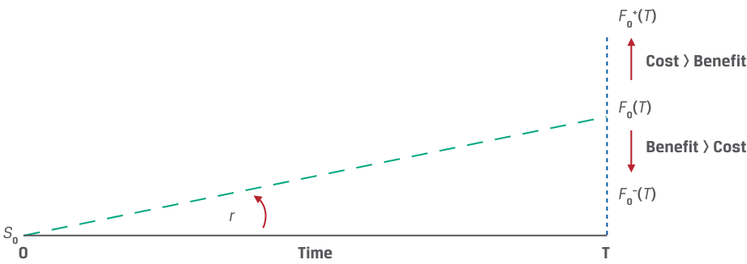
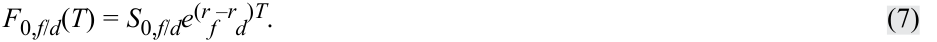

# Volume 7: Derivatives
## Learning Module 4 Arbitrage, Replication, and the Cost of Carry in Pricing Derivatives
### Part 2/2: Costs and Benefits Associated with Owning the Underlying (PDF Pages 96–106)

---

<!-- PDF Page 96 -->

5. Describe the relationship between the spot and forward price for an underlying asset if the risk-free rate is negative. 

   - **Solution:** 

The relationship between the spot and forward rate for an asset with no additional costs or benefits of ownership other than the opportunity cost (risk-free rate) is equal to _F_ 0( _T_ ) = _S_ 0(1 + _r_ )_T_ . In a case where _r_ < 0, (1 + _r_ )_T_ < 1 and therefore the forward price, _F_ 0( _T_ ), is below the spot price, _S_ 0, if the risk-free rate is negative. 

# **<mark>4</mark>** 

## **COSTS AND BENEFITS ASSOCIATED WITH OWNING THE UNDERLYING** 

explain the difference between the spot and expected future price of an underlying and the cost of carry associated with holding the underlying asset 

In the prior lesson, replication was used to illustrate the basic relationship between entering into a spot transaction versus a forward commitment. The linkage between the spot price of an asset with no associated cash flows and a forward commitment on the same asset was shown to be the risk-free rate of interest, _r_ . In this lesson, we discuss **cost of carry** as the net of the costs and benefits related to owning an underlying asset for a specific period. 

In the forward commitment example from the prior lesson, where no costs or benefits were associated with the underlying asset, the following relationship between the spot and forward prices was established: 

<!-- Formula Text: F0(T) = S0(1 + r)T. (3) -->

This relationship is shown under continuous compounding in Equation 4: 

- _F_ 0( _T_ ) = _S_ 0 _e__rT_ . ~~(4)~~ 

The risk-free rate, _r_ , denotes the **opportunity cost** of holding (“ **carrying** ”) the asset, whether or not the long investor borrows to finance the asset. This opportunity cost is present for all asset classes discussed below. 

Equations 3 and 4 represent the special case of an underlying asset with no additional associated cash flows. However, many assets have additional costs or benefits of ownership that must be reflected in the forward commitment price in order to prevent riskless arbitrage opportunities from arising between underlying spot and derivative prices. Exhibit 7 demonstrates the effect of costs and benefits (usually dividend or interest income) on the spot price, forward commitment price, and risk-free rate relationships. 

<!-- PDF Page 97 -->

#### **Exhibit 7: Spot Prices, Forward Commitment Prices, and the Risk-Free Rate with Underlying Asset Costs and Benefits** 

<!-- Start of picture text -->
F 0+( T ) Cost > Benefit F 0( T ) Benefit > Cost F 0–( T ) r S 0 0 Time T <!-- End of picture text -->

If an underlying asset owner incurs costs in addition to the opportunity cost, she should expect to be compensated for these added costs through a higher forward price, _F_ 0+ ( _T_ ). Income or other benefits accrue to the underlying asset owner and therefore should reduce the forward price to _F_ 0– ( _T_ ). 

For underlying assets with ownership benefits or income ( _I_ ) or costs ( _C_ ) expressed as a known _amount in present value terms at t = 0_ —shown as PV0()—the relationship between spot and forward prices in discrete compounding terms can be shown as 

_F_ 0( _T_ ) = [ _S_ 0 – PV0( _I_ ) + PV0( _C_ )](1 + _r_ )_T_ . ~~(5)~~ 

In other instances, the additional costs or benefits are expressed as a _rate of return_ over the life of the contract. For income ( _i_ ) and cost ( _c_ ) expressed as rates of return, the relationship between spot and forward prices under continuous compounding is 

_F_ 0( _T_ ) = _S_ 0 _e_(_r_+_c_–_i_)_T_ . ~~(6)~~ 

Whether expressed as a known amount in present value terms or as a rate of return, the forward price must incorporate the net effect of all costs and benefits associated with owning the underlying asset, including the following. 

- **Opportunity cost (risk-free interest rate,** **_r_ ):** A positive risk-free rate causes a forward price to be greater than the underlying spot price, all else equal, and the higher the risk-free rate, the greater the positive difference between the two. This opportunity cost applies to any asset. 

- **Other costs of ownership (** **_C_ ,** **_c_ )** : Owners of some underlying assets, such as physical commodities, must incur storage, transportation, insurance, and/or spoilage costs. An owner entering a contract for future delivery will expect to be compensated for these costs, resulting in a forward price that is therefore greater than the underlying spot price, all else equal. 

- **Benefits of ownership (** **_I_ ,** **_i_ ):** Alternatively, the owners of some underlying assets enjoy cash flow or other benefits associated with owning the underlying asset as opposed to a derivative on the asset. A counterparty entering a derivative contract for future delivery of an underlying asset forgoes these benefits and will therefore reduce the forward price by this amount. Stock dividends or bond coupons are examples of cash flow benefits. 

Exhibit 8 illustrates the relationship between forward and spot prices in the presence of costs and benefits. For example, when the opportunity cost and other costs of ownership exceed the benefits, the forward price will be above the underlying spot asset price. 

<!-- PDF Page 98 -->

**Exhibit 8: Forward vs. Spot Price** 

|**Cost vs. Benefit**|**Forward vs. Spot Price**|
|---|---|
|Opportunity and Other Cost > Benefit|_F_0(_T_) >_S_0|
|i Opportunity and Other Cost < Benefit|_F_0(_T_) <_S_0|
|Opportunity and Other Cost = Benefit|_F_0(_T_) =_S_0|

Each underlying asset type has different costs and benefits, which may vary over time and across markets. For example, owners of some individual equity securities receive the benefit of regular stock dividends, as in Example 4, while others do not. For equity indexes, the benefit is usually expressed as a rate of return, as shown in Example 5. 

#### **EXAMPLE 4** 

### **Hightest Equity Forward with Dividend** 

Assume Hightest Capital agrees to deliver 1,000 Unilever (UL) shares at an agreed-upon price to a financial intermediary in six months under a forward contract. Assume that UL has a spot price ( _S_ 0) of EUR50 and pays no dividend ( _I_ = 0), and assume a risk-free rate ( _r_ ) of 5%. We may use Equation 3 to solve for the forward price, _F_ 0( _T_ ), in six months: 

_F_ 0( _T_ ) = _S_ 0(1 + _r_ )_T_ . 

EUR51.23 = EUR50(1.05)0.5 . 

Now assume instead that Unilever pays a quarterly dividend of EUR0.30, which occurs in exactly three months and again at time _T_ , with other details unchanged. Use Equation 5 with PV0( _C_ ) = 0 to solve for _F_ 0( _T_ ) in six months: 

_F_ 0( _T_ ) = [ _S_ 0 – PV0( _I_ )](1 + _r_ )_T_ . 

First, solve for the present value of the dividend per share, PV0( _I_ ), as follows: 

PV0( _I_ ) = EUR0.30(1.05)–0.25 + EUR0.30(1.05)–0.5 . 

EUR0.5892 = 0.2964 + 0.2928. 

Substitute PV0( _I_ ) = EUR0.5892 into Equation 5 to solve for _F_ 0( _T_ ): 

_F_ 0( _T_ ) = (EUR50 – EUR0.5892)(1.05)0.5 

= EUR50.6310. 

Hightest’s forward contract for 1,000 UL shares would therefore be priced at EUR50,631.00 (= 1,000 × EUR50.6310). The opportunity cost of borrowing at the risk-free rate is EUR1.23 per share for six months and equals _F_ 0( _T_ ) – _S_ 0 when Unilever pays no dividend. A EUR0.30 quarterly dividend reduces the difference between the forward and spot price to approximately EUR0.63. 

<!-- PDF Page 99 -->

#### **EXAMPLE 5** 

### **Stock Index Futures with Dividend Yield** 

The Viswan Family Office (VFO) would like to enter into a three-month forward commitment contract to purchase the NIFTY 50 benchmark Indian stock market index traded on the National Stock Exchange. The spot NIFTY 50 index price is INR15,200, the index dividend yield is 2.2%, and the Indian rupee risk-free rate is 4%. Use Equation 6 (with _c_ = 0) to solve for the forward price: 

_F_ 0( _T_ ) = _S_ 0 _e_(_r_+_c_–_i_)_T_ = 15,200 _e_(0.04 – 0.022)0.25 = INR15,268.55. 

Foreign exchange requires some adjustments to establish the no-arbitrage condition between spot and forward prices, as shown in the prior lesson. First, it is important to distinguish the “price” of the underlying asset, which for equities, fixed income, or commodities refers to units of currency for each asset—for example, one share of stock or the principal amount for a bond. In contrast, the foreign exchange rate is expressed as a spot rate ( _S_ 0, _f_ / _d_ ) specifying the number of units of a _price_ currency (here denoted as _f_ or foreign currency) in the numerator per _single_ unit of a _base_ currency (here shown as _d_ or domestic currency) in the denominator. For example, for a USD/ EUR spot rate ( _S_ 0, _f_ / _d_ ) of 1.20, the US dollar is the price currency ( _f_ ), and the euro is the base currency ( _d_ ), with USD1.20 equal to EUR1. 

An FX (foreign exchange) forward contract involves the sale of one currency and purchase of the other on a future date at a forward price ( _F_ 0, _f_ / _d_ ) agreed on at inception. A _long_ FX forward position involves the _purchase_ of the base currency and the _sale_ of the price currency. For example, a long USD/EUR FX forward position is the sale of US dollars and purchase of euros at a forward rate. 

In the prior replication example, the derivative cash flow stream was recreated by combining a long or short position in an underlying asset and borrowing or lending cash. Here the foreign and domestic currency _each_ has an opportunity cost—namely, the foreign risk-free rate ( _rf_ ) and the domestic risk-free rate ( _rd_ ), respectively. 

#### **EXAMPLE 6** 

### **AUD/USD Foreign Exchange Forward Replication** 

In order to replicate one currency’s return in terms of the other for a given spot price today of _S_ 0, _f_ / _d_ , we may solve for a forward rate _F_ 0, _f_ / _d_ ( _T_ ) using the earlier arbitrage concept that assets with a known future price must have a spot price ( _S_ 0, _f_ / _d_ ) equal to the future price discounted at the risk-free rate. 

Assume the current AUD/USD spot price is 1.3335. The Australian dollar is the price currency or foreign currency, and the US dollar is the base or domestic currency (AUD1.3335 = USD1). The six-month Australian dollar risk-free rate is 0.05%, and the six-month US dollar risk-free rate is 0.20%. 

- At time _t_ = 0: 

   **1.** Borrow USD1,000 at the 0.20% US dollar risk-free rate for six months. 

   **2.** Purchase AUD1,333.50 at the AUD/USD spot rate ( _S_ 0, _f_ / _d_ = 1.3335). 

   **3.** Lend the AUD1,333.50 received at the 0.05% Australian dollar riskfree rate for six months. 

<!-- PDF Page 100 -->

- At time _t_ = _T_ in six months: 

   **4.** Receive Australian dollar loan proceeds of 1,333.83 (= 1,333.50 _e_(0.0005 × 0.5) ). 

   **5.** Exchange Australian dollar proceeds for US dollars at _ST_ , _f_ / _d_ to repay the US dollar loan. 

   **6.** Repay the US dollar loan (with interest) of 1,001 (= 1,000 _e_(0.002 × 0.5)). 

If the exchange in Step 5 at time _T_ is at a spot price, _ST_ , _f_ / _d_ , at which the Australian dollar loan proceeds (Step 4) exactly offset the US dollar loan (Step 6), no riskless arbitrage opportunity exists. Solve for _ST_ , _f_ / _d_ by dividing the Australian dollars in Step 4 by the US dollars in Step 6: 

#### _ST_ , _f_ / _d_ = 1.3325 (= AUD1,333.83/USD1,001). 

The following diagram summarizes the cash flows at time _t_ = 0 and time _T_ : 

<!-- Start of picture text -->
Time t  = 0 t  =  T Borrow USD1 at Sell USD r USD =  rd  = 0.20% Repay USD1,000 e r dT USD1,001 USD1,000 = 1,000 e (0.002×0.5) S 0,( f / d ) = 1.3335 F0,(f/d) (T) = 1.3325 =  AUD1,333.83 USD1,001 Lend AUD1,333.50 at Buy AUD r AUD =  rf  = 0.05% Earn AUD1,333.50 e r fT AUD1,333.83 AUD1,333.50 = 1,333.50 e (0.0005×0.5) F 0, f / d ( T ) =  S 0, f / d e ( rf  –  rd ) T = 1.3335 e (–0.0015×0.5) = 1.3325 <!-- End of picture text -->

For the no-arbitrage condition to hold between the FX spot and forward price, the amount of Australian dollars necessary to purchase USD1 at time _T_ ( _F_ 0, _f_ / _d_ ( _T_ )) must have a spot price ( _S_ 0, _f_ / _d_ ) equal to the discounted future price. The relevant discount rate here involves the _difference_ between the foreign and domestic risk-free rates, as shown in the following modified version of Equation 4: 

<!-- Formula Text: F0,f/d(T) = S0,f/de(rf–rd)T. (7) -->

Solve for _F_ 0, _AUD_ / _USD_ ( _T_ ) in Example 6 as follows: _F_ 0, _f_ / _d_ ( _T_ ) = 1.3325 (= 1.3335 _e_(–0.0015 × 0.5) ). 

From Equation 7, we see that it is the risk-free interest rate _differential_ ( _rf_ – _rd_ ), rather than the absolute level of interest rates, that determines the spot versus forward FX price relationship. For example, in Example 6, the Australian dollar risk-free rate is 0.15% below the US dollar rate ( _rf_ – _rd_ < 0). Borrowing at the higher US dollar rate and lending at the lower Australian dollar rate results in a no-arbitrage forward price at which _fewer_ Australian dollars are required to purchase USD1 in the future, so the Australian dollar is said to trade at a _premium_ in the forward market versus the US dollar. Exhibit 9 summarizes the relationship between forward and spot FX prices. 

<!-- PDF Page 101 -->

**Exhibit 9: FX Forward vs. Spot Price Relationship** 

|**Interest Rate** **Differential**|**Forward vs. Spot** **Price**|**Foreign Currency** **Forward**|**FX Forward Premium/** **Discount**|
|---|---|---|---|
|(_rf_–_rd_) > 0|_F_0,_f_/_d_(_T_) >_S_0,_f_/_d_|Discount|Premium|
|(_rf_–_rd_) < 0|_F_0,_f_/_d_(_T_) <_S_0,_f_/_d_|Premium|Discount|
|(_rf_–_rd_) = 0|_F_0,_f_/_d_(_T_) =_S_0,_f_/_d_|Neither a premium nor a discount|Neither a premium nor a discount|

We now examine this FX spot versus forward relationship in the case of the Montau AG example from an earlier lesson. 

#### **EXAMPLE 7** 

### **Montau AG’s FX Forward Rate** 

An earlier lesson introduced Montau AG, a German capital goods producer. Montau signs a commercial contract with Jeon, Inc., a South Korean manufacturer, to deliver a laser cutting machine at a price of KRW650 million in 75 days. Montau faces a timing mismatch between domestic euro costs incurred and euro revenue realized upon the delivery of the machine and sale of South Korean won received in exchange for euros in the spot FX market. Montau enters a long KRW/EUR FX forward contract. That is, Montau agrees to sell South Korean won and purchase euros at a fixed price, _F_ 0( _T_ ), in 75 days to eliminate the KRW/EUR exchange rate mismatch arising from the export contract. 

In this version of the Montau AG example, we use today’s spot exchange rate and the domestic ( _rd_ ) and foreign ( _rf_ ) risk-free rates to solve for the KRW/EUR forward rate. As seen in Equation 7, the difference between spot and forward FX rates involves the _difference_ in risk-free rates. In the KRW/EUR case, the South Korean won is the price currency or foreign currency and _rf_ is therefore the South Korean won interest rate. The euro is the base or domestic currency. We may therefore rewrite Equation 7 as follows: 

_F_ 0, _KRW_ / _EUR_ ( _T_ ) = _S_ 0, _KRW_ / _EURe_(_r_ _KRW_–_r_ _EUR_)_T_ . 

Assume a spot KRW/EUR rate ( _S_ 0) of 1,300 (that is, KRW1,300 = EUR1), a South Korean won risk-free rate of 0.75%, and a euro risk-free rate of –0.25% ( _rd_ ). Calculate the KRW/EUR forward rate in 75 days consistent with no arbitrage. 

_F_ 0, _KRW_ / _EUR_ ( _T_ ) = 1,300 × _e_(0.0075 + 0.0025) × (75/365) . 

Solving for the KRW/EUR forward rate gives us _F_ 0( _T_ ) = 1,302.67. Notice that the 1% difference between South Korean won and euro interest rates leads to a forward price that is above the spot price ( _F_ 0, _f_ / _d_ ( _T_ ) > _S_ 0, _f_ / _d_ ). That is, in six months’ time, more South Korean won will be required to purchase a euro, and the South Korean won is said to trade at a forward discount versus the euro. 

To demonstrate the no-arbitrage condition between the forward and spot rates, assume that Montau converts the KRW650 million into euros at the 1,300 KRW/EUR spot rate to receive EUR500,000 (= KRW650,000,000/1,300) and invests this for 75 days at a continuously compounded _rf_ = –0.25%: 

EUR499,743.22 = EUR500,000 × _e_[–0.0025 × (75/365)] . 

Assume that Jeon Inc. invests the KRW650 million at the South Korean won risk-free rate ( _rd_ = 0.75%) for 75 days to receive 

KRW651,002,484.59 = KRW650,000,000 × _e_[0.0075 × (75/365)] . 

<!-- PDF Page 102 -->

An arbitrage-free forward commitment price should therefore allow Montau to convert KRW651,002,484.59 into EUR499,743.22 after 75 days. 

_F_ 0( _T_ ) = 651,002,484.59/499,743.22 = 1,302.67. 

This confirms that the two prices (spot and forward exchange rates) are consistent with the risk-free interest rate differential in the two different currencies. 

In contrast to securities or cash stored electronically, commodities usually involve known costs associated with the storage, insurance, transportation, and potential spoilage (in the case of soft commodities) of these physical assets. A non-cash benefit of holding a physical commodity versus a derivative is known as a **convenience yield** . In physical goods markets, economic conditions may arise that cause market participants to prefer to own the physical commodity. As a simple example, if crude oil inventories are very low, refineries may bid up the spot oil price so that forward prices do not fully reflect storage costs and interest rates. The following example illustrates the impact of these carry costs on the relationship between spot and forward commitment prices for a commodity, as well as the possibility of a convenience yield. 

#### **EXAMPLE 8** 

### **Procam’s Gold Forward Contract with Storage Costs** 

Recall from earlier examples that Procam borrowed and purchased gold in the spot market and simultaneously sold gold in the forward market for three months to earn a riskless profit. Under the assumption of a 2% risk-free rate, we demonstrated that the spot gold price ( _S_ 0) would need to rise to USD1,783.28 (= USD1,792.13(1.02)–0.25 ) in order to eliminate the earlier arbitrage opportunity for a given USD1,792.13 forward price where gold may be stored at no cost. 

Given the spot price of USD1,783.28, how would the forward gold price change to satisfy the no-arbitrage condition if we were to introduce a USD2 per ounce cost of gold storage and insurance payable at the end of the contract? 

The forward commitment price for a commodity with known storage cost amounts may be determined using Equation 5, where PV0( _I_ ) = 0: 

_F_ 0( _T_ ) = [ _S_ 0 + PV0( _C_ )](1 + _r_ )_T_ . 

First, solve for the present value of the storage cost per ounce PV0( _C_ ) as follows: PV0( _C_ ) = USD2(1.02)–0.25 

= USD1.99. 

Substitute PV0( _C_ ) = USD1.99 into Equation 5 to solve for _F_ 0( _T_ ): 

_F_ 0( _T_ ) = (USD1,783.28 + USD1.99)(1.02)0.25 

= USD1,794.13. 

Note that the addition of storage and insurance costs increases the difference between the spot and forward price. Finally, note that a forward price, _F_ 0( _T_ ), significantly _below_ the no-arbitrage price may indicate the presence of a convenience yield. 

The additional costs and benefits of underlying asset ownership are summarized in Exhibit 10. 

<!-- PDF Page 103 -->

**Exhibit 10: Cost of Carry for Underlying Assets** 

|**Asset Class**|**Examples**|**Benefits (****_i_)**|**Costs (****_r_, ****_c_)**|
|---|---|---|---|
|Asset without Cash Flows|Non-dividend-paying stock|None|Risk-free rate|
|Equities|Dividend-paying stocks Equity indexes|Dividend Dividend yield|Risk-free rate|
|Foreign Exchange|Sovereign bonds (foreign) Market exchange rates|None|Difference between foreign and domes- tic risk-free rates (_rf_–_rd_)|
|Commodities|Soft and hard commodities|Convenience yield|Risk-free rate|
||Commodity indexes||Storage cost|
|Interest Rates|Sovereign bonds (domestic) Market reference rates|Interest income|Risk-free rate|
|Credit|Single reference entity Credit indexes|Credit spread|Risk-free rate|

Interest rates and credit have a term structure—that is, different prices or rates for different maturities. These forward contracts are addressed in a later lesson. 

#### **QUESTION SET** 

### **Cost of Carry** 

1. Describe the relationship between the spot and forward price for an underlying asset whose benefits exceed the opportunity and other costs of ownership. 

#### **Solution:** 

If the benefits for an owner of an underlying asset exceed the opportunity and other costs of owning the underlying asset, the spot price will be greater than the forward price. 

2. Identify which example corresponds to each of the following relationships between the spot and forward rate: 

|1._F_0(_T_) >_S_0|A. A fixed-coupon bond priced at par whose coupon is above the risk-free rate|
|---|---|
|2._F_0(_T_) <_S_0|B. A foreign currency forward where the foreign risk-free rate is greater than the domestic risk-free rate|
|3. Not enough information to deter- mine the relationship between_F_0(_T_) and_S_0|C. A commodity with a convenience yield as well as storage and insurance costs|

#### **Solution:** 

1. B is correct. The FX forward rate is greater than the spot rate if the foreign risk-free rate is greater than the domestic risk-free rate. 

<!-- PDF Page 104 -->

2. A is correct. A fixed-coupon bond priced at par has an income that exceeds the opportunity cost of the risk-free rate, so F0(T) < S0. 

3. C is correct. We do not have enough information to fully evaluate the benefit (convenience yield) versus the cost (risk-free rate, storage, and insurance) of holding the physical commodity asset in this example. 

3. Determine the correct answers to fill in the blanks: A positive risk-free rate causes a forward price to be _______ than the underlying spot price, all else equal, and the higher the risk-free rate, the _______ the difference between the two. 

#### **Solution:** 

A positive risk-free rate causes a forward price to be _greater_ than the underlying spot price, all else equal, and the higher the risk-free rate, the _greater_ the difference between the two. 

4. An analyst observes that the current spot MXN/USD exchange rate is 19.50, the Mexican peso six-month risk free rate is 4%, and the six-month US dollar risk free rate is 0.25%. Describe the relationship between the MXN/USD spot and six-month forward rate, and justify your answer. 

#### **Solution:** 

The relationship between the MXN/USD FX spot and forward price depends on the risk-free interest rate differential between the Mexican peso and the US dollar ( _rf_ – _r_ d > 0, since 3.75% = 4.0% – 0.25%). Since the Mexican peso rate is 3.75% above the US dollar rate, we would expect that borrowing at a higher Mexican peso rate and lending at a lower US dollar rate would result in a no-arbitrage forward price at which more Mexican pesos are required to purchase USD1 in the future, so the Mexican peso is said to trade at a discount in the forward market versus the US dollar ( _F_ 0, _MXN_ / _USD_(_T_) >_S_ 0, _MXN_ / _USD_). 

We can show this using Equation 7 for the case of MXN/USD as follows: 

_F_ 0, _MXN_ / _USD_ ( _T_ ) = _S_ 0, _MXN_ / _USDe_(_r_ _MXN_–_r_ _USD_)_T_ . 

Based on the current _S_ 0, _f_ / _d_ of 19.50, _rf_ = 4%, _rd_ = 0.25%, and _T_ of 0.5, we may solve for the no-arbitrage forward price, _F_ 0, _f_ / _d_ , as 

_F_ 0, _MXN_ / _USD_ ( _T_ ) = 19.50 _e_[(0.04 – 0.0025) × 0.5] 

= 19.8691. 

5. Assume that new, stricter environmental regulations associated with oil storage and insurance cause the cost of these services to increase sharply. Describe the anticipated effect of these increased costs on the relationship between oil spot and forward commitment prices. 

#### **Solution:** 

Owners of physical commodities who must incur storage and insurance costs over time expect to be compensated by higher forward commitment prices for future delivery of the underlying assets. Assuming other factors are constant, higher storage and insurance costs therefore lead to higher forward commitment prices and a greater difference between spot and forward prices. As shown in Equation 5, an increase in _C_ increases _F_ 0( _T_ ) for a given _S_ <u>0:</u> 

<!-- PDF Page 105 -->

_F_ 0( _T_ ) = [ _S_ 0 – PV0( _I_ ) + PV0( _C_ )] (1 + _r_ )_T_ . ~~(8)~~ 

<!-- PDF Page 106 -->

