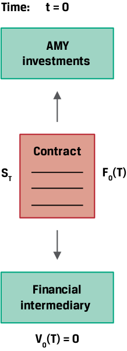
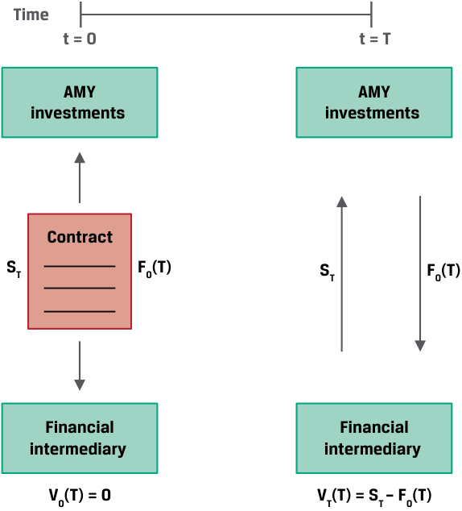
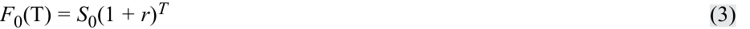
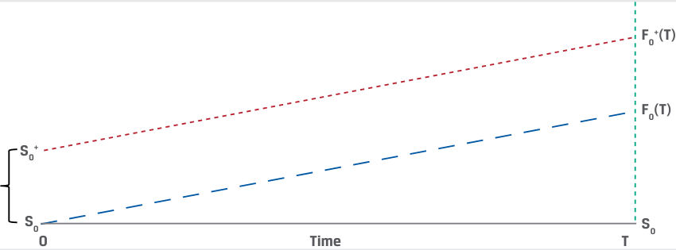
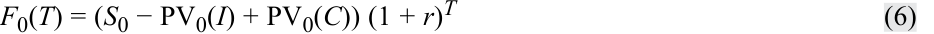
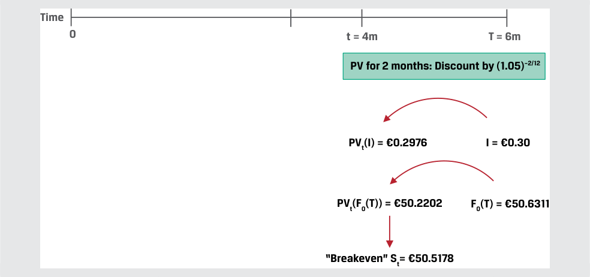

# Volume 7: Derivatives
## Learning Module 5 Pricing and Valuation of Forward Contracts and for an Underlying with Varying Maturities
### Part 1/2: Introduction (PDF Pages 107–120)

---

<!-- PDF Page 107 -->

#### L E A R N I N G M O D U L E 

# **<mark>5</mark>** 

### **Pricing and Valuation of Forward Contracts and for an Underlying with Varying Maturities** 

###### **<mark>LEARNING OUTCOMES</mark>** 

|**_Mastery_** **_The candidate should be able to:_**|
|---|

explain how the value and price of a forward contract are determined at initiation, during the life of the contract, and at expiration explain how forward rates are determined for interest rate forward contracts and describe the uses of these forward rates. 

##### **INTRODUCTION** 

**<mark>1</mark>** 

Earlier lessons introduced forward commitment features, payoff profiles, and concepts used in pricing these derivative instruments. In particular, the relationship between spot and forward commitment prices was established as the opportunity cost of owning the underlying asset (represented by the risk-free rate) as well as any additional cost or benefit associated with holding the underlying asset. This price relationship both prevents arbitrage and allows a forward commitment to be replicated using spot market transactions and risk-free borrowing or lending. 

In the first lesson, we explore the pricing and valuation of forward commitments on a mark-to-market basis from inception through maturity. This analysis is essential for issuers, investors, and financial intermediaries alike to assess the value of any asset or liability portfolio that includes these instruments. The second lesson addresses forward pricing for the special case of underlying assets with different maturities such as interest rates, credit spreads, and volatility. The prices of these forward commitments across the so-called term structure are an important building block for pricing swaps and related instruments in later lessons. 

<!-- PDF Page 108 -->

###### **LEARNING MODULE OVERVIEW** 

- A forward commitment price agreed upon at contract inception remains fixed and establishes the basis on which the underlying asset (or cash) will be exchanged in the future versus the spot price at maturity. 

- For an underlying asset that does not generate cash flows, the value of a long forward commitment prior to expiration equals the current spot price of the underlying asset minus the present value of the forward price discounted at the risk-free rate. The reverse is true for a short forward commitment. Foreign exchange represents a special case in which the spot versus forward price is a function of the _difference_ between risk-free rates across currencies. 

- For an underlying asset with additional costs and benefits, the forward contract mark-to-market (MTM) value is adjusted by the sum of the present values of all additional cash flows through maturity. 

- Underlying assets with a term structure, such as interest rates, have different rates or prices for different times-to-maturity. These zero or spot and forward rates are derived from coupon bonds and market reference rates and establish the building blocks of interest rate derivatives pricing. 

- Implied forward rates represent a breakeven reinvestment rate linking short-dated and long-dated zero-coupon bonds over a specific period. 

- ■ A forward rate agreement (FRA) is a contract in which counterparties agree to apply a specific interest rate to a future period. 

###### **LEARNING MODULE SELF-ASSESSMENT** 

These initial questions are intended to help you gauge your current level of understanding of this learning module. 

1. Match the following situations with their corresponding forward contract valuation for an asset with no additional costs or benefits. 

|1. At time_t_= 0, the spot price of the underlying asset rises instanta- neously and other market parame- ters remain unchanged.|A. The forward contract buyer has an MTM gain.|
|---|---|
|2. At time_t_, the present value of the forward price discounted at the risk-free rate (_r_) equals the current spotprice (_St_).|B. The forward contract seller has an MTM gain.|
|3. At time_T_, the forward contract price,_F_0(_T_), is greater than the cur- rent spotprice,_ST_.|C. The MTM value of the forward con- tract is zero.|

###### **Solution:** 

1. A is correct. In order to satisfy the no-arbitrage condition, the original spot price, _S_ 0 at _t_ = 0, must equal the present value of the forward price discounted at the risk-free rate, _r_ . An immediate increase in the spot price to _S_ <u>0</u>+ > _S_ <u>0 results in an MTM gain for the forward buyer.</u> 

<!-- PDF Page 109 -->

|2. C is correct. At any time_t_, the MTM value,_Vt_(_T_), is equal to the differ- ence between the current spot price,_St_, and the present value of the forward price discounted at the risk-free rate,_r_, or_F_0(_T_)(1 +_r_)-(_T_-_t_). When_St_=_F_0(_T_) (1 +_r_)-(_T_-_t_), then_Vt_(_T_) = 0. 3. B is correct. The MTM value to the forward contract seller upon settle- ment at time_T_is equal to the settlement value of_F_0(_T_) −_ST_.|
|---|
|2. An increase in the risk-free rate, r, following the inception of a forward con- tract will cause which of the following to the forward contract’s MTM value to the forward seller if other parameters remain unchanged.|
|**A.**The forward contract’s MTM value to the forward seller will be unchanged.|
|**B.**The forward contract’s MTM value to the forward seller will increase.|
|h **C.**The forward contract’s MTM value to the forward seller will decrease. **Solution:**|
|C is correct. The mark-to-market value from the forward seller’s perspective is equal to Vt(T) in the following equation: _Vt_(_T_) =_F_0(_T_)(1 +_r_)–(_T_–_t_)−_St_.|
|An increase in the risk-free rate, r, following the inception of a forward con- tract will cause the present value of the forward price, F0(T), to fall, and this will reduce the MTM value from the contract seller’s perspective.|
|3. Which of the following is closest to the two-year zero rate given a 3% annual coupon bond priced at 99 per 100 face value if a one-year annual coupon bond from the same issuer has a yield-to-maturity of 2.50%?|
|**A.**3.5266% **B.**3.5000% **C.**3.5422% **Solution:**|
|C is correct. The yield-to-maturity and the zero rate for a bond with a single cash flow at maturity in one period are identical, so the one-year zero rate, z1, equals 2.50%. Solve for the two-year zero rate (z2) in the following equation: 99 = 3/1.025 + 103/(1 +_z_2)2. Solve for_z_2to get 3.5422%. A is incorrect because 3.5266% is the internal rate of return (IRR) solved for cash flows of –99 at_t_= 0, 3 at_t_= 1, and 103 at_t_= 2. This response assumes a flat term structure, which is not a correct assumption given the question. B is incorrect because this response implies that we can find the correct answer by assuming the coupon rate is the sim- ple average of the one- and two-year zero rates.|
|4. Which of the following is a correct description of a 2y3y forward rate?|
|**A.**The implied two-year rate beginning three years in the future.|
|h **B.**The implied three-year rate beginning two years in the future.|
|h **C.**The implied one-year rate beginning two years in the future. **Solution:**|
|B is correct. In the terminology of forward rates, the first number reflects the point in time when a forward rate begins; thus, the forward rate stated above reflects a rate startingtwoyears in the future. The second number|

<!-- PDF Page 110 -->

reflects the maturity of the rate. Thus, the 2y3y forward rate reflects a threeyear rate starting in two years. A is incorrect because this is the description of the 3y2y forward rate. C is incorrect because this is the description of the 2y1y rate. 

## **<mark>2</mark>** 

##### **PRICING AND VALUATION OF FORWARD CONTRACTS** 

explain how the value and price of a forward contract are determined at initiation, during the life of the contract, and at expiration 

###### **Pricing versus Valuation of Forward Contracts** 

When counterparties enter into forward, futures, or swap contracts with one another, these contracts have an initial value of zero (ignoring trading and transaction costs as well as counterparty credit exposure). While forward commitments require no cash outlay at inception, their price incorporates the opportunity cost of a long cash position as measured by the risk-free rate. The forward price or forward rate established at inception remains fixed and determines the basis on which the underlying asset (or cash) will be exchanged in the future versus the spot price at maturity. 

As time passes and/or the underlying asset spot price and other parameters change, the value of a forward contract changes. This mark-to-market value of a contract reflects the change in the underlying price and other factors that would result in a gain or loss to a counterparty if the forward contract were to be settled immediately. The MTM gain of the forward seller will equal the MTM loss of the forward buyer and vice versa. Recall that a key difference between exchange-traded futures and over-the-counter forwards is that the futures clearinghouse settles these MTM changes in cash on a daily basis, while forward contract settlement typically occurs at maturity. 

###### **_Pricing and Valuation of Forward Contracts at Initiation_** 

The prior learning module established that a forward contract agreed at time _t_ = 0 occurs at a forward price, _F_ 0( _T_ ), that satisfies no-arbitrage conditions for the underlying spot price ( _S_ 0), the risk-free rate of return ( _r_ ), and any additional costs or benefits associated with underlying asset ownership until the forward contract matures at time _T_ . In an earlier example, AMY Investments agreed to purchase 1,000 Airbus (AIR) shares trading at the spot price ( _ST_ ) at maturity at an agreed upon forward price, _F_ 0( _T_ ), of EUR30 per share, as shown in Exhibit 1. 

<!-- PDF Page 111 -->

###### **Exhibit 1: Forward Contract Value at Initiation** 

<!-- Start of picture text -->
Time: t = 0 AMY investments Contract ST F0(T) Financial intermediary V0(T) = 0 <!-- End of picture text -->

If we assume _S_ 0 = EUR29.70, _r_ = 1.00% and _T_ is one year, _F_ 0( _T_ ) of EUR30 satisfies the no-arbitrage condition at _t_ = 0 (ignoring transaction costs). The forward contract is neither an asset nor a liability to AMY Investments (the buyer) or the financial intermediary (the seller) and therefore has a value of zero to both parties: 

_V_ 0( _T_ ) = 0 

~~(1)~~ 

###### **_Pricing and Valuation of Forward Contracts at Maturity_** 

Recall from an earlier lesson that a forward commitment has a symmetric payoff profile. That is, at time _T_ a forward contract is settled based on the difference between the forward price, _F_ 0( _T_ ), and the underlying spot price, _ST_ , or _ST_ − _F_ 0( _T_ ), from the buyer’s perspective, as shown in Exhibit 2. 

<!-- PDF Page 112 -->

**Exhibit 2: Forward Contract Value at Maturity** 

<!-- Start of picture text -->
Time t = 0 t = T AMY AMY investments  investments Contract ST F0(T) ST F0(T) Financial Financial intermediary  intermediary V0(T) = 0 VT(T) = ST – F0(T) <!-- End of picture text -->

|**Outcome**|**_VT_(****_T_) (long position)**|**_VT_(****_T_) (short position)**|
|---|---|---|
|_ST_>_F_0(_T_)|_ST_−_F_0(_T_) > 0|_F_0(_T_) −_ST_< 0|
|_ST_<_F_0(_T_)|_ST_−_F_0(_T_) < 0|_F_0(_T_) −_ST_> 0|
|_ST_=_F_0(_T_)|_ST_−_F_0(_T_) = 0|_F_0(_T_) −_ST_= 0|

AMY must pay the agreed upon price of _F_ 0( _T_ ) in exchange for the underlying asset at the current spot price of _ST_ . Since the contract settles at maturity, its _value_ at maturity is equal to the settlement amount from each counterparty’s perspective. For example, at time _t_ = _T_ , the value of the forward contract at maturity, _VT_ ( _T_ ), from the perspective of AMY (the forward buyer) equals: 

- _VT_ ( _T_ ) = _ST_ − _F_ 0( _T_ ) ~~(2)~~ 

###### **EXAMPLE 1** 

###### **Value of Biomian Forward Positions at Maturity** 

The Viswan Family Office (VFO) currently owns 10,000 common non-dividend-paying shares of Biomian Limited, a Mumbai-based biotech company, at a spot price of INR 295 per share. VFO agrees to sell forward 1,000 shares of Biomian stock to a financial intermediary for INR300.84 per share in six months. Calculate the contract value at maturity, _VT_ ( _T_ ), from both the buyer’s and the seller’s perspective if the spot price at maturity ( _ST_ ) is: 

- (1) _ST_ = INR 287 

(2) _ST_ = INR 312 

<!-- PDF Page 113 -->

###### **Solution:** 

At contract inception, VFO enters into a forward contract with a financial intermediary to sell Biomian for _F_ 0( _T_ ) = INR 300.84. The forward contract value at initiation for both VFO and the financial intermediary, _V_ 0( _T_ ), is zero. 

(1) _ST_ = INR287 and _F_ 0( _T_ ) = INR300.84. The contract value per share at maturity equals its settlement value from the perspective of both the financial intermediary (buyer) and VFO (seller), as follows: 

- Buyer (long forward position): _VT_ ( _T_ ) = _ST_ − _F_ 0( _T_ ) 

- _VT_ ( _T_ ) = −INR13.84 = 287 − 300.84 

- Viswan Family Office (short forward position): _VT_ ( _T_ ) = _F_ 0( _T_ ) − _ST VT_ ( _T_ ) = INR13.84 = 300.84 − 287 

(2) _ST_ = INR312 and _F_ 0( _T_ ) = INR300.84. The contract value per share at maturity equals its settlement value from the perspective of both the financial intermediary (buyer) and VFO (seller), as follows: 

- Buyer (long forward position): _VT_ ( _T_ ) = _ST_ − _F_ 0( _T_ ) 

- _VT_ ( _T_ ) = INR11.16 = 312 − 300.84 

- Viswan Family Office (short forward position): _VT_ ( _T_ ) = _F_ 0( _T_ ) − _ST VT_ ( _T_ ) = −INR11.16 = 300.84 − 312 

###### **_Pricing and Valuation of Forward Contracts during the Life of the Contract_** 

Once a forward contract is initiated between two counterparties, the passage of time and changes in the underlying asset’s spot price, among other factors, will cause the forward contract value to change. The mark-to-market value of a contract at any point in time from inception to maturity, _Vt_ ( _T_ ), reflects the relationship between the current spot price at time _t_ ( _St_ ) and the present value of the forward price at time t discounted at the current risk-free rate. Exhibit 3 shows this relationship for the Airbus equity forward example from AMY Investments’ perspective (the long forward position). 

**Exhibit 3: Forward Contract Value at Inception, over Time, and at Maturity** 

<!-- Start of picture text -->
Time 0 t T AMY AMY AMY investments  investments  investments Contract MTM PV of F0(T) ST F0(T) ST Financial Financial Financial intermediary  intermediary  intermediary V0(T) = 0 Vt(T) = St– PV of F0(T) VT(T) = ST – F0(T) <!-- End of picture text -->

<!-- PDF Page 114 -->

###### © CFA Institute. For candidate use only. Not for distribution. **Pricing and Valuation of Forward Contracts and for an Underlying with Varying Maturities** 

Recall that under no-arbitrage conditions, the forward price of an underlying asset with no additional cost or benefit of ownership equals the future value of the spot price at the risk-free rate, _r_ : 

<!-- Formula Text: F0(T) = S0(1 + r)T (3) -->

At any time _t_ over the life of the contract where _t_ < _T_ , we can show the present value of the forward price, _F_ 0( _T_ ), at time _t_ as follows: 

PV _t_ of _F_ 0( _T_ ) = _F_ 0( _T_ )(1 + _r_ )-(_T_-_t_) ~~(4)~~ 

If _St_ is the spot price of the underlying asset at time _t_ , Equation 5 shows the forward contract MTM value at time _t_ , _Vt_ ( _T_ ), from the long forward position’s perspective: 

_Vt_ ( _T_ ) = _St_ − _F_ 0( _T_ )(1 + _r_ )-(_T_-_t_) ~~(5)~~ 

Exhibit 4 shows the relationship between the spot price, the forward price, and the present value of the forward price, _F_ 0( _T_ )(1 + _r_ )-(_T_-_t_) , over time as represented by the dashed line. The slope of the dashed line is equal to _r_ . 

**Exhibit 4: Present Value of the Forward Price over Time** 

<!-- Start of picture text -->
F0(T) = S0(1 + r) T F0(T) (1 + r) –(T–t) S0 S0 0 Time T <!-- End of picture text -->

We explore these relationships, as well as the MTM impact of an instantaneous change in the spot price ( _S_ 0), in the following example. 

###### **EXAMPLE 2** 

###### **Implied Risk-Free Rate and Biomian Forward Contract MTM** 

As in Example 1, VFO enters into a six-month forward contract with a financial intermediary to sell Biomian shares for _F_ 0(T) = INR300.84 per share. The current spot price is INR295 per share. 

**1.** Calculate the risk-free rate implied by the spot and forward prices. 

**2.** Calculate the forward contract MTM from VFO’s perspective if Biomian’s share price rises instantaneously to INR325 at contract inception ( _t_ = 0). 

###### **Solution:** 

**1.** We can use Equation 3—with _S_ 0 = 295, _F_ 0( _T_ ) = 300.84, and _T_ = 0.5— to solve for the risk-free rate, _r_ : 

- _F_ 0( _T_ ) = _S_ 0(1 + _r_ )_T_ 

300.84 = 295(1 + _r_ )0.5 

_r_ = 0.04 or 4% 

<!-- PDF Page 115 -->

**2.** As the forward contract seller, we must rearrange Equation 5 to solve for the contract MTM value from VFO’s perspective as follows: 

- _Vt_ ( _T_ ) = _F_ 0( _T_ )(1 + _r_ )-(_T_-_t_) − _St_ 

Note that if _t_ = 0, _F_ 0( _T_ )(1 + _r_ )-(_T_-_t_) simplifies to _F_ 0( _T_ )(1 + _r_ )-_T_ = _S_ 0, so the contract value from VFO’s perspective can be shown simply as: 

- _Vt_ ( _T_ ) = _S_ 0 − _S_ t 

###### −INR30 = INR295 − INR325 

If we consider the new higher Biomian price as _S_ 0+ = INR325, we can show this MTM change in the following diagram: 

<!-- Start of picture text -->
F0+(T) F0(T) S0+ S0 S0 0 Time T <!-- End of picture text -->

The combination of spot price changes over the life of a forward contract and the passage of time causes the MTM value of a forward contract to fluctuate over time, representing a gain or loss to contract participants so long as _St_ ≠ _F_ 0( _T_ )(1 + _r_ )-(_T_-_t_) . Exhibit 5 shows this relationship, assuming a constant risk-free rate over the life of a contract for long and short forward contract positions. 

**Exhibit 5: Forward Contract MTM** 

|**S**|**F0(T)** **St** **F0(T)(1 + r)****–(T–t)**|
|---|---|
|**0** **0**|**T** **t** **Time**|
|**Outcome**|**_Vt_(****_T_) (long position)** **_Vt_(****_T_) (short position)**|
|_St_>_F_0(_T_)(1 +_r_)-(_T_-_t)_|MTM gain MTM loss|
|_St_<_F_0(_T_)(1 +_r_)-(_T_-_t_)|MTM loss MTM gain|
|_St_=_F_0(_T_)(1 +_r_)-(_T_-_t_)|No MTM gain or loss No MTM gain or loss|

Example 3 illustrates these combined effects for VFO’s Biomian forward contract and examines the effect of a change in the risk-free rate. 

<!-- PDF Page 116 -->

###### **EXAMPLE 3** 

###### **Biomian Forward Contract MTM over Time and Changes in Risk-Free Rate** 

As in earlier examples, VFO enters into a six-month forward contract with a financial intermediary to sell Biomian shares at _F_ 0(T) = INR300.84 per share. The spot price at _t_ = 0 is INR295 per share and the risk-free rate is 4%. 

**1.** Calculate the forward contract MTM from VFO’s perspective in three months ( _t_ = 0.25) if Biomian’s spot price ( _St_ ) falls to INR285 per share. 

**2.** Show the forward contract MTM from VFO’s perspective in Question (1) if the risk-free rate doubles from 4% to 8%, and interpret the results. 

###### **Solution:** 

(1) From VFO’s perspective as the forward contract seller, rearrange Equation 5 to solve for the contract MTM value as follows: 

- _Vt_ ( _T_ ) = _F_ 0( _T_ )(1 + _r_ )-(_T_-_t_) − _St_ 

Solve for _Vt_ ( _T_ ) where _F_ 0( _T_ ) = 300.84, _r_ = 0.04, T = 0.5, _t_ = 0.25, and _St_ = 285: _Vt_ ( _T_ ) = 300.84(1.04)-(0.25) − 285 

_Vt_ ( _T_ ) = INR12.90 MTM gain 

(2) Solve for _Vt_ ( _T_ ) using the same equation and inputs as in Question (1) except that _r_ = 0.08: 

- _Vt_ ( _T_ ) = _F_ 0( _T_ )(1 + _r_ )-(_T_-_t_) − _St_ 

- Solve for _Vt_ ( _T_ ) where _F_ 0( _T_ ) = 300.84, _r_ = 0.08, _T_ = 0.5, _t_ = 0.25, and _St_ = 285: _Vt_ ( _T_ ) = 300.84(1.08)-(0.25) − 285 

_Vt_ ( _T_ ) = INR10.11 MTM gain 

VFO’s MTM gain on the contract has declined by INR2.79 (12.90 − 10.11). The _higher_ risk-free rate increases the opportunity cost of a cash position and _lowers_ the present value of the forward price, _reducing_ VFO’s MTM gain, _Vt_ ( _T_ ), as represented by the present value of _F_ 0( _T_ ) − _St_ . 

###### **_Pricing and Valuation of Forward Contracts with Additional Costs or Benefits_** 

The pricing and valuation of forward contracts in this lesson have assumed that there are no cash flows associated with the underlying asset. We showed that the contract MTM value at any time _t_ equals the difference between the current spot price and the present value of the forward price discounted at the risk-free rate. Now we turn our attention to how the cost of carry, or the net of all costs and benefits related to owning an underlying asset or index, affects the valuation of a forward contract. Recall the relationship between spot and forward prices for underlying assets with ownership benefits or income ( _I_ ) or costs ( _C_ ), which is expressed as a present value at time _t_ = 0 in discrete compounding terms: 

<!-- Formula Text: F0(T) = (S0 − PV0(I) + PV0(C)) (1 + r)T (6) -->

Equation 6 incorporates the cost of carry and satisfies the no-arbitrage condition at _t_ = 0 (ignoring transaction costs). A forward contract at a price, _F_ 0( _T_ ), that incorporates these known costs and benefits is neither an asset nor a liability to the buyer or seller at inception: _V_ 0( _T_ ) = 0. Also, since the forward price, _F_ 0( _T_ ), incorporates the cost of carry, the value at maturity, _VT_ ( _T_ ), is equal to the difference between the spot price ( _ST_ ) at maturity and the original forward price, _F_ 0( _T_ ). 

<!-- PDF Page 117 -->

At any time _t_ over the life of the contract, the MTM value of the forward contract, _Vt_ ( _T_ ), will depend on the difference between the current spot price adjusted for any remaining costs or benefits from time _t_ through maturity, _St_ − PV _t_ ( _I_ ) + PV _t_ ( _C_ ), and the present value of the forward price, PV _tF_ 0( _T_ ) = _F_ 0( _T_ )(1 + _r_ )-(_T_-_t_) . This result is shown in Equation 7 from the long forward counterparty’s perspective: 

_Vt_ ( _T_ ) = ( _St_ − PV _t_ ( _I_ ) + PV _t_ ( _C_ )) − _F_ 0( _T_ )(1 + _r_ )-(_T_-_t_) ~~(7)~~ 

###### **EXAMPLE 4** 

###### **Hightest Equity Forward Valuation** 

In an earlier example, Hightest Capital agreed to deliver 1,000 Unilever (UL) shares to a financial intermediary in six months under a forward contract at a price of EUR 50,631.10, or EUR 50.6311 per share. Unilever pays a quarterly dividend of EUR 0.30 three months after contract inception and at time _T_ , and the risk-free rate ( _r_ ) is 5%. Calculate the forward contract breakeven price, _St_ , where _Vt_ ( _T_ ) = MTM = 0 four months after contract inception if the risk-free rate, _r_ , remains unchanged at 5%. 

Use Equation 7 with PV _t_ ( _C_ ) = 0 to solve for _Vt_ ( _T_ ) = 0 four months after contract inception: 

_Vt_ ( _T_ ) = ( _St_ − PV _t_ ( _I_ )) − _F_ 0( _T_ )(1 + _r_ )-(_T_-_t_) 

First, solve for the present value of the dividend per share, PV _t_ ( _I_ ), given that the second dividend will be paid in two months: 

PV _t_ ( _I_ ) = EUR0.30(1.05)-0.167 

= EUR0.2976 

<!-- Start of picture text -->
Time 0 t = 4m T = 6m PV for 2 months: Discount by (1.05) –2/12 PVt(I) = €0.2976 I = €0.30 PVt(F0(T)) = €50.2202 F0(T) = €50.6311 “Breakeven” St= €50.5178 <!-- End of picture text -->

Substitute PV _t_ ( _I_ ) = EUR0.2976 into Equation 5 to solve for _Vt_ ( _T_ ) = 0: 0 = ( _St_ − 0.2976) − 50.6311(1.05)-0.167 

_St_ = EUR50.2202 + EUR0.2976 

= EUR50.5178 

Hightest Capital’s breakeven spot rate, _St_ (i.e., where _Vt_ ( _T_ ) = 0), four months after inception of the forward contract is therefore EUR50.5178 per share. 

Forward commitments on underlying indexes such as equity indexes or commodity indexes are predominantly exchange-traded index futures contracts. An earlier lesson used the _rate of return_ over the life of the contract under continuous compounding to establish the relationship between spot and forward pricing for these instruments. The valuation of index futures and other futures contracts will be addressed in a later lesson. 

<!-- PDF Page 118 -->

###### © CFA Institute. For candidate use only. Not for distribution. **Pricing and Valuation of Forward Contracts and for an Underlying with Varying Maturities** 

Recall that for a foreign exchange forward, both spot ( _S_ 0, _f_ / _d_ ) and forward ( _F_ 0, _f_ / _d_ ( _T_ )) prices are expressed in terms of units of a _price_ currency ( _f_ or foreign currency) per _single_ unit of a _base_ currency ( _d_ or domestic currency). The spot price versus forward price relationship reflects the _difference_ between the foreign risk-free rate, _rf_ , and the domestic risk-free rate, _rd_ , as shown in Equation 8: 

<!-- Formula Text: F0,f/d(T) = S0,f/d e(rf–rd)T (8) -->

At trade inception at _t_ = 0, the currency with the lower risk-free rate for the forward period is said to trade at a forward premium—that is, fewer units of currency are required to purchase one unit of the other—while the currency with the higher risk-free rate trades at a forward discount. 

At any given time _t_ , the MTM value of the FX forward is the difference between the _current_ spot FX price ( _St_ , _f_ / _d_ ) and the present value of the forward price discounted by the _current_ difference in risk-free rates ( _rf_ − _rd_ ) for the remaining period through maturity, as shown in Equation 9: 

<!-- Formula Text: Vt(T) = St,f/d − F0,f/d(T)e-(rf–rd)(T–t) (9) -->

Changes in the interest rate differential ( _rf_ − _rd_ ) represent a change in the _relative_ opportunity cost between currencies. As described in an earlier lesson, a price change of one currency in terms of another is referred to as _appreciation_ or _depreciation_ . For example, if fewer USD are required to purchase one EUR, then the USD/EUR exchange rate falls and the USD is said to _appreciate_ against the EUR. 

A greater interest rate differential—that is, an increase in ( _rf_ − _rd_ )—causes the price, or foreign, currency to depreciate on a forward basis and the base, or domestic, currency to appreciate. The following example illustrates the effect of an interest rate change on the FX forward contract MTM value. 

###### **EXAMPLE 5** 

###### **Rook Point Investors LLC FX Forward MTM** 

Rook Point Investors LLC has entered into a long one-year USD/EUR forward contract. That is, it has agreed to purchase EUR1,000,000 in exchange for USD1,201,000 in one year. At time _t_ = 0 when the contract is initiated, the USD/ EUR spot exchange rate is 1.192 (i.e., USD1.192 = EUR1), the one-year USD risk-free rate is 0.50%, and the one-year EUR risk-free rate is −0.25%. 

Describe the MTM impact on the FX forward contract from Rook Point’s perspective if the one-year USD risk-free rate instantaneously rises by 0.25% once the contract is initiated, with other details unchanged. 

The instantaneous rise in the USD risk-free rate by 0.25% (from 0.5% to 0.75%) increases the difference between the foreign and domestic risk-free rates ( _rf_ − _rd_ ), _increasing_ the discount rate used to calculate the present value of the forward rate, _F_ 0, _f_ / _d_ ( _T_ ). Since _S_ 0, _f_ / _d_ > _F_ 0, _f_ / _d_ ( _T_ )e-(_r_ _f_–_r_ _d_)(_T_–_t_) , _V_ 0( _T_ ) > 0 from Rook Point’s perspective and it realizes an MTM gain. 

We can solve for the MTM value at time _t_ = 0 by first rewriting Equation 9: _Vt_ ( _T_ ) = _S_ 0, _USD/EUR_ − _F_ 0, _USD/EUR_ ( _T_ )e**-**(_r_ _USD_–_r_ _EUR_)_T_ 

Solve for _Vt_ ( _T_ ) from Rook Point’s perspective, with _S_ 0, _f_ / _d_ = 1.192 USD/EUR, _F_ 0, _f_ / _d_ = 1.201 USD/EUR, _rf_ = 0.75%, _rd_ = −0.25%, and _T_ = 1. = 1.192 − 1.201e-(0.0075 + 0.0025) 

= 0.00295 USD/EUR 

Note that this positive exchange rate difference of 0.00295 USD/EUR can be shown in Equation 9 if we instead substitute the USD needed to purchase EUR1,000,000 to arrive at a USD contract value: 

<!-- PDF Page 119 -->

= USD1,192,000 − USD1,201,000e-(0.0075 + 0.0025) = USD2,950.15 MTM gain 

In this and other examples involving interest rates, we have assumed constant risk-free rates both over time and across maturities. In the next lesson, we will explore how spot and forward prices change for variables, with different prices across maturities. 

###### **QUESTION SET** 

###### **Pricing and Valuation of Forward Contracts** 

1. Identify which MTM situation corresponds to which forward price versus spot price relationship for an underlying asset with no additional costs or benefits. 

|1. At time_t_= 0 once the forward price is agreed, the spot price of the underlying asset immediately falls and other market parameters remain unchanged.|A. The forward contract seller has an MTM loss.|
|---|---|
|2. At time_T_, the forward contract price,_F_0(_T_), equals the current spot price,_ST_.|B. The forward contract seller has an MTM gain.|
|3. At time_T_, the forward contract price,_F_0(_T_), is below the current spotprice,_ST_.|C. The MTM value of the forward con- tract is zero.|

###### **Solution:** 

   1. B is correct. To satisfy the no-arbitrage condition, the original spot price, _S_ 0 at _t_ = 0, must equal the present value of the forward price discounted at the risk-free rate, _r_ . Therefore, an immediate fall in the spot price to _S_ 0- < _S_ 0 results in an MTM gain for the forward contract seller. 

   2. C is correct. At time _T_ , the MTM value, _Vt_ ( _T_ ), is equal to contract settlement, or the difference between _F_ 0( _T_ ) and _ST_ , which in this case is zero. 

   3. A is correct. The MTM value to the forward seller upon settlement at time _T_ equals _F_ 0( _T_ ) − _ST_ , so the seller has a loss if _F_ 0( _T_ ) < _ST_ . 

2. Identify the following statement as true or false and justify your answer: 

At time _t_ , a forward contract with no additional cash flows has a value equal to the difference between the current spot price and the present value of the forward price. Therefore, the MTM value of the forward contract from the seller’s perspective is _St_ − PV of _F_ 0( _T_ ). 

###### **Solution:** 

This statement is false. Although the forward contract MTM equals the difference between the current spot price and the present value of the forward price, the MTM value of the forward contract from the seller’s perspective is PV of _F_ 0( _T_ ) − _St_ . 

3. Assume that Hightest Capital enters into a six-month forward contract to purchase Unilever (UL) shares at EUR51.23. UL shares pay no dividend, and the risk-free rate across all maturities is 5%. Calculate the forward contract 

<!-- PDF Page 120 -->

###### **Maturities** 

MTM value from Hightest’s perspective in three months’ time if the current UL spot rate, _St_ , is EUR50.50 and the risk-free rate does not change. 

###### **Solution:** 

Use Equation 5 to solve for the forward contract value in three months from Hightest’s perspective: 

_Vt_ ( _T_ ) = _St_ − _F_ 0( _T_ )(1 + _r_ )-(_T_-_t_) 

If _St_ = EUR50.50, _F_ 0( _T_ ) = EUR51.23, _r_ = 5%, and _T_ − _t_ = 0.25: 

_Vt_ ( _T_ ) = EUR50.50 − (EUR51.23)(1.05)-0.25 

   - = −EUR0.1089 

   - Hightest therefore has an MTM loss of EUR0.11 on the forward contract in three months’ time. 

4. Match the following statements with their corresponding MTM situation for an underlying asset with additional costs and benefits. 

|1. At time_t_, the present value of the benefits of owning the underlying asset is_greater than_the present value of the costs.|A. The forward contract has an MTM value_equal to_the difference between the current spot price and the present value of the forwardprice.|
|---|---|
|2. At time_t_, the present value of the benefits of owning the underlying asset is_equal to_the present value of the costs.|B. The forward contract has an MTM value_greater than_the difference between the current spot price and the present value of the forwardprice.|
|3. At time_t_, the present value of the benefits of owning the underlying asset is_less than_the present value of the costs.|C. The forward contract has an MTM value_less than_the difference between the current spot price and the present value of the forward price.|

###### **Solution:** 

Recall the forward contract MTM value, _Vt_ ( _T_ ), for underlying assets with additional costs and benefits from the long forward counterparty’s perspective in Equation 7: 

_Vt_ ( _T_ ) = ( _St_ − PV _t_ ( _I_ ) + PV _t_ ( _C_ )) − _F_ 0( _T_ )(1 + _r_ )-(_T_-_t_) 

1. C is correct. A higher present value of the benefits of owning the underlying asset versus the present value of the costs will reduce the MTM below the difference between the current spot price and the present value of the forward price. For Equation 7, if PV _t_ ( _C_ ) − PV _t_ ( _I_ ) < 0, then: 

- _Vt_ ( _T_ ) < _St_ − _F_ 0( _T_ )(1 + _r_ )-(_T_-_t_) 

2. A is correct. If the present values of the remaining benefits and costs of owning the underlying asset offset each other, then the forward contract MTM _equals_ the difference between the current spot price and the present value of the forward price. For Equation 7, if PV _t_ ( _C_ ) − PV _t_ ( _I_ ) = 0, then: 

_Vt_ ( _T_ ) = _St_ − _F_ 0(T)(1 + _r_ )-(_T_-_t_) 

3. B is correct. A lower present value of the benefits of owning the underlying asset versus the present value of the costs will increase the MTM beyond the difference between the current spot price and the present value of the forward price. For Equation 7, if PV _t_ ( _C_ ) − PV _t_ ( _I_ ) > 0, then: 

_Vt_ ( _T_ ) > _St_ − _F_ 0( _T_ )(1 + _r_ )-(_T_-_t_) 

5. Rook Point Investors LLC has entered into a six-month FX forward contract in which it agrees to sell South African rand (ZAR) and buy EUR at a 

