# Volume 7: Derivatives
## Learning Module 5 Pricing and Valuation of Forward Contracts and for an Underlying with Varying Maturities
### Part 2/2: Pricing and Valuation of Interest Rate Forward Contracts (PDF Pages 121–136)

---

<!-- PDF Page 121 -->

forward ZAR/EUR price of 17.2506 in six months. The ZAR/EUR spot price is 16.909, the six-month South African risk-free rate is 3.5%, and the six- 

month EUR risk-free rate is −0.5%. Describe the FX forward MTM impact from Rook Point’s perspective of an immediate appreciation in ZAR/EUR to 16.5 if other parameters are unchanged. 

###### **Solution:** 

An immediate appreciation in the ZAR/EUR spot price after contract inception will result in an MTM loss from Rook Point’s perspective as the forward seller of ZAR/EUR. 

The FX forward MTM from Rook Point’s perspective equals the present value of the forward price discounted at the interest rate differential between the foreign currency and the domestic currency minus the spot price: 

_V_ 0( _T_ ) = _F_ 0, _f_ / _d_ ( _T_ ) e-(_r_ _f_–_r_ _d_)_T_ − _S_ 0, _f_ / _d_ 

Note that ZAR is the price, or foreign, currency and EUR is the base, or domestic, currency, so we can rewrite the equation as: 

_V_ 0( _T_ ) = _F_ 0, _ZAR/EUR_ ( _T_ ) e-(_r_ _ZAR_–_r_ _EUR_)_T_ − _S_ 0, _ZAR/EUR_ 

If the ZAR price ( _S_ 0, _ZAR/EUR_ ) appreciates from 16.909 to 16.5, we can show that Rook Point would have a 0.4090 loss, as follows: 

_Vt_ ( _T_ ) = 17.2506e-(0.035 – -0.005)×(0.5) − 16.5 

= 16.909 − 16.5 

= 0.4090 

### **PRICING AND VALUATION OF INTEREST RATE FORWARD CONTRACTS** 

<!-- Start of picture text -->
3 <!-- End of picture text -->

explain how forward rates are determined for interest rate forward contracts and describe the uses of these forward rates. 

#### **Interest Rate Forward Contracts** 

The relationship between spot and forward prices of underlying assets uses a constant risk-free interest rate as the opportunity cost of owning the underlying asset. Unlike equities and commodities, addressed earlier, interest rates are characterized by a term structure—that is, different interest rates exist for different times-to-maturity. While this lesson focuses on interest rates, similar principles apply to other underlying variables with a term structure, including credit spreads and implied volatility as well as foreign exchange, where two interest rate term structures are involved. 

###### **_Spot Rates and Discount Factors_** 

The relationships between spot and forward interest rates, established in earlier fixed-income lessons, are key building blocks for interest rate derivatives pricing. These building blocks are usually based on a government benchmark or market reference rate. While most fixed-income instruments have coupon cash flows prior to maturity, 

<!-- PDF Page 122 -->

interest rate derivatives pricing and valuation are based on the price and yield of single cash flows on a future date. The transformation of these cash flows from one form into another is a first step in the process, as in the following example. 

###### **EXAMPLE 6** 

#### **Zero Rate** 

Assume we observe three most recently issued annual fixed-coupon government bonds, with coupons and prices as follows: 

|**Years to Maturity**|**Annual Coupon**|**PV (per 100 FV)**|
|---|---|---|
|1|1.50%|99.125|
|2|2.50%|98.275|
|3|3.25%|98.000|

_Note that each bond trades at a discount (PV < FV). As a first step, we solve for each bond’s yield-to-maturity (YTM) using the Excel RATE function (=RATE(nper, pmt, pv, [fv],[type])). For example, for the three-year bond, we use nper = 3, pmt = 3.25, pv = −98, fv = 100, and type = 0 (indicating payment at the end of the period) to solve for the three-year bond YTM of 3.9703%._ 

|**Years to**||||
|---|---|---|---|
|**Maturity**|**Annual Coupon**|**PV (per 100 FV)**|**YTM**|
|1|1.50%|99.125|2.3960%|
|2|2.50%|98.275|3.4068%|
|3|3.25%|98.000|3.9703%|

We can use these government yields-to-maturity to solve for a sequence of yields-to-maturity on zero-coupon bonds, or zero rates ( _z_ 1, … _z_ N), where _z_ i is the zero rate for period _i_ . 

Starting with the one-year bond, which consists of a single cash flow at maturity, we can solve for the one-year zero rate ( _z_ 1) as follows: 

One-year: 

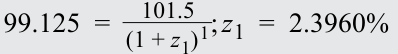

<!-- Formula Text: 99.125  =    101.5 _ (1 + z 1) 1 ; z 1  =  2.3960% -->

The yield-to-maturity rate and the zero rate for a bond with a single cash flow at maturity in one period are identical. Since all cash flows at time _t_ = 1 are discounted at _z_ 1, we can substitute z1 into the two-year fixed-coupon bond calculation to solve for the zero-coupon rate at the end of the second period ( _z_ 2): Two-year: 

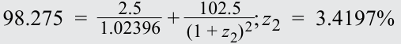

<!-- Formula Text: 98.275  =    2.5 _ 1.02396  +   102.5 _ (1 + z 2) 2 ; z 2  =  3.4197% -->

We then substitute both _z_ 1 and _z_ 2 into the three-year bond equation to solve for the zero-coupon cash flow at the end of year three ( _z_ 3): Three-year: 

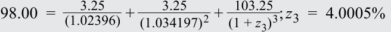

<!-- Formula Text: 98.00  = 3.25 _ (1.02396)  + 3.25 _ (1.034197) 2  +   103.25 _ (1 + z 3) 3 ; z 3  =  4.0005% -->

The zero rates are summarized in the following diagram: 

<!-- PDF Page 123 -->

<!-- Start of picture text -->
Yield (%) 7.00% 6.00% 5.00% z3 Spot or zero rates 4.00% z2 YTM1 = z1 3.00% 2.00% 1.00% Term 1 2 3 <!-- End of picture text -->

This process of deriving zero or spot rates from coupon bonds using forward substitution, as shown in Example 6, is sometimes referred to as bootstrapping. The _price_ equivalent of a zero rate is the present value of a currency unit on a future date, known as a **discount factor** . The discount factor for period _i_ (DF _i_ ) is: 

<!-- Formula Text: 1 _ (1 + z i) i (10) -->

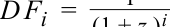

<!-- Formula Text: D F i  = 1 _ (1 + zi)i -->

For each of the zero rates shown in Example 6, an equivalent discount factor can be derived as follows: 

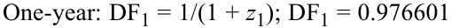

<!-- Formula Text: One-year: DF1 = 1/(1 + z1); DF1 = 0.976601 -->

<!-- Formula Text: Two-year: DF2 = 1/(1 + z2)2; DF2 = 0.934961 -->

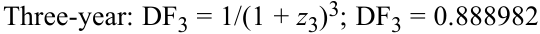

<!-- Formula Text: Three-year: DF3 = 1/(1 + z3)3; DF3 = 0.888982 -->

A discount factor may also be interpreted as the price of a zero-coupon cash flow or bond. We can use the discount factor for any period to demonstrate the same no-arbitrage condition from an earlier lesson—namely, that an asset with a known future price must trade at the present value of its future price as determined by using an appropriate discount rate. 

For example, assume a two-year GBP risk-free zero rate ( _z_ 2) of 3.42% and a two-year zero-coupon bond with a face value of GBP100 trading at a price of GBP92.45. The no-arbitrage price of the zero-coupon bond is equal to GBP93.4955: GBP100/(1.0342)2 . In order to earn a riskless arbitrage profit, we can take the following steps, as shown in Exhibit 6. 

<!-- PDF Page 124 -->

###### **Exhibit 6: Asset with Known Future Price Does Not Trade at Its Present Value** 

**S0 < ST(1 + zT)****–T** **S0(1 + zT)****T** **< ST** 

Borrow S0 at z and Buy S0, Hold to maturity (T) Use proceeds at maturity to repay S0(1 + zT)T Borrow £92.45 at 3.42% and Buy two-year zero (S0) Receive £100 at T(ST) and Repay S0(1 + zT)T = £98.88 

Riskless profit of £1.12 **CF0 = 0 CFT = (£100 – £98.88) > 0 0 Time T** 

At time _t_ = 0: 

- Borrow GBP92.45 at the risk-free rate of 3.42%. 

- Purchase the two-year zero-coupon note for GBP92.45. 

- At time _t_ = _T_ (in two years): 

- Receive GBP100 on the zero-coupon bond maturity date. 

- Repay loan of GBP98.88—GBP92.45 × (1.0342)2 —and earn a riskless arbitrage profit of GBP1.12. 

###### **_Forward Rates_** 

As in the case of other underlying assets, the forward market for interest rates involves a delivery date beyond the usual cash market settlement date. Given the term structures of different interest rates for different maturities, an interest rate forward contract specifies both the _length_ of the forward period and the tenor of the underlying rate. 

For example, a two-year forward contract that references a three-year underlying interest rate (which starts at the end of year two and matures at the end of year five) is referred to as a “2y3y” forward rate, which we will denote as _F_ 2,3. Short-term market reference rates (MRRs) usually reference a forward rate in months—for instance, _F_ 3m,6m references a six-month MRR that begins in three months and matures nine months from today. 

The breakeven reinvestment rate linking a short-dated and a long-dated zero-coupon bond is an **implied forward rate** . That is, the implied forward rate is the interest rate for a period in the future at which an investor earns the same return from: 

**1.** investing for a period from today until the forward start date and rolling over the proceeds at the implied forward rate, or 

**2.** investing today through the final maturity of the forward rate. 

The fact that these strategies have equal returns establishes the no-arbitrage condition for the implied forward rate. The following example demonstrates how spot rates can be used to derive forward rates. 

###### **EXAMPLE 7** 

#### **Implied Forward Rate (** **_IFR_ 1,1)** 

We return to the earlier example of three most recently issued annual fixed-coupon government bonds, with coupons and prices as well as yields-to-maturity and zero or spot rates as follows: 

<!-- PDF Page 125 -->

|**Years to Maturity**|**Annual Coupon**|**PV (per 100**|**FV)**|**YTM**|
|---|---|---|---|---|
|1|1.50%|99.125||2.3960%|
|2|2.50%|98.275||3.4068%|
|3|3.25%|98.000||3.9703%|
|**Years to Maturity**|||**Zero Rate**||
|1|||2.3960%||
|2|||3.4197%||
|3|||4.0005%||

Using the one-year and two-year zero rates from the prior example, an investor faces the following investment choices over a two-year period: 

**1.** Invest USD100 for one year today at the zero rate ( _z_ 1) of 2.396% and reinvest the proceeds of USD102.40 at the one-year rate in one year’s time, or the “1y1y” implied forward rate ( _IFR_ 1,1). 

**2.** Invest USD100 for two years at the two-year zero rate ( _z_ 2) of 3.4197% to receive USD100(1 + _z_ 2)2 , or USD106.96. 

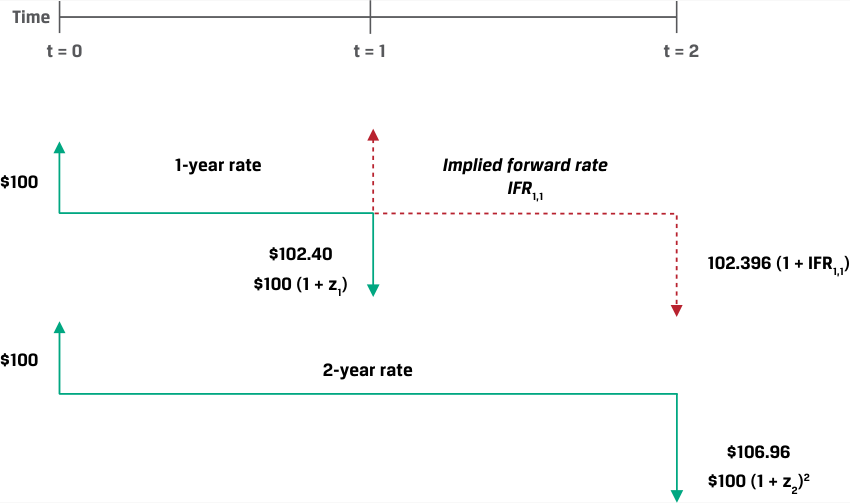

<!-- Start of picture text -->
Time t = 0 t = 1 t = 2 1-year rate Implied forward rate $100 IFR 1,1 $102.40 102.396 (1 + IFR1,1) $100 (1 + z1) $100 2-year rate $106.96 $100 (1 + z2) 2 <!-- End of picture text -->

In order to arrive at the same return for investment choices 1.) and 2.), we set them equal to each other and solve for _IFR_ 1,1 as follows: 

- USD100 × (1 + _z_ 1) × (1 + _IFR_ 1,1) = USD100 × (1 + _z_ 2)2 

USD100 × (1.02396) × (1 + _IFR_ 1,1) = USD100 × (1.034197)2 

_IFR_ 1,1 = 4.4536% 

We can demonstrate that the IFR1,1 of 4.4536% creates identical returns for the first and second strategies by calculating the return on the first strategy as follows: 

USD100 × (1.02396) × (1.044536) = USD106.96 

In general, assume a shorter-term bond matures in _A_ periods and a longer-term bond matures in _B_ periods. The yields-to-maturity per period on these bonds are denoted as _zA_ and _zB_ . The first bond is an _A_ -period zero-coupon bond trading in the cash market. The second is a _B_ -period zero-coupon cash market bond. The implied forward rate between period _A_ and period _B_ is denoted as _IFRA_ , _B_ – _A_ . It is a forward rate on a bond that starts in period _A_ and ends in period _B_ . Its tenor is _B − A_ periods. 

Equation 11 is a general formula for the relationship between the two spot rates ( _z_ A, _z_ B) and the implied forward rate ( _IFRA,B–A_ ): 

<!-- PDF Page 126 -->

(1 + _zA_ )_A_ × (1 + _IFRA_ , _B_ – _A_ )_B_–_A_ = (1 + _zB_ )_B_ 

~~(11)~~ 

Exhibit 7 shows the possible implied forward rates over three periods. 

**Exhibit 7: Implied Forward Rate Example** 

<!-- Start of picture text -->
Time t = 0 t = 1 t = 2 t = 3 $1 z2 IFR 2,1 $1(1 + z2)2 (1 + IFR2,1) $1(1 + z2)2 $1 z1 IFR 1,2 $1(1 + z1) (1 + IFR1,2)2 $1(1 + z1) $1 z3 $1(1 + z3)3 <!-- End of picture text -->

Using Equation 11, we can solve for the one-period rate in two periods (IFR2,1) as follows: 

(1 + _z2_ )2 × (1 + _IFR2_ , _1_ )_1_ = (1 + _z3_ )3 

<!-- Formula Text: (1.034197)2 × (1 + IFR2,1) = (1.040005)3 -->

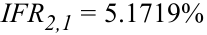

<!-- Formula Text: IFR2,1 = 5.1719% -->

A series of forward rates can be used to construct a forward curve of rates with the same time frame that are implied by cash market transactions or may be observed in the interest rate derivatives market. Exhibit 8 summarizes the relationship between spot or zero rates and the forward curve for one-year rates from the earlier government bond example. 

<!-- PDF Page 127 -->

###### **Exhibit 8: Interest Rate Spot or Zero Curve and Forward Curve** 

<!-- Start of picture text -->
Yield (%) 7.00% 6.00% IFR2,1 Forward curve 5.00% IFR1,1 z3 4.00% z2 Spot or zero curve 3.00% YTM1 = z1 2.00% 1.00% Term 1 2 3 <!-- End of picture text -->

While our examples so far have focused on government benchmark rates, we now turn our attention to short-term market reference rates. Assume, for example, that today we observe a current three-month MRR of 1.25% and a current six-month MRR of 1.75%. How can we solve for the three-month implied forward MRR in three months’ time ( _IFR_ 3m, 3m)? 

In order to apply Equation 11 in this case, we must first ensure that the time frames, or periodicities, of the interest rates are the same. Here, the six-month rate has two periods per year and the three-month rate has four. Recall from an earlier fixed-income lesson that we can convert an annual percentage rate for _m_ periods per year, denoted as _APRm_ , into an annual percentage rate for _n_ periods per year, _APRn_ , as follows: 

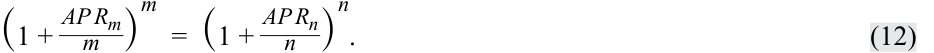

<!-- Formula Text: (1 + AP R m _ m  ) m =  (1 + AP R n _ n  ) n . (12) -->

First, we must convert the 1.75% semiannual MRR into a quarterly rate: 

(1 + _APR4_ /4)4 = (1 + 0.0175/2)2 _APR4_ = 1.74619% 

We can use this to solve Equation 11 for _IFR3m,3m_ : (1 + _z3m_ /4) × (1 + _IFR3m,3m_ /4) = (1 + _z_ 6m/4)_2_ (1 + 0.0125/4) × (1 + _IFR_ 3m,3m/4) = (1 + 0.0174619/4)2 _IFR3m,3m_ = 2.24299% 

Our result can be confirmed by showing that CNY100,000,000 invested at: 

**1.** 1.25% for three months and reinvested at 2.24299% for the following three months, or 

**2.** 1.75% for six months 

<!-- PDF Page 128 -->

will both return CNY100,875,000 in six months: 

**1.** CNY100,875,000 (= CNY100,000,000 × (1 + 0.0125/4) × (1 + 0.0224299/4)) 

**2.** CNY100,875,000 (= CNY100,000,000 × (1 + 0.0175/2)) 

As we will see in the next section, this breakeven reinvestment rate between zero rates of different maturities establishes a no-arbitrage price for a one-period interest rate forward contract. 

###### **_Forward Rate Agreements (FRAs)_** 

An OTC derivatives contract in which counterparties agree to apply a specific interest rate to a future period is a **forward rate agreement (FRA)** . The underlying is a hypothetical deposit of a notional amount in the future at a market reference rate that is fixed at contract inception ( _t_ = 0). The FRA buyer, or long position, agrees to pay the deposit interest based on the agreed upon fixed rate and receives deposit interest based on a market reference rate that begins in _A_ periods and ends in _B_ periods (with a tenor of _B − A_ periods) and is determined on or just before the forward settlement date at time _t_ = _A_ . 

Exhibit 9 shows FRA mechanics at _t_ = 0 and settlement at time _A_ . 

**Exhibit 9: Forward Rate Agreement (FRA) Mechanics** 

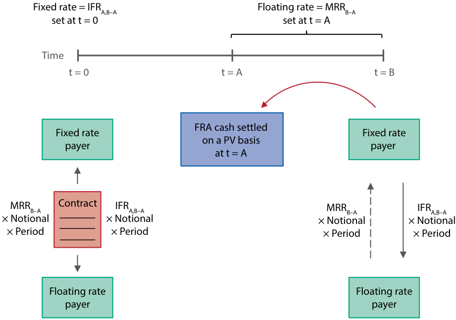

<!-- Start of picture text -->
Fixed rate = IFRA,B–A Floating rate = MRRB–A set at t = 0 set at t = A Time  t = 0 t = A t = B FRA cash settled Fixed rate Fixed rate on a PV basis payer payer at t = A MRRB–A Contract IFRA,B–A MRRB–A IFRA,B–A × Notional × Notional × Notional × Notional × Period × Period × Period × Period Floating rate Floating rate payer payer <!-- End of picture text -->

If Exhibit 9 looks familiar, it is because an FRA is a one-period version of the interest rate swap introduced as a _series_ of exchanges in an earlier lesson. Similar to the swap, fixed versus floating payments on an FRA occur on a net basis and the notional is not exchanged but is used solely for interest calculations. The implied forward rates shown in the previous section represent the FRA fixed rate for a given period where no riskless profit opportunities exist. This no-arbitrage interest rate ensures that, similar to other forward contracts, the forward rate agreement has a value of zero ( _V_ 0( _T_ ) = 0) to both parties at inception. FRA settlement and other details are best demonstrated by extending our earlier implied forward rate example. 

<!-- PDF Page 129 -->

###### **EXAMPLE 8** 

#### **CNY Forward Rate Agreement** 

In a prior example, we solved for a three-month implied forward MRR in three months’ time ( _IFR3m,3m_ ) of 2.24299%. Yangzi Bank enters into an agreement to pay the three-month rate in three months’ time and receive MRR as in Exhibit 9. Yangzi Bank uses the FRA to offset or hedge an underlying liability in three months on which it will owe MRR. 

Consider the following FRA term sheet: 

###### **Yangzi Bank CNY Forward Rate Agreement Term Sheet** 

|**Start Date:**|[Today]|
|---|---|
|**Maturity Date:**|[Three months from Start Date]|
|**Notional Principal:**|CNY 100,000,000|
|**Fixed-Rate Payer:**|Yangzi Bank|
|**Fixed Rate:**|2.24299% on a quarterly actual/360 basis|
|**Floating-Rate Payer:**|[Financial Intermediary]|
|**Floating Rate:**|Three-month CNY MRR on a quarterly actual/360 basis|
|**Payment Date:**|Maturity Date|
|**Business Days:**|Shanghai|
|**Documentation:**|ISDA Agreement and credit terms acceptable to both parties|

Similar to forward agreements for other underlying assets, the FRA settlement amount is a function of the difference between F0( _T_ ) (here, a forward interest rate, _IFRA,B-A_ ) and _ST_ (the market reference rate _MRRB-A_ , or the MRR for _B − A_ periods, which ends at time _B_ ). In our example, _MRR3m_ is the three-month market reference rate, which sets in three months’ time. FRAs are usually cash settled at the beginning of the period during which the reference rate applies. We calculate the net payment amount from the perspective of Yangzi Bank (the FRA buyer or fixed-rate payer) at the _end_ of the interest period as follows: 

Net Payment = ( _MRRB-A_ − _IFRA,B-A_ ) × Notional Principal × Period 

If _MRRB-A_ in three months’ time sets at 2.15% and we assume a 90-day interest period, we calculate the net payment at the end of the period as follows: 

Net Payment = ( _MRRB-A_ − _IFRA,B-A_ ) × Notional Principal × Period (2.15% − 2.24299%) × CNY100,000,000 × 90/360 = −CNY23,247.50 

This is the net payment amount at the end of six months. However, the FRA settles at the _beginning_ rather than the _end_ of the interest period, which is three months in our example. We must therefore calculate the _present value_ of the settlement amount to the beginning of the period during which the reference rate applies, using _MRRB-A_ as the discount rate: 

Cash Settlement (PV): −CNY23,123.21 = −CNY23,247.50/(1 + 0.0215/4) 

<!-- PDF Page 130 -->

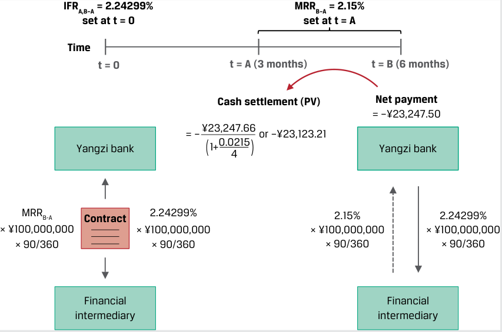

<!-- Start of picture text -->
IFRA,B–A = 2.24299% MRRB–A = 2.15% set at t = 0 set at t = A Time t = 0 t = A (3 months) t = B (6 months) Cash settlement (PV) Net payment = –¥23,247.50 = – ¥23,247.66 or –¥23,123.21 Yangzi bank (1+0.02154 ) Yangzi bank MRRB-A Contract 2.24299% 2.15% 2.24299% × ¥100,000,000 × ¥100,000,000 × ¥100,000,000 × ¥100,000,000 × 90/360 × 90/360 × 90/360 × 90/360 Financial Financial intermediary intermediary <!-- End of picture text -->

In this case, since _MRRB-A_ sets below the fixed rate, as the fixed-rate payer and floating-rate ( _MRRB-A_ ) receiver, Yangzi Bank must make a net settlement payment to the financial intermediary. Because Yangzi Bank has used the FRA to offset or hedge an underlying liability on which it owes MRR, the net settlement payment it makes on the FRA is offset by a lower MRR payment on its liability. 

Forward rate agreements are almost exclusively used by financial intermediaries to manage rate-sensitive assets or liabilities on their balance sheets. The forward rate agreement and its single-period swap equivalent that settles at the end of an interest period form the basic building blocks for interest rate swaps, which are more frequently used by issuers and investors to manage interest rate risk. 

###### **QUESTION SET** 

#### **Interest Rate Forward Contracts** 

1. Determine the correct answers to complete the following sentences: The yield-to-maturity rate and the zero rate for a bond with a single cash flow at maturity in one period are _________. The _price_ equivalent of a zero rate is the present value of a currency unit on a future date, known as a 

_______________. 

###### **Solution:** 

The yield-to-maturity rate and the zero rate for a bond with a single cash flow at maturity in one period are _identical_ . The _price_ equivalent of a zero rate is the present value of a currency unit on a future date, known as a _discount factor_ . 

2. An analyst observes three- and four-year government benchmark zero-coupon bonds priced at 93 and 90 per 100 face value, respectively. Calculate IFR3,1 (the implied one-year forward rate in three years’ time). 

   - **Solution:** 

First, use the three-year ( _DF3_ ) and four-year ( _DF4_ ) discount factors provided per unit of currency to derive three-year ( _z_ 3) and four-year ( _z_ 4) zero rates, which can be calculated as follows: 

<!-- PDF Page 131 -->

~~_~~ 1 _D Fi_ = (1 + _zi_ )_i_ Therefore: 

- 0.93 = 1/(1 + _z3_ )3 ; _z3_ = 2.4485% 

0.90 = 1/(1 + _z4_ )4 ; _z4_ = 2.6690% Solve for IFR3,1 as follows: 

(1 + _z3_ )3 × (1 + _IFR3,1_ ) = (1 + _z4_ )4 

   - (1.024485)3 × (1 + _IFR3,1_ ) = (1.02669)4 _IFR3,1_ = 3.3333% 

3. Match the following descriptions with their corresponding interest rate derivative building block. 

|A. Forward rate agreement|1. The breakeven reinvestment rate linking a short-dated and long-dated zero-coupon bond|
|---|---|
|B. Implied forward rate|2. The present value of a currency unit on a future date|
|C. Discount factor|3. A derivative in which counterparties agree to apply a specific interest rate to a future time period|

###### **Solution:** 

1. B is correct. The breakeven reinvestment rate linking a short-dated and a long-dated zero-coupon bond is the implied forward rate. 

2. C is correct. The price equivalent of a zero rate is the present value of a currency unit on a future date, known as a discount factor. 

   3. A is correct. A forward rate agreement is a derivative in which counterparties agree to apply a specific interest rate to a future period. 

4. A trader observes one-year and two-year zero-coupon bonds that yield 4% and 5%, respectively, and would like to protect herself against a rise in oneyear rates a year from now. Explain the position she should take in the FRA contract to achieve this objective and the forward interest rate she should expect on the contract. 

###### **Solution:** 

A forward rate agreement involves an underlying hypothetical future deposit at a market reference rate fixed at contract inception ( _t_ = 0). To protect against higher rates, the trader should enter into a fixed-rate payer FRA in order to realize a gain if one-year spot rates one year from now exceed the current forward rate. A long FRA position, or fixed-rate payer, agrees to pay interest based on the fixed rate and receives interest based on a variable market reference rate determined at settlement. The FRA is priced based on the implied forward rate, or breakeven reinvestment rate between a shorter and a longer zero rate. We can solve for _IFR1,1_ as follows: 

(1 + _z1_ ) × (1 + _IFR1,1_ ) = (1 + _z2_ )2 

- (1.04) × (1 + _IFR1,1_ ) = (1.05)2 _IFR1,1_ = 6.0096% 

<!-- PDF Page 132 -->

##### **Maturities** 

5. A counterparty agrees to be the FRA fixed-rate receiver on a one-month AUD MRR in three months’ time based on a AUD150,000,000 notional amount. If _IFR3m,1m_ at contract inception is 0.50% and one-month AUD MRR sets at 0.35% for settlement of the contract, calculate the settlement amount and interpret the results. 

###### **Solution:** 

A short FRA position, or fixed-rate receiver, agrees to pay interest based on a market reference rate determined at settlement and receives interest based on a pre-agreed fixed rate, the implied forward rate ( _IFR3m,1m_ ). Since AUD _MRRB-A_ at settlement is below the pre-agreed fixed rate, the FRA fixed-rate receiver realizes a gain and receives a net payment based on the following calculation: 

Net Payment = ( _IFRA,B-A_ − _MRRB-A_ ) × Notional Principal × Period = (0.50% − 0.35%) × AUD150,000,000 × (1/12) = AUD18,750 at the end of the period 

Solve for the present value of settlement given the contract is settled at the beginning of the period, using _MRRB-A_ as the discount rate: 

Cash Settlement (PV) = AUD18,750.00/(1 + 0.35%/12) = AUD18,744.53 

<!-- PDF Page 133 -->

# **~~PRACTICE PROBLEMS~~** 

## **The following information relates to questions 1-6** 

Baywhite Financial is a broker-dealer and wealth management firm that helps its clients manage their portfolios using stand-alone derivative strategies. A new Baywhite analyst is asked to evaluate the following client situations. 

**1.** Match the following definitions with their corresponding forward pricing or valuation component. 

1. Equal to the difference between the A. Forward contract MTM value at inception, current spot price (adjusted by remaining _V_ 0( _T_ ) costs and benefits through maturity) and the present value of the forward price 2. Future value of the underlying asset B. Forward contract MTM value between spot price ( _S_ 0) compounded at the inception and maturity, _Vt_ ( _T_ ) risk-free rate incorporating the present value of the costs and benefits of asset ownership 3. Under no-arbitrage conditions for a C. Forward price, _F_ 0( _T_ ) given underlying spot price, S0, adjusted by the costs and benefits, risk-free rate ( _r_ ), and forward price, _F_ 0( _T_ ), this should be equal to zero (ignoring transaction costs). 

**2.** A Baywhite client currently owns 5,000 common non-dividend-paying shares of Vivivyu Inc. (VIVU), a digital media company, at a spot price of USD173 per share. The client enters into a forward commitment to sell half of its VIVU position in six months at a price of USD175.58. Which of the following market events is most likely to result in the greatest gain in the VIVU forward contract MTM value from the client’s perspective? 

   - **A.** An increase in the risk-free rate 

   - **B.** An immediate decline in the VIVU spot price following contract inception 

   - **C.** A steady rise in the spot price of VIVU stock over time 

**3.** A Baywhite client has entered into a long six-month MXN/USD FX forward contract—that is, an agreement to sell MXN and buy USD. The MXN/USD spot exchange rate at inception is 19.8248 (MXN19.8248 = USD1), the six-month MXN risk-free rate is 4.25%, and the six-month USD risk-free rate is 0.5%. Baywhite’s market strategist predicts that the Mexican central bank (Banco de Mexico) will surprise the market with a 50 bp short-term rate cut at its upcoming meeting. Which of the following statements best describes how the client’s existing FX forward contract will be impacted if this prediction is realized and other parameters remain unchanged? 

   - **A.** The lower interest rate differential between MXN and USD will cause the MXN/USD contract forward rate to be adjusted downward. 

<!-- PDF Page 134 -->

##### **Pricing and Valuation of Forward Contracts and for an Underlying with Varying Maturities** 

   - **B.** The client will realize an MTM gain on the FX forward contract due to the decline in the MXN versus USD interest rate differential. 

   - **C.** The lower interest rate differential between MXN and USD will cause the client to realize an MTM loss on the MXN/USD forward contract. 

**4.** A client seeking advice on her fixed-income portfolio observes the price and yield-to-maturity of one-year ( _r1_ ) and two-year ( _r2_ ) annual coupon government benchmark bonds currently available in the market. Which of the following statements best describes how the analyst can determine a breakeven reinvestment rate in one year’s time to help decide whether to invest now for one or two years? 

   - **A.** As the two-year rate involves intermediate cash flows, divide the square root of (1 + _r2_ ) by (1 + _r1_ ) and subtract 1 to arrive at a breakeven reinvestment rate for one year in one year’s time. 

   - **B.** Since the first year’s returns are compounded in the second year, set (1 + _r1_ ) multiplied by 1 plus the breakeven reinvestment rate equal to (1 + _r2_ )2 and solve for the breakeven reinvestment rate. 

   - **C.** Since the breakeven reinvestment involves a zero-coupon cash flow, first substitute the one-year rate ( _r1_ ) into the two-year bond price equation to solve for the two-year spot or zero rate ( _z2_ ), then set (1 + _r1_ ) × (1 + breakeven reinvestment rate) = (1 + _z2_ )2 and solve for the breakeven reinvestment rate. 

**5.** Baywhite Financial seeks to gain a competitive advantage by making margin loans at fixed rates for up to 60 days to its investor clients. Since Baywhite borrows at a variable one-month market reference rate to finance these client loans, the firm enters into one-month FRA contracts on one-month MRR to hedge the interest rate exposure of its margin loan book. Which of the following statements best describes Baywhite’s interest rate exposure and the FRA position it should take to hedge that exposure? 

   - **A.** Baywhite faces exposure to a _rise_ in one-month MRR over the next 30 days, so it should enter into the FRA as a fixed-rate _payer_ in order to benefit from a rise in one-month MRR above the FRA rate and offset its higher borrowing cost. 

   - **B.** Baywhite faces exposure to a _rise_ in one-month MRR over the next 30 days, so it should enter into the FRA as a fixed-rate _receiver_ in order to benefit from a rise in one-month MRR above the FRA rate and offset its higher borrowing cost. 

   - **C.** Baywhite faces exposure to a _decline_ in one-month MRR over the next 30 days, so it should enter into the FRA as a fixed-rate _receiver_ in order to benefit from a rise in one-month MRR above the FRA rate and offset its higher borrowing cost. 

**6.** Baywhite observes that one-month MRR is 1.2% and two-month MRR is 1.5%. Which of the following rates is closest to the forward rate that Baywhite would expect on 1m1m forward rate agreement? 

   - **A.** 1.80% 

   - **B.** 1.35% 

<!-- PDF Page 135 -->

**C.** 3.55% 

<!-- PDF Page 136 -->

# **~~SOLUTIONS~~** 

1. 1. B is correct. The forward contract MTM value between inception and maturity, _Vt_ ( _T_ ), is equal to the difference between the current spot price (adjusted by costs and benefits through maturity) and the present value of the forward price. 2. C is correct. The forward price, _F_ 0( _T_ ), is the future value of the underlying asset spot price ( _S_ 0) compounded at the risk-free rate incorporating the present value of the costs and benefits of asset ownership. 

   3. A is correct. Under no-arbitrage conditions for a given underlying spot price, _S_ 0, adjusted by the costs and benefits, risk-free rate ( _r_ ), and forward price, _F_ 0( _T_ ), the forward contract MTM value at inception, _V_ 0( _T_ ), should be equal to zero (ignoring transaction costs). 

2. B is correct. The original VIVU spot price ( _S_ 0) at _t_ = 0 must equal the present value of the forward price discounted at the risk-free rate, so an immediate fall in the spot price to _S_ 0- < _S_ 0 results in an MTM gain for the forward contract seller. A is not correct, since a higher risk-free rate will reduce the contract MTM from the client’s perspective by reducing the PV of _F_ 0( _T_ ), while C will also reduce the forward contract MTM from the seller’s perspective. 

3. C is correct. A decline in the interest rate differential between MXN and USD will cause the client to realize an MTM loss on the MXN/USD forward contract, while B states that this decline will result in an MTM gain. A is incorrect as the forward price, _F_ 0( _T_ ), is not adjusted during the contract life. Specifically, the original MXN/USD forward exchange rate at inception is equal to 20.20 (= 19.8248e(.0425 – 0.005) × 0.5 ). If the MXN rate were to decline by 50 bps immediately after the contract is agreed, a new MXN/USD forward contract would be at a forward exchange rate of 20.15 (= 19.8248e(.0375 – 0.005) × 0.5 ). The MXN would weaken or depreciate against the USD. Since the MXN seller has locked in a forward sale at the original 20.20 versus the new 20.15 rate, the seller’s MTM loss is equal to 0.05, or MXN50,000 per MXN1,000,000 (= 0.05 × 1,000,000) notional amount. 

4. C is correct. The one-year annual rate equals the one-year zero rate, as it involves a single cash flow at maturity ( _z1_ = _r1_ ). Since the breakeven reinvestment rate involves a single cash flow at maturity, substitute the one-year rate ( _r1_ ) into the two-year bond price equation to solve for _z2_ , then set (1 + _r1_ ) × (1 + breakeven reinvestment rate) = (1 + _z2_ )2 and solve for the breakeven reinvestment rate ( _IFR1,1_ ). 

5. A is correct. As Baywhite faces exposure to a rise in one-month MRR over the next 30 days, it should enter into the FRA as a fixed-rate payer in order to benefit from a rise in one-month MRR above the FRA rate and offset its higher borrowing cost. Both B and C are incorrect, as the fixed-rate _receiver_ in an FRA does not benefit but rather must make a higher payment upon settlement if MRR rises. 

6. A is correct. The APR of the monthly compounded two-month rate is 1.499%. Dividing (1.01499/12)2 by (1.012/12) equals 1.001499. Subtracting 1 and then multiplying by 12 gives 1.7982%. Thus, the approximate forward rate is 1.80%. B is incorrect because this is a simple average of the two spot rates. C is incorrect because this result is derived from simply dividing (1.01499/12) by (1.012/12), then subtracting 1, and then multiplying by 12. 

