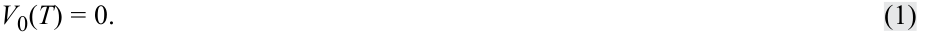
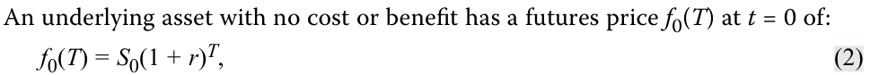
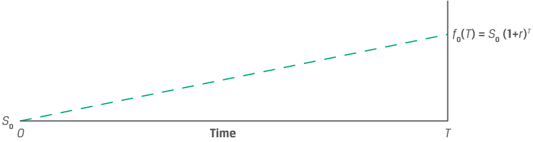
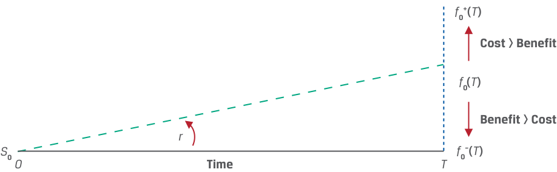
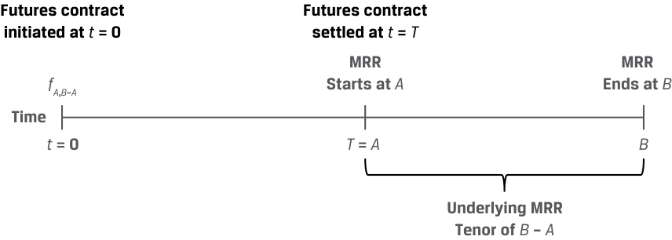

# Volume 7: Derivatives
## Learning Module 6 Pricing and Valuation of Futures Contracts
### Part 1/2: Introduction (PDF Pages 137–150)

---

<!-- PDF Page 137 -->

#### L E A R N I N G M O D U L E 

# **<mark>6</mark>** 

### **Pricing and Valuation of Futures Contracts** 

###### **<mark>LEARNING OUTCOMES</mark>** 

**_Mastery The candidate should be able to:_** 

compare the value and price of forward and futures contracts explain why forward and futures prices differ 

##### **INTRODUCTION** 

## **<mark>1</mark>** 

Many of the pricing and valuation principles associated with forward commitments are common to both forward and futures contracts. For example, previous lessons demonstrated that forward commitments have a price that prevents market participants from earning riskless profit through arbitrage. It was also shown that long and short forward commitments may be replicated using a combination of long or short cash positions and borrowing or lending at the risk-free rate. Finally, both forward and futures pricing and valuation incorporate the cost of carry, or the benefits and costs of owning an underlying asset over the life of a derivative contract. 

We now turn our attention to futures contracts. We discuss what distinguishes them from other forward commitments and how they are used by issuers and investors. We expand upon the daily settlement of futures contract gains and losses introduced earlier and explain the differences between forwards and futures. We also address and distinguish the interest rate futures market and its role in interest rate derivative contracts. 

###### **LEARNING MODULE OVERVIEW** 

- Futures are standardized, exchange-traded derivatives (ETDs) with zero initial value and a futures price _f_ 0( _T_ ) established at inception. The futures price, _f_ 0( _T_ ), equals the spot price compounded at the risk-free rate as in the case of a forward contract. 

- The primary difference between forward and futures valuation is the daily settlement of futures gains and losses via a margin account. Daily settlement resets the futures contract value to zero at the current futures price _ft_ ( _T_ ). This process continues until contract maturity and the futures price converge to the spot price, _ST_ . 

CFA Institute would like to thank Don Chance, PhD, CFA, for his contribution to this section, which includes material derived from material that appeared in _Derivative Markets and Instruments_ , featured in the 2022 CFA® Program curriculum. 

<!-- PDF Page 138 -->

- The cumulative realized mark-to-market (MTM) gain or loss on a futures contract is approximately the same as for a comparable forward contract. 

- Daily settlement and margin requirements give rise to different cash flow patterns between futures and forwards, resulting in a pricing difference between the two contract types. The difference depends on both interest rate volatility and the correlation between interest rates and futures prices. 

- The futures price for short-term interest rate futures is given by (100 – yield), where yield is expressed in percentage terms. There is a price difference between interest rate futures and forward rate agreements (FRAs) due to convexity bias. 

- The emergence of derivatives central clearing has introduced futureslike margining requirements for over-the-counter (OTC) derivatives, such as forwards. This arrangement has reduced the difference in the cash flow impact of ETDs and OTC derivatives and the price difference in futures versus forwards. 

###### **LEARNING MODULE SELF-ASSESSMENT** 

These initial questions are intended to help you gauge your current level of understanding of this learning module. 

1. Which of the following responses is closest to the one-year futures price of a stock with a spot price ( _S_ 0) of €125 and an annual dividend of €2.50 paid at maturity if the risk-free rate is 1%? 

   - **A.** €123.75 

**B.** €122.50 

**C.** €126.25 

- **Solution:** 

A is correct. The no arbitrage futures price for an underlying asset with known benefits, such as a dividend, may be determined using the following equation: 

_f_ 0( _T_ ) = [ _S_ 0 − PV0( _I_ )] (1 + _r_ )_T_ . 

First, solve for the present value of the dividend PV0( _I_ ) as follows: €2.48 = (€2.50 / 1.01). 

Substitute PV0( _I_ ) into the original equation to solve for _f_ 0( _T_ ): 

_f_ 0( _T_ ) = €123.75 = (€125 − €2.48)(1.01). 

2. Which of the following statements regarding the gains or losses of a long forward contract position compared to a long futures contract position is most correct? Assume that the underlying is identical on both contracts and that both contracts have the same time until maturity. 

   - **A.** The daily realized gain or loss of the forward contract position and the futures contract position are equivalent. 

   - **B.** Before the contracts mature, the cumulative realized gains or losses of the forward contract position and the futures contract position are equivalent. 

<!-- PDF Page 139 -->

- **C.** At contract maturity, the cumulative realized gains or losses of the forward contract position and the futures contract position are approximately equivalent. 

###### **Solution:** 

C is correct. The two contracts are similar in all respects except for the frequency with which contracts are marked to market. As a result, the cumulative gain or loss is approximately the same when the contracts mature. A is incorrect because the futures contract’s daily mark-to-market (MTM) feature creates daily realized gains or losses while the forward contract’s gains or losses are realized only at contract maturity. B is incorrect because the response refers to realized gains or losses, and the contracts have not yet matured. Thus, the forward contract has generated no realized gains or losses yet. 

3. Identify which of the following situations leads to which relationship between forward and futures prices for forward commitment contracts with otherwise identical terms. 

|1. Futures prices are_positively_correlated with interest rates, and interest rates change over the contract period.|A. Forward prices are above futures prices:_F_0(_T_) >_f_0(_T_).|
|---|---|
|2. Futures prices are_negatively_correlated with interest rates, and interest rates change over the contract period.|B. Forward and futures prices are the same:_F_0(_T_) =_f_0(_T_).|
|3. Interest rates are constant over the forward commitment contract period.|C. Futures prices are above for- ward prices:_f_0(_T_) >_F_0(_T_).|

###### **Solution:** 

1. C is correct. If futures prices are positively correlated with interest rates, then higher prices lead to futures profits reinvested at rising rates, and lower prices lead to losses that may be financed at lower rates. 

2. A is correct. If futures prices are negatively correlated with interest rates, then higher prices lead to futures profits reinvested at lower rates, and lower prices lead to losses that must be financed at higher rates. 

3. B is correct. If interest rates are constant over the forward commitment contract period, then forward and futures prices are the same. 

4. Which of the following statements most correctly describes a development that has helped reduce the difference in the cash flow impact between forward and futures contracts? 

   - **A.** Futures exchanges have moved away from daily mark-to-market recognition of gains and losses on futures contracts. 

   - **B.** OTC derivatives have become increasingly subject to central clearing requirements. 

   - **C.** Lower volatility in markets has reduced the magnitude of gains and losses in both types of contracts. 

###### **Solution:** 

B is correct. Under a central clearing framework for OTC derivatives, financial intermediaries that serve as counterparties are required to post daily margin or eligible collateral to the central counterparty (CCP) in a process very similar to futures margining. Dealers, therefore, often impose similar requirements on derivatives end users. A is incorrect because no such 

<!-- PDF Page 140 -->

change has occurred in exchange-traded futures markets. C is incorrect because volatility changes over time are hard to categorize as higher or lower. 

## **<mark>2</mark>** 

##### **PRICING OF FUTURES CONTRACTS AT INCEPTION** 

compare the value and price of forward and futures contracts 

When a forward commitment is initiated, no cash is exchanged and the contract is neither an asset nor a liability to the buyer or seller. The value of both a forward contract and a futures contract at initiation is zero: 

<!-- Formula Text: V0(T) = 0. (1) -->

<!-- Formula Text: An underlying asset with no cost or benefit has a futures price f0(T) at t = 0 of: f0(T) = S0(1 + r)T, (2) -->

where _r_ is the risk-free rate and _T_ is the time to maturity. As in the case of a forward contract, the futures price is the spot price compounded at the risk-free rate over the life of the contract. This is shown in Exhibit 1, where the slope of the line is equal to the risk-free rate, _r_ . 

###### **Exhibit 1: Futures Price at Initiation** 

<!-- Start of picture text -->
f 0( T ) =  S 0 (1+ r ) T S 0 0 Time T <!-- End of picture text -->

As for forwards, we use discrete compounding as in Equation 2 for futures on individual underlying assets. However, for underlying assets that are comprised of a portfolio—such as an equity, fixed-income, commodity, or credit index—or where the underlying involves foreign exchange with interest rates denominated in two currencies, continuous compounding is the preferred method, as shown in Equation 3: 

_f_ 0( _T_ ) = _S_ 0 _e__rT_ . ~~(3)~~ 

###### **EXAMPLE 1** 

###### **Procam Investments - Gold Futures Contract** 

As shown in a previous lesson, Procam Investments purchases a 100-ounce gold futures contract. The current spot price is $1,770.00 per ounce, the risk-free rate is 2.0%, and we assume gold may be stored at no cost. Calculate the no arbitrage futures price, _f_ 0( _T_ ), for settlement in 91 days ( _T_ = 91/365 or 0.24932). 

<!-- PDF Page 141 -->

###### **Solution** 

Using Equation 2: _f_ 0( _T_ ) = _S_ 0(1 + _r_ )_T_ $1,778.76 per ounce = $1,770.00 × (1.02)0.24932 Contract price = $177,876.04 (= 100 × $1,778.76) 

The futures price, _f_ 0( _T_ ), is identical to the forward price from a previous lesson. 

As in the case of a forward, for underlying assets with ownership benefits or income ( _I_ ) or costs ( _C_ ) expressed as a known amount in present value terms at time _t_ = 0, the spot versus futures price relationship using discrete compounding is shown in Equation 4 and Exhibit 2: 

_f_ 0( _T_ ) = [ _S_ 0 – PV0( _I_ ) + PV0( _C_ )] (1 + r)T . ~~(4)~~ 

###### **Exhibit 2: Futures Prices with Underlying Asset Costs and Benefits** 

<!-- Start of picture text -->
f 0+( T ) Cost > Benefit f 0 ( T ) Benefit > Cost r f 0–( T ) S 0  0 Time T <!-- End of picture text -->

###### **EXAMPLE 2** 

###### **Procam’s Gold Futures Contract with Storage Costs** 

Procam purchased a gold futures contract in Example 1 at _f_ 0( _T_ ) of $177,876.04 (or $1,778.76 per ounce) with _S_ 0 equal to $1,770 per ounce. How would _f_ 0( _T_ ) change to satisfy the no arbitrage condition if a $2 per ounce cost of gold storage and insurance were payable at the end of the contract? 

The futures price for a commodity with known storage cost amounts may be determined using Equation 4, where PV0( _I_ ) = 0: 

_f_ 0( _T_ ) = [ _S_ 0 + PV0( _C_ )] (1 + _r_ )_T_ . 

First, solve for the present value of the storage cost per ounce, PV0( _C_ ), as follows: PV0( _C_ ) = $1.99 = [$2(1.02)-0.24982 ]. 

Substitute PV0( _C_ ) = $1.99 into Equation 4 to solve for _f_ 0( _T_ ): 

_f_ 0( _T_ ) = ($1,770.00 + $1.99)(1.02)0.24982 

= $1,780.78 per ounce 

The addition of storage and insurance costs increases the difference between the spot price and futures price. Finally, as in the case of forwards, a futures price, _f_ 0( _T_ ), significantly _below_ the no arbitrage price including cash costs and benefits may indicate the presence of a convenience yield. 

<!-- PDF Page 142 -->

## **<mark>3</mark>** 

##### **MTM VALUATION: FORWARDS VERSUS FUTURES** 

compare the value and price of forward and futures contracts 

Examples 1 and 2 show the similarities between forward and futures prices at contract inception. Over time, different forward and futures contract features lead to different MTM values for contracts with the same underlying assets and otherwise identical details. Example 3 shows how the daily settlement of gains and losses causes this difference to arise. 

###### **EXAMPLE 3** 

###### **Procam Forward versus Futures Pricing and Valuation** 

We extend the earlier example to compare forward and futures pricing and valuation. In both cases, Procam Investments enters a cash-settled forward commitment to buy 100 ounces of gold at a price ( _f_ 0[ _T_ ] = _F_ 0[ _T_ ]) of $1,778.76 per ounce in 91 days, with a risk-free rate of 2% and no gold storage cost. 

###### **Forward Contract** 

The forward price is _F_ 0( _T_ ) = $1,778.76 per ounce. No cash is exchanged or deposited at inception, and the contract value at inception, _V_ 0( _T_ ), is zero. 

<!-- Start of picture text -->
Time t  = 0 t  = T Procam Procam investments investments 100 ounces of gold ( S 0) Contract 100 ounces 100 ounces ×  S T × F 0( T ) F 0( T ) Financial Financial intermediary intermediary <!-- End of picture text -->

Over time, the forward price, _F_ 0( _T_ ), does not change, and the MTM at any time, [ _Vt_ ( _T_ )], equals the difference between the current spot price, _St_ , and the present value of the forward price, PV _t_ of _F_ 0( _T_ ), shown from Procam’s (the forward buyer’s) perspective: 

_Vt(T_ ) = _St_ − _F_ 0( _T_ )(1 + _r_ )–(_T_–_t_) . 

For example, say 71 days have elapsed and 20 days remain to maturity, _T_ − _t_ = 20/365 or 0.0548. If the gold spot price, ( _St_ ), has fallen by $50 since inception to $1,720 per ounce, solve for _Vt_ ( _T_ ) as follows: 

_Vt_ ( _T_ ) = $1,720 − $1,778.76(1.02)–0.0548 

= –$56.83 per ounce, or a $5,683 MTM loss (= –$56.83 × 100 ounces). 

Under terms of the forward contract, no settlement of the MTM amount occurs until maturity. This process of resetting the contract value to zero each day makes it very unlikely that the futures contract would reach a similar MTM value. 

<!-- PDF Page 143 -->

###### **Futures Contract** 

The futures price, _f_ 0( _T_ ), is $1,778.76 per ounce. As per futures exchange daily settlement rules, the contract buyer and seller must post an initial cash margin of $4,950 per gold contract (100 ounces) and maintain a maintenance margin of $4,500 per contract. If a margin balance falls below $4,500, a counterparty receives a margin call and must immediately replenish its account to the initial $4,950. 

<!-- Start of picture text -->
Trade initiation ( t  = 0): Procam investments 100 ounces Initial margin of gold ( S 0) Contract $4,950 f 0( T ) Financial intermediary Initial margin $4,950 London Metal Exchange (LME) <!-- End of picture text -->

Consider the first day of trading, where the spot gold price, ( _S_ 0), is $1,770 per ounce and the opening gold futures price, _f_ 0( _T_ ), is $1,778.76 per ounce. 

- Assume that the gold futures price, _f_ 1( _T_ ), falls by $5 on the first trading day to $1,773.76 and the spot price, _S_ 1, ends the day at a no arbitrage equivalent of $1,765.12 (= $1,773.76(1.02)–90/365 ). 

- Procam realizes a $500 MTM loss (= $5 per ounce × 100 ounces) deducted from its margin account, leaving Procam with $4,450. 

- The MTM value of Procam’s futures contract resets to zero at the futures closing price of $1,773.76 per ounce. 

- Since Procam’s margin account balance has fallen below the $4,500 maintenance level, it must deposit $500 to return the balance to the $4,950 initial margin. 

###### **Futures versus Forward Price and Value over Time** 

Using the same details, we compare the futures and forward price and value over two trading days. Assume that day two trading opens at day one’s closing spot and futures prices. The following table shows the comparison: 

###### **Beginning of Day 2 Trading** 

|**Contract**|**Contract**|**Contract**|**Realized**|**Margin**|
|---|---|---|---|---|
|**Type**|**Price**|**MTM**|**MTM**|**Deposit**|
|**Forward**|_F_0(_T_) = $177,876|–$498|$0|$0|
|**Futures**|_f_1(_T_) = $177,376|$0|–$500|$4,950|

The forward MTM contract value, _Vt_ ( _T_ ), equals the difference between the current spot price, _S_ 1 = $1,765.12, and the present value of the original forward price, PV _t_ [ _F_ 0( _T_ )], here with 90 days remaining to maturity, _T_ − t = 90/365 or 0.24657: 

<!-- PDF Page 144 -->

_Vt_ ( _T_ ) = $1,765.12 − $1,778.76(1.02)–0.24657 

= $4.98 per ounce. 

Extending our example to the beginning of day three at the prior day’s close, assume a $4 per ounce fall in the gold futures price on day two, _f_ 2( _T_ ), to $1,769.76 and a no arbitrage equivalent spot price decline, _S_ 2, to $1,761.24 (= $1,769.76[1.02]–89/365 ). The following table shows the summary on day three: 

###### **Beginning of Day 3 Trading** 

|**Contract**|**Contract**|**Contract**|**Realized**|**Margin**|
|---|---|---|---|---|
|**Type**|**Price**|**MTM**|**MTM**|**Deposit**|
|**Forward**|_F_0(_T_) = $177,876|–$895|$0|$0|
|**Futures**|_f_2(_T_) = $176,976|$0|–$400|$4,550|

The forward MTM contract value, _Vt_ ( _T_ ), equals the difference between the current spot price, _S_ 2 = $1,761.24, and the present value of the original forward price, PV _t_ [ _F_ 0( _T_ )], here with 89 days remaining to maturity, _T_ − _t_ = 89/365 or 0.24384: 

_Vt_ ( _T_ ) = $1,761.24 − $1,778.76(1.02)–0.24384 

= $8.95 per ounce. 

Example 3 demonstrates the key differences in the price and value of forward and futures contracts over time. The forward contract price, _F_ 0( _T_ ), remains fixed until the contract matures. Forward contract MTM value changes are captured by the difference between the current spot price, _St_ , and the present value of the forward price, PV _t_ [ _F_ 0( _T_ )]. This forward contract MTM is not settled until maturity, giving rise to counterparty credit risk over time since no cash is exchanged from inception of the contract to its maturity or expiration. Futures contract prices fluctuate daily based upon market changes. The daily settlement mechanism resets the futures MTM to zero, and variation margin is exchanged to settle the difference, reducing counterparty credit risk. The _cumulative_ realized MTM gain or loss on a futures contract is approximately the same as for a comparable forward contract. We will explore these differences in the next lesson after first turning our attention to forward and futures contracts on market reference rates. 

## **<mark>4</mark>** 

##### **INTEREST RATE FUTURES VERSUS FORWARD CONTRACTS** 

compare the value and price of forward and futures contracts 

In an earlier lesson on interest rate forward contracts, zero rates derived from coupon bonds were used to derive a future investment breakeven rate (or implied forward rate). The implied forward rate was shown to equal the no arbitrage fixed rate on a forward rate agreement (FRA) under which counterparties exchange a fixed-for-floating cash flow at a time in the future. 

<!-- PDF Page 145 -->

Futures markets on short-term interest rates offer market participants a highly liquid, standardized alternative to FRAs. Interest rate futures contracts are available for monthly or quarterly market reference rates for successive periods out to final contract maturities of up to ten years in the future. Although the underlying variable is the market reference rate (MRR) on a hypothetical deposit on a future date as for forward rate agreements, interest rate futures trade on a _price_ basis as per the following general formula: 

_fA_ , _B_ − _A_ = 100 − (100 × MRR _A_ , _B_ − _A_ ), ~~(5)~~ 

where _fA_ , _B_ − _A_ represents the futures price for a market reference rate for _B_ − _A_ periods that begins in _A_ periods (MRR _A_ , _B_ − _A_ ), as shown in Exhibit 3. 

**Exhibit 3: Interest Rate Futures Contract Mechanics** 

<!-- Start of picture text -->
Futures contract Futures contract initiated at  t  = 0 settled at  t  =  T MRR MRR fA , B – A Starts at  A Ends at  B Time t  = 0 T  =  A B Underlying MRR Tenor of  B  –  A <!-- End of picture text -->

For example, we may solve for the implied three-month MRR rate in three months’ time (where _A_ = 3m, _B_ = 6m, _B_ − _A_ = 3m) if an interest rate futures contract is trading at a price of 98.25 using Equation 5: 

_f_ 3 _m_ ,3 _m_ : 98.25 = 100 − (100 × MRR _A_ , _B_ − _A_ ) 

MRR3 _m_ ,3 _m_ = 1.75%. 

This (100 − yield) price convention results in an inverse price/yield relationship but is _not_ the same as the price of a zero-coupon bond at the contract rate. A long futures position involves earning or receiving MRR in _A_ periods, whereas a short position involves paying MRR in _A_ periods. The interest rate exposure profile for long and short futures contracts are as follows: 

- Long futures contract (lender): Gains as prices rise, future MRR falls 

- Short futures contract (borrower): Gains as prices fall, future MRR rises 

In an earlier lesson, Yangzi Bank enters into an FRA as a fixed-rate payer to hedge a liability on which it owes MRR in the future, realizing a gain on the FRA contract as rates rise. Note that this would be equivalent to taking a _short_ position on a CNY MRR futures contract if one were available. Exhibit 4 summarizes the relationship between futures and FRAs. 

<!-- PDF Page 146 -->

**Exhibit 4: Interest Rate Futures versus FRAs** 

|**Contract Type**|**Gains from Rising MRR**|**Gains from Falling MRR**|
|---|---|---|
|**Interest rate**|Short futures contract|Long futures contract|
|**futures**|||
|**Forward rate** **agreement**|Long FRA: FRA fixed-rate payer (FRA floating-rate receiver)|Short FRA: FRA floating-rate payer (FRA fixed-rate receiver)|

Interest rate futures daily settlement occurs based on price changes, which translate into **futures contract basis point value (BPV)** as follows: 

Futures Contract BPV = Notional Principal × 0.01% × Period. 

~~(6)~~ 

For example, assuming a $1,000,000 notional for three-month MRR of 2.21% for one quarter (or 90/360 days), the underlying deposit contract value would be: 

- $1,005,525 = $1,000,000 × [1 + (2.21% / 4)]. 

Consider how a one basis point (0.01%) change in MRR affects contract value: 

- 1 bp increase (2.22%): $1,005,550 = $1,000,000 × [1 + (2.22% / 4)]. 

- 1 bp decrease (2.20%): $1,005,500 = $1,000,000 × [1 + (2.20% / 4)]. 

Both the increase and decrease in MRR by one basis point change the contract BPV by $25. Short-term interest rate futures are characterized by a fixed linear relationship between price and yield changes. The following example illustrates their use in practice. 

###### **EXAMPLE 4** 

###### **Interest Rate Futures - Baywhite Margin Loan Book** 

In an earlier example, Baywhite Financial offered 60-day margin loans at fixed rates to its clients and borrowed at a variable one-month MRR to finance the loans. Describe Baywhite’s residual interest rate exposure and how it may use interest rate futures as a hedge. 

<!-- Start of picture text -->
1-month MRR 1-month MRR set at  t  = 0 set at  t  = A Time t  = 0 t  =  A  (1 month) t  =  B  (2 months) Baywhite Baywhite receives fixed on 60-day margin loans Financial Baywhite pays fixed (MRR) Baywhite is exposed to paying a for 1 month higher 1-month MRR in 1 month Baywhite Financial <!-- End of picture text -->

The diagram shows that Baywhite faces the risk of higher MRR in one month’s time (MRR1,1), which would reduce the return on its fixed margin loans. In the prior example, Baywhite entered an FRA where it agreed to pay fixed one-month MRR and receive floating. If Baywhite were to use an interest rate futures contract instead, it would _sell_ a futures contract on one-month MRR. The futures contract BPV for a $50,000,000 notional amount is: 

Contract BPV = $416.67 (= $50,000,000 × 0.01% × [1/12]). 

<!-- PDF Page 147 -->

If Baywhite sells _f_ 1,1 for $98.75 (or MRR1,1 = 1.25%) and settles at maturity at a price of $97.75 (MRR1,1 = 2.25%), it would expect to have a _cumulative_ gain on the contract through maturity equal to $41,667 (= Contract BPV × 100 bps). 

###### **QUESTION SET** 

###### **Valuation and Pricing of Futures Contracts** 

1. Identify which of the following features corresponds to which type of forward commitment contract. 

1. The daily change in contract price is used to determine and settle the MTM. 

2. Inclusion of storage and insurance costs increases the difference between the spot and forward commitment contract price. 

3. The contract price established at inception remains unchanged over time. 

A. Forward contract 

B. Futures contract 

C. Both a forward and a futures contract 

###### **Solution:** 

   1. B is correct. The futures contract price change at the close of each trading day is used to determine the daily MTM settlement via the margin account. 

   2. C is correct. Storage and insurance costs increase the forward commitment price for both forward and futures contracts. 

   3. A is correct. The forward contract price, _F_ 0( _T_ ), established at _t_ = 0 remains unchanged and is used to calculate the MTM settlement at maturity. 

2. Calculate the correct answer to fill in the blank and justify your response: An investor entered a short oil futures contract position three months ago on 1,000 barrels at an initial price of $69.00 per barrel. The constant riskfree rate is 0.50%. Daily oil spot and futures prices for the final 10 days of trading are shown in the following table. The change in the investor’s futures contract value on day _T_ – 5 is closest to _______________. 

|**Day**|**Crude Oil Spot Price ($)**|**Crude Oil Futures Price ($)**|
|---|---|---|
|T-10|69.62|68.69|
|T-9|69.01|68.11|
|T-8|66.88|66.15|
|T-7|65.18|64.77|
|T-6|66.72|66.02|
|T-5|68.59|68.01|
|T-4|68.80|68.08|
|T-3|68.93|68.32|
|T-2|69.43|69.15|

<!-- PDF Page 148 -->

|**Day**|**Crude Oil Spot Price ($)**|**Crude Oil Futures Price ($)**|
|---|---|---|
|T-1|69.36|69.18|
|T|70.03|70.03|

###### **Solution:** 

The answer is $(1,990). The MTM of the investor’s futures position is the daily futures price change on Day T – 5 per barrel multiplied by 1,000 barrels: 

_VT_ −5( _T_ ) = – [ _–fT_ −5( _T_ ) – _fT_ −6( _T_ )– ] × 1,000 = – (68.01 – 66.02) × 1,000 = – $1,990. 

Note the negative sign refers to the investor’s short futures position. The investor realizes a loss as the futures price rises due to the short position. 

3. Determine the correct answers to complete the following sentences: The daily settlement mechanism resets the futures MTM to __________, and margin is exchanged to settle the difference. The ___________ realized MTM gain or loss on a futures contract is approximately the same as for a comparable forward contract. 

###### **Solution:** 

The daily settlement mechanism resets the futures MTM to _zero_ , and margin is exchanged to settle the difference. The _cumulative_ realized MTM gain or loss on a futures contract is approximately the same as for a comparable forward contract. 

4. Identify the following statement as true or false and justify your answer: An FRA fixed-rate receiver (floating-rate payer) position is equivalent to a long interest rate futures contract on MRR, as both positions realize a gain as MRR falls below the initial fixed rate. 

###### **Solution:** 

The statement is true. An FRA fixed-rate receiver (floating-rate payer) position realizes a gain as MRR falls as the counterparty receives the fixed MRR and owes the floating MRR in the future. A long futures contract price is based on (100 − yield), which rises as yield-to-maturity (MRR) falls. 

5. From May 2020 to January 2021, the three-month SONIA (Sterling Overnight Index Average) futures contract expiring in June 2021 traded at a price above 100. Describe the interest rate scenario implied by this futures price and justify your response. 

###### **Solution:** 

The future interest rate scenario implied by the futures price above 100 is a negative SONIA interest rate in June 2021. For example, if we consider the futures price for three-month SONIA one year forward as of June 2020 from Equation 5: 

- _f_ 1 _y_ ,3 _m_ = 100 − (100 × MRR1 _y_ ,3 _m_ ) . 

If _f_ 1 _y_ ,3 _m_ > 100, this implies that MRR1 _y_ ,3 _m_ < 0. 

<!-- PDF Page 149 -->

##### **FORWARD AND FUTURES PRICE DIFFERENCES** 

## **<mark>5</mark>** 

explain why forward and futures prices differ 

Despite their similar symmetric payoff profile at maturity, differences exist between forward and futures valuation and pricing because of different cash flow profiles over the life of a futures versus a forward contract with otherwise similar characteristics. The distinguishing features of a futures contract are the posting of initial margin, daily mark-to-market, and settlement of gains and losses. 

These features limit the MTM value of a futures contract to the daily gain or loss since the previous day’s settlement. When that value is paid out in the daily settlement via the margin account, the futures price resets to the current settlement price and the MTM value goes to zero. Forward contracts, on the other hand, involve privately negotiated credit terms (which sometimes involve cash or securities collateral) and do not require daily MTM cash settlement. Forward contract settlement occurs at maturity in a one-time cash settlement of the cumulative change in contract value. 

The different patterns of cash flows for forwards and futures can lead to a difference in the pricing of forwards versus futures. Forward and futures prices are identical under certain conditions, namely: 

- if interest rates are constant, or 

- if futures prices and interest rates are uncorrelated. 

On the other hand, violations of these assumptions can give rise to differences in pricing between these two contracts. For example, if futures prices are positively correlated with interest rates, long futures contracts are more attractive than long forward positions for the same underlying and maturity. The reason is because rising prices lead to futures profits that are reinvested in periods of rising interest rates, and falling prices lead to losses that occur in periods of falling interest rates. The price differential will also vary with the volatility of interest rates. 

A negative correlation between futures prices and interest rates leads to the opposite interpretation, with long forward positions being more desirable than long futures positions. In general, the more desirable contract will tend to have the higher price. 

##### **INTEREST RATE FORWARD AND FUTURES PRICE DIFFERENCES** 

**<mark>6</mark>** 

explain why forward and futures prices differ 

The short maturity of most futures contracts and the ability of most market participants to borrow near risk-free rates for these maturities typically results in little to no distinction between futures and forward prices. An exception to this is the so-called **convexity bias** , which arises given the difference in price changes for interest rate futures versus forward contracts, as illustrated in the following example. 

<!-- PDF Page 150 -->

###### **EXAMPLE 5** 

###### **Interest Rate Forwards versus Futures** 

Let us return to an example from the prior lesson with an interest rate futures contract of $1,000,000 notional for three-month MRR of 2.21% for one quarter (or 90/360 days). Recall that the underlying deposit contract value was: 

$1,005,525 = $1,000,000 × [1 + (2.21% / 4)]. 

The contract BPV was shown to be $25 (= $1,000,000 × 0.01% × [1/4]). 

Consider in contrast a $1,000,000 notional FRA on three-month MRR in three months’ time with an identical 2.21% rate. The net payment on the FRA is based upon the difference between MRR and the implied forward rate (IFR): 

Net Payment = (MRR _B_ − _A_ − IFR _A_ , _B_ − _A_ ) × Notional Principal × Period. 

For example, if the observed MRR in three months is 2.22% (+0.01%), the net payment _at maturity_ would be $25 (= $1,000,000 × 0.01% × [1/4]). However, the settlement of an FRA is based upon the present value of the final cash flow discounted at MRR, so: 

Cash Settlement (PV): $24.86 = $25 /(1 + 0.0222 / 4). 

If we increase the magnitude of the MRR change at settlement and compare these changes between a long interest rate futures position and a short receive-fixed (pay floating) FRA contract, we arrive at the following result: 

|**MRR3****_m_,3****_m_**|**Short FRA Cash Settle-** **ment (PV)**|**Long Futures Settlement**|
|---|---|---|
|2.01%|$497.50|$500|
|2.11%|$248.69|$250|
|2.21%|$0|$0|
|2.31%|($248.56)|($250)|
|2.41%|($497.01)|($500)|

Although the settlement values differ due to different conventions across these instruments, note that while the futures contract has a fixed linear payoff profile for a given basis point change, the FRA settlement does not. 

In the FRA contract in Example 5, we see that the percentage price change is greater (in absolute value) when MRR falls than when it rises. Although the difference here is very small due to the short forward period, note that this non-linear relationship is the convexity property, which characterizes fixed-income instruments from earlier lessons, as shown in Exhibit 5. 

