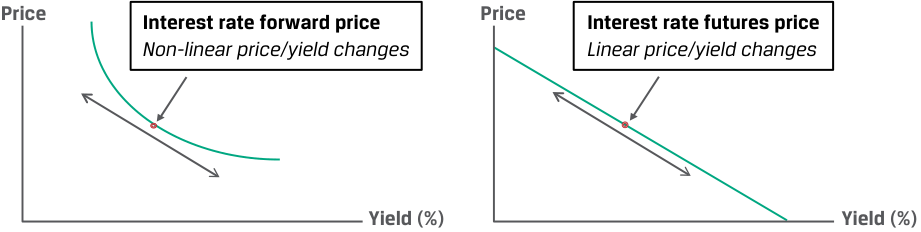
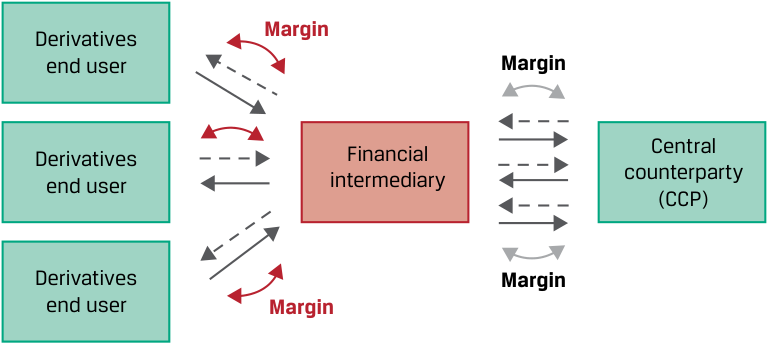

# Volume 7: Derivatives
## Learning Module 6 Pricing and Valuation of Futures Contracts
### Part 2/2: Effect of Central Clearing of OTC Derivatives (PDF Pages 151–156)

---

<!-- PDF Page 151 -->

**Exhibit 5: Convexity Bias** 

<!-- Start of picture text -->
Price Price Interest rate forward price Interest rate futures price Non-linear price/yield changes Linear price/yield changes Yield (%) Yield (%) <!-- End of picture text -->

The discounting feature of the FRA, which is not present in the futures contract, leads to a convexity bias that is greater for longer discounting periods. You will recall from an earlier lesson that a discount factor is the _price_ equivalent of a zero rate and is the present value of a currency unit on a future date, which may also be interpreted as the price of a zero-coupon cash flow or bond. We will show later how this discount factor is used to price interest rate swaps and other derivatives. 

#### **EFFECT OF CENTRAL CLEARING OF OTC DERIVATIVES** 

# **<mark>7</mark>** 

explain why forward and futures prices differ 

In periods of market and/or counterparty financial stress, large price movements combined with a derivative counterparty’s inability to meet a margin call may force the closeout of a futures transaction prior to maturity. An OTC forward contract with more flexible credit terms, however, may remain outstanding. 

The advent of derivatives central clearing, introduced in an earlier lesson, has created futures-like margining requirements for OTC derivative dealers who buy and sell forwards to derivatives end users. Dealers who are required to post cash or highly liquid securities to a central counterparty often impose similar requirements on derivatives end users. These dealer margin requirements reduce the difference in the cash flow impact of exchange-traded and OTC derivatives. This arrangement between dealers and their counterparties, shown in Exhibit 6, has been added to the original central clearing diagram from an earlier lesson. 

**Exhibit 6: Margin Requirements for Centrally Cleared OTC Derivatives** 

<!-- Start of picture text -->
Derivatives Margin end user Margin Derivatives Financial Central end user intermediary counterparty (CCP) Derivatives Margin end user Margin <!-- End of picture text -->

<!-- PDF Page 152 -->

Investors who actively use both exchange-traded futures or OTC forwards must therefore maintain sufficient cash or eligible collateral to fulfill margin or collateral requirements. Market participants must also consider the financing, transaction, and administrative costs of maintaining these positions when using derivatives in a portfolio. 

###### **QUESTION SET** 

##### **Forward and Futures Prices** 

1. Identify the following statement as true or false and justify your answer: If futures prices are positively correlated with interest rates, long futures contracts are more attractive than long forward positions for the same underlying and maturity. 

###### **Solution:** 

The statement is true. If futures contract prices rise as interest rates rise, a long futures contract holder can reinvest futures contract profits at higher interest rates. 

2. An investor seeks to hedge its three-month MRR exposure on a ₤25,000,000 liability in two months and observes an implied forward rate today (IFR2 _m_ ,3 _m_ ) of 2.95%. Calculate the settlement amounts if the investor enters a long pay-fixed (receive floating) FRA and a short futures contract, and compare and interpret the results if MRR2 _m_ ,3 _m_ settles at 3.25%. 

   - **Solution:** 

Solve for the pay-fixed FRA Cash Settlement (PV) value as follows: 

Net Payment = (MRR _B_ − _A_ – IFR _A_ , _B_ − _A_ ) × Notional Principal × Period 

= ₤18,750 (= [3.25% − 2.95%] × ₤25,000,000 × [1/4]). 

The present value based upon MRR2 _m_ ,5 _m_ of 3.25% is: 

= ₤18,598.88 (= ₤18,750 / [1 + 0.0325/4]). 

For the futures contract, contract BPV is equal to: 

Contract BPV = ₤625 (= ₤25,000,000 × 0.01% × [1/4]). 

For a 30-basis point increase in MRR (= 3.25% − 2.95%), the short futures contract will realize a price appreciation of ₤18,750 (= ₤625 × 30). Both contracts result in a gain from the investor’s perspective as MRR rises. However, the futures settlement is larger due to the discounting of the FRA final payment to the settlement date. 

3. Explain why short futures contracts are more attractive than short forward positions if futures prices are negatively correlated with interest rates for positions with the same underlying and maturity. 

###### **Solution:** 

The reason that short futures contracts are more attractive than short forward positions if futures prices are negatively correlated with interest rates is because falling prices lead to futures profits that are reinvested in periods of rising interest rates, and rising prices lead to losses that occur in periods of falling interest rates. 

<!-- PDF Page 153 -->

4. Identify the following statement as true or false and justify your answer: The convexity bias between interest rate futures and interest rate forwards causes the percentage price change to be greater (in absolute value) when MRR rises than when it falls for a forward than for a futures contract. **Solution:** 

The statement is false. The convexity bias between interest rate futures and interest rate forwards causes the percentage price change to be greater (in absolute value) when MRR _falls_ than when it _rises_ for a forward contract, as opposed to a futures contract. 

5. Explain how central clearing of derivatives reduces the difference in futures and forward prices for the same underlying and maturity periods. **Solution:** 

The central clearing of derivatives has created futures-like margining requirements for OTC derivative dealers who buy and sell forwards to derivatives end users. Dealers who are required to post cash or highly liquid securities to a central counterparty often impose similar requirements on derivatives end users. This arrangement between derivative dealers and their counterparties will reduce the difference in the cash flow impact of ETD and OTC derivatives. Hence, any price difference between ETD futures and OTC forwards will be reduced. 

<!-- PDF Page 154 -->

## **~~PRACTICE PROBLEMS~~** 

### **The following information relates to questions 1-4** 

Ace Limited is a financial intermediary active in both futures and forward markets. You have been hired as an investment consultant and asked to review Ace’s activities and answer the following questions. 

**1.** Ace serves as a futures commission merchant to assist several of its commodity trading adviser (CTA) clients to clear and settle their futures margin positions with the futures exchange. Ace is reviewing the copper futures market for a CTA client considering a long copper futures position for the first time. Details of the copper futures market are as follows: 

|**CME Copper Futures  i**|**Contract Specifications**|
|---|---|
|**Contract Maturities:**|Monthly [from 1 month to 15 months]|
|**Contract Size:**|25,000 pounds|
|**Delivery Type:**|Cash settled|
|**Price Quotation:**|$ per pound|
|**Initial Margin:**|$10,000 per contract|
|**Maintenance Margin:**|$6,000 per contract|
|**Final Maturity:**|Last CME business day of contract month|
|**Daily Settlement:**|CME Trading Operations calculates daily settlement values based on its published procedures|

Today’s copper spot price is $4.25 per pound, and the constant risk-free rate is 1.875%. Each contract has a $10 storage cost payable at the end of the month. Which of the following statements best characterizes the margin exposure profile of Ace’s CTA client if it enters a one-month copper futures contract? 

   - **A.** The CTA will be expected to post $10,000 initial margin and would receive a margin call if the copper futures price were to immediately fall below $4.10 per pound or below a price of $102,425 per contract. 

   - **B.** The CTA would be expected to post $10,000 in initial margin and would receive a margin call at any time over the life of the contract if the copper futures price were to immediately fall below $3.86 per pound or below a price of $96,425 per contract. 

   - **C.** The CTA will be expected to post $10,000 initial margin, but we cannot determine the exact futures price at which a margin call will occur as the futures MTM is settled each day and the contract value resets to zero. 

**2.** One of Ace’s investor clients has entered a long six-month forward transaction with Ace on 100 shares of Xenaliya (XLYA), a non-dividend-paying technology stock. The stock’s spot price per share, _S_ 0, is €85, and the risk-free rate is a constant 1% for all maturities. Ace has hedged the client transaction with a long 

<!-- PDF Page 155 -->

six-month XLYA futures contract at a price _f_ 0( _T_ ) of €85.42 and posted initial margin of €1,000. Three months after the forward and futures contracts are initiated, XYLA announces a strategic partnership with a major global technology firm, and its spot share price jumps €15 on the day’s trading to close at €123. Which of the following statements best characterizes the impact of the day’s trading on the MTM value of the forward versus the futures contract? 

- **A.** Ace’s client realizes an MTM gain of approximately €1,500 (= €15 × 100) on its margin account, which Ace must deposit at the end of the day to cover its margin call. 

- **B.** Ace’s client benefits from an MTM unrealized gain on its forward contract with Ace, and Ace has a corresponding MTM gain of approximately €1,500 (= €15 × 100) deposited in its margin account by the exchange. 

- **C.** Because Ace has entered a hedge of its client’s long forward position on XLYA by executing a futures contract with otherwise identical terms, the two contract MTM values exactly offset one another and no cash is exchanged on either transaction. 

**3.** Identify which of the following corresponds to which description. 

|1. Long interest rate futures position|A. Results in a gain when MRR settles above the initial forward commitment rate at maturity|
|---|---|
|2. Pay fixed (receive floating) FRA contract|B. Results in a loss when MRR settles above the initial forward commitment rate at maturity|
|3. Receive fixed (pay floating) FRA contract|C. Has a forward commitment price that will increase as short-term interest rates fall|

**4.** Ace’s investor clients usually use OTC forward transactions that Ace must clear with a central counterparty. Which of the following statements related to the impact on Ace from clearing these positions is most accurate? 

   - **A.** If Ace’s counterparties enter long forward contracts whose prices are positively correlated with interest rates, Ace will have to post more collateral to central counterparties than for otherwise similar futures contracts, since rising prices will lead to counterparty MTM gains reinvested at higher rates. 

   - **B.** If Ace’s counterparties enter short forward contracts whose prices are negatively correlated with interest rates, Ace will have to post less collateral to central counterparties than for otherwise similar futures contracts, since falling prices will lead to counterparty MTM gains reinvested at higher rates. 

   - **C.** Since Ace is required to post collateral (cash or highly liquid securities) to the central counterparty to clear its client forward transactions, Ace will face similar margining requirements to those of standardized exchange-traded futures markets. 

<!-- PDF Page 156 -->

## **~~SOLUTIONS~~** 

1. A is correct. The CTA will face a margin call if the copper contract price falls by more than $4,000, or $0.16 (= $4,000/25,000) per pound. We may solve for the price at which the CTA receives a margin call by first solving for the initial futures contract price, _f_ 0( _T_ ), at contract inception as follows: 

_f_ 0( _T_ ) = [ _S_ 0 + PV0( _C_ )] (1 + _r_ )_T_ . 

Solve for PV0( _C_ ) per pound as follows: 

PV0( _C_ ) = $9.98 (= $10[1.01875–(1/12) ]). 

Substitute PV0( _C_ ) = $9.98 into Equation 4 to solve for _f_ 0( _T_ ): 

_f_ 0( _T_ ) = [($4.25 × 25,000) + $9.98](1.01875-(1/12) ) 

_f_ 0( _T_ ) = $106,425 per contract (≈ $4.257 per pound). 

So, $106,425 − $4,000 = $102,425 per contract, and $4.257 − $0.16 = $4.10 per pound. 

B is incorrect as it assumes there is no maintenance margin, and while C may be true under some circumstances, the change in _A_ is immediate (occurs at trade inception). 

2. B is correct. The long investor client forward position with Ace benefits from an MTM gain on its forward contract with Ace, but no cash is exchanged until maturity. Ace receives a deposit in its futures margin account equal to the daily MTM futures contract gain, which if spot and futures prices change by approximately the same amount will be equal to €1,500 (€15 × 100). 

3. 1. C is correct. The futures contract price changes daily based upon a (yield − 100) quoting convention, so its price will increase as yields fall and vice versa. The fixed rate on an FRA does not change for the life of the contract. 2. A is correct. An FRA fixed-rate payer (floating-rate receiver) will realize a gain on the contract upon settlement (equal to the present value of the difference between the fixed rate and MRR multiplied by the contract notional over the specified interest period) if MRR settles above the initial fixed rate on the contract. 3. B is correct. If the MRR settles above the initial forward commitment rate at maturity, the FRA fixed-rate payer has an MTM loss on the contract. 

4. C is correct. Mandatory central clearing requirements impose margin requirements on financial intermediaries similar to those of standardized exchange-traded futures markets, who often pass these costs and/or requirements on to their clients. Answers A and B are incorrect, as the MTM gains on the forward contracts are not realized until maturity. 

