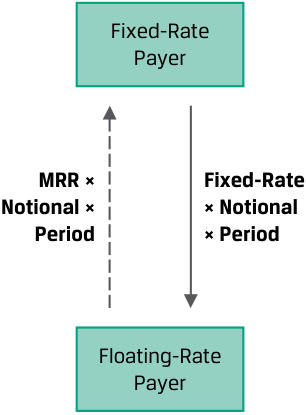
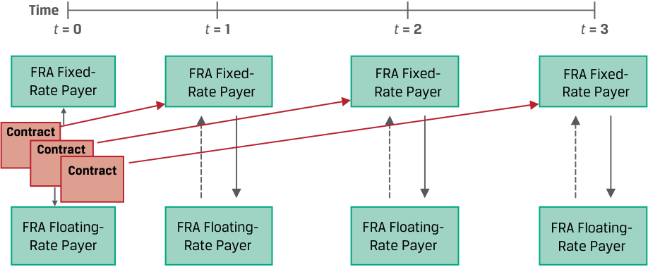
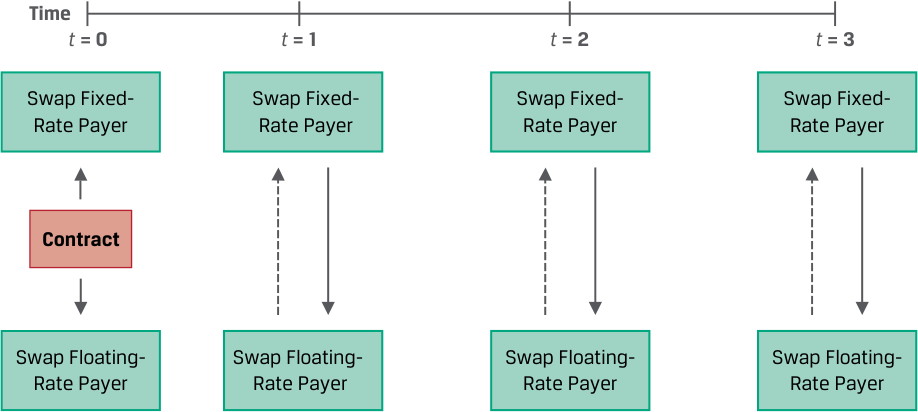
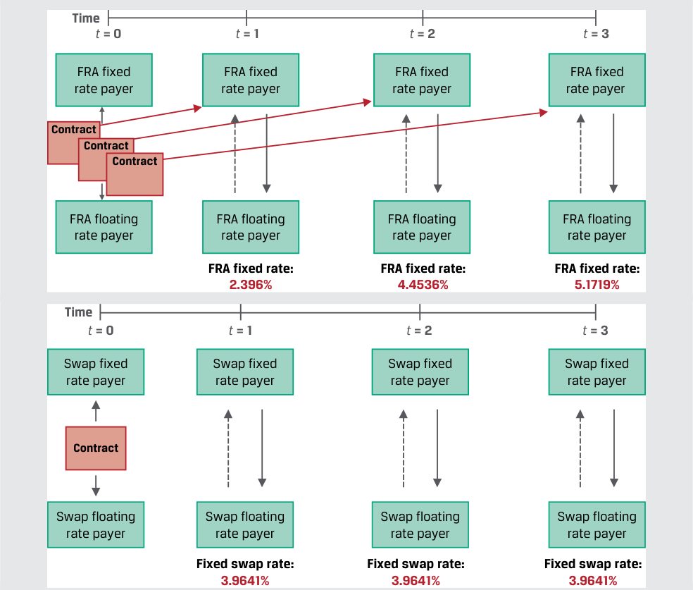
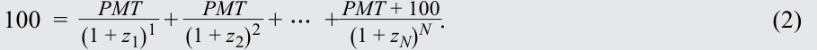
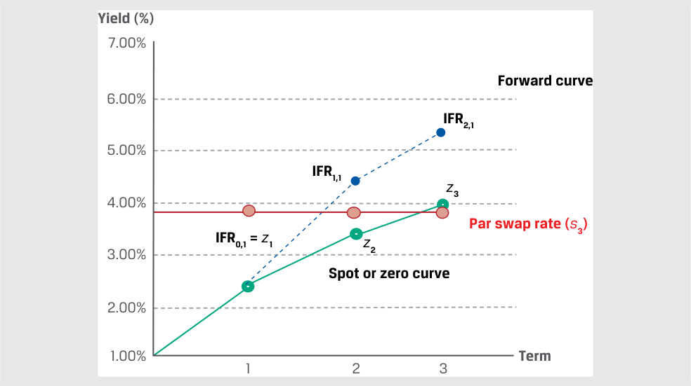
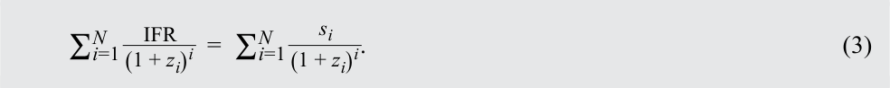
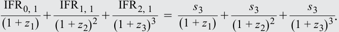

# Volume 7: Derivatives
## Learning Module 7 Pricing and Valuation of Interest Rates and Other Swaps
### Part 1/2: Introduction (PDF Pages 157–166)

---

<!-- PDF Page 157 -->

#### L E A R N I N G M O D U L E 

# **<mark>7</mark>** 

### **Pricing and Valuation of Interest Rates and Other Swaps** 

###### **<mark>LEARNING OUTCOMES</mark>** 

|**_Mastery_** **_The candidate should be able to:_**|
|---|

describe how swap contracts are similar to but different from a series of forward contracts contrast the value and price of swaps 

##### **INTRODUCTION** 

## **<mark>1</mark>** 

Swap contracts were introduced earlier as a firm commitment to exchange a series of cash flows in the future, with interest rate swaps where fixed cash flows are exchanged for floating payments being the most common type. Subsequent lessons addressed the pricing and valuation of forward and futures contracts across the term structure, which form the building blocks for swap contracts. 

In this lesson, we will explore how swap contracts are related to these other forward commitment types. While financial intermediaries often use forward rate agreements or short-term interest rate futures contracts to manage interest rate exposure, issuers and investors usually prefer swap contracts, since they better match rate-sensitive assets and liabilities with periodic cash flows, such as fixed-coupon bonds, variable-rate loans, or known future commitments. It is important for these market participants not only to be able to match expected future cash flows using swaps but also to ensure that their change in value is consistent with existing or desired underlying exposures. The following lessons compare swap contracts with forward contracts and contrast the value and price of swaps. 

###### **LEARNING MODULE OVERVIEW** 

- A swap contract is an agreement between two counterparties to exchange a _series_ of future cash flows, whereas a forward contract is a _single_ exchange of value at a later date. 

<!-- PDF Page 158 -->

- Interest rate swaps are similar to forwards in that both contracts are firm commitments with symmetric payoff profiles and no cash is exchanged at inception, but they differ in that the fixed swap rate is constant, whereas a series of forward contracts has different forward rates at each maturity. 

- A swap is priced by solving for the par swap rate, a fixed rate that sets the present value of all future expected floating cash flows equal to the present value of all future fixed cash flows. 

- The value of a swap at inception is zero (ignoring transaction and counterparty credit costs). On any settlement date, the value of a swap equals the current settlement value plus the present value of all remaining future swap settlements. 

- A swap contract’s value changes as time passes and interest rates change. For example, a rise in expected forward rates increases the present value of floating payments, causing a mark-to-market (MTM) gain for the fixed-rate payer (floating-rate receiver) and an MTM loss for the fixed-rate receiver (floating-rate payer). 

###### **LEARNING MODULE SELF-ASSESSMENT** 

These initial questions are intended to help you gauge your current level of understanding of this learning module. 

1. Identify which of the following characteristics matches which forward commitment contract. 

1. Involves periodic settlements based A. Both an interest rate swap and a series on the difference between a fixed of forward rate agreements rate established for each period and market reference rate (MRR) 

2. Has a symmetric payoff profile and B. A series of forward rate agreements a value of zero to both counterparties (FRAs) at inception 

3. Involves periodic settlements based on the difference between a constant fixed rate and the MRR 

C. Interest rate swap 

###### **Solution:** 

   **1.** B is correct. A series of FRAs involves periodic settlements based on the difference between a fixed rate established for each period and the MRR. 

   **2.** A is correct. Both an interest rate swap and a series of forward rate agreements have a symmetric payoff profile and a value of zero to both counterparties at inception. 

   **3.** C is correct. An interest rate swap involves periodic settlements based on the difference between a constant fixed rate and the MRR. 

2. Which of the following transactions would allow a fixed-income portfolio manager to gain from falling interest rates? 

   - **A.** Buy a floating-rate bond 

   - **B.** Enter into a receive-fixed, <u>pay-floating interest rate swap</u> 

<!-- PDF Page 159 -->

|**C.**Enter into a pay-fixed, receive-floating interest rate swap **Solution:** B is correct. A fixed-income portfolio manager seeking to gain from falling interest rates may consider entering a_receive_-fixed,_pay_-floating interest rate swap rather than purchasing bonds. The fixed-rate payments become more valuable as interest rates decline A is incorrect as the floating-rate bond in- terest rate payments decline as interest rates decline, thus the bond does not increase in value. C is incorrect as the fixed interest rate payments become more costly as interest rates decline.|
|---|
|3. Which of the following statements provides a correct description of a pay- fixed, receive-floating interest rate swap position?|
|**A.**Long a floating-rate note priced at the MRR and short a fixed-rate bond with a coupon equal to the fixed swap rate **B.**Long a fixed-rate bond with a coupon equal to the fixed swap rate and short a floating-rate note priced at the MRR **C.**Long a floating-rate note priced at the MRR **Solution:** A is correct. An interest rate swap is economically equivalent to a long and short position in underlying debt securities. In the case of a pay-fixed, receive-floating swap, the cash flow received reflects the long position. In this case, the party receives floating payments, so this is like buying a floating-rate note. The pay-fixed portion of the swap is like selling a fixed- rate bond and paying fixed coupons to the bond buyer. B is incorrect as this response is economically equivalent to entering into a receive-fixed, pay-floating swap. C is incorrect because the response does not reflect the short position.|
|4. An investor enters into a 10-year, pay-fixed EUR100 million swap at a rate of 1.12% versus six-month EUR MRR. Assume six-month EUR MRR sets today at 0.25%. Which of the following is closest to the correct calculation of the periodic settlement value of the swap from the investor’s perspective in six months’ time? **A.**EUR870,000 **B.**–EUR870,000 **C.**–EUR435,000 **Solution:** C is correct. From the investor’s (fixed-rate payer’s) perspective, the periodic settlement value of the swap is equal to Periodic settlement value = (MRR –_sN_) × Notional amount × Period = –EUR435,000 = (0.25% – 1.12%) × EUR100 million × 0.5 years. Since EUR MRR has set below the fixed swap rate, the fixed-rate payer must make a net payment to the fixed-rate receiver at the end of the interest period. Both A and B responses omit the period of the swap (0.5 years) so are incorrect. A is also incorrect because the reversed sign on the answer would properly reflect the counterparty’s periodic settlement value, not the investor’s.|

<!-- PDF Page 160 -->

## **<mark>2</mark>** 

##### **SWAPS VS. FORWARDS** 

describe how swap contracts are similar to but different from a series of forward contracts 

A swap contract is an agreement between two parties to exchange a _series_ of future cash flows, while a forward contract is an agreement for a _single_ exchange of value at a later date. Although this lesson focuses on interest rate swaps, similar principles apply to other underlying variables where a series of cash flows are exchanged on a future date. 

An earlier lesson showed how implied forward rates may be derived from spot rates. An implied forward rate for a given period in the future is equivalent to the forward rate agreement (FRA) fixed rate for that same period for which no riskless profit opportunities exist. The single cash flow of an FRA is similar to a single-period swap, as shown in Exhibit 1. 

###### **Exhibit 1: Swap and FRA Payoff Profile** 

<!-- Start of picture text -->
Fixed-Rate Payer MRR × Fixed-Rate Notional × × Notional Period × Period Floating-Rate Payer <!-- End of picture text -->

In each case, the net difference between a fixed rate agreed on at inception and an MRR set in the future is used as the basis for determining cash settlement on a given notional principal over a specific time period. For example, a fixed-rate payer on a swap or FRA will realize a gain if the MRR sets at a rate higher than the agreed-on fixed rate and will receive a net payment from the floating-rate payer. However, as we saw in an earlier lesson, the FRA has a single settlement, which occurs at the _beginning_ of an interest period, while a standard swap has periodic settlements, which occur at the _end_ of each respective period. 

Other similarities between interest rate forwards and swaps include the symmetric payoff profile and the fact that no cash flow is exchanged upfront. Both interest rate forward and swap contracts involve counterparty credit exposure. 

Since interest rates are characterized by a term structure, different FRA fixed rates usually exist for different times to maturity. In contrast, a standard interest rate swap has a _constant_ fixed rate over its life, which includes multiple periods. This relationship is shown visually in Exhibit 2 and numerically in Example 1, which extends an earlier spot and forward rate example. 

<!-- PDF Page 161 -->

**Exhibit 2: Series of FRAs vs. Standard Interest Rate Swap** 

###### **Series of Forward Rate Agreements (at Different Fixed Rates)** 

<!-- Start of picture text -->
Time t  = 0 t  = 1 t  = 2 t  = 3 FRA Fixed- FRA Fixed- FRA Fixed- FRA Fixed- Rate Payer Rate Payer Rate Payer Rate Payer Contract Contract Contract FRA Floating- FRA Floating- FRA Floating- FRA Floating- Rate Payer Rate Payer Rate Payer Rate Payer <!-- End of picture text -->

###### **Standard Interest Rate Swap (At A Constant Fixed Rate)** 

<!-- Start of picture text -->
Time t  = 0 t  = 1 t  = 2 t  = 3 Swap Fixed- Swap Fixed- Swap Fixed- Swap Fixed- Rate Payer Rate Payer Rate Payer Rate Payer Contract Swap Floating- Swap Floating-  Swap Floating- Swap Floating- Rate Payer Rate Payer Rate Payer Rate Payer <!-- End of picture text -->

###### **EXAMPLE 1** 

###### **Swaps as a Combination of Forwards** 

Recall from an earlier lesson that three recently issued annual fixed-coupon government bonds had the following coupons, prices, yields-to-maturity, and zero (or spot) rates: 

|**Years to** **Maturity**|**Annual Coupon**|**PV (per 100 FV)**|**YTM**|**Zero Rates**|
|---|---|---|---|---|
|1|1.50%|99.125|2.3960%|2.3960%|
|2|2.50%|98.275|3.4068%|3.4197%|
|3|3.25%|98.000|3.9703%|4.0005%|

We solve for the implied forward rate (IFR _A_ , _B_ – _A_ ), the break-even reinvestment rate for a period starting in the future (at _t_ = _A_ ) between short-dated ( _zA_ ) and longer-dated ( _zB_ ) zero rate using the following formula: 

(1 + _zA_ )_A_ × (1 + IFR _A_ , _B_ – _A_ )_B_–_A_ = (1 + _zB_ )_B_ . (1) 

The respective spot rate at time _t_ = 0 (IFR0,1) and the implied forward rates in one year (IFR1,1) and in two years (IFR2,1) are as follows: 

<!-- PDF Page 162 -->

IFR0,1 = 2.3960% = (1.023960) – 1. 

IFR1,1 = 4.4536% = (1.034197)2 /(1.02396) – 1. 

IFR2,1 = 5.1719% = (1.040005)3 /(1.034197)2 – 1. 

One way to create a forward commitment for multiple periods with an initial value of zero would be to use a series of forward rate agreements, exchanging cash flows based on the respective implied forward rate (i.e., the FRA fixed rate) for each period. However, the fixed rate would _vary_ for each period based on the term structure of interest rates. Instead, a standard interest rate swap is characterized by a _constant_ fixed rate over multiple periods. These rates are shown for both alternatives below. 

<!-- Start of picture text -->
Time t  = 0 t  = 1 t  = 2 t  = 3 FRA fixed FRA fixed FRA fixed FRA fixed rate payer rate payer rate payer rate payer Contract Contract Contract FRA floating FRA floating FRA floating FRA floating rate payer rate payer rate payer rate payer FRA fixed rate: FRA fixed rate: FRA fixed rate: 2.396% 4.4536% 5.1719% Time t  = 0 t  = 1 t  = 2 t  = 3 Swap fixed Swap fixed Swap fixed Swap fixed rate payer rate payer rate payer rate payer Contract Swap floating Swap floating Swap floating Swap floating rate payer rate payer rate payer rate payer Fixed swap rate: Fixed swap rate: Fixed swap rate: 3.9641% 3.9641% 3.9641% <!-- End of picture text -->

The method used to solve for a swap rate was introduced in an earlier fixed-income lesson. The _par rate_ (PMT) was shown to be the fixed rate at which a fixed-coupon bond has a price equal to par (or 100) using a sequence of zero rates ( _zi_ for period _i_ ) as market discount factors, as follows: 

<!-- Formula Text: 100  =    PMT _ (1 + z 1) 1  +   PMT _ (1 + z 2) 2  + ⋯  +  PMT + 100 _ (1 + z N) N . (2) -->

A standard interest rate swap represents an exchange of fixed payments (with _no_ final principal payment) at a constant rate for a series of floating-rate cash flows expected to equal the respective implied forward rates at time _t_ = 0. We must therefore modify the par bond rate calculation in Equation 2 to solve for PMT as a **par swap rate.** 

<!-- PDF Page 163 -->

###### **Exhibit 3: Par Swap Rate, Spot, and Forward Curve** 

<!-- Start of picture text -->
Yield (%) 7.00% Forward curve 6.00% IFR2,1 5.00% IFR1,1 z 3 4.00% Par swap rate ( s 3) IFR0,1 =  z 1 z 2 3.00% Spot or zero curve 2.00% 1.00% Term 1 2 3 <!-- End of picture text -->

The par swap rate is the fixed rate that equates the present value of all future expected floating cash flows to the present value of fixed cash flows. 

Σ PV(Floating payments) = Σ PV(Fixed payments), or 

<!-- Formula Text: ∑ i=1 N     IFR _ (1 + z i) i   =  ∑ i=1 N s i _ (1 + z i) i . (3) -->

In our three-period example, we use the implied forward rates, IFR, to solve for _s_ 3, or the three-year swap rate: 

<!-- Formula Text: IFR 0, 1 _ (1 + z 1)  + IFR 1, 1 _ (1 + z 2) 2  + IFR 2, 1 _ (1 + z 3) 3   = s 3 _ (1 + z 1)  + s 3 _ (1 + z 2) 2  + s 3 _ (1 + z 3) 3 . -->

Substitute each of these building blocks into Equation 3 to solve for _s_ 3: 

<mark>_ _ _</mark> 0.111017 =  1.023962.396%+  ( 1.0341974.4537%)2+  ( 1.0400055.1719%)3 = <mark>_</mark> 1.02396 _s_ 3+ <mark>_</mark>( 1.034197 _s_ 3)2+ <mark>_</mark>( 1.040005 _s_ 3)3 0.111017 = 2.800545 × _s_ 3. _s_ 3 = 3.9641%. 

The three-year swap rate of 3.9641% may be interpreted as a multiperiod breakeven rate at which an investor would be indifferent to 

- _paying_ the fixed swap rate and _receiving_ the respective forward rates or 

- _receiving_ the fixed swap rate and _paying_ the respective forward rates. 

For this reason, we may think of the fixed swap rate as an internal rate of return on the implied forward rates through the maturity of the swap as of _t_ = 0. Exhibit 3 also demonstrates that while the combined value of the equivalent forward contracts is zero at time _t_ = 0, some individual forward exchanges may have a positive present value and some will have a negative present value. For example, a fixed-rate receiver (floating-rate payer) on the swap in Example 1 would expect the following cash flow in one year’s time: 

- _Receive_ the fixed swap rate ( _s_ 3) of 3.9641%. 

- _Pay_ the initial floating rate (IFR0,1) of 2.396%. 

<!-- PDF Page 164 -->

- _Receive_ a net payment of 1.5681% (= 3.9641% – 2.396%) on the notional for the period. 

Derivative end users, such as issuers and investors, tend to use swaps more often than individual interest rate forward contracts for a number of reasons. For example, the ability to match cash flows of underlying assets or liabilities allows issuers to transform their exposure profile as in Example 2. 

###### **EXAMPLE 2** 

###### **Esterr Inc. Swap to Fixed** 

Recall from an earlier lesson that Esterr Inc. has a CAD250 million floating-rate term loan at three-month Canadian MRR plus 150 basis points with three and a half years to maturity paid quarterly. Esterr enters into a CAD250 million interest rate swap contract to pay a fixed quarterly swap rate of 2.05% and receive a three-month floating MRR on a notional principal of CAD250 million based on payment dates that match the term loan. The combined loan and swap exposure may be shown as follows: 

<!-- Start of picture text -->
Loan market 3-month MRR + 150 bps p.a. Esterr Inc. Fixed swap 3-month rate 2.05% MRR Financial intermediary <!-- End of picture text -->

Under the swap arrangement, Esterr can fix its interest expense for the term loan and avoids the administrative burden of multiple forward contracts at different forward rates. Consider the following cash flow scenarios on the interest rate swap and term loan (assuming each interest period is 0.25 year): 

###### **Scenario 1:** 

CAD MRR sets at 3.75%. As the fixed-rate payer, Esterr 

- pays the fixed swap rate of 2.05% and receives CAD MRR of 3.75%, 

- _receives_ a _net_ swap payment of 1.70% for the quarter, and 

- makes a term loan payment of 5.25% (= 3.75% + 1.50%). 

Esterr’s interest expense is 3.55% (= 5.25% paid – 1.70% received). 

###### **Scenario 2:** 

CAD MRR sets at 1.25%. As the fixed-rate payer, Esterr 

- pays the fixed swap rate of 2.05% and receives CAD MRR of 1.25%, 

- _pays_ a _net_ swap payment of 0.80% for the quarter, and 

<!-- PDF Page 165 -->

■ makes a term loan payment of 2.75% (= 1.25% + 1.50%). 

Esterr’s interest expense is 3.55% (= 2.75% paid + 0.80% paid). Regardless of where CAD MRR sets each period, Esterr’s interest expense for each quarterly interest period is approximately CAD2,218,750 (= 3.55%, [equal to the 2.05% swap rate + 1.50% loan spread] × CAD250 million × 0.25 year). 

As a fixed-income instrument with periodic fixed cash flows through maturity, an interest rate swap should be expected to have risk and return features similar to those of a fixed-coupon bond of a similar maturity. This feature makes interest rate swaps a more attractive alternative to forward rate agreements for investors in managing fixed-income exposures as well. Consider the following comparison of a cash bond position to paying or receiving a fixed swap rate: 

**Exhibit 4: Using Swaps to Manage Fixed-Income Exposure** 

<!-- Start of picture text -->
Fixed-Rate Payer ( Short Bond Position ) Fixed Swap MRR Rate Floating-Rate Payer ( Long Bond Position ) <!-- End of picture text -->

|**Instrument**|**Position** |**Higher interest** **rates**|**Lower interest rates**|
|---|---|---|---|
|**Cash bond**|Long fixed bond Short floating-rate note|Loss|Gain|
|**Interest rate** **swap**|l Receive fixed Pay floating|Loss|Gain|
|**Cash bond**|l Short fixed bond Long floating-rate note|Gain|Loss|
|**Interest rate** **swap**|l Pay fixed Receive floating|Gain|Loss|

While the next lesson will explore the value and price of interest rate swaps in greater detail, Exhibit 4 demonstrates the similarity between a long (short) bond position and a receive (pay) fixed interest rate swap. Given their greater liquidity than and similar benchmark exposure profile to individual bond positions, active fixed-income portfolio managers often use swaps rather than underlying securities to adjust their interest rate exposure. For example, if interest rates are expected to fall, a portfolio manager may choose to receive fixed on a swap rather than purchase underlying bonds to realize a gain in a lower rate environment. 

<!-- PDF Page 166 -->

As mentioned earlier, FRAs are primarily used by financial intermediaries to manage their rate-sensitive positions on a period-by-period basis. Issuers and investors typically opt for the greater efficiency of interest rate swaps to manage their interest rate exposures. As we will see in later lessons, the greater liquidity of interest rate swaps has also led to their use both as a bond pricing benchmark and an underlying variable for other derivative instruments. 

###### **QUESTION SET** 

###### **Interest Rate Swaps vs. Forward Contracts** 

1. Determine the correct answers to fill in the blanks: A fixed-rate payer on a swap or FRA will realize a(n) ______ if the MRR sets at a rate higher than the agreed-on fixed rate and will ______ a net payment ______ the floating-rate payer. 

###### **Solution:** 

A fixed-rate payer on a swap or FRA will realize a _gain_ if the MRR sets at a rate higher than the agreed-on fixed rate and will _receive_ a net payment _from_ the floating-rate payer. 

2. Identify which of the following characteristics matches which forward commitment contract. 

1. The price of this contract is the implied forward A. Interest rate swap rate, or the breakeven reinvestment rate, for a period starting in the future. 

2. Involves counterparty credit risk 

B. Forward rate agreement 

3. Has a constant fixed rate for which the presC. Both an interest rate ent value of future fixed versus floating cash flow swap and an interest rate exchanges is equal to zero forward contract 

###### **Solution:** 

**1.** B is correct. The breakeven reinvestment rate, or implied forward rate, is the no-arbitrage FRA fixed rate. 

**2.** C is correct. Both an interest rate swap and a forward rate agreement involve counterparty credit risk. 

**3.** A is correct. An interest rate swap has a constant fixed rate for which the present value of fixed versus floating cash flow exchanges equals zero. 

