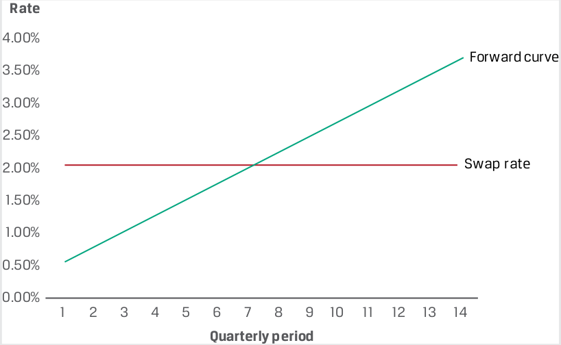
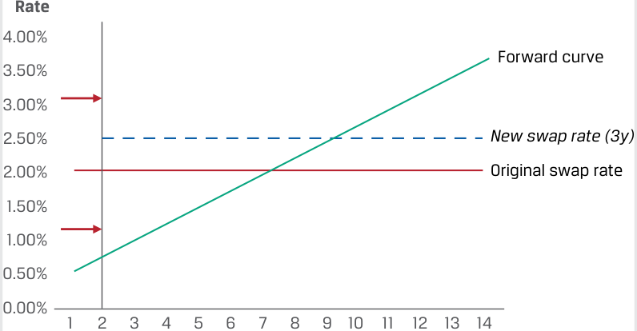
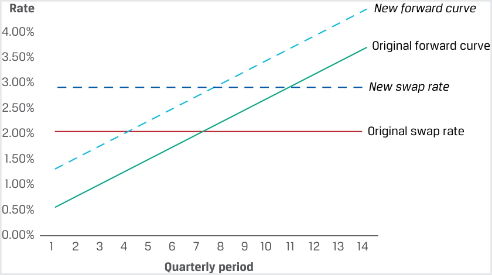
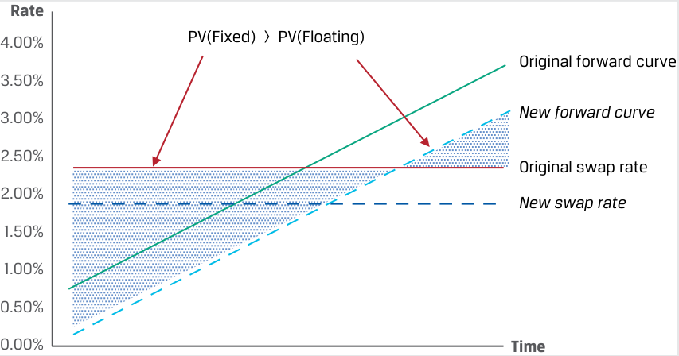
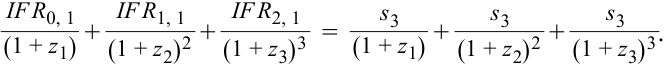
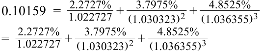
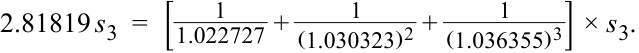

# Volume 7: Derivatives
## Learning Module 7 Pricing and Valuation of Interest Rates and Other Swaps
### Part 2/2: Swap Values and Prices (PDF Pages 167–178)

---

<!-- PDF Page 167 -->

3. Identify which of the following benefits of using swaps over forwards are most applicable to which derivative end users. 

1. Swaps allow these end users to match the periA. Both issuers and odic cash flows of a specific balance sheet liability to investors transform their interest rate exposure profile. 2. Swaps enable these end users to actively adjust B. Issuers their interest rate exposure profile without buying or selling underlying securities 3. Swaps involving a series of cash flows enable C. Investors these end users to avoid the administrative burden of entering into and managing multiple forward contracts. **Solution: 1.** B is correct. Swaps allow issuers to match the periodic cash flows of a specific balance sheet liability to transform their interest rate exposure profile, as shown in Example 2. 

**2.** C is correct. Swaps enable investors to actively adjust their interest rate exposure profile without buying or selling underlying securities. 

**3.** A is correct. Both issuers and investors benefit from a reduced administrative burden of entering one interest rate swap for a series of cash flows rather than multiple individual forward contracts. 

4. Identify the following statement as true or false, and justify your response: The market reference rate (MRR) is the internal rate of return on the implied forward rates over the life of an interest rate swap. **Solution:** False. The fixed swap rate is the internal rate of return on the implied forward rates over the life of an interest rate swap. 

5. Explain how an active fixed-income portfolio manager might use an interest rate swap rather than underlying bonds to realize a gain in a lower–interest rate environment, and justify your response. **Solution:** A manager may choose to receive fixed, pay floating on an interest rate swap, with the fixed cash flow stream being similar to owning a fixed-coupon bond. If interest rates are expected to fall, the manager will realize an MTM gain in a lower-rate environment. 

#### **SWAP VALUES AND PRICES** 

# **<mark>3</mark>** 

contrast the value and price of swaps 

In the prior lesson, we showed a swap price (or par swap rate) to be a periodic fixed rate that equates the present value of all future expected floating cash flows to the present value of fixed cash flows. The swap rate ( _sN_ for _N_ periods) is equivalent to a 

<!-- PDF Page 168 -->

forward rate, _F_ 0( _T_ ), that satisfies the no-arbitrage condition. Similar to other forwards, the initial contract value (ignoring transaction and counterparty credit costs) is zero ( _V_ 0( _T_ ) = 0). 

In contrast to other forward commitments, which involve a _single_ settlement at maturity, a swap contract involves a _series_ of periodic settlements with a final settlement at contract maturity. Recall from an earlier lesson that the value of a forward contract at maturity from the long forward (or forward buyer’s) perspective is _VT_ ( _T_ ) = _ST_ – _F_ 0( _T_ ), where _ST_ is the spot price at maturity and _F_ 0( _T_ ) is the forward price. For a swap with periodic exchanges, the current MRR is the “spot” price and the fixed swap rate, _sN_ , is the forward price. Restating this result for the fixed-rate payer on a swap, the periodic settlement value is 

Periodic settlement value = (MRR – _sN_ ) × Notional amount × Period. ~~(4)~~ 

The value of a swap on any settlement date equals the current settlement value in Equation 4 _plus_ the present value of all remaining future swap settlements. Although swap market conventions vary, for purposes of this lesson we will assume the MRR sets at the beginning of each interest period, with the same periodicity and day count convention as the swap rate. The fixed versus floating difference is exchanged at the end of each period. 

###### **EXAMPLE 3** 

##### **Esterr Inc. Swap Value and Price** 

Esterr entered a 3.5-year CAD250 million interest rate swap contract under which it pays a fixed quarterly swap rate of 2.05% and receives three-month CAD MRR. The fixed swap _price_ of 2.05% paid by Esterr remains constant over the life of the contract. While the first three-month CAD MRR is _known_ at _t_ = 0, the remaining 13 MRR settings are _unknown_ but are _expected_ to equal the respective implied forward rates (IFRs) for each period through maturity. A prior lesson showed how IFRs are derived from zero rates, which were then used to solve for the fixed swap rate by setting the present value of fixed payments equal to the present value of floating payments. 

The _value_ of Esterr’s swap contract will change as time passes and interest rates change. We first consider the passage of time with no change to expected interest rates. That is, the MRR sets each period based on the implied forward rates at trade inception. Assume the following implied forward rates apply to Esterr’s swap at _t_ = 0: 

|**Period**|**IFR**|**Rate**|
|---|---|---|
|1|IFR0,3_m_|0.50%|
|2|IFR3_m_,3_m_|0.74%|
|3|IFR6_m_,3_m_|0.98%|
|4|IFR9_m_,3_m_|1.22%|
|5|IFR12_m_,3_m_|1.46%|
|6|IFR15_m_,3_m_|1.70%|
|7|IFR18_m_,3_m_|1.94%|
|8|IFR21_m_,3_m_|2.18%|
|9|IFR24_m_,3_m_|2.43%|
|10|IFR27_m_,3_m_|2.67%|
|11|IFR30_m_,3_m_|2.91%|
|12|IFR33_m_,3_m_|3.15%|

<!-- PDF Page 169 -->

|**Period**|**IFR**|**Rate**|
|---|---|---|
|13|IFR36_m_,3_m_|3.39%|
|14|IFR39_m_,3_m_|3.78%|

Based on these forward rates, Esterr expects to _make_ a net swap payment each quarter through the seventh period—since (MRR – _sN_ ) = (1.94% – 2.05%) < 0—and _receive_ a net quarterly swap payment starting in the eighth period, where (MRR – _sN_ ) = (2.18% – 2.05%) > 0. Using Equation 1, consider the periodic settlement values for the first two periods from Esterr’s perspective as the fixed-rate payer: 

- **Period 1:** –CAD968,750 = (0.5% – 2.05%) × CAD250 million × 0.25. 

- **Period 2:** –CAD818,750 = (0.74% – 2.05%) × CAD250 million × 0.25. 

What is the swap MTM _value_ from Esterr’s perspective immediately after the second periodic settlement if forward rates remain unchanged? Note that the swap _price_ (the fixed swap rate of 2.05%) was set at inception to equate the present value of fixed versus floating payments. 

<!-- Start of picture text -->
Rate 4.00% Forward curve 3.50% 3.00% 2.50% 2.00% Swap  rate 1.50% 1.00% 0.50% 0.00% 1 2 3 4 5 6 7 8 9 10 11 12 13 14 Quarterly period <!-- End of picture text -->

As we move forward in time with _no_ change to interest rate expectations, the present value of remaining floating payments rises above the present value of fixed payments at 2.05%, as Esterr has made a net settlement payment in the first two periods. 

<!-- Start of picture text -->
Rate 4.00% Forward curve 3.50% 3.00% 2.50% New swap rate (3y) 2.00% Original swap rate 1.50% 1.00% 0.50% 0.00% 1 2 3 4 5 6 7 8 9 10 11 12 13 14 <!-- End of picture text -->

###### **Quarterly period** 

As the diagram shows, as time progresses, Esterr realizes an MTM gain on the swap, since 

<!-- PDF Page 170 -->

###### Σ PV(Floating payments received) > Σ PV(Fixed payments paid). 

Note that this result depends on the relative level of IFRs and shape of the forward curve, which in this case is upward sloping. 

If we instead consider interest rate changes only, from Esterr’s perspective as the fixed-rate payer (and floating-rate receiver), we can show the conditions under which Esterr has a swap MTM gain or loss: 

- Esterr realizes an MTM _gain_ on the swap as the fixed-rate payer if 

- Σ PV(Floating payments received) > Σ PV(Fixed payments paid). 

- Esterr realizes an MTM _loss_ on the swap as the fixed-rate payer if 

Σ PV(Floating payments received) < Σ PV(Fixed payments paid). 

A rise in the expected forward rates after inception will increase the present value of floating payments, while the fixed swap rate will remain the same. We show the effect of an immediate change in interest rates following trade inception in the following diagram: 

<!-- Start of picture text -->
Rate New forward curve 4.00% Original forward curve 3.50% 3.00% New swap rate 2.50% 2.00% Original swap rate 1.50% 1.00% 0.50% 0.00% 1 2 3 4 5 6 7 8 9 10 11 12 13 14 Quarterly period <!-- End of picture text -->

The new forward curve in this diagram is composed of higher IFRs. If we were to now solve for a fixed swap rate using these higher IFRs by setting floating and fixed cash flows equal to one another, the new swap rate would be above the original swap rate. However, since Esterr has locked in future fixed payments at the _lower_ original swap rate while receiving higher expected future MRRs, the swap has a positive MTM value to Esterr. 

Another interpretation of an interest rate swap is that the fixed-rate payer (floating-rate receiver) is _long_ a floating-rate note (FRN) priced at the MRR and _short_ a fixed-rate bond with a coupon equal to the fixed swap rate. Note that the combination of long and short bond positions causes both the purchase and sale prices of the two bonds at inception and the return of principal at maturity cancel one another out, and only the fixed versus variable coupon payments remain. The following example shows how the change in an interest rate swap’s value is similar to that of a fixed-income security using an earlier investor swap example. 

###### **EXAMPLE 4** 

##### **Fyleton Investments** 

Fyleton Investments entered a five-year, receive-fixed GBP200 million interest rate swap in an example from an earlier lesson to increase the duration of its fixed-income portfolio. Assume in this case that Fyleton receives a fixed swap 

<!-- PDF Page 171 -->

rate of 2.38% on a semiannual basis versus six-month GBP MRR. Further assume that initial six-month GBP MRR sets at 0.71% and, as in the case of Esterr, the MRR forward curve is upward sloping. How will the value of Fyleton’s swap change as time passes and interest rates change? 

First, consider the passage of time with no rate changes. The first-p ~~e~~ riod swap settlement value (in six months) from Fyleton’s perspective as the fixedrate receiver is 

GBP1,670,000 = (2.38% – 0.71%) × GBP200 million × 0.5. 

What is the MTM value from Fyleton’s perspective immediately following the first settlement if implied forward rates remain the same as at trade inception? 

As the fixed-rate _receiver_ , Fyleton will realize an MTM _loss_ on the swap, since 

Σ PV(Floating payments paid) > Σ PV(Fixed payments received). 

Second, consider a change in forward rates. A _decline_ in expected forward rates immediately following trade inception will _reduce_ the present value of floating payments, while the fixed swap rate will remain the same. Fyleton will realize an MTM gain as the fixed-rate receiver, since 

###### Σ PV(Fixed payments received) > Σ PV(Floating payments paid). 

This MTM gain is shown by the different size of the shaded areas under the original swap rate using the new forward curve in the following diagram. 

<!-- Start of picture text -->
Rate 4.00% PV(Fixed)  >  PV(Floating) Original forward curve 3.50% 3.00% New forward curve 2.50% Original swap rate 2.00% New swap rate 1.50% 1.00% 0.50% 0.00% Time <!-- End of picture text -->

Note the similarity between the receive-fixed swap exposure profile and that of a long cash fixed-rate bond position. In the first instance, we would expect a fixed-rate par bond to be priced at a _discount_ as time passes if rates rise as per an upward-sloping forward curve, while an FRN priced at the MRR would remain at par. In the second instance, a decline in implied forward rates (or downward shift in the forward curve) would cause a fixed-rate par bond to be priced at a _premium_ , while the FRN price would not change. We will explore how term structure and yield curve changes affect swap values and bond prices in greater detail later in the curriculum. 

<!-- PDF Page 172 -->

###### **QUESTION SET** 

##### **Swap Prices and Values** 

1. Determine the correct answers to fill in the blanks: A rise in the expected forward rates after inception will ______ the present value of floating payments, causing a fixed-rate receiver to realize a(n) ______ in MTM value on the swap contract. 

###### **Solution:** 

A rise in the expected forward rates after inception will _increase_ the present value of floating payments, causing a fixed-rate receiver to realize a _decline_ in MTM value on the swap contract. 

2. Identify the following statement as true or false, and justify your response: The fixed rate on an interest rate swap is priced such that the present value of the floating payments (based on respective implied forward rates for each period) is equal to the present value of the fixed payments at _t_ = 0. 

   - **Solution:** 

This statement is true. The fixed rate on an interest rate swap may be solved by setting the present value of floating payments equal to the present value of fixed payments. We use zero rates to derive implied forward rates, or breakeven reinvestment rates, between a shorter and a longer zero rate. These IFRs represent the respective floating rates that are expected to apply for each future period at time _t_ = 0. 

3. Identify which of the following statements is associated with which position in an interest rate swap contract. 

1. Establishes a set of certain net A. Fixed-rate payer (Floating-rate receiver) future cash flows on a swap contract at inception 

2. Realizes an MTM gain on a swap B. Fixed-rate receiver (Floating-rate contract if the expected future payer) floating-rate payments increase 

3. An investor may increase portfolio C. Neither a fixed-rate payer nor a duration by entering this position in a fixed-rate receiver swap contract 

###### **Solution:** 

**1.** C is correct. A swap contract establishes a set of _certain_ fixed future cash flows that are exchanged for a set of _expected_ ( _uncertain_ ) floating future cash flows. Therefore, _neither_ a fixed-rate payer nor a fixed-rate receiver knows the _net_ future cash flows of a swap at inception. 

**2.** A is correct. A fixed-rate payer realizes an MTM gain on a swap contract if the expected future floating-rate payments increase. 

**3.** B is correct. A fixed-rate receiver may increase portfolio duration by entering this position on a swap, because receiving fixed is similar to a long bond position. 

<!-- PDF Page 173 -->

4. Determine the correct answers to fill in the blanks: The value of a swap on any settlement date equals the ______ settlement value plus the present value of all remaining ______ swap settlements. **Solution:** The value of a swap on any settlement date equals the _current_ settlement value plus the present value of all remaining _future_ swap settlements. 

5. Describe how an investor may use an interest rate swap to reduce the duration of a fixed-income portfolio, and justify your response. **Solution:** A pay-fixed swap is similar to a short bond position that reduces duration, because the fixed-rate payer (floating-rate receiver) is effectively long a floating-rate note priced at the MRR and short a fixed-rate bond with a coupon equal to the fixed swap rate. 

<!-- PDF Page 174 -->

## **~~PRACTICE PROBLEMS~~** 

### **The following information relates to questions 1-6** 

Ace Limited is a financial intermediary that is active in forward and swap markets with its issuer and investor clients. You have been asked to consult on a number of client situations to determine the best course of action. 

**1.** Identify which of the following statements is associated with which Ace counterparty swap position. 

1. Ace’s counterparty with this swap position will realize an MTM gain if implied forward rates rise. 

2. Ace’s counterparty with this swap position will make a net payment if the initial market reference rate sets above the fixed swap rate. 

3. Ace’s counterparty with this position will face an initial swap contract value (ignoring transaction and counterparty credit costs) of zero. 

A. A receive-fixed interest rate swap 

B. A pay-fixed interest rate swap 

C. Both a receive-fixed and a pay-fixed interest rate swap 

**2.** Ace’s client is an asset manager with a significant portion of its fixed-rate bond investment portfolio maturing soon. Ace intends to reinvest the proceeds in five-year bond maturities. Which of the following describes the _best_ course of action in the derivatives market for Ace’s client to address its bond reinvestment risk? 

   - **A.** Ace’s client should consider _receiving_ fixed on a cash-settled five-year forward-starting swap that starts and settles in three months in order to best address its bond reinvestment risk. 

   - **B.** Ace’s client should consider _paying_ fixed on a cash-settled five-year forward-starting swap starting in three months in order to best address its bond reinvestment risk. 

   - **C.** Ace’s client should consider entering a _series_ of forward rate agreements (FRAs) from today until five years from now under which it pays a fixed rate and receives a floating rate each period ending in five years to address its bond reinvestment risk. 

**3.** Ace enters a 10-year GBP interest rate swap with a client in which Ace receives an initial six-month GBP MRR of 1.75% and pays a fixed GBP swap rate of 3.10% for the first semiannual period. Which of the following statements best describes the value of the swap from Ace’s perspective three months after the inception of the trade? 

   - **A.** Ace has an MTM _loss_ on the swap, because it owes a net settlement payment to its counterparty equal to 1.35% multiplied by the notional and period. 

<!-- PDF Page 175 -->

   - **B.** Ace has an MTM _gain_ on the swap, because once it makes the first known net payment to its counterparty, the remainder of the future net fixed versus floating cash flows must have a positive present value from Ace’s perspective. 

   - **C.** While the present value of fixed and future cash flows was set to zero by solving for the swap rate at inception, we do not have enough information to determine whether the swap currently has a positive or negative value from Ace’s perspective following inception. 

**4.** Ace enters a 10-year GBP interest rate swap with a client in which Ace receives an initial six-month GBP MRR of 1.75% and pays a fixed GBP swap rate of 3.10% for the first semiannual period. Six months later, Ace and its counterparty settle the first swap payment, and no change has occurred in terms of future interest rate expectations. Which of the following statements best describes the value of the swap from Ace’s perspective? 

   - **A.** Ace has an MTM gain on the swap, because once it makes the first known net payment to its counterparty, the remainder of the future net fixed versus floating cash flows must have a positive present value from Ace’s perspective. 

   - **B.** Ace has an MTM loss on the swap, because once it receives the first known payment from its counterparty, the remainder of the future net fixed versus floating cash flows must have a negative present value from Ace’s perspective. 

   - **C.** While the present value of fixed and future cash flows was set to zero by solving for the swap rate at inception, we do not have enough information to determine whether the swap currently has a positive or negative value from Ace’s perspective following inception. 

**5.** At time _t_ = 0, Ace observes the following zero rates over three periods: 

|**Periods**|**Zero Rates**|
|---|---|
|1|2.2727%|
|2|3.0323%|
|3|3.6355%|

Which of the following best describes how Ace arrives at a three-period par swap rate ( _s_ 3)? 

- **A.** Since the par swap rate represents the fixed rate at which the present value of fixed and future cash flows equal one another, we discount each zero rate back to the present using zero rates and solve for _s_ 3 to get 2.961%. 

- **B.** Since the par swap rate represents the fixed rate at which the present value of fixed and future cash flows equal one another, we first solve for the implied forward rate per period using zero rates, then discount each implied forward rate back to the present using zero rates, and solve for _s_ 3 to get 3.605%. 

<!-- PDF Page 176 -->

   - **C.** Since the par swap rate represents the fixed rate at which the present value of fixed and future cash flows equal one another, we first solve for the implied forward rate per period using zero rates, then discount each zero rate back to the present using implied forward rates, and solve for _s_ 3 to get 3.009%. 

**6.** Ace’s issuer client has swapped its outstanding fixed-rate debt to floating to match asset portfolio cash flows that generate an MRR-based return. Which of the following statements _best_ describes how Ace’s MTM credit exposure to the issuer changes if interest rates rise immediately following trade inception? 

   - **A.** Since the client receives fixed and pays floating swap, it faces an MTM loss on the transaction as rates rise, _increasing_ Ace’s MTM exposure to the client. 

   - **B.** Since the client receives fixed and pays floating swap, it faces an MTM gain on the transaction as rates rise, _decreasing_ Ace’s MTM exposure to the client. 

   - **C.** Since the swap’s value is equal to the current settlement plus future expected settlement amounts, we do not have enough information to determine whether Ace’s MTM exposure to the client increases or decreases. 

<!-- PDF Page 177 -->

## **~~SOLUTIONS~~** 

1. 1. B is correct. A pay-fixed swap counterparty will realize an MTM gain if implied forward rates rise. 

   2. A is correct. A receive-fixed swap counterparty will make a net payment if the initial market reference rate sets above the fixed swap rate. 

   3. C is correct. Both a receive-fixed and a pay-fixed swap counterparty will face an initial swap contract value (ignoring transaction and counterparty credit costs) of zero. 

2. A is correct. Ace’s client should consider _receiving_ fixed on a five-year swap. A receive-fixed swap has a risk and return profile similar to that of a _long_ fixed-rate bond position. Ace’s client would therefore expect to have a similar MTM gain or loss on the swap position as if it had purchased a five-year bond at inception. 

3. C is correct. At time _t_ = 0, the present value of fixed and future cash flows was set to zero by solving for the swap rate at inception. Although the current settlement value is known, we cannot determine whether the swap has a positive or negative value from Ace’s perspective three months later without further information— specifically, the current level of future forward rates. 

4. A is correct. Ace makes the first net payment because the fixed-rate payment is greater than the floating rate received. Given no change in forward interest rates, this implies that the remaining net cash flows must have positive present value to Ace. B is incorrect as this response states the opposite compared to the prior response. C is incorrect because we have information about forward rate expectations. 

5. B is correct. Since the expected floating cash flows on the swap are the implied forward rates, we first use zero rates to solve for IFRs using Equation 1: 

(1 + _zA_ )_A_ × (1 + IFR _A_ , _B_ – _A_ )_B_–_A_ = (1 + _zB_ )_B_ . 

We may solve for these rates as IFR0,1 = 2.2727%, IFR1,1 = 3.7975%, and IFR2,1 = 4.8525%. We then substitute the respective IFRs discounted by zero rates into the following equation to solve for _s_ 3: 

<!-- Formula Text: IF R 0, 1 _ (1 + z 1)  + IF R 1, 1 _ (1 + z 2) 2  + IF R 2, 1 _ (1 + z 3) 3   = s 3 _ (1 + z 1)  + s 3 _ (1 + z 2) 2  + s 3 _ (1 + z 3) 3 . -->

Solving for the left-hand side of the equation, we get 

<!-- Formula Text: 0.10159  =   2.2727% _ 1.022727  +   3.7975% _ (1.030323) 2  +   4.8525% _ (1.036355) 3 =   2.2727% _ 1.022727  +   3.7975% _ (1.030323) 2  +   4.8525% _ (1.036355) 3 -->

Solving for the right-hand side, we get 

<!-- Formula Text: 2.81819 s 3  =  [ 1 _ 1.022727  + 1 _ (1.030323) 2  + 1 _ (1.036355) 3 ] × s 3. -->

_s_ 3 = 3.605% = 0.10159 ÷ 2.81819. 

A is incorrect, because it discounts zero rates, not IFRs, back to the present using zero rates, while C incorrectly discounts zero rates by the respective IFRs. 

6. A is correct. Since the client receives fixed and pays floating swap, in a rising-rate environment, Σ PV(Floating payments) > Σ PV(Fixed payments), and it will 

<!-- PDF Page 178 -->

therefore owe more in future floating-rate settlements than it will receive in fixed-rate settlements, resulting in an MTM loss for the client and an _increase_ in Ace’s MTM exposure. 

