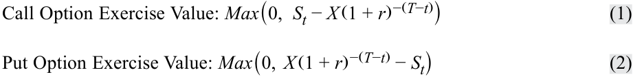
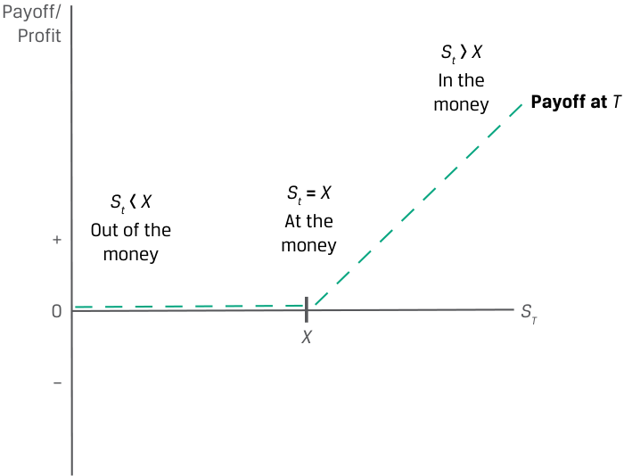
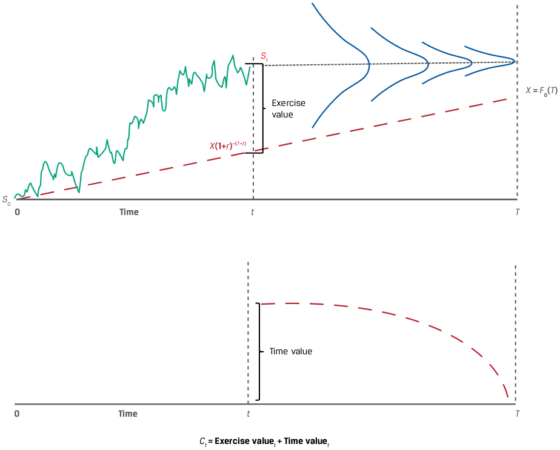
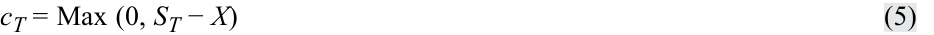
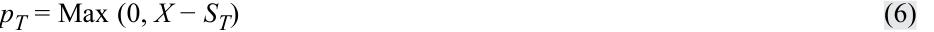
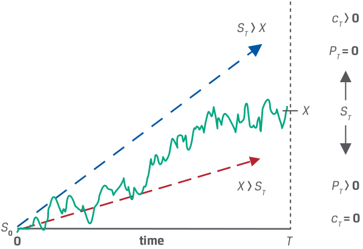
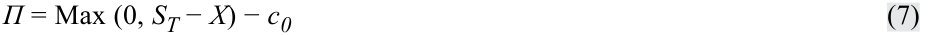
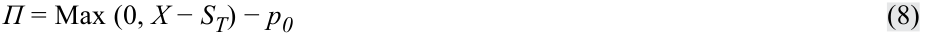
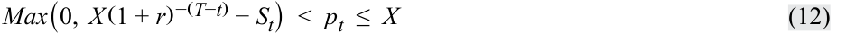
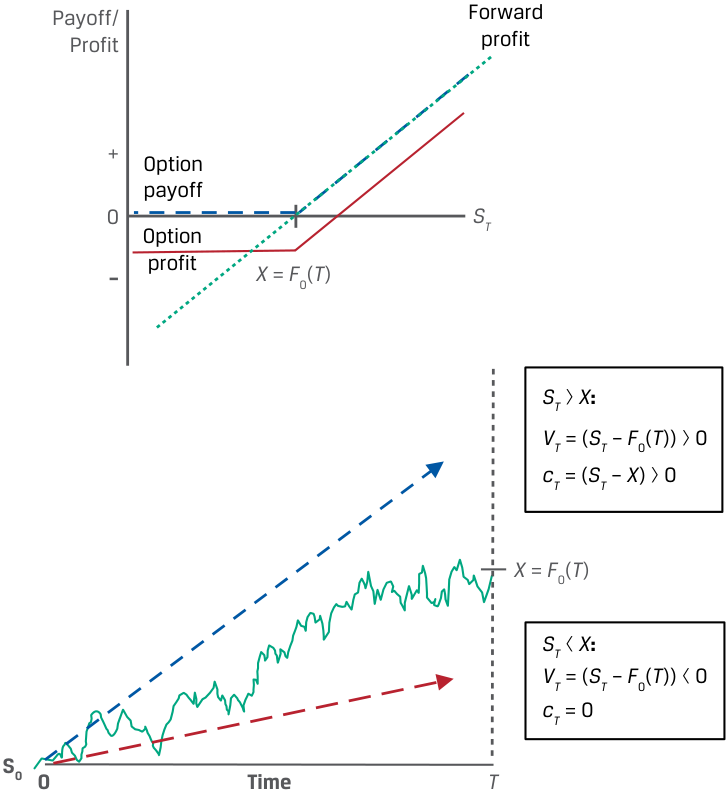

# Volume 7: Derivatives
## Learning Module 8 Pricing and Valuation of Options
### Part 1/2: Introduction (PDF Pages 179–193)

---

<!-- PDF Page 179 -->

#### L E A R N I N G M O D U L E 

# **<mark>8</mark>** 

### **Pricing and Valuation of Options** 

###### **<mark>LEARNING OUTCOMES</mark>** 

**_Mastery The candidate should be able to:_** explain the exercise value, moneyness, and time value of an option contrast the use of arbitrage and replication concepts in pricing forward commitments and contingent claims identify the factors that determine the value of an option and describe how each factor affects the value of an option 

##### **INTRODUCTION** 

Option contracts are contingent claims in which one of the counterparties determines whether and when a trade will settle. Unlike a forward commitment with a value of zero to both counterparties at inception, an option buyer pays a premium to the seller for the right to transact the underlying in the future at a pre-agreed price. The contingent nature of options affects their price as well as their value over time. 

In the first lesson, we explore three features unique to contingent claims related to an option’s value versus the spot price of the underlying: the exercise, or intrinsic, value; the relationship between an option’s spot price and its exercise price, referred to as “moneyness”; and the time value. We then turn to how the arbitrage and replication concepts introduced earlier for forward commitments differ when applied to contingent claims with an asymmetric payoff profile. Finally, we identify and describe factors that determine the value of an option. These lessons focus on European options, which can be exercised only at expiration. 

## **<mark>1</mark>** 

###### **LEARNING MODULE OVERVIEW** 

- An option’s value comprises its exercise value and its time value. The exercise value is the option’s value if it were _immediately_ exercisable, while the time value captures the _possibility_ that the passage of time and the variability of the underlying price will increase the profitability of exercise at maturity. 

<!-- PDF Page 180 -->

- Option moneyness expresses the relationship between the underlying price and the exercise price. A put or call option is “at the money” when the underlying price equals the exercise price. An option is more likely to be exercised if it is “in the money”—with an underlying price above (for a call) or below (for a put) the exercise price—and less likely to be exercised if it is “out of the money.” 

- Due to their asymmetric payoff profile, options are characterized by no-arbitrage price bounds. The lower bound is a function of the present value of the exercise price and the underlying price, while the upper bound is the underlying price for a call and the exercise price for a put. 

- As in the case of forward commitments, the replication of option contracts uses a combination of long (for a call) or short (for a put) positions in an underlying asset and borrowing or lending cash. The replicating transaction for an option is based on a proportion of the underlying, which is closely associated with the moneyness of the option. 

- The underlying price, the exercise price, the time to maturity, the riskfree rate, the volatility of the underlying price, and any income or cost associated with owning the underlying asset are key factors in determining the value of an option. 

- Changes in the volatility of the underlying price and the time to expiration will usually have the same directional effect on put and call option values. Changes to the exercise price, the risk-free rate, and any income or cost associated with owning the underlying asset have the opposite effect on call options versus put options. 

###### **LEARNING MODULE SELF-ASSESSMENT** 

These initial questions are intended to help you gauge your current level of understanding of this learning module. 

1. Which of the following statements correctly describes the lower bound of a call option’s value? 

   - **A.** The underlying’s price minus the present value of the option’s exercise price 

   - **B.** The underlying’s price minus the option’s exercise price or zero, whichever is greater 

   - **C.** The underlying’s price minus the present value of the option’s exercise price or zero, whichever is greater 

###### **Solution:** 

C is correct. The lower bound of a call price is the underlying’s price minus the present value of its exercise price or zero, whichever is greater. A is incorrect as the response omits the fact that the lower bound is zero if the underlying’s price is less than the present value of the exercise price. B is incorrect as it omits the present value term. 

<!-- PDF Page 181 -->

|2. Match the following statements about replication strategies with their asso- ciated derivative instrument(s):|
|---|
|1. At time_t_= 0, lend at the risk-free rate and sell the underlying at_S0_. A. Neither a call option nor a put option replication strategy|
|2. The replication strategy is executed at inception and is settled at maturity with no adjustment over time. B. A put option replication strategy|
|3. At time_t_=_T_, sell the underlying at _ST_and repay the loan of_X_. C. A call option replication strategy if exercised|
|**Solution:** |
|**1.**B is correct. At time_t_= 0, a put option replication strategy involves lending at the risk-free rate and selling the underlying at_S0_.|
|**2.**A is correct. As both call and put options involve a non-linear payoff profile, their replication strategy requires adjustment over time as the likelihood of exercise changes.|
|**3.**C is correct. A call option replication strategy if exercised involves repaying the loan of_X_and selling the underlying at_ST_at time_t_=_T_.|
|3. A European call option with three months remaining to maturity on an un- derlying stock with no additional cash flows has an exercise price (_X_) of GBP 50, a risk-free rate of 2%, and a current underlying price (_St_) of GBP 57.50. If the current call option price is GBP 10, which response below most closely shows the correct exercise value and the time value of the option?|
|**A.**Exercise value = GBP 7.50; Time value = GBP 2.50|
|**B.**Exercise value = GBP 7.75; Time value = GBP 2.25|
|**C.**Exercise value = GBP 0; Time value = GBP 10 **Solution:**|
|B is correct. An option’s value comprises its exercise value plus its time val- ue. The exercise value of a call option is Max (0,_St_− PV(_X_)) and is calculat- ed as follows:|
|Call Option Exercise Value = Max(0,_S_ _t_−_X_ (1 +_r_) −(_T_−_t_)  )|
|Max(0, GBP 57.50 − GBP 50(1.02)−0.25) = GBP 7.75|
|The exercise value is positive, as the current underlying price exceeds the present value of the exercise price. The time value is the difference between the option price and the exercise value, representing the possibility that the option payoff at maturity will exceed the current exercise value due to a favorable price change:|
|Call Option Time Value =_c_ _t_−_Max_ (0,_S_ _t_−_X_ (1 +_r_) −(_T_−_t_)  )|
|= GBP 2.25 (= GBP 10 − GBP 7.75)|
|The time value is always positive and declines to zero at maturity (_t_=_T_). A is incorrect as the present value term is omitted from the exercise value calculation. C is incorrect as it implies the option has zero exercise value.|

<!-- PDF Page 182 -->

4. Match the following underlying price and exercise price relationships with their associated put option: 

1. _ST_ = 100, _X_ = 100 A. An at-the-money put option 2. _ST_ = 110, _X_ = 100 B. An in-the-money put option 3. _ST_ = 90, _X_ = 100 C. An out-of-the-money put option 

###### **Solution:** 

Put options are in the money when _ST_ < _X_ , at the money when _ST_ = _X_ , and out of the money when _ST_ > _X_ . Therefore: 

**1.** A is correct. Since _ST_ = _X_ = 100, this is an at-the-money put option. 

**2.** C is correct. Since _ST_ > _X_ , this is an out-of-the-money put option. 

**3.** B is correct. Since _ST_ < _X_ , this is an in-the-money put option. 

5. Match the following changes in a factor affecting option value (holding other factors constant) with their corresponding option value change: 

1. A higher exercise price ( _X_ ) A. Decreases the value of both a call option and a put option 

2. A higher underlying price ( _ST_ ) B. Decreases the value of a call option 

3. A decline in the volatility of the underC. Decreases the value of a put option lying price 

###### **Solution:** 

   **1.** B is correct. A higher exercise price decreases the value of a call option; for a given underlying price at maturity ( _ST_ ), the call option settlement value of Max (0, _ST_ − _X_ ) will decrease for a higher _X_ . 

   **2.** C is correct. A higher underlying price ( _ST_ ) will decrease the value of a put option. Since a put option is the right to sell an underlying, the put option settlement value of Max (0, _X_ − _ST_ ) will fall as _ST_ rises. 

   **3.** A is correct. A decline in the volatility of the underlying price will decrease the value of both a call option and a put option. Lower price variability of the underlying will reduce the probability of a higher positive exercise value for a call or a put option without affecting the downside case where the option expires unexercised. 

6. Which of the following statements provides the correct description as to how a call option’s value changes if the income on the underlying declines unexpectedly, holding all else equal. 

   - **A.** The call option value increases. 

   - **B.** The call option value decreases. 

   - **C.** The call option value does not change. 

   - **Solution:** 

A is correct. Income or other, non-cash benefits (such as convenience yield) accrue to the owner of an underlying asset but not to the owner of a derivative, whose value is based on the underlying. A call option on an underlying with income has lower value than an identical call option on the same un- 

<!-- PDF Page 183 -->

derlying without income. Thus, a decline in income on an underlying asset increases the value of a call option. 

##### **OPTION VALUE RELATIVE TO THE UNDERLYING SPOT PRICE** 

## **<mark>2</mark>** 

explain the exercise value, moneyness, and time value of an option 

As shown in earlier lessons, the non-linear or asymmetric payoff profile of an option causes us to approach these derivative instruments differently than for a forward commitment. When evaluating these derivatives, whose value depends critically on whether the spot price crosses an exercise threshold at maturity, buyers and sellers frequently rely on three measures—exercise value, moneyness, and time value—to gauge an option’s value over the life of the contract. Recall from an earlier lesson that American options can be exercised at any time, while European options can be exercised only at maturity. This lesson focuses solely on European options with no additional cost or benefit of owning the underlying asset. 

##### **OPTION EXERCISE VALUE** 

**<mark>3</mark>** 

explain the exercise value, moneyness, and time value of an option 

An option buyer will exercise a call or put option at maturity only if it returns a positive payoff—that is: 

- ( _ST_ − _X_ ) > 0 for a call 

- ( _X_ − _ST_ ) > 0 for a put 

If not exercised, the option expires worthless and the option buyer’s loss equals the premium paid. 

At any time _before_ maturity ( _t_ < _T_ ), buyers and sellers often gauge an option’s value by comparing the underlying spot price ( _St_ ) with the exercise price ( _X_ ) to determine the option’s exercise value at time _t_ . This is the option contract’s value _if_ the option were exercisable at time _t_ . The exercise value for a call and a put option at time t incorporating the time value of money is the difference between the spot price ( _St_ ) and the present value of the exercise price (PV( _X_ )), as follows: 

<!-- Formula Text: Call Option Exercise Value: Max(0,   S t − X (1 + r) −(T−t)) (1) Put Option Exercise Value: Max(0,  X (1 + r) −(T−t) − S t) (2) -->

If we assume an exercise price, _X_ , equal to the forward price, _F0_ ( _T_ ), the exercise value of a call option is the _same_ as the value of a long forward commitment at time _t_ ( _Vt_ ( _T_ )). This forward commitment was shown earlier to equal _St_ − PV( _F0_ ( _T_ )), _provided thatSt_ > PV( _X_ ). That is, for a call option where _F0_ ( _T_ ) = _X_ : If _St_ > PV( _X_ ): _St_ − PV( _F_ 0( _T_ )) = Max (0, _St_ − PV( _X_ )) 

<!-- PDF Page 184 -->

Note that this comparison _ignores_ the upfront call option premium paid by the option buyer ( _c0_ at time _t_ = 0). 

###### **EXAMPLE 1** 

###### **Put Option Exercise Value** 

Consider the case of a one-year put option with an exercise price ( _X_ ) of EUR 1,000 and a risk-free rate of 1%. What is the exercise value of the option in six months if the spot price ( _St_ ) equals EUR 950? 

Use Equation 2 to solve for Max (0, PV( _X_ ) − _St_ ): 

_X_( 1 + _r_)− (_T_−_t_) − _St_ 

= EUR 45.04 (= EUR 1,000(1.01)-0.5 − EUR 950) 

## **<mark>4</mark>** 

##### **OPTION MONEYNESS** 

explain the exercise value, moneyness, and time value of an option 

An option’s exercise value at any time _t_ was shown to be its current payoff. The relationship between the option’s total value and its exercise price expresses the option’s **moneyness** . Examples of in-the-money (ITM) options include a call option whose underlying spot price is _above_ the exercise price ( _X_ ) and a put option with an underlying spot price _below_ the exercise price. When the underlying price is _equal to_ the exercise price, the put or call option is said to be at the money (ATM). When the underlying price is _below_ ( _above_ ) the exercise price for a _call_ ( _put_ ) option, the option is less likely to be exercised and is said to be out of the money (OTM). 

Also, the _degree_ to which an option is in or out of the money affects the sensitivity of an option’s price to underlying price changes. For example, a so-called **deep-in-the-money option** , or one that is highly likely to be exercised, usually demonstrates a nearly one-to-one correspondence between option price and underlying price changes. A **deep-out-of-the-money option** , which is very _unlikely_ to be exercised, demonstrates far less option price sensitivity for a given underlying price change. In contrast, relatively small price changes in the underlying for an at-the-money option often determine whether the option will be exercised. Moneyness is often used to compare options on the same underlying but with different exercise prices and/or times to maturity. Exhibit 1 shows the moneyness of a call option at maturity and summarizes these relationships. 

<!-- PDF Page 185 -->

**Exhibit 1: Call Option Moneyness at Maturity** 

<!-- Start of picture text -->
Payoff/ Profit St  >  X In the money Payoff at  T St =  X St  <  X At the + Out of the money money 0 ST X – <!-- End of picture text -->

|**Moneyness**|**Call option (****_ct_)**|**Put option (****_pt_)**|
|---|---|---|
|In the money (ITM)|_St_>_X_|_St_<_X_|
|At the money (ATM)|_St_=_X_|_St_=_X_|
|Out of the money (OTM)|_St_<_X_|_St_>_X_|

###### **EXAMPLE 2** 

###### **Put Option Moneyness** 

Recall in Example 1 that at time _t_ , a put option with six months remaining to maturity had an exercise price ( _X_ ) of EUR 1,000 and an underlying spot price ( _St_ ) of EUR 950. Describe the moneyness of the put option at time _t_ . 

Given that the underlying spot price is below the exercise price, the put option is in the money by EUR 50. 

##### **OPTION TIME VALUE** 

<!-- Start of picture text -->
5 <!-- End of picture text -->

explain the exercise value, moneyness, and time value of an option 

While the exercise value of an option reflects its _current_ payoff, an additional component of an option’s value is derived from its remaining _time_ to maturity. Although European options can be exercised only at maturity, they can be purchased or sold prior to maturity at a price ( _ct_ or _pt_ , for a call or put, respectively) that reflects the option’s _future expected_ payoff. A longer time until expiration usually means a higher potential dispersion of the future underlying price for a given level of volatility. 

<!-- PDF Page 186 -->

Similarly, an increase in volatility at a specific underlying price for a given time to expiration increases option value for the same reason. We will explore these factors further in a later lesson. 

The time value of an option is equal to the difference between the current option price and the option’s current payoff (or exercise value): 

<!-- Formula Text: Call Option Time Value: Max(0,   S t − X (1 + r) −(T−t)) (3) or: c t  =  Max(0,   S t − X (1 + r) −(T−t)) + Time Value Put Option Time Value: p t − Max(0,  X (1 + r) −(T−t) − S t) (4) or: p t  =  Max(0,  X (1 + r) −(T−t) − S t) + Time Value -->

That is, the current option price is equal to the sum of its exercise value and time value. As Exhibit 2 shows, the time value of an option is always positive but declines to zero at maturity, a process referred to as **time value decay** . 

###### **Exhibit 2: Exercise Value and Time Value of a Call Option** 

<!-- Start of picture text -->
St X  =  F 0( T ) Exercise value X (1+ r ) –( T – t ) S 0 0 Time t T Time value 0 Time t T Ct  = Exercise value t + Time value t <!-- End of picture text -->

###### **EXAMPLE 3** 

###### **Put Option Time Value** 

Example 1 showed that a one-year put option with an exercise price ( _X_ ) of EUR 1,000 had an exercise value of EUR 45.04 with six months remaining to maturity when the spot price ( _St_ ) was EUR 950. If we observe a current put option price ( _pt_ ) of EUR 50, what is the time value of the put option? 

Use Equation 4 to solve for _pt_ − Max (0, PV( _X_ ) − _St_ ): 

<!-- PDF Page 187 -->

_pt_ − max (0, _X_( 1 + _r_)− (_T_−_t_) − _St_ ) = EUR 4.96 (= EUR 50 − EUR 45.04) 

**QUESTION SET Option Value relative to Underlying Spot Price** 1. Describe the similarities and differences between the exercise value of a long put option position with an exercise price ( _X_ ) equal to the forward price, _F0_ ( _T_ ), and a short forward position payoff at maturity with the same underlying details. **Solution:** The exercise value of a put option with an exercise price of _X_ = _F0_ ( _T_ ) at maturity (Max (0, _X_ − _ST_ )) is the _same_ as the payoff of a short forward commitment at maturity ( _F0_ ( _T_ ) − _ST_ ) _as long as_ the exercise price is greater than the underlying price. That is, for _F0_ ( _T_ ) = _X_ : If _X_ > _ST: F0_ ( _T_ ) − _ST_ = Max (0, _X_ − _ST_ ) These payoff profiles will _differ_ if _ST_ > _X_ , since the short forward payoff at maturity will require a payment from the seller to the buyer, while the put option owner will allow the option to expire unexercised. Note that this payoff comparison ignores the upfront option premium paid by the put option buyer ( _p0_ ) at time _t_ = 0. 2. A European put option with three months remaining to maturity on an underlying stock with no additional cash flows has an exercise price ( _X_ ) of GBP 50, a risk-free rate of 2%, and a current underlying price ( _St_ ) of GBP 55. If the current put option price is GBP 5, calculate the exercise value and the time value and interpret the results. **Solution:** An option’s value comprises its exercise value plus its time value. The exercise value of a put option is Max (0, PV( _X_ ) − _St_ ) and can be calculated as follows: Put Option Exercise Value = _Max_ (0, _X_( 1 + _r_)− (_T_−_t_) − _St_ ) Max(0, GBP 50(1.02)-0.25 − GBP 55) = 0 The exercise value is zero, as the current underlying price exceeds the present value of the exercise price. The time value is the difference between the option price and the exercise value and represents the possibility that the likelihood and profitability of exercise at maturity may increase due to a favorable price change: Put Option Time Value = _pt_ − _Max_ (0, _X_( 1 + _r_)− (_T_−_t_) − _St_ ) 

<!-- PDF Page 188 -->

- = GBP 5 (= GBP 5 − GBP 0) 

The time value is always positive and declines to zero at maturity ( _t_ = _T_ ). Since the put option is out of the money, its value consists _solely_ of time value. 

3. Match the following underlying price and exercise price relationships with their associated call option: 

1. _ST_ = 60, _X_ = 50 A. An at-the-money call option 2. _ST_ = 50, _X_ = 50 B. An in-the-money call option 3. _ST_ = 40, _X_ = 50 C. An out-of-the-money call option 

###### **Solution:** 

Call options are in the money when _ST_ > _X_ , at the money when _ST_ = _X_ , and out of the money when _ST_ < _X_ . Therefore: 

   **1.** B is correct. Since _ST_ > _X_ , this is an in-the-money call option. 

   **2.** A is correct. Since _ST_ = _X_ = 50, this is an at-the-money call option. 

   **3.** C is correct. Since _ST_ < _X_ , this is an out-of-the-money call option. 

4. Describe how the moneyness of an option affects how the option’s value will change for a given change in the price of the underlying. 

   - **Solution:** 

An increase in the moneyness of an option will increase the sensitivity of its value to changes in the underlying price. For example, an option that is very likely to be exercised will have a nearly one-to-one change in option value for a given change in the underlying price, while an option that is unlikely to be exercised will have a relatively small change in value for a given change in the underlying price. 

## **<mark>6</mark>** 

##### **ARBITRAGE** 

contrast the use of arbitrage and replication concepts in pricing forward commitments and contingent claims 

An earlier lesson showed that riskless arbitrage opportunities arise if the “law of one price” does not hold—that is, an identical asset trades at different prices in different places at the same time. In the case of a derivative, we establish no-arbitrage conditions based on the payoff profile at maturity. As shown earlier, forward commitments with a _symmetric_ payoff profile settle based on the difference between the forward price, _F0_ ( _T_ ), at contract inception ( _t_ = 0) and the underlying price, _ST_ , at contract maturity ( _t_ = _T_ ), or ( _ST_ − _F0_ ( _T_ )) for a long forward position. For an underlying with no additional cash flows, it was shown that assets with a known future price must have a spot price equal to the future price discounted at the risk-free rate, _r: S0_ = _ST_ (1 + _r_ )-_T_ . For purposes of this lesson, we ignore any costs or benefits of owning the underlying other than the opportunity cost (or the risk-free rate, _r_ ). 

<!-- PDF Page 189 -->

Contingent claims are characterized by _asymmetric_ payoff profiles, introduced earlier. In the case of European options representing the right to purchase an underlying (or call option, _c_ ) or the right to sell an underlying (or put option, _p_ ) at a given exercise price ( _X_ ) at maturity, the payoff profiles at maturity for an option buyer were shown to be: 

<!-- Formula Text: cT = Max (0, ST − X) (5) -->

<!-- Formula Text: pT = Max (0, X − ST) (6) -->

**Exhibit 3: European Option Exercise at Expiration** 

<!-- Start of picture text -->
cT > 0 ST  >  X PT = 0 X ST X  >  ST PT > 0 cT = 0 S 0 0 time T <!-- End of picture text -->

Recall that, unlike forward commitments with an initial price of zero, the option buyer pays the seller a premium ( _c0_ for a call and _p0_ for a put at time _t_ = 0), so the option buyer’s _profit_ at maturity was introduced earlier as follows (ignoring the time value of money): 

<!-- Formula Text: Π = Max (0, ST − X) − c0 (7) -->

<!-- Formula Text: Π = Max (0, X − ST) − p0 (8) -->

Equations 7 and 8 show the key distinction between forward commitments and contingent claims for purposes of arbitrage. The forward buyer enters into the contract with no cash paid upfront and has an unlimited gain or loss (bounded by zero for an underlying such as a stock that cannot have a negative price) at maturity as the underlying price rises or falls. The option buyer, in contrast, will exercise an option at maturity only if it is in the money. This _conditional_ nature of option payoff profiles leads us to establish upper and lower no-arbitrage price bounds at any time _t_ . 

A call option buyer will exercise only if the spot price ( _ST_ ) exceeds the exercise price ( _X_ ) at maturity. The _lower_ bound of a call price is therefore the underlying’s price minus the present value of its exercise price or zero, whichever is greater. In other words, an option which trades below its exercise value violates the no-arbitrage condition. The call buyer will not pay more for the right to purchase an underlying than the price of that underlying, which is the _upper_ bound: 

<!-- Formula Text: Max(0,   S t − X (1 + r) −(T−t))  <  c t  ≤  S t (9) c t,Lower bound  =  Max(0,   S t − X (1 + r) −(T−t)) (10) c t,Upper bound=S t (11) -->

<!-- PDF Page 190 -->

A put option buyer will exercise only if the spot price, _ST_ , is below _X_ at maturity. The exercise price, _X_ , therefore represents the _upper_ bound on the put value. The _lower_ bound is the present value of the exercise price minus the spot price or zero, whichever is greater: 

<!-- Formula Text: Max(0,  X (1 + r) −(T−t) − S t)  <  p t  ≤  X (12) -->

<!-- Formula Text: p t,Lower bound  =  Max(0,  X (1 + r) −(T−t) − S t) (13) -->

<!-- Formula Text: p t,Upper bound  =  X (14) -->

###### **EXAMPLE 4** 

###### **Call Option Upper and Lower Bounds** 

Consider a one-year call option with an exercise price, _X_ , of EUR 1,000. The underlying asset, _S0_ , trades at EUR 990 at time _t_ = 0 and the risk-free rate, _r_ , is 1%. What are the no-arbitrage upper and lower bounds in six months’ time if the underlying asset price, _St_ , equals EUR 1,050? 

As the option buyer will exercise only if _ST_ > _X_ at _t_ = _T_ , the _lower_ bound is equal to _St_ − PV ( _X_ ) or zero, whichever is greater: 

_ct_ , _Lower bound_ = _Max_ (0, _St_ − _X_( 1 + _r_)− (_T_−_t_) ) ct,Lower bound = Max(0, EUR 1,050 − EUR 1,000(1.01)-0.5 ) 

ct,Lower bound = Max(0, EUR 54.96) 

The call buyer will not pay more than _St_ for the right to purchase the underlying: _ct_ , _Upper bound_ = _St_ ct, Upper bound = EUR 1,050 

## **<mark>7</mark>** 

##### **REPLICATION** 

contrast the use of arbitrage and replication concepts in pricing forward commitments and contingent claims 

In an earlier lesson, we used replication to create forward commitment cash flows, utilizing a combination of long or short positions in an underlying asset and borrowing or lending cash. The ability of market participants to use replication strategies ensures that the law of one price holds and no riskless arbitrage profit opportunities exist. 

Recall from an earlier lesson that a call option is _similar to_ a long forward position in that it increases in value as the underlying price rises but _differs_ in that the call option settles only if there is a gain upon exercise. This apparent symmetry for positive outcomes is shown in Exhibit 4, where the exercise price, _X_ , is equal to the forward price, _F0_ ( _T_ ). 

<!-- PDF Page 191 -->

###### **Exhibit 4: Call Option versus Long Forward Position** 

<!-- Start of picture text -->
Payoff/ Forward Profit profit + Option payoff 0 ST Option – profit X  =  F 0( T ) ST > X : VT  = ( ST  –  F 0( T )) > 0 cT  = ( ST  –  X ) > 0 X  =  F 0( T ) ST < X : VT  = ( ST  –  F 0( T )) < 0 cT  = 0 S0 0 Time T <!-- End of picture text -->

In order to replicate the call option at contract inception ( _t_ = 0), we also must borrow at the risk-free rate, _r_ , and use the proceeds to purchase the underlying at a price of _S0_ . At option expiration ( _t_ = _T_ ), unlike in the case of the forward commitment, there are two possible replication outcomes: 

- **Exercise** ( _ST_ > _X_ ): Sell the underlying for _ST_ and use the proceeds to repay _X_ . 

- **No exercise** ( _ST_ < _X_ ): No settlement is required. 

If exercise were certain, we would borrow _X_ (1 + _r_ )-_T_ at inception, as in the case of the forward. However, since it is uncertain, we instead borrow a _proportion_ of _X_ (1 + _r_ )-_T_ based on the _likelihood_ of exercise at time _T_ , which is closely associated with the moneyness of an option. The non-linear payoff profile of an option requires that the replicating transaction be adjusted as this likelihood changes, while the replicating trades for a forward commitment remain constant. Option replication will be addressed in greater detail in later lessons. 

We now turn our attention to put option replication. It was shown earlier that a _short_ put position with an exercise price equal to the forward price ( _X_ = _F0_ ( _T_ )) mirrors the outcomes for a _long_ forward position when the underlying price at maturity is _below_ the forward price ( _ST_ < _X_ = _F0_ ( _T_ )). The sold put _decreases_ in value as the underlying price falls, but it settles only if there is a gain upon exercise. This relationship is shown in Exhibit 5, where the exercise price ( _X_ ) is equal to the forward price, _F0_ ( _T_ ). 

<!-- PDF Page 192 -->

**Exhibit 5: Put Option versus Short Forward Position** 

<!-- Start of picture text -->
Payoff/ Forward Profit profit + Option profit 0 ST Option – payoff X  =  F 0( T ) ST > X : VT  = ( ST  –  F 0( T )) > 0 – pT  = 0 X  =  F 0( T ) ST < X : VT  = ( ST  –  F 0( T )) < 0 – pT  = ( X  –  ST ) < 0 S 0 0 Time T <!-- End of picture text -->

In order to replicate the put option at contract inception ( _t_ = 0), we must sell the underlying short at a price of _S0_ and lend the proceeds at the risk-free rate, _r_ . At option expiration ( _t_ = _T_ ), unlike in the case of the forward commitment, there are two possible replication outcomes: 

- **Exercise** ( _ST_ < _X_ ): Purchase the underlying for ST from the proceeds of the risk-free loan. 

- **No exercise** ( _ST_ > _X_ ): No settlement is required. 

If exercise were certain, we would lend _X_ (1 + _r_ )-_T_ at inception, as in the case of the forward. However, as in the case of the call option, the asymmetric payoff profile requires adjustment over time based on the _likelihood_ of exercise. 

In the next lesson, we will turn our attention to the factors that drive the likelihood of option exercise prior to maturity. 

###### **QUESTION SET** 

###### **Arbitrage and Replication** 

1. Determine the correct answers to complete the following sentence: The lower bound of a call price is the underlying’s price ______ the present value of its ________ price or zero, whichever is greater. 

###### **Solution:** 

The lower bound of a call price is the underlying’s price _minus_ the present value of its _exercise_ price or zero, whichever is greater. 

2. A six-month European call option on an underlying stock with no additional cash flows has an exercise price ( _X_ <u>) of GBP 50, an initial underlying price</u> 

<!-- PDF Page 193 -->

( _S0_ ) of GBP 49.75, and a risk-free rate of 2%. Calculate the lower bound of the call price in three months’ time if _St_ = GBP 65. **Solution:** As the call option buyer will exercise only if _ST_ > _X_ at maturity, the lower bound is equal to _St_ − PV ( _X_ ) or zero in three months’ time, whichever is greater: _ct_ , _Lower bound_ = _Max_ (0, _St_ − _X_( 1 + _r_)− (_T_−_t_) ) Given _St_ = GBP 65, _X_ = GBP 50, _r_ = 2%, and ( _T_ − _t_ ) = 0.25, we can solve for the call option’s lower bound as follows: _ct_ , _Lower bound_ = _Max_ (0,  GBP65 − GBP50( 1.02)− (0.25) ) = GBP 15.25 

3. Match the following statements about replication strategies with their associated derivative instrument(s): 1. At time _t_ = 0, borrow at the risk-free A. Both a call option and a put option rate and purchase the underlying at _S0_ . replication strategy 2. The strategy requires adjustment B. A call option replication strategy over time as the likelihood of exercise changes. 3. At time _t_ = _T_ , receive the loan repayC. A put option replication strategy if ment and purchase the underlying at _ST_ . exercised 

###### **Solution:** 

   **1.** B is correct. At time _t_ = 0, a call option replication strategy involves borrowing at the risk-free rate and purchasing the underlying. 

   **2.** A is correct. As both call and put options have a non-linear payoff profile, the replication strategy requires adjustment over time as the likelihood of exercise changes. 

   **3.** C is correct. A put option replication strategy if exercised involves receiving the loan repayment and purchasing the underlying at _ST_ at time _t_ = _T_ . 

4. Explain the key difference between the changes in the replication of a contingent claim versus a forward commitment over the life of the contract. 

###### **Solution:** 

An option has an _asymmetric_ payoff profile, since the option buyer will exercise only if the exercise value of the option is positive. Since the likelihood of option exercise changes over time, transactions replicating an option contract must be adjusted over time. A forward commitment has a _symmetric_ payoff profile that will settle with certainty at a future date, and therefore the replicating transactions do not require adjustment over the contract life. 

