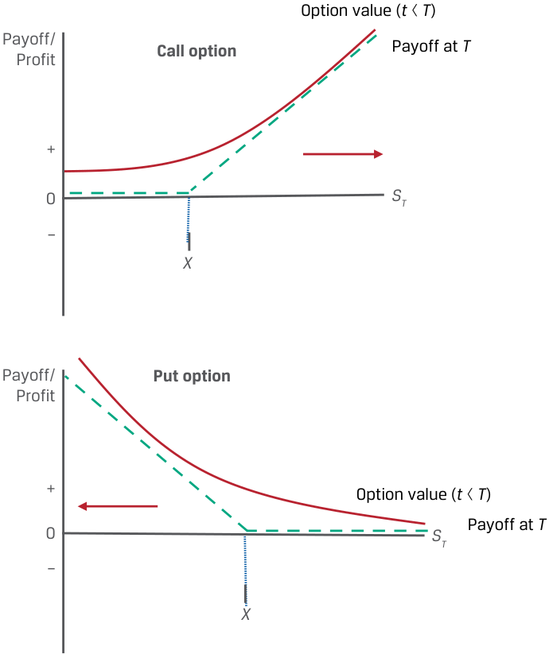
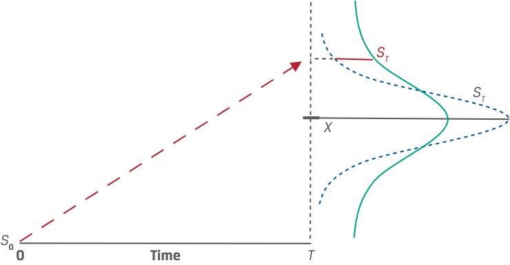

# Volume 7: Derivatives
## Learning Module 8 Pricing and Valuation of Options
### Part 2/2: Factors Affecting Option Value (PDF Pages 194–204)

---

<!-- PDF Page 194 -->

# **<mark>8</mark>** 

#### **FACTORS AFFECTING OPTION VALUE** 

identify the factors that determine the value of an option and describe how each factor affects the value of an option 

We now turn our attention to identifying and describing factors that affect an option’s value. Several of these factors are common to both forward commitments and options, and a number are unique to contingent claims. Factors that determine the value of an option include the value of the underlying, the exercise price, the time to maturity, the risk-free rate, the volatility of the underlying price, and any income or cost associated with owning the underlying asset. 

##### **Value of the Underlying** 

Changes in the value of the underlying will have the same directional effect on the _right_ to transact the underlying under an option contract as on the _obligation_ to transact under a forward commitment. For example, a call option and a long forward position will both _appreciate_ if the spot price of the underlying _rises_ , while a put option and a short forward position will both _appreciate_ if the spot price of the underlying _falls_ , as shown in Exhibit 6. 

**Exhibit 6: Call and Put Option Value versus Underlying Value** 

<!-- Start of picture text -->
Option value ( t  < T ) Payoff/ Profit Call option Payoff at  T + 0 ST – X Payoff/ Put option Profit + Option value ( t < T ) 0 ST Payoff at  T – X <!-- End of picture text -->

<!-- PDF Page 195 -->

A key distinction between forward commitments and contingent claims is the _magnitude_ of a derivative’s price change for a given change in the underlying value. For a forward commitment, the derivative’s value is a _linear_ (one-for-one) function of the underlying price, while for an option it is a _non-linear_ relationship that depends on the likelihood that an option buyer will exercise in the future. The more likely it is that the option buyer will exercise (e.g., when the option is in the money), the more sensitive the option’s value to the underlying price. This likelihood depends on the relationship between the value of the underlying and the exercise price, a feature unique to option contracts that we turn to next. 

##### **Exercise Price** 

The exercise price is the threshold that determines whether an option buyer chooses to transact at contract maturity. For a call option representing the right to buy the underlying, the exercise price represents a _lower_ bound on the option’s exercise value at maturity, leading to a _higher_ option value for a _lower_ exercise price. As call options settle based on Max (0, _ST_ − _X_ ) at expiry, a lower _X_ will increase both the likelihood of exercise and the settlement value if exercised. 

The exercise price of a put option, in contrast, is an _upper_ bound on its exercise value at maturity. A _higher_ exercise price at which a put option buyer has the right to sell the underlying will therefore _increase_ the value of the option. Exhibit 7 shows these differing effects of exercise price changes for both call and put options. 

**Exhibit 7: Call and Put Option Value versus Exercise Price** 

<!-- Start of picture text -->
Payoff at  T Call option Payoff/ Profit + 0 ST – X – X Put option Payoff/ Profit Payoff at  T + 0 ST – X X + <!-- End of picture text -->

<!-- PDF Page 196 -->

##### **Time to Expiration** 

Recall from a prior lesson that the time value, or difference between an option’s price and its exercise value, represents the likelihood that favorable changes to the underlying price will increase the profitability of exercise. Unlike a long forward position where the buyer is equally likely to experience an increase or a decrease in the underlying price over a longer period, the one-sided (or asymmetric) payoff profile of an option allows the buyer to ignore any outcomes where the option will expire unexercised. 

For a call option, a longer time to expiration will increase the option’s value in _all_ cases. The price appreciation potential of an underlying is essentially unlimited and increases over longer periods, while the downside is limited to the loss of the premium. 

A put option representing the right to sell the underlying also usually benefits from the passage of time. In the case of a put option, a longer time to expiration offers greater potential for price _depreciation_ below the exercise price, while the loss is limited to the premium if the underlying price rises. However, as put option buyers await the _sale_ of the underlying in order to receive ( _X_ − _ST_ ) upon exercise, a longer time to expiry _reduces_ the present value of the payoff. While less common, in some cases a longer time to expiration will _lower_ a put’s value, especially for deep-in-the-money puts with a longer time to expiration and a higher risk-free rate of interest. 

##### **Risk-Free Interest Rate** 

An earlier lesson showed the risk-free rate to be the opportunity cost of holding an asset, which extends to the no-arbitrage valuation of derivatives. For example, an option’s exercise value was shown to be equal to the difference between the spot price and the _present value_ of the exercise price: 

Call Option Exercise Value: Max (0, ( _St_ − PV( _X_ ))) 

Put Option Exercise Value: Max (0, (PV( _X_ ) − _St_ )) 

A _higher_ risk-free rate therefore _lowers_ the present value of the exercise price _provided_ an option is in the money. A higher risk-free rate will _increase_ the exercise value of a call option and _decrease_ the exercise value of a put option. Note that the risk-free rate does not directly affect the time value of an option. 

##### **Volatility of the Underlying** 

Volatility is a measure of the expected dispersion of an underlying asset’s future price movements. Higher price volatility of the underlying increases the likelihood of a higher positive exercise value without affecting the downside case in which the option expires unexercised, as shown in Exhibit 8. Note that this effect will be the same for both call options and put options. 

For example, as volatility _rises_ , a wider range of possible underlying prices _increases_ an option’s time value and the likelihood that it will end up in the money. _Lower_ volatility will _reduce_ the time value of both put and call options. 

<!-- PDF Page 197 -->

###### **Exhibit 8: Volatility and Option Value** 

<!-- Start of picture text -->
ST ST X S 0 0 Time T <!-- End of picture text -->

##### **Income or Cost Related to Owning Underlying Asset** 

In a prior lesson, the benefits and costs of owning an underlying asset over time were shown to affect the relationship of spot versus forward prices. For example, income or other, non-cash benefits (such as convenience yield) accrue to the owner of an underlying asset but not to the owner of a derivative. This effect holds for both forward commitments and contingent claims. Income or other benefits of ownership _decrease_ the value of a call and _increase_ the value of a put. Carry costs (such as storage and insurance for commodities) have the opposite effect, _increasing_ the value of a call option and _decreasing_ the value of a put. A summary of the factors that affect an option’s value is provided in Exhibit 9, with the sign on the option value referring to the impact (positive or negative) of an _increase_ in the factor. 

**Exhibit 9: Factors That Affect the Value of an Option** 

|**Factor**|**Call Value**|**Put Value**|
|---|---|---|
|Value of the underlying|**+**|**−**|
|Exercise price|**−**|**+**|
|Time to expiration|**+**|**+/−**|
|Risk-free interest rate|**+**|**−**|
|Volatility of the underlying|**+**|**+**|
|Income/cost related to owning the underlying|**−/+**|**+/−**|

<!-- PDF Page 198 -->

###### **QUESTION SET** 

##### **Factors That Affect Option Value** 

1. Determine the correct answers to complete the following sentence: For a call option representing the right to buy the underlying, the exercise price represents a ______ bound on an option’s exercise value at maturity, leading to a ______ option value for a lower exercise price. 

###### **Solution:** 

For a call option representing the right to buy the underlying, the exercise price represents a _lower_ bound on an option’s exercise value at maturity, leading to a _higher_ option value for a lower exercise price. 

2. Match the following changes in factors affecting option value (holding other factors constant) with their corresponding option value change: 

1. A lower exercise price ( _X_ ) A. Increases the value of both a call option and a put option 

2. A lower underlying price ( _ST_ ) B. Increases the value of a call option 

3. A rise in the volatility of the underlying C. Increases the value of a put option price 

###### **Solution:** 

   **1.** B is correct. A lower exercise price increases the value of a call option, since for a given underlying price at maturity of _ST_ , the call option settlement value of Max (0, _ST_ − _X_ ) will increase for a lower _X_ . 

   **2.** C is correct. A lower underlying price ( _ST_ ) will increase the value of a put option. Since a put option is the right to sell an underlying at the exercise price ( _X_ ), the put option settlement value of Max (0, _X_ − _ST_ ) will increase as _ST_ declines. 

   **3.** A is correct. A rise in the volatility of the underlying price will increase the value of both a call option and a put option. Greater price variability of the underlying will increase the probability of a higher positive exercise value for a call or a put option without affecting the downside case where the option expires unexercised. 

3. Determine the correct answers to complete the following sentences: A key distinction between forward commitments and contingent claims is the __________ of a derivative’s price change for a given change in the underlying value. For a forward commitment, the derivative value is a ______ function of the underlying price, while for an option it is a _______ relationship. 

###### **Solution:** 

A key distinction between forward commitments and contingent claims is the _magnitude_ of a derivative’s price change for a given change in the underlying value. For a forward commitment, the derivative value is a _linear_ function of the underlying price, while for an option it is a _non-linear_ relationship. 

<!-- PDF Page 199 -->

4. Explain the effect of a _decrease_ in the risk-free rate of interest on the value of put and call options and justify your answer. 

   - **Solution:** 

   - A _decrease_ in the risk-free rate _increases_ the present value of an option’s exercise _price_ (PV( _X_ )). The exercise value for an _in-the-money call_ option will fall, since ( _St_ − PV( _X_ )) is lower for a higher PV( _X_ ), while the exercise value for an _in-the-money put_ option will rise, since (PV( _X_ ) − _St_ ) rises for a higher PV( _X_ ). Note that the time value of an option is not directly affected by the risk-free rate. 

<!-- PDF Page 200 -->

## **~~PRACTICE PROBLEMS~~** 

### **The following information relates to questions 1-9** 

The Viswan Family Office (VFO) owns non-dividend-paying shares of Biomian Limited that are currently priced ( _S0_ ) at INR 295 per share. VFO’s CIO is considering an offer to sell shares at a forward price ( _F0_ ( _T_ )) of INR 300.84 per share in six months based on a risk-free rate of 4%. You have been asked to advise on the purchase of a put option or the sale of a call option with an exercise price ( _X_ ) equal to the forward price ( _F0_ ( _T_ )) as alternatives to a forward share sale. 

**1.** Which of the following statements correctly describes the put option and call option premiums given the relationship between Biomian’s current price of INR 295 and the exercise price equal to the forward price of INR 300.84? 

   - **A.** The call option’s premium consists solely of time value, and the put option’s premium consists solely of exercise value. 

   - **B.** The call option’s premium consists solely of exercise value, and the put option’s premium consists solely of time value. 

   - **C.** The call option’s premium consists solely of time value, and the put option’s premium consists solely of time value. 

**2.** Which of the following statements correctly describes an important distinction between the two strategies of buying a put option and selling a call option with respect to option time value decay? 

   - **A.** Time value decay is a benefit to both option strategies. 

   - **B.** Time value decay is a cost to both option strategies. 

   - **C.** Time value decay is a benefit to selling a call option and a cost to buying a put option. 

**3.** VFO is considering the purchase of the put option to hedge against a decline in Biomian’s share price. Which of the following statements best characterizes the trade-off between the put and the forward based on no-arbitrage pricing? 

   - **A.** The gain on the forward sale will _equal_ the purchased put option’s profit at maturity _provided_ the put option ends up in the money at maturity. 

   - **B.** The loss on the forward sale will _exceed_ the loss on the purchased put at maturity if Biomian’s share price exceeds the forward price by more than the initial put premium paid. 

   - **C.** We do not have enough information to answer this question, since we do not know the time value of the option at maturity. 

**4.** In evaluating the purchased put strategy (with _X_ = _F0_ ( _T_ )), the CIO has asked you to consider selling the put in three months’ time if its price appreciates over that period. Which of the following best characterizes the no-arbitrage put price at 

<!-- PDF Page 201 -->

###### that time? 

   - **A.** As VFO will exercise only if the spot price is below the exercise price, the lower bound of the put price is the greater of zero and the present value of the spot price minus the exercise price. 

   - **B.** As VFO will exercise only if the spot price is below the exercise price, the upper bound of the put price equals the present value of the exercise price minus the spot price. 

   - **C.** The put price can be no greater than the forward price and no less than the greater of zero and the present value of the exercise price minus the spot price. 

**5.** VFO is considering a sold call strategy to generate income from the sale of a call. In your scenario analysis of the sold call option alternative, VFO has asked you to value the call option in three months’ time if Biomian’s spot price is INR 325 per share. Given an estimated call price of INR 46.41 at that time, which of the following correctly reflects the relationship between the call’s exercise value and its time value? 

   - **A.** The call’s exercise value is INR 24.16, and its time value is INR 22.25. 

   - **B.** The call’s exercise value is INR 27.10, and its time value is INR 19.31. 

   - **C.** The call’s exercise value is INR 20.99, and its time value is INR 25.42. 

**6.** Which of the following statements correctly describes how VFO could replicate selling a call option on Biomian if exercise is certain? 

   - **A.** Borrow _X_ (1 + _r_ )–**T** at the risk-free rate and use the proceeds to buy Biomian stock at the current spot price, _S_ 0. At expiration, sell the Biomian stock and use the proceeds to pay off the loan. 

   - **B.** Sell short Biomian stock at the current spot price, _S_ 0, and use the proceeds to lend _X_ (1 + _r_ )–_T_ at the risk-free rate. At expiration, receive _X_ as repayment of the risk-free loan and buy back the Biomian stock. 

   - **C.** Sell short Biomian stock at the current spot price, _S_ 0, and borrow _X_ (1 + _r_ )–_T_ at the risk-free rate. At expiration, pay off the risk-free loan of _X_ and buy back the Biomian stock. 

**7.** In comparing the sold call and purchased put strategies at the forward price, VFO’s CIO is concerned about how an increase in the volatility of the underlying Biomian shares affects option premiums. Which of the following statements about volatility change and its effect on strategy is most accurate? 

   - **A.** An increase in the volatility of the underlying shares has the _same_ effect on call and put option values, so this change should not affect VFO’s strategy decision. 

   - **B.** Since changes in the volatility of the underlying shares have the _opposite_ effect on put versus call options, this change will increase the attractiveness of the put strategy versus the call strategy. 

<!-- PDF Page 202 -->

   - **C.** An increase in the volatility of the underlying shares will increase both the _cost_ of the purchased put strategy and the premium received on the sold call strategy, so this change will increase the attractiveness of the call strategy versus the put strategy. 

**8.** In comparing the Biomian purchased put and sold call strategies, which of the following statements is most correct about how the call and put values are affected by changes in factors other than volatility? 

   - **A.** Changes in the time to expiration and the risk-free rate have a similar directional effect on the put and call strategies, while changes in the exercise price tend to have the opposite effect. 

   - **B.** Changes in the time to expiration tend to have a similar directional effect on the put and call strategies, while changes in the exercise price and the risk-free rate tend to have the opposite effect. 

   - **C.** Changes in the risk-free rate have a similar directional effect on the put and call strategies, while changes in the exercise price and the time to expiration tend to have the opposite effect. 

**9.** VFO is concerned about the potential for increasing interest rates in the future. Which of the following statements provides the most correct description as to how rising rates after entering into the two option strategies would affect the option valuations? 

   - **A.** Rising risk-free rates would make the selling a call option strategy more advantageous to VFO because call options increase in value with higher risk-free rates. 

   - **B.** Rising risk-free rates would make the buying a put option strategy more advantageous to VFO because the company locks in the put option premium at lower interest rates. 

   - **C.** Rising risk-free rates are a negative for both option strategies. 

<!-- PDF Page 203 -->

## **~~SOLUTIONS~~** 

1. C is correct. The exercise value of both the call and put options are zero because the present value of the exercise price is INR 295, which is equivalent to the stock price of INR 295. Thus, both option premiums reflect time value only. A is incorrect as this statement does not properly account for the discounting of the exercise price. B is incorrect as the call option’s premium does not reflect exercise value. 

2. C is correct. The time value component of an option premium declines toward zero as time passes toward the expiration date. A purchased option declines in value, all else equal, because of the time value decline. A sold option increases in value, all else equal, because of the time value decline. A is incorrect as time value decay is a cost to the purchased put option strategy, and B is incorrect as time value decay is a benefit to the sold option strategy. 

3. The correct answer is B. The loss on the forward sale will be greater than the loss on the purchased put at maturity if Biomian’s share price exceeds the forward price by more than the initial put premium. VFO’s downside return is limited to the put premium paid, while the forward sale has unlimited downside as Biomian shares appreciate. A is incorrect as it does not take the put premium paid into account, while C is incorrect as the time value of an option is equal to zero at maturity. 

4. The correct answer is C. The put exercise price, _X_ (equal to _F0_ ( _T_ ) in this case), represents the _upper_ bound on the put value, while the _lower_ bound is the greater of the present value of the exercise price minus the spot price and zero: 

   - Max (0, _X_( 1 + _r_)− (_T_−_t_) − _St_ ) < _pt_ ≤ _X_ 

A is incorrect, as the _lower_ bound of the put price is the greater of zero and the present value of the exercise price minus the spot price, not the present value of the spot price minus the exercise price. B is incorrect, as the _lower_ , not the upper, bound of the put price equals the present value of the exercise price minus the spot price. 

5. The correct answer is B. The option price is equal to the sum of the exercise value and the time value. A call option’s exercise value is equal to the greater of zero and the spot price minus the present value of the exercise price: 

   - _Max_ (0, _St_ − _X_( 1 + _r_)− (_T_−_t_) ) 

   - = Max(0, INR325 − INR300.84(1.04)-0.25 ) 

= INR27.10 

The time value is equal to the call price minus the exercise value, or INR 19.31 (= INR46.41 − INR27.10). A is incorrect as it takes the spot price minus the exercise price as the exercise value, while C calculates the exercise value as the present value of the spot price minus the exercise price. 

6. B is correct. To replicate selling a call option, combine shorting the underlying with risk-free lending. This is exactly the opposite strategy to replicate buying a call option in which the underlying is purchased with proceeds from risk-free borrowing. A is incorrect as this statement describes replicating buying a call option. C is incorrect as selling short and borrowing initially creates two cash 

<!-- PDF Page 204 -->

inflows at _t_ = 0 followed by two cash outflows at _t_ = _T_ . 

7. The correct answer is C. An increase in the volatility of the underlying share price will increase both the upfront premium received on the sold call option and the premium paid on the purchased put option. Therefore, since the purchased put strategy involves an increased upfront payment made by VFO and the sold call strategy involves an increased premium received, the volatility increase will increase the attractiveness of the call strategy versus the put strategy. 

8. The correct answer is B. Changes in the time to expiration tend to have a similar directional effect on the put and call strategies (the only exception being deep-in-the-money put options in some cases), while changes in the exercise price and the risk-free rate tend to have the opposite effect. 

9. C is correct. Because both option strategies (buy a put or sell a call) are short strategies, VFO is delaying cash inflows so higher risk-free rates are negative. A is incorrect as this statement describes the value effect from buying a call option, not from selling. B is incorrect as the locked-in premium will decline after rising risk-free rates. 

