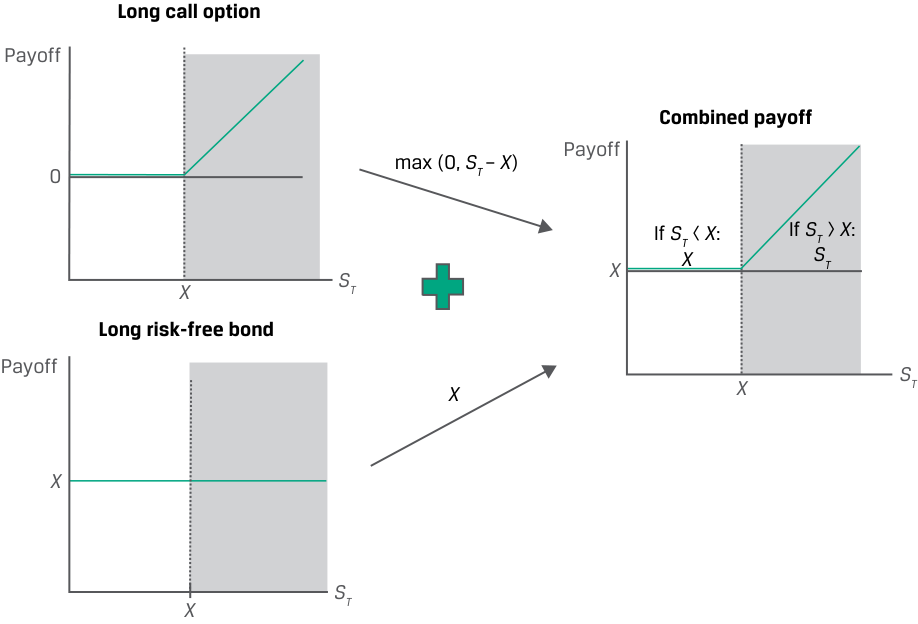
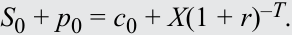
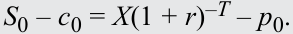

# Volume 7: Derivatives
## Learning Module 9 Option Replication Using Put–Call Parity
### Part 1/2: Introduction (PDF Pages 205–216)

---

<!-- PDF Page 205 -->

#### L E A R N I N G M O D U L E 

# **<mark>9</mark>** 

### **Option Replication Using Put–Call Parity** 

###### **<mark>LEARNING OUTCOMES</mark>** 

**_Mastery The candidate should be able to:_** 

explain put–call parity for European options explain put–call _forward_ parity for European options 

##### **INTRODUCTION** 

## **<mark>1</mark>** 

Previous lessons examined the payoff and profit profiles of call options and put options, the upper and lower bounds of an option’s value, and the factors impacting option values. In doing so, we contrasted the asymmetry of one-sided option payoffs with the linear or symmetric payoff of forwards and underlying assets. 

We now extend this analysis further to show that there are ways to _combine_ options to have an equivalent payoff to that of the underlying and a risk-free asset as well as a forward commitment. In the first lesson, we demonstrate that the value of a European call may be used to derive the value of a European put option with the same underlying details, and vice versa, under a no-arbitrage condition referred to as put–call parity. In the second lesson, we show how this may be extended to forward commitments and how the put–call parity relationship may be applied to option and other investment strategies. We will focus on European options on underlying assets with no income or benefit. 

###### **LEARNING MODULE OVERVIEW** 

- Put–call parity establishes a relationship that allows the price of a call option to be derived from the price of a put option with the same underlying details and vice versa. 

- Put–call parity holds for European options with the same exercise price and expiration date, representing a no-arbitrage relationship between put option, call option, underlying asset, and risk-free asset prices. 

- If put–call parity does not hold, then riskless arbitrage profit opportunities may be available to investors. 

<!-- PDF Page 206 -->

- Put–call forward parity extends the put–call parity relationship to forward contracts given the equivalence of an underlying asset position and a long forward contract plus a risk-free bond. 

- Under put–call forward parity, we may demonstrate that a purchased put option and a sold call option are equivalent to a long risk-free bond and short forward position, and a sold put and purchased call are equivalent to a long forward and short risk-free bond. 

- Put–call parity may be applied beyond option-based strategies in finance—for example, to demonstrate that equity holders have a position equivalent to a purchased call option on the value of the firm with unlimited upside, while debtholders have a sold put option position on firm value with limited upside. 

###### **LEARNING MODULE SELF-ASSESSMENT** 

These initial questions are intended to help you gauge your current level of understanding of this learning module. 

1. Which of the following statements correctly describes the equivalent to a long position in an underlying according to put–call parity? 

   - **A.** Long a put option on the underlying, short a call option on the underlying, and long a risk-free bond 

   - **B.** Short a put option on the underlying, long a call option on the underlying, and long a risk-free bond 

   - **C.** Short a put option on the underlying, long a call option on the underlying, and short a risk-free bond 

###### **Solution:** 

B is correct. Put–call parity demonstrates that a long underlying position is equivalent to a sold put option, a purchased call option, and a long risk-free bond. This is shown in the following equation: 

Put–call parity: _S_ 0 + _p_ 0 = _c_ 0 + _X_ (1 + _r_ )–_T_ implies _S_ 0 = – _p_ 0 + _c_ 0 + _X_ (1 + _r_ )–_T_. 

2. Identify which of the following positions has the same no-arbitrage value as which portfolio under put–call parity: 

1. Long call option ( _c_ 0) A. Long underlying, short risk-free bond, and short call option 

2. Short risk-free bond (– _X_ (1 + _r_ )–_T_ ) B. Long underlying, long put option, and short risk-free bond 

3. Short put option (– _p_ 0) C. Short underlying, long call option, and short put option 

###### **Solution:** 

Recall that the put–call parity relationship may be expressed as 

_S_ 0 + _p_ 0 = _c_ 0 + _X_ (1 + _r_ )–_T_ . 

1. B is correct. A long call option position is the no-arbitrage equivalent of a long underlying position, a long put option, and a short risk-free bond <u>position.</u> 

<!-- PDF Page 207 -->

   2. C is correct. A short risk-free bond position is equivalent to a short underlying position, a long call option, and a short put option. 3. A is correct. A short put option is equivalent to a long underlying position, a short risk-free bond, and a short call option. 

3. Which of the following statements correctly describes a synthetic protective put position according to put–call forward parity? **A.** A long forward contract on the underlying, a long put option on the underlying, and short a risk-free bond 

**B.** A short forward contract on the underlying, a long put option on the underlying, and short a risk-free bond 

**C.** A short forward contract on the underlying, a short put option on the underlying, and short a risk-free bond 

**Solution:** A is correct. The formula for put–call forward parity is as follows: _F_ 0( _T_ )(1 + _r_ )–_T_ + _p_ 0 = _c_ 0 + _X_ (1 + _r_ )–_T_ . Rearranging the terms as follows shows the synthetic protective put position on the left-hand side of the equation: _F_ 0( _T_ )(1 + _r_ )–_T_ + _p_ 0 – _X_ (1 + _r_ )–_T_ = _c_ 0. 

4. Which of the following statements best describes a shareholder’s claim in terms of an option payoff? 

   - **A.** Shareholder payoff resembles the payoff of a put option on firm value. **B.** Shareholder payoff resembles the payoff of a covered call option on firm value. 

   - **C.** Shareholder payoff resembles the payoff of a call option on firm value. 

   - **Solution:** 

C is correct. When considering shareholder claims in option terms, the shareholder payoff resembles a call option on firm value. 

##### **PUT–CALL PARITY** 

<!-- Start of picture text -->
2 <!-- End of picture text -->

explain put–call parity for European options 

A prior lesson contrasted no-arbitrage pricing conditions and the replication of cash flows for forward commitments and contingent claims. Forwards have zero initial value and their _certain_ payoff, which is replicated at inception by borrowing to purchase the underlying or selling the underlying and lending the sale proceeds. Option buyers pay an upfront premium, and their _contingent_ payoff profiles lead us to establish upper and lower no-arbitrage price bounds. Option replication is similar to that of a forward but involves borrowing or lending to buy or sell a _proportion_ of the underlying, which is adjusted as the moneyness of an option changes. We now extend this analysis using a combination of positions. 

<!-- PDF Page 208 -->

In this section, we show how combining cash and derivative instruments into a portfolio in a certain way enables us to price and value these positions without directly modeling them using no-arbitrage conditions. Consider an investor whose goal is to benefit from upward movements in the value of an underlying but who wants to protect her investment from downward movements in the underlying’s value. Consider the following two portfolios, shown in Exhibit 1: 

**1.** At _t_ = 0, an investor purchases a call option ( _c_ 0) on an underlying with an exercise price of _X_ and a risk-free bond today that pays _X_ at _t_ = _T_ . The cost of this strategy is _c_ 0 + _X_ (1 + _r_ )–_T_ , where we assume the option expires at time _T_ . 

**2.** At _t_ = 0, an investor purchases an underlying unit ( _S_ 0) and a put option on the underlying ( _p_ 0) with an exercise price of _X_ at _t_ = _T_ . The cost of this strategy is _p_ 0 + _S_ 0. 

Exhibit 1 shows the payoff of the individual components of these two portfolios. 

**Exhibit 1: Payoffs at Time** **_T_ for Two Portfolios** 

<!-- Start of picture text -->
��������������� ������ � ������� ��� � ��� � ��������������� ������ �� � �� ��� ��� �� �� ��� ��� �� � �� ��������������� � ������ �� � � �� �� � <!-- End of picture text -->

At first glance, these portfolios appear to offer the investor a similar opportunity to benefit from underlying asset appreciation without exposure to an underlying price decline below the exercise price. 

In the first case (Portfolio 1), the investor buys a call option with a positive payoff if the underlying asset price rises above the exercise price ( _ST_ > _X_ ) and invests cash in a risk-free bond. Since the risk-free asset pays _X_ at time _T_ , the investor pays _c_ 0 + _X_ (1 + _r_ )–_T_ at time _t_ = 0. This combination of a purchased call and a risk-free bond is known as a **fiduciary call** and is shown in Exhibit 2. 

<!-- PDF Page 209 -->

**Exhibit 2: Portfolio 1 (Fiduciary Call) Payoff at Time** **_T_** 

<!-- Start of picture text -->
Long call option Payoff Combined payoff Payoff 0  max (0,  ST –  X ) If  ST  <  X : If  ST  >  X : X ST X X ST Long risk-free bond Payoff X X ST X ST X <!-- End of picture text -->

In the second instance (Portfolio 2) in Exhibit 1, the investor pays _S_ 0 + _p_ 0 at inception and is hedged if the underlying price falls below _X_ . This strategy of holding an underlying asset and purchasing a put on the same asset is sometimes called a **protective put** . The payoff for Portfolio 2 at time _T_ is shown in Exhibit 3. 

**Exhibit 3: Portfolio 2 (Protective Put) Payoff at Time** **_T_** 

<!-- Start of picture text -->
Sold call option Long underlying Covered call If  ST <  X : If  ST >  X : ST X X X 0 ST ST ST X X X Sold put option Long risk-free bond Sold put + long risk-free bond If  ST <  X : If  ST >  X : ST  X X X 0 X ST X ST ST X <!-- End of picture text -->

<!-- PDF Page 210 -->

Despite their differences, these two portfolios have identical payoff profiles, as evidenced by Exhibit 2 and Exhibit 3. Recall that no-arbitrage conditions require two assets with identical future cash flows to trade at the same price, ignoring transaction costs. In Exhibit 4, we evaluate this in the case of the two portfolios by comparing their cash flows under all possible scenarios at time _t_ = _T_ . 

**Exhibit 4: Protective Put vs. Fiduciary Call at Expiration** 

|**Portfolio Position**|**Put Exercised (****_ST_** **<****_X_)**|**No Exercise** **(****_ST_ =****_X_)**|**Call Exercised** **(****_ST_ >****_X_)**|
|---|---|---|---|
|**Protective Put:**||||
|Underlying Asset|_ST_|_ST_|_ST_|
|Put Option|_X_–_ST_|0|0|
|**Total:**|_X_|_ST_(=_X_)|_ST_|
|**Fiduciary Call:**||||
|Call Option|0|0|_ST_–_X_|
|Risk-Free Asset|_X_|_X_|_X_|
|**Total:**|_X_|_X_(=_ST_)|_ST_|

These two portfolios have cash flows that are identical at time _T_ under each scenario, and the prices of these portfolios must be equal at _t_ = 0 to satisfy the no-arbitrage condition in a relationship commonly referred to as **put–call parity** : 

_S_ 0 + _p_ 0 = _c_ 0 + _X_ (1 + _r_ )–_T_ . 

In other words, under put–call parity, at _t_ = 0 the price of the long underlying asset plus the long put must equal the price of the long call plus the risk-free asset. 

###### **EXAMPLE 1** 

###### **Biomian Put–Call Parity** 

In an earlier example, the Viswan Family Office (VFO) held non-dividend-paying Biomian shares currently priced ( _S_ 0) at INR295 per share. VFO is considering the purchase of a six-month put on Biomian shares at an exercise price, _X_ , of INR265. If VFO’s chief investment officer observes a traded six-month call option price of INR59 per share for the same INR265 exercise price, what should he expect to pay for the put per share if the relevant risk-free rate is 4%? 

From Equation 1, the put–call parity relationship was shown as 

_S_ 0 + _p_ 0 = _c_ 0 + _X_ (1 + _r_ )–_T_ . 

We can solve for the risk-free bond price as INR259.85 (= INR265(1.04)–0.5 ) and substitute into Equation 1: 

INR295 + _p_ 0 = INR59 + INR259.85. 

_p_ 0 = INR23.85. 

VFO should expect to pay a six-month put option premium of _p_ 0 = INR23.85. 

Arbitrage profit opportunities arise if these portfolios trade at different prices. As in the case of individual assets, an investor able to borrow and lend at the risk-free rate can earn a riskless profit if either portfolio is mispriced, as shown in the following example. 

<!-- PDF Page 211 -->

###### **EXAMPLE 2** 

###### **VFO Put–Call Parity Arbitrage Opportunity** 

As in Example 1, the Viswan Family Office holds non-dividend-paying Biomian shares at a price ( _S_ 0) of INR295 per share. VFO is considering the purchase of a put for which it expects to pay INR23.85 but which is instead currently priced at INR30. Assuming a risk-free rate of 4%, identify the arbitrage opportunity and the steps VFO might take to earn a riskless profit. 

From Equation 1, the put–call parity relationship is 

_S_ 0 + _p_ 0 = _c_ 0 + _X_ (1 + _r_ )–_T_ . 

Substituting the values from Example 1 and the current put price into Equation 1 gives us the following result: 

INR295 + INR30 > INR59 + INR259.85, 

so, _S_ 0 + _p_ 0 > _c_ 0 + _X_ (1 + _r_ )–_T_ . 

By selling the put and the shares and purchasing the call and the risk-free asset at _t_ = 0, VFO has a positive cash flow of INR6.15 (= INR295 + INR30 – INR59 – INR259.85), or _S_ 0 + _p_ 0 – _c_ 0 – _X_ (1 + _r_ )–_T_ , as shown in the following diagram. 

|**Arbitrage Position**|**Cash Flow** **at****_t_ = 0**|**Put Exer-** **cised (****_ST_ <****_X_)**|**No Exercise** **(****_ST_ =****_X_)**|**Call Exercised** **(****_ST_ >****_X_)**|
|---|---|---|---|---|
|**Protective Put:**|||||
|Sell Underlying Asset|_S_0|–_ST_|–_ST_|–_ST_|
|Sell Put Option|_p_0|–(_X_–_ST_)|0|0|
|**Total:**|_S_0+_p_0|–_X_|–_ST_(=_X_)|–_ST_|
|**Fiduciary Call:**|||||
|Buy Call Option|–_c_0|0|0|(_ST_–_X_)|
|Buy Risk-Free Asset|–_X_(1 +_r_)–_T_|_X_|_X_|_X_|
|**Total:**|–_c_0–_X_(1 + _r_)–_T_|_X_|_X_(=_ST_)|_ST_|
|**Overall Portfolio:**|_S_0+_p_0–_c_0 –_X_(1 +_r_)–_T_|0|0|0|

Note that the combined cash flows of the two portfolios are equal to zero under each scenario at time _t_ = _T_ , leaving VFO with an arbitrage profit of INR6.15. 

##### **OPTION STRATEGIES BASED ON PUT–CALL PARITY** 

## **<mark>3</mark>** 

explain put–call parity for European options 

The put–call parity relationship established between call option, put option, underlying asset, and risk-free asset pricing in the previous section provides the foundation for thinking about replication and pricing of individual derivative positions, cash positions, and option-based strategies. 

<!-- PDF Page 212 -->

For example, if we rearrange Equation 1 to solve for the put option premium, _p_ 0, we find that it may be derived from a combination of a long call option ( _c_ 0), a long risk-free bond ( _X_ (1 + _r_ )–_T_ ), and a short position in the underlying (– _S_ 0), as shown in Equation 2 and Exhibit 5. 

_p_ 0 = _c_ 0 + _X_ (1 + _r_ )–_T_ – _S_ 0. ~~(1)~~ 

Note that Equation 2 is both a statement of what the price of the put option should be and also sets out a replicating portfolio for that put option using a call option, the underlying, and a risk-free bond, as shown in Exhibit 5. 

**Exhibit 5: Put Option as a Long Call, Long Bond, and Short Underlying** 

<!-- Start of picture text -->
Long call option 0 max (0,  ST –  X ) Long put option ST X Payoff Long risk-free bond X X 0 If  ST <  X : If  ST  >  X : X  –  ST 0 ST ST X X Short underlying – ST X ST X <!-- End of picture text -->

What is more, we may also demonstrate that the asymmetric payoff profiles of put and call options effectively offset one another in a no-arbitrage condition when combined to solve for the price of the underlying, as follows: 

_S_ 0 = _c_ 0 - _p_ 0 + _X_ (1 + _r_ )–_T_ . ~~(2)~~ 

Exhibit 6 summarizes the equivalence of these individual positions in terms of replicating positions using other cash and derivative positions. 

<!-- PDF Page 213 -->

**Exhibit 6: Replication of Individual Positions under Put–Call Parity** 

|**Position**|**Underlying** **(****_S_0)**|**Risk-Free Bond** **(****_X_(1 +****_r_)****–****_T_****)**|**Call Option** **(****_c_0)**|**Put Option (****_p_0)**|
|---|---|---|---|---|
|Underlying (_S_0)|—|Long|Long|Short|
|Risk-free bond (_X_(1 +_r_)–_T_)|Long|—|Short|Long|
|Call option (_c_0)|Long|Short|—|Long|
|Put option (_p_0)|Short|Long|Long|—|

These building blocks are used not only to generate riskless profits in the case of mispricing but also to create other option-based strategies, such as in the following example. 

###### **EXAMPLE 3** 

###### **VFO Covered Call Strategy** 

Recall from an earlier example that the Viswan Family Office holds non-dividend-paying Biomian shares currently priced ( _S_ 0) at INR295 per share. Since VFO’s chief investment officer believes Biomian’s share price will appreciate over the long term but remain relatively unchanged for the next six months, he would like to _sell_ a six-month call option at a INR325 exercise price ( _X_ ) to generate short-term income in what is known as a covered call strategy. 

Using put–call parity, how can he replicate this position using a risk-free bond (the risk-free rate is 4%) and a put option, and what is the expected call option premium if the put option has a price of INR56? 

The covered call strategy consists of a _long_ position in the underlying and a _short_ call option, or ( _S_ 0 – _c_ 0) at inception. Recall from Equation 1 that put–call parity is shown as 

<!-- Formula Text: S0 + p0 = c0 + X(1 + r)–T. -->

We may rearrange these terms to solve for ( _S_ 0 – _c_ 0): 

<!-- Formula Text: S0 – c0 = X(1 + r)–T – p0. -->

The covered call position is therefore equivalent to a _long_ risk-free bond and a _short_ put option, as shown in the following diagram. 

<!-- Start of picture text -->
Sold call option Long underlying Covered call If  ST <  X : If  ST >  X : ST X X X 0 ST ST ST X X X Sold put option Long risk-free bond Sold put + long risk-free bond If  ST >  X : If  ST >  X : ST  X X X 0 X ST X ST ST X <!-- End of picture text -->

<!-- PDF Page 214 -->

We may solve for the no-arbitrage call price, _c_ 0, using put–call parity by substituting terms into the following equation: 

_S_ 0 – _c_ 0 = _X_ (1 + _r_ )–_T_ – _p_ 0. 

INR295 – c0 = INR325(1.04)–0.5 – INR56. 

_c_ 0 = INR32.31. 

###### **QUESTION SET** 

###### **Put–Call Parity** 

1. Determine the correct answers to complete the following sentence: If two portfolios have cash flows that are ________ at time _T_ under each scenario, then the no-arbitrage prices of those portfolios must ________ one another at _t_ = 0 in a relationship commonly referred to as put–call parity. 

###### **Solution:** 

If two portfolios have cash flows that are _identical_ at time _T_ under each scenario, then the no-arbitrage prices of those portfolios must _equal_ one another at _t_ = 0 in a relationship commonly referred to as put–call parity. 

2. Identify which of the following positions has the same no-arbitrage value as which portfolio under put–call parity: 

1. Short call option (– _c_ 0) 

2. Long risk-free bond ( _X_ (1 + _r_ )–_T_ ) 

3. Long put option ( _p_ 0) 

- A. Short underlying, long risk-free bond, and long call option 

- B. Short underlying, short put option, and long risk-free bond 

- C. Long underlying, short call option, and long put option 

###### **Solution:** 

Recall that the put-call parity relationship may be expressed as 

- _S_ 0 + _p_ 0 = _c_ 0 + _X_ (1 + _r_ )–_T_ . 

1. B is correct. A short call option position is the no-arbitrage equivalent of a short underlying position, a short put option, and a long risk-free bond position. 

   2. C is correct. A long risk-free bond position is equivalent to a long underlying position, a short call option, and a long put option. 

   3. A is correct. A long put option is equivalent to a short underlying position, a long risk-free bond, and a long call option. 

3. Determine the correct answer to complete the following sentence: The combination of a ________ call and a risk-free bond position is known as a fiduciary call. 

###### **Solution:** 

The combination of a _purchased_ call and a risk-free bond position is known as a fiduciary call. 

<!-- PDF Page 215 -->

4. Identify the following statement as true or false, and justify your answer: The covered call strategy consists of a long position in the underlying and a long call option, or ( _S_ 0 + _c_ 0) at inception. 

###### **Solution:** 

The statement is false. The covered call strategy consists of a _long_ position in the underlying and a _short_ call option, or ( _S_ 0 – _c_ 0) at inception. 

##### **PUT–CALL FORWARD PARITY AND OPTION APPLICATIONS** 

## **<mark>4</mark>** 

explain put–call _forward_ parity for European options 

Forward commitment replication was shown in earlier lessons to involve borrowing at the risk-free rate to purchase the underlying in the case of a long position or selling the underlying short and lending the proceeds at the risk-free rate for a short position. We also showed that a long underlying position combined with a short forward resulted in a risk-free return. We now incorporate these forward commitment building blocks into the put–call parity relationship shown in the prior lesson. 

##### **PUT–CALL FORWARD PARITY** 

**<mark>5</mark>** 

explain put–call _forward_ parity for European options 

In an earlier lesson, we learned that a long underlying asset position can be replicated by entering a long forward contract and purchasing the risk-free asset. Combining the synthetic asset with the put–call parity relationship—so, substituting the present value of _F_ 0( _T_ ) for _S_ 0 in Equation 1—we have what is referred to as **put–call forward parity** : 

_F_ 0( _T_ )(1 + _r_ )–_T_ + _p_ 0 = _c_ 0 + _X_ (1 + _r_ )–_T_ . ~~(3)~~ 

We can demonstrate put–call forward parity by comparing a synthetic protective put position to the protective put and fiduciary call positions. Consider a modification of the portfolios used earlier to demonstrate put–call parity, as follows: 

**1.** At _t_ = 0, an investor purchases a forward contract and a risk-free bond with a face value equal to the forward price, _F_ 0( _T_ ), and a put option on the underlying ( _p_ 0) with an exercise price of _X_ at _t_ = _T_ . 

**2.** At _t_ = 0, an investor purchases a call option ( _c_ 0) on the same underlying with an exercise price of _X_ and a risk-free bond that pays _X_ at _t_ = _T_ . 

The first portfolio has replaced the _cash_ underlying position with a _synthetic_ underlying position using a forward purchase and a risk-free bond. The combination of the synthetic underlying position and a purchased put on the underlying is known as a **synthetic protective put** . Exhibit 7 demonstrates the equivalence of the protective and synthetic protective puts by comparing their cash flows at both _t_ = 0 and contract maturity, _T_ . 

<!-- PDF Page 216 -->

**Exhibit 7: Protective Put vs. Synthetic Protective Put** 

|**Position**|**Cash Flow** **at****_t_ = 0**|**Put Exercised** **(****_ST_ <****_X_)**|**No Exercise** **(****_ST_ ≥****_X_)**|
|---|---|---|---|
|**Protective Put:**||||
|Purchased Put (_p_0)|_p_0|_X_–_ST_|0|
|Cash Underlying (_S_0)|_S_0|_ST_|_ST_|
|**Total:**|_p_0+_S_0|_X_|_ST_|
|**Synthetic Protective Put:**||||
|Purchased Put (_p_0)|_p_0|_X_–_ST_|0|
|Forward Purchase|0|ST– F0(T)|ST– F0(T)|
|Risk-Free Bond _F_0(_T_)(1 +_r_)–_T_|_F_0(_T_)(1 +_r_)–_T_|_F_0(_T_)|_F_0(_T_)|
|**Total:**|_p_0+_F_0(_T_)(1 +_r_)–_T_ (=_p_0+_S_0)|_X_|_ST_|

Exhibit 8 compares the future cash flows of the synthetic protective put with the fiduciary call under all possible scenarios at expiration. 

**Exhibit 8: Synthetic Protective Put vs. Fiduciary Call** 

|**Portfolio Position**|**Put Exercised (****_ST_** **<****_X_)**|**No Exercise** **(****_ST_ =****_X_)**|**Call Exercised** **(****_ST_ >****_X_)**|
|---|---|---|---|
|**Synthetic Protective Put:**||||
|Purchased Put (_p_0)|_X_–_ST_|0|0|
|Forward Purchase|_ST_–_F_0(_T_)|_ST_–_F_0(_T_)|_ST_–_F_0(_T_)|
|Risk-Free Bond_F_0(_T_)(1 + _r_)–_T_|_F_0(_T_)|_F_0(_T_)|_F_0(_T_)|
|**Total:**|_X_|_ST_(=_X_)|_ST_|
|**Fiduciary Call:**||||
|Purchased Call (c0)|0|0|_ST_–_X_|
|Risk-Free Asset|_X_|_X_|_X_|
|**Total:**|_X_|_X_(=_ST_)|_ST_|

It follows that the cost of the fiduciary call must equal the cost of the synthetic protective put, thereby demonstrating the put–call forward parity relationship: 

_F_ 0( _T_ )(1 + _r_ )–_T_ + _p_ 0 = _c_ 0 + _X_ (1+ _r_ )–_T_ . 

If we rearrange these terms, we can demonstrate that a long put and a short call are equivalent to a long risk-free bond and short forward position: 

_p_ 0 – _c_ 0 = [ _X_ – _F_ 0( _T_ )](1 + _r_ )–_T_ . 

~~(4)~~ 

Consider the earlier put–call parity example using a synthetic underlying position, as in the following example. 

