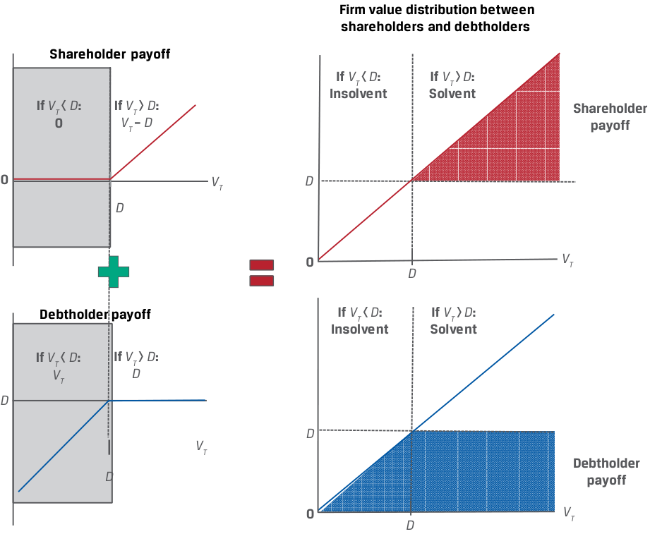

# Volume 7: Derivatives
## Learning Module 9 Option Replication Using Put–Call Parity
### Part 2/2: Option Put–Call Parity Applications: Firm Value (PDF Pages 217–226)

---

<!-- PDF Page 217 -->

###### **EXAMPLE 4** 

##### **VFO Put–Call Forward Parity** 

Consider the Viswan Family Office example using a long forward and a risk-free bond, rather than a cash underlying position as in the prior example. Biomian shares trade at a price ( _S_ 0) of INR295 per share. VFO is considering the purchase of a six-month put on Biomian shares at an exercise price ( _X_ ) of INR265. If VFO’s chief investment officer observes a traded six-month call option price of INR59 per share for the same INR265 exercise price, what should he expect to pay for the put option per share if the relevant risk-free rate is 4%? 

From Equation 5, the put–call forward parity relationship is _p_ 0 – _c_ 0 = [ _X_ – _F_ 0( _T_ )](1 + _r_ )–_T_ . 

Substituting terms and solving for _F_ 0( _T_ ) = INR300.84 (= INR295(1.04)0.5 ), _p_ 0 – INR59 = (INR265 – INR300.84)(1.04)–0.5 . _p_ 0 = INR23.86. 

VFO should expect to pay a six-month put option premium of _p_ 0 = INR23.86. 

#### **OPTION PUT–CALL PARITY APPLICATIONS: FIRM VALUE** 

# **<mark>6</mark>** 

explain put–call parity for European options 

explain put–call _forward_ parity for European options 

The insights established by the put–call parity relationship go well beyond option trading strategies, extending to modeling the value of a firm to describe the interests and financial claims of capital providers—namely, the owners of a firm’s equity and the owners of its debt. 

Assume that at time _t_ = 0, a firm with a market value of _V_ 0 has access to borrowed capital in the form of zero-coupon debt with a face value of _D_ . The market value of the firm’s assets, _V_ 0, is equal to the present value of its outstanding debt obligation, PV( _D_ ), and equity, _E_ 0: _V_ 0 = _E_ 0 + PV( _D_ ). 

When the debt matures at _T_ , the firm’s debt and assets are distributed between shareholders and debtholders with two possible outcomes depending on the firm’s value at time _T_ ( _VT_ ): 

**1. Solvency (** **_VT_ >** **_D_ )** : If the value of the firm ( _VT_ ) _exceeds_ the face value of the debt, or _VT_ > _D_ , at time T, we say the firm is _solvent_ and able to return capital to _both_ its shareholders and debtholders. 

   - Debtholders receive _D_ and are repaid in full. 

   - Shareholders receive the residual: _ET_ = _VT_ – _D_ . 

<!-- PDF Page 218 -->

**2. Insolvency (** **_VT_ <** **_D_ )** : If the value of the firm ( _VT_ ) is _below_ the face value of the debt, or _VT_ < _D_ , at time _T_ , we say the firm is _insolvent._ In the event of insolvency, shareholders receive nothing and debtholders are owed more than the value of the firm’s assets. Debtholders therefore receive _VT_ to settle their debt claim of _D_ at time _T_ . 

   - Debtholders have a priority claim on assets and receive _VT_ < _D_ . 

   - Shareholders receive the residual, _ET_ = 0. 

Unlike the _risk-free_ bond shown in the prior put–call parity lesson, the firm has _risky_ debt, because the bondholders receive _D only_ in the case of solvency (when _VT_ > _D_ ). Debtholders therefore demand a premium similar to a put option premium from shareholders in order to assume the risk of insolvency. 

Shareholders retain _unlimited_ upside potential (if the firm remains solvent and can pay off its debt) and _limited_ downside potential (if the firm becomes insolvent). In contrast, debtholder upside is _limited_ to receiving debt repayment in the event of solvency, and principal and interest are at risk in the downside event of insolvency. 

Next, we examine the respective payoff profiles at maturity more closely. At _t_ = _T_ , 

- shareholder payoff is max(0, _VT_ – _D_ ) and 

- debtholder payoff is min( _VT_ , _D_ ). 

Consider these payoff profiles in terms of options: 

- Shareholders hold a long position in the underlying firm’s assets ( _VT_ ) and have purchased a put option on firm value ( _VT_ ) with an exercise price of _D_ ; that is, max(0, _D_ – _VT_ ). 

- Debtholders hold a long position in a risk-free bond ( _D_ ) and have sold a put option to shareholders on firm value ( _VT_ ) with an exercise price of _D_ . 

The payoff profiles for shareholders versus debtholders is shown in Exhibit 9. 

**Exhibit 9: Shareholder and Debtholder Payoff at Time** **_T_** 

##### **Construction of Shareholder and Debtholder Payoffs** 

<!-- Start of picture text -->
Payoff Purchased put option Long firm assets Shareholder payoff If  VT <  D : If  VT >  D :     0 VT –  D D 0 VT 0 D VT 0 D VT D Sold put option Long risk-free debt Debtholder payoff Payoff If  VT <  D : If  VT >  D : D VT D D VT 0 VT VT D D D <!-- End of picture text -->

<!-- PDF Page 219 -->

##### **Firm Value Distribution Between Shareholders and Debtholders** 

<!-- Start of picture text -->
Firm value distribution between shareholders  and debtholders Shareholder  payoff If  VT  <  D : If  VT >  D : Insolvent Solvent If  VT  <  D : If  VT >  D : Shareholder 0 VT –  D payoff 0 VT D D 0 VT D Debtholder payoff If  VT <  D : If  VT >  D : Insolvent Solvent If  VT  <  D : If  VT >  D : VT D D D VT Debtholder D payoff 0 VT D <!-- End of picture text -->

Note that the shareholder’s combination of a purchased put option and a long position in the firm’s assets is equivalent to a _call_ option on the firm’s assets. The risky debt held by the debtholders is a combination of the risk-free debt, _D_ , and the put option sold to shareholders. 

Revisiting the put–call parity relationship, _S_ 0 + _p_ 0 = _c_ 0 + PV( _X_ ), from Equation 1, we may substitute the value of the firm at time 0 ( _V_ 0) for the underlying asset ( _S_ 0), substitute the debt ( _D_ ) for the risk-free bond ( _X_ ), and solve for _V_ 0 as follows: 

_V_ 0 + _p_ 0 = _c_ 0 + PV( _D_ ). 

_V_ 0 = _c_ 0 + PV( _D_ ) – _p_ 0. ~~(5)~~ 

Equation 6 captures the value of the firm’s assets at _t_ = 0 from a shareholder and debtholder perspective. The _shareholder_ has a position with a payoff similar to that of a call option on firm value ( _c_ 0). The _debtholder_ has a position of PV( _D_ ) – _p_ 0, or risk-free debt of the firm _plus_ a sold put option on firm value. The put option ( _p_ 0) may be interpreted as the _credit spread_ on the firm’s debt, or the premium above the risk-free rate the firm must pay to debtholders to assume insolvency risk. This put option increases in value to shareholders as the likelihood of insolvency increases. From a debtholder’s perspective, the more valuable the sold put, the more credit risk is present in the firm’s debt. 

<!-- PDF Page 220 -->

###### **QUESTION SET** 

##### **Put–Call Forward Parity and Option Applications** 

1. Identify the following statement as true or false, and justify your answer: A key link between put–call parity and put–call forward parity is that the cash underlying position is replaced by a synthetic underlying position using a forward purchase and a risk-free bond. 

###### **Solution:** 

The statement is true. The replacement of the cash underlying position by a synthetic underlying position using a forward purchase and a risk-free bond links call option, put option, and forward prices under put–call forward parity. 

2. Identify which of the following positions has the same no-arbitrage value as which portfolio under put–call forward parity: 

1. Long call option ( _c_ 0) A. Forward sale, long risk-free bond, and long call option 

2. Long risk-free bond ( _X_ (1 + _r_ )–_T_ ) 

3. Long put option ( _p_ 0) 

- B. Forward purchase, long put option, and short risk-free bond 

- C. Long forward purchase, short call option, and long put option 

###### **Solution:** 

Recall that the put–call forward parity relationship may be expressed as 

   - _F_ 0( _T_ )(1 + _r_ )–_T_ + _p_ 0 = _c_ 0 + _X_ (1 + _r_ )–_T_ . 

   1. B is correct. A long call option position is the no-arbitrage equivalent of a forward purchase, a long put option, and a short risk-free bond position. 

   2. C is correct. A long risk-free bond position is equivalent to a long forward purchase, a short call option, and a long put option. 

   3. A is correct. A long put option is equivalent to a forward sale, a long riskfree bond, and a long call option. 

3. Describe the cash flows at the time of option expiration for a synthetic protective put. 

###### **Solution:** 

A synthetic protective put is the combination of a _synthetic_ underlying position (using a forward purchase and a long risk-free bond position equal to the exercise price) and a purchased put. 

At the time of option expiration, time _T_ , there are two possible scenarios: 

**Put option exercised (** **_X_ >** **_ST_ ):** If the put option is exercised, an investor receives ( _X_ – _ST_ ). The risk-free asset returns F0(T), and the forward purchase returns _ST_ – _F_ 0( _T_ ). 

The total return equals ( _X_ – _ST_ ) + [ _ST_ – _F_ 0( _T_ )] + _F_ 0( _T_ ) = _X_ . 

**Put option unexercised (** **_X_ ≤** **_ST_ ):** If the put option is unexercised, it will expire worthless. The risk-free asset returns _F_ 0( _T_ ), and the forward purchase returns _ST_ – _F_ <u>0(</u> _T_ <u>).</u> 

<!-- PDF Page 221 -->

The total return equals [ _ST_ – _F_ 0( _T_ )] + F0( _T_ ) = _ST_ . 

4. Describe how a debtholder’s position may be considered similar to the sale of a put option on firm value. 

###### **Solution:** 

- If the value of the firm ( _VT_ ) is _below_ the face value of its debt outstanding, or _VT_ < _D_ at time _T_ , we say the firm is _insolvent_ and debtholders receive less than the face value ( _D_ ) to settle their debt claim. Stated differently, a debtholder’s payoff is min( _D_ , _VT_ ) = _D_ – max(0, _D_ – _VT_ ) and equals the debt face value ( _D_ ) minus a put option on firm value ( _VT_ ) with an exercise price of _D_ , which represents a _sold_ put on firm value. 

<!-- PDF Page 222 -->

## **~~PRACTICE PROBLEMS~~** 

### **The following information relates to questions 1-6** 

###### **South China Sprintwyck Investments (SCSI)** 

South China Sprintwyck Investments (SCSI) has a Chinese equity portfolio that has outperformed in the first half of the year due to an overweight position in health care industry shares. SCSI is considering option-based alternatives for one of its current overweight positions, ChinaWell Inc. (CWI). CWI has a current price ( _S_ 0) of CNY127.50 and pays no dividends. The current risk-free rate is 4%. You are a new SCSI analyst hired to evaluate several alternatives for CWI stock. 

**1.** SCSI is considering the sale of a three-month call on CWI shares. If you observe a traded put price with the same underlying details, which of the following statements best describes how to derive the no-arbitrage call price? 

   - **A.** Using put–call parity, the call price may be derived by _subtracting_ the traded put price from the underlying price less the present value of the exercise price. 

   - **B.** Using put–call parity, the call price may be derived by _adding_ the traded put price to the underlying price less the present value of the exercise price. 

   - **C.** Using put–call parity, the call price may be derived by _adding_ the traded put price to the present value of the exercise price minus the underlying price. 

**2.** Due to the recent sharp rise in CWI’s share price, SCSI is recommending that clients consider protective put strategies for three- to six-month tenors. If you observe that a six-month CWI call option at an exercise price of CNY120 is trading at a price of CNY22.60, which answer is closest to what you would expect to pay for a six-month put option with the same underlying terms? 

   - **A.** CNY15.10 

   - **B.** CNY9.83 

   - **C.** CNY12.77 

**3.** You realize that the six-month put option on CWI shares is overpriced relative to the no-arbitrage price from Question 2. Which of the following statements best describes the steps you would take to earn a riskless arbitrage profit under this scenario? 

   - **A.** Sell the six-month put option and sell CWI short, investing the proceeds in a call option and a risk-free bond. 

   - **B.** Sell the six-month put option, buy a call option, and borrow at the risk-free rate to buy CWI shares. 

   - **C.** Sell the six-month put option, buy a call option, enter a forward purchase of CWI, and invest in a risk-free bond. 

<!-- PDF Page 223 -->

**4.** In her most recent research note on CWI, SCSI’s equity analyst specifically mentions an increase in CWI’s leverage ratio as a reason for her bearish outlook on the stock. Applying the put–call parity relationship to the value of the firm, which of the following statements most accurately describes the CWI outlook in terms of option pricing? 

   - **A.** The shareholder payoff has improved versus debtholders, because they have sold a put option on the firm value that has appreciated. 

   - **B.** The debtholder payoff has deteriorated versus the shareholders, because they are effectively short a put option on the value of the firm equal to the value of debt, which has appreciated in value. 

   - **C.** The shareholder payoff has improved versus the debtholders, because the debtholders have sold a call option on the firm’s assets to the shareholders. 

**5.** Which of the following choices best describes how SCSI could replicate a long risk-free bond return using a forward contract on CWI and call and put options on CWI? 

   - **A.** Short a forward contract on CWI, short a put option on CWI, and long a call option on CWI 

   - **B.** Long a forward contract on CWI, long a put option on CWI, and short a call option on CWI 

   - **C.** Long a forward contract on CWI, long a put option on CWI, and long a call option on CWI 

**6.** SCSI observes that a 3-month call option on CWI with an exercise price of CNY 130 trades at a premium of CNY 3. A 3-month forward contract on CWI trades at a forward price of CNY 128.76. Which of the following choices is closest to the correct premium for a 3-month put option with an exercise price of CNY 130 on CWI? 

   - **A.** CNY 4.20 

   - **B.** CNY 1.20 

   - **C.** CNY 0.50 

<!-- PDF Page 224 -->

## **~~SOLUTIONS~~** 

1. The correct answer is B. From Equation 1, the put–call parity relationship is _S_ 0 + _p_ 0 = _c_ 0 + _X_ (1 + _r_ )–_T_ . 

We can rearrange these terms to solve for _c_ 0: _c_ 0 = _S_ 0 + _p_ 0 – _X_ (1 + _r_ )–_T_ , which shows that the call price may be derived by _adding_ the traded put price to the underlying price less the present value of the exercise price. 

2. The correct answer is C. If _c_ 0 = CNY22.60, _S_ 0 = CNY127.50, and PV( _X_ ) = CNY117.67 (= 120(1.04)–0.5 ), we can solve for _p_ 0 using put–call parity: _S_ 0 + _p_ 0 = _c_ 0 + _X_ (1 + _r_ )–_T_ . 

_p_ 0 = _c_ 0 + _X_ (1 + _r_ )–_T_ – _S_ 0. 

CNY12.77 = 22.60 + 117.67 – 127.50. 

3. The correct answer is A. Since the put option is overpriced, we would sell it to earn the difference between the price at which it is sold and the no-arbitrage price. The put–call parity relationship, from Equation 1, is 

   - _S_ 0 + _p_ 0 = _c_ 0 + _X_ (1 + _r_ )–_T_ . 

We can rearrange this to demonstrate that the put option value is equivalent to a long call option, a long risk-free bond, and a short position in CWI shares: 

_p_ 0 = _c_ 0 + _X_ (1 + _r_ )–_T_ – _S_ 0. 

Answer A reflects this long risk-free bond and short CWI combination, which has a payoff of _X_ – _ST_ at expiration matching that of the put payoff, whereas Answer B involves a long cash position in CWI and Answer C involves a long synthetic (forward purchase) position in CWI stock. 

4. The correct answer is B. The debtholder payoff has deteriorated versus the shareholders, because they are effectively short a put option on the value of the firm equal to the value of debt, which has appreciated in value. 

   - The debtholder payoff is min( _D_ , _VT_ ) = _D_ – max(0, _D_ – _VT_ ) and equals the debt face value ( _D_ ) _minus_ a put option on firm value ( _VT_ ) with an exercise price of _D_ . Answer A is incorrect because the debtholders, not the shareholders, have sold a put option. C is incorrect, because the shareholders own a call option, but it is not sold by the debtholders. 

5. B is correct. Using the put–call forward parity equation as follows: _F_ 0( _T_ )(1 + _r_ )–_T_ + _p_ 0 = _c_ 0 + _X_ (1 + _r_ )–_T_ 

And rearranging to solve for the risk-free bond gives the following: 

- _F_ 0( _T_ )(1 + _r_ )–_T_ + _p_ 0 – _c_ 0 = _X_ (1 + _r_ )–_T_ . 

The signs on the forward contract and put option positions are both positive, indicating long positions. The negative sign on the call option indicates a short position. 

6. A is correct. The solution can be derived through either put–call parity or put– call forward parity. You can demonstrate the solution using put–call forward parity: 

   - _F_ 0( _T_ )(1 + _r_ )–_T_ + _p_ 0 = _c_ 0 + _X_ (1 + _r_ )–_T_ 128.76(1.04)–0.25 + _p_ 0 = 3 + 130(1.04)–0.25 

<!-- PDF Page 225 -->

127.50 + _p_ 0 = 131.73 _p_ 0 = 4.23. 

<!-- PDF Page 226 -->

