# Volume 7: Derivatives
## Learning Module 10 Valuing a Derivative Using a One-Period Binomial Model
### Part 1/2: Introduction (PDF Pages 227–242)

---

<!-- PDF Page 227 -->

#### L E A R N I N G M O D U L E 

# **<mark>10</mark>** 

### **Valuing a Derivative Using a One-Period Binomial Model** 

###### **<mark>LEARNING OUTCOMES</mark>** 

###### **_Mastery The candidate should be able to:_** 

explain how to value a derivative using a one-period binomial model describe the concept of risk neutrality in derivatives pricing 

##### **INTRODUCTION** 

## **<mark>1</mark>** 

Earlier lessons explained how the principle of no arbitrage and replication can be used to value and price derivatives. The put–call parity relationship linked put option, call option, underlying asset, and risk-free asset prices. This relationship was extended to forward contracts given the equivalence of an underlying asset position and a long forward contract plus a risk-free bond. 

Forward commitments can be priced without making assumptions about the underlying asset’s price in the future. However, the pricing of options and other contingent claims requires a model for the evolution of the underlying asset’s future price. The first lesson introduces the widely-used binomial model to value European put and call options. A simple one-period version is introduced, which may be extended to multiple periods and used to value more complex contingent claims. In the second lesson, we demonstrate the use of risk-neutral probabilities in derivatives pricing. 

###### **LEARNING MODULE OVERVIEW** 

- The one-period binomial model values contingent claims, such as options, and assumes the underlying asset will either increase by _R__u_ (up gross return) or decrease by _R__d_ (down gross return) over a single period that corresponds to the expiration of the derivative contract. 

- The binomial model combines an option with the underlying asset to create a risk-free portfolio where the proportion of the option to the underlying security is determined by a hedge ratio. 

CFA Institute would like to thank Don Chance, PhD, CFA, for his contribution to this section, which includes material derived from material that appeared in _Derivative Markets and Instruments_ , featured in the 2022 CFA® Program curriculum. 

<!-- PDF Page 228 -->

- The hedged portfolio must earn the prevailing risk-free rate of return; otherwise, riskless arbitrage profit opportunities would be available. 

- Valuing a derivative via risk-free hedging is equivalent to computing the discounted expected payoff of the option using _risk-neutral_ probabilities rather than actual probabilities. 

- Neither the actual (real-world) probabilities of underlying price increases or decreases nor the expected return of the underlying are required to price an option. 

- The one-period binomial model can be extended to multiple periods as well to value more complex contingent claims. 

###### **LEARNING MODULE SELF-ASSESSMENT** 

These initial questions are intended to help you gauge your current level of understanding of this learning module. 

1. Which of the following statements most correctly describes the binomial model for valuing options? 

   - **A.** The model uses the actual probabilities associated with stock price moves up or down. 

   - **B.** The model assumes that a risk-free portfolio can be created by combining the option and the underlying according to a hedge ratio. 

   - **C.** The model is similar to those used for valuing forward and futures contracts. 

###### **Solution:** 

B is correct. Unlike forward commitments, contingent claims, such as options, require that we model the future price behavior of the underlying asset because unlike forwards and futures, options have asymmetric payoffs. By modeling the future price behavior, the option and its underlying asset can be combined into a risk-free portfolio. The cost of this portfolio, where the proportion of the option and the underlying asset is set by a hedge ratio, determines the no-arbitrage price of the option. A is incorrect because the actual probabilities of up and down price moves do not factor into the model. C is incorrect because options have asymmetric payoffs, so they must be modeled differently than symmetric-payoff instruments like forward and futures contracts. 

2. When using a one-period binomial model to price a call option, an increase in the actual probability of an upward move in the underlying asset will result in the call option price: 

   - **A.** decreasing. 

   - **B.** staying the same. 

   - **C.** increasing. 

###### **Solution:** 

The correct answer is B. The call option price will stay the same. The actual (real-world) probabilities of an up or a down price movement in a binomial model do not influence the (no-arbitrage) <u>price of an option.</u> 

<!-- PDF Page 229 -->

3. Identify which of the various factor changes has which effect on the no-arbitrage price of a put option based on the one-period binomial model: 

1. The probability of an upward price A. Put option price remains the same movement, _q_ , increases. 2. The spread between the up and down B. Put option price increases factor, _R__u_ − _R__d_ , increases. 3. The risk-neutral probability of price, C. Put option price decreases π, increases. **Solution:** 1. The correct answer is A. The probability of an upward price movement, _q_ , has no impact on value in the one-period binomial option pricing model. Thus, this change would not have any impact on the price of a put option, and the price of the put option would remain the same. 2. The correct answer is B. The spread between the up and down factor, _R__u_ _– R__d_ , increases the range of potential prices, which increases the likelihood that the option ends up in the money. Thus, this change would increase the price of a put option. 3. The correct answer is C. The risk-neutral probability of price, π, captures the probability of the price of the underlying increasing. As π increases, the likelihood of the put option ending up in the money decreases. 

4. A one-period binomial model assumes that the price of the underlying asset can change from $16.00 today to either $20.00 or $12.00 at the end of the period. If the risk-free rate of return over the period is 5%, which of the following choices is closest to the risk-neutral probability of a price increase? **A.** 0.50 **B.** 0.60 **C.** 0.625 

**Solution:** B is correct. An increase from $16.00 to $20.00 or a decrease from $16.00 to $12.00 corresponds to: _R__u_ = $20.00/$16.00 = 1.25 and _R__d_ = $12.00/$16.00 = 0.75. Using the risk-neutral probability (π) of a price increase: π = (1 + _r_ – _R__d_ )/( _R__u_ – _R__d_ ) = (1 + 0.05 – 0.75)/(1.25 – 0.75) = 0.3/0.5 = 0.60. 

explain how to value a derivative using a one-period binomial model 

<!-- PDF Page 230 -->

The law of one price states that if the payoffs from any two assets (or portfolio of assets) at a given future time are identical in all possible scenarios, then the value of these two assets must also be identical _today_ . Forward commitments offer symmetric payoffs at a predetermined price in the future, the value of which are independent of the future price behavior of the underlying asset. 

The asymmetric payoff profile of options and other contingent claims makes valuation of these instruments more challenging. Assumptions about future prices are an important component in option valuation given the different payoffs under different scenarios whose likelihood changes over time. Option valuation therefore requires the specification of a model for the future (random) price behavior of the option’s underlying asset. 

The binomial model is a common tool used to determine the no-arbitrage value of an option. The simplicity of this model makes it attractive, as we only need to make an assumption about the magnitude of the potential upward and downward price changes of the underlying asset in a future time period. 

## **<mark>3</mark>** 

##### **THE BINOMIAL MODEL** 

explain how to value a derivative using a one-period binomial model 

The binomial model builds on a simple idea: Over a given period of time, the asset’s price will either go up ( _u_ ) to _S_ 1_u_ _> S_ 0 or go down ( _d_ ) to _S_ 1_d_ _< S_ 0. We do not need to know the future price in advance, because it is determined by the outcome of a random variable. The movement from _S_ 0 to either _S_ 1_u_ or _S_ 1_d_ can be interpreted as the outcome of a _Bernoulli trial._ 

Let us denote _q_ as the probability of an upward price movement and 1 − _q_ as the probability of a downward price movement. With only two possible outcomes—the price either goes up or down—the sum of probabilities must equal 1. We will also find it useful to define the gross return from an up or a down price move as: 

<!-- Formula Text: Ru = S1u/S0> 1 (1) -->

<!-- Formula Text: Rd = S1d/S0< 1 (2) -->

At first glance, it would appear that knowing _q_ is crucial in determining the value of an option on any underlying asset. However, knowing _q_ is not required; only specifying the values of _S_ 1_u_ and _S_ 1_d_ is needed. The difference between _S_ 1_u_ and _S_ 1_d_ measures the “spread” of possible future price outcomes. Specifying _S_ 1_u_ and _S_ 1_d_ (or _R__u_ _S_ 0 and _R__d_ _S_ 0) determines the _volatility_ of the underlying asset, an important factor in valuing options as shown earlier. Simply stated, the size of the up and down price movements should match the underlying asset volatility, as shown in Exhibit 1. 

<!-- PDF Page 231 -->

###### **Exhibit 1: Price Movement for the Underlying Asset** 

<!-- Start of picture text -->
S 1 u = RuS 0 S 0 S 1 d = RdS 0 0 Time T  = 1 <!-- End of picture text -->

Binomial models may be extended to multiple periods where the underlying asset price can move up or down in each period. This extension creates a binomial tree, a powerful way to model more realistic price dynamics. A simple one-period binomial model is sufficient to introduce the pricing methodology and the required steps in the option pricing procedure. 

##### **PRICING A EUROPEAN CALL OPTION** 

## **<mark>4</mark>** 

explain how to value a derivative using a one-period binomial model 

Consider a one-year European call option with an exercise price ( _X_ ) of €100. The underlying spot price ( _S_ 0) is €80. The one-period binomial model corresponds to the option’s time to expiration of one year. 

The binomial model specifies the possible values of the underlying asset in one year, where the option value is a known function of the value of the underlying asset. Further, we assume that _S_ 1_d_ _< X < S_ 1u (i.e., the exercise price of the option [ _X_ = €100] is between the value of the underlying in the two scenarios)—for example, setting _S_ 1_d_ = €60 and _S_ 1u = €110. Then, _R__u_ _=_ 1.375 and _R__d_ _=_ 0.75. The value of the call option is as follows: 

- At _t_ = 0, the call option value is _c_ 0 _._ 

- At _t_ = 1, the call option value is either _c_ 1_u_ (if the underlying price rises to _S_ 1u ) or _c_ 1_d_ (if the underlying price falls to _S_ 1_d_ ). 

   - **Up move to** **_S_ 1****_u_** **:** Call option ends up _in-the-money_ 

- _c_ 1_u_ = Max (0, _S_ 1_u_ − _X_ ) = Max (0,  €110 − €100) = €10. 

   - **Down move to** **_S_ 1****_d_** **_:_** _C_ all option expires _out-of-the-money_ 

- _c_ 1_d_ = Max (0, _S_ 1_d_ − _X_ ) = Max (0,  €60 − €100) = 0. 

Exhibit 2 summarizes the one-period binomial model and the value of the underlying asset and call option. 

<!-- PDF Page 232 -->

###### **Exhibit 2: One-Period Binomial Option Pricing** 

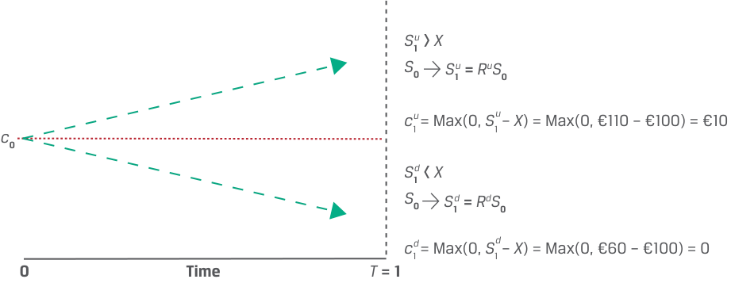

<!-- Start of picture text -->
S 1 u >  X S 0 S 1 u  =  RuS 0 c 1 u  = Max(0,  S 1 u  –  X ) = Max(0, €110 – €100) = €10 c 0 S 1 d  <  X S 0 S 1 d  =  RdS 0 c 1 d  = Max(0,  S 1 d  –  X ) = Max(0, €60 – €100) = 0 0 Time T  = 1 <!-- End of picture text -->

The only unknown value is _c_ 0, which may be determined using replication and no-arbitrage pricing. That is, the value of both the option and its underlying asset in each future scenario may be used to construct a risk-free portfolio. For example, assume that at _t_ = 0 we sell the call option at a price of _c_ 0 and purchase _h_ units of the underlying asset. Denoting the value of the portfolio as _V_ , we have the following: 

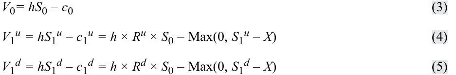

<!-- Formula Text: V0= hS0 – c0 (3) V1u = hS1u – c1u = h × Ru × S0 – Max(0, S1u – X) (4) V1d = hS1d – c1d = h × Rd × S0 – Max(0, S1d – X) (5) -->

_V_ 0 represents the initial portfolio investment in the portfolio, and _V_ 1_u_ and _V_ 1_d_ represent the portfolio value if the underlying price moves up or down, respectively. We must choose _h_ so that _V_ 1_u_ _= V_ 1_d_ (i.e., the portfolio value is the same in either scenario). The value of the combination, _V_ 1, will not change if the underlying asset price changes. For portfolio _V_ 0, the impacts of the changes are as follows: 

- **Up move from** **_S_ 0 to** **_S_ 1****_u_** **by** **_R_****_u_** **:** 

   - The asset value changes from €80 to €110 by 1.375, or 37.5%. 

   - The call option ends up _in-the-money_ : 

- _c_ 1_u_ = Max (0, _S_ 1_u_ − _X_ ) = Max (0, €110 − €100) = €10. 

   - Total portfolio value: _V_ 1_u_ _= hS_ 1_u_ – _c_ 1_u_ _=_ €110 × _h_ − €10. 

- **Down move from** **_S_ 0 to** **_S_ 1****_d_** **by** **_R_****_d_** **:** 

   - The asset value changes from €80 to €60 by 0.75, or –25%. 

   - The call option expires _out-of-the-money_ : 

- _c_ 1_d_ = Max (0, _S_ 1_d_ − _X_ ) = Max (0, €60 − €100) = 0. 

   - Total portfolio value: _V_ 1_d_ = _hS_ 1_d_ – _c_ 1_d_ _=_ €60 × _h._ 

Since we create two portfolios at time _t_ = 0 with identical payoffs at option expiry at time _t_ = 1, we must solve for _h_ , the ratio between the underlying asset, _S_ 0, and the call option, _c_ 0, such that _V_ 1_u_ _= V_ 1_d_ , or _hS_ 1_u_ _– c_ 1_u_ _= hS_ 1_d_ _– c_ 1_d_ _._ Solving for _h_ * yields: 

<!-- Formula Text: h *  = c 1 u − c 1 d _ s 1 u − s 1 d , (6) -->

<!-- PDF Page 233 -->

where all quantities on the right-hand side are known at _t_ = 0. Equation 6 gives us the **hedge ratio** of the option, or the _proportion_ of the underlying that will offset the risk associated with an option. In our sold call option example, 

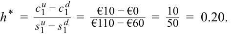

<!-- Formula Text: h *  = c 1 u − c 1 d _ s 1 u − s 1 d   =    €10 − €0 _ €110 − €60   =   10 _ 50   =  0.20. -->

For each call option unit sold, we buy 0.2 units of the underlying asset (or for each underlying asset unit, we must sell 5 call options to equate the portfolio values at _t_ = 1). Consider the two scenarios as follows: 

> ■ **Up move from** **_S_ 0 to** **_S_ 1****_u_** **by** **_R_****_u_** **:** 

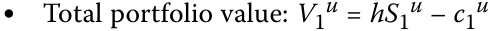

<!-- Formula Text: ● Total portfolio value: V1u = hS1u – c1u -->

_=_ €110 × 0.20 − €10 = €22 – 10 = €12. 

■ **Down move from** **_S_ 0 to** **_S_ 1****_d_** **by** **_R_****_d_** **:** 

- Total portfolio value _V_ 1_d_ _= hS_ 1_d_ _– c1__d_ _=_ €60 × 0.20 = €12. 

The portfolio values are the same, _V_ 1_u_ _= V_ 1_d_ , which has two implications: 

**1.** We can use either portfolio to value the derivative, and 

**2.** The return _V_ 1_u_ _/ V_ 0 _= V_ 1_d_ _/ V0_ must equal one plus the risk-free rate. 

Exhibit 3 summarizes these results. 

###### **Exhibit 3: Value of the Hedged Portfolio** 

<!-- Start of picture text -->
V 1 u = hS 1 u – c 1 u = €110 × 0.20 – €10 = €22 – 10 = €12 V 0 =  h  ×  S 0 –  c 0 V 1 d = hS 1 d – c 1 d = €60 × 0.20 – €0 = €12 0 Time T  = 1 <!-- End of picture text -->

This hedging approach is not specific to call options and can be used for any derivative contract whose value is entirely determined by the underlying asset’s value at _t_ = 1. 

To prevent arbitrage, the portfolio value at _t_ = 1, 

- _V_ 1 = _h_ × _R__u_ _S_ 0 − _c_ 1_u_ = _h_ × _R__d_ _S_ 0 − _c_ 1_d_ , 

should be discounted at the risk-free rate so that: 

<!-- Formula Text: V 1 -->

<!-- Formula Text: h S 0 − c 0  =   _ 1 -->

_1 + _r_. 

Based on no-arbitrage pricing and the certain portfolio payoff, _V_ 1, the value of the call option may be shown as: 

<!-- PDF Page 234 -->

_c_ 0 = _h_ × _S_ 0 − _V_ 1( 1 + _r_)−1 . ~~(7)~~ 

Substituting the information from the previous example, we already established that _V_ 1 = €12. For an annual risk-free rate of 5%: 

_c_ 0 = _h_ × _S_ 0 − _V_ 1(1 + r)−1 

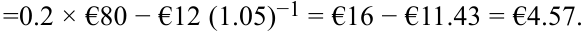

<!-- Formula Text: =0.2 × €80 − €12 (1.05)−1 = €16 − €11.43 = €4.57. -->

The call option price _c_ 0 is therefore €4.57. We may confirm an investor in the hedge portfolio would earn the risk-free rate ( _r_ ) of 5% by comparing the initial portfolio value _V_ 0 with the portfolio value after one period of _V_ 1 (recalling that _V_ 1_u_ = _V_ 1_d_ ) equal to €12: 

_V_ 0 = _h_ × _S_ 0 – _c_ 0 

_V_ 0 = €11.43 = €16 - €4.57 _V_ 1 = _V_ 0(1 + _r_ ) ~~(8)~~ 

_V_ 1 = €12 = €11.43 (1 + 0.5) 

###### **EXAMPLE 1** 

###### **Hightest Capital** 

Hightest Capital believes that a particular non-dividend-paying stock is currently trading at $50 and is considering the sale of a one-year European call option at an exercise price of $55. Answer the following questions: 

**1.** If the stock price is expected to either go up or down by 20% over the next year, what price should Hightest expect to receive for the sold call option? Assume a risk-free rate of 5%. 

**2.** How would the call option price change if the stock price were expected to either go up or down by 40% over the next year? 

**3.** If Hightest had a more optimistic outlook on the future stock price (i.e., they estimated a higher probability of the option ending up in-the-money), how would the expected call option price change? 

**4.** What would be the price of a one-year put option at an exercise price of $55 if the stock price were expected to change by 20%? 40%? 

###### **Solution to 1:** 

Denote the initial price of the underlying stock as _S_ 0 _=_ $50 and the exercise price of the call option as _X =_ $55. If the stock price moves up or down by 20%, then: 

_S_ 1_u_ = _R__u_ _S_ 0 = 1.2 × $50 = $60. 

<!-- Formula Text: S 1 d  =  R d S 0  =  0.8 × $50  =  $40. -->

The price will either move up to $60 or down to $40. Given that the payoff of a call option at expiry is Max(0, _ST_ − _X_ ): 

- _c_ 1_u_ = Max (0, _S_ 1_u_ − _X_ ) = Max (0,  $60 − $55) = $5. 

<!-- Formula Text: c 1 d  =  Max(0,   S 1 d − X)  =  Max(0,  $40 − $55)  =  $0. -->

The call option value is $5 if the underlying stock increases in price by 20% and zero if it decreases by 20%. The hedge ratio of the option is: 

<!-- Formula Text: h *  = (c 1 u − c 1 d) _ (S 1 u − S 1 d)   = $5.00 − $0 ____________ $60.00 − $40.00   =   $5.00 _ $20.00   =  0.25. -->

<!-- PDF Page 235 -->

To create a risk-free portfolio, we can sell a call option and purchase 0.25 units of the underlying asset today. At maturity, the hedged portfolio value is: 

<!-- Formula Text: V 1  =  V 1 u  =  h * S 1 u − c 1 u  =  0.25 × $60.00 − $5.00  =  $10.00. -->

<!-- Formula Text: V 1  =  V 1 d  =  h * S 1 d − c 1 d  =  0.25 × $40.00 − $0.00  =  $10.00. -->

We can use either _V_ 1_u_ or _V_ 1_d_ to compute the certain value, _V_ 1, and the present value of the hedged position today is: 

_V_ 0 = _V_ 1(1 + _r_ )−1 = $10.00 × 1.05−1 = $9.52. 

The call option value is: 

<!-- Formula Text: c0 = h*S0 − V0 = 0.25 × $50.00 − $9.52 = $12.50 − $9.52 = $2.98. -->

The no-arbitrage price of the call option should be $2.98. If not, then investors would be able to construct a synthetic risk-free asset using the option and its underlying asset with a higher return than the risk-free rate. 

Note that the hedge ratio (0.25 units in this example) is positive in this case since the derivative is sold and the underlying is purchased. A negative hedge ratio implies that _both_ the derivative and the underlying are purchased or sold to create the hedge. Also, while the hedge ratio is usually expressed as a fraction of an underlying unit, option contracts are usually traded in larger size, allowing a round number of underlying assets to be purchased or sold as a hedge. It is important that the _ratio_ (4:1 in this case) of options to underlying units is maintained in the portfolio. 

###### **Solution to 2:** 

If the stock price changes by 40%, then the call option payoff at expiry is: 

<!-- Formula Text: c 1 u  =  Max(0,   S 1 u − X)  =  Max(0,  $70 − $55)  =  $15. -->

<!-- Formula Text: c 1 d  =  Max(0,   S 1 d − X)  =  Max(0,  $30 − $55)  =  0. The hedge ratio of the option is: h *  = (c 1 u − c 1 d) _ (S 1 u − S 1 d)   =   $15 − $0 _ $70 − $30   =   $15 _ $40   =  0.375. -->

At maturity, the perfectly hedged portfolio is worth: 

_V_ 1 = _V_ 1_u_ = _h_* _S_ 1_u_ − _c_ 1_u_ = 0.375 × $70 − $15 = $11.25. _V_ 1 = _V_ 1_d_ = _h_* _S_ 1_d_ − _c_ 1_d_ = 0.375 × $30 − $0 = $11.25. The present value of the hedged position at _t_ = 0 is: 

_V_ 0 = _V_ 1(1 + r)−1 = $11.25 × 1.05−1 = $10.71. Then, the call option price at _t_ = 0 is: 

_c_ 0 = _h_ * _S_ 0 − _V_ 0 = 0.375 × $50 − $10.71 = $18.75 − $10.71 = $8.04. 

A higher expected price change indicates higher volatility. An increase in the range of future price changes increases the value of the call option. 

<!-- PDF Page 236 -->

###### **Solution to 3:** 

Since the actual probabilities of an up or a down move in the underlying asset do not affect the no-arbitrage value of the option, the option price that Hightest may charge should not change. Hightest can offset the risk of selling the call by purchasing _h*_ units of the underlying asset, so any directional views on the stock price do not affect the hedge position. 

###### **Solution to 4:** 

Using put–call parity, _c_ 0 − _p_ 0 = _S_ 0 − _X_ (1 + _r_ )−_T_ , and rearranging terms to solve for the put price, when the stock price changes by 20% and the call option price is $2.98, the result can be calculated as: 

_p_ 0 = _c_ 0 − _S_ 0 + _X_ (1 + _r_ )−_T_ = $2.98 − $50 + $55(1 + 0.05)−1 = $5.36. 

When the underlying stock price changes by 40% and the call option price is $8.04, the put option price is: 

_p_ 0 = _c_ 0 − _S_ 0 + _X_ (1 + _r_ )−_T_ = $8.04 − $50 + $55(1 + 0.05)−1 = $10.42. 

###### **QUESTION SET** 

###### **Binomial Valuation of Options** 

1. Determine the correct answers to fill in the blanks: To price a contingent claim, such as an option, a model for the __________ of the underlying asset is needed due to the ___________ nature of the contract’s payoff. 

###### **Solution:** 

To price a contingent claim, such as an option, a model for the _future price behavior_ of the underlying asset is needed due to the _asymmetric_ nature of the contract’s payoff. 

2. Describe the main difference between pricing a contingent claim and pricing a forward commitment. 

###### **Solution:** 

The symmetric nature of a forward commitment’s payoff (i.e., the obligation to transact at maturity) allows the commitment to be perfectly replicated without the need to model the future price behavior of the underlying asset. However, the asymmetric nature of a contingent claim’s payoff (i.e., the right but _not_ the obligation to transact at maturity) _does_ require the future price behavior to be modeled. 

3. If a one-period binomial model is used to price an at-the-money put option, which of the following statements is _most_ accurate? The option will be: 

   - **A.** in-the-money if the price moves up. 

   - **B.** out-of-the-money if the price moves up. 

   - **C.** at-the-money if the price moves up or down. 

###### **Solution:** 

The correct answer is B; the option will be out-of-the-money if the price moves up. An at-the-money put option has an exercise price equal to the underlying asset price. Therefore, a price decrease will result in the put op- 

<!-- PDF Page 237 -->

tion moving _in the money_ , and a price increase will result in the put option moving _out of the money_ . 4. Explain how increasing the up gross return, _R__u_ , and/or decreasing the down gross return, _R__d_ , in a one-period binomial model would influence the price of a call and a put option. **Solution:** In a one-period binomial model, the volatility of the underlying asset is represented by the spread between the up gross return, _R__u_ , and the down gross return, _R__d_ . Therefore, if either the up gross return increases or the down gross return decreases (or both), the price of the underlying asset at maturity will be more volatile. If all else remains equal, then the price of both call and put options will increase when the underlying asset is expected to have a higher volatility over the life of the option. 5. A put option on a non-dividend-paying stock has an exercise price, _X_ , of £21 and six months left to maturity. The current stock price, _S_ 0, is £20, and an investor believes that the stock’s price in six months’ time will be either 10% higher or 10% lower. **a.** Describe how the investor can construct a perfectly hedged portfolio using the put option and its underlying stock. **b.** What will the value of the hedged portfolio be in the scenario that the stock price rises and the scenario that the stock price falls (assume a risk-free rate is 4%)? **c.** What is the no-arbitrage price of the put option? **Solution: a.** Denote the initial price of the underlying stock as _S_ 0 _=_ £20.00 and the exercise price of the put option as _X =_ £21.00. If the stock price moves up by 10%, then: _S_ 1_u_ = _R__u_ _S_ 0 = 1.1 × £20.00 = £22.00. If the stock price moves down by 10%, then _S_ 1_d_ = _R__d_ _S_ 0 = 0.9 × £20.00 = £18.00. Given that the payoff of a put option at expiry is Max(0, _X_ − _ST_ ): _p_ 1_u_ = Max (0, _X_ − _S_ 1_u_ ) = Max (0,  £21.00 − £22.00) = £0. _p_ 1_d_ = Max (0, _X_ − _S_ 1_d_ ) = Max (0,  £21.00 − £18.00) = £3.00. 

The put option will be worth _£_ 3.00 if the underlying stock decreases in price by 10% and worthless if it increases by 10%. The hedge ratio of the option is: 

<!-- Formula Text: h *  = (p 1 u − p 1 d) _ (S 1 u − S 1 d)   =    £0 − £3 _ £22 − £18   =   £3 _ £4   =  − 0.75. -->

So, to create a risk-free portfolio, we can buy the put option and buy 0.75 units of the underlying asset. 

**b.** At maturity, the value of the perfectly hedged portfolio is: 

_V_ 1 = _V_ 1_u_ = _h_* _S_ 1_u_ + _p_ 1_u_ = 0.75 × £22 + £0 = £16.50. 

<!-- PDF Page 238 -->

- _V_ 1 = _V_ 1_d_ = _h_* _S_ 1_d_ + _p_ 1_d_ = 0.75 × £18 + £3.00 = £16.50. 

We can use either _V_ 1_u_ or _V_ 1_d_ to compute the certain value, _V_ 1, and the present value of the hedged position today is: 

<!-- Formula Text: V0 = V1(1 + r)−1 = £16.50 × 1.04−0.5 = £16.18. -->

- **c.** The price of the put option is: 

_p_ 0 = _V_ 0 − _h_ * _S_ 0− = £16.18 − 0.75 × £20 = £16.18 − £15 = £1.18. The no-arbitrage price of the put option should be £1.18. 

6. Determine the correct answers to fill in the blanks: When the _______________ applies, the rate of return on all (real or synthetic) riskfree assets should equal the __________. 

###### **Solution:** 

When the _law of one price_ applies, the rate of return on all (real or synthetic) risk-free assets should equal the _risk-free rate_ . 

## **<mark>5</mark> RISK NEUTRALITY** 

describe the concept of risk neutrality in derivatives pricing 

As shown in the prior lesson, an option’s value is not affected by actual (real-world) probabilities of underlying price increases or decreases. This realization contributed to the growing use of options as it became easier to agree on a given option’s value. As we will see in this lesson, only the expected volatility—that is, gross returns _R__u_ and _R__d_ introduced earlier—and not the expected return are required to price an option. 

We may generalize the relationship between an option’s value and that of the hedge portfolios from Equation 5 of the prior lesson using the example of a call option _c_ 0 as follows: 

<!-- Formula Text: c 0  = (π c 1 u + (1 − π) c 1 d) _____________ (1 + r) T . (9) -->

The value of the call option today, _c_ 0, is computed as the expected value of the option at expiration, _c_ 1_u_ and _c_ 1_d_ , discounted at the risk-free rate, _r_ . This shows the derivative’s value as similar to any other asset in that it equals the present value of expected future cash flows. In this case, these cash flows are weighted by assumed probabilities that are consistent with risk-neutral returns on the underlying. 

The **risk-neutral probability** (π) is the computed probability used in binomial option pricing by which the discounted weighted sum of expected values of the underlying, _S_ 1_u_ = _R__u_ _S_ 0 and _S_ 1_d_ = _R__d_ _S_ 0, equal the current option price. Specifically, this probability is computed using the risk-free rate and assumed up gross return and down gross return of the underlying as in Equation 7. 

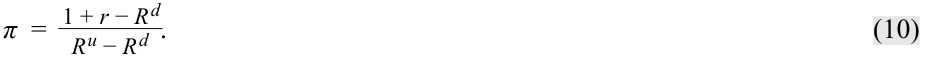

<!-- Formula Text: π  =   1 + r − R d _ R u − R d  . (10) -->

More specifically, π, is the risk-neutral probability of an increase in the underlying price to _S_ 1_u_ _= R__u_ _S_ 0, and (1 − π) is that of a decrease, _S_ 1_d_ _= R__d_ _S_ 0. 

<!-- PDF Page 239 -->

Substituting the details from our earlier example, where _R__u_ _S_ 0 _=_ €110, _R__d_ _S_ 0 _=_ €60, _S_ 0 _=_ €80, and _X =_ €100, _R__u_ _=_ 1.375 and _R__d_ _=_ 0.75 and assuming an annual risk-free rate of 5%: 

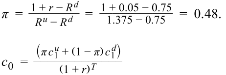

<!-- Formula Text: π  =   1 + r − R d _ R u − R d    =   1 + 0.05 − 0.75 ___________ 1.375 − 0.75    =  0.48. c 0  = (π c 1 u + (1 − π) c 1 d) _____________ (1 + r) T -->

=[0.48 × Max(0, €110 − €100) + 0.52 × Max(0, €60 − €100)]/1.05 

= €4.80/1.05 = €4.57, which matches our earlier result from the prior lesson. 

In Equation 7, the risk-neutral probabilities are determined solely by the up and down gross returns, _R__u_ and _R__d_ , representing underlying asset volatility and the risk-free rate used to calculate the present value of future cash flows. This no-arbitrage derivative value established separately from investor views on risk is referred to as **risk-neutral pricing** . 

The use of risk-neutral pricing goes well beyond the simple one-period binomial tree and may be applied to any model that uses future underlying asset price movements, as we will see later in the curriculum. 

###### **EXAMPLE 2** 

###### **Hightest Capital (revisited)** 

Revisiting Example 1 and the European call option sold by Hightest Capital, we can now explore the option price using risk-neutral pricing. Answer the following questions: 

**1.** What is the risk-neutral probability of an up move and a down move in the one-period binomial model described in Example 1? 

**2.** Demonstrate how this risk-neutral probability can be used to arrive at the no-arbitrage price of the call option. 

**3.** What would be the value of a European _put_ option on the same stock with the same exercise price and expiration date? 

**4.** Confirm that the call option price computed in question 2 and the put option price computed in question 3 both satisfy the put–call parity relationship. 

###### **Solution to 1:** 

The risk-neutral probability of an up move, denoted π, is: 

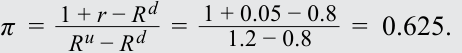

<!-- Formula Text: π  =   1 + r − R d _ R u − R d    =   1 + 0.05 − 0.8 _ 1.2 − 0.8    =  0.625. -->

The risk-neutral probability of a down move is therefore: 

1 – π = 1 – 0.625 = 0.375. 

###### **Solution to 2:** 

The call option price today is given by the (risk-neutral) expected value of the option payoff at maturity, discounted at the risk-free rate, _r_ . In Equation 6: 

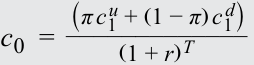

<!-- Formula Text: c 0  = (π c 1 u + (1 − π) c 1 d) _____________ (1 + r) T -->

<!-- Formula Text: =[0.625 × Max(0, $60 − $55) + 0.375 × Max (0, $40 − $55)]/1.05 -->

<!-- PDF Page 240 -->

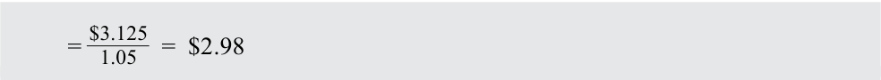

<!-- Formula Text: =  $3.125 _ 1.05    =  $2.98 -->

which matches the value in Example 1. 

###### **Solution to 3:** 

Since Equation 6 is valid for any European option, the put option value with an exercise price of $55 is: 

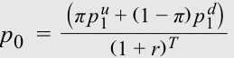

<!-- Formula Text: p 0  = (π p 1 u + (1 − π) p 1 d) ______________ (1 + r) T -->

=[0.625 × Max(0, $55 − $60) + 0.375 × Max (0, $55 − $40)]/1.05 

= $5.625/1.05 = $5.36. 

Note that we have used the same risk-neutral probability π as in Questions 1 and 2, since these values are a function of the binomial model for the underlying asset for a given asset volatility and risk-free rate, not the specific option being priced. 

###### **Solution to 4:** 

European call and put options with the same exercise price and maturity date must satisfy put–call parity as defined by: 

_S_ 0 + _p_ 0 = _c_ 0 + _X_ (1 + _r_ )−_T_ = $50 + $5.36 = $2.98 + $55 × 1.05−1 = $55.36, which confirms the relationship. 

###### **QUESTION SET** 

###### **Hedging and Risk Neutrality** 

1. Which of the following factors influences the value of an option price when using a binomial model? 

   - **A.** The risk-free rate of return 

   - **B.** The level of investors’ risk aversion 

   - **C.** The probability of an upward price move 

   - **Solution:** 

The correct answer is A, the risk-free rate of return. The value of an option is determined by its risk-neutral expectation discounted at the risk-free rate. In a one-period binomial model, the risk-neutral probabilities are determined only by the risk-free rate over the life of the option and the underlying asset’s volatility (as measured by the up and down gross returns, _R__u_ and _R__d_ ). Because of the ability to construct a perfect hedge of the option using the underlying asset, an option’s price is independent of investors’ risk aversion and the probability of the underlying price moving up (or down). 

2. If the underlying asset price in a one-period binomial model can increase by 15% or decrease by 10% over the period and the prevailing risk-free rate 

<!-- PDF Page 241 -->

over the period is 4%, what is the risk-neutral probability of an asset pricing decrease? **Solution:** If the underlying asset price in a one-period binomial model can increase by 15%, then the up gross return is _R__u_ _=_ 1.15. Similarly, if the price can decrease by 10%, then the down gross return is _R__d_ _=_ 0.9. The risk-neutral probability of an upward price move is: _  π_ =1 +_r_−_Rd_ = 0.56. _R__u_ − _R__d_=  1 + 0.04 − 0.9 1.15 − 0.9 The risk-neutral probability of a downward price move is 1 – 0.56 = 0.44. 3. Which of the following _best_ describes the risk-neutral pricing interpretation of the one-period binomial option pricing formula? **A.** The real-world expected payoff discounted at the risk-free rate **B.** The risk-neutral expected payoff discounted at the risk-free rate **C.** The risk-neutral expected payoff discounted at a risk-adjusted rate **Solution:** The correct answer is B, the risk-neutral expected payoff discounted at the risk-free rate. The risk-neutral pricing interpretation of the option pricing formula states that the value of an option today is its risk-neutral expected value at maturity, discounted at the risk-free rate. 4. Determine the correct answers to fill in the blanks: If a call option is trading at a higher price than that implied from the binomial model, investors can earn a return in excess of the risk-free rate by ________ at the risk-free rate, __________ the call, and _________ the underlying. **Solution:** If a call option is trading at a higher price than that implied from the binomial model, investors can earn a return in excess of the risk-free rate by _borrowing_ at the risk-free rate, _selling_ the call, and _buying_ the underlying. A synthetic risk-free asset can be created by this strategy that earns a return higher than the risk-free rate. Selling the over-priced call will provide a higher cash inflow than is required to generate the risk-free rate of return. 5. A stock’s price is currently ¥8,000. At the end of one month when its options expire, the stock price is either up by 5% or down by 15%. If the risk-free rate is –0.20% for the period, what is the value of a put option with a strike price of ¥7,950? **A.** ¥333.67 **B.** ¥299.60 **C.** ¥236.93 **Solution:** The correct answer is B, ¥299.60. Using risk-neutral pricing, we can determine the risk-neutral probability as: _ ___________ π_ =1 +_r_−_Rd_ = 0.74. _R__u_ − _R__d_=  1 − 0.002 − 0.85 1.05 − 0.85 The risk-neutral probability of a down move is therefore 1 – π = 1 – 0.74 = 0.26. The value of a put option with an exercise price of ¥7,950 is: 

<!-- PDF Page 242 -->

<!-- Formula Text: p 0  = (π p 1 u + (1 − π) p 1 d) ______________ (1 + r) T =[0.74 × Max(0, ¥7,950 − ¥8,400) + 0.26 × Max(0, ¥7,950 − ¥6,800)]/(1 − 0.002) =[0.26 × ¥1,150]/0.998 = ¥299.60. -->

