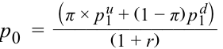
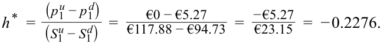

# Volume 7: Derivatives
## Learning Module 10 Valuing a Derivative Using a One-Period Binomial Model
### Part 2/2: Practice Problems (PDF Pages 243–246)

---

<!-- PDF Page 243 -->

# **~~PRACTICE PROBLEMS~~** 

## **The following information relates to questions 1-4** 

Privatbank Kleinert KGaA, a private wealth manager in Munich, has a number of clients with large holdings in the German fintech firm SparCoin AG. Kleinert’s analyst is concerned about a drop in SparCoin’s share price in the next year and is recommending to clients that they consider purchasing a one-year put with an exercise price of €100. SparCoin’s spot price ( _S_ 0) is €105.25, and it pays no dividends. The risk-free rate is 0.37%. 

**1.** Kleinert’s analyst estimates a 50-50 chance that the price of SparCoin will either increase by 12% or decline by 10% at the put option’s expiration date. Which of the following statements best describes the no-arbitrage option price implied by this assumption? 

   - **A.** Since there is a 50% chance that the stock will fall to €94.73, there is a 50-50 chance of a €5.27 payout upon exercise and the no-arbitrage put is therefore worth €2.64 (= €5.27 / 2). 

   - **B.** Since there is a 50% chance that the stock will fall to €94.73, there is a 50-50 chance of a €5.27 payout upon exercise and given the risk-neutral probability of 0.47, the no-arbitrage put price is €2.48 (= €5.27 × 0.47). 

   - **C.** Since there is a 50% chance that the stock will fall to €94.73 and the risk-neutral probability is 0.47, the no-arbitrage put price is €2.78 (= €5.27 × {[1 – 0.47]/1.0037}). 

**2.** If Kleinert’s clients observe that the one-year put option with a €100 exercise price is trading at €2.50, which of the following statements best describes how Kleinert’s clients could take advantage of this to earn a risk-free return greater than 0.37% over the year. 

   - **A.** Kleinert should purchase the put option and also purchase approximately 0.23 shares per option to match the hedge ratio. 

   - **B.** Kleinert should purchase the put option and purchase 50% of the underlying shares given the 50-50 chance the stock will fall and the put option exercised. 

   - **C.** Kleinert should purchase the put option and purchase 47% of the underlying shares to match the risk-neutral probability of put exercise. 

**3.** If risk-free investments yielded a higher return over the next year, which of the following statements best describes how this would affect the no-arbitrage value of the put option on SparCoin shares? 

   - **A.** An increase in the risk-free rate will have _no effect_ on SparCoin’s put option price, as it is solely a function of the probability and degree of share price increase or decrease upon option expiration. 

<!-- PDF Page 244 -->

   - **B.** An increase in the risk-free rate will _increase_ the value of the put option, as it will increase the risk-neutral probability of a price decline. 

   - **C.** An increase in the risk-free rate will _decrease_ the value of the put option, as it will both increase the risk-neutral probability of a price increase π and decrease the present value of the expected option payoff. 

**4.** If the expected percentage increase and decrease in SparCoin’s share price were to _double_ , which of the following is the closest estimate of the one-year put option price with an exercise price of €100? 

   - **A.** The one-year put option price will rise to €7.90. 

   - **B.** The one-year put option price will rise to €8.50. 

   - **C.** The one-year put option price will rise to €7.40. 

<!-- PDF Page 245 -->

# **~~SOLUTIONS~~** 

1. The correct answer is C. A 12% increase in the stock price gives: _S_ 1_u_ = _R__u_ _S_ 0 = 1.12 × €105.25 = €117.88. 

The put option will expire unexercised: 

- _p_ 1_u_ = Max (0, _X_ − _S_ 1_u_ ) = Max (0,  €100 − €117.88) = €0. Alternatively, a 10% price decrease gives: 

_S_ 1_d_ = _R__d_ _S_ 0 = 0.9 × €105.25 = €94.73. 

The put option will pay off: 

_p_ 1_d_ = Max (1, _X_ − _S_ 1_d_ ) = Max (0,  €100 − €94.73) = €5.27. 

To price this option, the risk-neutral pricing formula gives the risk-neutral probability π as: 

π = (1 + 0.0037 − 0.9)/(1.12 − 0.9) = 0.47. 

The no-arbitrage price is: 

<!-- Formula Text: p 0  = (π × p 1 u + (1 − π) p 1 d) _______________ (1 + r) -->

_p_ 0 = (0.47 × €0 + 0.53 × €5.27)/(1 + 0.0037) = €2.79/1.0037 = €2.78. 

2. The correct answer is A. If the put option can be purchased for less than the no-arbitrage price, then a potential arbitrage opportunity is available. In this case, Kleinert’s clients should purchase the underpriced put option and buy _h_ * units of SparCoin’s stock. The hedge ratio, _h_ *, is calculated as: 

<!-- Formula Text: h *  = (p 1 u − p 1 d) _ (S 1 u − S 1 d)   = €0 − €5.27 _____________ €117.88 − €94.73   =   − €5.27 _ €23.15   =  − 0.2276. -->

Note that the negative hedge ratio implies that both the put option and underlying are purchased or sold to create a hedge. This initial purchase of the put option and stock will cost: 

€2.50 + 0.2276 × €105.25 = €26.45. 

Should the stock price decrease, the value of this portfolio will be: 

_V_ 1 = _V_ 1_d_ = _h_* _S_ 1_d_ + _p_ 1_d_ = 0.2276 × €94.73 + €5.27 = €26.83. 

The strategy generates a risk-free return of (€26.83 – €26.45)/€26.45 = 1.44%, which is greater than the 0.37% return on other available risk-free investments. 

3. The correct answer is C. Rising interest rates reduce the value of a put option. Increasing the risk-free rate will increase the risk-neutral probability of a price increase π and decrease the present value of the expected option payoff. Since the value of a put option is inversely related to the price of the underlying asset, an increased probability of an upward price move will reduce the expected payoff from the put. Consequently, both of these effects will reduce the put option value as the return on risk-free investments increases. 

4. The correct answer is B. A 24% (previously 12%) increase in the stock price gives: 

<!-- PDF Page 246 -->

<!-- Formula Text: S 1 u  =  R u S 0  =  1.24 × €105.25  =  €130.51. -->

The put option will expire unexercised: 

_p_ 1_u_ = Max (0, _X_ − _S_ 1_u_ ) = Max (0,  €100.00 − €130.51) = €0. Alternatively, a 20% (previously 10%) decrease gives: 

_S_ 1_d_ = _R__d_ _S_ 0 = 0.8 × €105.25 = €84.20. The put option will pay off: 

<!-- Formula Text: p 1 d  =  Max(0,  X − S 1 d)  =  Max(0,  €100 − €84.20)  =  €15.80. To price this option, the risk-neutral pricing formula gives the risk-neutral prob- ability as: π = (1 + 0.0037 − 0.8)/(1.24 − 0.8) = 0.46. The no-arbitrage price is: p 0  = (π × p 1 u + (1 − π) p 1 d) _______________ (1 + r) =   (0.46 × €0 + 0.54 × €15.80) ____________________ (1 + 0.0037) =   €8.53 _ 1.0037   =  €8.50. -->

