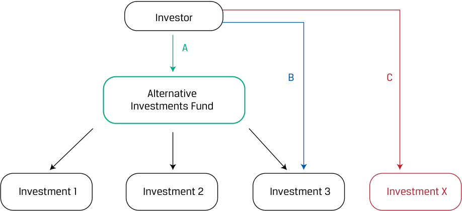
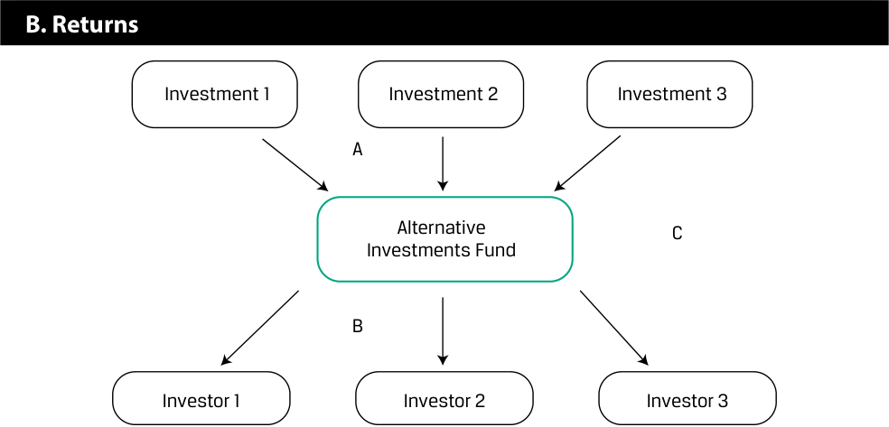

# Volume 8: Alternative Investments
## Learning Module 1 Alternative Investment Features, Methods, and Structures
### Part 1/2: Introduction (PDF Pages 11–26)

---

<!-- PDF Page 11 -->

#### L E A R N I N G M O D U L E 

# **<mark>1</mark>** 

### **Alternative Investment Features, Methods, and Structures** 

###### **<mark>LEARNING OUTCOMES</mark>** 

###### **_Mastery The candidate should be able to:_** 

describe features and categories of alternative investments compare direct investment, co-investment, and fund investment methods for alternative investments describe investment ownership and compensation structures commonly used in alternative investments 

##### **INTRODUCTION** 

**<mark>1</mark>** 

Alternative Investments are grouped together not because they have similar features but instead because they have characteristics distinct from traditional investments. Investing in alternatives can be done through fund investing, co-investing, or direct investing. Alternative investments typically offer investors greater diversification and higher expected returns than traditional investments but often involve longer-term, illiquid investments in less efficient markets. Investing in alternatives requires specialized knowledge. Alternative investments typically rely on more complex and richer compensation structures than traditional investments in order to better align manager and investor incentives over longer periods. 

###### **LEARNING MODULE OVERVIEW** 

- Alternative investments are investments other than ownership of traditional asset classes (public equity and fixed-income instruments and cash) and include private capital, real assets, and hedge funds. 

- Private capital includes private equity and private debt. Real assets include real estate, infrastructure, and natural resources. Hedge funds may invest across both traditional and alternative asset classes and are distinguished by their investment approach, which often includes leverage, derivatives, or other strategies. 

<!-- PDF Page 12 -->

- Investors often consider alternative investments in pursuit of greater portfolio diversification and/or increased expected returns. In doing so, they usually face longer investment periods, reduced liquidity, and less efficient markets than for more traditional assets. 

- Alternative investment fund investors fully outsource the control and management of investments in exchange for relatively high fees, while co-investment and direct investment methods involve greater investor effort and control over the selection and management of assets in exchange for relatively lower fees. 

- Another common type of alternative investment structure is a limited partnership in which responsibilities are flexibly allocated between investors and managers—with managers as general partners and investors as limited partners. Limited partnerships usually have more complex compensation structures, which include both management and performance fees. 

- Additional alternative investment structures include trusts and limited liability companies. 

###### **LEARNING MODULE SELF-ASSESSMENT** 

1. Identify which of the following choices is _most likely_ an alternative investment: 

   - **A.** An investment in a hedge fund focused on traditional assets 

   - **B.** Shares in a manufacturing firm traded on the Bursa Malaysia exchange 

   - **C.** A euro foreign exchange future purchased on the Chicago Mercantile exchange 

   - **Solution:** 

The correct answer is A. An investment in a hedge fund, even one that purchases traditional exchange-traded assets, is considered an alternative investment. B is incorrect because shares traded on a public exchange, such as the Bursa Malaysia exchange, are considered traditional, not alternative, investments. C is incorrect because a euro foreign exchange future purchased on a public exchange, such as the Chicago Mercantile exchange, is considered a traditional, not an alternative, investment. 

2. An advantage of investing in alternative investments _most likely_ is: 

   - **A.** high liquidity. 

   - **B.** low investment fees. 

   - **C.** higher expected returns. 

###### **Solution:** 

The correct answer is C. Investors are often attracted to alternative investments seeking greater diversification and/or higher expected returns. A is incorrect because investors usually face longer investment periods, reduced liquidity, and less efficient markets with alternative investments than with more traditional assets. B is incorrect because alternative investments often carry higher fees, including <u>performance and/or incentive fees.</u> 

<!-- PDF Page 13 -->

3. Investors with limited experience _most likely_ enter into alternative investments through: 

   - **A.** co-investing. 

   - **B.** fund investing. 

   - **C.** direct investing. 

   - **Solution:** 

The correct answer is B. Investors with limited resources and/or experience generally enter into alternative investments through fund investing, where the investor contributes capital to a fund and the fund identifies, selects, and makes investments on the investor’s behalf. A is incorrect because co-investing is more appropriate for investors who already have some experience investing in funds; in co-investing, the investor invests in assets indirectly through the fund but also possesses rights (known as co-investment rights) to invest directly in the same assets. C is incorrect because direct investing, which occurs when an investor makes a direct investment in an asset without the use of an intermediary, is typically reserved for larger and more sophisticated investors. 

4. When an investor invests in an asset without the use of an intermediary, it is called: 

   - **A.** co-investing. 

   - **B.** fund investing. 

   - **C.** direct investing. 

   - **Solution:** 

The correct answer is C. In direct investing, an investor makes a direct investment in an asset without the use of an intermediary. A is incorrect because in co-investing, an investor invests in assets indirectly through a fund but also possesses rights (known as co-investment rights) to invest directly in the same assets. B is incorrect because for fund investing, an investor contributes capital to a fund and the fund, not the investor, identifies, selects, and makes investments on the investor’s behalf. 

5. Which statement regarding alternative investment partnership structures is _most_ accurate? 

   - **A.** The fund manager has limited liability for anything that goes wrong. 

   - **B.** The fund manager is a limited partner, and investors are general partners. 

   - **C.** Investors’ upfront cash outflow can be a small portion of their total commitment to the partnership. 

###### **Solution:** 

The correct answer is C. Limited partners (LPs) are outside investors who own a fractional interest in the partnership based on the amount of their initial investment and the terms set out in the partnership documentation. LPs commit to future investments, and their upfront cash outflow can be a small portion of their total commitment to the fund. A is incorrect because the fund manager is the fund’s general partner (GP) who runs the business and theoretically bears unlimited liability for anything that goes wrong. B is incorrect because the fund manager is the fund’s general partner, not a limited partner, and the investors are the limited partners. 

<!-- PDF Page 14 -->

6. After failing to meet the hurdle rate, which of the following would a general partner still _most likely_ receive as compensation? 

   - **A.** Carried interest 

   - **B.** Management fee 

   - **C.** Committed capital 

###### **Solution:** 

The correct answer is B. Alternative investment funds are usually structured with a management fee typically ranging from 1% to 2% of assets under management (e.g., for hedge funds) or 1% to 2% of committed capital (e.g., for private equity funds). (Committed capital is the total amount of money that the limited partners have committed to the fund’s future investments.) A performance fee (also referred to as an incentive fee, carried interest, or carry) is applied based on excess returns. The partnership agreement usually specifies that the performance fee is earned only after the fund achieves a return known as a “hurdle rate.” The hurdle rate is a minimum rate of return that the general partner must exceed in order to earn the performance fee. A is incorrect because “carried interest” is another name for a performance fee, which is earned only after the fund achieves its hurdle rate. C is incorrect because committed capital is the total amount of money that the limited partners have committed to the fund’s future investments, not a fee to the general partner. 

## **<mark>2</mark>** 

##### **ALTERNATIVE INVESTMENT FEATURES** 

describe features and categories of alternative investments 

Alternative investments are investments other than ownership of public equity securities, fixed-income instruments, or cash that represent the more traditional asset classes. These investments are referred to as alternatives to traditional asset classes because of their characteristics and the way they are structured. Investors are often attracted to alternative investments when seeking greater diversification and/or higher expected returns in exchange for what are often longer-term, illiquid investments in less efficient markets. The features of these investments necessitate specific skills and information to evaluate their performance and include unique factors investors must consider if adding them to a portfolio. 

###### **Alternative Investments: Features and Categories** 

Some alternative investment features are shared with traditional public debt and equity securities, while others are significantly different. Features that may distinguish alternative investments include the following: 

- The need for specialized knowledge to value cash flows and risks 

- Typically low correlation of returns with more traditional asset classes 

- Illiquidity, long investment time horizons, and large capital outlays 

These features lead to the following alternative investment characteristics: 

- Different investment structures due to the challenges of direct investment 

<!-- PDF Page 15 -->

- Incentive-based fees to address/minimize information asymmetry between managers and investors 

- Performance appraisal challenges 

For example, while many alternative investments have equity or debt characteristics, they often require a larger or longer financial commitment due to an underlying investment’s extended life cycle or different investment methods and vehicles used to align the capabilities and incentives of managers and investors over time. Unlike individual securities, the size and type of some alternative investments may also be prohibitively large for certain investors. For these reasons, most investors limit alternative investments to that portion of their portfolio designated to fund obligations several years in the future. Sophisticated investors with the longest investment time horizons, such as large pension funds, sovereign wealth funds, and not-for-profit endowments, tend to allocate a larger share of their portfolio to these assets. 

Alternative investment categories include private capital, real assets, and hedge funds. 

###### **Private Capital** 

**Private Capital** is a broad term for funding provided to companies that is sourced from neither the public equity nor the public debt markets. Capital that is provided in the form of equity investments is called private equity, whereas capital that is provided as a loan or other form of debt is called private debt. 

Private equity and private debt are alternative investments with features similar to public equity and public debt. For example, both private and public equity investors are company owners with residual claims to future cash flows and dividends. However, while investors in private equity may have full access to company information and latitude to influence day-to-day management and strategy decisions, investors in publicly traded equity receive only publicly available information, such as annual reports and periodic financial statements, with voting rights limited to decisions requiring shareholder approval. 

**Private equity** refers to investment in privately owned companies or in public companies with the intent to take them private. In general, private equity is used in the _mature_ life cycle stage or for firms in _decline_ ,with leveraged buyouts being a key approach _._ Private equity managers often use the greater control and flexibility of private versus public ownership to make management and strategy changes, including closing, selling, or reorganizing lines of business to increase profitability over a several-year period. **Venture capital** is a specialized form of private equity whereby ownership capital is used for non-public companies in the _early_ life cycle or _startup_ phase, where often an idea or business plan exists with a limited operation or customer base. 

###### **EXAMPLE 1** 

###### **Venture Capital vs. Private Equity** 

Heartfield Digital is an early-stage digital media venture established 18 months ago. Heartfield plans to convert conventional music and art collection rights to digital form for sale and distribution. Its founders are seeking early-stage investors in order to conduct market research, build partnerships, and initiate operations. 

In contrast, Arguston Inc. is a mid-sized manufacturing firm in a mature industry that is experiencing a decline in profitability. Arguston’s share price has stagnated, and given its high-cost structure and dwindling operating cash flow, Arguston lacks the scale to make necessary technological upgrades to maintain competitiveness. A prospective private equity investor might consider an 

<!-- PDF Page 16 -->

investment plan to restructure Arguston’s operations, acquire a smaller competitor, and/or create efficiencies, perhaps by updating the plant and equipment. In several years, Arguston may emerge as a more profitable independent company or as an attractive acquisition target for a competitor. 

Technically, venture capital (VC) is a form of private equity. The main difference is that while private equity investors prefer stable companies, VC investors usually come in during the startup phase. Venture capital is usually given to small companies with huge growth potential, such as Heartfield Digital, while broader types of private equity financing would be more appropriate for a mature firm, such as Arguston. 

For **private debt** , in addition to private loans or bonds, venture debt is extended to early-stage firms with little or no cash flow, while distressed debt (introduced in a separate fixed-income lesson) involves public or private debt of corporate issuers believed to be close to or in bankruptcy that could benefit from investors with capital restructuring skills. 

###### **Real Assets** 

In contrast to financial assets, **real assets** generally are tangible physical assets, such as real estate (for example, land or buildings) and natural resources, but also include such intangibles as patents, intellectual property, and goodwill. Real assets either generate current or expected future cash flows and/or are considered a store of value. **Real estate** includes borrowed or ownership capital in buildings or land. Developed land includes commercial and industrial real estate, residential real estate, and infrastructure. Commercial real estate includes land and buildings where private business activity is the primary cash flow source, whereas residential real estate’s cash flows stem from rents or mortgage payments by households. Publicly traded forms of real estate include real estate investment trusts (REITS), which are issuers of equity securities, and mortgage-backed debt securities, which are introduced and discussed in a fixed-income lesson. 

**Infrastructure** is a special type of real asset that typically involves land, buildings and other long-lived fixed assets that are intended for public use and provide essential services. Bridges and toll roads are common examples of tangible infrastructure assets. Infrastructure may be developed either solely by governments or through a **public–private partnership (PPP)** in which private investors also have a stake. For example, a public–private partnership might be used in order to attract long-term private investment for a broadband internet investment. Infrastructure assets create cash flows either _directly_ in the form of fees, leases, or other compensation for access rights or _indirectly_ by promoting economic growth and supporting a government’s ability to generate increased tax revenue on future economic activity. When private investors are involved, a contract known as a **concession agreement** usually governs the investor’s obligations to construct and maintain infrastructure as well as the exclusive right to operate and earn fees for a pre-determined period. 

###### **EXAMPLE 2** 

###### **Public–Private Partnership for Infrastructure Projects in Indonesia** 

PT Indonesia Infrastructure Finance (IIF) is a private national company established in 2010 by the government of Indonesia to accelerate and improve private participation in infrastructure development in Indonesia. Together with the World Bank, the Asian Development Bank, and other institutions, the IIF 

<!-- PDF Page 17 -->

provides infrastructure financing and advisory services for commercially viable infrastructure projects. This approach has facilitated development of PPP projects, increased equity investment in Indonesian infrastructure projects, and increased institutional awareness and capacity to implement environmental, health, and safety and social issues. Looking ahead, the IIF anticipates the need to spend USD150 billion over a five-year period to construct power plants and toll roads. While the government will be able to fund 30% of this cost, the remainder will be financed by the private sector through PPPs. 

**Natural resources** involve either less developed land, which itself is the source of economic value, or naturally occurring standardized products that are harvested, extracted, and/or refined. Less developed land includes farmland, timberland, or land for exploration for natural resource deposits, such as minerals or energy. Sources of return for these types of less developed land include expected price appreciation over time and cash flows. For example, farmland generates crop yields or agricultural lease payments, future timber harvests generate timberland income, and mineral or drilling rights to extract and refine natural resources can provide income. In some cases, these investments may be considered for environmental, social, and governance (ESG) purposes—for example, when promoting sustainable farming practices for agriculture or creating carbon offsets for timberland, as in the following example. 

###### **EXAMPLE 3** 

###### **Using Timberland to Create Carbon Offsets** 

Companies eager to offset emissions are paying timberland owners not to cut acres of trees. Growing trees absorb carbon in the atmosphere. 

- Companies that pay timber owners not to harvest trees receive credits in the form of carbon offsets. Large companies, which inevitably generate emissions in the course of doing business, can fund carbon offsets to demonstrate to their investors, customers, and others (including regulators) that they are serious about reducing pollution and helping the environment. 

- For large and small owners of timberland, choosing not to harvest makes sense, too. Their trees continue to grow, leading to higher future volumes of timber, and they earn non-timber income in the meantime. 

In other cases, undeveloped land may also have future potential for commercial, residential, or infrastructure development. 

Standardized, traded goods known as **commodities** include plant, animal, energy, and mineral products used in goods and services production. Commodities do not themselves generate cash flows but, rather, are ultimately sold by commodity producers to commodity consumers for economic use. Investors seek to benefit from commodity price changes based on their future economic use as well as a lower correlation of returns versus other asset classes over the economic cycle. With their lower correlation of returns with other asset classes, commodities also can serve as a countercyclical holding and as an inflation hedge. 

<!-- PDF Page 18 -->

###### **EXAMPLE 4** 

###### **Rising Demand for Lithium, an Increasingly Important Commodity** 

Demand for lithium is growing rapidly as demand for electric vehicles (EVs) climbs. Lithium is popular with battery manufacturers because, as the least dense metal, it stores a large proportion of energy relative to its weight. 

The sales of battery electric and plug-in hybrid electric cars exceeded 2 million for the first time in 2019. China dominates this market, accounting for more than half of all current EV sales worldwide. An industry source has forecast that EV sales will grow from 2.5 million in 2020 to approximately 11 million in 2025 and will exceed 30 million by 2030, garnering approximately 32% of the total market share for new car sales at that time. 

Demand for lithium will rise accordingly. The growth in lithium demand is expected to foster new lithium mining and more production in more countries worldwide. 

Other real alternative assets include tangible collectible assets, such as fine art, wine, rare coins, watches, and other rare assets, as well as intangible assets, such as patents, and litigation, and so-called **digital assets** . “Digital assets” is the umbrella term covering assets that can be created, stored, and transmitted electronically and have associated ownership or use rights. 

###### **DIGITAL ASSETS** 

The term “digital assets” covers a wide variety of assets, such as cryptocurrencies, tokens (security and utility), and digital collectables (such as digital art). The following diagram provides a simple breakdown of digital assets. 

###### **Digital Assets diagram** 

<!-- Start of picture text -->
Bitcoin Stablecoins Cryptocurrencies Altcoins Meme coins Central Bank Digital Currencies Digital Assets Non-Fungible Tokens Tokens Security Tokens Utility Token <!-- End of picture text -->

Cryptocurrency and tokens utilize cryptography, an advanced encryption technique that assures the authenticity of crypto assets. The key difference between these two classes of digital asset is that cryptocurrencies have their own blockchains, whereas crypto tokens are built on an existing blockchain. 

For example, cryptocurrencies are the native asset of a blockchain—such as Bitcoin (BTC) or Ethereum (ETH). However, tokens are created as part of a platform that is built on an existing blockchain, such as the many ERC-20 tokens that make up the Ethereum ecosystem. The Ethereum ecosystem is used as a network for decentralized applications, such as non-fungible token (NFT) marketplaces and decentralized finance (DeFi) projects. 

<!-- PDF Page 19 -->

Digital assets are covered in more detail in a subsequent alternative investments learning module. 

###### **Hedge Funds** 

**Hedge funds** are private investment vehicles that may invest in public equities or publicly traded fixed-income assets, private capital, and/or real assets, but they are distinguished by their investment _approach_ rather than by the investments themselves. Hedge funds make frequent use of leverage, derivatives, short selling, and other investment strategies, which often results in a substantially different risk and return profile from that of merely buying and holding the underlying assets in an investment portfolio. Investors may also invest in a portfolio of hedge funds, often referred to as a **fund of funds** . 

###### **QUESTION SET** 

1. Tangible physical assets that generate current or expected future cash flows and/or are considered a store of value are _best_ labeled as: 

   - **A.** real assets. 

   - **B.** private equity. 

   - **C.** venture capital. 

###### **Solution:** 

The correct answer is A. In contrast to financial assets, real assets are generally tangible physical assets that generate current or expected future cash flows and/or are considered a store of value. Major categories of real assets include real estate and natural resources, as well as intangibles such as patents. B is incorrect because private equity, considered an alternative investment, is non-publicly traded capital that is invested directly in private companies (or in public companies that are being taken private). It is typically used to invest in firms in the mature life-cycle stage or in decline. C is incorrect because venture capital is ownership capital used for non-public companies in their early life cycle or startup phase. 

2. Contrast private equity and venture capital. 

###### **Solution:** 

Private capital is used at different times in a company’s life cycle and in different forms. Most private equity is used in the mature life cycle stage or for firms in decline. Private equity managers often use the greater control and flexibility of private versus public ownership to make management and strategy changes including closing, selling, or reorganizing lines of business to increase profitability over a several-year period. In contrast, venture capital is used for non-public companies with high growth potential in their early life cycle or startup phase. Venture capital is essentially a specialized form of private equity; it represents a small portion of the entire private equity market by value. 

3. Identify which statement about a digital asset is _most_ accurate. A digital asset: 

   - **A.** includes digital art but not cryptocurrencies. 

<!-- PDF Page 20 -->

- **B.** is anything that can be stored and transmitted electronically and has associated ownership or use rights. 

- **C.** must adhere to very specific designs or requirements in order to work within the limited types of technology that support it. 

- **Solution:** 

The correct answer is B. Digital assets continue to evolve and vary in terms of design and application. Digital assets can be thought of as anything that can be stored and transmitted electronically and has associated ownership or use rights. A is incorrect because digital assets include cryptocurrencies, tokens (security and utility), and digital collectables (such as digital art). C is incorrect because digital assets may take many forms (such as digital tokens and virtual currencies) and may use various underlying technologies. They are not limited to specific designs or technology. 

4. Determine the correct answers to fill in the blanks: Alternative investment categories include _______________, _________________, and ______________. **Solution:** Alternative investment categories include _<u>private capital</u>_ , _<u>real assets</u>_ , and _<u>hedge funds</u>_ . 

## **<mark>3</mark>** 

##### **ALTERNATIVE INVESTMENT METHODS** 

compare direct investment, co-investment, and fund investment methods for alternative investments 

Investors seeking greater diversification and higher expected returns from alternative investments must consider how best to enter into such an investment. The long-term, illiquid nature of many alternative investments along with the specialized knowledge involved in evaluating and overseeing these investments make investors more dependent on manager decisions over longer time periods. Large, sophisticated investors can address this issue by taking greater control over the investment process, while other, less sophisticated investors must outsource this process and seek to align manager incentives with investor objectives. 

###### **Alternative Investment Methods** 

Investors can access alternative investments in three ways: 

- Fund investment (such as a in a PE fund) 

- Co-investment into a portfolio company of a fund 

- Direct investment into a company or project (such as infrastructure or real estate) 

Institutional investors typically begin investing in alternative investments via funds. Then, as they gain experience, they may begin to invest via co-investing and direct investing. The largest and most sophisticated direct investors (such as some 

<!-- PDF Page 21 -->

sovereign wealth funds) compete with fund managers for access to the best investment opportunities. Exhibit 1 shows an illustration of the three methods of investing in alternative investments. We will refer to this exhibit several times during this lesson. 

**Exhibit 1: Three Methods of Investing in Alternative Assets** 

<!-- Start of picture text -->
Investor Alternative Investments Fund Investment 1 Investment 2 Investment 3 Investment A Fund Investing Co-Investing Direct Investing <!-- End of picture text -->

###### **Fund Investment** 

Investors with limited resources and/or experience generally enter into alternative investments through **fund investing** , where the investor contributes capital to a fund and the fund identifies, selects, and makes investments on the investor’s behalf. For the fund’s services, the investor is charged a management fee, plus a performance fee if the fund manager delivers superior results versus a hurdle rate or benchmark. In Exhibit 1, the investor invests in the “alternative investments fund.” The fund itself invests in three investments: Investments 1, 2, and 3. Fund investing can be viewed as an indirect method of investing in alternative assets. 

Fund investors have little or no leeway in the sense that their investment decisions are limited to either investing in the fund or not. Fund investors typically have neither the sophistication nor the experience to invest directly on their own. Furthermore, fund investors are typically unable to affect the fund’s underlying investments. Note that fund investing is available for all major alternative investment types, including hedge funds, private capital, real estate, infrastructure, and natural resources. 

Allocation to alternative assets requires distinct specialized skills that many investors likely do not possess. These investors can achieve this exposure through fund investing, where one or more investors contribute capital to an investment management company that identifies, selects, manages, and monitors investments on the investors’ behalf, as shown in Exhibit 2. 

<!-- PDF Page 22 -->

**Exhibit 2: Alternative Investment Fund Structure** 

<!-- Start of picture text -->
Investor 1 Investor 2 Investor 3 Capital Committed over Time Alternative Investments Fund Manager Selects Investments over Time Investment 1 Investment 2 Investment 3 Gross Returns Alternative Management Fee Investments Fund Performance Fee Net Returns Investor 1 Investor 2 Investor 3 <!-- End of picture text -->

###### **A. Investments** 

<!-- Start of picture text -->
Investor A B C Alternative Investments Fund Investment 1 Investment 2 Investment 3 Investment X <!-- End of picture text -->

<!-- PDF Page 23 -->

<!-- Start of picture text -->
B. Returns Investment 1 Investment 2 Investment 3 A Alternative C Investments Fund B Investor 1 Investor 2 Investor 3 <!-- End of picture text -->

Fund investment structures for alternative investments differ substantially from traditional public equity and fixed-income fund or ETF investments. For example, alternative funds usually involve (1) the pre-commitment of funds prior to investment selection and an extended period during which the fund may not be sold, (2) higher management fees with more complex fee structures, and (3) less frequent transparency on periodic returns and fund positions versus equity or fixed-income funds. Investors in alternative funds therefore usually compensate managers using a performance-based, as opposed to flat, fee structure to better align manager and investor incentives over longer periods. Important terms are provided in a term sheet; a sample term sheet for fund investment with Tenderledge Investments LLC is provided in Exhibit 3. Further details of these terms are discussed in subsequent lessons. 

###### **Exhibit 3: Tenderledge Investment Fund VIII Limited Partner Agreement Term Sheet** 

###### **Tenderledge Investment Fund VIII, L.P. Term Sheet** 

|**Fund**|Tenderledge Investment Fund VIII, L.P|
|---|---|
|**General Partner**|Tenderledge Investment LLC|
|**Fund Manager**|Tenderledge Investments|
|**Maximum Size**|Not to exceed USD750 million Equal to at least 2% of the aggregate Commitments of the|
|**General Partner’s**|Limited Partners h|
|**Commitment**|The date the General Partner determines that aggregate|
|**Initial Closing Date**|h Commitments equal or exceed USD500 million|
|**Final Closing Date**|Twelve (12) months from the Initial Closing Date|
|**Term of the Fund**|Ten (10) years from the Initial Closing Date|
|**Investment Policy**|To provide attractive, long-term investment return from a diver- sified portfolio of alternative investments|
|**ESG**|In accordance with the General Partner’s environmental, social, and governance policy|
|**Management Fee**|1.5% per annum of the commitment of each limited partner|
|**Hurdle Rate**|A hard hurdle rate of 10%|

<!-- PDF Page 24 -->

|**Tenderledge Investm** **Term Sheet**|**ent Fund VIII, L.P.**|
|---|---|
|**Performance Fee**|20% of fund returns in excess of the specified hard hurdle rate|
|**Side Letters**|If any Side Letter grants more favorable rights to any Partner than those provided to other Partners, the more favorable rights will be granted to all other Partners|

###### **Co-Investment** 

Once investors have some experience investing in funds, prior to investing directly themselves, many investors gain direct investing experience via **co-investing** , where the investor invests in assets _indirectly_ through the fund but also possesses rights (known as co-investment rights) to invest _directly_ in the same assets. Through co-investing, an investor is able to make an investment _alongside_ a fund when the fund identifies deals; the investor is not limited to participating in the deal solely by investing in the fund. Exhibit 1 illustrates the co-investing method: The investor invests in one deal (labeled “Investment 3”) indirectly via fund investing while investing an additional amount directly via a co-investment. Co-investing allows investors to expand their investment knowledge, skills, and experience beyond what they would gain from taking a fund-only investment approach. Co-investing also provides investors access to an investment opportunity at a lower fee than they would owe as fund-only investors in the same asset. Co-investors can learn from the fund’s process to eventually pursue direct investments themselves. Co-investors weigh the benefits of greater control and lower fees versus higher oversight costs. 

Managers benefit from choosing one or more co-investors to 

- accelerate investment timing when available funds and expected inflows are insufficient for a specific deal, 

- expand the scope of available new investments, and 

- increase diversification of an existing pool of fund investments. 

###### **EXAMPLE 5** 

###### **Co-Investment Opportunity** 

Moreton Bay Pension Plan is an investor in Tenderledge LLC Alternatives Fund. Tenderledge has identified a take-private transaction in Fancy Roofing Co. that requires a USD1.5 billion capital investment. However, the fund concentration limit allows Tenderledge to invest only up to USD1 billion in any one investment. Tenderledge offers the additional USD0.5 billion to Moreton Bay Pension Plan and other investors in the fund as a co-investment on a reduced fee and no carry basis. In this case, the co-investment allows Tenderledge the ability to secure the investment without needing to bring an additional fund manager into the transaction, and the co-investors gain additional exposure to Fancy Roofing Company at a reduced management fee and zero performance fees. 

###### **Direct Investment** 

The largest, most sophisticated investors with sufficient skills and knowledge to manage individual alternative investments often do so via **direct investing** _without_ the use of an intermediary, as previously shown in Exhibit 1 (labeled “Investment A”). 

<!-- PDF Page 25 -->

Direct investors retain maximum flexibility and control when it comes to investment choice, methods of financing, and timing. In the case of private equity, this involves the purchase of a direct stake in a private company without the use of a fund managed by an external asset manager or general partner. It also requires the direct investor to have the resources to provide the specialized knowledge, skills, and oversight capabilities that direct investment requires. Although the direct investment approach usually applies to private capital and real estate, some very large investors, such as pensions and sovereign wealth funds, also invest directly in infrastructure and natural resources. 

###### **EXAMPLE 6** 

###### **Direct Investment in Renewable Energy** 

Singapore sovereign wealth fund GIC announced in 2021 that it will directly invest USD240 million in a Singapore-based energy firm, Arctic Green Energy, becoming an equity partner in the firm. The investment will help Arctic Green Energy expand its global operations and increase its capability in geothermal energy. Geothermal energy is derived from hot underground springs and is a renewable, economically competitive, and sustainable alternative to using fossil fuels for heating and cooling. Arctic Green Energy uses geothermal resources to generate power and produce clean heat. GIC has noted that investing sustainably is one of its core long-term investment mandates. 

###### **QUESTION SET** 

1. Referring to the diagram below, identify the label that best corresponds to the three methods of investing in alternative assets: 

<!-- Start of picture text -->
Investor A B C Alternative Investments Fund Investment 1 Investment 2 Investment 3 Investment X A. 1. Co-investing B. 2. Fund investing C. 3. Direct investing <!-- End of picture text -->

###### **Solution (as seen in Exhibit 1 of this lesson):** 

A. 2 is correct. In fund investing, the investor contributes capital to a fund and the fund identifies, selects, and makes investments on the investor’s behalf. 

B. 1 is correct. In co-investing, the investor invests in assets indirectly through the fund but also possesses rights (known as co-investment rights) to invest directly in the same assets. 

<!-- PDF Page 26 -->

   - C. 3 is correct. In direct investing, an investor makes a direct investment in an asset (labeled “Investment X” in the diagram) without the use of an intermediary. 

2. Determine the correct answers to fill in the blanks:The ________ and ________ nature of many alternative investments and the _______________ required to evaluate and oversee these investments make investors more dependent on manager decisions over longer time periods. 

###### **Solution:** 

The _<u>long-term</u>_ and _<u>illiquid</u>_ nature of many alternative investments and the _<u>specialized knowledge</u>_ required to evaluate and oversee these investments make investors more dependent on manager decisions over longer time periods. 

3. Identify two reasons investment managers offer co-investment opportunities to investors. Managers might choose to add co-investors for such reasons as: 

   1. 

   2. 

###### **Solution:** 

Managers might choose to add co-investors for such reasons as: 

   - accelerating investment timing when available funds and expected inflows are insufficient for a specific deal. 

   - expanding the scope of available new investments. 

   - increasing diversification of an existing pool of fund investments. 

4. Identify one reason an investor would elect to participate in each of the following alternative investment methods: 

   **1.** Fund investing 

   **2.** Co-investing 

   **3.** Direct investing 

   **Solution:** 

