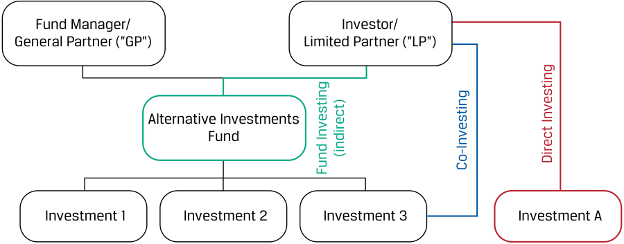
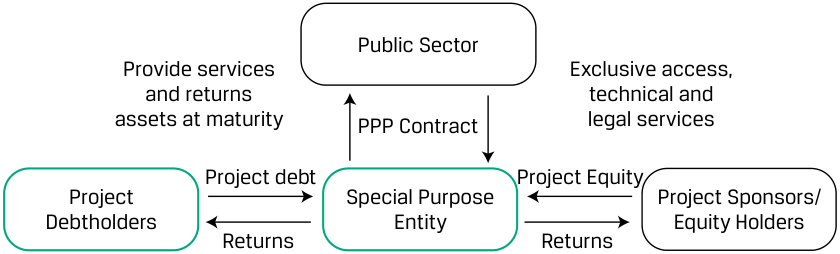
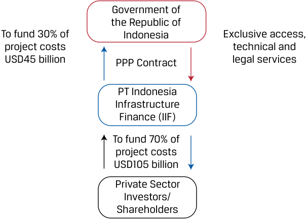
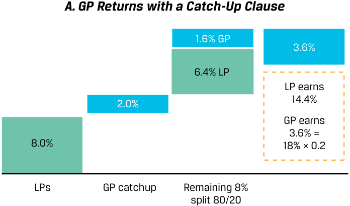

# Volume 8: Alternative Investments
## Learning Module 1 Alternative Investment Features, Methods, and Structures
### Part 2/2: Alternative Investment Structures (PDF Pages 27–40)

---

<!-- PDF Page 27 -->

|1. Fund investing|Fund investing gives investors with limited resources or experience an entrance into alternative investing. i|
|---|---|
|2. Co-investing|Investors who have better specific skills and greater ability to allocate investments to individual assets may select a more active investment approach while retaining manager involvement. This results in lower fees for the investor than for a purely fund-based approach. Also, co-investors select and manage an investment jointly with a general fund manager, which potentially gives them greater control and higher returns than they could earn in a fund-only structure.|
|3. Direct investing|Direct investing offers investors flexibility and control when it comes to choosing their investments, selecting their preferred methods of financing, and planning their approach.|

## **ALTERNATIVE INVESTMENT STRUCTURES** 

**<mark>4</mark>** 

describe investment ownership and compensation structures commonly used in alternative investments 

Beyond the direct or indirect method of investing in alternatives, the illiquidity, complexity, and long-term nature of these investments require more complex structures to bridge potential gaps between manager and investor interests. Alternative investment structures may explicitly address both the roles and responsibilities of investors and managers to address these gaps. In addition, alternative investment structures tailor the distribution of returns between these two parties to better align the incentives (or interests) between manager and investor. 

For example, managers may require investors to be responsible for future capital contributions, while investors may place restrictions on manager investment selection to avoid conflicts of interest or hostile takeovers among other investment criteria. Performance-based compensation structures, which can include minimum return requirements for investors, delayed payouts, and/or the ability to reclaim incentive compensation in the event of poor fund performance, encourage managers to maximize returns in the best interest of investors. 

### **Alternative Investment Ownership and Compensation Structures** 

In this section, we discuss the ownership and compensation structures of alternative investments. 

### **Ownership Structures** 

Alternative investment vehicles often take the form of partnerships in order to maximize flexibility in the investment structure to allocate business risk and return and to distribute special responsibilities between investors and managers as required. Limited partnerships, introduced in a corporate issuer lesson, involve at least one general 

<!-- PDF Page 28 -->

partner (GP) with theoretically unlimited liability who is responsible for managing the fund. Limited partners (LPs) are outside investors who own a fractional interest in the partnership based on the amount of their initial investment and the terms set out in the partnership documentation. Exhibit 4 shows the basic GP/LP structure together with the various investment approaches (fund, co-investment, direct) introduced earlier. 

**Exhibit 4: Basic GP/LP Structure and Various Investment Approaches** 

<!-- Start of picture text -->
Fund Manager/ Investor/ General Partner (”GP”) Limited Partner (”LP”) Alternative Investments Fund Investment 1 Investment 2 Investment 3 Investment A (indirect) Direct Investing Fund Investing Co-Investing <!-- End of picture text -->

LPs commit to future investments, and the upfront cash outflow can be a small portion of their total commitment to the fund. Funds set up as limited partnerships typically have a limit on the number of LPs allowed to invest in the fund. LPs play passive roles and are not involved with the management of the fund (although co-investment rights allow for the LPs to make additional direct investments in the portfolio companies); the operations and decisions of the fund are controlled solely by the GP. 

Limited partners (LPs) have their liability capped at the amount of their investment in the partnership, as shown in Exhibit 5. 

**Exhibit 5: Example Limited Partnership Structure** 

<!-- Start of picture text -->
Fund Manager/ Investor/ General Partner (”GP”) Limited Partners (”LPs”) $500 million Alternative Investments Fund $10 million $50 million $90 million $70 million $75 million $80 million $75 million $50 million <!-- End of picture text -->

A restricted number of limited partners hold a fractional interest in the fund. LP investors must generally meet certain minimum regulatory net worth, institutional, or other requirements, as so-called **accredited investors** , to access these investments, which are less regulated than general public offerings. The GP (Tenderledge Investments LLC in Exhibit 6) agrees to manage the fund’s operations under an agreed standard of care and perform such activities as buying or selling assets, borrowing funds, establishing reserves, or entering into contracts on behalf of the fund. 

<!-- PDF Page 29 -->

**Exhibit 6: Limited Partnership (Tenderledge Investment Fund)** 

<!-- Start of picture text -->
Tenderledge Investments Investor/Limited LLC/General Partner (GP) Partner (LP) Management and Fund Incentive Fees Investing (indirect) Tenderledge Investment Unlimited Liability Fund VIII, L.P. Investment 1 Investment 2 Investment 3 Investment A after Fees Share in Risk and Returns Limited Liability Direct Investing Co-Investing <!-- End of picture text -->

A GP may manage multiple funds at a time. A **limited partnership agreement (LPA)** establishes terms of an LP as governed by a limited partnership agreement. 

Key features of an LPA include the distribution of profits and losses (covered in detail below); manager roles and responsibilities, such as investment criteria and restrictions; and terms governing transfers, withdrawals, and dissolution of the agreement. 

Adjustments to LP terms are sometimes made to address the unique legal, regulatory, or reporting requirements of a specific investor. In this case, a supplemental document known as a **side letter** is issued between a GP and one or more LPs with terms that override or modify the original LPA terms. These terms might include such features as increased investor ability to transfer investments to a related or successor fund; first right of refusal and other similar clauses to outline potential treatment (regarding fees, co-investment rights, secondary sales, and potentially other matters) in comparison to other LPs; ability to forgo a contractual capital contribution (known as an excusal right); or ability to receive additional investment reporting. One feature of a side letter might include a “most favored nation” clause ensuring any more favorable or additional terms negotiated outside of the LPA with other investors will also apply to a particular LP. The customized features of the LPA and any side letters stand in contrast to a standardized indenture applicable to all bond investors in the case of public fixed-income securities. 

Different specialized structures are commonly adopted for other alternative investments. For example, infrastructure investors frequently enter into public–private partnerships, which are agreements between the public sector and the private sector to finance, build, and operate public infrastructure, as shown in Exhibit 7. Exhibit 8 shows the PPP structure for PT Indonesia Infrastructure Finance (IIF), as discussed in Example 2. 

**Exhibit 7: Public–Private Partnership** 

<!-- Start of picture text -->
Public Sector Provide services Exclusive access, and returns technical and assets at maturity PPP Contract legal services Project debt Project Equity Project Special Purpose Project Sponsors/ Debtholders Entity Equity Holders Returns Returns <!-- End of picture text -->

<!-- PDF Page 30 -->

**Exhibit 8: Public–Private Partnership Structure of IIF** 

<!-- Start of picture text -->
Government of the Republic of To fund 30% of Indonesia Exclusive access, project costs technical and USD45 billion PPP Contract legal services PT Indonesia Infrastructure Finance (IIF) To fund 70% of project costs USD105 billion Private Sector Investors/ Shareholders <!-- End of picture text -->

Infrastructure projects often involve a special purpose entity that raises borrowed and ownership capital for the construction and operation of a specific road, bridge, or other long-lived asset under the terms of a concession agreement, after which the asset is sold or returned to a public sector entity. 

Real estate or natural resource fund investors are often classified as unitholders in what is referred to as a **master limited partnership (MLP)** , which has similar features to the limited partnership described earlier but is usually a more liquid investment that is often publicly traded. Other forms of more liquid investments in alternative assets are real estate investment trusts (REITs), commodity funds, and various exchange-traded funds (ETFs). In the case of direct real estate investments, joint ventures are also a common partnership structure. Infrastructure and real estate will be discussed further in a subsequent alternative investment learning module. 

### **Compensation Structures** 

The asymmetry in information between the general partner, with specialized knowledge and control, and the limited partners in alternative investments means that more complex compensation structures are usedto better align general and limited partner incentives. Most funds that own public equity or debt securities charge management fees as a fixed percentage of assets under management. Alternative investment funds, in contrast, usually combine a higher management fee (often 1%–2% of assets under management) with a **performance fee** (also referred to as an incentive fee or **carried interest** ) based on a percentage of periodic fund returns. 

While hedge funds and REITs typically charge a management fee on assets under management, private equity funds often levy this fee on **committed capital** , which consists of the total amount that LPs have promised to fund future investments. Private equity funds raise committed capital and draw down on those commitments, generally over three to five years, when they have a specific investment to make. The life of a typical private equity fund is 10 years. Note that the management fee is typically based on committed capital, _not_ invested capital; the committed-capital basis for management fees is an important distinction from hedge funds, whose management fees are based on assets under management (AUM). Using committed capital as the basis for management fee calculations reduces the incentive for GPs to deploy the committed capital as quickly as possible (in order to increase near-term management fees). This allows the GPs to be selective about deploying capital into investment 

<!-- PDF Page 31 -->

opportunities. In addition, since the GP has so much influence on the value of the assets, it would be inappropriate to pay management fees on the basis of the value of assets under management. 

Performance fees are often subject to a minimum fund return or **hurdle rate** (also known as a “preferred return”), as well as other modifications, to align manager incentives as closely as possible with those of investors over long investment periods. Hurdle rate agreements sometimes distinguish between a **hard hurdle rate** , where the manager earns fees on annual returns in excess of the hurdle rate, or a **soft hurdle rate** , where the fee is calculated on the entire return when the hurdle is exceeded. With a soft hurdle, GPs are able to catch up performance fees once the hurdle threshold is exceeded. 

If we ignore management fees and assume a single-period fund rate of return of _r_ , a hard hurdle rate of _rh_ , and a GP performance fee ( _p_ ) as a percentage of total return, then the GP’s rate of return ( _rGP_ ) is as follows: 

_rGP_ = max[0, _p_ ( _r_ – _rh_ )]. ~~(1)~~ 

For example, if a fund earns _r_ of 18% over a period and receives a performance fee of 20% ( _p_ ) of returns in excess of the hurdle rate, _rh_ , of 8%, then _rGP_ is equal to 2%: 

2% = max[0, 20%(18% – 8%)]. 

Performance fee modifications include rewarding managers for exceeding the hurdle rate or generating returns on specific deals or penalizing them by limiting or requiring the return of performance fees for declining performance over time. The acceleration of performance fees once a fund exceeds the soft hurdle rate is known as a **catch-up clause** , as illustrated in Exhibit 9. Under the catch-up clause using the prior example, the GP earns an _immediate_ 2% (catch-up return of _rcu_ ) once the hurdle is exceeded, resulting in a 1.6% higher return than without the catch-up feature. In other words, the LP will receive 100% of all cash distributions until it earns the hurdle rate of 8%. Then, the GP will receive 100% of distributions until the split of profit is 80%/20%. The remaining distributions will be split 80%/20%. The GP’s rate of return ( _rGP_ ) from Equation 1 with a catch-up clause becomes 

_rGP_ = max[0, _rcu_ + _p_ ( _r_ − _rh_ − _rcu_ )]. ~~(2)~~ 3.6% = max[0, 2.0% + 20%(18% – 8% – 2%)]. 

<!-- PDF Page 32 -->

**Exhibit 9: Catch-Up Clause Illustration** 

<!-- Start of picture text -->
A. GP Returns with a Catch-Up Clause 1.6% GP 3.6% 6.4% LP LP earns 14.4% 2.0% GP earns 3.6% = 8.0% 18% × 0.2 LPs GP catchup Remaining 8% split 80/20 <!-- End of picture text -->

#### **_B. GP Returns without a Catch-Up Clause_** 

<!-- Start of picture text -->
2.0% GP 2.0% 8.0% LP LP earns 16% GP earns 2.0% = 8.0% (18% – 8%) × 0.2 LPs No GP catchup Remaining 10% split 80/20 <!-- End of picture text -->

In other instances, managers are penalized with fee reductions in cases of poor or declining performance. One example of this in the case of hedge funds is the use of a so-called **high-water mark** , which reflects the fund’s peak value as of a performance calculation date net of fees. If the fund’s value subsequently declines below the high-water mark, the hedge fund manager may not charge performance fees until the fund value exceeds the previous high-water mark. The use of high-water marks seeks to reward managers for sustained performance and protect LPs from paying twice for the same returns. 

A **clawback** provision, in contrast, actually grants LPs the right to reclaim a portion of the GP’s performance fee. Clawback provisions are usually activated when a GP exits successful deals early on but incurs losses on deals later in the fund’s life. For most alternative investments, investor high-water marks carry over into new calendar years, but in the case of hedge funds, an investor may no longer claw back incentive fees paid for a prior calendar year if portfolio losses are incurred later. Given the generally more illiquid and longer-term nature of their holdings, private equity and real estate investments are more likely to contain clawback clauses for the entire life of the portfolio. 

Finally, as in the case of asset-backed securities described in fixed-income lessons, alternative investments often use a waterfall structure to determine the distribution of cash flows to GPs and LPs. In alternative investments, GPs usually receive a disproportionately larger share of the total profits relative to their initial investment, which incentivizes them to maximize profitability. 

<!-- PDF Page 33 -->

There are two types of waterfalls: _deal-by-deal_ (or _American_ ) waterfalls and _whole-of-fund_ (or _European_ ) waterfalls. 

- Deal-by-deal waterfalls are more advantageous to the GP because performance fees are collected on a per-deal basis, allowing the GP to get paid before LPs receive both their initial investment _and_ their preferred rate of return (i.e., the hurdle rate) on the entire fund. 

- In whole-of-fund waterfalls, all distributions go to the LPs as deals are exited and the GP does not participate in any profits until the LPs receive their initial investment and the hurdle rate has been met. In contrast to deal-by-deal waterfalls, whole-of-fund waterfalls occur at the aggregate fund level and are more advantageous to the LPs. 

Exhibit 10 and Exhibit 11 illustrate how the cash flow to the GP differs in a deal-by-deal waterfall with a clawback provision versus a whole-of-fund waterfall, respectively. In the first instance, the fund initially grants the GP payouts of $2 million, $3 million, and $8 million because Investments 1, 2, and 3 generate a profit when sold. However, all subsequent investments either break even or return a loss, meaning that over the course of the fund’s life, it breaks even at an aggregate level. Thus, the GP must return all early payouts, to compensate for subsequent losses. 

**Exhibit 10: Deal-by-Deal (American) Waterfall Example—with Clawback Provision** 

||**Year**||**Amount ($**|**mm)**||**Profit**|**i**|
|---|---|---|---|---|---|---|---|
|**Investment no.**|**Invested**|**Sold**|**Invested**|**Sold**|**$mm**|**%**|**GP at 20%**|
|1|1|4|$10|$20|$10|26.0%|$2|
|2|2|5|$20|$35|$15|20.5%|$3|
|3|2|7|$40|$80|$40|14.9%|$8|
|4|3|7|$20|$20|—|—|—|
|5|3|8|$35|$25|($10)|neg|($2)|
|6|4|9|$25|$20|($5)|neg|($1)|
|7|5|9|$30|$—|($30)|neg|($6)|
|8|5|10|$20|$—|($20)|neg|($4)|
|Total|1|10|$200|$200|—|—|—|

In the second instance, the GP would receive no payouts until the LPs have received their initial investment and the hurdle rate has been met at the aggregate level. Since the fund only breaks even at the aggregate level, the GP would receive no performance payouts. 

**Exhibit 11: Whole-of-Fund (European) Waterfall Example** 

||**Year**||**Amount ($**|**mm)**||**Profit**||
|---|---|---|---|---|---|---|---|
|**Investment no.**|**Invested**|**Sold**|**Invested**|**Sold**|**$mm**|**%**|**GP at 20%**|
|1|1|4|$10|$20|$10|26.0%|—|
|2|2|5|$20|$35|$15|20.5%|—|
|3|2|7|$40|$80|$40|14.9%|—|
|4|3|7|$20|$20|—|—|—|

<!-- PDF Page 34 -->

||**Year**||**Amount ($**|**mm)**||**Profit**|**i**|
|---|---|---|---|---|---|---|---|
|**Investment no.**|**Invested**|**Sold**|**Invested**|**Sold**|**$mm**|**%**|**GP at 20%**|
|5|3|8|$35|$25|($10)|neg|—|
|6|4|9|$25|$20|($5)|neg|—|
|7|5|9|$30|$—|($30)|neg|—|
|8|5|10|$20|$—|($20)|neg|—|
|Total|1|10|$200|$200|—|—|—|

#### **QUESTION SET** 

1. Compensation structures for alternative investments _most likely_ are: 

   - **A.** less complex than those of traditional investments. 

   - **B.** equally complex as those of traditional investments. 

   - **C.** more complex than those of traditional investments. 

   - **Solution:** 

C is correct. The illiquidity, complexity, and long-term nature of alternative investments require more complex structures to bridge potential gaps between manager and investor interests. Alternative investment structures may explicitly address both the roles and responsibilities of investors and managers to address these gaps. In addition, alternative investment structures tailor the distribution of returns between these two parties to minimize the divergence of incentives between manager and investor. A is incorrect because the compensation structures for alternative investments are more complex, not less complex, than those for traditional investments. B is incorrect because the compensation structures for alternative investments are more complex than, not equally complex as, those for traditional investments. 

2. Identify the following statement as true or false: Limited partners (LPs) are involved in the management of the alternative investment fund in which they invest; they assist the general partner (GP) in the operations and decisions of the fund. 

   - **A.** True 

**B.** False 

#### **Solution:** 

False. LPs play passive roles and are not involved in the management of the fund (although co-investment rights allow LPs to make additional direct investments in the portfolio companies); the operations and decisions of the fund are controlled solely by the GP. 

3. Calculate the general partner’s performance fee earned based on the following terms: 

|Single-period fund rate of return|20%|
|---|---|
|Hard hurdle rate|10%|

<!-- PDF Page 35 -->

|GP performance fee|18%|
|---|---|
|Catch-up clause|none|

**A.** 1.6% **B.** 1.8% **C.** 2.0% **Solution:** 

The correct answer is B, 1.8%, determined as follows: 

A GP’s rate of return when there is no catch-up clause is calculated as 

_rGP_ =max[0, _p_ ( _r_ – _rh_ )], 

where 

|**Symbol**|**Stands for**|
|---|---|
|_rGP_|GP’s rate of return|
|_p_|GP’s performance fee|
|_r_|Single-period fund rate of return|
|_rh_|Hard hurdle rate|

Using the terms noted results in a rate of return for the GP of 1.8%: 

_rGP_ = max[0, 18%(20% – 10%)]. 

_rGP_ = 1.8%. 

A is incorrect because it is calculated using a single-period fund rate of return of 18%, a hard hurdle rate of 10%, and a GP performance fee of 20%. C is incorrect because it is calculated using a single-period fund rate of return of 18%, a hard hurdle rate of 8%, and a GP performance fee of 20%. 

4. Determine the correct answers to fill in the blanks: A **____________** agrees to manage a fund’s operations under an agreed standard of care and to perform such activities as buying or selling assets, borrowing funds, establishing reserves, or entering into contracts on behalf of the fund. A **____________________** establishes the terms of a limited partnership and governs the actions and decisions of the limited partnership. 

#### **Solution:** 

A _<u>general partner</u>_ agrees to manage a fund’s operations under an agreed standard of care and to perform such activities as buying or selling assets, borrowing funds, establishing reserves, or entering into contracts on behalf of the fund. A _<u>limited partnership agreement (LPA)</u>_ establishes the terms of a limited partnership and governs the actions and decisions of the limited <u>partnership.</u> 

<!-- PDF Page 36 -->

5. Identify the investment type in which each of the following investments _best_ fits. 

|**Investment**|**Traditional Investment**|**Alternative Investment**|
|---|---|---|
|A. Alibaba shares traded on the Frankfurt Stock|||
|Exchange|||
|B. Real estate holdings|||
|C. Hedge fund shares invested in common stock|||
|D. An investment in an|||
|infrastructure project via a public–private partnership|||
|E. The most junior tranche in an asset-backed security|||

#### **Solution:** 

|**Investment**|**Traditional Investment**|**Alternative Investment**|
|---|---|---|
|A.|Publicly traded equity shares are a traditional, not an alternative, investment.||
|B.||Real estate is a real, tangible physi- cal asset that will generate current and/or future cash flows.|
|C.||Hedge funds are private invest- ment vehicles, not traditional ones, even though they may invest in public equities or fixed income, private capital, and/or real assets. They are distinguished by their investment approach rather than the types of investments they make via the fund.|
|D.||Infrastructure is a special type of real asset typically involving land, buildings, and other long-lived fixed assets that are intended for public use and provide essential services. When private investors get involved in such projects, they participate through a public– private partnership.|
|E.|The most junior tranche in an asset-backed secu- rity is still a fixed-income instrument. Fixed-income instruments are tradi- tional investments.||

<!-- PDF Page 37 -->

# **~~PRACTICE PROBLEMS~~** 

**1.** Which of the following documents provides tailored terms for a specific investor? 

   - **A.** A side letter 

   - **B.** An excusal right 

   - **C.** A limited partnership agreement 

**2.** Identify the fee approach that _most directly_ encourages private equity fund managers to invest selectively, not just quickly. Management fees: 

   - **A.** based on committed capital 

   - **B.** combined with an incentive fee 

   - **C.** based on a fixed percentage of assets under management 

**3.** Which performance fee modification grants limited partners the right to reclaim a portion of the general partner’s performance fee? 

   - **A.** Catch-up clause 

   - **B.** High-water mark 

   - **C.** Clawback provision 

**4.** Which of the following features is _most likely_ associated with an alternative investment rather than a traditional one? 

   - **A.** Illiquidity 

   - **B.** Smaller capital outlays 

   - **C.** Shorter investment time horizons 

**5.** Assets developed through a public–private partnership typically involve: 

   - **A.** long-lived fixed assets intended for public use. 

   - **B.** ownership capital used in the early life cycle of a venture. 

   - **C.** commercial real estate where private business activity is the primary cash flow source. 

<!-- PDF Page 38 -->

- **Alternative Investment Features, Methods, and Structures** 

<!-- Start of picture text -->
6. Investment 1 Investment 2 Investment 3 A Alternative C Investments Fund B Investor 1 Investor 2 Investor 3 <!-- End of picture text -->

Referring to the diagram above, identify the label (A, B, or C) that _best_ corresponds to each of the following financial measures 

|A.|1. Management fee|
|---|---|
|B.|2. Net return|
|C.|3. Gross return|

**7.** Which of the following options is the _most likely_ ranking of the alternative investment methods—from most desirable to least—for the following pension fund?A well-endowed university pension fund with significant in-house knowledge, skills, and oversight capabilities is seeking alternative investments to diversify its existing asset portfolio and produce higher returns than more traditional investments while retaining as much control as possible. 

   - **A.** fund investment, co-investment, direct investment 

   - **B.** direct investment, co-investment, fund investment 

   - **C.** co-investment, direct investment, fund investment 

**8.** From the following options, identify the _most important_ reason that investors in alternative funds compensate managers using a performance-based fee structure. To: 

   - **A.** penalize managers for poor or declining performance over time 

   - **B.** better align manager and investor incentives over longer periods 

   - **C.** protect themselves from paying managers twice for the same returns 

<!-- PDF Page 39 -->

# **~~SOLUTIONS~~** 

1. The correct answer is A. In addition to limited partnership agreements (LPAs), a supplemental document known as a side letter also may be negotiated. Side letters are agreements between the general partner and one or more limited partners that exist outside the LPA and whose terms override or modify the original limited partnership agreement terms. A side letter is negotiated to address the unique legal, regulatory, or reporting requirements of a specific investor. B is incorrect because an excusal right gives an investor the right to forgo a capital contribution or to not participate in a particular type of investment. An excusal right is granted when it has been stipulated in a side letter, not independently. C is incorrect because the limited partnership agreement establishes and governs the terms of a limited partnership; its terms apply to all limited partners, not just to a specific investor who requires tailored terms. 

2. The correct answer is A. Private equity funds typically calculate their management fee based on committed capital, which is the total amount that the limited partners have promised to fund future investments, rather than based on assets under management. The committed-capital basis for management fees is an important distinction from hedge funds, whose management fees are typically based on assets under management. Having committed capital as the basis for management fee calculations reduces the incentive for GPs to deploy the committed capital as quickly as possible to grow their fee base and thus allows the GPs to be selective about deploying capital into investment opportunities. B is incorrect because alternative investment funds usually combine a management fee with a performance fee paid when fund returns exceed a specified hurdle rate. Although this combined fee approach is typical for alternative investment funds, it is not what encourages managers to invest selectively, rather than quickly. C is incorrect because typically hedge funds and REITs charge a management fee on assets under management, while private equity funds instead levy management fees on committed capital. 

3. C is correct. A clawback provision grants limited partners the right to reclaim a portion of the general partner’s performance fee. Clawback provisions are usually activated when a GP exits successful deals early on but incurs losses on deals later in the fund’s life. A is incorrect because a catch-up clause allows a general partner to accelerate performance fees once a fund exceeds a specified soft hurdle rate. B is incorrect because the high-water mark identifies the fund’s peak value as of a performance calculation date net of fees; it is not a performance fee modification. 

4. A is correct. Investors are often attracted to alternative investments if they are seeking greater diversification and higher expected returns than traditional investments can deliver; alternative investments are often longer-term, illiquid investments in less efficient markets. B is incorrect because alternative investments often require larger capital outlays, not smaller ones than traditional investments. C is incorrect because alternative investments typically require long investment time horizons compared to those of traditional investments. 

5. A is correct. In a public–private partnership (PPP), both governments and private investors are involved in funding and completing long-lived fixed assets intended for public use and/or to provide essential services. B is incorrect because ownership capital used for non-public companies in the early life cycle of a venture pertains to venture capital, not to public–private partnerships. C is incorrect because typically a public–private partnership is used to fund and develop infrastructure (i.e., long-lived fixed assets intended for public use and to provide 

<!-- PDF Page 40 -->

essential services), not commercial real estate for private business activity. 

6. A. 3 is correct. The returns generated by fund investments are gross returns. From these, management deducts its fees, paying the remainder (net fees) to fund investors. 

B. 2 is correct. In alternative fund investing, the fund manager pays the net return (gross return less management fees) to investors. 

C. 1 is correct. Management fees and performance fees are how alternative fund managers are compensated for managing the fund and its investments. 

7. B is correct. It shows the three alternative investment methods from most control to least. Direct investing offers investors maximum flexibility and control when it comes to investment choice, methods of financing, and timing. Co-investors gain more control than fund-only investors but not as much as direct investors. Fund investors have the least control; their decisions are limited to either investing in the fund or not. A is incorrect because it ranks the three investment methods from least control to most. C is incorrect because it puts co-investment, the alternative investment method with some control but not the most, in front of direct investment, which offers maximum control and flexibility. 

8. B is correct. Investors in alternative funds usually compensate managers using a performance-based, versus flat, fee structure to better align manager and investor incentives over longer periods. A is incorrect because while performance fees/fee structures can penalize managers for declining performance, that is not the most important reason for a performance-based fee structure. C is incorrect because although calculation of a manager’s performance may include reference to a fund’s peak value (high-water mark) in order to avoid paying twice for the same returns, this is not the most important reason that investors in alternative funds compensate using a performance-based fee structure. 

