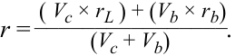

# Volume 8: Alternative Investments
## Learning Module 2 Alternative Investment Performance and Returns
### Part 3/3: Practice Problems (PDF Pages 66–72)

---

<!-- PDF Page 66 -->

# **~~PRACTICE PROBLEMS~~** 

**1.** The following information applies to Rotunda Advisers, a hedge fund: 

   - $288 million in AUM as of prior year end 

   - 2% management fee (based on year-end AUM) 

   - 20% incentive fee calculated: 

      - Net of management fee 

      - Using a 5% soft hurdle rate 

      - Using a high-water mark (high-water mark is $357 million) 

   - Current-year fund gross return is 25%. 

The total fee earned by Rotunda in the current year is closest to: 

**A.** $7.20 million. 

   - **B.** $20.16 million. 

   - **C.** $21.60 million. 

**2.** A hedge fund with net capital of GBP500 million has borrowed an additional GBP200 million at 4.5% per annum. The current-year return of the fund is 15%. What would have been the return if the fund had not added any leverage? 

   - **A.** 10.7% 

   - **B.** 12.0% 

   - **C.** 19.2% 

**3.** A common problem for the “mark-to-model” valuation of private equity funds is _most likely_ : 

   - **A.** a violation of accounting rules. 

   - **B.** an understatement of portfolio risk. 

   - **C.** an understatement of interim portfolio return. 

**4.** A commodity hedge fund has three investors: 

   - €100 million from Investor A invested at Year 0, 

   - €100 million from Investor B invested at the beginning of Year 2, and 

   - €100 million from Investor C invested at the beginning of Year 3. 

The gross returns before fees of the fund are as follows: 

|||**Investor A’s**|**Investor B’s**|**Investor C’s**|
|---|---|---|---|---|
|**Year**|**Annual Gross** **Return**|**Investment** **(€ millions)**|**Investment** **(€ millions)**|**Investment** **(€ millions)**|
|0|—|100||—|
|1|20%|—||—|
|2|–15%|—|100|—|

<!-- PDF Page 67 -->

|||**Investor A’s**|**Investor B’s**|**Investor C’s**|
|---|---|---|---|---|
|**Year**|**Annual Gross** **Return**|**Investment** **(€ millions)**|**Investment** **(€ millions)**|**Investment** **(€ millions)**|
|3|15%|—||100|
|4|10%|—||—|

The management fee is 2% based on end-of-year value. The incentive fee is 20% above the high-water mark and is calculated based on end-of-year value net of management fee. 

Which investor has earned the highest net return after the end of Year 4? 

- **A.** Investor A 

- **B.** Investor B 

- **C.** Investor C 

## **The following information relates to questions 5-6** 

Buyout Capital, LLC, is a private equity fund that has the following characteristics: 

- Capital committed: $200 million 

- Preferred return: 8% soft hurdle, with full catch-up 

- Fund distribution: after five years 

- Management fee: none 

- Carried interest: 20% above preferred return 

- Waterfall structure: American (deal by deal) with clawback 

The fund made five investments, tabulated as follows: 

|**Investment**|**Year**||**Amount**|**($ m)**|**i**|**Profit**|
|---|---|---|---|---|---|---|
| **No.**|**Invested**|**Sold**|**Invested**|**Sold**|**$ m**|**%**|
|1|0|4|40|60|20|10.67%|
|2|0|4|40|100|60|25.74%|
|3|1|5|40|50|10|5.74%|
|4|1|5|40|120|80|31.61%|
|5|2|5|40|30|(10)|neg.|
|**Total**|||**200**|**360**|**160**|**12.47%**|

**5.** What is the total carried interest to the GP? 

   - **A.** $30 million 

   - **B.** $32 million 

   - **C.** $34 million 

**6.** Buyout Capital, LLC, is a private equity fund that has the following 

<!-- PDF Page 68 -->

characteristics: 

- Capital committed: $200 million 

- Preferred return: 8% soft hurdle, with full catch-up 

- Fund distribution: after five years 

- Management fee: none 

- Carried interest: 20% above preferred return 

- Waterfall structure: European (whole of fund) 

The fund made five investments that are tabulated as follows: 

|**Investment**|**Year**||**Amount (**|**$ m)**||**Profit**|
|---|---|---|---|---|---|---|
|**No.**|**Invested**|**Sold**|**Invested**|**Sold**|**$ m**|**%**|
|1|0|4|40|60|20|10.67%|
|2|0|4|40|100|60|25.74%|
|3|1|5|40|50|10|5.74%|
|4|1|5|40|120|80|31.61%|
|5|2|5|40|30|(10)|neg.|
|**Total**|||**200**|**360**|**160**|**12.47%**|

What is the total carried interest to the GP? 

- **A.** $30 million 

**B.** $32 million 

   - **C.** $34 million 

**7.** A hedge fund has the following fee structure: 

   - Annual management fee based on year-end AUM: 2% 

   - Incentive fee: 20% 

   - Hurdle rate before incentive fee collection starts: 4% 

   - Current high-water mark: $610 million 

The fund has a value of $583.1 million at the beginning of the year. After one year, it has a value of $642 million before fees. The net percentage return to an investor for this year is closest to: 

**A.** 6.72%. 

**B.** 6.80%. 

**C.** 7.64%. 

<!-- PDF Page 69 -->

# **~~SOLUTIONS~~** 

1. A is correct. Although the gross return of Rotunda results in a $360 million gross NAV, the deduction of the $7.2 million management fee brings NAV to $352.8 million, which is below the prior high-water mark. Rotunda earns a management fee of $7.20 million but does not earn an incentive fee because the year-end fund value net of management fee does not exceed the prior high-water mark of $357 million. Since Rotunda is still also below the prior-year high-water mark, the hurdle rate of return is also basically irrelevant in this fee calculation. The specifics of this calculation are as follows: 

End-of-year AUM = Prior year-end AUM × (1 + Fund return) = $288 million × 1.25 = $360 million. 

$360 million × 2% = $7.20 million management fee. 

$360 million − $7.2 million = $352.8 million AUM net of management fee. 

The year-end AUM net of fees do not exceed the $357 million high-water mark. Therefore, no incentive fee is earned. 

2. B is correct. 

Using Equation 2, 

_rL_ = Leveraged portfolio return/Cash position = [ _r_ × ( _Vb+Vc_ ) – ( _Vb_ × _rb_ )]/ _Vc_ . 

Or, after re-arranging the formula, 

<!-- Formula Text: r = ( V c × r L ) + (V b × r b) ________________ (V c + V b) . -->

Substituting _rL_ = 0.15, _Vb_ = 200, _Vc_ = 500, _rb_ = 0.045, 

_r_ = (500 × 0.15) + (200 × 0.045)/(200 + 500) = 12%. 

Since leverage magnifies return when the borrowing cost is lower than asset returns, the unleveraged asset return must be lower than 15%. 

3. B is correct. Accounting rules require that investments be recorded at their fair value for financial reporting purposes. The fair value of private equity that owns illiquid assets requires certain estimates, rather than observable transaction prices, to be factored into valuation. A model that relies on Level 3 inputs may reflect an imperfect theoretical valuation and not a true liquidation value. The lack of new market information over time may anchor the interim valuation at or near initial cost. The relatively stable accounting valuations may give investors a false sense that they are less volatile. At the same time, there is a potential conflict of interest for the GP to overstate interim return because of the implication for carried interest. As a result, returns may be smoothed or overstated and the volatility of returns understated. 

4. C is correct. Despite investing for the shortest period of time in the fund (i.e., two years), Investor C has earned the highest net return compared to the other two investors. The following table illustrates the calculations based on the “2 and 20” fee structure and the high-water marks facing each investor in any particular year; in each case, the incentive fee is calculated using Equation 8: 

_RGP_ ( _High-Water Mark_ ) = ( _P_ 2 × _rm_ ) + max[0, ( _P_ 2 – _PHWM_ ) × _p_ ]. 

<!-- PDF Page 70 -->

The net return is calculated using Equation 9: 

_ri_ = ( _P_ 2 – _P_ 1 – _RGP_ )/ _P_ 1. 

|**Year**|**Annual** **Gross** **Return**|**Investor A’s** **Investment**|**Year-End AUM** **(Before Fee)**|**High-Water** **Mark**|**Management** **Fee (2%)**|**Incentive** **Fee (20%)**|**Year-End AUM** **(After Fee)**|
|---|---|---|---|---|---|---|---|
||||||||**(Before Fee)**|
|0|—|100.00|100.00|—|—|—|100.00|
|1|20%|—|120.00|100.00|2.40|3.52|114.08|
|2|-15%|—|96.97|114.08|1.94|—|95.03|
|3|15%|—|109.28|114.08|2.19|—|107.10|
|4|10%|—|117.81|114.08|2.36|0.27|115.18|
|**Investor**|**A's net return**||||||**15.18%**|

|**Year**|**Annual** **Gross** **Return**|**Investor B’s** **Investment**|**Year-End AUM** **(Before Fee)**|**High-Water** **Mark**|**Management** **Fee (2%)**|**Incentive** **Fee (20%)**|**Year-End AUM** **(Before Fee)**|
|---|---|---|---|---|---|---|---|
|0|—|—|—|—|—|—|—|
|1|20%|—|—|—|—|—|—|
|2|-15%|100.00|85.00|100.00|1.70|—|83.30|
|3|15%||95.80|100.00|1.92|—|93.88|
|4|10%|—|103.27|100.00|2.07|0.24|100.96|
|**Investor**|**B's net return**||||||**0.96%**|

|**Year**|**Annual** **Gross** **Return**|**Investor C’s** **Investment**|**Year-End AUM** **(Before Fee)**|**High-Water** **Mark**|**Management** **Fee (2%)**|**Incentive** **Fee (20%)**|**Year-End AUM** **(Before Fee)**|
|---|---|---|---|---|---|---|---|
|0|—|—|—|—|—|—|—|
|1|20%|—|—|—|—|—|—|
|2|-15%|—|—|—|—|—|—|
|3|15%|100.00|115.00|100.00|2.30|2.54|110.16|
|4|10%|—|121.18|110.16|2.42|1.72|117.03|
|**Investor**|**C's Net Return**||||||**17.03%**|

5. A is correct. The distribution of profit of each investment is as follows: 

||**Year**||**Amount (**|**$ m)**||**Pri**|**ofit**||
|---|---|---|---|---|---|---|---|---|
|**Investment**|||||||**LPs at**|**GP at**|
|**No.**|**Invested**|**Sold**|**Invested**|**Sold**|**$ m**|**%**|**80%**|**20%**|
|1|0|4|40|60|20|10.67%|16|4|
|2|0|4|40|100|60|25.74%|48|12|
|3|1|5|40|50|10|5.74%|10|0|
|4|1|5|40|120|80|31.61%|64|16|

<!-- PDF Page 71 -->

||**Year**||**Amount (**|**$ m)**||**Pri**|**ofit**||
|---|---|---|---|---|---|---|---|---|
|**Investment**|||||||**LPs at**|**GP at**|
|**No.**|**Invested**|**Sold**|**Invested**|**Sold**|**$ m**|**%**|**80%**|**20%**|
|5|2|5|40|30|(10)|neg.|(8)|(2)|
|**Total**|||**200**|**360**|**160**|**12.47%**|**130**|**30**|

Since the preferred return of the LP is 8%, Investments 1, 2, and 4 all meet the criterion and the profit is split 80/20 between the LPs and GP. Investment 3 does not earn the GP any carry because it fails to meet the preferred return; neither does Investment 5, whose profit is negative. Because of the clawback clause, the GP’s carry is reduced by $2 million (or 20% of the loss on Investment 5). Therefore, the total carried interest adds up to $30 million, or 30/160 = 18.75% of the total profit made by the fund. 

6. B is correct. A European waterfall occurs at the aggregate fund level. As long as the fund exit IRR exceeds 8% after five years, the GP will be eligible for the full 20% carried interest on the profit made from all investments—that is, $160 million × 20% = $32 million. 

||**Year**||**Amount**|**($ m)**||**Proi**|**fit**||
|---|---|---|---|---|---|---|---|---|
|**Investment**|||||||**LPs at**|**GP at**|
|**No.**|**Invested**|**Sold**|**Invested**|**Sold**|**$ m**|**%**|**80%**|**20%**|
|1|0|4|40|60|20|10.67%|||
|2|0|4|40|100|60|25.74%|||
|3|1|5|40|50|10|5.74%|||
|4|1|5|40|120|80|31.61%|||
|5|2|5|40|30|(10)|neg.|||
|**Total**|||**200**|**360**|**160**|**12.47%**|**128**|**32**|

7. C is correct. The management fee for the year is $642 million × 0.02 = $12.84 million. Because the ending gross value of the fund of $642 million exceeds the high-water mark of $610 million, the hedge fund can collect an incentive fee on gains above this high-water mark but net of the hurdle rate of return. The incentive fee calculation becomes 

{$642 – [$610 × (1 + 0.04)]} × 0.20 = $1.52 million. 

The net return to the investor for the year is 

[($642 – $12.84 – $1.52)/$583.1] – 1 = 0.07638 ≈ 7.64%. 

<!-- PDF Page 72 -->

