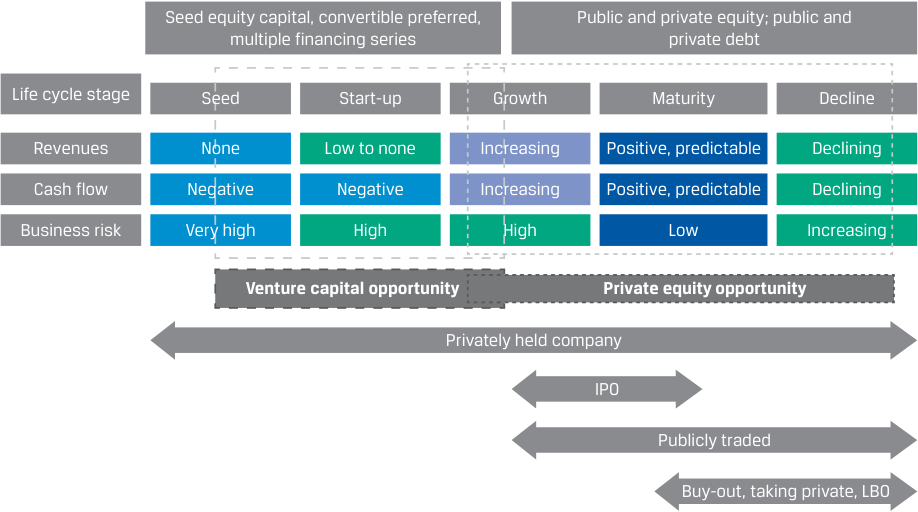

# Volume 8: Alternative Investments
## Learning Module 3 Investments in Private Capital: Equity and Debt
### Part 1/2: Introduction (PDF Pages 73–86)

---

<!-- PDF Page 73 -->

# L E A R N I N G M O D U L E **<mark>3</mark>** 

### **Investments in Private Capital: Equity and Debt** 

##### **<mark>LEARNING OUTCOMES</mark>** 

###### **_Mastery The candidate should be able to:_** 

explain features of private equity and its investment characteristics explain features of private debt and its investment characteristics describe the diversification benefits that private capital can provide 

#### **INTRODUCTION** 

## **<mark>1</mark>** 

This Learning Module and the subsequent four Learning Modules explain the investment characteristics of specific alternative asset types, starting with private equity and private debt. The subsequent Learning Modules focus on real assets, natural resources, hedge funds, and digital assets. Each Learning Module introduces core characteristics, distinguishing features, and risk–return characteristics for the specific asset class. Alternative assets differ from the traditional asset classes—debt and equity—due to their unique return, risk, and information profiles and historically show low levels of correlation with debt and equity. Moreover, alternative assets often require highly specialized knowledge to select, manage, and divest these assets. Since these alternative assets are generally considered to be less liquid than traditional asset classes, understanding the valuation and return characteristics is a specialized skill. 

###### **LEARNING MODULE OVERVIEW** 

- Private equity is a form of private capital funding sourced from outside public markets through non-traditional sources, such as venture capital and leveraged buyout firms. It can be injected at various stages of business development, from initial idea to final transition to public company status. 

- The duration of a private equity investment also varies, with funds conducting their exits typically by the strategies of trade sales to strategic buyers or public listings through IPOs or special acquisition 

<!-- PDF Page 74 -->

companies (SPACs). Other strategies include recapitalizations, secondary sales, and liquidations, with all the strategies having their unique advantages and drawbacks. 

- Compared to traditional investments, private equity can offer better returns combined with higher risks. This contrast is a function of private equity’s distinct choice set, greater management control, and greater leverage. Data ambiguities make it challenging to reliably measure the benefits of private equity investing. 

- Private debt primarily refers to the various forms of debt provided by investors directly to private entities. Its four major categories are direct lending, mezzanine loans, venture debt, and distressed debt, and it also includes unitranche debt of blended loans and other specialty loans. 

- As in private equity investment, private debt can be arranged on a direct or indirect basis, with funds deployed over the corporate life cycle straight from an investor or intermediated through a fund. Investors receive interest payments and the return of principal after a designated term, with debt typically secured and having protections/ covenants. 

- Private debt has potentially higher returns and risks than traditional fixed income, with its investors needing specialized knowledge to adjust exposures for differences across company funding stages, debt structures, and underlying assets. 

- Private debt and equity are distinct in terms of risks and performance from their public counterparts due to illiquidity and concentration risk and to the often-greater uncertainties of both their underlying businesses and the means to hedge away their risks. And a fundamental timing characteristic for private capital is its vintage year, with the valuation and economic environment at the origin of a private equity fund having a potentially substantial effect on realized results over the fund’s set lifespan. 

- To offset the potentially adverse performance effects of an ill-timed fund launch at an unfavorable stage of the business cycle, investors can diversify exposure across fund vintage years. 

- Investments in private capital vary in terms of risk and return across the corporate capital structure hierarchy, with a diversified mix of private equity and debt investments potentially balancing private capital risks and returns. And when combined with public stocks and bonds, investments in private capital funds can add a moderate diversification benefit with opportunities for excess returns due to private capital’s additional leverage, market, and liquidity risks. 

###### **SELF-ASSESSMENT** 

These initial questions are intended to help you gauge your current level of understanding of this learning module. 

1. At the conclusion of a public company’s leveraged buyout, the amount of its market-traded stock is substantially: 

   - **A.** reduced. 

<!-- PDF Page 75 -->

|**B.**increased. f|
|---|
|**C.**unaffected. **Solution:**|
|A is correct. After the transaction, the target company becomes or remains a privately owned company. Leveraged buyouts are sometimes called “go- ing-private” transactions because after the acquisition of a publicly traded company, the target company’s equity is substantially no longer publicly traded.|
|2. Which of the following financing tools would_most likely_be used at the later stage of venture capital investment?|
|**A.**Common stock|
|**B.**Preferred stock **C.**Convertible debt **Solution:**|
|B is correct. Preferred stock can be deployed as late into a company’s ma- turity as later-stage venture capital, when preferred stock can offer more protection to venture investors as a company transitions toward an IPO. A and C are incorrect because these instruments are more typically used in the earlier pre-seed and seed stages.|
|3. Which of the following transaction features is associated with mezzanine debt?|
|**A.**Warrants|
|**B.**Lines of credit **C.**Fixed payment schedules **Solution:**|
|A is correct. Mezzanine debt often comes with additional features, such as warrants or conversion rights. These provide equity participation to lenders/ investors. B is incorrect because lines of credit are associated with venture debt, which entrepreneurs may seek to obtain additional financing without further diluting shareholder ownership. C is incorrect because fixed pay- ment schedules are associated with direct lending, in which, as with typical bank loans, payments are usually received on a fixed schedule.|
|4. In using private debt for a syndicated leveraged mortgage portfolio, the financial ratio of loan to value (LTV) is important at:|
|**A.**origination and to the real estate fund sponsor.|
|**B.**syndication and to the private debt fund lender. **C.**both transaction phases and to each of the parties. **Solution:**|
|C is correct. LTV plays a significant role in both legs of this transaction. For a sponsor to be able to borrow and for a lender to be able syndicate the loans, the aggregate LTV ratio cannot be breached, and any deviation from LTV on an individual property level needs to be cured. As the loan amortiz- es, its outstanding principal declines, decreasing LTV. However, if the value of the real estate were to drop, then the sponsor will be required to raise additional collateral to maintain the LTV level.|

<!-- PDF Page 76 -->

5. Vintage diversification is an advisable policy for implementation by private capital: 

   - **A.** funds. 

   - **B.** investors. 

   - **C.** users, such as company managers. 

###### **Solution:** 

B is correct. The vintage year, the time when fund deployment begins, is important for comparing PE and VC investments with other funds in the same year. Because of changing business and valuation environments, funds of a certain vintage have a relative advantage based on their start-up timing. That is why investors are encouraged to pursue vintage diversification by investing in multiple vintage years. A is incorrect because once capital commitments from a fund begin, all subsequent transactions are classified as part of the same vintage year. C is incorrect because the terms and conditions of capital use are more a function of the circumstances of their company than of the origin point of their fund source. 

6. The potential diversification benefits from private capital investment are _most likely_ related to its: 

   - **A.** wide range of exit strategies. 

   - **B.** various types of fee structures. 

   - **C.** lower correlation with public asset returns. 

   - **Solution:** 

C is correct. Investments in private capital funds can add a moderate diversification benefit to a portfolio of publicly traded stocks and bonds. Correlations with public market indexes vary from 0.63 to 0.83. A is incorrect because different exit strategies can offer funds the opportunity to maximize returns but do not necessarily reduce the volatility of returns over time. B is incorrect because while different fee structures may more effectively align the interests of funds and their investors, they do not necessarily change the risks of the underlying investments. 

## **<mark>2</mark>** 

#### **PRIVATE EQUITY INVESTMENT CHARACTERISTICS** 

explain features of private equity and its investment characteristics 

**Private capital** is the broad term for funding provided to companies that is not sourced from the public markets, such as from the sale of equities, bonds, and other securities on exchanges, or from traditional institutional providers, such as a government or bank. Capital raised from sources other than public markets and traditional institutions and in the form of an equity investment is called **private equity** . Comparably sourced capital extended to companies through a loan or other form of debt is referred to as **private debt** . Private capital relates to the entire capital structure, comprising private equity and private debt. 

Private equity strategies include **leveraged buyout (LBO)** , venture capital (VC), and growth capital. Leveraged buyouts, or highly leveraged transactions, arise when private equity firms establish buyout funds (or LBO funds) to acquire public companies 

<!-- PDF Page 77 -->

or established private companies, with a significant percentage of the purchase price financed through debt. The target company’s assets typically serve as collateral for the debt, and the target company’s cash flows are expected to be sufficient to service the debt. The debt becomes part of the target company’s capital structure after the buyout occurs. After the transaction, the target company becomes or remains a privately owned company. LBOs are sometimes called “going private” transactions because after the acquisition of a publicly traded company, the target company’s equity is substantially no longer publicly traded. 

The LBO may also be of a specific type. In a **management buyout** (MBO), the current management team participates in the acquisition, and in a **management buy-in** (MBI), the current management team is replaced with the acquiring team involved in managing the company. LBO managers seek to add value by improving company operations, boosting revenue, and ultimately increasing profits and cash flows. Cash flow growth, in order of contribution, comes from organic revenue growth, cost reductions and restructuring, acquisitions, and then all other sources. The financial returns in this category, however, depend greatly on the use of leverage. If debt financing is unavailable or costly, LBOs become less attractive and are less likely to take place. As business conditions and the availability of financing change, private equity managers may change focus. 

A manager may manage many private equity funds, each composed of several investments, and the companies owned are called **portfolio companies** because they will be part of a private equity fund portfolio. 

There are certain similarities and differences between private equity and public equity. Both types of equity represent direct ownership and control of the corporation. Owners are shareholders and as such have voting rights at the annual general meeting of shareholders electing the board, setting strategy, and making impactful decisions for the future of the company. Additionally, all owners have a direct and proportional claim to residual cash flow rights in the form of dividends. Ultimately, because of significant shareholdings, private equity ownership allows more direct control over decisions than public equity. Because of this, managing a direct private investment exposure requires specialized knowledge specific to the industry and sector the firm is in. Capital gains are typically the largest driver of returns, either through price appreciation or from free cash flow generated by the holdings. 

Equity investment, whether in public or private companies, has historically exhibited higher returns at the expense of greater risk compared with debt. The potential pay off for equity investors is unlimited upside with the downside limited to the amount invested. However, there are some differences as well. 

##### **Private Equity Investment Categories** 

Private equity investments can be direct, through a single private equity fund, or indirect, through a fund-of-funds vehicle with stakes in various other private funds. With a direct private equity investment, the investment is made in a single, specific asset, but there may also be co-investments where the investor will participate alongside a lead sponsor who sources, structures, and executes the transaction. 

Non-public equity is often categorized by the investor’s _entry_ point in a company’s life cycle (venture capital versus private equity), as Exhibit 1 shows. 

<!-- PDF Page 78 -->

**Exhibit 1: Private and Venture Capital across the Corporate Life Cycle Stages** 

<!-- Start of picture text -->
Seed equity capital, convertible preferred, Public and private equity; public and multiple financing series private debt Life cycle stage Seed Start-up Growth Maturity Decline Revenues None Low to none Increasing Positive, predictable Declining Cash flow Negative Negative Increasing Positive, predictable Declining Business risk Very high High High Low Increasing Venture capital opportunity Private equity opportunity Privately held company IPO Publicly traded Buy-out, taking private, LBO <!-- End of picture text -->

**Venture capital** entails investing in or providing financing to private companies with high growth potential. Typically, these are start-ups or young companies, but venture capital can be injected at various stages, ranging from concept creation for a company or near the point of a company’s IPO (initial public offering) launch or its acquisition. The investment return required varies with the company’s stage of development. Investors in early-stage companies will demand higher expected returns relative to later-stage investors because the earlier the stage of development, the higher the risk. 

Venture capitalists, like all private equity managers, are active investors directly involved with their portfolio companies. 

VC funds typically invest in companies and receive an equity interest but may also provide financing in the form of debt (commonly, convertible debt). Exhibit 2 summarizes the financing stages at different phases of the venture. 

**Exhibit 2: Stages of Venture Capital** 

|**Stage**|**Pre-seed**|**Seed**|**Early stage | Later stage**|
|---|---|---|---|
|**Investors**|• Founders • Friends and family • Angel investors|• Seed funds • Angel investors|• Venture capital funds • Corporate venture funds • Private equity investors • Strategic investors|
|**Typical invest-** **ment amount**|USD5k–USD500k|USD25k– USD5mil|USD5mil+|
|**Source of** **capital**|Mainly individuals|Funds|• Institutional investors • Family offices • Strategic investors|

- _Pre-seed capital_ , or _angel investing_ , is capital provided at the idea stage. Funds may be used to develop a business plan and to assess market potential. The amount of financing here is typically small and sourced from individuals, often friends and family, rather than by VC funds. 

<!-- PDF Page 79 -->

- _Seed-stage financing_ , or _seed capital_ , generally supports product development and marketing efforts, including market research. This is the first stage at which VC funds usually invest. 

- _Early-stage financing_ (early-stage VC), or _start-up stage financing_ , goes to companies moving toward operation but prior to commercial production or sales, in both of which early-stage financing may be injected to initiate. 

- _Later-stage financing_ (expansion VC) comes after commercial production and sales have begun but before an IPO. Funds may be used to support initial growth, a major expansion (such as a physical plant upgrade), product improvements, or a major marketing campaign. 

Later-stage financing generally involves management selling control of the company to the VC investor; financing is provided through equity and debt, although the fund may also use convertible bonds or convertible preferred shares. The VC fund offers debt financing for reasons of recovery and the control of assets in a bankruptcy situation, not to generate income. Simply put, debt financing affords the VC fund more protection than equity does. 

**Mezzanine-stage financing** (mezzanine venture capital) prepares a company to go public as it continues to expand capacity and enhance its growth trajectory. It represents the bridge financing needed to fund a private firm until it can execute an IPO or be sold. The term _mezzanine-stage financing_ is used because it is infused between private and public company status, principally distinguished by the timing of the financing rather than its method. While the terms sound quite similar, mezzanine financing is different from mezzanine-stage financing. Mezzanine financing relates to the use of equity–debt hybrid instruments, such as convertible debt or convertible preferred. Mezzanine-stage financing can use mezzanine financing, but typically at this stage the main financing is either equity-like (to capture potential gains from the planned IPO) or short-term debt. 

Convertible preferred shares are often used in start-ups to raise private capital from venture capital funds. Since convertible preferred shares include an option for the holder to convert the preferred shares into a fixed number of common shares after a predetermined date and in some cases at a predetermined price, they provide incentive alignment between the entrepreneurs in the start-up and the investor. The conversion value is ultimately based on the valuation of the start-up. Investing in a start-up is risky because the investor is financing a new and unproven business. Preferred convertible equity provides investors with additional protections that are not available to common shareholders. Most importantly, in the event of a liquidation, preferred convertible shareholders have seniority over common shareholders and are entitled to recover the entire value of their investment before common shareholders receive any of the proceeds. 

When investing, the manager of the venture capital fund is largely confident that the portfolio company’s management team is competent and armed with a solid business plan showing strong prospects for growth. Because these companies are immature businesses without years of operational and financial performance history, estimating company valuations and their future prospects is highly subjective. 

Once venture capital sees an exit opportunity, private equity can take over. Private equity firms specialized in the later-stage life cycle phase seek to generate returns by directly influencing management and implementing strategy changes, particularly for both publicly traded and privately held companies that are underperforming their peers. Here, private equity focuses on increasing the value of the core business by adaptively changing the overall business strategy by eliminating poor-performing business lines or businesses that do not generate sufficiently high returns. These 

<!-- PDF Page 80 -->

strategic changes can generate value that can be extracted either from the assets in place (selling underperforming assets) or by creating a more sustainable strategy and selling the company at a higher valuation. 

Established companies in a transition phase may seek minority equity interest to expand, restructure, or acquire other companies. A private equity firm that engages in minority equity investing, also known as growth equity or growth capital, takes a less-than-controlling interest in more mature companies looking for capital to expand or restructure operations, enter new markets, or finance major acquisitions. Many times, minority equity investing is initiated and sought by the management of the investee company. The management’s motive is to realize earnings from selling a portion of its shares before the company can go public but still retain control and participation in the success of the company. Although this scenario occurs most commonly with private companies, publicly quoted companies can seek private equity capital through PIPEs (private investments in public equities). 

###### **EXAMPLE 1** 

##### **Tenderledge and Arguston—Buyout** 

A private equity firm, Tenderledge Opportunity Fund LLC, is evaluating Arguston Inc. Arguston is a mid-sized manufacturing firm operating in a mature industry and has seen both its revenues and earnings drop. Arguston does not have the needed capital to make the necessary long-term investments in technological upgrades to maintain its competitiveness or to recapture and extend its dwindling market share. The company is closely held, but the current owners and its management do not have the financial capacity to make the necessary investments and are willing to be bought out by Tenderledge. 

To make the investment in Arguston, Tenderledge would not only provide needed capital but also restructure Arguston’s operations to create efficiencies by reducing unnecessary redundancies and streamlining production, operations, and administration. It would likely replace management and install its own board members. 

Tenderledge is likely to reduce overhead costs and cut employment levels. Once the restructuring and technological investments bear fruit, Tenderledge may also opt to consider acquiring some of Arguston’s competitors to create additional growth through economies of scale and scope. Ultimately, the objective is to increase the value of Arguston and exit from the investment at a much higher price. 

A **PIPE (private investment in public equity)** transaction is a private offering to select investors with fewer disclosures and lower transaction costs that allows the issuer to raise capital more quickly and cost effectively than with other means that may be more regulated, expensive, and lengthy. In a traditional PIPE transaction, either newly issued common stock or shares sold by existing stockholders—or a combination of both—in an already-publicly traded company are made available to certain investors. These investors, typically investment firms, mutual funds, or other institutional investors, enter into a definitive purchase agreement with the issuer and commit to purchase securities at a fixed price. These transactions are common in work-out or rescue situations where there is a material difference in the market price and valuations. A special case of PIPE is capital raised through convertible debt or convertible preferred stock. PIPE transactions are also dilutive to existing shareholders, and the new investors require a discount to market on the purchase price, which can introduce incentive conflicts between existing shareholders and new shareholders. 

<!-- PDF Page 81 -->

###### **EXPEDIA AND PIPE DURING COVID-19** 

Private investment in public equity often signals confidence in a company’s prospects and offers companies an accelerated approach to raise capital by selling large chunks of its equity to investors who often take board seats to directly get involved in setting business strategy. But these transactions can be costly. 

In March 2020, the early stages of the COVID-19 pandemic led to a severe decline in travel, creating crisis conditions for the industry. Expedia, an online business and retail travel platform operating several brands, sold USD1.2 billion of preferred shares to two private equity managers, gave each firm a seat on its board, and issued USD2 billion of additional debt. 

The preferred shares pay a fixed rate of 9.5% and warrants to purchase common stock. All in all, Expedia accumulated over USD4 billion in liquidity to weather the business disruption caused by the pandemic. 

Expedia may redeem these preferred shares at preset prices during certain time periods and at preset periods. 

|**Time period**|**Redemption price**|
|---|---|
|Up to the first year of issuance|105.0%|
|Between first and second year of issuance|103.0%|
|Between second and third year of issuance|102.0%|
|Between third and fourth year of issuance|101.0%|
|After the fourth year of issuance|100.0%|

When redeeming these shares, Expedia also has to pay any unpaid and accrued dividends. Additionally, Expedia also issued warrants to purchase 8.4 million shares of common equity at an exercise price of USD72.00 per share; these warrants have an expiration of 10 years. 

Finally, Expedia also issued debt with an aggregate principal amount up to USD855 million. Its euro-denominated debt paid up to a 2.35% annual interest rate until 31 December 2021 and after that date paid up to 1.75%. 

Assuming the adverse business conditions recovered fairly quickly to enable Expedia redemption of the financing at the midpoint (2 years) of the term sheet and it had not paid any preferred dividends beforehand, Expedia’s cost would be [(1.02) + (0.095 × 2)](USD1.2 billion) = USD1.45 billion, or USD250 million in excess of the preferred fund raise, plus the potential dilutive effects on earnings of 8.4 million extra common shares if their market price exceeded the USD72 warrant exercise price. As a benchmark comparison, the dividend yield of the largest US market preferred ETF, iShares Preferred and Income Securities, was approximately 5.6% in the summer of 2020, a substantially lower yield. 

##### **Private Equity Exit Strategies** 

Private equity firms seek to improve new or underperforming businesses and then exit them at higher valuations, buying and holding companies for an average of five years. Holding time, however, can range from less than six months to more than 10 years. Before deciding on an exit strategy, private equity managers assess the dynamics of the industry in which the portfolio company competes, the overall economic cycle, interest rates, and company performance. 

<!-- PDF Page 82 -->

Instead of a long-term buy-and-hold strategy that managers and owners of publicly held equity funds espouse, private equity seeks to aggressively maximize investment return by selling or even auctioning holdings in private assets to the highest bidder. The added value that private equity investors can realize by strategically connecting firms and entities can further increase the value of the transaction and the returns to the private equity investors. 

Typically, a private equity fund has an investment period of approximately five years and a subsequent harvesting period when exit occurs and the valuation environment becomes more relevant. Moreover, private equity fund investments are not made in one single payment but are spread over time using committed capital over several years, which provides managers a great deal of flexibility to optimize when their entry and exit points occur. 

There are two main exit strategies: trade sale and public listing, which can take the form of IPOs, direct listings, or SPACs 

###### **_Trade Sale_** 

There are two main exit strategies: trade sale and public listing. In a **trade sale** , a portion or a division of the private company is sold either via direct sale or auction to a strategic buyer interested in increasing the scale and scope of the existing business. Because the transaction may have an impact on the competitive environment, it may face regulatory scrutiny and approval or management or employee resistance. 

A key advantage of a trade sale is that a strategic investor will be willing to pay a premium as they price in potential synergies with their existing business. Other advantages of a trade sale include the relatively fast and simple execution of the transaction, which compared with an IPO may be shorter and incur lower transaction costs. Since these are privately negotiated transactions, there is a higher confidentiality because there are just a few parties involved in the transaction or the auction. Additionally, the strategic buyers can better evaluate the fit with their existing business without external scrutiny, which potentially makes strategic buyers willing to pay more from anticipating synergies with their own business. 

The disadvantages of trade sales include potential resistance from existing members of management, who may fear their job security and may wish to avoid ownership by a competitor. Similarly, management and employees may resist a private transaction because a public listing would monetize the shares and potentially attain a higher sale price. Finally, the universe of trade buyers may be limited, which can potentially raise regulatory scrutiny and reduce prices. 

###### **EXAMPLE 2** 

##### **Tenderledge and Arguston—Exit** 

After Tenderledge Opportunity Fund LLC, bought out Arguston Inc., the midsized manufacturing firm operating in a mature industry, Tenderledge restructured Arguston’s operations and acquired some of Arguston’s direct competitors to increase its economies of scale. Additionally, it acquired one of Arguston’s smaller, strategic suppliers to create a strategically resilient and efficient entity. To realize the efficiencies from streamlining production, operations, distributions, and administration, Tenderledge is now considering exiting from this investment. 

Trade sale may be an alternative Tenderledge considers, particularly because there still are some competitors that may benefit from a strategic alliance with a more cost-efficient peer. Tenderledge has turned to BridgeRock LLC, another 

<!-- PDF Page 83 -->

private equity firm, which owns one of Arguston’s main competitors, Tetrawolf Inc., about merging the two companies before exiting from the investment by listing the companies on the market. 

###### **_Public Listing_** 

Public listing on an exchange can take place either as an initial public offering (IPO), a direct listing, or a special acquisition company (SPAC). IPOs are the most common means of raising capital in public equity markets using financial intermediaries to underwrite the offering. When a private equity firm or company founder takes a company public, the portfolio company sells its shares, including some or all of those held by the private equity firm, to public investors. 

There are several benefits of an IPO as an exit strategy. An IPO may potentially realize the highest price for the company, may increase the visibility of the company, and would continue to provide an upside for the private equity company because it retains a share in the new public entity. Moreover, the success of an IPO builds on management support and approval, and it is likely that management will be retained, which provides job security. 

There are several disadvantages with an IPO and public listing. Apart from the high transaction fees to investment banks and lawyers, the time to complete the transaction may be long, and it requires onerous disclosure. The public equity market introduces stock market volatility, and the potential lockup period (mandating the private equity firm to retain an equity position for a specified period post-IPO) may limit a quick realization of value. Moreover, not all companies are suitable for an IPO; smaller companies and those operating in out-of-favor industries, ones with unclear strategic priorities and unstable financial position, or those that have limited operating histories may not be ideal candidates for an IPO. A less commonly used approach to exit from a private equity position is **direct listing** , where the equity of the entity is floated on the public markets directly, without underwriters, reducing the complexity and cost of the transaction. 

A **special purpose acquisition company** (SPAC) is a technique also used for a public exit. Such a “blank check” company exists solely for the purpose of acquiring an unspecified private company within a predetermined period; otherwise, it must return capital to investors. Companies suitable for an IPO would be appropriate SPAC candidates, but the two strategies have different valuation methods: here a single counterparty sets SPAC terms, which reduces the uncertainty around the valuation. 

There are several advantages of an SPAC exit; these transactions provide an extended time for public disclosure on company prospects to build investor interest, flexibility of transaction structure to best suit the company’s context, and association with potentially high-profile and seasoned sponsors and their extensive investor network. Moreover, the valuation of the entity is fixed in advance and does not change, which reduces both the volatility and the uncertainty of share pricing. Finally, SPACs are allowed to provide more forward formal guidance on a company’s prospects than is allowed under an IPO. 

There are some noteworthy shortcomings of using SPACs for market access and exit. First, SPAC transactions increase the cost of capital because the various capital instruments, such as warrants, have dilutive effects. Second, there is a valuation spread between the value of the SPAC equity and the equity purchased by the SPAC. This can be further complicated by possible dilution effects: The shares and warrants of a SPAC can be issued and then traded separately. Third, there may also be specific deal risk associated with the successful execution of the definite purchase and merger agreement. Fourth, regulatory authorities, such as the US SEC, are reconsidering the classification of SPACs under long established rules that could impose more stringent standards on their operations. Finally, there may be significant trading in the SPAC 

<!-- PDF Page 84 -->

equity in the months after the purchase transaction is announced that can lead to **stockholder overhang** , the downward pressure on the share price as large blocks of shares are being sold on the open market. 

###### **EXAMPLE 3** 

##### **Tenderledge and BridgeRock—SPAC Transaction** 

After Tenderledge Opportunity Fund LLC and BridgeRock merged their two companies Arguston Inc. and Tetrawolf Inc., they continued to operate the merged company, Aurora Inc., each holding a 50% share in the merged entity. As both private equity firms are considering exiting from the investment at the same time, they were evaluating various exit alternatives. 

For private equity, having an exit strategy is critical. Tenderledge and BridgeRock are evaluating various alternatives. Although IPOs and direct listings are popular exit strategies, SPACs have the ability to raise capital as companies such as Aurora enter the public market. Given the future uncertainty about valuations, the private equity firms chose to go the SPAC route and enter into a merger with a SPAC to bring Aurora to market a few months faster and at a higher price than the companies would have realized had they chosen an IPO or a direct listing. 

**Exhibit 3: Pros and Cons of Common Private Equity Exit Strategies** 

|**Strategy**|**Advantage**|**Disadvantage**|
|---|---|---|
|**Trade** **Sale**|1. Immediate cash exit 2. Higher price from synergy-seeking strategic buyers 3. Fast and simple execution 4. Streamlined process on transaction cost, disclosure, and confidentiality from dealing with only one party|1. Potential management opposition 2. Limited set of buyers 3. Reduced financial appeal to employees due to forgone monetization of owner- ship stakes/options|
|**IPO**|1. Highest potential share price 2. Likeliest management approval 3. Notoriety to private equity sponsor’ 4. Sharing in potential share price appreciation from ongoing own- ership stake|1. High transaction costs 2. Long lead time 3. Stock market volatility creating value uncertainty 4. Onerous disclosure 5. Potential lockup period freezing capital committed to deal 6. Suitable mainly for large and fast-growingcompanies|
|**SPAC**|1. Extended disclosure time and ability to provide forward guid- ance to develop investor interest 2. Fixed valuation with lower share price volatility 3. Transaction structure flexibility 4. Involvement of high-profile, seasoned sponsors and their investor networks|1. Potential higher capital costs of dilu- tion, warrants, and fees 2. Divergence between announced and true equity value due to dilution 3. Deal and capital risk of potential redemptions 4. Prolonged post-merger stockholder overhang and churn|

<!-- PDF Page 85 -->

###### **_Other Exit Strategies_** 

In addition to the previously discussed exit strategies, other exit strategies include **recapitalization** , **secondary sale** , and **write-off/liquidation** . 

- _Recapitalization._ Recapitalization via private equity describes the steps a firm takes to increase or introduce leverage to its portfolio company and pay itself a dividend out of the new capital structure. A recapitalization is not a true exit strategy, because the private equity firm typically maintains control; however, it does allow the private equity investor to extract money from the company to pay its investors and improve its internal rate of return (IRR). 

- _Secondary sale._ This approach represents a sale of the company to another private equity firm or group of financial buyers. With the considerable amount of funds raised by global PE, there has been an increase in the proportion of secondary sale exits. 

- _Write-off/liquidation._ A write-off occurs when a transaction has not gone well, and the investment is likely to lose value. The private equity firm then revises the value of its investment downward or liquidates the portfolio company before moving on to other projects. 

The exit strategies we have discussed may be pursued individually or in combination with others or may be used for a partial exit strategy, such as divesting a self-contained product or business line. For example, private equity funds may sell a portion of a portfolio company to a competitor via a trade sale and then complete a secondary sale to another private equity firm for the remaining portion. Company shares may also be distributed directly to the investors (LPs) of the private equity fund, although such a move is unusual. 

##### **Risk–Return from Private Equity Investments** 

Private equity investors expect ownership capital returns—cash flows from dividends and proceeds from exit—subject to underlying market conditions of the industry. However, private equity investments have distinct entry and exit points between which managers exercise greater direct control and apply specialized knowledge to add value over a specific life cycle phase. While both involve investment selection (stock selection using filings and financial statement analysis for public companies, target selection for private equity), vintage year is important for private equity for comparative purposes. 

The higher-return opportunities that private equity funds may provide relative to traditional investments are due to their ability to invest in private companies, their influence on portfolio companies’ management and operations, and their use of leverage. Investing in private equity, including venture capital, is riskier than investing in common stocks and requires a higher return for accepting its higher risk, including illiquidity and leverage risks. 

Published private equity indexes may be an unreliable measure of performance. Measuring historical private equity performance is challenging; as with hedge funds, which will be discussed later, private equity return indexes typically rely on self-reporting and are subject to survivorship, backfill, and other biases. This typically leads to an overstatement of returns. Moreover, prior to the global financial crisis of 2008–2009, in the absence of a liquidity event, private equity firms did not necessarily mark their investments to market. Failure to mark to market combined with the lag to mark investments due to inherent illiquidity will understate measures of volatility and correlations with other investments. Thus, data adjustments are required to more reliably measure the benefits of private equity investing. As a result, many investors 

<!-- PDF Page 86 -->

expect companies to be marked on a quarterly or annual basis, preferably by an independent party. Investors should require a higher return for accepting a higher risk, including illiquidity and leverage risks. 

###### **QUESTION SET** 

1. Determine the correct answers to fill in the blanks: ________________ is the broad term for funding provided to companies that is not sourced from the public markets, with its two primary sub-categories being _________________ and ______________. 

###### **Solution:** 

_Private capital_ is the broad term for funding provided to companies that is not sourced from the public markets, with its two primary sub-categories being _private equity_ and _private debt_ . 

2. Identify the following statement as true or false: Both public and private equity represent direct ownership and control of the corporation. Additionally, all owners have a direct and proportional claim to residual cash flow rights in the form of dividends. 

###### **Solution:** 

True. These are two of the similarities shared by public and private equity. 

3. Describe a funding situation to which a PIPE transaction is well suited. 

   - **Solution:** 

A PIPE (private investment in public equity) transaction is a private offering to select investors with fewer disclosures and lower transaction costs that allows the issuer to raise capital more quickly and cost effectively than other means that may be more regulated, expensive, and lengthy. These transactions are common in work-out or rescue situations where there is a material difference in the market price and valuations. 

4. Match each form of private capital investment with the combination of corporate life cycle characteristics _most appropriate_ for it. 

|**Investment Form**|**Corporate Life Cycle Characteristics**|
|---|---|
|1. Private Equity|i. Negative cash flow, high business risk|
|2. Venture Capital|ii. Increasingcash flow, high business risk|
|3. Both Private Equity and|iii. Declining cash flow, increasing business risk|
|Venture Capital|l|

###### **Solution:** 

|**Investment Form**|**Corporate Life Cycle Characteristics**|
|---|---|
|1. Private Equity|iii. Decliningcash flow, increasingbusiness risk|
|2. Venture Capital|i. Negative cash flow, high business risk|
|3. Both Private Equity and Venture Capital|l ii. Increasing cash flow, high business risk|

As shown in Exhibit 1, the “iii” combination of characteristics is typical of the decline stage, when private equity would have the best fit. The “i” combination of characteristics is typical of the start-up stage of the corporate life 

