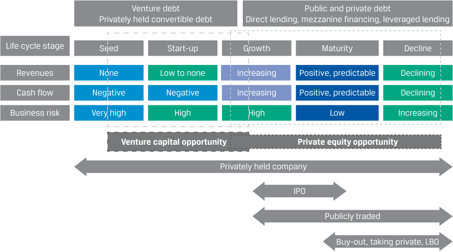
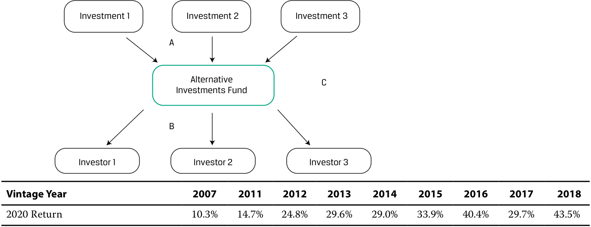

# Volume 8: Alternative Investments
## Learning Module 3 Investments in Private Capital: Equity and Debt
### Part 2/2: Private Debt Investment Characteristics (PDF Pages 87–100)

---

<!-- PDF Page 87 -->

cycle, when venture capital is most appropriate. Finally, the “ii” combination is typical of the growth stage, when the opportunities for the forms of investment overlap and either type would be suitable. 

### **PRIVATE DEBT INVESTMENT CHARACTERISTICS** 

# **<mark>3</mark>** 

explain features of private debt and its investment characteristics 

Private debt primarily refers to the various forms of debt provided by investors directly to private entities. In the past decade, the expansion of the private debt market has been largely driven by private lending funds filling the gap between borrowing demand and reduced lending supply from traditional lenders in the face of tightened regulations following the 2008 financial crisis. 

We can organize the primary methods of private debt investing into four categories: direct lending, mezzanine loans, venture debt, and distressed debt. The broad array of debt strategies offers not only diversification benefits but also exposure to other investment spheres, such as real estate and infrastructure. 

#### **Private Debt Categories** 

Analogous to private equity investment, an investor wanting to include private debt in a portfolio has various alternatives along a comparable direct versus indirect distinction. In direct private debt investment, the investor makes a loan directly to a specific operating company. In the indirect approach, the investor takes an intermediated path, purchasing an interest in a fund that pools contributions typically on behalf of multiple participants to buy into the debt from a set of operating companies. For both approaches, in exchange for the debt, the investors receive interest payments and the return of principal after a designated term. The debt is typically secured and has various protections/covenants in place. Exhibit 4 depicts the role of private debt in the corporate life cycle. 

<!-- PDF Page 88 -->

**Exhibit 4: Private Debt and Corporate Life Cycle** 

<!-- Start of picture text -->
Venture debt Public and private debt Privately held convertible debt Direct lending, mezzanine financing, leveraged lending Life cycle stage Seed Start-up Growth Maturity Decline Revenues None Low to none Increasing Positive, predictable Declining Cash flow Negative Negative Increasing Positive, predictable Declining Business risk Very high High High Low Increasing Venture capital opportunity Private equity opportunity Privately held company IPO Publicly traded Buy-out, taking private, LBO <!-- End of picture text -->

**Venture debt** is private debt funding that provides venture capital backing to start-up or early-stage companies that may be generating little or negative cash flow. Entrepreneurs may seek venture debt, often in the form of a line of credit or term loan, to obtain additional financing without further diluting shareholder ownership. Venture debt can complement existing equity financing, allowing current shareholders to maintain ownership and control for a longer period. Similar to mezzanine debt, venture debt may carry additional features that compensate the investor/lender for the increased risk of default or for the start-up and early-stage companies that lack substantial assets for debt collateral. One such feature could grant the lender rights to purchase equity in the borrowing company under certain circumstances. 

Private debt investors get involved in **direct lending** by providing capital directly to borrowers and subsequently receiving interest, the original principal, and possibly other payments in exchange for their investment. As with typical bank loans, payments are usually received on a fixed schedule. The debt itself typically is senior and secured and has covenants in place to protect the lender/investor. It is provided by a small number of investors to private and sometimes public entities and differs from traditional debt instruments, such as bonds, which can be issued to many participants and be publicly traded. 

Direct lending primarily involves private debt firms (or private equity firms with private debt arms) establishing funds with money raised from investors desiring higher-yielding debt. Fund managers will then seek financing opportunities, such as providing a loan to a mid-market corporation or extending debt to another private equity fund that is seeking funds for acquisitions. In general, private debt funds provide debt, at higher interest rates, to entities needing capital but lacking good alternatives to traditional bank lenders, which themselves may be uninterested or unable to transact with these borrowers. As in private equity, private debt fund managers conduct thorough due diligence before investing. 

In direct lending, many firms may also provide debt in the form of a **leveraged loan** , a loan that is itself levered. Private debt firms that invest in leveraged loans first borrow money to finance the debt and then extend it to another borrower. By using leverage, a private debt firm can enhance the return on its loan portfolio. 

<!-- PDF Page 89 -->

##### **EXAMPLE 4** 

#### **Peterburgh Real Estate Fund, LLC—Syndicated Leveraged Mortgages** 

The Peterburgh Real Estate Fund, LLC, has acquired a portfolio consisting of six commercial properties for a total of GBP100 million. From its investors, the fund secured GBP30 million in equity financing, and it turned to BridgeRock Credit Opportunities LLP, a private debt fund that underwrites commercial mortgages before syndicating them. 

In this specific transaction, properties valued at GBP100 million serve as collateral for a total of GBP75 million mortgages, giving an aggregate loan to value (LTV) of 0.75, which provides GBP25 million excess collateral to BridgeRock. The terms of the mortgage are MRR + 150 bps, with a maturity of 15 years, GBP5 million in annual amortization, and all mortgages being secured by the first lien on the property. The lender, BridgeRock, then sells or syndicates the mortgages to other banks or institutional investors. The LTV plays a significant role in both legs of this transaction. For Peterburgh to be able to borrow and for BridgeRock to be able syndicate the loans, the aggregate LTV ratio cannot be breached, and any deviation from the LTV on an individual property level needs to be cured. As Peterburgh amortizes the loan, the outstanding principal of the mortgages decline, which decreases the LTV value. However, if the value of the real estate were to drop, then Peterburgh will be required to raise additional collateral to maintain the LTV. 

In private debt, **mezzanine debt** refers to private credit subordinated to senior secured debt but senior to equity in the borrower’s capital structure. Mezzanine debt is a pool of additional capital available to borrowers beyond senior secured debt, often used to finance LBOs, recapitalizations, corporate acquisitions, and similar transactions. Because of its typically junior ranking and its usually unsecured status, mezzanine debt is riskier than senior secured debt. To compensate investors for this heightened risk, investors commonly demand higher interest rates and may require options for equity participation. Mezzanine debt often comes with additional features, such as warrants or conversion rights. These provide equity participation to lenders/ investors, conveying the option to convert their debt into equity or purchasing the equity of the underlying borrower under certain circumstances. 

Involvement in **distressed debt** typically entails buying the debt of mature companies in financial difficulty. These companies may be in bankruptcy, have defaulted on debt, or seem likely to default on debt. Some investors identify companies with a temporary cash flow problem but a good business plan to help the company survive and ultimately flourish. These investors buy the company’s debt expecting both the company and its debt to increase in value. Turnaround investors buy debt with an aim to be more active in distressed company management and direction, seeking to restructure and revive the company. Overall, investors concentrating on distressed debt need to develop specialized knowledge related to assessing the likelihood of default and the possible recovery rates because distressed debt is priced to the expected recovery rate, but occasionally recovery rates mistake the underlying risk of the exposures and have long time horizons. Bankruptcy procedures can be lengthy, complex, and capital intensive. Similarly, distressed debt investors need to understand how to restructure companies and restructure debt. Several distressed debt funds focus on debtor-in-possession (DIP) financing, which provides operating funds for firms already in bankruptcy. 

<!-- PDF Page 90 -->

##### **HERTZ AND DIP FINANCING** 

Hertz entered Chapter 11 reorganization in May 2020 after filing for bankruptcy due to COVID-19’s near total shutdown of the global travel industry. In October 2020, it negotiated USD1.65 billion in operating funds secured through debtor-in-possession financing. That committed Hertz to pay creditors up to a market reference rate of (MRR) + 725 bps, permitting drawdowns from the facility in individual tranches of at least USD250 million. Up to USD1 billion was allowed for vehicle acquisition, and as much as USD800 million was allowed to fund working capital and general corporate needs. 

The DIP financing was projected to provide Hertz with liquidity to support its continued operations throughout 2021, when the loan matured. Private capital firms Apollo Global Management, Diameter Capital Partners, and Silver Point Capital provided this funding. DIP financing is often a signal that lenders are confident in the company’s ability to reorganize and pay the debt back in time. 

Another type of debt that could be directly extended to borrowers is **unitranche debt** . Unitranche debt consists of a hybrid or blended loan structure combining different tranches of secured and unsecured debt into a single loan with a single, blended interest rate. Since unitranche debt is a blend of secured and unsecured debt, its interest rate will generally fall in between the interest rates often demanded on secured and unsecured debt. The unitranche loan will usually be structured between senior and subordinated debt in priority ranking. 

Private debt firms may also provide _specialty loans_ , extended to niche borrowers in specific situations. For example, in litigation finance, a specialist funding company provides debt to clients, usually plaintiffs in litigation, for their legal fees and expenses in exchange for a share of judgements. 

#### **Risk–Return of Private Debt** 

Private debt investments may provide higher-yielding opportunities to fixed-income investors seeking increased returns relative to traditional bonds. Private debt funds may generate higher returns by taking opportunistic positions based on market inefficiencies. Private lending funds filled the financing gap left by traditional lenders following the 2008 financial crisis. Investors in private debt could realize higher returns from the illiquidity premium, which is the excess return investors require to compensate for lack of liquidity. Investors also benefited from increased portfolio diversification by owning these securities. 

The interest rate of private debt is often expressed relative to a reference rate—for example, the Secured Overnight Financing Rate (SOFR) + 375 bps. As a result, the coupon varies in line with changes to the reference rate brought about by changes to the interest rate environment. 

Differences between public and private debt include the distinct entry and exit points with lenders, which offer borrowers greater flexibility in arranging financing. Specialized knowledge for private debt financing is needed in order to add value for the investor. First, the financing and return on debt depends on the specific period of a company’s phase of life cycle. Earlier debt financing typically carries higher risks and provides higher returns. Second, the structure of the debt is also of importance; for instance, CLOs (collateralized loan obligations) with the market reference rate, or MRR, as the base rate require specialized knowledge. Finally, the investor needs to have special knowledge about underlying assets, particularly for secured lending, such as real estate. 

<!-- PDF Page 91 -->

The potential for higher returns is connected to higher levels of risk. Private debt investments vary in risk and return, with senior private debt providing a steadier yield and moderate risk and mezzanine private debt carrying higher growth potential, equity upside, and higher risk than senior private debt. Overall, investing in private debt is riskier than investing in traditional bonds. Investors should be aware of these risks, including illiquidity and heightened default risk when loans are extended to riskier entities or borrowers in riskier situations. Modeling private equity or debt returns is not straightforward, due to a lack of good-quality data and artificially smooth returns. 

##### **QUESTION SET** 

1. Identify two categories of private debt that would typically be relied on in the growth stage or a later stage of the corporate life cycle. 

##### **Solution:** 

As shown in Exhibit 4, three private debt categories are featured in the later stages of the corporate life cycle: 

   **1.** Direct lending 

   **2.** Mezzanine financing 

   **3.** Leveraged lending 

2. **Determine the correct answers to fill in the blanks:** Similar to mezzanine debt, ________________ may carry additional features that compensate the investor/lender for ___________________________ or for the start-up and early-stage companies that _________________________. 

##### **Solution:** 

Similar to mezzanine debt, _venture debt_ may carry additional features that compensate the investor/lender for _the increased risk of default_ or for the start-up and early-stage companies that _lack substantial assets for debt collateral._ 

3. Describe the borrowing cost of unitranche debt. 

##### **Solution:** 

Unitranche debt consists of a hybrid or blended loan structure combining different tranches of secured and unsecured debt into a single loan with a single, blended interest rate. Since unitranche debt is a blend of secured and unsecured debt, its interest rate will generally fall in between the interest rates often demanded on secured and unsecured debt. 

4. Identify the following statement as true or false: Modeling private debt returns is fairly straightforward because they are a function of a benchmark public debt return. 

##### **Solution:** 

False. While private debt and public debt share a reference point in being marked up from a benchmark return, modeling private equity or debt returns is not straightforward, due to a lack of good-quality data, more security-specific risk between assets, and artificially smooth returns. 

<!-- PDF Page 92 -->

# **<mark>4</mark>** 

### **DIVERSIFICATION BENEFITS OF PRIVATE CAPITAL** 

describe the diversification benefits that private capital can provide 

Since the performance of private debt and private equity greatly depend on the specific phase of a company’s life cycle, performance, and risk, comparison of public debt and equity may not be appropriate. First, investing in a start-up carries greater risk than investing in a well-established firm. Second, investing in a company in a declining or disintermediated industry is unlikely to offer positive return over longer time horizons. Moreover, performance risk of a continuous investment in public equity and debt can easily be hedged away. 

The vintage year is important for comparing private equity and VC investments with other funds in the same year. Each private equity fund carries a **vintage year** , typically defined as the year in which the fund makes its first investment. Typically, a private equity fund operates over a 10- to 12-year period, which is often segmented into an initial investment period and a subsequent harvesting period. The investment period usually is the first five years during which the capital is sourced from the limited partners and invested in various companies. The harvesting period is the remaining years of the fund, when the fund looks to exit its existing investments and to return capital to limited partners. 

Because of changing business and valuation environments, funds of a certain vintage have the advantage of starting in a low-valuation, low-risk appetite, economic recovery phase and benefit from riding the wave of an economic recovery. Other vintages may be less fortunate and invest the bulk of their capital in a high-valuation environment preceding a market crash or a period of prolonged economic contraction. That is why investors are encouraged to pursue vintage diversification by investing in multiple vintage years. 

The performance realized by the fund is greatly determined by the vintage year and the phase of the business cycle in which the vintage year occurred, as Exhibit 5 shows. Funds seeded during the expanding phase of the business cycle tend to earn excess returns if they fund early-stage companies. Funds seeded during the contracting phase of the business cycle tend to earn excess returns if they fund distressed companies. 

<!-- PDF Page 93 -->

##### **Exhibit 5: US Private Equity Index Vintage Year Returns, Net Fund-Level Performance** 

<!-- Start of picture text -->
Investment 1 Investment 2 Investment 3 A Alternative C Investments Fund B Investor 1 Investor 2 Investor 3 Vintage Year 2007 2011 2012 2013 2014 2015 2016 2017 2018 2020 Return 10.3% 14.7% 24.8% 29.6% 29.0% 33.9% 40.4% 29.7% 43.5% <!-- End of picture text -->

_Source:_ Cambridge Associates, data as of December 31, 2020. https:// www .cambridgeassociates .com/ benchmarks/ us -pe -vc -benchmark -commentary -calendar -year -2020/ 

Investments in private capital vary in terms of risk and return across the corporate capital structure hierarchy. Typically, private equity, as the riskiest alternative, offers the highest returns, with private debt returns declining on a continuum down to the safest, most secured form of debt—infrastructure debt. Exhibit 6 outlines various private equity and private debt categories by their risk and return levels (mirroring the risk–return pathway for traditional equity and debt investing, note the trade-off as investors select between junior and senior debt and between equity and debt). 

**Exhibit 6: Private Capital Risk and Return Levels by Category** 

<!-- Start of picture text -->
Return Private Equity Co-Investments Debt Mezzanine Unitranche Debt Senior Direct Lending Senior Real Estate Debt Infrastructure Debt Risk <!-- End of picture text -->

_Source_ : Based on a graph from Leon Sinclair, “The Rise of Private Debt,” IHS Markit (7 August 2017). 

<!-- PDF Page 94 -->

Investments in private capital funds can add a moderate diversification benefit to a portfolio of publicly traded stocks and bonds. Correlations with public market indexes vary from 0.63 to 0.83, as shown in Exhibit 7. And if investors identify skillful fund managers, benefits from excess returns given the additional leverage, market, and liquidity risks are possible. 

**Exhibit 7: Private Capital’s Average Correlations with Public Market Indexes, March 2008–June 2021** 

||**S&P 500 Total** **Return**|**Russell 2000** **Total Return**|**MSCI World** **Total Return**|
|---|---|---|---|
|Preqin, Private Equity|0.80|0.76|0.81|
|Preqin, Venture All Stage|0.65|0.67|0.63|
|Preqin, Buyout|0.82|0.76|0.83|
|Preqin, Private Debt|0.82|0.77|0.86|

_Source:_ Annualized quarterly returns of Private Capital Quarterly Index rebased to 31 December 2007, provided by Preqin. 

##### **QUESTION SET** 

1. State a private debt and equity investment factor that can make performance/risk comparisons with public debt and equity inappropriate. **Solution:** 

There are several private debt and equity investment factors that can invalidate such comparisons: 

   - Start-up investments carry greater risks than those of established firms. 

   - Investments in declining industries are unlikely to sustain gains over the long term. 

   - Ongoing performance risk in private investments can’t be easily hedged. 

2. Describe the life cycle segments of a private equity fund. 

##### **Solution:** 

The year in which a private equity fund makes its first investments is called its vintage year. Typically, operations span a 10- to 12-year period, which is often segmented into an initial investment period and a subsequent harvesting period. The investment period usually is the first five years during which the capital is sourced from the limited partners and invested in various companies. The harvesting period is the remaining years of the fund, when the fund looks to exit its existing investments and to return capital to limited <u>partners.</u> 

<!-- PDF Page 95 -->

3. Identify the following statement as true or false: 

A private equity fund whose vintage dates to a high-valuation environment _most likely_ starts with an advantage in having rich prices for its assets. 

##### **Solution:** 

False. Funds starting in a low-valuation, low-risk appetite, economic recovery phase benefit from riding the wave of an economic recovery and have an advantage over other vintages investing the bulk of their capital in a high-valuation environment preceding a market crash or a period of prolonged economic contraction. 

4. Match the form of private capital investment with its _most likely_ position on the risk/return continuum. 

|**Investment Form**|**Risk/return combination**|
|---|---|
|1. Mezzanine Financing|i. Lowest risk and return|
|2. Private Equity|ii. Intermediate risk and return|
|3. Senior Direct Lending|iii. Highest risk and return|

##### **Solution:** 

Investing in private debt and equity mirrors the risk–return pathway for traditional equity and debt investing. As investors select between senior and junior debt and between equity and debt, the potential risks and returns increase. Therefore, the lowest risk and return come from senior direct lending, and the highest risk and return are from private equity, while mezzanine financing falls in between the two. 

|**Investment Form**|**Risk/return combination**|
|---|---|
|1. Mezzanine Financing|ii. Intermediate risk and return|
|2. Private Equity|iii. Highest risk and return|
|3. Senior Direct Lending|i. Lowest risk and return|

<!-- PDF Page 96 -->

## **~~PRACTICE PROBLEMS~~** 

|**1.**Which of the following is_most likely_to participate in early-stage financing? **A.**Founders|
|---|
|**B.**Angel investors|
|**C.**Strategic investors|
|**2.**Private equity funds are_most likely_to use:|
|**A.**leveraged buyouts.|
|**B.**option-based strategies.|
|**C.**merger arbitrage strategies.|
|**3.**A shared advantage of IPO and SPAC exit strategies for a private equity fund is their:|
|**A.**fast and simple execution.|
|**B.**ability to win market attention.|
|**C.**transaction structure flexibility.|
|**4.**Which of the following combinations of financial characteristics_most likely_ would be associated with a venture debt transaction?|
|**A.**Positive revenues and cash flow|
|**B.**Declining revenues and cash flow|
|**C.**Low revenues and negative cash flow|
|**5.**In contrast to direct lending and distressed debt, mezzanine debt_most likely_ requires higher interest rates for its investors due to its:|
|**A.**reliance on leverage.|
|**B.**overall ranking and status in company debt structure.|
|**C.**need for management involvement over an extended time.|
|**6.**A feature that private debt and public debt share in the setting of their investment returns is their:|
|**A.**relationship to benchmark interest rates.|
|**B.**need for specialized investment knowledge.|
|**C.**opportunity for illiquidity premiums in market crises.|
|**7.**The_most likely_effect on a portfolio’s diversification when exposure to direct lending commences is that it: **A.**decreases.|

<!-- PDF Page 97 -->

   - **B.** remains the same. 

   - **C.** increases. 

**8.** Private equity funds whose vintage year occurs in the expanding phase of the business cycle tend to earn excess returns by investing in companies that are: 

   - **A.** mature. 

   - **B.** distressed. 

   - **C.** early stage. 

**9.** The private capital category _most likely_ to offer the highest diversification benefit for portfolios holding public stock and bonds is: 

   - **A.** private debt. 

   - **B.** private equity. 

   - **C.** venture capital. 

<!-- PDF Page 98 -->

## **~~SOLUTIONS~~** 

1. C is correct. Strategic investors typically join in at early-stage to later-stage financing. A is incorrect because founders are typically part of the investor group at the earliest, pre-seed stage. B is incorrect because angel investors are typically involved in the beginning stages, either pre-seed or seed. 

2. A is correct. Many private equity transactions involve leveraged buyouts to acquire public companies or established private companies. B and C are incorrect because these are strategies implemented by other types of alternative investors, such as hedge funds. 

3. B is correct. IPOs can gain public attention for sponsors by high-profile business launches, and SPACs often have high-profile, seasoned sponsors and their investor networks as participants. A is incorrect because this is an advantage of a trade sale exit strategy. C is incorrect because it is a benefit specific to SPACs, with IPOs having fairly rigid and defined features, such as onerous disclosure requirements and lock-up periods. 

4. C is correct. These financial characteristics are typical of the start-up stage in the corporate life cycle, when it is suitable to rely on venture debt. A is incorrect because these are features of the maturity stage, when direct lending, mezzanine financing, and leveraged lending are customary. B is incorrect because these are features of the maturity stage, when direct lending, mezzanine financing, and leveraged lending are customary. 

5. B is correct. Because of its typically junior ranking and its usually unsecured status, mezzanine debt is riskier than senior secured debt. To compensate investors for this heightened risk, investors commonly demand higher interest rates. A is incorrect because leverage is typically a feature of a form of direct lending in which firms may also provide debt in the form of a leveraged loan, a loan that is itself levered with borrowing costs figuring into returns. C is incorrect because operational involvement over a possibly lengthy time with unpredictable risks describes the role of turnaround investors involved with distressed debt. 

6. A is correct. For both public debt and private debt, return on debt capital tends to follow and change with the benchmark interest rate environment. B is incorrect because there is a need for specialized knowledge for private debt financing to add value to the investor through consideration of such factors as the debt’s life cycle timing, its place in the financial structure, and the quality of underlying assets. C is incorrect because in market disruptions, such as the 2008 financial crisis, private debt exclusively benefited from an illiquidity premium when private lending funds filled the financing gap left by traditional lenders because traditional lenders were reluctant to underwrite public debt. 

7. C is correct. Private capital can have overall positive contributions to diversification. Note, however, that direct lending can involve a large capital commitment to a single borrower, with increased concentration risk and reduced diversification 

8. C is correct. Fund performance is greatly determined by the vintage year and the coinciding phase of the business cycle. Funds seeded during the expanding phase tend to earn excess returns investing in early-stage companies. Funds seeded during the contracting phase tend to do best with distressed companies. Results may be intermediate with mature, stable companies. 

<!-- PDF Page 99 -->

9. C is correct. Research on the correlations between portfolios holding these public assets shows that venture capital has the lowest correlations across all major market indexes. This relationship implies a higher diversification benefit for venture capital. 

<!-- PDF Page 100 -->

