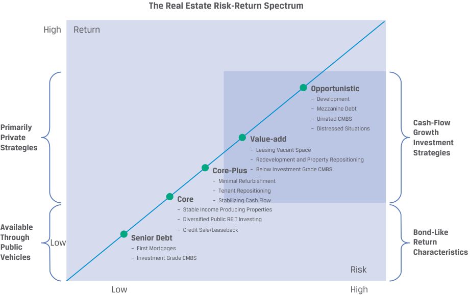

# Volume 8: Alternative Investments
## Learning Module 4 Real Estate and Infrastructure
### Part 1/2: Introduction (PDF Pages 101–114)

---

<!-- PDF Page 101 -->

#### L E A R N I N G M O D U L E 

# **<mark>4</mark>** 

### **Real Estate and Infrastructure** 

###### **<mark>LEARNING OUTCOMES</mark>** 

**_Mastery The candidate should be able to:_** explain features and characteristics of real estate explain the investment characteristics of real estate investments explain features and characteristics of infrastructure explain the investment characteristics of infrastructure investments 

##### **INTRODUCTION** 

## **<mark>1</mark>** 

Broadly defined, real estate comprises land and buildings. Real estate investments involve developed land, including commercial and industrial real estate and residential real estate. Real estate has some unique features, including heterogeneity (no two properties are identical), long lives, and fixed geographical or physical location. 

Raw land and less developed land used in agriculture and forestry are categorized as _natural resource_ investments, while _infrastructure_ involves land, buildings, and other fixed assets developed by public entities or public–private partnerships for economic use. Investments in real estate and infrastructure are included in many portfolios because they tend to exhibit low correlations with traditional asset classes and provide risk and return combinations across a broad spectrum. Here, as in other alternative assets, investors need specialized knowledge in selecting, acquiring, managing, and divesting these assets. 

###### **LEARNING MODULE OVERVIEW** 

- Real estate includes two major sectors: residential and commercial. Residential real estate is the largest sector, totaling 75% of the global market. Commercial real estate includes office buildings, shopping centers, and warehouses. 

- Real estate investing has some unique features, including heterogeneity (no two properties are identical), fragmentation, price discovery challenges, and costly and time-consuming transactions. 

<!-- PDF Page 102 -->

- Real estate investments can be direct or indirect, in the public market (e.g., REITs) or private transactions, and in equity. 

- The return on real estate investments comes from income or asset appreciation or a combination of both. More than half of the returns commercial real estate investors earn are derived from income, and throughout an economic market cycle, real estate income is a more consistent source of return than capital appreciation. 

- Investing in real estate can generate either lower-risk, bond-like cash flows from leases or higher-risk, equity-like speculative returns from realizing value from development projects or price appreciation. 

- Real estate offers diversification benefits to portfolios. However, during certain market conditions, equity REIT correlations with market benchmarks increase, particularly during steep market downturns. 

- Infrastructure consists of assets that are capital intensive and long lived and that are intended to provide essential services for public use. 

- Infrastructure investments can take many forms, both direct and indirect. They can be broadly categorized as either economic (e.g., transportation, utility, and energy assets) or social (e.g., educational assets). They can also be categorized based on the underlying asset’s stage of development as greenfield, secondary stage, or brownfield. The greenfield investment life cycle common among public–private partnerships is called the build-operate-transfer (BOT) life cycle. 

- Most infrastructure assets are financed, owned, and operated by governments, and infrastructure is increasingly being financed privately through public–private partnerships by local, regional, and national governments. Investments in construction and development of new infrastructure are made with expectations to generate cash from either income or capital appreciation. 

- Of the three stages of infrastructure investments, greenfield investments offer the highest expected return and have the highest expected risk, and secondary stage investments offer the lowest expected return and have the lowest expected risk. 

- Infrastructure investors primarily expect the assets to generate stable long-term cash flows that also adjust for economic growth and inflation and secondarily expect capital appreciation, depending on the type and timing of their investment. 

- Infrastructure investments provide an income stream, increase portfolio diversification by adding an asset class with typically low correlation with other public investments, provide some protection for changes in GDP growth, and offer some protection against inflation. 

###### **LEARNING MODULE SELF-ASSESSMENT** 

These initial questions are intended to help you gauge your current level of understanding of this learning module. 

1. The two categories of real property are: 

   - **A.** residential and commercial. 

   - **B.** <u>privately held and publicly traded.</u> 

<!-- PDF Page 103 -->

|**C.**individual market and institutional market. **Solution**:|
|---|
|The correct answer is A. The two categories of real property are residential and commercial.|
|2. The preferred investment vehicles for public investors to own income-pro- ducing real estate are:|
|**A.**real estate funds.|
|**B.**mortgage-backed securities.|
|**C.**real estate investment trusts. **Solution**:|
|The correct answer is C. Real estate investment trusts (REITs) are the pre- ferred investment vehicles for owning income-producing real estate for both private and public investors.|
|3. Which of the following entails the least risk?|
|**A.**Value-add real estate|
|**B.**Investment-grade commercial mortgage-backed securities|
|**C.**Residential real estate with long-term leases and many lessors **Solution**:|
|The correct answer is B. Of these three, investment-grade commercial mortgage-backed securities (CMBS) entail the least risk, and value-add real estate investments entail the most.|
|4. Which of the following entails the most risk?|
|**A.**Mezzanine debt|
|**B.**Core-plus real estate strategies|
|**C.**Redevelopment of an existing property **Solution**:|
|The correct answer is A. Of these three, mezzanine debt entails the most risk, and core-plus strategies entail the least.|
|5. The first stage of development of an infrastructure asset is typically called:|
|**A.**bluesky.|
|**B.**greenfield.|
|**C.**early stage. **Solution**:|
|The correct answer is B. The first stage of development of an infrastructure asset is typically called greenfield. Greenfield investing involves developing new assets and new infrastructure with the intention either to lease or sell the assets to the government after construction or to hold and operate the assets. Greenfield investors typically invest alongside strategic investors or developers that specialize in developing the underlying assets. The sub- sequent stages of development of infrastructure assets are typically called secondary stage and brownfield.|

6. Direct infrastructure investment involves assets that are: 

<!-- PDF Page 104 -->

- **B.** securitized. 

- **C.** exchange traded. 

**Solution** : 

The correct answer is A. Like real estate, direct investment in existing infrastructure involves acquiring unique, illiquid assets with distinct location, features, and uses. Investors concerned about liquidity and diversification may invest indirectly using publicly traded infrastructure securities. 

7. Which of the following types of infrastructure investments has the highest expected return? 

   - **A.** Greenfield 

   - **B.** Brownfield 

   - **C.** Secondary stage 

   - **Solution** : 

The correct answer is A. Greenfield investments offer the highest expected return of the three. They also entail the highest expected risk. Secondary stage offers the lowest expected return and the lowest expected risk. 

8. Which of the following tends to make the largest allocations to the infrastructure asset class? 

   - **A.** Pension funds 

   - **B.** Sovereign wealth funds 

   - **C.** Life insurance companies 

   - **Solution** : 

The correct answer is B. Sovereign wealth funds tend to make the largest allocations to the infrastructure asset class—around 5%–6% of total AUM, according to Preqin. 

## **<mark>2</mark>** 

##### **REAL ESTATE FEATURES** 

explain features and characteristics of real estate 

Both individuals and institutions invest in real property: either in residential or commercial real estate. Residential real estate, or the housing market, consists of individual single-family detached homes and multi-family attached units, which share at least one wall with another unit, such as condominiums, cooperatives, townhouses, or terraced housing. Commercial real estate includes primarily office buildings, retail shopping centers, commercial and residential rental properties, and warehouses. In contrast to the owner-occupied market, rental properties are leased to tenants. 

Residential real estate is by far the largest market sector by value and size. Savills World Research estimated in July 2018 that residential real estate accounted for more than 75% of global real estate values. Although the average value of a home is less than the average value of an office building, the aggregate space required to house people is much larger than that needed to accommodate office use and retail shopping. 

<!-- PDF Page 105 -->

###### **Real Estate Investments** 

Real estate investments exhibit general similarities to and differences from traditional equity and debt classes. Real estate can be held privately or traded publicly through real estate investment trusts (REITs). Equity investment involves direct or indirect ownership with claims to residual cash flows from the property. Depending on the property investment, these cash flows can be variable or fixed. Debt investment typically involves direct mortgage lending from financial intermediaries, part of which then can be securitized and then traded through various types of mortgage-backed securities (MBS). The main features of residential and commercial real estate are shown in Exhibit 1. 

**Exhibit 1: Main Features of Residential and Commercial Real Estate** 

||**Residential real estate**|**Commercial real estate**|
|---|---|---|
|Typical property|Owner-occupied, single resi- dences; single-family residen- tial property|Residential properties owned for lease or rental Office, retail, industrial, ware- house, hospitality, and mixed-use properties|
|Source of equity|Owners|Privately held by owners Publicly held through investors|
|Source of debt|Directly: Lenders (banks) through residential mortgages Indirectly: Investors in MBS that package residential mortgages|Directly: Lenders (banks) through commercial mortgages Indirectly: Investors in MBS that package commercial mortgages|
|Source of return to investors|Enjoyment of the property Price, or capital, appreciation|Income, or cash flow, generated by the property Price, or capital, appreciation|

Real estate is uniquely different from other asset classes in several ways: 

- The initial investment is typically large. 

- Real estate is unique and distinct because there aren’t two identical properties; each piece of real estate is heterogeneous and is uniquely characterized in terms of location, age, tenant credit mix, lease term, and market demographics. 

- There are multiple types of real estate investment alternatives available: direct and indirect investment options spanning the spectrum from relatively liquid investments in stable, income-producing properties to illiquid investments over a long development life cycle across the purchase, construction/upgrade, occupancy, and sales phases. 

- Diversification across all different types of real estate investment alternatives may be difficult to attain. 

- Private market indexes replicating the performance of real estate are not directly investable. 

Additionally, the price discovery process in the private real estate markets is opaque, for multiple reasons: 

- Historical prices may not reflect prevailing market conditions. 

<!-- PDF Page 106 -->

- Transaction costs are typically high. Buying and selling real estate can be a time-consuming process, involving real estate professionals, banks, lawyers, and others needed to facilitate these transactions. 

- Transaction activity may be limited in certain markets due to either supply or demand conditions. 

Because of distinct and unique features—geographic location and potential uses— real estate markets are typically fragmented, with the local demand and supply conditions determining the value of the property. Consequently, the heterogeneity unique to real estate demands specialized skills. Selecting, valuing, acquiring, managing, and divesting a real estate portfolio is often more complicated than managing a portfolio made up of listed corporate debt and equity. 

###### **Real Estate Investment Structures** 

Real estate investments take on a variety of public and private forms across equity and debt capital alternatives, as summarized in Exhibit 2. 

**Exhibit 2: Selected Forms of Real Estate Investment** 

<!-- Start of picture text -->
Debt Equity Direct ownership Mortgage debt Sole ownership Joint ventures Private Construction loans Limited partnerships Mezzanine debt Indirect ownership Real estate funds Private REITs MBS/CMBS/CMOs Publicly traded shares Construction Covered bonds Operating Development Public Mortgage REITs Public REITs Mortgage ETFs UCITS/Mutual funds/ETFs <!-- End of picture text -->

###### **_Direct Real Estate Investment_** 

Direct private investing involves purchasing a property and originating debt for one’s own account. Ownership can be free and clear, whereby the property title is transferred to the owner(s) unencumbered by any financing liens, such as from outstanding mortgages. Initial purchase expenses associated with direct ownership may include legal expenses, survey costs, engineering/environmental studies, and valuation (appraisal) fees. There are distinct advantages to owning real estate directly for property investors: 

- _Control._ Only the owner can decide when to buy or sell, when and how much to spend on capital projects, whom to select as tenants based on credit quality preference and tenant mix, and what types of lease terms to 

<!-- PDF Page 107 -->

offer. Owners generate cash flow returns from the use and enjoyment of the property, the receipt of lease payments, and the potential for capital appreciation. 

- _Tax benefits._ The owners can reduce their taxable income using non-cash property depreciation expenses and tax-deductible interest expenses. 

- _Diversification._ Historically, real estate has exhibited low correlation with other asset classes, and adding real estate to a portfolio has been demonstrated to increase portfolio diversification and reduce portfolio risk. 

There are also disadvantages to investing directly in property: 

- _Complexity._ The owners need to dedicate time to manage the property. Making the purchase itself is more complicated as well, with requirements including property selection, negotiating terms, performing due diligence, title search, contract review, and property inspection. 

- _Need for specialized knowledge._ The owners need to understand both general and local market characteristics, which requires local market knowledge. 

- _Significant capital needs._ The owners need to have access to a potentially significant amount of debt and equity capital because of the large initial capital outlay needed for real estate investments. 

- _Concentration risk._ Owners, particularly smaller investors, cannot create a well-diversified real estate portfolio through direct investment. 

- _Lack of liquidity._ It is typically difficult to quickly buy or sell direct investments in real estate, and transaction costs are typically high. 

Real estate investors may choose to handle all aspects of investing in and operating the property internally. However, commercial real estate investors often hire advisers to identify investments, negotiate acquisition and lease terms, perform due diligence, conduct real estate operations, and assist with the eventual disposal. Institutional investors that hire advisers or managers to manage their direct real estate investment can also use a separate account structure that allows the investor to control the timing and value of acquisitions and dispositions. 

Owners can also borrow from mortgage lenders to fund the acquisition. Additional debt closing costs are incurred when owners take out loans to fund their investments. 

###### **_Indirect Real Estate Investment_** 

Indirect investment in real estate pools assets from different investors to acquire one or several properties; here the exposure is indirect through a variety of investment vehicles. These can be public or private, such as limited partnerships, mutual funds, equities, REITs, and exchange-traded funds (ETFs). Sometimes investors form joint ventures with other investors to invest in real estate. Joint ventures are especially common when one party can uniquely contribute something of value, such as land, capital, development expertise, debt due diligence, or entrepreneurial talent. 

Tax-advantaged trusts that own, operate, and sometimes develop income-producing real estate property are known as real estate investment trusts. Their structure is shown in Exhibit 3. There are three main forms of REIT: equity REITs, which invest in properties outright or through partnerships and joint ventures; mortgage REITs, which underwrite loans to real estate (mortgages) or invest in MBS; and hybrid REITs, which invest in both these types. 

<!-- PDF Page 108 -->

**Exhibit 3: Real Estate Investment Trust Structure** 

<!-- Start of picture text -->
Investor Investor (Unitholder) (Unitholder) Investor Investor (Unitholder) (Unitholder) Income Distribution Trustee Management Services Services Investment Trustee REIT Manager Trustee Management Fees Fees Gross Property Property Acquisition/ Income Sale Property Management Property Property Fees Property Manager Property Property Property Management Services <!-- End of picture text -->

REITs are the preferred investment vehicles for owning income-producing real estate for both private and public investors. The main appeal of the REIT structure is the elimination of double corporate taxation. Corporations pay taxes on their income, from which they make dividend distribution to their owners from after-tax earnings. The shareholders, in turn, are taxed at their personal tax rate. REITs can avoid corporate income taxation by distributing dividends equal to 90%–100% of taxable net rental income. 

The business strategy for equity REITs is simple: Maximize property occupancy rates and rents while minimizing ongoing operating and maintenance expenses to maximize cash income and dividends. REITs are a popular investment vehicle both in the United States, where they originated, and in other countries. REITs and REIT-like structures have similar legal and taxation structures and provide unique tax advantages to investors and the corporate entity. 

Equity REITs, like other public companies, must report earnings per share based on net income as defined by generally accepted accounting principles (GAAP) or International Financial Reporting Standards (IFRS). Many report non-traditional measures, such as net asset value or variations of gross cash flow, such as funds from operations (FFO), which makes adjustments for depreciation, distributions, and preferred dividends, to better estimate future dividends, because non-cash depreciation expenses can be high for asset-intensive businesses. 

These publicly traded REITs address many of the disadvantages related to private real estate investing. These REITs provide investors with greater transparency. Additionally, a REIT investor only needs to buy or sell REIT shares instead of buying or selling real estate directly. The REIT is not forced to sell the company’s underlying real estate like open-end funds experiencing mass redemptions. Finally, REITs have the know-how to manage the properties in order to align the interests of the REIT with those of its investors. However, a disadvantage of REITs is their higher correlation with the public equity markets when compared to private real estate. 

<!-- PDF Page 109 -->

###### **EXAMPLE 1** 

###### **Luxury Dreams REIT** 

Luxury Dreams Real Estate Investment Trust acquires high-quality, income-oriented, high-end real estate around the world and offers investment alternatives for investors looking for long-term, stable, predictable cash flows, price appreciation in the underlying properties from the inclusion of properties, and active management of the properties, at generally lower volatility because of its focus on high-end real estate. 

The REIT invests at least 75% of assets in high-end residential properties and up to 25% of assets in privately held, real estate-related securities, mortgage debt, and cash. The REIT is capped at USD5 billion. Because this REIT is not traded publicly, shares in the trust can be redeemed at the end of each month at a price equal to the prior month’s net asset value (NAV) per share in increments of USD10,000. NAV per share is determined at the end of each month and is released to holders within 15 business days after the end of the month. Each shareholder is limited to transact 2% of the total NAV per month and 5% of NAV per quarter. 

REITs and other private real estate funds are structured as infinite-life, open-end funds and allow investors to contribute or redeem capital throughout the life of the fund in a fashion parallel to mutual fund structures. Open-end funds generally offer exposure to well-leased, high-quality commercial and residential real estate in the best markets, also called **core real estate strategies** . Investors expect core real estate to deliver stable returns, primarily from income from the property. 

Investors seeking higher returns may also accept additional risks from development, redevelopment, repositioning, and leasing. For such opportunistic investment preferences, finite-life, closed-end funds are more commonly used. Investors may focus on **core-plus real estate strategies** , value-add investments that require modest redevelopment or upgrades to lease any vacant space together with possible alternative use of the underlying properties. To earn higher returns, investors may engage in **value-add real estate strategies** , such as larger-scale redevelopment and repositioning of existing assets. The most **opportunistic real estate strategies** include major redevelopment, repurposing of assets, taking on large vacancies, or speculating on significant improvement in market conditions. 

Mortgage REITs and hybrid REITs invest in real estate debt, typically MBS (covered elsewhere in the curriculum. These debt REITs can be both private and publicly traded funds. 

###### **QUESTION SET** 

1. True or false: The distinct and unique features of real estate make managing a real estate portfolio less complex than managing a portfolio of listed corporate bonds. 

**Solution** : 

False. Selecting, valuing, acquiring, managing, and divesting a real estate portfolio is often more complicated than managing a portfolio made up of listed corporate debt. The heterogeneity unique to real estate demands specialized skills, and real estate markets are typically fragmented, with the local demand and supply conditions determining the value of the property. 

<!-- PDF Page 110 -->

2. The largest sector of the real estate market is: 

   - **A.** residential real estate. 

   - **B.** real estate investment trusts. 

   - **C.** publicly traded mortgage-backed securities. 

   - **Solution** : 

The correct answer is A. Residential real estate is by far the largest market sector by value and size. Savills World Research estimated in July 2018 that residential real estate accounted for more than 75% of global real estate values. 

3. Describe the business strategy for equity REITs. **Solution** : 

The business strategy for equity REITs is to maximize property occupancy rates and rents while minimizing ongoing operating and maintenance expenses to maximize cash income and dividends. 

4. When a property title that is transferred to a new owner is unencumbered by any financing liens, such as from outstanding mortgages, the new ownership is considered: 

   - **A.** privately held. 

   - **B.** free and clear. 

   - **C.** direct equity ownership. 

   - **Solution** : 

The correct answer is B. “Free and clear” refers to the lack of any financing liens on a purchased property. If a direct private investor purchases a property and receives a title that is unencumbered by any financing liens, that ownership is considered free and clear. 

## **<mark>3</mark>** 

##### **REAL ESTATE INVESTMENT CHARACTERISTICS** 

explain the investment characteristics of real estate investments 

Investments in real estate provide competitive long-term total returns from income generation combined with potential price appreciation. Many commercial real estate companies offer multiple-year leases with fixed rents; hence, the income earned from these leases is typically both predictable and stable. Moreover, real estate tends to provide inflation protection because the lease payments are regularly adjusted, which allows for a clear valuation and pricing of the property. Finally, real estate historically has low correlations with other asset classes, and adding real estate to an investment portfolio provides diversification benefits at relatively lower levels of risk. There are a variety of indexes globally designed to measure total and component real estate returns for listed securities and non-listed investment vehicles. 

<!-- PDF Page 111 -->

###### **Source of Returns** 

The return on real estate investments comes from income or asset appreciation or a combination of both. Income-producing real estate generates income primarily from the collection of rental or lease payments, including lease renewals. Expenses include direct and indirect management expenses, such as maintenance and improvement costs. Income-producing real estate investment is mostly low-risk direct investment that depends on the timely receipt of lease payments. Investors relying on capital appreciation typically expect that their longer-term property development projects are successful and the exit price will exceed the aggregate investments and any cash flow that they can generate in the meantime. 

The risk and return spectrum for real estate investments, depicted in Exhibit 4, includes strategies across both debt and equity investment. Investing in real estate can generate either lower-risk, bond-like cash flows from leases or higher-risk, equity-like speculative returns from realizing value from development projects or price appreciation. Moreover, most real estate strategies are financed by a combination of debt and equity, with the proportion depending on the type of real estate. 

**Exhibit 4: Real Estate Risk–Return Spectrum** 

<!-- Start of picture text -->
The Real Estate Risk-Return Spectrum High Return Opportunistic – Development – Mezzanine Debt – Unrated CMBS Cash-Flow Primarily – Distressed Situations Growth Private Value-add Investment Strategies – Leasing Vacant Space Strategies – Redevelopment and Property Repositioning Core-Plus – Below Investment Grade CMBS – Minimal Refurbishment – Tenant Repositioning Core – Stabilizing Cash Flow – Stable Income Producing Properties – Diversified Public REIT Investing Available – Credit Sale/Leaseback Bond-Like ThroughPublic Low Senior Debt – First Mortgages ReturnCharacteristics Vehicles – Investment Grade CMBS Risk Low High <!-- End of picture text -->

The low-risk/low-return part of the spectrum, starting in the lower left section of the exhibit, is made up by relatively low-risk, senior debt, such as first mortgages and investment-grade commercial mortgage-backed securities (CMBS). Since the underlying assets are bonds, both the risks and returns are bond-like. 

The second part of the of spectrum is made up of the core, stable income-producing REITs, investing in properties that generate stable cash flows either from properties with long-term leases and with many lessors (typically residential real estate) or from sale-leaseback transactions. Because in a sale-leaseback transaction the owner of the property sells the property to an investor and leases the property for continued use, the risk of default is low, providing investors a stable and relatively safe return. Additionally, real estate investors often use sale leaseback structures to secure financing in a cost-efficient way or to reduce their leverage. Overall, the returns are relatively higher compared to low-risk senior debt and are generally bond-like because the main source of return comes from long-term lease payments. 

<!-- PDF Page 112 -->

The third and fourth parts of the spectrum offer higher, riskier, and less predictable potential returns; the main source of return moves away from the predictable, bond-like, contractual cash flows and is replaced by more speculative sources from potential price appreciation. The main source of return for core-plus holdings comes from leases, but the cost of acquiring these leases and maintaining and updating the underlying properties may become significant, particularly when the property needs refurbishment, renovation, and redevelopment. For value-add real estate, the returns are increasingly equity-like, with the price appreciation component becoming progressively meaningful. 

The final, fifth phase of the spectrum provides the greatest return potential at the expense of the highest levels of risk from opportunistic real estate. For instance, investments in distressed properties and in property development are subject to greater risks than investments in properties in sound financial condition or with stable operations, such as core real estate. The increasing equity-like return reflects that property development is subject to special risks, including regulatory issues, construction delays, and cost overruns. Environmental regulation is one regulatory hurdle, as is the failure to receive zoning, occupancy, and other approvals and permits. Because the lifecycle of such projects can be very lengthy, economic conditions may change. All these issues may increase construction time or delay successful leases, which increases construction costs and reduces the level of rents relative to initial expectations. This could result in a reduction of IRR versus expectation—leaving the investor uncompensated for the higher risk and illiquidity of real estate investment. 

In sum, real estate investments offer a wide range of investment opportunities along the risk/return spectrum. Also, the amount of leverage deployed in each strategy shifts the risk/return trade-off by magnifying both the gains and the losses. Particularly for the more speculative real estate investors, this can increase their default risk, especially when there are unexpected changes in the level of interest rates, access to financing, or government land-use regulations. Therefore, the performance of real estate investments can vary substantially depending on the measurement period being considered. 

###### **EXAMPLE 2** 

###### **Peterburgh Real Estate Fund, LLC—Change to LTV** 

The Peterburgh Real Estate Fund, LLC, has acquired a portfolio consisting of six commercial properties for a total of GBP100 million and secured GBP75 million in mortgages from BridgeRock Credit Opportunities LLP, a private debt fund that syndicated them. The terms of the mortgage are MRR + 150 bps, with a maturity of 15 years, GBP5 million in annual amortization, and all mortgages being secured by the first lien on the property. The loan agreements stipulated that the loan to value (LTV) should remain at 0.75. But after one year, the economic environment worsened substantively and the assessed value of some of the commercial properties owned by Peterburgh declined by GBP8 million to GBP92 million, breaching the LTV of 0.75. More specifically, the outstanding mortgage balance was reduced through amortization by GBP5 million to GBP70 million and the value of the property is GBP92 million, which gives an LTV of 0.76. BridgeRock and the other members of the syndicate would now require that Peterburgh fix the breach by adding GBP1.3 million in collateral to bring the LTV down to 0.75. 

Returns to both debt and equity investors in real estate depend to a large extent on the ability of the owners or their agents to successfully operate the underlying properties. Property values vary with global, national, and local conditions. Real estate tends to provide inflation protection if leases provide regular contractual rent step-ups 

<!-- PDF Page 113 -->

or can be frequently marked to market. Research suggests that inflation-hedging ability varies significantly by geographic location, market segment, and time period. In particular, the inflation-hedging potential of real estate may be more difficult to detect if the high-inflation period of the late 1970s and early 1980s is excluded from the period of study. In addition to these macro and micro conditions, the prevailing level of interest rates influence valuation, returns, and risk. 

###### **Real Estate Investment Diversification Benefits** 

Investors in real estate—whether direct or indirect, public or private, debt or equity— seek high, stable, and steady returns. Real estate investments generate bond-like cash flows from their medium- to long-term property leases and offer bond-like returns. The variability of these returns can be reduced by longer-term leases, better credit quality of tenants, and the possibility of rent increases. 

Real estate investments offer the opportunity for capital appreciation from the underlying assets that can bolster returns. In fact, more than half of the returns commercial real estate investors earn are derived from income, with the rest coming from long-term price appreciation. Additionally, throughout an economic market cycle, the real estate income is a more consistent source of return than capital appreciation. This reduces the risk from investing for real estate investors and provides a source of diversification: stock market returns mostly derive from long-term capital appreciation. Effectively, investment in real estate is somewhat like a convertible bond but with several advantages: steady cash flows, the possibility of capital appreciation, and low correlation between real estate price appreciation and equity market price appreciation. 

Different investors have differing views on how to approach investments in REITs. Some institutional investors consider it a separate alternative asset class, some consider it a sub-sector of the broader real estate market, some consider it a fixed-income/ equity hybrid, and others consider it a fixed-income asset with an incremental yield advantage over investment-grade corporate bonds. 

Whether listed real estate behaves like stocks or private real estate is a matter of ongoing debate. The market prices listed REITs continuously, whereas private real estate is appraised perhaps once a year. This mismatch in appraisal timing leads to correlation numbers that are artificially low. Additionally, equity investors in public real estate discount future cash flows, while appraisers of private real estate place heavy emphasis on current market conditions and recent trends. The various real estate strategies provide different diversification benefits, as Exhibit 5 shows. 

**Exhibit 5: Historical Correlation between Real Estate Investment Strategies and Market Returns, March 2008–June 2021** 

||**S&P 500 Total**|**MSCI US REIT**|**MSCI World**|
|---|---|---|---|
|**Correlation**|**Return**|**Total Return**|**Total Return**|
|Preqin, real estate|0.51|0.49|0.46|
|Preqin, real estate debt|0.40|0.48|0.38|

_Source:_ Annualized quarterly returns of Private Capital Quarterly Index rebased to 31 December 2007, provided by Preqin. 

<!-- PDF Page 114 -->

Moreover, during certain market conditions, equity REIT correlations with market benchmarks increase, particularly during steep market downturns, such as the 2007–08 financial crisis. As these high correlations remained high during the post-crisis recovery, they lifted the value of most asset classes. Similar patterns in financial asset prices and real estate prices appear to have been observed during the COVID-19 recovery. 

All in all, there appears to be a consensus that real estate offers diversification benefits to portfolios. Real estate markets around the world can be highly idiosyncratic and often have low correlations with traditional asset classes. For example, Oxford Economics studied the expected performance of listed European real estate as an asset class, comparing it with equities, fixed income, and commodities.1 “A substantial allocation to listed real estate,” the authors concluded, “does enhance the risk–return characteristics of a multi-asset portfolio.” They went on to recommend larger allocations to real estate for European investors. 

###### **QUESTION SET** 

1. True or false: Real estate historically has high correlations with other asset classes. 

###### **Solution** : 

False. Real estate historically has low correlations with other asset classes, and adding real estate to an investment portfolio provides diversification benefits at relatively lower levels of risk. 

2. The sources of long-term return for real estate investments are _______ and _______. 

**Solution** : 

_income generation_ , _potential price appreciation_ 

3. In what ways are real estate investments similar to bond investments? 

###### **Solution** : 

Real estate investments can be similar to bond investments in that they are stable, predictable, lower-risk cash flows from leases that are similar to bond coupon payments 

4. In what ways are real estate investments similar to equity investments? 

###### **Solution** : 

Real estate investments can be similar to equity investments in that they are speculative returns that can be realized from price appreciation of the real estate asset 

