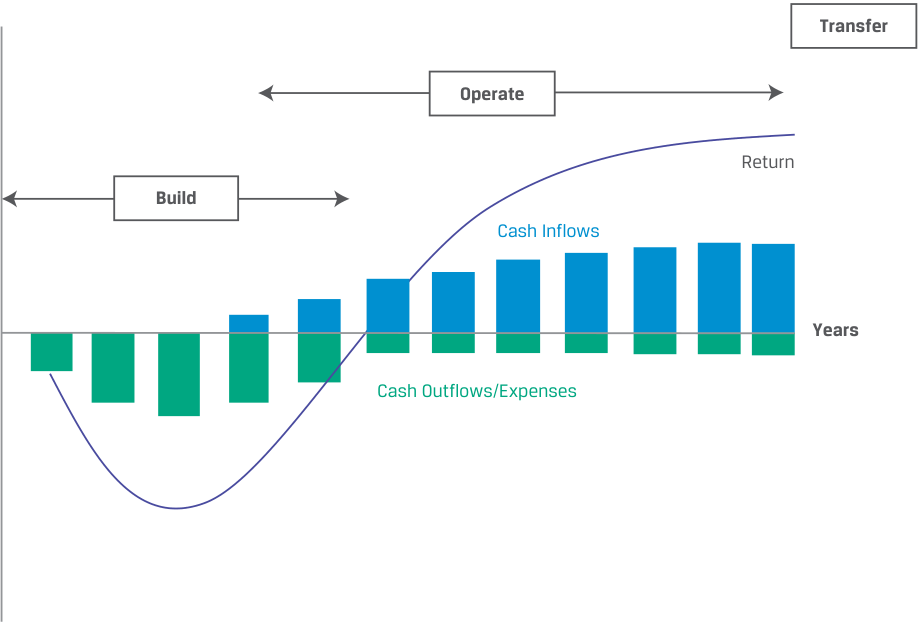

# Volume 8: Alternative Investments
## Learning Module 4 Real Estate and Infrastructure
### Part 2/2: Infrastructure Investment Features (PDF Pages 115–128)

---

<!-- PDF Page 115 -->

### **INFRASTRUCTURE INVESTMENT FEATURES** 

# **<mark>4</mark>** 

explain features and characteristics of infrastructure 

Infrastructure investments have a societal purpose; facilitate broad economic, technological, and social development purposes; and usually combine land, buildings, and other long-lived fixed assets. Infrastructure supports public transportation, airports, utilities (water, gas, and electricity), and more recently, information (telecommunication, cable, and wireless networks). Early infrastructure investments were typically financed by private corporations to realize profits. Subsequently, many governments took on a larger proportion of infrastructure investment and by the second half of the 20th century became the main source of investments. The late 20th century saw waves of privatizations of public transportation, and the scope of private infrastructure investment expanded to assets that governments had historically financed, owned, and operated themselves. The market for privately funded infrastructure is sizeable. 

#### **Infrastructure Investments** 

Infrastructure investments are real, capital-intensive, and long-lived assets intended for public use and provide essential services, such as airports, health care facilities, and sewage treatment plants. These investments have similarities to and differences from common equity and debt. Investments include equity, with its usual claims to residual cash flows, and debt, to finance and maintain such investments. Like real estate, investment in existing infrastructure involves acquiring unique, illiquid assets with distinct locations, features, and uses. Investments in construction and development of new infrastructure are made with expectations to generate cash either from income or from capital appreciation. 

Infrastructure investments often involve a consortium that combines one or several strategic partners that have specialized operational or technical skills with the financial investors. Rather than leases or rentals from commercial or residential tenants, infrastructure cash flows in most cases arise from contractual payments, such as the following: 

- _Availability payments_ , which are payments that are received to make the facility available 

- _Usage-based payments_ , such as tolls and fees for using the facilities 

- _“Take-or-pay” arrangements_ , which obligate buyers to pay a minimum purchase price to sellers for a pre-agreed volume. 

Allocations to infrastructure investments are driven both by the increased demand for infrastructure and by many governments’ search for alternative funding sources for infrastructure investments, such as investors interested and experienced in building, managing, and running infrastructure. Investors have an interest in financing infrastructure investments, demand-side growth. As governments provide more opportunities by expanding infrastructure assets, they also continue to privatize government services. 

Most infrastructure assets are financed, owned, and operated by governments, and a substantive proportion of these investments comes from public sources in the developing world. However, increasingly infrastructure is being financed privately through public–private partnerships (PPPs) by local, regional, and national governments. A **public–private partnership** is typically defined as a long-term contractual relationship between the public and private sectors for the purpose of having the private sector deliver a project or service traditionally provided by the public sector. 

<!-- PDF Page 116 -->

Infrastructure investors may intend to lease the assets back to the government, to sell newly constructed assets to the government, or to hold and operate the assets until they reach operational maturity or perhaps for even longer. 

Infrastructure investments are also made in partnership with development finance institutions, which are specialized financial intermediaries that provide risk capital for economic development projects on a non-commercial basis. There are global, international, national, and local development finance institutions. For instance, the European Bank for Reconstruction and Development (EBRD) invests to improve municipal services, including infrastructure, and regularly taps global financial markets to finance infrastructure and other types of investments. 

##### **_Categories of Infrastructure Investments_** 

To categorize infrastructure investments, investors frequently rely on the underlying assets, with the broadest categorization distinguishing between economic and social infrastructure assets, as shown in Exhibit 6. 

**Exhibit 6: Categorizing Infrastructure Investments** 

|**Econo** **Transportation** **Assets**|**mic Infrastructure Inves** **Information and** **Communication** **Technology Assets**|**tments** **Utility and** **Energy Assets**|**Social Infrastructure** **Investments**|
|---|---|---|---|
|▫roads ▫bridges ▫tunnels ▫airports ▫seaports ▫railway systems|▫telecommunication towers ▫data centers|▫electrical grid ▫power gener- ation, transmis- sion, distribution ▫potable water production ▫gas storage and distribution ▫liquefied natu- ral gas terminals ▫oil and gas infrastructure ▫solid waste treatment|▫educational assets ▫health care assets ▫social housing ▫correctional facilities ▫government/municipal buildings|

**Economic infrastructure investments** support economic activity through transportation assets, information and communication technology (ICT) assets, and utility and energy assets: 

- _Transportation assets_ include roads, bridges, tunnels, airports, seaports, and heavy and light/urban railway systems. Income will usually be linked to demand based on traffic, airport and seaport charges, tolls, and rail fares and hence is deemed to carry market risk. 

- _ICT assets_ include infrastructure that stores, broadcasts, and transmits information or data, such as telecommunication towers and data centers. 

- _Utility and energy assets_ generate power and produce potable water; transmit, store, and distribute gas, water, and electricity; and treat solid waste. 

Utility investments encompass environmentally sustainable development, with an increasing focus on renewable technologies, including solar, wind, and waste-to-energy power generation. Other energy assets may encompass downstream oil and gas infrastructure, the electrical grid, and liquefied natural gas terminals. The income 

<!-- PDF Page 117 -->

earned from utility assets may also carry demand risk because buyers’ energy and natural resources needs fluctuate. Alternatively, utilities can institute “take-or-pay” arrangements, locking buyers into minimum purchases whether supply is needed or not. Buyers usually have recourse if the utility falls short on performance or delivers supplies that are late or of inferior quality. 

**Social infrastructure investments** are directed toward human activities and include such assets as educational, health care, social housing, and correctional facilities, with the focus on providing, operating, and maintaining the asset infrastructure. The relevant services administered through those facilities are usually provided separately by the public authority or by a private service provider contracted by the public authority. In some countries, this model has been extended to other public infrastructure, including government and municipal buildings. Income from social infrastructure is typically derived from a type of lease payment that depends on availability payments and on managing and maintaining the asset according to predefined standards. 

##### **EXAMPLE 3** 

#### **Clarkswood Infrastructure Fund LP** 

Clarkswood Infrastructure Fund LP invests its assets in equity and equity-like securities and debt issued by issuers that own or operate infrastructure assets in developed and developing countries. Infrastructure lays the foundation of basic services, facilities, and institutions on which the growth and development of a nation and country directly depend. More specifically, in several developed countries, such as the United States, the United Kingdom, and Australia, many infrastructure assets have been privatized as national, state, and local governments spend less on building, investing, maintaining, and operating infrastructure. The private sector has stepped in to provide equity financing to fund infrastructure. 

For instance, the fund invests in an operator of Australian toll roads listed on the Australian Stock Exchange, as well as the operator of the Auckland Airport (New Zealand’s largest airport), also listed on a stock exchange. It also invests in several corporations that provide infrastructure services in both the developing world and the developed world, including China and India, that see significant demand for infrastructure products and services and seek private sector investments. The fund invests up to 50% of its assets in US assets, up to 30% in infrastructure assets located in OECD (Organisation for Economic Co-operation and Development) countries, up to 30% in assets in non-OECD countries, and no more than 10% in any country with no more than 5% in any infrastructure provider. 

##### **_Stages of Infrastructure Development_** 

Infrastructure investments can also be categorized by the underlying assets’ stage of development. Typically, we distinguish among greenfield investments, secondary-stage investments, and brownfield investments. 

**Greenfield investments** , developing new assets and new infrastructure, are opportunistic investments. The intent may be to lease or sell the assets to the government after construction or to hold and operate the assets. If they are held, it can be over the long term or for a shorter period until operational maturity, with subsequent sale to new investors, thus ensuring capital appreciation to reflect the construction and commissioning risk. Greenfield investors typically invest alongside strategic investors or developers that specialize in developing the underlying assets. 

<!-- PDF Page 118 -->

The greenfield investment life cycle common among public–private partnerships is called the build-operate-transfer (BOT) life cycle and is shown in Exhibit 7. The build phase is often characterized by an initial longer approval and construction phase with negative cash flows. The subsequent operate phase is governed by a concession agreement in which the private investor generates income based on pre-agreed parameters. In the final transfer phase, the investment is transferred to a government entity based on pre-determined parameters, sold to a third party, or decommissioned. 

**Exhibit 7: Illustrative Build-Operate-Transfer Model for Greenfield Infrastructure** 

<!-- Start of picture text -->
Transfer Operate Return Build Cash Inflows Years Cash Outflows/Expenses <!-- End of picture text -->

**Brownfield investments** expand existing facilities and may involve privatization of public assets or a sale leaseback of completed greenfield projects. They are characterized by a shorter investment period with immediate cash flows and an operating history. Typically, some of the assets’ financial and operating history is available, and so brownfield investments may be sought after by both strategic investors specializing in operating the assets and—particularly with privatizations—financial investors focused on long-term, stable returns. 

**Secondary-stage investments** invest in existing infrastructure facilities or fully operational assets that do not require further investment or development over the investment horizon. These assets generate immediate cash flow and returns expected over the investment period. Some assets never reach this stage because they continuously require additional capital and development. 

##### **_Forms of Infrastructure Investment_** 

As with real estate investments, infrastructure investments come in a variety of forms. The choice affects liquidity, cash flow, and income streams. Infrastructure investments can be direct or indirect. The vast majority of investors focus on equity investments, with some interest in pure debt (infrastructure bonds) and convertible debt. 

- _Direct investment in the underlying infrastructure_ provides control and the opportunity to capture full value. It requires a large investment and results in both concentration and liquidity risks while the assets are managed and 

<!-- PDF Page 119 -->

operated. Because of this risk and the typical long-term horizon, direct infrastructure investment usually takes place with a group or consortium of strategic investors that share the financial risk and/or assume a specific role in building, operating, or managing the assets. Such strategic partners, such as large pension funds or sovereign wealth funds, are frequent direct investors because they are better placed to manage certain risks to limit individual concentration risk. Frequently these funds invest under specific mandates in infrastructure projects and specifically prioritize domestic infrastructure needs. 

##### **EXAMPLE 4** 

#### **Public–Private Partnership, Iguá Saneamento S.A.** 

In March 2021, the Canada Pension Plan Investment Board paid CAD270 million (BRL1,178 million) for a 45% stake in Iguá Saneamento S.A. (Iguá), a water and sewage service company operating 18 concessions and contracts across five Brazilian states. The company serves more than 6 million people, provides sanitation services, and is the third-largest Brazilian private water and sewage treatment service provider. 

The objective of the transaction is to support Iguá’s growth objectives and to maintain operating funds to support its operations. Iguá is considering acquiring additional water and sanitation concessions in Brazil, including the formation of public–private partnerships there. Other institutional investors include Alberta Investment Management Corporation (39%), BNDES Participações S.A. (11%), and IG4 Capital Group (11%). 

• _Indirect investments_ include infrastructure funds (similar in structure to private equity funds and either closed end or open end), infrastructure ETFs, and holding equity in publicly traded infrastructure providers, or master limited partnerships (MLPs). Investors concerned about liquidity and diversification may choose publicly traded infrastructure securities. Publicly traded infrastructure securities benefit from liquidity, reasonable fees, transparent governance, observable market prices, and transparent pricing, in addition to diversification among underlying assets. An investor should be aware, however, that publicly traded infrastructure securities represent a small segment of infrastructure investment: S&P Dow Jones Indices reported a total global market cap of USD2.23 trillion as of 31 December 2021.2 Publicly traded infrastructure investments also tend to be clustered in certain asset categories. 

Master limited partnerships (MLPs) trade on exchanges, are pass-through entities like REITs, and share the income pass-through structure taxation rules that minimize double taxation for investors. MLPs are most commonly used in energy transportation, processing, or storage; generate relatively stable cash flows from fee-based income; and distribute larger parts of their free cash flow to their investors. 

Debt financing for infrastructure projects can be both private debt and publicly traded debt. Normally, the terms are flexible to accommodate periods of zero cash flow and long development or investment horizons. Publicly issued debt, such as the Airport Authority of Hong Kong perpetual bonds and Indonesian Infrastructure Fund US dollar bonds highlighted in earlier fixed-income modules are other approaches to financing infrastructure projects. 

> 2 S&P Dow Jones Indices, “Approaches to Benchmarking Listed Infrastructure” (June 2022, p. 3). www .spglobal .com/ spdji/ en/ documents/ research/ research -approaches -to -benchmarking -listed -infrastructure .pdf. 

<!-- PDF Page 120 -->

##### **QUESTION SET** 

1. Infrastructure cash flows primarily arise from: 

   - **A.** dividends. 

   - **B.** commercial tenants. 

   - **C.** contractual payments. 

   - **Solution** : 

The correct answer is C. Rather than leases or rentals from commercial or residential tenants, infrastructure cash flows arise from contractual payments, such as: availability payments (payments are received to make the facility available), usage-based payments (e.g., tolls and fees for using the facilities), and “take-or-pay” arrangements (which obligate buyers to pay a minimum purchase price to sellers for a pre-agreed volume). 

2. Most infrastructure assets are financed, owned, and operated by: 

   - **A.** governments. 

   - **B.** public–private partnerships. 

   - **C.** development finance institutions. 

   - **Solution** : 

The correct answer is A. Most infrastructure assets are financed, owned, and operated by governments, and a substantive proportion of these investments comes from public sources in the developing world. However, increasingly infrastructure is being financed privately through public–private partnerships by local, regional, and national governments. Infrastructure investments are also made in partnership with development finance institutions, which are specialized financial intermediaries that provide risk capital for economic development projects on a non-commercial basis. 

3. Which of these statements about infrastructure investing is true? Infrastructure investments: 

   - **A.** can generate cash income. 

   - **B.** are intended to be non-profit. 

   - **C.** do not have capital appreciation. 

**Solution** : 

The correct answer is A. Investments in construction and development of new infrastructure are made with expectations to generate cash either from income or from capital appreciation. 

4. Which of the following is a characteristic of direct investment in infrastructure? 

   - **A.** High liquidity 

   - **B.** Concentration risk 

   - **C.** Short-term horizon 

   - **Solution** : 

The correct answer is B. Direct investment in infrastructure requires a large investment and results in both concentration and liquidity risks while the assets are managed and operated. Because of these risks and the typical 

<!-- PDF Page 121 -->

long-term horizon, direct infrastructure investment usually takes place with a group or consortium of strategic investors that share the financial risk and/or assume a specific role in building, operating, or managing the assets. 

### **INFRASTRUCTURE INVESTMENT CHARACTERISTICS** 

# **<mark>5</mark>** 

explain the investment characteristics of infrastructure investments 

The type of the underlying infrastructure investment, its stage of development, its geographic location, and the way the investment is structured define the expected risk and returns, as Exhibit 8 depicts. 

**Exhibit 8: Infrastructure Investment Characteristics** 

<!-- Start of picture text -->
Social Regulated Demand-Based Infrastructure  Industry  Infrastructure Expected Return Greenfield Renewable energy Airport expansion  New toll roads Brownfield Ports Secondary Power Stage  infrastructure Existing toll roads Hospitals Expected Risk <!-- End of picture text -->

In the three groupings of the infrastructure development cycle—greenfield, operational secondary-stage, and brownfield—the operational secondary-stage assets with an existing track record of generating steady, bond-like cash flows possess the lowest risk and offer the lowest return to the investors. Brownfield investments, redevelopment of existing infrastructure, are incrementally riskier, and greenfield projects are the riskiest. Exhibit 9 shows the historical risk and return statistics for infrastructure assets compared to other real asset categories. 

<!-- PDF Page 122 -->

**Exhibit 9: Historical Annualized Return and Standard Deviation of Return for Infrastructure and Real Assets, March 2008–June 2021** 

|**Annualized**|**Average** **return**|**Standard** **deviation**|**Coefficient of** **variation**|
|---|---|---|---|
|Preqin, infrastructure|8.57%|0.07|0.82|
|Preqin, natural resources|3.29%|0.09|2.66|
|Preqin, real estate|3.43%|0.10|2.86|
|S&P Infrastructure Total Return|3.52%|0.19|5.52|
|MSCI US REIT Total Return|7.77%|0.26|3.38|

_Source:_ Annualized quarterly returns of Private Capital Quarterly Index rebased to 31 December 2007, provided by Preqin. 

Additionally, the type of infrastructure investment is material in determining the risk and return. While investments in basic social services infrastructure or existing regulated industries typically involve less risk and lower expected return, demand-based infrastructure projects often build on projections of future economic growth and increased usage demands and are riskier. 

In developing market economies, where infrastructure investments are needed to underpin economic, social, and societal growth and benefit from increased wealth created by the economy, risks are considerable, but the returns—over long time horizons—are considerable. Greenfield infrastructure projects in developing countries offer exceptional return opportunities over very long time horizons. Exhibit 10 shows the risk profiles of various infrastructure projects. 

**Exhibit 10: Private Infrastructure Fund Illustrative Target Returns** 

|**High-Risk Profile**|**Medium-Risk Profile**|**Low-Risk Profile**|
|---|---|---|
|Greenfield projects without guarantees of demand upon completion—e.g., variable electricity prices, uncertain traffic on roads and through ports|Mostly brownfield assets (with some capital expen- diture requirements) and some greenfield assets (with limited construction and demand risk)|Brownfield assets with mitigated risks—e.g., fully constructed with con- tracted/regulated revenues|
|Located in OECD countries and emerging markets|Located primarily in OECD countries|Located in the most stable OECD countries|
|High weighting to capital appreciation|Mix of yield and capital appreciation|High weighting to current yield|
|**Target equity returns of**|**Target equity returns of**|**Target equity returns of**|
|**14%+**|**10%–12%**|**6%–8%**|

_Note:_ Target equity returns are net of fees. _Source:_ Cambridge Associates, “Digging In: Assessing the Private Infrastructure Opportunity Today,” Research Note (April 2017). 

Most infrastructure funds gravitate toward the medium- and low-risk profiles, generating an average long-term annual return around 10%. As for other alternative investments, less liquid forms of direct equity ownership investments tend to offer the highest expected return with the greatest risk, while publicly traded forms of debt offer the lowest potential returns. Assets backed by stable long-term concession arrangements provide the most stable returns. 

<!-- PDF Page 123 -->

#### **Infrastructure Diversification Benefits** 

Infrastructure investors expect the assets to primarily generate stable long-term cash flows that also adjust for economic growth and inflation and secondarily expect capital appreciation, depending on the type and timing of their investment. Because infrastructure investments typically support services that face inelastic demand and/ or benefit from high barriers to entry, generate steady cash returns, and have a longer life cycle, equity investments in infrastructure offer lower correlation with public market equities and the broader economy. Effectively, infrastructure investments provide an income stream, increase portfolio diversification by adding an asset class with typically low correlation with other public investments, provide some protection for changes in GDP growth, and offer some protection against inflation. Exhibit 11 summarizes the diversification benefits of infrastructure investments and shows the low correlation between infrastructure and other market returns. It is notable that public and private infrastructure returns exhibit low correlations. 

**Exhibit 11: Historical Annualized Correlations for Infrastructure Assets, March 2008–June 2021** 

||**S&P 500**|**S&P Infra-**|**MSCI US**||
|---|---|---|---|---|
|**Correlation**|**Total** **Return**|**structure Total** **Return**|**REIT Total** **Return**|**MSCI World** **Total Return**|
|Preqin, infrastructure|0.12|0.14|0.33|0.08|
|Preqin, natural resources|0.68|0.67|0.61|0.68|
|Preqin, real estate|0.51|0.39|0.49|0.46|

_Source:_ Annualized quarterly returns of Private Capital Quarterly Index rebased to 31 December 2007, provided by Preqin. 

Most institutional investors consider infrastructure investments to balance public equity holdings because infrastructure has proven to be relatively resilient to swings in the equity markets. Given the stable underlying nature of cash flows, infrastructure debt tends to experience lower default rates and higher recovery than similar fixed-income instruments, and it is less subject to fluctuation over the economic cycle. 

Additionally, infrastructure may better match the longer-term liability structure of certain investors, such as pension funds, superannuation schemes, and life insurance companies. It also suits the longer-term horizon of sovereign wealth funds, which tend to make the largest allocations to this asset class—around 5%–6% of total assets under management, according to Preqin. Long-term correlation benefits also result from the fact that most infrastructure assets have a link to inflation through regulation, concession agreements, or other fee contracts whose rates rise to or above the rate of inflation. 

##### **QUESTION SET** 

1. True or false: Greenfield infrastructure projects in developing countries offer exceptional return opportunities over very long time horizons. 

**Solution** : 

True. In developing market economies, where infrastructure investments are needed to underpin economic, social, and societal growth and benefit 

<!-- PDF Page 124 -->

from increased wealth created by the economy, risks are considerable but the returns—over long time horizons—are also considerable. 

2. Which of these types of infrastructure investment has the highest expected risk? 

   - **A.** Regulated industry 

   - **B.** Social infrastructure 

   - **C.** Demand-based infrastructure 

   - **Solution** : 

The correct answer is C. Demand-based infrastructure investments have the highest expected risk of the three. Social infrastructure has the lowest. 

3. Which of the following has the highest weighting to capital appreciation? 

   - **A.** Greenfield assets with limited construction and demand risk 

   - **B.** Fully constructed brownfield assets with contracted revenues **C.** Greenfield assets without guarantees of demand upon completion 

   - **Solution** : 

The correct answer is C. Greenfield projects without guarantees of demand upon completion—for example, variable electricity prices, uncertain traffic on roads and through ports—have a high weighting to capital appreciation. Greenfield assets with limited construction and demand risk have a mix of yield and capital appreciation. Brownfield assets with mitigated risks (e.g., fully constructed with contracted/regulated revenues) that are located in the most stable OECD countries have a high weighting to current yield. 

4. Which of the following is true regarding infrastructure investments? 

   - **A.** Infrastructure investments typically generate volatile cash returns. 

   - **B.** Infrastructure investments typically support services that face inelastic demand and/or benefit from high barriers to entry. 

   - **C.** While public infrastructure returns have low correlation with market returns, private infrastructure returns have high correlation with market returns. 

**Solution** : 

The correct answer is B. Because infrastructure investments typically support services that face inelastic demand and/or benefit from high barriers to entry, generate steady cash returns, and have a longer life cycle, equity investments in infrastructure offer lower correlation to public market equities and the broader economy. It is notable that public and private infrastructure returns exhibit low correlations. 

<!-- PDF Page 125 -->

## **~~PRACTICE PROBLEMS~~** 

**1.** A REIT is considered to be “hybrid” if it invests in both: 

   - **A.** equity REITs and mortgage REITs. 

   - **B.** sole ownership and joint ventures. 

   - **C.** direct and indirect property ownership. 

**2.** A direct private real estate investor can reduce taxable income using: 

   - **A.** double taxation. 

   - **B.** cash depreciation expenses. 

   - **C.** tax-deductible interest expenses. 

**3.** The main appeal of the REIT structure is the elimination of: 

   - **A.** dividend distributions. 

   - **B.** double corporate taxation. 

   - **C.** the requirement to report earnings per share. 

**4.** An advantage of REITs is: 

   - **A.** low non-cash depreciation expenses. 

   - **B.** more transparency than private real estate markets. 

   - **C.** lower correlation with the public equity markets compared to private real estate. 

**5.** Which of the following tends _not_ to characterize real estate investments? 

   - **A.** Predictability 

   - **B.** Protection from inflation 

   - **C.** High correlations with other asset classes 

**6.** Akasaka Investment Company established a portfolio of warehouse properties with a total market value of THB3.60 billion. It secured mortgage financing of THB2.61 billion. The terms of the mortgage required Akasaka to maintain a loan-to-value ratio of 0.725. 

After 18 months, the portfolio value had dropped to THB3.23 billion and the mortgage liability was THB2.35 billion. 

By how much must Akasaka reduce its mortgage liability to return its LTV back to the required level? 

- **A.** THB6.00 million 

- **B.** THB8.25 million 

- **C.** THB9.19 million 

<!-- PDF Page 126 -->

|**7.**Unlike appraisers, equity investors tend to place heavy emphasis on: **A.**recent trends.|
|---|
|**B.**discounted cash flows.|
|**C.**current market conditions.|
|**8.**Infrastructure investments can be categorized based on the nature of their un- derlying assets as:|
|**A.**economic or social.|
|**B.**local, regional, or national.|
|**C.**usage-based or take-or-pay.|
|**9.**Which of these would most likely appeal to an investor who wants long-term, stable returns?|
|**A.**Greenfield investments|
|**B.**Brownfield investments|
|**C.**Secondary-stage investments|
|**10.**Which of the following is true regarding infrastructure investments?|
|**A.**They cannot be made using publicly traded securities.|
|**B.**Master limited partnerships minimize double taxation for investors.|
|**C.**Large pension funds are frequent members of direct investment consor- tiums because of their preference for a short-term horizon.|
|**11.**Which of the following types of infrastructure investments entails the lowest expected risk?|
|**A.**Greenfield|
|**B.**Brownfield|
|**C.**Secondary stage|
|**12.**Which of the following has the highest weighting to current yield?|
|**A.**Greenfield assets with limited construction and demand risk|
|**B.**Fully constructed brownfield assets with contracted revenues|
|**C.**Greenfield assets without guarantees of demand upon completion|
|**13.**Compared with similar fixed-income instruments, infrastructure debt:|
|**A.**has higher recovery rates.|
|**B.**experiences higher default rates.|
|**C.**has more fluctuation over the economic cycle.|

<!-- PDF Page 127 -->

## **~~SOLUTIONS~~** 

1. The correct answer is A. There are three main forms of REIT: (1) equity REITs that invest in properties outright or through partnerships and joint ventures, (2) mortgage REITs that underwrite loans to real estate (mortgages) or invest in MBS, and (3) hybrid REITs that invest in both of these types. 

2. The correct answer is C. Direct private real estate owners can reduce their taxable income using _non_ -cash property depreciation expenses and tax-deducible interest expenses. 

3. The correct answer is B. The main appeal of the REIT structure is the elimination of double corporate taxation. Corporations pay taxes on their income, from which they make dividend distributions to their owners from after-tax earnings. The shareholders, in turn, are taxed at their personal tax rate. Equity REITs, like other public companies, must report earnings per share based on net income as defined by generally accepted accounting principles or International Financial Reporting Standards. 

4. The correct answer is B. An advantage of REITs is more transparency than private real estate markets. As an asset-intensive business, REITs can have high non-cash depreciation expenses. REITs have higher correlation with the public equity markets compared to private real estate, and this is a disadvantage of REITs. 

5. The correct answer is C. Real estate has historically low correlations with other asset classes, and adding real estate to an investment portfolio provides diversification benefits at relatively lower levels of risk. Many commercial real estate companies offer multiple-year leases with fixed rents; hence, the income earned from these leases is typically both predictable and stable. Moreover, real estate tends to provide inflation protection because the lease payments are regularly adjusted. 

6. The correct answer is B. LTV = Mortgage liability/Portfolio value. Mortgage liability = LTV × Portfolio value. Required mortgage liability = Required LTV × Portfolio value. 

   - Required reduction in mortgage liability = Mortgage liability – Required mortgage liability. 

Required reduction in mortgage liability = Mortgage liability – (Required LTV × Portfolio value). 

8.25 = 235 – (0.725 × 323). 

7. The correct answer is B. Equity investors in public real estate discount future cash flows, while appraisers of private real estate place heavy emphasis on current market conditions and recent trends. 

8. The correct answer is A. To categorize infrastructure investments, investors frequently rely on the underlying assets, with the broadest categorization distinguishing between economic and social infrastructure assets. 

9. The correct answer is B. With brownfield investments, typically some of the financial and operating history is available. Therefore, brownfield investments may be sought after by both strategic investors specializing in operating the assets 

<!-- PDF Page 128 -->

and—particularly with privatizations—financial investors focused on long-term, stable returns. 

10. The correct answer is B. Master limited partnerships trade on exchanges, are pass-through entities like REITs, and may also share with REITs taxation rules that minimize double taxation for investors. Investors concerned about liquidity and diversification may choose publicly traded infrastructure securities. 

Because of the concentration and liquidity risks and the typical long-term horizon, direct infrastructure investment usually takes place with a group or consortium of strategic investors that share the financial risk and/or assume a specific role in building, operating, or managing the assets. Such strategic partners, such as large pension funds or sovereign wealth funds, are frequent direct investors because they are better placed to manage certain risks to limit individual concentration risk. 

11. The correct answer is C. In the three groupings of the infrastructure development cycle—greenfield, operational secondary stage, and brownfield—the operational secondary-stage assets with an existing track record of generating steady, bond-like cash flows possess the lowest risk and offer the lowest return to the investors. Brownfield investments, redevelopment of existing infrastructure, are incrementally riskier, and greenfield projects are the riskiest. 

12. The correct answer is B. Brownfield assets with mitigated risks (e.g., fully constructed with contracted/regulated revenues) that are located in the most stable OECD countries have a high weighting to current yield. Greenfield assets with limited construction and demand risk have a mix of yield and capital appreciation. Greenfield projects without guarantees of demand upon completion—e.g., variable electricity prices, uncertain traffic on roads and through ports—have a high weighting to capital appreciation. 

13. The correct answer is A. Given the stable underlying nature of cash flows, infrastructure debt tends to experience lower default rates and higher recovery than similar fixed-income instruments, and it is less subject to fluctuation over the economic cycle. 

