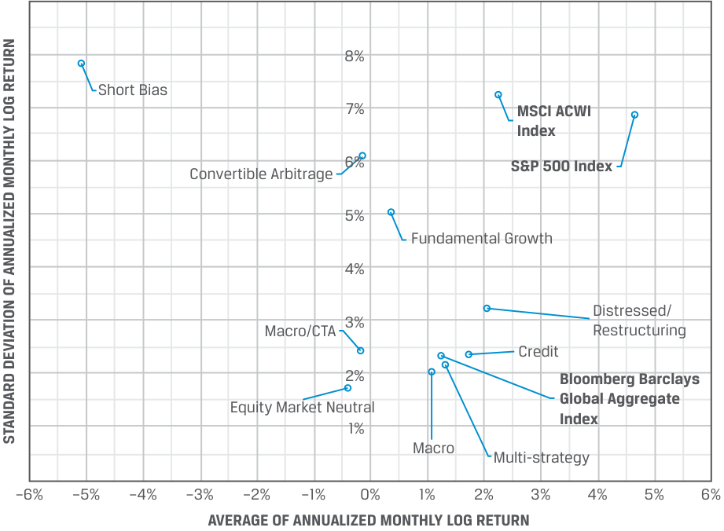

# Volume 8: Alternative Investments
## Learning Module 6 Hedge Funds
### Part 2/3: Hedge Fund Investment Forms (PDF Pages 168–182)

---

<!-- PDF Page 168 -->

5. Select the statements that are true: 

A. The primary drivers of returns from stocks are growth projections, dividends, and retained earnings. 

B. The primary drivers of returns from a bond are interest rates, credit risk, and coupon payments. 

C. The primary drivers of return from hedge funds are market volatility and market inefficiency. 

**Solution:** 

A, B, and C are all true. 

# **<mark>3</mark>** 

## **HEDGE FUND INVESTMENT FORMS** 

describe investment forms and vehicles used in hedge fund investments 

A common structural characteristic of a hedge fund is that it is set up as a private investment partnership either onshore or in a tax-advantaged offshore location. Under certain legal restrictions (which vary by jurisdiction), the offering can be open only to a limited number of investors meeting certain income and net worth guidelines. 

Hedge funds, like private equity funds, are legally typically incorporated and organized as private limited partnerships or limited liability companies with a general partner or managing member who is the hedge fund manager. The partnership or the managing member receives a management fee, and the general partner receives compensation based on fund performance. Hedge fund investors purchase a share of the fund or partnership and receive in return a fixed percentage of the fund returns, minus applicable fees. 

The fund documents—private placement memorandum, the partnership agreement, or the articles of incorporation—lay out the legal and contractual relationship between the fund manager and the fund investor and create the operational framework for the fund. Normally, the fund structures are incorporated as perpetual legal entities, but in reality, as the hedge funds close, they are liquidated on a regular basis. 

### **Direct Hedge Fund Investment Forms** 

A common hedge fund form is a master feeder structure. The master feeder structure is set up for optimum tax efficiency and consists of an offshore feeder fund and an onshore feeder fund—both feeding into a master fund that invests the capital based on its contractual partnership agreements. This structure is depicted in Exhibit 2. 

<!-- PDF Page 169 -->

**Exhibit 2: Sample Master-feeder Structure** 

<!-- Start of picture text -->
The TED Fund LLC The Fund LLC (Tax Exempt and Deferred Investors) (Onshore) The Cayman Fund LDC (Offshore) Master Fund Investment Funds <!-- End of picture text -->

A common hedge fund fee structure is known as “two and twenty.” In this setup, the hedge fund partnership entity that operates and administers the fund receives a 2% management fee. The general partner, who manages the fund investments, receives 20% of the fund’s net profits. The investment returns, after management and performance fees, flow back to the feeder funds to the investors. Recently, the fee structure has been changing due to pressure from investors. Some of the newer funds are offered with a fee of 1 or 30, where the manager receives the greater of a 1% management fee or an incentive fee of 30% of the fund’s alpha or outperformance against a benchmark, instead of a performance fee based simply on total profits. 

In addition to the partnership agreement that delineates responsibilities, hedge funds often use side letters to address the specific legal, regulatory, tax, operational, and reporting requirements of an investor. Such side letters complement and can occasionally supersede the terms of the fund’s documents and are typically used when a hedge fund investor requires concessions without changing the private placement memorandum, the partnership agreement, or the articles. Occasionally, specific rights are conferred to a particular investor, such as enhanced information rights. 

For larger investors, the hedge fund structure could be a fund of one or a separately managed account (SMA). These are separate investment accounts over which the investor retains more influence. In the case of a fund of one structure, the hedge fund is created for one investor, and in the case of an SMA, the investor creates his or her own investment vehicle and the underlying assets are held and registered in the name of the investor. However, the day-to-day management of the account is delegated to the hedge fund manager. These structures may require additional agreements and service providers to operate efficiently and seamlessly. Exhibit 3 shows a typical structure. 

<!-- PDF Page 170 -->

**Exhibit 3: Separately Managed Hedge Fund Investment Account** 

<!-- Start of picture text -->
Third Party Service Providers • Prime Broker Investment Management Agreement • Custodian • Accounting and Hedge Fund Manager  Administration • Legal, Tax, and Compliance • Investment Philosophy • Investment Process • Governance • Trading and Operations • Monitoring and Reporting Managed Account Segregated portfolio managed in investor’s name Investor • Asset Control • Governance • Monitoring • Risk Management Asset Ownership Service Agreement <!-- End of picture text -->

_Source:_ KPMG. https:// assets .kpmg/ content/ dam/ kpmg/ pdf/ 2015/ 09/ hedge -fund -managed -accounts .pdf. 

An SMA structure allows for a customizable portfolio, with investor-specific investment mandates, better transparency, efficient capital allocation, and higher liquidity, over which the investor can exercise enhanced control while keeping the fees lower. However, SMAs are operationally more complex and also demand greater governance oversight. That is why these accounts are more appropriate for larger, institutional investors. 

An SMA structure has some downsides as well. Unlike a commingled fund, the managers do not have a stake in the fund investments. The investors negotiate lower fees and fund expenses but in return, may receive allocations only to the fund manager’s most liquid investment trades. Hence, the overall motivation of the managers for investment performance could be reduced. Structuring in favor of incentive fees can mitigate this problem. 

### **Indirect Hedge Fund Investment Forms** 

Indirect investment in hedge funds aims to make hedge fund exposures more accessible to smaller institutional and larger retail investors or to those who may lack specialized skills in managing certain asset types or want to create multiple and concurrent exposures to different strategies. The choice of indirect exposure is often motivated by reducing management costs, increasing performance transparency, and improving liquidity. Often the choice is the fund-of-hedge-funds approach, which is a managed portfolio of hedge funds. 

<!-- PDF Page 171 -->

Funds of hedge funds pool funds from investors and invest the proceeds in a diversified portfolio of hedge fund investments across a variety of hedge funds. This approach provides direct diversification benefits across fund strategies, investment regions, and management styles. These funds offer generally lower investment minimums, reduced lockup periods, and typically better exit liquidity. 

For the investor, all this comes with a higher fee structure—often an additional 1%—because the manager of the fund of funds adds its own fees on top of the hedge fund management fees. Fund-of-funds investors often face a 10% incentive fee in addition to those fees charged by underlying hedge funds. The incentive fee is typically calculated on profits net of management fees at both the hedge fund level and the fund-of-funds level. This raises the cost for the investors, but at the same time, they gain access to hedge funds in which they otherwise would not have been able to invest in a diversified pool of funds. Fee layering reduces the end investor’s initial gross investment returns and may result in an investor paying fees more than once for management of the same assets. Despite the additional fees, investors choose funds of funds since they provide an opportunity to invest in an underlying hedge fund that might be closed to new investors otherwise. Greater liquidity in funds of funds may result in weaker performance due to fund redemptions in times of market turmoil. 

The fund-of-hedge-fund managers must have expertise in conducting hedge fund due diligence, must monitor both absolute and relative performance, and are often able to negotiate better redemption or fee terms than individual investors can. 

#### **EXAMPLE 3** 

### **Tenderledge Investments LLC—Comparing strategies** 

Tenderledge Investments, a fund-of-funds hedge fund, is benchmarking the performance of various hedge fund strategies as measured by the annual strategy returns over a 10-year period. Focusing on the correlation between various hedge fund strategies, the highest correlation between fund-of-funds returns is with fundamental growth, and the lowest is with short-bias funds. 

|**Correlation between Annual Returns**|**Fund of Funds**|
|---|---|
|Fundamental Growth|0.91|
|Convertible Arbitrage|0.89|
|Distressed/Restructuring|0.84|
|Multi-Strategy|0.83|
|Credit|0.74|
|Equity Market Neutral|–0.02|
|Macro/CTA|–0.16|
|Short Bias|–0.84|

An increasing number of exchange-traded products, such as ETFs, seek to replicate hedge fund investment _styles_ without directly investing in hedge funds themselves. Exhibit 4 shows where these investments are on the liquidity spectrum. 

<!-- PDF Page 172 -->

#### **Exhibit 4: Liquidity Spectrum of Various Investment Alternatives** 

<!-- Start of picture text -->
Least Liquid Most Liquid • Limited Partnerships• Separately Managed Accounts• Closed-end Funds• Mutual Funds• Exchange-traded Funds <!-- End of picture text -->

These funds can deliver returns similar to many popular hedge fund strategies, such as long/short equity, market neutral, and event driven, through indexing or active management using liquid assets. Effectively, hedge fund replication ETFs seek to generate returns with high correlations with actual hedge fund returns. By relying on quantitative tools, they imitate a broad spectrum of hedge fund returns or a specific style return. However, the returns from these strategies often fall short compared to pure hedge fund strategies because these instruments are publicly traded, are subject to a much heavier regulatory burden, do not impose restrictions on redemptions, and cannot use leverage to the same level. Yet, these investments benefit from greater liquidity, lower fees, and increased transparency than comparable hedge fund or fund-of-funds strategies and seek to match the monthly returns of hedge fund indexes, as in the following example. 

#### **EXAMPLE 4** 

### **Tenderledge Investments LLC—Creating a Hedge Fund ETF** 

Tenderledge is in the process of developing a hedge fund ETF that would track, before fees and expenses, the performance of a fund-of-hedge-funds strategy index. The strategy index seeks to replicate the risk-adjusted return characteristics of fund of hedge funds and underlying multiple hedge fund investment styles— more specifically, long/short equity, market neutral, event driven, fixed-income arbitrage, and distressed situations. 

Although Tenderledge is a fund of hedge funds, the ETF will not invest in any hedge funds but, rather, incorporates Tenderledge’s experience and knowledge in selecting hedge fund investments for the incorporation of its flagship fund of funds. Tenderledge will use quantitative tools to select traded debt and equity instruments, as well as certain derivatives, to replicate the performance of these five hedge fund strategies. 

This ETF intends to achieve portfolio diversification by tracking the performance of the hedge fund universe and the five styles it seeks to replicate, generating returns with high correlation with these strategies over the longterm. Moreover, by combining these distinct strategies, the ETF will reduce its exposures to traditional sources of risk, such as interest rate volatility and equity market risk factors, such as beta. 

<!-- PDF Page 173 -->

|**QUESTION SET**|
|---|
|1. Choose the correct statements regarding benefits of a master feed- er structure.|
|A. It allows investors in taxable jurisdictions to invest in an offshore hedge fund without any tax liability.|
|B. Pooling funds from offshore and onshore funds creates economies of scale.|
|C. This structure allows hedge funds to accept funding from global investors with relative ease.|
|D. Many regional regulatory requirements can be avoided by such a structure. **Solution:**|
|B, C, and D are correct. A is incorrect because investors in taxable jurisdic- tions do not avoid taxes by investing in offshore funds.|
|2. Which of the following statements about SMAs is_least_accurate?|
|**A.**SMAs are a preferred choice of high-net-worth investors with specific investment mandates because they are highly customizable.|
|**B.**SMAs provide better transparency for the investor than other fund structures.|
|**C.**SMAs are characterized by simpler fee structures compared to mutual funds.|
|**D.**The potential for conflicts of interest exists for SMAs since managers are not personally invested in the funds and the regulation require- ments are light. **Solution:**|
|C is correct because it is the least accurate statement. Mutual fund fees are clearly disclosed in the fund prospectus. The SMA fees are negotiated with the manager for each account and require sufficient care to structure in a way to incentivize the manager. A, B, and D are accurate statements.|
|3. Which of the following is_least_likely an investor objective that would help inform the choice of a specific fund structure?|
|**A.**Reduce tax leakage and enhance returns by efficient tax planning|
|fi **B.**Ensure an appropriate amount of investor control on companies and strategies|
|**C.**Maximize the net returns on the investments|
|**D.**Reduce the regulatory and compliance requirements **Solution:**|
|C is correct because it is the least likely investor objective. The objective of|
|h the investment manager is to maximize the returns,while the objective of|

<!-- PDF Page 174 -->

|the structure is to ensure that the oth taken care of.|er options (Choices A, B, and D) are|
|---|---|
|4. Identify the investment structure mo A. Managed futures|st appropriate for the investor.|
|B. SMA C. Fund of funds||
|1. A high-net-worth investor who requires tax-efficient investment chan- nels with a high degree of control over allocation decisions||
|2. An institutional investor intending to invest in commoditymarkets||
|3. A small investor who would like hedge fund exposure at a lower risk||
|**Solution:**||
|1. A high-net-worth investor who requires tax-efficient investment chan- nels with a high degree of control over allocation decisions|B. SMA|
|2. An institutional investor intending to invest in commoditymarkets|A. Managed futures|
|3. A small investor who would like hedge fund exposure at a lower risk|C. Fund of funds|

**Choice A:** Managed futures funds are also known as commodity trading advisers because they historically focused on commodity futures. However, CTAs may include investments in a variety of futures, including commodities, equities, fixed income, and foreign exchange. 

**Choice B:** An SMA structure allows a customizable portfolio, with investor-specific investment mandates, better transparency, efficient capital allocation, and higher liquidity, over which the investor can exercise enhanced control while keeping fees lower. However, SMAs are operationally more complex and also demand greater governance oversight. That is why these accounts are more appropriate for larger investors. 

**Choice C:** Funds of funds allow smaller investors to make investments in hedge funds for which the minimum investment and research requirements would otherwise be overly burdensome. Volatility is generally low in these offerings because the fund-of-funds manager invests in many different hedge funds. 

<!-- PDF Page 175 -->

## **HEDGE FUND INVESTMENT RISK, RETURN, AND DIVERSIFICATION** 

# **<mark>4</mark>** 

analyze sources of risk, return, and diversification among hedge fund investments 

Hedge fund portfolios approach return generation differently from traditional portfolios, as Exhibit 5 shows. The most significant difference is that hedge funds seek to limit market exposure and returns from beta and primarily focus on generating idiosyncratic returns by identifying sources of unique return, or alpha. The primary source of hedge fund excess return is market inefficiencies (which may be short lived) and the skills of the manager in leveraging them. 

**Exhibit 5: Comparing Traditional and Hedge Fund Portfolio Sources of Return** 

<!-- Start of picture text -->
Sources of Return Approach Idiosyncratic Hedge Fund Strategies Emphasize idiosyncratic Business risk, operational risk risk, other company- specific risks Sector/Style Diversify sector/style risks Industry risk, market-cap, growth/value, liquidity and sovereign risk Market Mitigate market risks Equity market movement, Traditional Strategies interest rates, foreign currency, other macro factors Alpha Beta <!-- End of picture text -->

Some specific sources of alpha are the manager skills in specific stock selection and utilizing higher-return strategies that minimize risks. The performance of hedge funds can be attributed to three distinct sources: 

- Market beta—the broad market beta that can be realized using market index–based funds/ETFs 

- Strategy beta—the beta attributed to the investment strategy of the hedge fund applied across the broad market 

- Alpha—the manager-specific returns, due to the selection of specific positions 

The managers can realize the strategy beta and alpha returns due to their skills in identifying mis-priced securities and sectors, correctly timing the market, and utilizing operational control on the company business model, as well as using leverage to amplify the results. 

<!-- PDF Page 176 -->

This does not suggest that the traditional asset pricing models are incorrect. They operate within a set of assumptions—not the least of which is that the markets are efficient. The returns from hedge funds are due to systematic and idiosyncratic alternative risk factors not considered by the model. 

Typically, investors do not realize the full returns from the hedge fund. Hedge funds are characterized by higher fees, which reduce the alpha generated by them. Some underperforming hedge funds that close out for performance issues face another problem. The capital redeemed from liquidated positions may result in a lower payout, effectively diminishing the total return from the fund. 

To compare the risk-adjusted return characteristics of individual hedge funds and aggregate hedge fund strategies, we use hedge fund indexes that are created using publicly available hedge fund performance data. There are several vendors that create such indexes, and each index has its own features, but there are some general considerations around these indexes that distinguish them from other indexes used for performance comparison. Most hedge fund indexes are based on information reported by the hedge fund managers and others who receive performance information with the right to share that information. It should also be noted that the reporting by any hedge fund is voluntary. This situation introduces several sources of bias and suggests that hedge fund performance is likely overestimated. 

Selection bias can be an issue. Individual funds are allocated to strategy peer groups in an inconsistent manner: sometimes based on the prospectus, sometimes based on historical style analysis, sometimes using a combination of approaches, each of which adds and compounds bias. Indexes may also have inconsistent sources of the underlying data. A handful of these indexes operate with transparent and constant inclusion, selection, and exclusion of individual managers and/or their funds. Some index providers impose requirements on AUM, vintage, and whether the hedge fund is open to new investors. 

Survivorship bias can also be an issue. When funds that have stopped reporting are removed from the index, the index will likely show better performance. This effect can be mitigated by including the returns of funds of funds that are active and those that have stopped reporting. For instance, a hedge fund manager consistently underperforming a peer group may have limited incentives to continue to highlight underperformance, particularly if the manager is actively sourcing new investors or launching new funds. Hence, the manager may discontinue reporting poor performance, which overestimates reported performance. 

Additionally, hedge funds that are closed to new investors or closed because of underperformance are treated equally. Their performance is excluded from the index value. Additionally, the hedge fund performance data are published with a delay, normally a time lag of four weeks or one month. Since these indexes are non-investable and illiquid, replicating their performance may be difficult. 

In addition, backfill bias can be an issue. When a successful fund starts reporting performance for the first time, it is very likely that its past performance was stellar, since typically only hedge funds with favorable returns are reported. When such funds are added to an index, the benchmarks will overstate the actual performance. This is a variation of the survivorship bias that results when a new hedge fund is included in a given index and its past performance is “backfilled” into the index’s database. Typically, larger indexes have less backfill bias. 

A large majority of hedge fund indexes are not weighted by assets under management. In these hedge fund indexes, each hedge fund receives an equal index weighting in the performance peer group. As a result, comparison of large and small funds can be skewed compared to the performance of a size-weighted index. 

<!-- PDF Page 177 -->

### **Hedge Fund Investment Risks and Returns** 

Many traditional investment funds, such as long-only mutual funds and index ETFs, diversify away much of the idiosyncratic risks in their holdings by investing in a large number of stocks and achieve most of their returns primarily by bearing the systematic market risk (beta). Unlike in traditional funds, hedge funds use a variety of instruments across asset classes and techniques in seeking to generate absolute returns in all market environments. 

The structure of a hedge fund complicates the benchmarking of the returns on a frequent basis. Due to the high degree of flexibility the managers have over the investments and the minimal level of disclosure (as well as the frequency of disclosure) they offer, it is hard to conduct any performance attribution analysis. Additionally, the relative illiquidity of investments held by the funds makes marking to market a problematic and potentially futile process. 

Hence, attributing the sources of returns and risks is a composite process that is further complicated by the complexity of the strategies and compounded using various sources of leverage. That is why risk and return comparisons are typically made to fund-of-funds composite indexes to minimize return distortions. That approach controls for the effects of self-reporting and selection biases. Furthermore, it ensures that the fund-of-funds benchmark index is investable. 

Nonetheless, over the long term (since 1990), hedge funds have enjoyed higher returns (at least prior to fees and expenses) than either stocks or bonds and a standard deviation nearly identical to that of bonds. Specifically, Exhibit 6 compares the returns, risk, and performance measures for the HFRI Fund of Funds Composite Index, the MSCI ACWI Index, and the Bloomberg Barclays Global Aggregate Index. The HFRI Fund of Funds Composite Index is an equally weighted performance index of funds of hedge funds included in the HFR Database. 

As mentioned earlier, hedge fund indexes typically build on data that each hedge fund reports. Because these data are self-reported, there is a degree of survivorship bias that the HFRI Fund of Funds Composite Index mitigates by reflecting the actual performance of portfolios of hedge funds. The measures shown here may reflect a lower reported return because of the added layer of fees, but they likely represent a fairer, more conservative, and more accurate estimate of average hedge fund performance than HFR’s composite index of individual funds. The returns are likely biased toward equity long/short funds since these are frequently a substantial portion of funds of funds’ allocation mix. There are also other hedge fund indexes, allowing a more thorough analysis of the source of returns. 

As shown in Exhibit 6, over the 25-year period between 1990 and 2014, hedge funds had higher returns than either stocks or bonds and a standard deviation almost identical to that of bonds. This, however, depends on the benchmarks used, which typically are broad market benchmarks. In the 1990- 2014 period, hedge funds had modest overall correlation with global stock returns (0.56) and negligible correlation with global bond returns (0.07) over this 25-year period. Hedge funds certainly offered added value to institutional investors as a portfolio diversification agent in this time period. 

**Exhibit 6: Historical Risk–Return Characteristics of Hedge Funds and Other Investments, 1990–2019** 

||**FoF**|**Global Stocks**|**Global Bonds**|
|---|---|---|---|
|Annualized return||||
|1990–2014|7.2%|6.9%|6.3%|

<!-- PDF Page 178 -->

||**FoF**|**Global Stocks** **Glo**|**bal Bonds**|
|---|---|---|---|
|_2015–2019_|_2.48%_|_10.41%_|_2.42%_|
|Annualized volatility||||
|1990-2014|6.0%|16.5%|5.8%|
|_2015–2019_|_1.08%_|_11.42%_|_1.33%_|
|FoF correlation (avg. monthly)||||
|1990–2014||0.56|0.07|
|_2015–2019_||_0.86_|_0.03_|
|Percentage of positive months|69.3%|61.3%|62.7%|
|Best month|6.8%|11.9%|6.2%|
|Worst month|−7.5%|−19.8%|−3.8%|
|Worst drawdown|−22.2%|−54.6%|−10.1%|

_Sources:_ Fund-of-funds (FoF) data are from the HFRI Fund of Funds Composite Index; global stock data are from the MSCI ACWI Index; global bond data are from the Bloomberg Barclays Global Aggregate Index. 

Notably, Exhibit 6 shows that for the subsequent five-year period between 2015 and 2019, the absolute return of funds of funds relative, in particular, to global equities has declined, while their performance correlation with equity markets actually increased. This trend has made hedge fund allocations arguably less useful and also somewhat less popular. But some allocators have continued to find value to maintain or actually increase their allocation to a mix of hedge funds as a bond market substitute in their overall portfolio building. 

Looking at the performance of various hedge fund strategies over time, an approach is to examine the relationship between hedge fund returns and the risk measured by the standard deviation of returns. Exhibit 7 shows the log returns and standard deviation of returns for selected hedge fund strategies on an annualized monthly basis as reported by Hedge Fund Research. The data cover the period from January 2008 to November 2021, a period of almost 14 years. 

<!-- PDF Page 179 -->

**Exhibit 7: Return and Risk of Selected Hedge Fund Strategies, 2008–2021** 

<!-- Start of picture text -->
8% Short Bias 7% MSCI ACWI Index 6% S&P 500 Index Convertible Arbitrage 5% Fundamental Growth 4% Distressed/ 3% Macro/CTA Restructuring Credit 2% Bloomberg Barclays Global Aggregate Equity Market Neutral Index 1% Macro Multi-strategy –6% –5% –4% –3% –2% –1% 0% 1% 2% 3% 4% 5% 6% AVERAGE OF ANNUALIZED MONTHLY LOG RETURN STANDARD DEVIATION OF ANNUALIZED MONTHLY LOG RETURN <!-- End of picture text -->

_Source_ : Hedge Fund Research (HFR), annualized monthly log returns. 

Some of the hedge fund strategies generated negative returns on average. Short-bias strategies underperformed all the other strategies in terms of both return and risk measured by standard deviation. For comparison, the S&P 500, MSCI ACWI, and Bloomberg Barclays Global Aggregate Index returns are also plotted to show that many strategies have widely varying risk/return characteristics compared to common equity and fixed income benchmarks. 

Another approach to analyze the benefits from investing in hedge funds looks at the risk/return trade-off measured by the coefficient of variation of annual hedge fund returns. The coefficient of variation can be thought as the price of return in terms of risk or the relative return adjusted for risk: A higher coefficient of variation provides greater return for the same amount of risk. 

### **Diversification Benefits of Hedge Fund Investments** 

The original hedge fund strategy was a market-neutral strategy in which the long and short positions made the portfolio beta neutral and generated a positive alpha. Stated differently, hedge funds initially kept their portfolios’ net market sensitivity exposure to the market benchmark index at zero. By holding long and short positions, they sought to create value for their investors with minimal exposure to the market. 

Over time, hedge fund investments have evolved from these equity hedge strategies with little or no equity market correlation to complex strategies across various asset classes. While hedge fund strategies vary widely, market-neutral, relative value, and event-driven strategies tend to outperform equity markets during market downturns and when individual stock correlations fall and tend to have weaker performance when correlations are high (reducing relative value opportunities) and equities move uniformly higher. 

<!-- PDF Page 180 -->

The diversification benefits of hedge funds first came to prominence with the dot-com bubble unwinding in 2000–2002, when they generally performed well compared with traditional long-only investment products. Starting with funds of funds, institutional investors increased their hedge fund exposure and then expanded it through direct allocations following the 2008 financial crash. Seeking better diversification and risk mitigation, despite high hedge fund fees, the investors sought absolute and uncorrelated risk-adjusted returns rather than outsized upside performance. In the early 2000s, when hedge funds came to prominence, the primary drivers were the absolute excess returns, regardless of market direction. The verification efforts from investors on hedge fund operations were minimal. The 2008 crisis (including Lehman Brothers’ bankruptcy and the Bernie Madoff fraud) brought to light the need for additional due diligence. The correction after the 2008 crisis brought several changes. The inflow from high-quality institutional investors and pension funds increased. Such investors demanded additional transparency and control over the fund’s investment process, fund operations, leverage applied, and managers’ performance. This change has benefited only the highest-quality funds, and most other hedge funds failed to keep pace with the positive equity and bond market advances of 2009–2019. They continue to have a place in institutional asset allocations because of their risk-diversification properties. 

Exhibit 8 shows return relationships between hedge funds and US stock and bond indexes from 2001 to 2021. Although diversification is typically used to reduce idiosyncratic risk, diversification using hedge fund investments seeks to add idiosyncratic outperformance. 

While hedge fund risk diversification benefits can merit investigation, experience also reflects that their prospective advantage can vary over time. Investors need to be thorough in conducting due diligence when selecting a hedge fund manager. Hedge fund performance has a very low correlation with that of traditional asset classes, such as investment bonds and currencies/cash. For traditional investors in these asset classes, hedge funds provide an enhanced opportunity for portfolio diversification and for generating consistent returns over time. Adding hedge funds to a traditional 60/40 portfolio typically decreases the total portfolio standard deviation and increases the Sharpe ratio, thus enhancing portfolio diversification and risk-adjusted return. 

**Exhibit 8: Historical Hedge Fund Monthly Return Correlations, 2001–2021** 

||**Hedge Funds**|**S&P 500**|**Invest-** **ment-Grade** **Bonds**|
|---|---|---|---|
|Hedge Funds|1|0.82|0.10|
|S&P 500||1|−0.06|
|Investment-Grade Bonds|||1|

_Notes:_ Hedge funds = Dow Jones Credit Suisse Hedge Fund Index. Investment-grade bonds = Bloomberg Barclays US Aggregate Bond Index. 

As Exhibit 8 shows, hedge funds have a fairly high correlation with equities and a low correlation with investment-grade bonds. 

<!-- PDF Page 181 -->

- **QUESTION SET** 1. Selecting investment trades with high idiosyncratic risk is _most likely_ associated with the management of which type of fund? **A.** Equity index ETF **B.** Long-only equity mutual fund **C.** Long/short equity hedge fund 

- **Solution:** C is correct. Long/short equity hedge funds are the most likely type of funds to seek out trades with high idiosyncratic risk, so their performance is driven primarily by stock selection and less by other factors, such as sector and market exposures. B is incorrect because long-only mutual funds are more likely to seek returns from market risk and sector risks with less emphasis on undiversifiable, security-specific risks. A is incorrect because equity index funds do not seek out idiosyncratic risk and simply try to mimic the performance of an index. 

- 2. Hedge funds are not obligated to report their performance to the public. Many do, however, to attract additional investors. Hedge fund benchmarks and indexes are created using the reported data. Which of the following is _least likely_ a bias that hedge fund investors should be aware of when evaluating the performance of hedge fund benchmarks and indexes? **A.** Survivorship bias: Unsuccessful and liquidated hedge funds are removed from an index, resulting in their underperformance not being accounted for in the index. 

- **B.** Self-reporting bias: Hedge funds have the freedom to not report their performance, and only the ones that report are included in an index. 

- **C.** Societal bias: This relates to the perception of hedge funds at a societal level, where hedge funds that are perceived to be high performing are included in the index. 

- **Solution:** C is correct. Societal bias is not one of the biases that hedge fund investors need to be aware of when evaluating hedge fund performance. A and B are biases that distort the performance of hedge fund benchmarks and indexes. 

- 3. An investor wants to invest in a diversified hedge fund that minimizes the return correlation with the traditional asset classes but would prefer the fund to be more liquid and transparent while minimizing the leverage obtained by borrowing or shorting. What would be the _most_ appropriate hedge fund the investor can choose? **A.** Fundamental value **B.** Managed futures **C.** Multi-strategy **D.** Fund of funds 

- **Solution:** B is correct. Managed futures have, historically, exhibited low correlation with traditional assets and invest in active futures in liquid commodities and 

<!-- PDF Page 182 -->

foreign exchange markets. They are also able to increase exposure without resorting to borrowing or shorting. 

