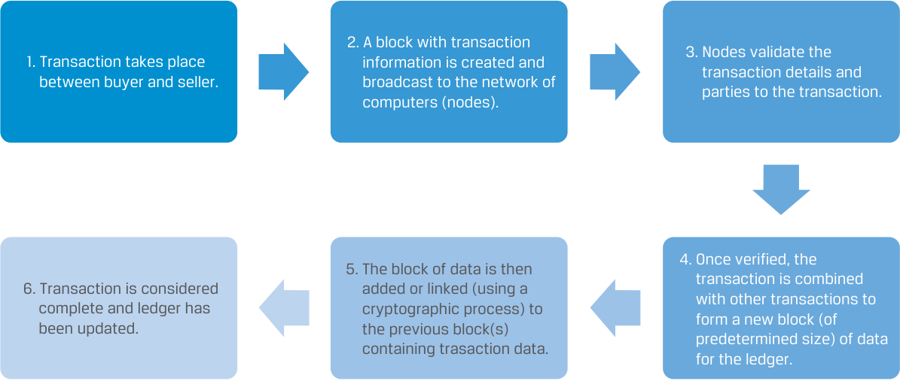

# Volume 8: Alternative Investments
## Learning Module 7 Introduction to Digital Assets
### Part 1/3: Introduction (PDF Pages 187–197)

---

<!-- PDF Page 187 -->

#### L E A R N I N G M O D U L E 

# **<mark>7</mark>** 

### **Introduction to Digital Assets** 

###### **<mark>LEARNING OUTCOMES</mark>** 

|**_Mastery_**|**_The candidate should be able to:_**|
|---|---|
||describe financial applications of distributed ledger technology|
||explain investment features of digital assets and contrast them with other asset classes|
||describe investment forms and vehicles used in digital asset investments|
||analyze sources of risk, return, and diversification among digital asset investments|

##### **INTRODUCTION** 

## **<mark>1</mark>** 

As introduced in Alternatives Learning Module 1, digital assets are a relatively new investment class that covers assets that can be created, stored, and transmitted electronically and have associated ownership or use rights. This class includes a wide variety of digital assets, including cryptocurrencies, tokens, and digital collectables. Based on the innovative distributed ledger technology (DLT), or blockchain technology, digital assets utilize advanced encryption techniques that assure the authenticity of digital assets. While cryptocurrencies have their own blockchains, crypto-tokens are built on an existing blockchain. 

As with other types of alternative investments, digital assets have characteristics distinct from traditional investments. Since the advent of Bitcoin in 2009, when it was a niche concept in the technology world, digital assets have gradually become more mainstream alternative investments for investors worldwide. We will give an overview of the common forms of digital asset investments and discuss the key concepts and pitfalls in this space. 

Despite their special features and technological characteristics, digital assets offer investors diversification while providing higher expected returns than traditional investments provide. However, their risks are also higher. We will discuss the sources of risks in digital assets to provide a better understanding of this evolving asset class. 

<!-- PDF Page 188 -->

###### **LEARNING MODULE OVERVIEW** 

- Blockchain and distributed ledger technology might offer a new way to store, record, and track digital assets on a secure, distributed basis. Additionally, DLT could bring efficiencies to posttrade and compliance processes through automation, smart contracts, and identity verification. 

- DLT can take the form of either permissionless or permissioned networks. 

- A consensus protocol is a set of rules that govern how blocks are cryptographically chained together in a blockchain network for the verification of the complete and immutable history of transaction records. Two broad types of consensus protocols are “proof of work” (PoW) and “proof of stake” (PoS). 

- Digital assets are frequently seen as an alternative asset class. As digital assets become more developed, institutional investors may continue to seek some exposure to these assets for their higher returns and possible diversification benefits. 

- Digital assets differ from traditional financial assets in terms of their inherent value, transaction validation approach, uses as a legal medium of exchange, and legal and regulatory protection. 

- The most common digital assets are cryptocurrencies, including Bitcoin and altcoins (including stablecoins and meme coins). There are also digitalized tokens that include non-fungible tokens, security tokens, utility tokens, and governance tokens. 

- Many cryptocurrencies are designed with self-imposed limits on the total supply through complex computer algorithms. Such limits could help maintain a value from a technical perspective, yet there is no economic consensus on how they should be valued. Cryptocurrency exchanges are classified into centralized exchanges and decentralized exchanges. Both centralized and decentralized exchanges face problems with fraud and manipulation because they are not subject to rigorous oversight and are generally not regulated as financial exchanges. 

- Investment in digital assets can take the form of direct ownership of cryptocurrencies and other digital assets on the blockchains or indirect investment in exchange-traded products, hedge funds, trusts, futures, and thematic stocks. 

- Asset-backed tokens are digital claims on physical assets, financial assets, or financial instruments and are collateralized by these underlying assets. 

- The push for financial decentralized applications based on opensource codes and smart contracts has grown into a movement known as decentralized finance, or DeFi. DeFi seeks to design, combine, and develop decentralized financial applications as building blocks for sophisticated financial products and services. 

- The price of Bitcoin and other digital assets are driven by expectations on future asset appreciation rather than any underlying cash flow. The market demand for the limited supply of cryptocurrencies is a significant driver of prices. 

<!-- PDF Page 189 -->

- The performance of the first widely traded digital asset, Bitcoin, has been characterized by high return, high volatility, and low correlations with traditional asset classes. 

- Due to the historically low correlations with other asset classes, digital assets offer potential diversification benefits to a well-diversified portfolio. But the correlations are observed to have risen, especially during periods of high market uncertainty. 

###### **LEARNING MODULE SELF-ASSESSMENT** 

These initial questions are intended to help you gauge your current level of understanding of this learning module. 

1. The consensus protocol on a distributed ledger technology network refers to: 

   - **A.** the standardized approach that governs how digital assets generated from a blockchain network should be valued. 

   - **B.** programs embedded in electronic transaction records that are coded to self-execute according to predetermined conditions. 

   - **C.** the set of rules governing how blocks are cryptographically linked to the chain to become immutable on the distributed ledger network. 

   - **Solution:** 

The correct answer is C. When transactions enter a node of the distributed ledger, they are bundled into “blocks” and cryptographically “chained” together to facilitate verification of the prior history. How blocks are chained together is determined by the consensus protocol, a set of rules governing how blocks can join the chain and become the immutable “truth.” The consensus protocols are designed to resist attempts at malicious manipulation up to a certain level of security. 

2. Cryptocurrencies are a common form of digital asset that: 

   - **A.** can be mined only through “proof of work” on blockchain networks. 

   - **B.** exist both in physical forms and electronic records with rights to use, buy, or sell by owners. 

   - **C.** can be used to transfer or store value, which allows time-efficient transactions between parties without the need for an intermediary. 

   - **Solution:** 

The correct answer is C. Cryptocurrencies are used to transfer or store value, which allows near-real-time transactions between parties without the need for an intermediary. As electronic mediums of exchange, cryptocurrencies lack physical form and exist only as electronic records on distributed ledgers. Depending on the particular consensus protocols used, cryptocurrencies can be generated either by “proof of work” or “proof of stake” by miners or validators on networks. 

3. Digital assets differ from traditional financial securities in that: 

   - **A.** digital assets are subject to a broader legal protection framework. 

   - **B.** digital assets are not valued based on their expected future cash flow. 

<!-- PDF Page 190 -->

- **C.** transaction records of digital assets require a centralized intermediary. 

- **Solution:** 

The correct answer is B. Most digital assets do not have a fundamental value based on underlying assets or on the potential cash flow or earnings they are expected to generate. To date, the legal and regulatory frameworks for digital assets are still evolving, and there is generally less legal protection compared to traditional financial securities. Digital asset transactions are recorded on a distributed ledger, and no centralized intermediary is required in the process. 

4. A special type of cryptocurrency that is backed by and pegged to a fiat currency is called: 

   - **A.** altcoin. 

   - **B.** stablecoin. 

   - **C.** meme coin. 

   - **Solution:** 

The correct answer is B. A stablecoin is designed to maintain a stable value by pegging its value to another asset and is collateralized by a basket of assets, typically a fiat currency, precious metals, or other cryptocurrencies. 

5. An indirect investment in digital assets can be made through: 

   - **A.** entering into cryptocurrency futures. 

   - **B.** purchasing Bitcoins on cryptocurrency wallets. 

   - **C.** participating in the initial coin offering of a new digital token. 

   - **Solution:** 

The correct answer is A. Investors interested in an indirect investment in digital assets can trade cryptocurrency futures on established exchanges, such as the Chicago Mercantile Exchange. However, the purchase of Bitcoins and buying new tokens through an initial coin offering are direct forms of investment. 

6. A cryptocurrency ETF seeks to: 

   - **A.** gain exposure to cryptocurrencies through cash and cryptocurrency derivatives. 

   - **B.** replicate digital asset investment returns by investing directly in cryptocurrencies. 

   - **C.** gain exposure to the cryptocurrency theme by investing in public equities related to the digital asset sector. 

###### **Solution:** 

The correct answer is A. A cryptocurrency ETF seeks to replicate digital asset investment returns by cash and cryptocurrency derivatives. 

7. Bitcoin as an alternative investment has historically exhibited: 

   - **A.** low return, low risk, and high correlations with traditional assets. 

   - **B.** high return, high risk, and low correlations with traditional assets. 

<!-- PDF Page 191 -->

**C.** high return, high risk, and high correlations with traditional assets. **Solution:** The correct answer is B. Despite no future cash flow generation, Bitcoin as an alternative investment has been characterized by high return, high volatility, and low correlations with traditional asset classes. 

8. Early investors in cryptocurrencies have enjoyed significant price appreciation but many later-stage investors suffered huge losses most likely because: **A.** blockchain technology favors early-stage investors. **B.** there are substantial price fluctuations in cryptocurrencies. **C.** cryptocurrencies have increased their appeal to institutional investors. 

**Solution:** The correct answer is B. Because cryptocurrencies are a relatively new innovation, their market is subject to rapid price swings, changes, and uncertainty. Their prices have been extremely volatile over the years, and price drawdowns were often much more substantial than for traditional asset classes. As a result, later-stage investors may suffer huge losses depending on their points of entry and exit. 

##### **DISTRIBUTED LEDGER TECHNOLOGY** 

**<mark>2</mark>** 

describe financial applications of distributed ledger technology 

**Distributed ledger technology (DLT)** based on a distributed ledger (defined later) represents a technological development and offers potential improvements to delivering financing services and financial record keeping. DLT networks are being considered as a means to create, exchange, and track ownership of financial assets on a peer-to-peer (P2P) basis. Potential benefits of using this technology include greater accuracy, transparency, and security in record keeping; faster transfer of ownership; and P2P interactions. However, the technology is not fully secure, and breaches in privacy and data protection are possible. Additionally, the computational processes underlying DLT generally require massive amounts of energy to verify transaction activity. 

A **distributed ledger** is a type of database that can be shared among potentially infinite numbers of entities in a network. In a distributed ledger, entries are recorded, stored, and distributed across a network of participants so that each participating entity has a matching copy of the digital database, making each copy of the database a verified record of all current and previous transactions. Basic elements of a DLT network include a digital ledger, a consensus mechanism used to confirm new entries, and a participant network. 

The consensus mechanism is the process by which the computer entities (or nodes) in a network agree on a common state of the ledger. Consensus generally involves two steps: transaction validation and agreement on ledger update by network parties. These features enable the creation of records that are, for the most part, considered immutable, or unchangeable, yet they are transparent and accessible to network participants on a near-real-time basis. There are various approaches to establishing consensus. 

<!-- PDF Page 192 -->

Features of DLT include the use of **cryptography** —an algorithmic process to encrypt data, making the data unusable if received by unauthorized parties—which enables a high level of network security and database integrity. For example, DLT uses cryptographic methods of proof to verify network participant identity and for data encryption. 

DLT has the potential to accommodate “ **smart contracts** ,” which are computer programs that self-execute on the basis of pre-specified terms and conditions agreed to by the parties to a contract. Examples of smart contract use are the automatic execution of contingent claims for derivatives and the instantaneous transfer of collateral in the event of default. 

Exhibit 1 illustrates a distributed ledger network in which all participants (nodes) are connected to one another, each having a copy of the distributed ledger. The term “consensus” is shown in the center of the network and represents the consensus mechanism in which the nodes agree on new transactions and ledger updates. 

###### **Exhibit 1: Distributed Ledger Network Setup** 

<!-- Start of picture text -->
LEDGER 81c699a7-b760-4573- 8e06-3b7e98f5edfd LEDGER LEDGER 81c699a7-b760-4573- 81c699a7-b760-4573- 8e06-3b7e98f5edfd 8e06-3b7e98f5edfd LEDGER LEDGER 81c699a7-b760-4573- CONSENSUS 81c699a7-b760-4573- 8e06-3b7e98f5edfd 8e06-3b7e98f5edfd LEDGER LEDGER 81c699a7-b760-4573- 81c699a7-b760-4573- 8e06-3b7e98f5edfd 8e06-3b7e98f5edfd LEDGER 81c699a7-b760-4573- 8e06-3b7e98f5edfd <!-- End of picture text -->

**Blockchain** is a type of digital ledger in which information, such as changes in ownership, is recorded sequentially within blocks that are then linked or “chained” together and secured using cryptographic methods. The steps outlining adding a new transaction to the network are outlined in Exhibit 2. There are several key steps a transaction must go through before it is added to the blockchain. 

<!-- PDF Page 193 -->

**Exhibit 2: Adding a Transaction to the Blockchain** 

<!-- Start of picture text -->
2. A block with transaction 3. Nodes validate the 1. Transaction takes place  information is created and  transaction details and  between buyer and seller.  broadcast to the network of  parties to the transaction.  computers (nodes). 4. Once verified, the 5. The block of data is then  transaction is combined 6. Transaction is considered  added or linked (using a  with other transactions to  complete and ledger has  cryptographic process) to  form a new block (of  been updated.  the previous block(s)  predetermined size) of data  containing trasaction data.  for the ledger. <!-- End of picture text -->

Each block contains a grouping of transactions (or entries) and a secure link (known as a hash) to the previous block. New transactions are inserted into the chain only after validation via a consensus mechanism in which authorized members agree on the transaction and the preceding order, or history, in which previous transactions have occurred. 

###### **Proof of Work vs. Proof of Stake** 

Fundamentally, blockchains are software protocols that enable many parties to interact under common assumptions and knowledge without having to trust each other. When transactions enter into a node of the blockchain, they are bundled into “blocks” and cryptographically “chained” together to facilitate verification of the prior history. How blocks are chained together is determined by the **consensus protocol** , a set of rules governing how blocks can join the chain and become the immutable “truth.” The consensus protocols are designed to resist attempts at malicious manipulation up to a certain level of security. We distinguish between two main types of protocols. 

###### **_The Proof of Work (PoW) Protocol_** 

The proof of work protocol determines which specific block to add through a computationally costly lottery. The PoW consensus mechanism used to verify a transaction involves a cryptographic problem that must be solved by some computers on the network (known as miners) each time a transaction takes place. **Miners** use powerful computers and significant amounts of energy to solve complex algorithm puzzles to validate and lock blocks of transactions into the blockchain, earning cryptocurrency for themselves in the process. The “proof of work” consensus process to update the blockchain can require substantial amounts of computing power, making it very difficult and extremely expensive for an individual third party to manipulate historical data. To manipulate historical data, an individual or entity would have to control most nodes in the network. The success of the network, therefore, relies on broad network participation. 

Participants on the network agree that the _longest chain_ of blocks is the only truthful representation of all previous transactions. If a malicious attacker wanted to make a longer chain including fraudulent transactions, it must outperform the entire network’s computational power, which theoretically requires most of the network’s 

<!-- PDF Page 194 -->

available computational power. This is the famous 51% attack threshold and serves as the boundary of the PoW protocol’s security standards. Amassing this much network power on the most widely used blockchains behind cryptocurrencies, such as Bitcoin or Ethereum, is extremely difficult for any individual, organization, or group of coordinated actors. Even if most of the network’s computational power can be controlled momentarily, the length of block history that can be altered is limited by the duration of this control. This has been the most widely used consensus protocol for digital assets. 

###### **_The Proof of Stake (PoS) Protocol_** 

This protocol requires selected participants on the networks, the validators, to pledge capital to vouch for the block's validity. This stake signals to the network that a validator is available to verify the veracity of a transaction and propose a block. A majority of the other validators, who similarly staked a digital asset to the network, must then attest to the validity of proposed block. Validators benefit from both proposing and attesting to the validity of blocks that have been proposed by other participants in a similar staking process. The boundary of the PoS protocol’s security standards builds on a group of stakers (and their pledged stake) controlling the network’s computational power and protecting access from malicious parties gaining a majority. 

Under both consensus protocols, the validation of the transactions comes with rewards: mining. Successful miners that validate the transaction obtain a new digital asset, whether it is a cryptocurrency or a token. The rate of mining and the speed at which new transactions on the network are validated generally control the amount of a new digital asset that can be created on a specific digital ledger network. 

###### **Permissioned and Permissionless Networks** 

DLT can take the form of either permissionless or permissioned networks. **Permissionless networks** are open to any user who wishes to make a transaction, and all users within the network can see all transactions that exist on the blockchain. In a permissionless, or open, DLT system, any network participant can perform all network functions. 

The main benefit of a permissionless network is that it does not depend on a centralized authority to confirm or deny the validity of transactions, because this takes place through the chosen consensus mechanism. This means no single point of failure exists because all transactions are recorded on a single distributed database and every node stores a copy of the database. Once a transaction has been added to the blockchain, it cannot be changed, barring manipulation; the distributed ledger becomes a permanent and immutable record of all previous transactions. In a permissionless network, trust between transacting parties is not a requirement. 

**Bitcoin** is a well-known use of an open permissionless network. Bitcoin was created in 2009 to serve as the public ledger for all transactions occurring on its virtual currency. Since the introduction of Bitcoin, many more cryptocurrencies, or digital currencies, which use permissionless DLT networks, have been created. 

In **permissioned networks** , network members might be restricted from participating in certain network activities. Controls, or permissions, can be used to allow varying levels of access to the ledger, from adding transactions (e.g., a participant) to viewing transactions only (e.g., a regulator) to viewing selective details of the transactions but not the full record. Exhibit 3 compares the salient features of permissioned and permissionless blockchains. 

<!-- PDF Page 195 -->

**Exhibit 3: Features of Permissioned and Permissionless Blockchains** 

||**Permissioned blockchain**|**Permissionless blockchain**|
|---|---|---|
|**Speed**|Faster as only a limited number of mem- bers participate or are authorized to validate transactions|Slower as a large number of members have to reach consensus, which decreases network speed and scalability|
|**Cost**|Cost-effective as few members are required to validate each transaction|Not cost-effective as many members are required to validate each transaction|
|**Decentralization**|Partially decentralized as there are a limited number of members in the chain|Decentralized as all members can access the network|
|**Access**|Membership is limited.|Membership is unlimited.|
|**Governance**|The governance is determined by a centralized organization.|The governance is decentralized and is main- tained by the members.|

Based on their decentralized nature, permissionless distributed ledgers are fully open to all, but that high level of decentralization usually requires more processing power and bandwidth, making them less cost-effective. The opposite holds true for permissioned blockchains. Governance and transaction verification are two other aspects that are specific to the type of blockchain. 

###### **Types of Digital Assets** 

Potential applications of DLT to financial services and investment management include the creation of digital assets, such as cryptocurrencies, and the process to deliver financial services more efficiently, such as processes tokenization, post-trade clearing and settlement, and compliance. Exhibit 4 summarizes different digital assets. 

###### **Exhibit 4: Different Digital Assets** 

<!-- Start of picture text -->
Other Bitcoin cryptocurrencies Cryptocurrencies Altcoins Stablecoins Central Bank Memecoins Digital Currencies Digital Assets Non-Fungible Tokens Security Tokens Tokens Utility Token Governance Tokens <!-- End of picture text -->

<!-- PDF Page 196 -->

###### **_Cryptocurrencies_** 

Digital assets are assets that exist only as an electronic record with rights to use, buy, or sell. They can be securities, currencies, properties, or commodities. The most common digital assets are units used to transfer or store value, referred to as **cryptocurrency** and digital currency, which allow near-real-time transactions between parties without the need for an intermediary. 

As electronic mediums of exchange, cryptocurrencies lack physical form and are issued privately by individuals, companies, and other organizations. Hence, they do not benefit from the backing of a central bank or a monetary authority. Most issued cryptocurrencies utilize open DLT systems in which a decentralized distributed ledger is used to record and verify all digital currency transactions. Several different types of cryptocurrency exist, such as altcoins and stablecoins. 

Many cryptocurrencies have a self-imposed limit on the total amount of currency they may issue. Although such limits could help maintain their store of value, it is important to note that many cryptocurrencies have experienced high levels of price volatility. There is no consensus on how to value cryptocurrencies, and the apparent lack of clear fundamentals underlying these currencies has contributed to their volatility. 

Cryptocurrencies are not government backed or regulated. Central banks around the world, however, are recognizing potential benefits and examining use cases for their own cryptocurrency versions as an alternative to physical currency. Such **central bank digital currencies (CBDCs)** are typically designed as a tokenized version of the currency issued by the central bank (“fiat currency”)—essentially a digital bank note or coin. 

###### **_Tokens_** 

Transactions involving physical assets, such as real estate, luxury goods, and commodities, often require substantial efforts in ownership verification and examination each time a transfer in ownership takes place. Through **tokenization** , the process of representing ownership rights to physical assets on a blockchain or distributed ledger, DLT has the potential to streamline this process by creating a single, digital record of ownership with which to verify ownership title and authenticity, including all historical activity. 

Another form of digital assets is the **non-fungible token (NFT)** . An NFT links digital assets to certificates of authenticity using blockchain technology. NFTs differ from “fungible” tokens, such as cryptocurrencies, because each token and the authenticated object it represents is unique. As such, they uniquely “stamp” assets and can represent digital assets in a virtual world. The most common use for NFTs is trading in digital artwork. 

**Security tokens** digitize the ownership rights associated with publicly traded securities. The custody of these security tokens can be stored on a blockchain, which increases the efficiency of post-trade processing, settlement, record keeping, and custody. Such a single ledger solution would eliminate the need for reconciliation and validation of transactions and allow participants to perform various transactions more easily and with greater transparency. 

An example of security tokens is **initial coin offering** (ICO), an unregulated process whereby companies sell their crypto-tokens to investors in exchange for money or for another agreed upon cryptocurrency. An ICO is typically structured to issue digital tokens to investors that can be used to purchase future products or services being developed by the issuer. ICOs provide an alternative to traditional, regulated capital-raising processes, such as IPOs. Compared to the regulated IPO market, ICOs might have lower associated issuance costs and shorter capital-raising time frames. However, most ICOs do not typically have attached voting rights. Regulation for ICOs is under consideration in several jurisdictions, and numerous instances of investor loss have resulted from fraudulent schemes. 

<!-- PDF Page 197 -->

There are also **utility tokens** that provide services within a network, such as pay for services and network fees. While security tokens may pay out dividends, utility tokens only compensate for activities on the network. 

**Governance tokens** are important in permissionless networks. They serve as votes to determine how particular networks are run. For instance, when there is a technical problem on a permissionless blockchain network, it is the owners of governance tokens who can vote on a solution or any major changes to maintain the stability and integrity of the network. 

###### **QUESTION SET** 

1. Which of the following is _not_ a potential benefit of distributed ledger technology? 

   - **A.** Facilitation of smart contracts 

   - **B.** Energy-efficient way of record keeping 

   - **C.** Immutable and secure transaction records 

   - **Solution:** 

The correct answer is B. Distributed ledger technology provides greater accuracy, transparency, and security in record keeping; enables faster transfer of ownership; and enables peer-to-peer interactions. A DLT network relies on certain consensus mechanisms in which all nodes that are connected on the network agree on new transactions and ledger updates. Once verified by all the nodes of the network, the transaction ledger is immutable and is kept by each of the nodes. However, the transaction validation process requires material computational power of all the miners on the network, especially in the case of proof-of-work consensus protocol. 

2. Identify the following statement as true or false: Prices of cryptocurrencies can be volatile because there are finite limits on the total amount of currencies that may be issued. 

   - **Solution:** 

False. Prices of cryptocurrencies have been volatile because there is no consensus on how to value cryptocurrencies. The apparent lack of clear fundamentals underlying these currencies has contributed to their volatility. 

3. The process where a node on a blockchain network pledges its digital asset to verify a new block’s validity is called: 

   - **A.** tokenization. 

   - **B.** proof of work. 

   - **C.** proof of stake. 

   - **Solution:** 

The correct answer is C. This proof-of-stake protocol requires selected participants on a blockchain network, the validators, to pledge digital assets to vouch for the block’s validity. This stake signals to the network that a validator is available to verify the veracity of a transaction and propose a block. Other validators who stake a digital asset to the network must then attest to the validity of proposed block. Validators benefit from both proposing and attesting to the validity of blocks that have been proposed by other partici- <u>pants in a similar staking process in the form of new digital assets.</u> 

