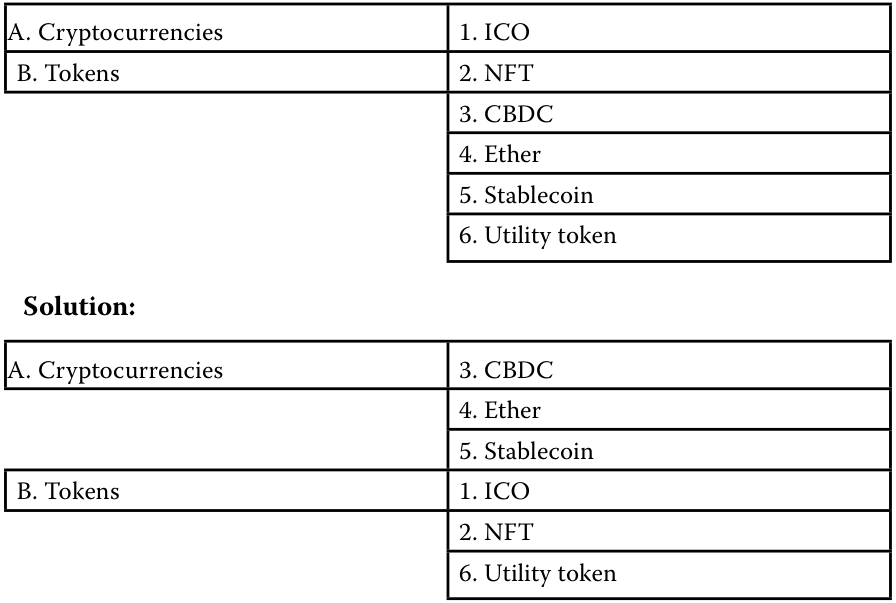
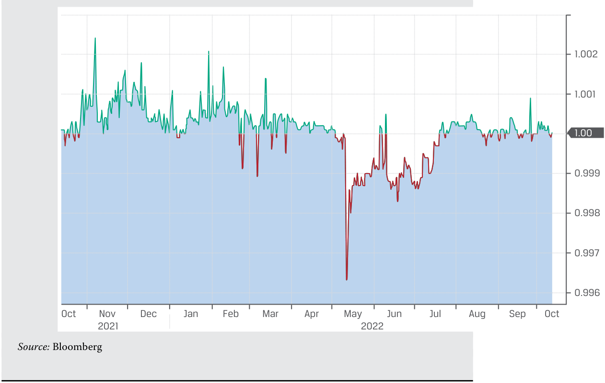
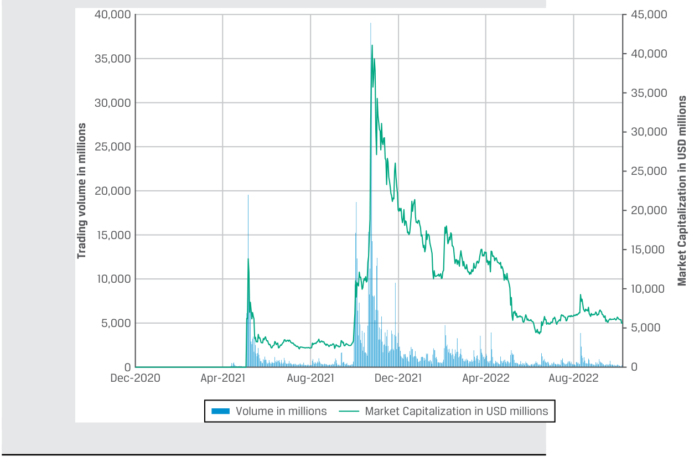

# Volume 8: Alternative Investments
## Learning Module 7 Introduction to Digital Assets
### Part 2/3: Digital Asset Investment Features (PDF Pages 198–212)

---

<!-- PDF Page 198 -->

4. Identify the various types of digital assets according to their general classifications: 

<!-- Start of picture text -->
A. Cryptocurrencies 1. ICO B. Tokens 2. NFT 3. CBDC 4. Ether 5. Stablecoin 6. Utility token Solution: A. Cryptocurrencies 3. CBDC 4. Ether 5. Stablecoin B. Tokens 1. ICO 2. NFT 6. Utility token <!-- End of picture text -->

# **<mark>3</mark>** 

## **DIGITAL ASSET INVESTMENT FEATURES** 

explain investment features of digital assets and contrast them with other asset classes 

Digital assets have a growing presence in the financial services industry and have become a more prevalent asset class for investors. Most digital assets are cryptocurrencies, and their growth has been spectacular. While there were around 70 cryptocurrencies recorded in 2013, by early 2022, there were close to 10,000 different cryptocurrencies issued by corporations, organizations, and in many cases, individuals. 

Cryptocurrency investment is typically viewed as an alternative asset. As digital assets increase in prominence, some institutional investors selectively seek exposure to these assets for their potential higher returns and possible diversification benefits. When institutional investors become more comfortable with investing in digital assets, it may be a very early indication that the market may be close to reaching a tipping point. As more institutional investors are becoming comfortable with the idea of owning digital assets outright, various financial service providers, such as digital exchanges and custodians, have expanded their infrastructure in anticipation to support potential investment in these digital assets. 

<!-- PDF Page 199 -->

### **Distinguishing Characteristics of Digital Assets** 

There are notable differences between digital assets and traditional financial assets. The main similarity between these asset types is the emergence of indirect investment vehicles such as exchange-traded funds and hedge funds that invest both in traditional financial assets and in digital assets. The main differences between these asset types are as follows: 

- _Differences in inherent value_ . Unlike financial assets, most digital assets do not have an inherent value based on underlying assets or on the potential cash flow—interest and dividends—they can or are expected to generate. With no expected earnings to inform today’s value and indicate the likely direction for tomorrow’s prices, digital assets do not have a fundamental value. They derive their price solely from an anticipated asset appreciation from a perceived scarcity value (due to limitations on the total supply of currency) and the potential ability to transfer value in the future (due to unique features in the underlying algorithms that may facilitate certain types of financial transactions). 

- _Differences in validating transactions._ One key difference between digital assets and traditional financial instruments is that traditional assets are generally recorded in private ledgers maintained by central intermediaries. The ownership and exchange of digital assets are generally recorded on a decentralized digital ledger using cryptography and enhanced algorithms. Whether a digital asset transaction is validated in a permissionless or permissioned network using either a PoS or PoW standard impacts its perceived value. 

- _Differences in the uses as a medium of exchange_ . Financial assets are traditionally priced and traded in widely accepted currencies; they can be readily transacted and exchanged into fiat currencies. Fiat currencies form the foundation of modern financial systems as the mediums of exchange in any country. In contrast, some digital assets—for example, cryptocurrencies, such as Bitcoins—are used as direct substitutes of real-world fiat currencies in certain circumstances—especially for online transactions in the emerging Web3 ecosystem. Web3 is a concept that refers to the third iteration of the internet built on blockchain technologies, decentralization, and token-based economies. 

- While many digital assets, such as digital art and NFTs, are transacted and traded using cryptocurrencies, there is only a very limited acceptance of digital assets as a medium of exchange in the mainstream financial system to date. A reason has been the relative cost of the transactions, which can be prohibitively high to meaningfully process a large volume of transactions. While cryptocurrencies are being used to pay for certain goods and services and as investments, they are not legal tender in most jurisdictions and cannot usually be used to legally settle and extinguish debt in the same way as fiat currencies. Finally, the use of cryptocurrencies for payment and investment purposes is severely restricted in multiple countries; some countries have banned its usage outright and digital asset ownership may result in criminal conviction. Some governments are exploring the concept of CBDC as a tokenized version of fiat currencies, but the jury is still out how the idea will evolve. 

<!-- PDF Page 200 -->

#### **EXAMPLE 1** 

### **Tesla’s Acceptance of Bitcoin and Dogecoin** 

A high-profile supporter of cryptocurrencies and tokens has been Elon Musk, the CEO and major shareholder of Tesla Inc., the electric vehicle automaker. In February 2021, Tesla announced in a public filing that it has invested USD1.5 billion in Bitcoin to diversify its cash balance (of over USD19 billion at the end of 2020). It also indicated it would start accepting Bitcoin as a payment method for its vehicles subject to applicable laws and on a limited basis initially. But in May 2021, the company announced that it had suspended vehicle purchases using Bitcoin, citing concerns about increasing use of fossil fuels for Bitcoin mining and transactions. In July 2021, Musk indicated that Tesla would most likely restart accepting Bitcoin as payments once it had conducted due diligence on the amount of renewable energy used in Bitcoin mining. It resumed accepting Bitcoin; in January 2022, Musk announced that Tesla would start accepting Dogecoin as a payment method for selected brand merchandise. It is now the only cryptocurrency that Tesla accepts for online payment for certain Dogecoin-eligible products. 

In July 2022, Tesla announced that it had sold off 75% of its Bitcoin holding as the price had plummeted, but none of its Dogecoin. 

- _Differences in legal and regulatory protection_ . The rules governing financial instruments and the trading of financial instruments are clear, predictable, and well defined across most jurisdictions. Legal and regulatory standards for traditional financial instruments and assets and trading in these are well developed and are often comparable across national borders; this is not the case with digital assets. Comprehensive rules that are specific to digital assets—their formation, trading, and legal standards—are still being developed. The unclear, ambiguous framework puts digital assets at a disadvantage. US regulators consider certain digital currencies as commodities, and other regulators consider them a non-financial asset. With no comprehensive and clear legal recognition—and protection—for digital assets, their value is highly speculative. Finally, the various exchanges at which digital currencies are traded are typically not regulated as a traditional financial exchange. Therefore, certain market behaviors, such as price manipulation and outright fraud, that are considered to be illegal activities on traditional financial transactions are not necessarily prohibited on a digital exchange. Exhibit 5 shows differences between digital and traditional financial assets. 

#### **Exhibit 5: Digital Assets vs. Traditional Financial Assets** 

||**Digital Assets**|**Traditional Financial Assets**|
|---|---|---|
|Inherent value|■No fundamental value or future cash flow generation ■Price driven by certain features on the blockchain|■Value determined by future cash flow gener- ated from the assets|
|Transaction validation|■Usually recorded on decentralized digital ledgers using cryptography and algorithms for permissionless blockchain networks|■Recorded in private ledgers maintained by central intermediaries|

<!-- PDF Page 201 -->

||**Digital Assets**|**Traditional Financial Assets**|
|---|---|---|
|Uses as a medium of exchange|■Very few digital assets are used as a direct medium of exchange, mainly targeting large- scale commercially viable acceptance|■Not used directly as a medium of exchange but can be readily transacted and exchanged into traditional fiat currencies that are widely used in the real world|
|Legal and regulatory protection|■Ambiguous, often contradictory, evolving framework; generally unregulated, with mini- mal legal protections ■Use can be illegal or criminal in some countries|■Well-established, tested, and proven legal, regulatory, and commercial standards that are clear, predictable, and well defined across all jurisdictions|

### **Investible Digital Assets** 

The rapid growth of digital assets has been remarkable. That several digital assets and cryptocurrencies exist reflects that their underlying blockchains are designed and optimized for different purposes. The most popular cryptocurrencies are Bitcoin and Ether. Bitcoin and Ether together make up over 80% of total cryptocurrency market value as of July 2022. 

Bitcoin (BTC or XBT) and was launched to secure payments in a P2P network. It was designed as an alternative to traditional currencies: as a medium of exchange and store of value. It is the best-known and most widely traded cryptocurrency and its fundamental design continues to influence the development of new types of digital assets. Thousands of other cryptocurrencies exist based on technology similar to Bitcoin: These are called **altcoins** . 

#### **_Altcoins_** 

The most prominent altcoin is **Ether** , launched in 2015 on its own Ethereum network. Ether involves the added feature of a programmable blockchain that allows users to construct applications using the blockchain to validate or secure transactions or payments for markets or other uses. Ether and other programmable coins therefore have the possibility to be more widely used than simply as a store of value. Such programmable altcoins are also called smart coins or smart contracts, a self-executing contract with the salient terms of the contract directly written into the lines of code, which allows for execution of the contract using the blockchain network. That execution provides a trackable and irreversible record, subject to immutable verification by the nodes of the network. Other altcoins include stablecoins and meme coins. 

#### **_Stablecoins_** 

**Stablecoins** are designed to maintain a stable value by linking their value to another asset and are collateralized by a basket of assets, typically legal tender, precious metals, or other cryptocurrencies. The reserve basket protects the holders from price volatility and minimizes the risk to the holders of the stablecoin should the cryptocurrency face transaction problems, including failure. Some stablecoins—smart stablecoins or algorithmic stablecoins—are designed to use algorithms to control the available supply of the asset, such as minting additional assets when there is increased demand for the coin. It is important to note that stablecoins cannot be exchanged for fiat money and do not have any legal or regulatory backing. 

Stablecoins may potentially facilitate settlement and streamline cross-border trading, investing, and payments. In recent years, several competing solutions have been developed to facilitate transactions across various physical and tokenized financial assets and instruments using the stablecoin concept. A special example is the **asset-backed token** , which maintains price parity with some target asset (the 

<!-- PDF Page 202 -->

US dollar or gold) through tokenization and will be covered later in this module. For an investor holding assets in in a cryptographic wallet, asset-backed tokens provide exposure both to assets that are on the chain (cryptocurrencies and digital assets) and off the chain (financial instruments). 

#### **EXAMPLE 2** 

### **Market Shakeout of Stablecoins** 

Stablecoins are designed to track the value of real-world conventional fiat currencies and to provide immediate access to liquidity for traders to redeem their digital stablecoins at par with the value of fiat currencies. Some of these stablecoins are collateralized by financial assets, such as a basket of fiat currencies, gold, Treasuries, and other liquid or illiquid assets. Two of the largest stablecoins in terms of collateral, Tether and USD Coins, use this approach and can either be traded freely on the open market or be redeemed for their dollar value from the issuers. 

Another popular stablecoin, Terra, was often called an “algorithmic stablecoin.” It was backed not by collateral of financial and physical assets but through an algorithm that sought to keep its value stable. 

For instance, TerraUSD was Terra’s stablecoin pegged to the US dollar “algorithmically” instead of the value of the underlying collateral in US dollar reserves. The computer algorithm developed by the issuer of Terra, Terraform Labs, used Luna, a governance token also issued by Terraform Labs, to maintain the stability of Terra’s value. The relationship between Terra and Luna was designed so that the holders of Terra could always redeem it for a stable value of newly minted Luna coins. If the pricing relationship between Terra and Luna was not in equilibrium, new Luna coins could be issued or existing Luna coins would be destroyed to maintain the value relationship and this algorithmic peg between Terra and Luna. Through financial arbitrage, the stability of Terra’s value by trading between Terra and Luna would be held. Effectively, Terra was simply backed by Luna, both bearing a US dollar value. 

In May 2022, this relationship was tested. On 9 May, the price of Luna first began to slide, putting pressure on the Terra’s peg. Many Terra owners rushed to redeem their coins, leading to a sudden surge in supply of newly issued Luna: In just one week, the number of Luna increased from 350 million coins to 6.5 trillion. Consequently, the price of Luna collapsed, as did that of Terra. 

TerraUSD was finally depegged from the US dollar on 9 May 2022. Though Terra’s co-founder tried to revive Terra in a reincarnated form of TerraClassicUSD, the stablecoin had since lost its credibility. With its appeal diminished, the coin was practically defunct. 

The collapse of Terra sparked serious concern over the collateral backing of its largest stablecoin counterparts, Tether and USD Coins, because of the limited transparency of their reserves. A massive run and redemption by nervous holders of these stablecoins soon followed. 

While the “securitized” stablecoins, such as Tether, may have survived market turbulence, other “algorithmic” stablecoins may not when their technical flaws are exploited. Likewise, the value of asset-backed tokens depends on both the underlying assets and the prices of the relevant tokens. An example of Tether is shown in Exhibit 6. 

<!-- PDF Page 203 -->

#### **Exhibit 6: Market Price of Tether** 

<!-- Start of picture text -->
1.002 1.001 1.7 0 0 0.999 0.998 0.997 0.996 Oct Nov Dec Jan Feb Mar Apr May Jun Jul Aug Sep Oct 2021 2022 Source:  Bloomberg <!-- End of picture text -->

#### **_Meme Coins_** 

**Meme coins** are cryptocurrencies often inspired by a joke and are generally launched for entertainment purposes as they gain popularity in a short period of time, which allows early purchasers to sell their holdings at an often considerable profit. 

#### **EXAMPLE 3** 

### **Meme Coins—The History of Dogecoin** 

The original and probably most popular meme coin is Dogecoin, which is based on the popular “doge” internet meme. Dogecoin, featuring a Shiba Inu dog on its logo, was originally founded in 2013 as a mockery of the popularity of cryptocurrencies, mainly Bitcoin. Even the name “dog” was misspelled as “doge” as part of a light-hearted parody. 

While some cryptocurrencies are scarce by design, Dogecoins were intentionally designed to have no limit in supply. But what started as a joke soon gained popularity among fervent followers as a cult symbol, especially after social media endorsements by some high-profile business figures. At its peak in May 2021, Dogecoin’s market value had jumped to over USD80 billion. However, the price and market cap of Dogecoins plummeted as investors and speculators dumped these coins because their value seemed hardly justifiable. By May 2022, its market dropped to USD11 billion. 

<!-- PDF Page 204 -->

#### **QUESTION SET** 

1. The market value of a digital asset is primarily driven by: 

   - **A.** the future price expectation of speculators. 

   - **B.** the future earnings generated from the digital assets. 

   - **C.** the cryptographic algorithm of the blockchain network. 

   - **Solution:** 

The correct answer is A. Unlike financial assets, most digital assets do not have an inherent value based on underlying assets or on the expected cash flow that can be generated. In other words, digital assets do not have a fundamental economic value. Their prices depend solely on the expected asset appreciation due to the perceived scarcity value and the potential ability to transfer value in the future; however, that value reflects market expectations at the time the transaction takes place. 

2. Identify the following statement as true or false: The legal protection regulations on securities and commodities are generally applicable to digital assets. 

#### **Solution:** 

False. Whereas legal and regulatory standards for traditional financial instruments are well developed, legally tested, and proven; widely and uniformly enforceable; and often comparable across different jurisdictions and legal systems, comprehensive rules that are specific to digital assets—their formation, trading, and legal standards—are being developed. Additionally, the various digital exchanges on which digital currencies are traded are typically not as heavily regulated as traditional financial markets. Consequently, certain irregular market behaviors, such as price manipulation and outright fraud, are not always prohibited on a digital exchange. 

3. The ownership and exchange of digital assets on permissionless networks are usually recorded on a: 

   - **A.** centralized ledger maintained by a central intermediary. 

   - **B.** decentralized ledger maintained by a central intermediary. 

   - **C.** decentralized ledger without any central intermediary. 

   - **Solution:** 

The correct answer is C. The ownership and exchange of digital assets on permissionless networks are generally recorded on a distributed (i.e., decentralized) digital ledger using cryptography and enhanced algorithms without the use of any central intermediary. 

4. Compare and contrast the main types of stablecoins. 

#### **Solution:** 

The traditional type of stablecoin, or “securitized stablecoin,” is backed by physical collateral of fiat currencies, precious metals, or other financial assets as reserves for every stablecoin issued. Each coin can be traded freely on the open market or redeemed for its dollar value from the issuer by liquidating the collateral. A special example of the stablecoin is the asset-backed 

<!-- PDF Page 205 -->

token, which maintains price parity with some target asset—for example, the US dollar or gold—through tokenization. 

Another unique type of stablecoin is called a “smart stablecoin” or an “algorithmic stablecoin,” because there is no backing of physical assets for the cryptocurrency. Rather, its value is backed by another cryptocurrency or token and is linked to the US dollar “algorithmically” instead of using actual dollar reserves. 

## **DIGITAL ASSET INVESTMENT FORMS** 

# **<mark>4</mark>** 

describe investment forms and vehicles used in digital asset investments 

Investment in digital assets can take the form of direct investment on the blockchain or indirect investments in exchange-traded products and hedge funds. Direct ownership of Bitcoin and other cryptocurrencies involves the use of a **cryptocurrency wallet** , which stores the (public and private) digital codes required to access the asset on a computer website or mobile device application. Two different types of cryptocurrency exchanges exist. 

- _Centralized exchanges_ are the most popular type of exchange. These privately held exchanges provide trading platforms for cryptocurrencies and offer volume, liquidity, and price transparency. Although the concept of centralized exchanges is incompatible with Bitcoin’s decentralized ideology, they are very popular. Trading is electronic and direct, without any intermediating broker or dealer, and is hosted on private servers, exposing the centralized exchanges and their clients to security vulnerabilities. Should the exchange’s servers become compromised, the entire system may become paralyzed, halting trade, and leaking vital user information—such as cryptographic keys accessing the custodial wallets leaked. Some exchanges are regulated, and depending on jurisdiction, these exchanges may be regulated as financial exchanges or other types of financial intermediaries. 

- _Decentralized exchanges_ emulate blockchain’s decentralized protocol and operate similarly to how Bitcoin operates. Decentralized exchanges lack a centralized control mechanism and operate on a distributed platform without central coordination or control. This comes with the benefit that should one of the computers on the network be attacked, the exchange remains operational since there are numerous other computers that continue to operate on the network. That is why attacking decentralized exchanges is substantially more difficult, rendering such attacks almost certain to fail. Decentralized exchanges are difficult to regulate because no single individual, organization, or group controls the system. This means that those trading on decentralized exchanges are generally free to transact without any regulatory scrutiny, allowing for potentially illegal activity. 

Both centralized and decentralized exchanges may face problems with fraud and manipulation and raise investor-protection concerns because they are not subject to rigorous oversight. Unlike the exchanges for more traditional assets, such as equity securities and futures contracts, cryptocurrency and cryptocurrency trading venues 

<!-- PDF Page 206 -->

are largely unregulated, and individuals or groups may engage in fraud or market manipulation (including using social media to promote cryptocurrencies in a way that artificially increases the price of a cryptocurrency). 

#### **EXAMPLE 4** 

### **Pump and Dump Schemes of Cryptocurrencies** 

In a typical pump and dump scheme, earlier investors of an asset talk it up to encourage others to buy, pushing the price up. When the price is high enough, the scheme orchestrators quickly realize profits and dump the asset in the market, leaving unknowing investors with often steep trading losses. Given the hype around cryptocurrencies and the unregulated nature of the digital assets, pump and dump schemes are widespread. 

EthereumMax (EMAX) is a digital token created on the Ethereum blockchain in May 2021, but it has no other connection to Ethereum. Touted as a “culture coin” that “bridges the gap between community-driven coins and foundational coins,” it was endorsed and heavily promoted by pop celebrities and famous sports stars just a month after it came into being. The price of EMAX rose sharply, with frenzied buying likely fueled by receiving heavy social media exposure. Its ascent was rapid, but its descent was faster: After one month, it had lost almost all its value and the interest in trading in it disappeared. It was then alleged that EMAX was a classic example of the typical pump and dump scheme. Subsequent legal action against the celebrities endorsing and “pumping” EMAX with false and misleading statements alleged that this scheme allowed EMAX executives to dump their holdings of EMAX for substantial profit while leaving other investors with worthless tokens. 

#### **EXAMPLE 5** 

### **FTX Bankruptcy** 

FTX, a Bahamas-based cryptocurrency exchange that also owns FTX.US (available to US investors), grew rapidly after its founding in 2019. 

As a centralized exchange for spot cryptocurrency and stablecoins, as well as futures, FTX became one of the largest such exchanges. It also provided custodial and transaction services. In 2021, it had 1.2 million users and generated over USD 1 billion in revenue. Like many digital currency exchanges, FTX issues an exchange token (FTT), a form of utility token used on its platform by market participants. As FTT may be borrowed or lent—and grants holders a discount on FTX trading fees—it represents some value (shown in Exhibit 7). 

FTX has been funded by several successive rounds of venture capital (VC) investments, raising USD 400 million from VC firms and a major pension fund. In January 2022, FTX was valued at USD 31.6 billion. 

FTX was considered to be a relatively stable and trusted alternative among digital currency exchanges. In 2022, declining cryptocurrency prices and rising interest rates created liquidity pressures for FTX and other cryptocurrency market participants. 

This growing liquidity stress was compounded by reports that FTX and Alameda Research, a quantitative trading firm controlled by FTX’s founder, held significant collateral assets in illiquid investments, including FTX-related assets. On 2 November 2022, a _Coindesk_ article cited close ties between FTX and Alameda Research and noted that Alameda Research held over a third of its 

<!-- PDF Page 207 -->

USD 14.6 billion balance sheet either directly in FTT or as FTT-based collateral. This revelation prompted an FTT selloff by investors and customer withdrawals, with the FTT price falling from over USD 25 to around USD 1 in just over a week, as Exhibit 7 shows. On 11 November 2022, FTX filed for bankruptcy. 

#### **Exhibit 7: FTT Digital Token Price (USD), January–November 2022** 

<!-- Start of picture text -->
Last Price 1.3070 High on 03/27/22 52.0191 Average 32.7153 Low on 11/14/22 1.3070 50 40 30 20 10 1.30 0 Jan Feb Mar Apr May Jun Jul Aug Sep Oct Nov 2022 <!-- End of picture text -->

_Source:_ Bloomberg. 

In its bankruptcy filing, FTX listed USD 9 billion in liabilities, with liquid investments comprising just USD 900 million of total assets. The number of creditors exceeds 100,000. 

#### **EXAMPLE 6** 

### **Ponzi Scheme Allegation over Forsage** 

A Ponzi scheme is an investment scam that typically involves the distribution of high returns to existing investors not from any real investment but from funds contributed by new investors. A variant of the Ponzi scheme is the pyramid Ponzi scheme, in which each level of schemers lures new investors in by promising high returns from investment opportunities that are usually fabricated. The new funds then go in to pay back the “returns” one level up. In effect, the “returns” earned by the earlier investors at the top are paid for by the cash contribution from the different levels of new investors. 

Launched in January 2020, Forsage ran a decentralized blockchain platform that purportedly enabled online businesses to transact through smart contracts based on Ethereum, Tron, and Binance networks. But in August 2022, the US Securities and Exchange Commission (SEC) laid charges against 11 individuals, including the four founders based in Russia, Georgia, and Indonesia and certain US promoters, for investment fraud. The SEC alleged that Forsage operated a typical fraudulent crypto pyramid and Ponzi scheme that raised more than USD300 million from retail investors worldwide, helped by heavy endorsement and marketing by promoters on social media. 

<!-- PDF Page 208 -->

### **Direct Digital Asset Investment Forms** 

Direct investments in digital assets are made on various digital exchanges where the transaction is recorded on the blockchain. Once such a transaction is entered between the parties, it becomes validated on the blockchain and a permanent record of the transaction is created. Most cryptocurrency exchanges are open and available 24/7, which allows for continuous trading. 

There are several risks with direct investment in cryptocurrencies. First, there is the risk for fraud, which has increased with the popularity of cryptocurrencies. Such fraud comes in many forms and includes scam ICOs, various pump and dump schemes, market manipulation, theft, and schemes that seek to gain access to credentials needed to access cryptocurrency wallet information. Second, since cryptocurrencies are usually held in a wallet that is accessible only using a unique passkey, losing access to the passkey makes the holdings in the wallet irretrievable. Around 20% of all Bitcoins are reportedly in lost or deserted wallets that their owners cannot access. 

Moreover, many of the smaller cryptocurrencies may be held primarily by a small number of holders, sometimes referred to as “whales.” “Whales” is jargon used by the cryptocurrency community to mean individuals or entities that hold an amount of a cryptocurrency large enough to have the ability to manipulate the price. 

#### **EXAMPLE 7** 

### **Cryptocurrency Whales** 

It was reported in mid-2022 that big investors on the Ethereum blockchain were accumulating the newly created meme coin, Shiba Inu (SHIB), a close competitor to Dogecoin. According to Whalestats, the crypto whale-watching platform, by August 2022, 41% of SHIB were “burned” (sent to “dead wallets” and effectively taken out of circulation). However, the next top 10 SHIB holders were estimated to be holding around 21%–23% of the total tokens (or 36%–39% of total coins in circulation). This might have allowed those “whales” to easily influence the price of SHIB. A glimpse into the trading volume might offer a hint about the effect on price action in a thin trading market environment, when the average daily trading volume was less than 10% of the total SHIB tokens. Exhibit 8 shows data on SHIB’s price and trading volume. 

<!-- PDF Page 209 -->

**Exhibit 8: Price Action and Trading Volume in Shiba Inu** 

<!-- Start of picture text -->
40,000 45,000 40,000 35,000 35,000 30,000 30,000 25,000 25,000 20,000 20,000 15,000 15,000 10,000 10,000 5,000 5,000 0 0 Dec-2020 Apr-2021 Aug-2021 Dec-2021 Apr-2022 Aug-2022 Volume in millions Market Capitalization in USD millions Trading volume in millions Market Capitalization in USD millions <!-- End of picture text -->

### **Indirect Digital Asset Investment Forms** 

Several alternatives exist to gain indirect exposure to digital assets, including the following: 

- _Cryptocurrency coin trust_ s allow investors to trade shares in trusts holding large pools of a cryptocurrency and that trade over the counter (OTC) and behave like closed-end funds. For an investor in a coin trust, there is no need to create a digital wallet and use encryption keys to invest in cryptocurrencies. Additionally, the trusts may provide additional transparency into trading. The trusts charge substantial fees and expenses, in some cases in excess of 2%, and may trade at a premium or discount to their net asset values. 

- _Cryptocurrency futures_ contracts are agreements to buy or sell a specific quantity of Bitcoin or other cryptocurrency at a specified price on a particular future date. For instance, trading in Bitcoin futures on the Chicago Mercantile Exchange (CME) is based on the CME CF Bitcoin Reference Rate, which tracks the price of spot Bitcoin trading on cryptocurrency exchanges. Unlike physical commodities, these contracts are typically cash settled, with no actual cryptocurrency changing hands. Trading in futures is inherently leveraged. The market for cryptocurrency futures may be less developed and potentially less liquid and more volatile than more established futures markets. 

<!-- PDF Page 210 -->

- _Cryptocurrency exchange-traded funds:_ An increasing number of exchange-traded products, such as ETFs, seek to replicate digital asset investment returns. These ETFs typically do not directly invest in cryptocurrencies and gain exposure to the value of cryptocurrencies using cash and cryptocurrency derivatives. 

##### **Baywhite Financial Cryptocurrency ETF (Fund) Term Sheet** 

|**Fund description**|The Fund is designed to provide investment results that generally correspond to the performance of major traded cryptocurrencies. It offers investors a convenient way to incorporate a rapidly growing digital asset into their portfolios as an alternative to traditional investments. The Fund does not invest directly in Bitcoin or other cryptocurrencies.|
|---|---|
|**Fund investment** **strategy**|The Fund seeks to provide capital appreciation primarily through managed exposure to cryptocurrency futures contracts. The Fund does not invest directly in cryptocurrencies. The value of cryptocurrencies is not backed by any government, corporation, or other identified body authorized to legally issue currency. Instead, its value is determined in part by the supply and demand in markets created to facilitate trading of cryptocurrencies. Ownership and transaction records for cryptocurrencies are pro- tected through public-key cryptography. The supply of cryptocur- rencies is typically determined by protocols that are unique to each specific cryptocurrency. The Fund may also invest in _Cryptocurrency futures contracts_, standardized, cash-settled crypto- currency futures contracts traded on exchanges _Money market instruments_, such as short-term cash instruments with high-quality credit profiles, including short-term government debt and repurchase agreements|
|**Fund trading**|The Fund is bought and sold through a brokerage account, eliminat- ing the need for a cryptocurrency exchange account or wallet.|
|**Fund expenses**|Annual Fund operating expenses are 1.50% of NAV.|
|**Additional** **considerations**|The Fund is non-diversified, with the ability to invest a relatively high percentage of its assets in financial instruments with a single counterparty or a few counterparties. Cryptocurrencies and cryptocurrency futures are relatively new investments. They are subject to unique and substantial risks and historically have been subject to significant price volatility. The value of an investment in the Fund could decline significantly and without warning, including to zero.|

- _Cryptocurrency stocks_ provide indirect exposure due to their activity and relationship to digital assets. Examples include equity in publicly traded digital exchanges; payment providers accepting cryptocurrencies; corporations accepting cryptocurrencies as payments, investing in cryptocurrencies, or mining cryptocurrencies; and corporations developing and/or manufacturing products or services that are used for running blockchain networks, such as specialized computers used for mining. 

- _Hedge funds investing in cryptocurrencies_ , such as discretionary long, long/ short, quantitative, and multi-strategy, have emerged as a major source of indirect digital asset investing. Several hedge funds actively mine for Bitcoin to generate further returns. 

<!-- PDF Page 211 -->

|**Seq **|**uester Capital LLC Crypto Hedge Fund (“Fund”) Term Sheet**|
|---|---|
|**Fund**|The Fund is designed to provide investment results that generally|
|**description**|h correspond to the performance of major traded cryptocurrencies. The Fund invests directly in multiple cryptocurrencies.|
|**Fund invest-** **ment strategy**|The Fund uses a combination of common hedge fund strategies, including quantitatively driven trading strategies, discretionary long/ short positions, and discretionary long-only positions in cryptocurren- cies and other digital assets. The Fund invests in multiple cryptocurrencies, including Bitcoin, Ether, Litecoin, Cardano, Solana, and Polkadot. Additionally, the Fund trades in cryptocurrency derivatives and may from time to time take specu- lative short positions in certain cryptocurrencies that it believes to be overvalued. h|
||The Fund may engage in lending and borrowing cryptocurrencies.|

### **Digital Forms of Investment for Non-Digital Assets** 

These represent similar digital forms of investment with an underlying _non-digital_ asset from which the investment derives its value. 

A recent development is asset-backed tokens, digital claims on physical assets, financial assets, or financial instruments that are collateralized by the underlying asset and derive their value directly from the underlying asset. Asset-backed tokens are a digital representation of the ownership. Tokenized assets include gold, crude oil, real estate, and equities. 

Asset-backed tokens could increase liquidity by allowing for fractional ownership of high-priced assets, such as houses, art, precious metals, and precious stones, which allows multiple investors to possess a fractional interest of the same asset. The digital representation of the ownership allows for an immutable record of ownership information and ownership transfer, which increases the transparency of these transactions and reduces transaction, intermediation, and record-keeping costs. 

Financial regulators typically classify asset-backed tokens as securities, as the ownership of the token entitles the holder to an ownership interest in the underlying asset. 

Asset-backed tokens are often issued on the Ethereum network or other smart contract platforms that allow for peer-to-peer interaction using interoperable, transparent smart contracts that persist for the duration of the chain. These decentralized applications, or dApps, allow for transactions to take place—and to be recorded on the blockchain—without a central coordinating mechanism. 

The push for financial decentralized applications grew into a movement known as decentralized finance, or DeFi. DeFi seeks to design, combine, and develop various open-source financial applications as building blocks for sophisticated financial products and services. Effectively, DeFi is a marketplace of dApps that are designed to perform various core financial functions, including potentially acting as a medium of exchange, storage of value, tokenization of underlying assets, and immutable record keeping of ownership and transfer of ownership. Effectively, all kinds of smart contracts can be embedded in dApps to handle nearly all aspects of the traditional financial system, such as lending, trading, investment, settlement, payment, and transfer in a decentralized, authenticated and instantaneous manner. Some advocates of DeFi argue that the modern blockchain ecosystem may have more technical advantages over the traditional finance system—for example, time saving and risk reduction in settlement and asset transfer. However, the nascent idea of DeFi is yet to be fully developed. To date, most dApps have centered around extending leverage to investment and speculation in digital assets. 

<!-- PDF Page 212 -->

#### **QUESTION SET** 

1. Compare and contrast centralized cryptocurrency exchanges and decentralized cryptocurrency exchanges. **Solution:** 

   - _Centralized exchanges_ are privately held. They provide trading platforms for cryptocurrencies and offer volume, liquidity, and price transparency. Trading is electronic and direct, without any intermediating broker or dealer, and is hosted on private servers, exposing the centralized exchanges and their clients to security vulnerabilities. Should the exchange's servers be attacked, the entire system may be compromised, halting trade, and leaking vital user information. Depending on jurisdiction, some centralized exchanges are regulated as financial exchanges or other types of financial intermediaries. 

   - _Decentralized exchanges_ emulate blockchain’s decentralized protocol. Decentralized exchanges lack a centralized control mechanism and operate on a distributed platform without central coordination or control. The benefit is that should one of the computers on the network be attacked, the exchange remains operational since there are numerous other computers that continue to operate on the network. That is why decentralized exchanges are substantially less susceptible to computer hacks. Decentralized exchanges are difficult to regulate because no single individual, organization, or group controls the system. Therefore those trading on decentralized exchanges are generally free of any regulatory scrutiny, allowing for potentially illegal activity. 

#### 2. Identify the direct and indirect forms of investment in digital assets: 

|A. Direct investment|1. CryptocurrencyETF|
|---|---|
|B. Indirect investment|2. Cryptocurrencycoin trust|
||3. Initial coin offering 4. Hedge fund investingin digital tokens 5. Buyinga digital art NFT 6. Tradingcryptocurrencystocks|
||7. Tradingtokens on a cryptocurrencyexchange|
||8. Buying Bitcoin futures on a futures exchange|

#### **Solution:** 

|A. Direct investment|3. Initial coin offering|
|---|---|
||5. Buyinga digital art NFT|
||7. Tradingtokens on a cryptocurrencyexchange|
|B. Indirect investment|1. CryptocurrencyETF|
||2. Cryptocurrencycoin trust|
||4. Hedge fund investingin digital tokens|
||6. Tradingcryptocurrencystocks,|
||8. Buying Bitcoin futures on a futures exchange.|

