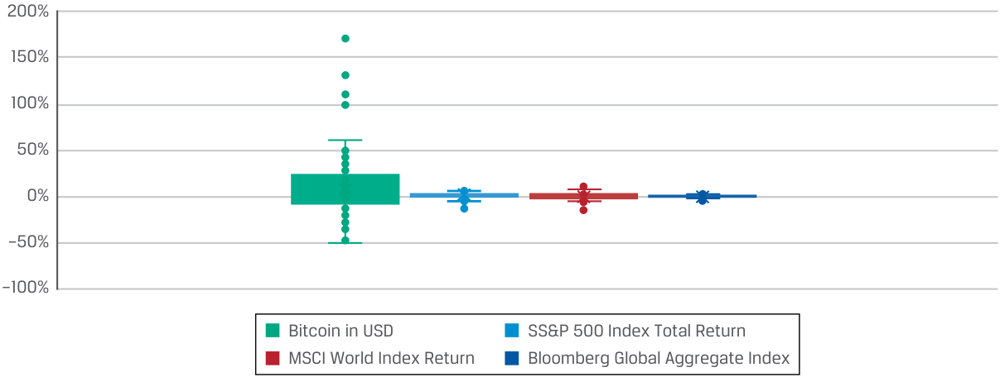

# Volume 8: Alternative Investments
## Learning Module 7 Introduction to Digital Assets
### Part 3/3: Digital Asset Investment Risk, Return, and Diversification (PDF Pages 213–220)

---

<!-- PDF Page 213 -->

3. Which of the following is _not_ a risk in direct investment in digital assets? 

   - **A.** Market manipulation 

   - **B.** Pump and dump schemes 

   - **C.** Failure to validate asset transfers 

   - **Solution:** 

The correct answer is C. There are several risks with direct investment in cryptocurrencies, including the risk for fraud, such as scam ICOs, pump and dump schemes, market manipulation, theft, and schemes that seek to gain access to credentials needed to access cryptocurrency wallet information. However, transactions in digital assets such as cryptocurrencies and tokens are verified and authenticated by cryptographical algorithms and consensus protocols. Once a transaction is entered between the parties, it becomes validated on the blockchain and creates a permanent record of the transaction. Therefore, the DLT technology makes it very unlikely to fail validating asset transfers. 

4. Determine the correct answers to fill in the blanks: DeFi is loosely defined as a marketplace for _________________ that allows for financial transactions to take place and to be recorded on the _________________ without a central coordinating mechanism. DeFi seeks to design, combine, and develop various _____________________ as building blocks for sophisticated financial products and services. 

   - **Solution:** 

DeFi is loosely defined as a marketplace for _dApps (or decentralized applications)_ that allow for financial transactions to take place and to be recorded on the _blockchain_ without a central coordinating mechanism. DeFi seeks to design, combine, and develop various _open-source financial applications_ as building blocks for sophisticated financial products and services. 

### **DIGITAL ASSET INVESTMENT RISK, RETURN, AND DIVERSIFICATION** 

# **<mark>5</mark>** 

analyze sources of risk, return, and diversification among digital asset investments 

Value appreciation of digital assets, such as Bitcoin and Ethereum, has been rapid since inception, most recently fueled by the introduction of more traditional indirect forms of investment. Because cryptocurrencies are a relatively new innovation, their market is subject to rapid price swings, changes, and uncertainty, with most investors considering them alternative investments. 

<!-- PDF Page 214 -->

#### **Digital Asset Investment Risks and Returns** 

Bitcoin and other cryptocurrency values are based solely on asset appreciation, with no underlying cash flows. The market demand for the limited supply of cryptocurrencies is a significant driver of prices. For instance, the supply of Bitcoin is limited to 21 million Bitcoins, by design. For this reason, Bitcoins are sometimes viewed by some investors as the digital version of gold. 

Since its launch in 2009, Bitcoin’s performance has been characterized by high return, high volatility, and low correlations with traditional asset classes, as seen in Exhibit 9 and Exhibit 10. 

**Exhibit 9: Monthly Log-Returns for Bitcoin and Asset Class Benchmarks between January 2011 and January 2022** 

||**Bitcoin in USD**|**S&P 500** **Index Total** **Return**|**MSCI World** **Index Return**|**Bloomberg** **Global Aggre-** **gate Index**|
|---|---|---|---|---|
|**Average**|8.84%|1.13%|0.66%|0.16%|
|**Standard deviation**|0.32|0.04|0.04|0.01|
|**Coefficient of**|||||
|**fi** **variation**|3.66|3.43|6.09|8.16|

_Notes:_ Bitcoin price in US dollars, S&P 500 Total Return, MSCI World Index, and Bloomberg Global Aggregate Bond Index are log-returns for January 2011 to December 2022. All series are in US dollars. 

From mid-2010, when publicly available market prices were available, Bitcoin price has risen from USD0.05 at inception to the historical peak of USD68,789 on 10 November 2021, before a subsequent crash took it down to around USD17,709 on 18 June 2022. Early investors in Bitcoins were hugely rewarded with phenomenal price appreciation. 

Investing in cryptocurrencies therefore comes with material risks unique to digital assets. Cryptocurrencies have a relatively brief track record, yet their volatility has remained high, as Exhibit 10 shows. Although the volatility of Bitcoin has declined, it is still much higher than the volatility of traditional financial assets, such as the S&P 500 Index. 

##### **Exhibit 10: Distribution of Monthly Log-Returns for Bitcoin and Asset Class Benchmarks between January 2011 and January 2022** 

<!-- Start of picture text -->
200% 150% 100% 50% 0% –50% –100% Bitcoin in USD SS&P 500 Index Total Return MSCI World Index Return Bloomberg Global Aggregate Index <!-- End of picture text -->

<!-- PDF Page 215 -->

_Notes:_ Bitcoin price in US dollars, S&P 500 Total Return, MSCI World Index, and Bloomberg Global Aggregate Bond Index are log-returns for January 2011 to January 2022. All series are in US dollars. 

Bitcoin-like price and return patterns are often observed in other cryptocurrencies and may reflect a great deal of uncertainty about cryptocurrencies as an investable asset class. Given that regulation of cryptocurrencies is evolving, there still is no clear legal protection for using them as a medium of exchange. While they are regulated as a digital commodity in the United States and comprehensive rules in the EU remain pending, there is a great deal of uncertainty from an investor perspective about the quality of legal protection an investor can enjoy when investing in these assets. Considering that fraud and criminal activities are rampant among buyers, sellers, issuers, and marketers of digital assets, the continued legal and regulatory uncertainty is non-trivial. Multiple countries have placed extensive restrictions on trading and owning cryptocurrencies, such as China, which banned the asset in 2021. 

#### **Diversification Benefits of Digital Asset Investments** 

Although purely speculative in nature, considered by some to have value drivers distinct from common equity and debt markets, cryptocurrencies have exhibited low correlations with traditional asset class returns. This may provide a hint that the long-term determinants of cryptocurrency prices differ from those of traditional investment assets. In practice, prices (or returns) of cryptocurrencies are driven more by market adoption, network effects, technological advancement, regulatory development, speculation, and general market risk appetite. Some of these factors are unique to this asset class. Exhibit 11 shows the monthly correlation of Bitcoin with some benchmarks. 

**Exhibit 11: Correlations between Monthly Log-Returns for Cryptocurrencies and Selected Asset Classes (January 2011 to January 2022)** 

||**Bitcoin in** **US Dollars**|**S&P 500 Index** **Total Return**|**MSCI World** **Index Return**|**Bloomberg Global** **Aggregate Index**|
|---|---|---|---|---|
|Bitcoin in US|||||
|dollars|1||||
|S&P 500 Index|||||
|Total Return|0.21|1|||
|MSCI World Index|||||
|Return|0.22|0.97|1||
|Bloomberg Global|||||
|Aggregate Index|0.14|0.25|0.33|1|

_Notes:_ Bitcoin price in US dollars, S&P 500 Total Return, MSCI World Index, and Bloomberg Global Aggregate Bond Index are log-returns for January 2011 to January 2022. All series are in US dollars. 

In this way, cryptocurrencies are potential portfolio diversifiers. The correlation of cryptocurrencies with traditional assets appears to increase, and the correlation and diversification benefits of cryptocurrencies remain to be seen. 

<!-- PDF Page 216 -->

##### **QUESTION SET** 

1. More institutional investors are allocating capital to cryptocurrencies because of their: 

   - **A.** low price volatility. 

   - **B.** high expected cash flow. 

   - **C.** low correlation with other traditional asset classes. 

##### **Solution:** 

The correct answer is C. The value of Bitcoin and other cryptocurrencies is based solely on asset appreciation, with no underlying cash flows. Historically, their price volatility has been extremely high. As such, cryptocurrencies are often considered a high-risk investment. Nevertheless, more institutional investors allocate their investment into cryptocurrencies because of the low historical correlation with other traditional asset classes, providing potential diversification benefits to a portfolio. 

2. Explain the historical characteristics of cryptocurrencies’ correlation with other traditional investments. 

##### **Solution:** 

Cryptocurrencies have historically exhibited low long-term correlations with traditional asset class returns. Prices of cryptocurrencies are driven more by market adoption, network effects, technological advancement, regulatory development, and general market risk appetite. Some of these factors are unique to this asset class. But as institutional participation increases in digital assets, the correlations with traditional assets have risen. 

3. Identify the following statement as true or false: Regulatory uncertainty is a non-trivial risk for investors in cryptocurrencies. 

##### **Solution:** 

True. Regulatory uncertainty is a non-trivial risk for investors in cryptocurrencies because there is considerable risk of fraud and criminal activity among participants, and legal protection over these assets remains uncertain. Regulation of cryptocurrencies is evolving; some countries have adopted them, while some have banned them altogether. 

<!-- PDF Page 217 -->

## **~~PRACTICE PROBLEMS~~** 

**1.** A benefit of distributed ledger technology (DLT) that increases its use by the investment industry is its: 

   - **A.** scalability of underlying systems. 

   - **B.** ease of integration with existing systems. 

   - **C.** streamlining of current post-trade processes. 

**2.** What is a DLT application suited for physical assets? 

   - **A.** Tokenization 

   - **B.** Cryptocurrencies 

   - **C.** Permissioned networks 

**3.** A cryptocurrency miner can earn new digital assets by: 

   - **A.** solving complex algorithm puzzles to validate blocks of transactions onto a blockchain network based on a PoS protocol. 

   - **B.** staking his own cryptocurrencies to validate blocks of transactions onto a blockchain network based on a PoW protocol. 

   - **C.** validating and locking transactions onto a blockchain irrespective of the consensus protocol adopted by the particular network. 

**4.** The perceived value of a cryptocurrency depends on the following factors _except_ : 

   - **A.** the maximum supply of the cryptocurrencies. 

   - **B.** the underlying cash flow of the cryptocurrencies. 

   - **C.** whether the relevant blockchain operates on a permissionless or permissioned network. 

**5.** A key difference between digital assets and traditional financial assets is that: 

   - **A.** digital assets are usually subject to a well-defined set of regulations. 

   - **B.** transactions in digital assets are most likely kept on private centralized ledgers. 

   - **C.** digital assets are valued not on their earnings but on the expected price appreciation given supply limitation. 

**6.** Asset-backed tokens have the potential of improving the liquidity of the underlying assets because: 

   - **A.** they allow for fractional ownership of high-value assets. 

   - **B.** costs of validating the transactions are reduced on the blockchains. 

   - **C.** they make it easier to trade the underlying assets on centralized exchanges. 

<!-- PDF Page 218 -->

|**7.**Which of the following is the least vulnerable to a computer security hack? **A.**Cryptocurrency wallets|
|---|
|**B.**Centralized cryptocurrency exchanges|
|**C.**Decentralized cryptocurrency exchanges|
|**8.**An investor who wants to replicate the return on Bitcoins without the use of a digital wallet can_best_do so by:|
|**A.**investing in a cryptocurrency coin trust that holds Bitcoins.|
|**B.**investing in a listed cryptocurrency exchange stock.|
|**C.**buying Bitcoins from a centralized cryptocurrency exchange.|
|**9.**Which of the following is a key building block of dApps?|
|**A.**Bitcoins|
|**B.**Smart contracts|
|**C.**Centralized exchanges|
|**10.**Compared to traditional equity investment, the historical return distribution of Bitcoins shows:|
|**A.**negative skewness.|
|**B.**high mean returns.|
|**C.**low standard deviation.|
|**11.**Despite higher volatility, cryptocurrencies may offer diversification benefits to an investment portfolio due to their:|
|**A.**scarcity value.|
|**B.**expected higher return.|
|**C.**lower correlation with other traditional investments.|
|**12.**Price volatility of cryptocurrencies is high most likely because they are:|
|**A.**subject to self-imposed limit on supply.|
|**B.**correlated with traditional risky asset classes.|
|**C.**highly speculative with no fundamental value or cash flow.|

<!-- PDF Page 219 -->

## **~~SOLUTIONS~~** 

1. The correct answer is C. DLT has the potential to streamline the existing, often complex and labor-intensive post-trade processes in securities markets by providing close to real-time trade verification, reconciliation, and settlement, thereby reducing related complexity, time, and costs. 

2. The correct answer is A. Through tokenization—the process of representing ownership rights to physical assets on a blockchain or distributed ledger—DLT has the potential to streamline this rights process by creating a single digital record of ownership with which to verify ownership title and authenticity, including all historical activity. 

3. The correct answer is C. Under both PoW and PoS consensus protocols, the validation of the transactions, or “mining,” always comes with rewards. A successful miner that validates the transactions obtains new digital assets—either a cryptocurrency or a token. For blockchain networks based on the PoW protocol, the miner earns his digital assets by solving complex algorithm puzzles to validate blocks of transactions onto a blockchain network. For blockchain networks based on the PoS protocol, the miner earns his digital assets by staking his own to validate and attest to the new blocks of transactions. 

4. The correct answer is B. A cryptocurrency derives its price solely from an anticipated asset appreciation given the perceived scarcity value arising from a self-imposed limit of supply. Whether a cryptocurrency transaction is validated in a permissionless or permissioned network using either PoS or PoW standard also impacts its perceived value. But most digital assets do not have an inherent value based on underlying assets or on the potential cash flow. 

5. The correct answer is C. Unlike traditional financial assets, most digital assets do not have an inherent value based on underlying assets or the potential cash flow or earnings they are expected to generate. Digital asset transactions are usually kept on decentralized digital ledgers using cryptography and algorithms without any central intermediaries. Regulations around digital assets are also ambiguous and evolving, unlike most traditional financial assets, which are subject to a well-defined set of regulations. 

6. The correct answer is A. Asset-backed tokens can increase liquidity by allowing for fractional ownership of high-priced assets, such as houses, art, precious metals, and precious stones, which allows multiple investors to possess a fractional interest of the same asset. B is incorrect because the validation of transactions on the blockchains takes up a substantial amount of computing power, which can be expensive. 

7. The correct answer is C. Decentralized exchanges operate on a distributed platform without central coordination or control. The benefit is that should one of the computers on the network be attacked, the exchange remains operational since there are numerous other computers that continue to operate on the network. For this reason, decentralized exchanges are substantially more difficult to hack, rendering such attacks almost certain to fail. However, transactions on centralized cryptocurrency exchanges are hosted on private servers, exposing the centralized exchanges and their clients to security vulnerabilities. Should the exchange’s servers become compromised, the entire system may become paralyzed, halting trade and leaking vital user information, such as cryptographic keys stored in the cryptocurrency wallets. 

<!-- PDF Page 220 -->

8. The correct answer is A. Investing in a cryptocurrency coin trust that holds Bitcoins is the best way to replicate the return on Bitcoins. Investing in a listed cryptocurrency exchange stock provides very indirect exposure that may not necessarily replicate the performance of Bitcoins because of a variety of company-specific factors, as well as the sensitivity to the general stock market environment. Buying Bitcoins from a centralized cryptocurrency exchange provides a direct exposure, but it would require a digital wallet. 

9. The correct answer is B. Smart contracts are the building block of dApps. dApps are usually developed on the Ethereum blockchain network or other smart contract platforms that allow for peer-to-peer interaction using interoperable, transparent smart contracts that persist for the duration of the chain. These decentralized applications, or dApps, allow for transactions to take place—and to be recorded on the blockchain—without a central coordinating mechanism or centralized exchange. 

10. The correct answer is B. Historical Bitcoin returns are characterized by high mean returns and high standard deviation. Despite the high volatility, the return distribution is positively skewed. 

11. The correct answer is C. Although purely speculative in nature, cryptocurrencies have historically exhibited low correlations with traditional asset class returns and are considered to have value drivers distinct from common equity and debt markets. Therefore, cryptocurrencies are potential diversifiers of an investment portfolio. 

12. The correct answer is C. Cryptocurrencies are purely speculative, with no fundamental value or future cash flow. There is no consensus on how to value them. Their markets are therefore subject to rapid price swings, changes, and uncertainty. But historically, their performance has relatively low correlations with traditional asset classes. 

