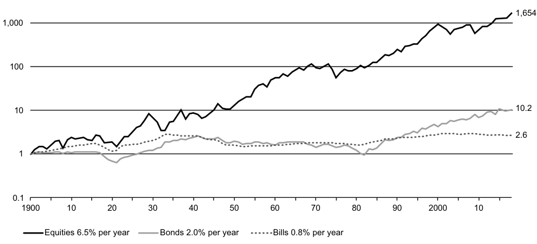
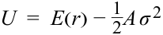
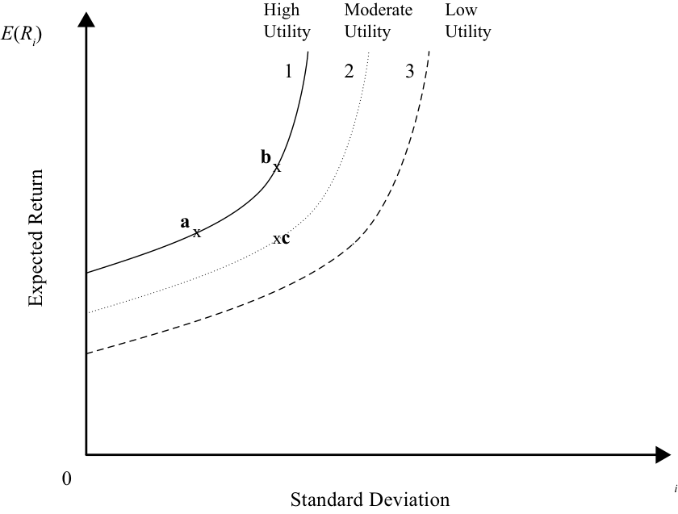

# Volume 9: Portfolio Management
## Learning Module 1 Portfolio Risk and Return: Part I
### Part 1/4: Introduction (PDF Pages 13–27)

---

<!-- PDF Page 13 -->

#### L E A R N I N G M O D U L E 

# **<mark>1</mark>** 

### **Portfolio Risk and Return: Part I** 

**by Vijay Singal, PhD, CFA.** 

_Vijay Singal, PhD, CFA, is at Virginia Tech (USA)._ 

###### **<mark>LEARNING OUTCOMES</mark>** 

|**_Mastery_**|**_The candidate should be able to:_**|
|---|---|
||describe characteristics of the major asset classes that investors consider in forming portfolios|
||explain risk aversion and its implications for portfolio selection|
||explain the selection of an optimal portfolio, given an investor’s utility (or risk aversion) and the capital allocation line|
||calculate and interpret the mean, variance, and covariance (or correlation) of asset returns based on historical data|
||calculate and interpret portfolio standard deviation|
||describe the effect on a portfolio’s risk of investing in assets that are less than perfectly correlated|
||describe and interpret the minimum-variance and efficient frontiers of risky assets and the global minimum-variance portfolio|

##### **INTRODUCTION** 

## **<mark>1</mark>** 

Construction of an optimal portfolio is an important objective for an investor. In this reading, we will explore the process of examining the risk and return characteristics of individual assets, creating all possible portfolios, selecting the most efficient portfolios, and ultimately choosing the optimal portfolio tailored to the individual in question. 

During the process of constructing the optimal portfolio, several factors and investment characteristics are considered. The most important of those factors are risk and return of the individual assets under consideration. Correlations among individual assets along with risk and return are important determinants of portfolio risk. Creating a portfolio for an investor requires an understanding of the risk profile of the investor. Although we will not discuss the process of determining risk aversion for individuals or institutional investors, it is necessary to obtain such information for making an 

<!-- PDF Page 14 -->

## **<mark>2</mark>** 

informed decision. In this reading, we will explain the broad types of investors and how their risk–return preferences can be formalized to select the optimal portfolio from among the infinite portfolios contained in the investment opportunity set. 

The reading is organized as follows: Sections 2–3 discuss the investment characteristics of assets. Sections 4–6 discuss risk aversion and how indifference curves, which incorporate individual preferences, can be constructed. The indifference curves are then applied to the selection of an optimal portfolio using two risky assets. Sections 7–9 provide an understanding and computation of portfolio risk. The role of correlation and diversification of portfolio risk are examined in detail. Sections 10–12 begins with the risky assets available to investors and constructs a large number of risky portfolios. It illustrates the process of narrowing the choices to an efficient set of risky portfolios before identifying the optimal risky portfolio. The risky portfolio is combined with investor risk preferences to generate the investor’s optimal portfolio. A summary concludes this reading. 

##### **HISTORICAL RETURN AND RISK** 

describe characteristics of the major asset classes that investors consider in forming portfolios 

Before examining historical data, it is useful to distinguish between the historical mean return and expected return, which are very different concepts but easy to confuse. Historical return is what was actually earned in the _past_ , whereas expected return is what an investor anticipates to earn in the _future_ . 

Expected return is the nominal return that would cause the marginal investor to invest in an asset based on the real risk-free interest rate ( _rrF_ ), expected inflation [ _E_ (π)], and expected risk premium for the risk of the asset [ _E_ ( _RP_ )]. The real risk-free interest rate is expected to be positive as compensation for postponing consumption. Similarly, the risk premium is expected to be positive in most cases.1 The expected inflation rate is generally positive, except when the economy is in a deflationary state and prices are falling. Thus, expected return is generally positive. The relationship between the expected return and the real risk-free interest rate, inflation rate, and risk premium can be expressed by the following equation: 

1 + _E_ ( _R_ ) = (1 + _rrF_ ) × [1 + _E_ (π)] × [1 + _E_ ( _RP_ )] 

The historical mean return for investment in a particular asset, however, is obtained from the actual return that was earned by an investor. Because the investment is risky, there is no guarantee that the actual return will be equal to the expected return. In fact, it is very unlikely that the two returns are equal for a specific time period being considered. Given a long enough period of time, we can _expect_ that the future (expected) return will equal the average historical return. Unfortunately, we do not know how long that period is—10 years, 50 years, or 100 years. As a practical matter, we often assume that the historical mean return is an adequate representation of the expected return, although this assumption may not be accurate. For example, Exhibit 1 shows that the historical equity returns in the last eight years (2010–2017) for large US company stocks were positive whereas the actual return was negative the prior decade, but nearly always positive historically. Nonetheless, longer-term returns 

> 1 There are exceptions when an asset reduces overall risk of a portfolio. We will consider those exceptions in Section 9. 

<!-- PDF Page 15 -->

(1926–2017) were positive and could be consistent with expected return. Though it is unknown if the historical mean returns accurately represent expected returns, it is an assumption that is commonly made. 

**Exhibit 1: Risk and Return for US Asset Classes by Decade (%)** 

|||**1930s**|**1940s**|**1950s**|**1960s**|**1970s**|**1980s**|**1990s**|**2000s**|**2010s***|**1926–** **2017**|
|---|---|---|---|---|---|---|---|---|---|---|---|
|Large com-|Return|−0.1|9.2|19.4|7.8|5.9|17.6|18.2|−1.0|13.9|10.2|
|pany stocks|Risk|41.6|17.5|14.1|13.1|17.2|19.4|15.9|16.3|13.6|19.8|
|Small com-|Return|1.4|20.7|16.9|15.5|11.5|15.8|15.1|6.3|14.8|12.1|
|pany stocks|Risk|78.6|34.5|14.4|21.5|30.8|22.5|20.2|26.1|19.4|31.7|
|Long-term|Return|6.9|2.7|1|1.7|6.2|13|8.4|7.7|8.3|6.1|
|corporate bonds|Risk|5.3|1.8|4.4|4.9|8.7|14.1|6.9|11.7|8.8|8.3|
|Long-term|Return|4.9|3.2|−0.1|1.4|5.5|12.6|8.8|7.7|6.8|5.5|
|government bonds|Risk|5.3|2.8|4.6|6|8.7|16|8.9|12.4|10.8|9.9|
|Treasury|Return|0.6|0.4|1.9|3.9|6.3|8.9|4.9|2.8|0.2|3.4|
|bills|Risk|0.2|0.1|0.2|0.4|0.6|0.9|0.4|0.6|0.1|3.1|
|Inflation|Return|−2.0|5.4|2.2|2.5|7.4|5.1|2.9|2.5|1.7|2.9|
|l|Risk|2.5|3.1|1.2|0.7|1.2|1.3|0.7|1.6|1.1|4.0|

_* Through 31 December 2017 Note:_ Returns are measured as annualized geometric mean returns. _Risk is measured by annualizing monthly standard deviations. Source:_ 2018 SBBI Yearbook (Exhibits 1.2,1.3, 2.3 and 6.2). 

Going forward, be sure to distinguish between expected return and historical mean return. We will alert the reader whenever historical returns are used to estimate expected returns. 

###### **Nominal Returns of Major US Asset Classes** 

We focus on three major asset categories in Exhibit 1: stocks, bonds, and T-bills. The mean nominal returns for US asset classes are reported decade by decade since the 1930s. The total for the 1926–2017 period is in the last column. All returns are annual geometric mean returns. Large company stocks had an overall annual return of 10.2 percent during the 92-year period. The return was negative in the 1930s and 2000s, and positive in all remaining decades. The 1950s and 1990s were the best decades for large company stocks. Small company stocks fared even better. The nominal return was never negative for any decade, and had double-digit growth in all decades except two, leading to an overall 92-year annual return of 12.1 percent. 

Long-term corporate bonds and long-term government bonds earned overall returns of 6.1 percent and 5.5 percent, respectively. The corporate bonds did not have a single negative decade, although government bonds recorded a negative return in the 1950s when stocks were doing extremely well. Bonds also had some excellent decades, earning double-digit returns in the 1980s and 2000s. 

Treasury bills (short-term government securities) did not earn a negative return in any decade. In fact, Treasury bills earned a negative return only in 1938 (–0.02 percent) when the inflation rate was –2.78 percent. Consistently positive returns for Treasury bills are not surprising because nominal interest rates are almost never 

<!-- PDF Page 16 -->

negative and the Treasury bills suffer from little interest rate or inflation risk. Since the Great Depression, there has been no deflation in any decade, although inflation rates were highly negative in 1930 (–6.03 percent), 1931 (–9.52 percent), and 1932 (–10.30 percent). Conversely, inflation rates were very high in the late 1970s and early 1980s, reaching 13.31 percent in 1979. Inflation rates have been largely range bound between 1 and 3 percent from 1991 to 2017. Overall, the inflation rate was 2.9 percent for the 92-year period. 

###### **Real Returns of Major US Asset Classes** 

Because annual inflation rates can vary greatly, from –10.30 percent to +13.31 percent in the last 92 years, comparisons across various time periods are difficult and misleading using nominal returns. Therefore, it is more effective to rely on real returns. Real returns on stocks, bonds, and T-bills are reported from 1900 in Exhibit 2 and Exhibit 3. 

**Exhibit 2: Cumulative Returns on US Asset Classes in Real Terms, 1900–2017** 

<!-- Start of picture text -->
1,654 1,000 100 10 10.2 2.6 1 0.10 1900 10 20 30 40 50 60 70 80 90 2000 10 Equities 6.5% per year Bonds 2.0% per year Bills 0.8% per year <!-- End of picture text -->

_Source_ : E. Dimson, P. Marsh, and M. Staunton, _Credit Suisse Global Investment Returns Yearbook 2018_ , Credit Suisse Research Institute (February 2018). This chart is updated annually and can be found at https:// www .credit -suisse .com/ media/ assets/ corporate/ docs/ about -us/ media/ media -release/ 2018/ 02/ giry -summary -2018 .pdf. 

Exhibit 2 shows that $1 would have grown to $1,654 if invested in stocks, to only $10.20 if invested in bonds, and to $2.60 if invested in T-bills. The difference in growth among the three asset categories is huge, although the difference in real returns does not seem that large: 6.5 percent per year for equities compared with 2.0 percent per year for bonds. This difference represents the effect of compounding over a 118-year period. 

Exhibit 3 reports real rates of return. As we discussed earlier and as shown in the table, geometric mean is never greater than the arithmetic mean. Our analysis of returns focuses on the geometric mean because it is a more accurate representation of returns for multiple holding periods than the arithmetic mean. We observe that the real returns for stocks are higher than the real returns for bonds. 

<!-- PDF Page 17 -->

**Exhibit 3: Real Returns and Risk Premiums for Asset Classes (1900–2017)** 

|||**Unit**|**ed State**|**s**||**World**||**World e**|**xcluding** **States**|**United**|
|---|---|---|---|---|---|---|---|---|---|---|
||**_Asset_**|**_GM_ (%)**|**_AM_** **(%)**|**_SD_** **(%)**|**_GM_ (%)**|**_AM_** **(%)**|**_SD_** **(%)**|**_GM_ (%)**|**_AM_** **(%)**|**_SD_ (%)**|
|**Real**|Equities|6.5|8.4|20.0|5.2|6.6|17.4|4.5|6.2|18.9|
|**Returns**|Bonds|2.0|2.5|10.4|2.0|2.5|11.0|1.7|2.7|14.4|
|**Premiums**|Equities vs. bonds|4.4|6.5|20.7|3.2|4.4|15.3|2.8|3.8|14.4|

_Note:_ All returns are in percent per annum measured in US$. GM = geometric mean, AM = arithmetic mean, SD = standard deviation. 

_“World” consists of 21 developed countries:_ Australia, Austria, Belgium, Canada, Denmark, Finland, France, Germany, Ireland, Italy, Japan, the Netherlands, New Zealand, Norway, Portugal, South Africa, Spain, Sweden, Switzerland, United Kingdom, and the United States. Weighting is by each country’s relative market capitalization size. See source for details of calculations. 

_Source:_ Credit Suisse Global Investment Returns Sourcebook, 2018. 

###### **Nominal and Real Returns of Asset Classes in Major Countries** 

Along with US returns, real returns of major asset classes for a 21-country world and the world excluding the United States are also presented in Exhibit 3. Equity returns are weighted by each country’s GDP before 1968 because of a lack of reliable market capitalization data. Returns are weighted by a country’s market capitalization beginning with 1968. Similarly, bond returns are defined by a 21-country bond index, except GDP is used to create the weights because equity market capitalization weighting is inappropriate for a bond index and bond market capitalizations were not readily available. 

The real geometric mean return for the world stock index over the last 117 years was 5.2 percent, and bonds had a real geometric mean return of 2.0 percent. The real geometric mean return for the world excluding the United States were 4.5 percent for stocks and 1.7 percent for bonds. For both stocks and bonds, the United States earned higher returns than the world excluding the United States. Similarly, real returns for stocks and bonds in the United States were higher than the real returns for rest of the world. 

###### **Risk of Major Asset Classes** 

Risk for major asset classes in the United States is reported for 1926–2017 in Exhibit 1, and the risk for major asset classes for the United States, the world, and the world excluding the United States are reported for 1900–2017 in Exhibit 3. Exhibit 1 shows that US small company stocks had the highest risk, 31.7 percent, followed by US large company stocks, 19.8 percent. Long-term government bonds and long-term corporate bonds had lower risk at 9.9 percent and 8.3 percent, with Treasury bills having the lowest risk at about 3.1 percent. 

Exhibit 3 shows that the risk for world stocks is 17.4 percent and for world bonds is 11.0 percent. The world excluding the United States has risks of 18.9 percent for stocks and 14.4 percent for bonds. The effect of diversification is apparent when world risk is compared with US risk and world excluding US risk. Although the risk of US stocks is 20.0 percent and the risk of world excluding US stocks is 18.9 percent, the combination gives a risk of only 17.4 percent for world stocks. 

<!-- PDF Page 18 -->

###### **Risk–Return Trade-off** 

The expression “risk–return trade-off” refers to the positive relationship between expected risk and return. In other words, a higher return is not possible to attain in **efficient markets** and over long periods of time without accepting higher risk. Expected returns should be greater for assets with greater risk. 

The historical data presented above show the risk–return trade-off. Exhibit 1 shows for the United States that small company stocks had higher risk and higher return than large company stocks. Large company stocks had higher returns and higher risk than both long-term corporate bonds and government bonds. Bonds had higher returns and higher risk than Treasury bills. Uncharacteristically, however, long-term government bonds had higher total risk than long-term corporate bonds, although the returns of corporate bonds were slightly higher. These factors do not mean that long-term government bonds had greater default risk, just that they were more variable than corporate bonds during this historic period. 

Exhibit 3 reveals that the risk and return for stocks were the highest of the asset classes, and the risk and return for bonds were lower than stocks for the United States, the world, and the world excluding the United States. 

Another way of looking at the risk–return trade-off is to focus on the **risk premium** , which is the extra return investors can expect for assuming additional risk, after accounting for the risk-free interest rate. The nominal risk premium is the nominal risky return minus the nominal risk-free rate (which includes both compensation for expected inflation and the real risk-free interest rate). The real risk premium is the real risky return minus the real risk-free rate. Worldwide equity risk premiums reported at the bottom of Exhibit 3 show that equities outperformed bonds. Investors in equities earned a higher return than investors in bonds because of the higher risk in equities. 

A more dramatic representation of the risk–return trade-off is shown in Exhibit 2, which shows the cumulative returns of US asset classes in real terms. The line representing T-bills is much less volatile than the other lines. Adjusted for inflation, the average real return on T-bills was 0.8 percent per year. The line representing bonds is more volatile than the line for T-bills but less volatile than the line representing stocks. The total return for equities including dividends and capital gains shows how $1 invested at the beginning of 1900 grows to $1,654, generating an annualized return of 6.5 percent in real terms. 

Over long periods of time, we observe that higher risk does result in higher mean returns. Thus, it is reasonable to claim that, over the long term, market prices reward higher risk with higher returns, which is a characteristic of a risk-averse investor, a topic that we discuss in Section 4. 

## **<mark>3</mark> OTHER INVESTMENT CHARACTERISTICS** 

describe characteristics of the major asset classes that investors consider in forming portfolios 

In evaluating investments using only the mean (expected return) and variance (risk), we are implicitly making two important assumptions: 1) that the returns are normally distributed and can be fully characterized by their means and variances and 2) that markets are not only informationally efficient but that they are also operationally efficient. To the extent that these assumptions are violated, we need to consider additional investment characteristics. These are discussed below. 

<!-- PDF Page 19 -->

###### **Distributional Characteristics** 

As explained in an earlier reading, a **normal distribution** has three main characteristics: its mean and median are equal; it is completely defined by two parameters, mean and variance; and it is symmetric around its mean with: 

- 68 percent of the observations within ±1σ of the mean, 

- 95 percent of the observations within ±2σ of the mean, and 

- 99 percent of the observations within ±3σ of the mean. 

Using only mean and variance would be appropriate to evaluate investments if returns were distributed normally. Returns, however, are not normally distributed; deviations from normality occur both because the returns are skewed, which means they are not symmetric around the mean, and because the probability of extreme events is significantly greater than what a normal distribution would suggest. The latter deviation is referred to as kurtosis or fat tails in a return distribution. The next sections discuss these deviations more in-depth. 

###### **Skewness** 

**Skewness** refers to asymmetry of the return distribution, that is, returns are not symmetric around the mean. A distribution is said to be left skewed or negatively skewed if most of the distribution is concentrated to the right, and right skewed or positively skewed if most is concentrated to the left. Exhibit 4 shows a typical representation of negative and positive skewness, whereas Exhibit 5 demonstrates the negative skewness of stock returns by plotting a histogram of US large company stock returns for 1926–2017. 

###### **Exhibit 4: Skewness** 

Distribution Skewed to the Right (Positively Skewed) Distribution Skewed to the Left (Negatively Skewed) 

_Source_ : Reprinted from _Fixed Income Readings for the Chartered Financial Analyst_ ® _Program._ Copyright CFA Institute. 

<!-- PDF Page 20 -->

<!-- Start of picture text -->
Exhibit 5: Histogram of US Large Company Stock Returns, 1926–2017 (Percent) <!-- End of picture text -->

<!-- Start of picture text -->
2016 2014 2012 2010 2015 2006 2017 2011 2004 2009 2013 2000 2007 1988 2003 1997 1990 2005 1986 1999 1995 1981 1994 1979 1998 1991 1977 1993 1972 1996 1989 1969 1992 1971 1983 1985 1962 1987 1968 1982 1980 1953 1984 1965 1976 1975 1946 1978 1964 1967 1955 2001 1940 1970 1959 1963 1950 1973 1939 1960 1952 1961 1945 2002 1966 1934 1956 1949 1951 1938 1958 2008 1974 1957 1932 1948 1944 1943 1936 1935 1954 1931 1937 1939 1941 1929 1947 1926 1942 1927 1928 1933 –60 –50 –40 –30 –20 –10 0 10 20 30 40 50 60 70 <!-- End of picture text -->

_Source_ : 2018 SBBI Yearbook (Appendix A1) 

###### **Kurtosis** 

**Kurtosis** refers to fat tails or higher than normal probabilities for extreme returns and has the effect of increasing an asset’s risk that is not captured in a mean–variance framework, as illustrated in Exhibit 6. Investors try to evaluate the effect of kurtosis by using such statistical techniques as value at risk (VaR) and conditional tail expectations.2 Several market participants note that the probability and the magnitude of extreme events is underappreciated and was a primary contributing factor to the financial crisis of 2008.3 The higher probability of extreme negative outcomes among stock returns can also be observed in Exhibit 5. 

> 2 Value at risk is a money measure of the minimum losses expected on a portfolio during a specified time period at a given level of probability. It is commonly used to measure the losses a portfolio can suffer under normal market conditions. For example, if a portfolio’s one-day 10 percent VaR is £200,000, it implies that there is a 10 percent probability that the value of the portfolio will decrease by more than £200,000 over a single one-day period (under normal market conditions). This probability implies that the portfolio will experience a loss of at least £200,000 on one out of every ten days. 

> 3 For example, see Bogle (2008) and Taleb (2007). 

<!-- PDF Page 21 -->

###### **Exhibit 6: Kurtosis** 

<!-- Start of picture text -->
Fat Tails Distribution Normal Distribution –5 –4 –3 –2 –1 0 1 2 3 4 5 Standard Deviations <!-- End of picture text -->

_Source_ : Reprinted from _Fixed Income Readings for the Chartered Financial Analyst® Program._ Copyright CFA Institute. 

###### **Market Characteristics** 

In the previous analysis, we implicitly assumed that markets are both informationally and operationally efficient. Although informational efficiency of markets is a topic beyond the purview of this reading, we should highlight certain operational limitations of the market that affect the choice of investments. One such limitation is **liquidity** . The cost of trading has three main components—brokerage commission, bid–ask spread, and price impact. Liquidity affects the latter two. Stocks with low liquidity can have wide bid–ask spreads. The bid–ask spread, which is the difference between the buying price and the selling price, is incurred as a cost of trading a security. The larger the bid–ask spread, the higher the cost of trading. If a $100 stock has a spread of 10 cents, the bid–ask spread is only 0.1 percent ($0.10/$100). On the other hand, if a $10 stock has a spread of 10 cents, the bid–ask spread is 1 percent. Clearly, the $10 stock is more expensive to trade and an investor will need to earn 0.9 percent extra to make up the higher cost of trading relative to the $100 stock. 

Liquidity also has implications for the price impact of trade. Price impact refers to how the price moves in response to an order in the market. Small orders usually have little impact, especially for liquid stocks. For example, an order to buy 100 shares of a $100 stock with a spread of 1 cent may have no effect on the price. On the other hand, an order to buy 100,000 shares may have a significant impact on the price as the buyer has to induce more and more stockholders to tender their shares. The extent of the price impact depends on the liquidity of the stock. A stock that trades millions of shares a day may be less affected than a stock that trades only a few hundred thousand shares a day. Investors, especially institutional investors managing large sums of money, must keep the liquidity of a stock in mind when making investment decisions. 

Liquidity is a bigger concern in emerging markets than in developed markets because of the smaller volume of trading in those markets. Similarly, liquidity is a more important concern in corporate bond markets and especially for bonds of lower 

<!-- PDF Page 22 -->

## **<mark>4</mark>** 

credit quality than in equity markets because an individual corporate bond issue may not trade for several days or weeks. This certainly became apparent during the global financial crisis. 

There are other market-related characteristics that affect investment decisions because they might instill greater confidence in the security or might affect the costs of doing business. These include analyst coverage, availability of information, firm size, etc. These characteristics about companies and financial markets are essential components of investment decision making. 

##### **RISK AVERSION AND PORTFOLIO SELECTION** 

explain risk aversion and its implications for portfolio selection 

As we have seen, stocks, bonds, and T-bills provide different levels of returns and have different levels of risk. Although investment in equities may be appropriate for one investor, another investor may not be inclined to accept the risk that accompanies a share of stock and may prefer to hold more cash. In the last section, we considered investment characteristics of assets in understanding their risk and return. In this section, we consider the characteristics of investors, both individual and institutional, in an attempt to pair the right kind of investors with the right kind of investments. 

First, we discuss risk aversion and utility theory. Later we discuss their implications for portfolio selection. 

###### **The Concept of Risk Aversion** 

The concept of **risk aversion** is related to the behavior of individuals under uncertainty. Assume that an individual is offered two alternatives: one where he will get £50 for sure and the other is a gamble with a 50 percent chance that he gets £100 and 50 percent chance that he gets nothing. The expected value in both cases is £50, one with certainty and the other with uncertainty. What will an investor choose? There are three possibilities: an investor chooses the gamble, the investor chooses £50 with certainty, or the investor is indifferent. Let us consider each in turn. However, please understand that this is only a representative example, and a single choice does not determine the risk aversion of an investor. 

###### **_Risk Seeking_** 

If an investor chooses the gamble, then the investor is said to be risk loving or risk seeking. The gamble has an uncertain outcome, but with the same expected value as the guaranteed outcome. Thus, an investor choosing the gamble means that the investor gets extra “utility” from the uncertainty associated with the gamble. How much is that extra utility worth? Would the investor be willing to accept a smaller expected value because he gets extra utility from risk? Indeed, risk seekers will accept less return because of the risk that accompanies the gamble. For example, a risk seeker may choose a gamble with an expected value of £45 in preference to a guaranteed outcome of £50. 

There is a little bit of gambling instinct in many of us. People buy lottery tickets although the expected value is less than the money they pay to buy it. Or people gamble at casinos with the full knowledge that the expected return is negative, a characteristic of risk seekers. These or any other isolated actions, however, cannot be taken at face value except for compulsive gamblers. 

<!-- PDF Page 23 -->

###### **_Risk Neutral_** 

If an investor is indifferent about the gamble or the guaranteed outcome, then the investor may be risk neutral. Risk neutrality means that the investor cares only about return and not about risk, so higher return investments are more desirable even if they come with higher risk. Many investors may exhibit characteristics of risk neutrality when the investment at stake is an insignificant part of their wealth. For example, a billionaire may be indifferent about choosing the gamble or a £50 guaranteed outcome. 

###### **_Risk Averse_** 

If an investor chooses the guaranteed outcome, he/she is said to be **risk averse** because the investor does not want to take the chance of not getting anything at all. Depending on the level of aversion to risk, an investor may be willing to accept a guaranteed outcome of £45 instead of a gamble with an expected value of £50. 

In general, investors are likely to shy away from risky investments for a lower, but guaranteed return. That is why they want to minimize their risk for the same amount of return, and maximize their return for the same amount of risk. The risk–return trade-off discussed earlier is an indicator of risk aversion. A risk-neutral investor would maximize return irrespective of risk and a risk-seeking investor would maximize both risk and return. 

Data presented in the last section illustrate the historically positive relationship between risk and return, which demonstrates that market prices were based on transactions and investments by risk-averse investors and reflect risk aversion. Therefore, for all practical purposes and for our future discussion, we will assume that the representative investor is a risk-averse investor. This assumption is the standard approach taken in the investment industry globally. 

###### **_Risk Tolerance_** 

**Risk tolerance** refers to the amount of risk an investor can tolerate to achieve an investment goal. The higher the risk tolerance, the greater is the willingness to take risk. Thus, risk tolerance is negatively related to risk aversion. 

##### **UTILITY THEORY AND INDIFFERENCE CURVES** 

**<mark>5</mark>** 

explain risk aversion and its implications for portfolio selection 

Continuing with our previous example, a risk-averse investor would rank the guaranteed outcome of £50 higher than the uncertain outcome with an expected value of £50. We can say that the utility that an investor or an individual derives from the guaranteed outcome of £50 is greater than the utility or satisfaction or happiness he/ she derives from the alternative. In general terms, utility is a measure of relative satisfaction from consumption of various goods and services or in the case of investments, the satisfaction that an investor derives from a portfolio. 

Because individuals are different in their preferences, all risk-averse individuals may not rank investment alternatives in the same manner. Consider the £50 gamble again. All risk-averse individuals will rank the guaranteed outcome of £50 higher than the gamble. What if the guaranteed outcome is only £40? Some risk-averse investors might consider £40 inadequate, others might accept it, and still others may now be indifferent about the uncertain £50 and the certain £40. 

<!-- PDF Page 24 -->

A simple implementation of utility theory allows us to quantify the rankings of investment choices using risk and return. There are several assumptions about individual behavior that we make in the definition of utility given in the equation below. We assume that investors are risk averse. They always prefer more to less (greater return to lesser return). They are able to rank different portfolios in the order of their preference and that the rankings are internally consistent. If an individual prefers X to Y and Y to Z, then he/she must prefer X to Z. This property implies that the indifference curves (see Exhibit 7) for the same individual can never touch or intersect. An example of a utility function is given below 

<!-- Formula Text: U  =  E(r) −  1 _ 2 A σ 2 -->

where, _U_ is the utility of an investment, _E(r)_ is the expected return, and σ2 is the variance of the investment. 

In the above equation, _A_ is a measure of risk aversion, which is measured as the marginal reward that an investor requires to accept additional risk. More risk-averse investors require greater compensation for accepting additional risk. Thus, _A_ is higher for more risk-averse individuals. As was mentioned previously, a risk-neutral investor would maximize return irrespective of risk and a risk-seeking investor would maximize both risk and return. 

We can draw several conclusions from the utility function. First, utility is unbounded on both sides. It can be highly positive or highly negative. Second, higher return contributes to higher utility. Third, higher variance reduces the utility but the reduction in utility gets amplified by the risk aversion coefficient, _A_ . Utility can always be increased, albeit marginally, by getting higher return or lower risk. Fourth, utility does not indicate or measure satisfaction itself—it can be useful only in ranking various investments. For example, a portfolio with a utility of 4 is not necessarily two times better than a portfolio with a utility of 2. The portfolio with a utility of 4 could increase our happiness 10 times or just marginally. But we do prefer a portfolio with a utility of 4 to a portfolio with a utility of 2. Utility cannot be compared among individuals or investors because it is a very personal concept. From a societal point of view, by the same argument, utility cannot be summed among individuals. 

Let us explore the utility function further. The risk aversion coefficient, _A_ , is greater than zero for a risk-averse investor. So any increase in risk reduces his/her utility. The risk aversion coefficient for a risk-neutral investor is 0, and changes in risk do not affect his/her utility. For a risk lover, the risk aversion coefficient is negative, creating an inverse situation so that additional risk contributes to an increase in his/her utility. Note that a risk-free asset (σ2 = 0) generates the same utility for all individuals. 

###### **Indifference Curves** 

An **indifference curve** plots the combinations of risk–return pairs that an investor would accept to maintain a given level of utility (i.e., the investor is indifferent about the combinations on any one curve because they would provide the same level of overall utility). Indifference curves are thus defined in terms of a trade-off between expected rate of return and variance of the rate of return. Because an infinite number of combinations of risk and return can generate the same utility for the same investor, indifference curves are continuous at all points. 

<!-- PDF Page 25 -->

**Exhibit 7: Indifference Curves for Risk-Averse Investors** 

<!-- Start of picture text -->
High Moderate Low E ( Ri ) Utility Utility Utility 1 2 3 b x a x x c 0 i Standard Deviation Expected Return <!-- End of picture text -->

A set of indifference curves is plotted in Exhibit 7. By definition, all points on any one of the three curves have the same utility. An investor does not care whether he/she is at Point **a** or Point **b** on indifference Curve 1. Point **a** has lower risk and lower return than Point **b** , but the utility of both points is the same because the higher return at Point **b** is offset by the higher risk. 

Like Curve 1, all points on Curve 2 have the same utility and an investor is indifferent about where he/she is on Curve 2. Now compare Point **c** with Point **b** . Point **c** has the same risk but significantly lower return than Point **b** , which means that the utility at Point **c** is less than the utility at Point **b** . Given that all points on Curve 1 have the same utility and all points on Curve 2 have the same utility and Point **b** has higher utility than Point **c** , Curve 1 has higher utility than Curve 2. Therefore, a risk-averse investor with indifference Curves 1 and 2 will prefer Curve 1 to Curve 2. The utility of a risk-averse investor always increases as you move northwest—higher return with lower risk. Because all investors prefer more utility to less, investors want to move northwest to the indifference curve with the highest utility. 

The indifference curve for risk-averse investors runs from the southwest to the northeast because of the risk–return trade-off. If risk increases (going east) then it must be compensated by higher return (going north) to generate the same utility. The indifference curves are convex because of diminishing marginal utility of return (or wealth). As risk increases, an investor needs greater return to compensate for higher risk at an increasing rate (i.e., the curve gets steeper). The upward-sloping convex indifference curve has a slope coefficient closely related to the risk aversion coefficient. The greater the slope, the higher is the risk aversion of the investor as a greater increment in return is required to accept a given increase in risk. 

Indifference curves for investors with different levels of risk aversion are plotted in Exhibit 8. The most risk-averse investor has an indifference curve with the greatest slope. As volatility increases, this investor demands increasingly higher returns to compensate for risk. The least risk-averse investor has an indifference curve with the least slope and so the demand for higher return as risk increases is not as acute as for the more risk-averse investor. The risk-loving investor’s indifference curve, however, exhibits a negative slope, implying that the risk-lover is happy to substitute risk for 

<!-- PDF Page 26 -->

return. For a risk lover, the utility increases both with higher risk and higher return. Finally, the indifference curves of risk-neutral investors are horizontal because the utility is invariant with risk. 

**Exhibit 8: Indifference Curves for Various Types of Investors** 

<!-- Start of picture text -->
High Risk Moderate Risk E ( Ri ) Aversion Aversion Low Risk 2 Aversion 1 3 Risk Neutral 4 5 Risk Lover 0 i Standard Deviation Expected Return <!-- End of picture text -->

In the remaining parts of this reading, all investors are assumed to be risk averse unless stated otherwise. 

###### **EXAMPLE 1** 

###### **Comparing a Gamble with a Guaranteed Outcome** 

Assume that you are given an investment with an expected return of 10 percent and a risk (standard deviation) of 20 percent, and your risk aversion coefficient is 3. 

1. What is your utility of this investment? 

###### **Solution:** 

   - _U_ = 0.10 − 0.5 × 3 × 0.202 = 0.04. 

2. What must be the minimum risk-free return you should earn to get the same utility? 

###### **Solution:** 

A risk-free return’s σ is zero, so the second term disappears. To get the same utility (0.04), the risk-free return must be at least 4 percent. Thus, in your mind, a risky return of 10 percent is equivalent to a risk-free return or a guaranteed outcome of 4 percent. 

<!-- PDF Page 27 -->

###### **EXAMPLE 2** 

###### **Computation of Utility** 

Based on investment information given below and the utility formula _U_ = _E_ ( _r_ ) − 0.5 _A_ σ2 , answer the following questions. Returns and standard deviations are both expressed as percent per year. When using the utility formula, however, returns and standard deviations must be expressed in decimals. 

|**Investment**|**Expected Return****_E_(****_r_)**|**Standard Deviation σ**|
|---|---|---|
|1|12%|30%|
|2|15|35|
|3|21|40|
|4|24|45|

1. Which investment will a risk-averse investor with a risk aversion coefficient of 4 choose, and which investment will a risk-averse investor with a risk aversion coefficient of 2 choose? 

###### **Solution:** 

The utility for risk-averse investors with _A_ = 4 and _A_ = 2 for each of the four investments are shown in the following table. Complete calculations for Investment 1 with _A_ = 4 are as follows: _U_ = 0.12 − 0.5 × 4 × 0.302 = –0.06. 

|**Investment**|**Expected** **Return****_E_(****_r_)**|**Standard** **Deviation σ**|**Utility****_A_ = 4**|**Utility****_A_ = 2**|
|---|---|---|---|---|
|1|12%|30%|−0.0600|0.0300|
|2|15|35|−0.0950|0.0275|
|3|21|40|−0.1100|0.0500|
|4|24|45|−0.1650|0.0375|

The risk-averse investor with a risk aversion coefficient of 4 should choose Investment 1. The risk-averse investor with a risk aversion coefficient of 2 should choose Investment 3. 

2. Which investment will a risk-neutral investor choose? 

###### **Solution:** 

A risk-neutral investor cares only about return. In other words, his risk aversion coefficient is 0. Therefore, a risk-neutral investor will choose Investment 4 because it has the highest return. 

3. Which investment will a risk-loving investor choose? 

###### **Solution:** 

A risk-loving investor likes both higher risk and higher return. In other words, his risk aversion coefficient is negative. Therefore, a risk-loving investor will choose Investment 4 because it has the highest return and highest risk among the four investments. 

