# Volume 9: Portfolio Management
## Learning Module 1 Portfolio Risk and Return: Part I
### Part 2/4: Application of Utility Theory to Portfolio Selection (PDF Pages 28–40)

---

<!-- PDF Page 28 -->

# **<mark>6</mark>** 

## **APPLICATION OF UTILITY THEORY TO PORTFOLIO SELECTION** 

explain risk aversion and its implications for portfolio selection explain the selection of an optimal portfolio, given an investor’s utility (or risk aversion) and the capital allocation line 

The simplest application of utility theory and risk aversion is to a portfolio of two assets, a risk-free asset and a risky asset. The risk-free asset has zero risk and a return of _Rf_ . The risky asset has a risk of σ _i_ (> 0) and an expected return of _E_ ( _Ri_ ). Because the risky asset has risk that is greater than that of the risk-free asset, the expected return from the risky asset will be greater than the return from the risk-free asset, that is, _E_ ( _Ri_ ) > _Rf_ . 

We can construct a portfolio of these two assets with a portfolio expected return, _E_ ( _Rp_ ), and portfolio risk, σ _p_ , based on the formulas provided below. In the equations given below, _w_ 1 is the weight in the risk-free asset and (1 − _w_ 1) is the weight in the risky asset. Because σ _f_ = 0 for the risk-free asset, the first and third terms in the formula for variance are zero leaving only the second term. We arrive at the last equation by taking the square root of both sides, which shows the expression for standard deviation for a portfolio of two assets when one asset is the risk-free asset: 

<!-- Formula Text: E(R p)  =  w 1 R f + (1 − w 1)E(R i) -->

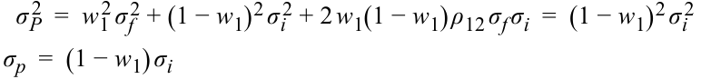

<!-- Formula Text: σ P 2   =  w 1 2 σ f 2 + (1 − w 1) 2 σ i 2 + 2 w 1(1 − w 1) ρ 12 σ f σ i  =  (1 − w 1) 2 σ i 2 σ p  =  (1 − w 1) σ i -->

The two-asset portfolio is drawn in Exhibit 9 by varying _w1_ from 0 percent to 100 percent. The portfolio standard deviation is on the horizontal axis and the portfolio return is on the vertical axis. If only these two assets are available in the economy and the risky asset represents the market, the line in Exhibit 9 is called the **capital allocation line** . The capital allocation line represents the portfolios available to an investor. The equation for this line can be derived from the above two equations by rewriting  σp_ the second equation as _w_ 1 = 1 − _σi_. Substituting the value of_w_ 1in the equation for expected return, we get the following equation for the capital allocation line: 

<!-- Formula Text: E(R p)  =  (1 − σ p _ σ i ) R f + σ p _ σ i E(R i) -->

This equation can be rewritten in a more usable form: 

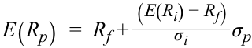

<!-- Formula Text: E(R p)  =  R f + (E(R i) − R f) _ σ i σ p -->

_( _E_ ( _Ri_ ) − _Rf_ ) The capital allocation line has an intercept of _Rf_ , and a slope of _σi_ , which is the additional required return for every increment in risk, and is sometimes referred to as the market price of risk. 

<!-- PDF Page 29 -->

**Exhibit 9: Capital Allocation Line with Two Assets** 

<!-- Start of picture text -->
E ( Rp ) E ( Ri ) x Rf 0 i p Portfolio Standard Deviation Expected Return <!-- End of picture text -->

Because the equation is linear, the plot of the capital allocation line is a straight line. The line begins with the risk-free asset as the leftmost point with zero risk and a risk-free return, _Rf_ . At that point, the portfolio consists of only the risk-free asset. If 100 percent is invested in the portfolio of all risky assets, however, we have a return of _E_ ( _Ri_ ) with a risk of σ _i_ . 

We can move further along the line in pursuit of higher returns by borrowing at the risk-free rate and investing the borrowed money in the portfolio of all risky assets. If 50 percent is borrowed at the risk-free rate, then _w1_ = –0.50 and 150 percent is placed in the risky asset, giving a return = 1.50 _E_ ( _Ri_ ) − 0.50 _Rf_ , which is > _E_ ( _Ri_ ) because _E_ ( _Ri_ ) > _Rf_ . 

The line plotted in Exhibit 9 is comprised of an unlimited number of risk–return pairs or portfolios. Which _one_ of these portfolios should be chosen by an investor? The answer lies in combining indifference curves from utility theory with the capital allocation line from portfolio theory. Utility theory gives us the utility function or the indifference curves for an individual, as in Exhibit 9, and the capital allocation line gives us the set of feasible investments. Overlaying each individual’s indifference curves on the capital allocation line will provide us with the optimal portfolio for that investor. Exhibit 10 illustrates this process of portfolio selection. 

<!-- PDF Page 30 -->

**Exhibit 10: Portfolio Selection** 

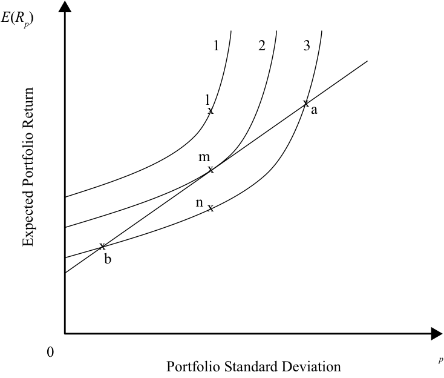

<!-- Start of picture text -->
E ( Rp ) 1 2 3 l x x a m x n x x b 0 Portfolio Standard Deviation p Expected Portfolio Return <!-- End of picture text -->

The capital allocation line consists of the set of feasible portfolios. Points under the capital allocation line may be attainable but are not preferred by any investor because the investor can get a higher return for the same risk by moving up to the capital allocation line. Points above the capital allocation line are desirable but not achievable with available assets. 

Three indifference curves for the same individual are also shown in Exhibit 10. Curve 1 is above the capital allocation line, Curve 2 is tangential to the line, and Curve 3 intersects the line at two points. Curve 1 has the highest utility and Curve 3 has the lowest utility. Because Curve 1 lies completely above the capital allocation line, points on Curve 1 are not achievable with the available assets on the capital allocation line. Curve 3 intersects the capital allocation line at two Points, **a** and **b** . The investor is able to invest at either Point **a** or **b** to derive the risk–return trade-off and utility associated with Curve 3. Comparing points with the same risk, observe that Point **n** on Curve 3 has the same risk as Point **m** on Curve 2, yet Point **m** has the higher expected return. Therefore, all investors will choose Curve 2 instead of Curve 3. Curve 2 is tangential to the capital allocation line at Point **m** . Point **m** is on the capital allocation line and investable. Point **m** and the utility associated with Curve 2 is the best that the investor can do because he/she cannot move to a higher utility indifference curve. Thus, we have been able to select the optimal portfolio for the investor with indifference Curves 1, 2, and 3. Point **m** , the optimal portfolio for one investor, may not be optimal for another investor. We can follow the same process, however, for finding the optimal portfolio for other investors: the optimal portfolio is the point of tangency between the capital allocation line and the indifference curve for that investor. In other words, the optimal portfolio maximizes the return per unit of risk (as it is on the capital allocation line), and it simultaneously supplies the investor with the most satisfaction (utility). 

As an illustration, Exhibit 11 shows two indifference curves for two different investors: Kelly with a risk aversion coefficient of 2 and Jane with a risk aversion coefficient of 4. The indifference curve for Kelly is to the right of the indifference curve for Jane because Kelly is less risk averse than Jane and can accept a higher amount of risk, i.e. has a higher tolerance for risk. Accordingly, their optimal portfolios are different: 

<!-- PDF Page 31 -->

Point **k** is the optimal portfolio for Kelly and Point **j** is the optimal portfolio for Jane. In addition, for the same return, the slope of Jane’s curve is higher than Kelly’s suggesting that Jane needs greater incremental return as compensation for accepting an additional amount of risk compared with Kelly. 

#### **Exhibit 11: Portfolio Selection for Two Investors with Various Levels of Risk Aversion** 

<!-- Start of picture text -->
E ( Rp ) Indifference Curves Capital Allocation Line A = 2 x k A = 4 x j 0 Portfolio Standard Deviation p Expected Portfolio Return <!-- End of picture text -->

## **PORTFOLIO RISK & PORTFOLIO OF TWO RISKY ASSETS** 

# **<mark>7</mark>** 

calculate and interpret the mean, variance, and covariance (or correlation) of asset returns based on historical data 

calculate and interpret portfolio standard deviation 

describe the effect on a portfolio’s risk of investing in assets that are less than perfectly correlated 

We have seen before that investors are risk averse and demand a higher return for a riskier investment. Therefore, ways of controlling portfolio risk without affecting return are valuable. As a precursor to managing risk, this section explains and analyzes the components of portfolio risk. In particular, it examines and describes how a portfolio consisting of assets with low correlations have the potential of reducing risk without necessarily reducing return. 

### **Portfolio of Two Risky Assets** 

The return and risk of a portfolio of two assets was introduced in Sections 2–3 of this reading. In this section, we briefly review the computation of return and extend the concept of portfolio risk and its components. 

<!-- PDF Page 32 -->

#### **_Portfolio Return_** 

When several individual assets are combined into a portfolio, we can compute the portfolio return as a weighted average of the returns in the portfolio. The portfolio return is simply a weighted average of the returns of the individual investments, or assets. If Asset 1 has a return of 20 percent and constitutes 25 percent of the portfolio’s investment, then the contribution to the portfolio return is 5 percent (= 25% of 20%). In general, if Asset _i_ has a return of _Ri_ and has a weight of _wi_ in the portfolio, then the portfolio return, _RP_ , is given as: 

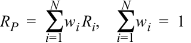

<!-- Formula Text: R P  =  ∑ i=1 N w i R i,    ∑ i=1 N w i  =  1 -->

Note that the weights must add up to 1 because the assets in a portfolio, including cash, must account for 100 percent of the investment. Also, note that these are single period returns, so there are no cash flows during the period and the weights remain constant. 

When two individual assets are combined in a portfolio, we can compute the portfolio return as a weighted average of the returns of the two assets. Consider Assets 1 and 2 with weights of 25 percent and 75 percent in a portfolio. If their returns are 20 percent and 5 percent, the weighted average return = (0.25 × 20%) + (0.75 × 5%) = 8.75%. More generally, the portfolio return can be written as below, where _Rp_ is return of the portfolio, _w_ 1 and _w_ 2 are the weights of the two assets, and _R_ 1, _R_ 2 are returns on the two assets: 

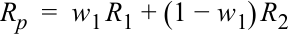

<!-- Formula Text: R p  =  w 1 R 1 + (1 − w 1) R 2 -->

#### **_Portfolio Risk_** 

Like a portfolio’s return, we can calculate a portfolio’s variance. Although the return of a portfolio is simply a weighted average of the returns of each security, this is not the case with the standard deviation of a portfolio (unless all securities are perfectly correlated—that is, correlation equals one). Variance can be expressed more generally for _N_ securities in a portfolio using the notation from the portfolio return calculation above: 

<!-- Formula Text: ∑ i=1 N w i  =  1 σ P 2   =  Var(R P)  =  Var(∑ i=1 N w i R i) -->

Note that the weights must add up to 1. The right side of the equation is the variance of the weighted average returns of individual securities. Weight is a constant, but the returns are variables whose variance is shown by Var( _Ri_ ). We can rewrite the equation as shown next. Because the covariance of an asset with itself is the variance of the asset, we can separate the variances from the covariances in the second equation: 

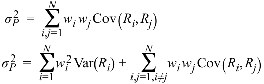

<!-- Formula Text: σ P 2   =   ∑ i,j=1 N w i w j Cov(R i, R j) σ P 2   =  ∑ i=1 N w i 2 Var(R i) +   ∑ i,j=1,i≠j N w i w j Cov(R i, R j) -->

Cov( _Ri_ , _Rj_ ) is the covariance of returns, _Ri_ and _Rj_ , and can be expressed as the product of the correlation between the two returns (ρ1,2) and the standard deviations of the two assets. Thus, Cov( _Ri_ , _Rj_ ) = ρ _ij_ σ _i_ σ _j_ . 

For a two asset portfolio, the expression for portfolio variance simplifies to the following using covariance and then using correlation: 

<!-- PDF Page 33 -->

<!-- Formula Text: σ P 2   =  w 1 2 σ 1 2 + w 2 2 σ 2 2 + 2 w 1 w 2 Cov(R 1, R 2) σ P 2   =  w 1 2 σ 1 2 + w 2 2 σ 2 2 + 2 w 1 w 2 ρ 12 σ 1 σ 2 -->

The standard deviation of a two asset portfolio is given by the square root of the portfolio’s variance: 

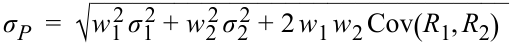

<!-- Formula Text: σ P  =  √ ______________________________ w 1 2 σ 1 2 + w 2 2 σ 2 2 + 2 w 1 w 2 Cov(R 1, R 2) -->

or, 

_σP_ =  √___________________________ w_ 12 _σ_ 12 + _w_ 22 _σ_ 22 + 2 _w_ 1 _w_ 2 _ρ_ 12 _σ_ 1 _σ_ 2 

#### **EXAMPLE 3** 

### **Return and Risk of a Two-Asset Portfolio** 

1. Assume that as a US investor, you decide to hold a portfolio with 80 percent invested in the S&P 500 US stock index and the remaining 20 percent in the MSCI Emerging Markets index. The expected return is 9.93 percent for the S&P 500 and 18.20 percent for the Emerging Markets index. The risk (standard deviation) is 16.21 percent for the S&P 500 and 33.11 percent for the Emerging Markets index. What will be the portfolio’s expected return and risk given that the covariance between the S&P 500 and the Emerging Markets index is 0.5 percent or 0.0050? Note that units for covariance and variance are written as %2 when not expressed as a fraction. These are units of measure like squared feet and the numbers themselves are not actually squared. 

**Solution:** 

Portfolio return, _RP_ = _w_ 1 _R_ 1 + (1 − _w_ 1), _R_ 2 = (0.80 × 0.0993) + (0.20 × 0.1820) = 0.1158 = 11.58%. 

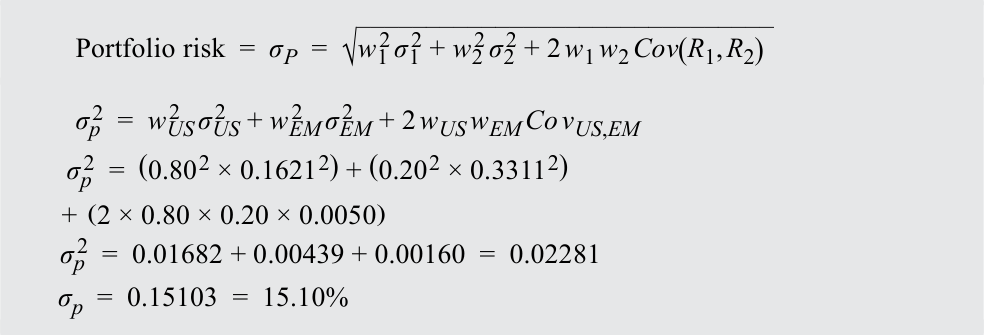

<!-- Formula Text: Portfolio risk  =  σ P  =  √ ______________________________ w 1 2 σ 1 2 + w 2 2 σ 2 2 + 2 w 1 w 2 Cov(R 1, R 2) σ p 2  =  w US 2   σ US 2   + w EM 2   σ EM 2   + 2 w US w EM Co v US,EM σ p 2  =  (0.80 2 × 0.1621 2) + (0.20 2 × 0.3311 2) +  (2 × 0.80 × 0.20 × 0.0050) σ p 2  =  0.01682 + 0.00439 + 0.00160  =  0.02281 σ p  =  0.15103  =  15.10% -->

The portfolio’s expected return is 11.58 percent and the portfolio’s risk is 15.10 percent. Look at this example closely. It shows that we can take the portfolio of a US investor invested only in the S&P 500, combine it with a _riskier_ portfolio consisting of emerging markets securities, and the return of the US investor increases from 9.93 percent to 11.58 percent while the risk of the portfolio actually falls from 16.21 percent to 15.10 percent. Exhibit 12 depicts how the combination of the two assets results in a superior risk–return trade-off. Not only does the investor get a higher return, but he also gets it at a lower risk. That is the power of diversification as you will see later in this reading. 

<!-- PDF Page 34 -->

#### **Exhibit 12: Combination of Two Assets** 

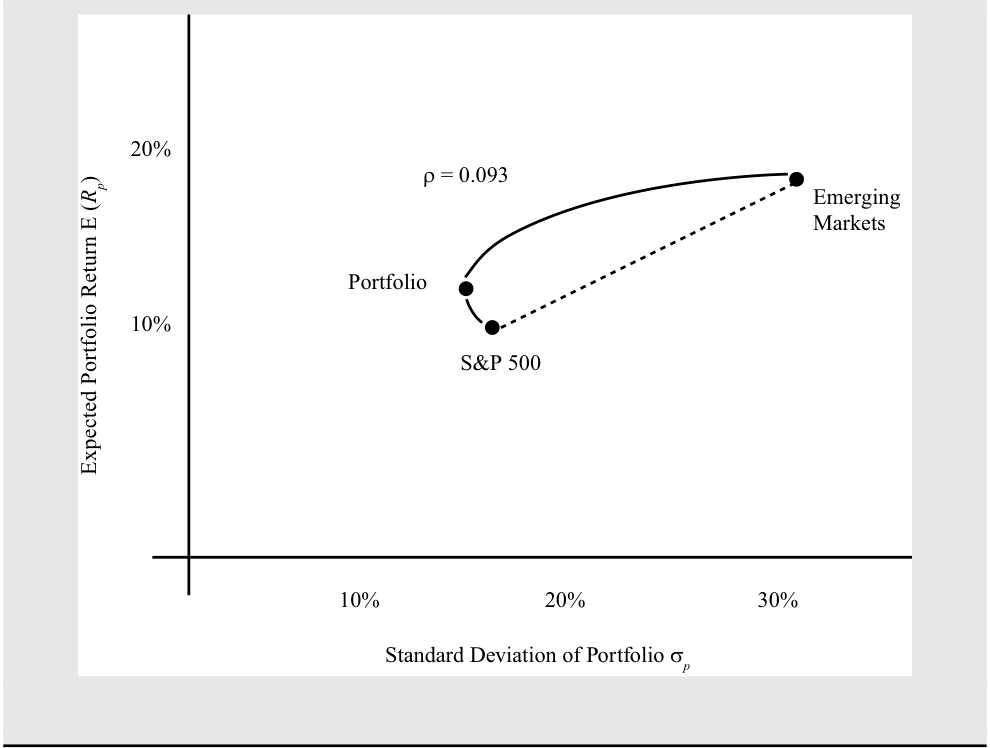

<!-- Start of picture text -->
20% ρ = 0.093 Emerging Markets Portfolio 10% S&P 500 10% 20% 30% Standard Deviation of Portfolio σ p Expected Portfolio Return E () R p <!-- End of picture text -->

#### **_Covariance and Correlation_** 

The **covariance** in the formula for portfolio standard deviation can be expanded as Cov( _R_ 1, _R_ 2) = ρ12σ1σ2 where ρ12 is the correlation between returns, _R_ 1, _R_ 2. Although covariance is important, it is difficult to interpret because it is unbounded on both sides. It is easier to understand the **correlation coefficient** (ρ12), which is bounded but provides similar information. 

Correlation is a measure of the consistency or tendency for two investments to act in a similar way. The correlation coefficient, ρ12, can be positive or negative and ranges from –1 to +1. Consider three different values of the correlation coefficient: 

- ρ12 = +1: Returns of the two assets are perfectly _positively_ correlated. Assets 1 and 2 move together 100 percent of the time. 

- ρ12 = –1: Returns of the two assets are perfectly _negatively_ correlated. Assets 1 and 2 move in opposite directions 100 percent of the time. 

- ρ12 = 0: Returns of the two assets are _uncorrelated_ . Movement of Asset 1 provides no prediction regarding the movement of Asset 2. 

The correlation coefficient between two assets determines the effect on portfolio risk when the two assets are combined. To see how this works, consider two different values of ρ12. You will find that portfolio risk is unaffected when the two assets are perfectly correlated (ρ12 = +1). In other words, the portfolio’s standard deviation is simply a weighted average of the standard deviations of the two assets and as such a portfolio’s risk is unchanged with the addition of assets with the same risk parameters. Portfolio risk falls, however, when the two assets are not perfectly correlated (ρ12 < +1). Sufficiently low values of the correlation coefficient can make the portfolio riskless under certain conditions. 

<!-- PDF Page 35 -->

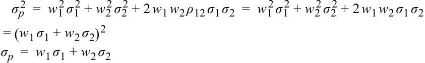

<!-- Formula Text: σ p 2  =  w 1 2 σ 1 2 + w 2 2 σ 2 2 + 2 w 1 w 2 ρ 12 σ 1 σ 2  =  w 1 2 σ 1 2 + w 2 2 σ 2 2 + 2 w 1 w 2 σ 1 σ 2 = (w 1 σ 1 + w 2 σ 2) 2 σ p  =  w 1 σ 1 + w 2 σ 2 -->

The first set of terms on the right side of the first equation contain the usual terms for portfolio variance. Because the correlation coefficient is equal to +1, the right side can be rewritten as a perfect square. The third row shows that portfolio risk is a weighted average of the risks of the individual assets’ risks. We showed earlier that the portfolio return is a weighted average of the assets’ returns. Because both risk and return are just weighted averages of the two assets in the portfolio there is no reduction in risk when ρ12 = +1. 

#### **Now let ρ12 < +1** 

The above analysis showed that portfolio risk is a weighted average of asset risks when ρ12 = + 1. When ρ12 < +1, the portfolio risk is less than the weighted average of the individual assets’ risks. 

To show this, we begin by reproducing the general formula for portfolio risk, which is expressed by the terms to the left of the “<” sign below. The term to the right of “<” shows the portfolio risk when ρ12 = + 1: 

<!-- Formula Text: σ p  =  √ ____________________________ w 1 2 σ 1 2 + w 2 2 σ 2 2 + 2 w 1 w 2 ρ 12 σ 1 σ 2   <  √ _________________________ w 1 2 σ 1 2 + w 2 2 σ 2 2 + 2 w 1 w 2 σ 1 σ 2 = (w 1 σ 1 + w 2 σ 2) σ p  <  (w 1 σ 1 + w 2 σ 2) -->

The left side is smaller than the right side because the correlation coefficient on the left side for the new portfolio is <1. Thus, the portfolio risk is less than the weighted average of risks while the portfolio return is still a weighted average of returns. 

As you can see, we have achieved diversification by combining two assets that are not perfectly correlated. For an extreme case in which ρ12 = –1 (that is, the two asset returns move in opposite directions), the portfolio can be made risk free. 

#### **EXAMPLE 4** 

### **Effect of Correlation on Portfolio Risk** 

Two stocks have the same return and risk (standard deviation): 10 percent return with 20 percent risk. You form a portfolio with 50 percent each of Stock 1 and Stock 2 to examine the effect of correlation on risk. 

1. Calculate the portfolio return and risk if the correlation is 1.0. 

**Solution:** 

_R_ 1 = _R_ 2 = 10 %  = 0.10; _σ_ 1 = _σ_ 2 = 20 %  = 0.20; _w_ 1 = _w_ 2 = 50% = 0.50. Case 1: _ρ_ 12 = + 1 _Rp_ = _w_ 1 _R_ 1 + _w_ 2 _R_ 2 _Rp_ =( 0.5 × 0.1) +( 0.5 × 0.1) = 0.10 = 10% _σp_2 = _w_ 12 _σ_ 12 + _w_ 22 _σ_ 22 + 2 _w_ 1 _w_ 2 _σ_ 1 _σ_ 2 _ρ_ 12 _σp_2 =( 0.52 ×  0.22) +( 0.52 ×  0.22) +( 2 × 0.5 × 0.5 × 0.2 × 0.2 × 1) = 0.04 _σp_ =  √_ 0.04 = 0.20 = 20% 

This equation demonstrates the earlier point that with a correlation of 1.0 the risk of the portfolio is the same as the risk of the individual assets. 

<!-- PDF Page 36 -->

2. Calculate the portfolio return and risk if the correlation is 0.0. **Solution:** _ρ_ 12 = 0 _Rp_ = _w_ 1 _R_ 1 + _w_ 2 _R_ 2 = 0.10 = 10% _σp_2 = _w_ 12 _σ_ 12 + _w_ 22 _σ_ 22 + 2 _w_ 1 _w_ 2 _σ_ 1 _σ_ 2 _ρ_ 12 _σp_2 =( 0.52 ×  0.22) +( 0.52 ×  0.22) +( 2 × 0.5 × 0.5 × 0.2 × 0.2 × 0) = 0.02 _σp_ =  √_ 0.02 = 0.14 = 14% 

This equation demonstrates the earlier point that, when assets have correlations of less than 1.0, they can be combined in a portfolio that has less risk than either of the assets individually. 

3. Calculate the portfolio return and risk if the correlation is –1.0. **Solution:** 

_ρ_ 12 = − 1 _Rp_ = _w_ 1 _R_ 1 + _w_ 2 _R_ 2 = 0.10 = 10% _σp_2 = _w_ 12 _σ_ 12 + _w_ 22 _σ_ 22 + 2 _w_ 1 _w_ 2 _σ_ 1 _σ_ 2 _ρ_ 12 _σp_2 =( 0.52 ×  0.22) +( 0.52 ×  0.22) +( 2 × 0.5 × 0.5 × 0.2 × 0.2 × − 1) = 0 _σp_ = 0% 

This equation demonstrates the earlier point that, if the correlation of assets is low enough, in this case 100 percent negative correlation or –1.00 (exactly inversely related), a portfolio can be designed that eliminates risk. The individual assets retain their risk characteristics, but the portfolio is risk free. 

4. Compare the return and risk of portfolios with different correlations. **Solution:** 

The expected return is 10 percent in all three cases; however, the returns will be more volatile in Case 1 and least volatile in Case 3. In the first case, there is no diversification of risk (same risk as before of 20 percent) and the return remains the same. In the second case, with a correlation coefficient of 0, we have achieved diversification of risk (risk is now 14 percent instead of 20 percent), again with the same return. In the third case with a correlation coefficient of –1, the portfolio is risk free, although we continue to get the same return of 10 percent. This example shows the power of diversification that we expand on further in Section 9. 

#### **_Relationship between Portfolio Risk and Return_** 

The previous example illustrated the effect of correlation on portfolio risk while keeping the weights in the two assets equal and unchanged. In this section, we consider how portfolio risk and return vary with different portfolio weights and different correlations. 

Asset 1 has an annual return of 7 percent and annualized risk of 12 percent, whereas Asset 2 has an annual return of 15 percent and annualized risk of 25 percent. The relationship is tabulated in Exhibit 13 for the two assets and graphically represented in Exhibit 14. 

<!-- PDF Page 37 -->

**Exhibit 13: Relationship between Risk and Return** 

|**Weight in**|**Portfolio**|**P**|**ortfolio Risk w**|**ith Correlation**|**of**|
|---|---|---|---|---|---|
|**Asset 1 (%)**|**Return**|**1.0**|**0.5**|**0.2**|**−1.0**|
|0|15.0|25.0|25.0|25.0|25.0|
|10|14.2|23.7|23.1|22.8|21.3|
|20|13.4|22.4|21.3|20.6|17.6|
|30|12.6|21.1|19.6|18.6|13.9|
|40|11.8|19.8|17.9|16.6|10.2|
|50|11.0|18.5|16.3|14.9|6.5|
|60|10.2|17.2|15.0|13.4|2.8|
|70|9.4|15.9|13.8|12.3|0.9|
|80|8.6|14.6|12.9|11.7|4.6|
|90|7.8|13.3|12.2|11.6|8.3|
|100|7.0|12.0|12.0|12.0|12.0|

**Exhibit 14: Relationship between Risk and Return** 

<!-- Start of picture text -->
 = .2 14  = –1  = 1 11  = .5 8 5 10 15 20 25 Standard Deviation of Portfolio p Expected Portfolio Return () ER p <!-- End of picture text -->

The table shows the portfolio return and risk for four correlation coefficients ranging from +1.0 to –1.0 and 11 weights ranging from 0 percent to 100 percent. The portfolio return and risk are 15 percent and 25 percent, respectively, when 0 percent is invested in Asset 1, versus 7 percent and 12 percent when 100 percent is invested in Asset 1. The portfolio return varies with weights but is unaffected by the correlation coefficient. 

Portfolio risk becomes smaller with each successive decrease in the correlation coefficient, with the smallest risk when ρ12 = –1. The graph in Exhibit 14 shows that the risk–return relationship is a straight line when ρ12 = +1. As the correlation 

<!-- PDF Page 38 -->

falls, the risk becomes smaller and smaller as in the table. The curvilinear nature of a portfolio of assets is recognizable in all investment opportunity sets (except at the extremes where ρ12 = –1 or +1). 

#### **EXAMPLE 5** 

### **Portfolio of Two Assets** 

Assume you are a UK investor holding a portfolio invested 60% in UK large-capitalization equities (as proxied by the FTSE 100 Index) and 40% in local medium-duration Treasury bonds (“gilts”). The expected return on the FTSE 100 is 5.5% and on the medium-duration gilts it is 0.7%. The risk (standard deviation of returns) is 13.2% and 4.2%, respectively. The correlation between the two assets is –0.01. 

The expected return of this portfolio is 

_Rp_ = _w_ 1 × _R_ 1 + (1 – _w_ 1) × _R_ 2 = 0.6 × 0.055 + 0.4 × 0.007 = 0.0358 ≈ 3.6%. The risk of this portfolio is 

<!-- Formula Text: σ p  =  √ __________________________________ w 1 2 σ 1 2   +   w 2 2 σ 2 2 + 2 × w 1 w 2 × ρ × σ 1 σ 2 . σ p= √ ____________________________________________________________ (0.6 2 × 0.132 2) + (0.4 2 × 0.042 2) + 2 × 0.6 × 0.4 × − 0.01 × 0.132 × 0.042 . -->

σ _p_ = 0.0808 ≈ 8.1% 

You notice that compared with US Treasury bonds, the expected return on gilts is lower and the risk of gilts is higher. US Treasury bonds have an expected return for a US-based investor of 1.5% and a risk of 4.0%. You wonder whether replacing the gilts in your portfolio with US Treasury bonds (“Treasuries”) would improve the risk and return profile of your portfolio. 

1. Do the given risk and return assumptions for US Treasury bonds allow you as a UK-based investor to calculate the expected return and risk of your portfolio with US Treasury bonds replacing UK gilts? 

#### **Solution:** 

No. The expected return and risk for Treasuries apply to a US investor, who invests in US dollars. To calculate expected return and risk in sterling for a UK-based portfolio of FTSE 100 equities and US Treasuries, one needs to take into account the exchange rate between the US dollar and UK pound sterling. This exchange rate has a volatility (risk) of its own, and a return expectation for the GBP/USD exchange rate has to be specified. For the purpose of calculating the return and risk of a foreign asset in a domestic investor’s portfolio, the foreign asset can be seen as a “portfolio” of two assets. The return of a foreign asset in domestic (i.e., non-foreign) currency can be decomposed into a local currency return component and an exchange rate component: 

_RD_ = (1 + _Rlc_ ) × (1 + _RFX_ ) – 1 

Because the portfolio is fully exposed to the movement in both the asset’s value in local currency and the currency exchange rate, the foreign currency and the asset each have a 100% portfolio weight. Note that the exchange rate must be specified as domestic currency/foreign currency to convert the foreign currency return into the investor’s domestic currency. The risk can be calculated as follows: 

<!-- PDF Page 39 -->

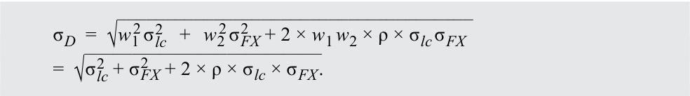

<!-- Formula Text: σ D  =  √ _____________________________________ w 1 2 σ lc 2    +   w 2 2 σ FX 2   + 2 × w 1 w 2 × ρ × σ lc σ FX =  √ _________________________ σ lc 2  + σ FX 2   + 2 × ρ × σ lc × σ FX . -->

Assume in what follows that the risk (measured as expected standard deviation) of the GBP/USD currency exchange rate is 9.0% and the returns on Treasuries have a correlation with the GBP/USD exchange rate of 0.33. Assume also that you have no forecast for the future value of the USD/GBP exchange rate, and hence assume a 0% return. 

2. What would be the expected risk of US Treasuries to you as a UK investor? **Solution:** 

<!-- Formula Text: σ D  =    √ _________________________ σ lc 2  + σ FX 2   + 2 × ρ × σ lc × σ FX =  √ ____________________________________ 0.040 2 + 0.090 2 + 2 × 0.33 × 0.040 + 0.090 . -->

σ _D_ = 0.110 = 11.0%. 

The correlations between the FTSE 100, US Treasuries, and the USD/GBP exchange rate are as depicted in the following correlation matrix. 

||**FTSE 100**|**US Treasuries**|**GBP/USD**|
|---|---|---|---|
|FTSE 100|1.00|–0.32|–0.06|
|US Treasuries|–0.32|1.00|0.33|
|GBP/USD|–0.06|0.33|1.00|

3. What would be the expected return and risk for your portfolio if you replace the UK gilts with US Treasuries? 

   - **Solution:** 

The expected return is the weighted average of the expected returns in British pound sterling (GBP) of UK large-capitalization equities and of US Treasuries. Recall that the return of a foreign asset in domestic currency consists of a foreign currency component and an asset component. All expected returns can be found above. 

_Rp_ = _w_ 1 × _R_ 1 + (1 – _w_ 1) × [(1 + _Rlc_ ) × (1 + _RFX_ ) – 1]. 

_Rp_ = 0.6 × 0.055 + 0.4 × [(1 + 0.015) × (1 + 0.0) – 1] = 0.039 = 3.9%. 

Calculation of the risk of the portfolio involves a slightly more complicated formula. Recall that the risk of a two-asset portfolio depends on the risk and the weights of the individual assets and the co-movements between the two. For a three-asset portfolio (an equity portion, a foreign fixed-income portion, and the associated foreign currency exposure), the calculation is essentially the same, however there are three pairs of co-movements between assets, rather than one. 

The formula for the standard deviation of a three-asset portfolio is therefore 

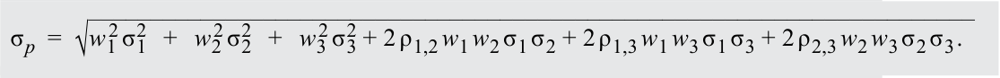

<!-- Formula Text: σ p  =  √ _______________________________________________________________________ w 1 2 σ 1 2   +   w 2 2 σ 2 2   +   w 3 2 σ 3 2 + 2 ρ 1,2 w 1 w 2 σ 1 σ 2 + 2 ρ 1,3 w 1 w 3 σ 1 σ 3 + 2 ρ 2,3 w 2 w 3 σ 2 σ 3 . -->

The portfolio weight of the foreign currency exposure is equal to the portfolio weight of the US Treasuries. Using the information provided above, we can calculate the risk of the portfolio with UK large-capitalization equities and US Treasuries as follows: 

<!-- PDF Page 40 -->

σ _p_ = (0.62 × 0.1322 + 0.42 × 0.0402 + 0.42 × 0.0902 + 2 × –0.32 × 0.6 × 0.4 × 0.132 × 0.040 + 2 × –0.06 × 0.6 × 0.4 × 0.132 × 0.090 + 2 × 0.33 × 0.4 × 0.4 × 0.040 × 0.090)1⁄2 . 

σ _p_ = 0.0841 ≈ 8.4%. 

Compared to the UK equity/gilt portfolio, the UK equity/US Treasury portfolio has a higher expected return, because the UK gilts were replaced with an asset with superior return expectations. The risk of the new portfolio, however, is slightly higher despite the lower risk in local currency terms of US Treasuries compared to gilts. Owning US Treasuries as a non-US investor means being exposed to exchange rate risk, which should be considered when evaluating the risk profile. 

# **<mark>8</mark> PORTFOLIO OF MANY RISKY ASSETS** 

calculate and interpret portfolio standard deviation describe the effect on a portfolio’s risk of investing in assets that are less than perfectly correlated 

In the previous section, we discussed how the correlation between two assets can affect the risk of a portfolio and the smaller the correlation the lower is the risk. The above analysis can be extended to a portfolio with many risky assets ( _N_ ). Recall the previous equations for portfolio return and variance: 

<!-- Formula Text: E(R p)  =  ∑ i=1 N w i E(R i),    σ P 2   =  (∑ i=1 N w i 2 σ i 2 +   ∑ i,j=1,i≠j N w i w jCov(i, j)),  ∑ i=1 N w i  =  1 -->

To examine how a portfolio with many risky assets works and the ways in which we can reduce the risk of a portfolio, assume that the portfolio has equal weights (1/ _N_ ) for all _N_ assets. In addition, assume that _σ__2 and  ‾Cov are the average variance and average covariance. Given equal weights and average variance/covariance, we can rewrite the portfolio variance as below (intermediate steps are omitted to focus on the main result): 

<!-- Formula Text: σ P 2   =  (∑ i=1 N w i 2 σ i 2 +   ∑ i,j=1,i≠j N w i w jCov(i, j)) σ P 2   =    _ σ  2 _ N  +  (N − 1) _ N  ‾ Cov -->

The equation in the second line shows that as _N_ becomes large, the first term on the right side with the denominator of _N_ becomes smaller and smaller, implying that the contribution of one asset’s variance to portfolio variance gradually becomes negligible. The second term, however, approaches the average covariance as _N_ increases. It is reasonable to say that for portfolios with a large number of assets, covariance among the assets accounts for almost all of the portfolio’s risk. 

### **Importance of Correlation in a Portfolio of Many Assets** 

The analysis becomes more instructive and interesting if we assume that all assets in the portfolio have the same variance and the same correlation among assets. In that case, the portfolio risk can then be rewritten as: 

