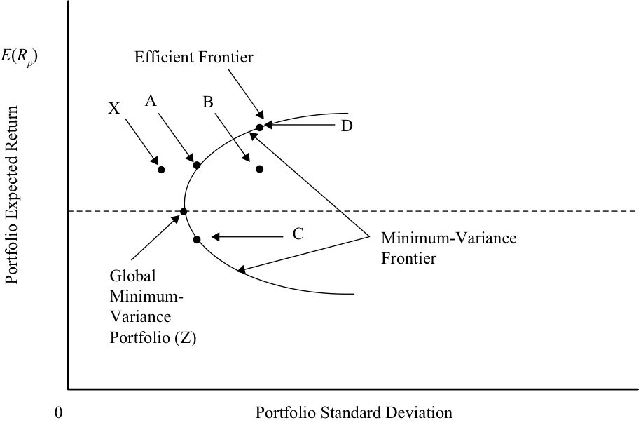
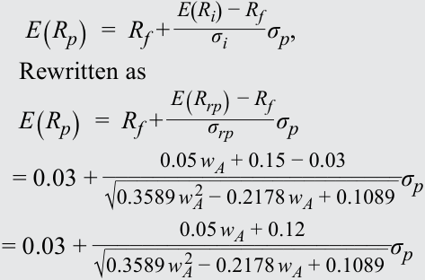

# Volume 9: Portfolio Management
## Learning Module 1 Portfolio Risk and Return: Part I
### Part 3/4: The Power of Diversification (PDF Pages 41–56)

---

<!-- PDF Page 41 -->

<!-- Formula Text: σ p  =  √ _____________ σ 2 _ N  +  (N − 1) _ N  ρ σ 2 -->

The first term under the root sign becomes negligible as the number of assets in the portfolio increases leaving the second term (correlation) as the main determining factor for portfolio risk. If the assets are unrelated to one another, the portfolio can have close to zero risk. In the next section, we review these concepts to learn how portfolios can be diversified. 

## **THE POWER OF DIVERSIFICATION** 

<!-- Start of picture text -->
9 <!-- End of picture text -->

describe characteristics of the major asset classes that investors consider in forming portfolios 

describe the effect on a portfolio’s risk of investing in assets that are less than perfectly correlated 

Diversification is one of the most important and powerful concepts in investments. Because investors are risk averse, they are interested in reducing risk preferably without reducing return. In other cases, investors may accept a lower return if it will reduce the chance of catastrophic losses. In previous sections of this reading, you learned the importance of correlation and covariance in managing risk. This section applies those concepts to explore ways for risk diversification. We begin with a simple but intuitive example. 

#### **EXAMPLE 6** 

### **Diversification with Rain and Shine** 

Assume a company Beachwear rents beach equipment. The annual return from the company’s operations is 20 percent in years with many sunny days but falls to 0 percent in rainy years with few sunny days. The probabilities of a sunny year and a rainy year are equal at 50 percent. Thus, the average return is 10 percent, with a 50 percent chance of 20 percent return and a 50 percent chance of 0 percent return. Because Beachwear can earn a return of 20 percent or 0 percent, its average return of 10 percent is risky. 

You are excited about investing in Beachwear but do not like the risk. Having heard about diversification, you decide to add another business to the portfolio to reduce your investment risk. 

- There is a snack shop on the beach that sells all the healthy food you like. You estimate that the annual return from the Snackshop is also 20 percent in years with many sunny days and 0 percent in other years. As with the Beachwear shop, the average return is 10 percent. 

You decide to invest 50 percent each in Snackshop and Beachwear. The average return is still 10 percent, with 50 percent of 10 percent from Snackshop and 50 percent of 10 percent from Beachwear. In a sunny year, you would earn 20 percent (= 50% of 20% from Beachwear + 50% of 20% from Snackshop). In a rainy year, you would earn 0 percent (=50% of 0% from Beachwear + 50% of 0% from Snackshop). The results are tabulated in Exhibit 15. 

<!-- PDF Page 42 -->

#### **Exhibit 15** 

|**Type**|**Company**|**Percent** **Invested**|**Return** **in** **Sunny** **Year** **(%)**|**Return** **in** **Rainy** **Year** **(%)**|**Average** **Return** **(%)**|
|---|---|---|---|---|---|
|Single stock|Beachwear|100|20|0|10|
|Single stock|Snackshop|100|20|0|10|
|Portfolio of two|Beachwear|50|20|0|10|
|stocks|Snackshop|50|20|0|10|
||Total|100|20|0|10|

These results seem counterintuitive. You thought that by adding another business you would be able to diversify and reduce your risk, but the risk is exactly the same as before. What went wrong? Note that both businesses do well when it is sunny and both businesses do poorly when it rains. The correlation between the two businesses is +1.0. No reduction in risk occurs when the correlation is +1.0. 

- To reduce risk, you must consider a business that does well in a rainy year. You find a company that rents DVDs. DVDrental company is similar to the Beachwear company, except that its annual return is 20 percent in a rainy year and 0 percent in a sunny year, with an average return of 10 percent. DVDrental’s 10 percent return is also risky just like Beachwear’s return. 

If you invest 50 percent each in DVDrental and Beachwear, then the average return is still 10 percent, with 50 percent of 10 percent from DVDrental and 50 percent of 10 percent from Beachwear. In a sunny year, you would earn 10 percent (= 50% of 20% from Beachwear + 50% of 0% from DVDrental). In a rainy year also, you would earn 10 percent (=50% of 0% from Beachwear + 50% of 20% from DVDrental). You have no risk because you earn 10 percent in both sunny and rainy years. Thus, by adding DVDrental to Beachwear, you have reduced (eliminated) your risk without affecting your return. The results are tabulated in Exhibit 16. 

#### **Exhibit 16** 

|**Type**|**Company**|**Percent** **Invested**|**Return** **in** **Sunny** **Year** **(%)**|**Return** **in** **Rainy** **Year** **(%)**|**Average** **Return** **(%)**|
|---|---|---|---|---|---|
|Single stock|Beachwear|100|20|0|10|
|Single stock|DVDrental|100|0|20|10|
|Portfolio of two|Beachwear|50|20|0|10|
|stocks|DVDrental|50|0|20|10|
||Total|100|10|10|10|

<!-- PDF Page 43 -->

In this case, the two businesses have a correlation of –1.0. When two businesses with a correlation of –1.0 are combined, risk can always be reduced to zero. 

### **Correlation and Risk Diversification** 

Correlation is the key in diversification of risk. Notice that the returns from Beachwear and DVDrental always go in the opposite direction. If one of them does well, the other does not. Therefore, adding assets that do not behave like other assets in your portfolio is good and can reduce risk. The two companies in the above example have a correlation of –1.0. 

Even when we expand the portfolio to many assets, correlation among assets remains the primary determinant of portfolio risk. Lower correlations are associated with lower risk. Unfortunately, most assets have high positive correlations. The challenge in diversifying risk is to find assets that have a correlation that is much lower than +1.0. 

### **Historical Risk and Correlation** 

When we previously discussed asset returns, we were careful to distinguish between historical or past returns and expected or future returns because historical returns may not be a good indicator of future returns. Returns may be highly positive in one period and highly negative in another period depending on the risk of that asset. Exhibit 1 showed that returns for large US company stocks were high in the 1990s but were very low in the 2000s. 

Risk for an asset class, however, does not usually change dramatically from one period to the next. Stocks have been risky even in periods of low returns. T-bills are always less risky even when they earn high returns. From Exhibit 1, we can see that risk has typically not varied much from one decade to the next, except that risk for bonds has been much higher in recent decades when compared with earlier decades. Therefore, it is not unreasonable to assume that historical risk can work as a good proxy for future risk. 

As with risk, correlations are quite stable among assets of the same country. Intercountry correlations, however, have been on the rise in the last few decades as a result of globalization and the liberalization of many economies. A correlation above 0.90 is considered high because the assets do not provide much opportunity for diversification of risk Low correlations—generally less than 0.50—are desirable for portfolio diversification. 

### **Historical Correlation among Asset Classes** 

Correlations among major US asset classes and international stocks are reported in Exhibit 17 for 1970–2017. The highest correlation is between US large company stocks and US small company stocks at about 70 percent, whereas the correlation between US large company stocks and international stocks is approximately 66 percent. Although these are the highest correlations, they still provide diversification benefits because the correlations are less than 100 percent. The correlation between international stocks and US small company stocks is lower, at 50 percent. The lowest correlations 

<!-- PDF Page 44 -->

are between stocks and bonds, with some correlations being negative, such as that between US small company stocks and US long-term government bonds. Similarly, the correlation between T-bills and stocks is close to zero.4 

**Exhibit 17: Correlation Among US Assets and International Stocks (1970–2017)** 

|**Series**|**International** **Stocks**|**US Large** **Company** **Stocks**|**US Small** **Company** **Stocks**|**US Long-Term** **Corporate** **Bonds**|**US Long-** **Term Trea-** **sury Bonds**|**US** **T-Bills**|**US** **Inflation**|
|---|---|---|---|---|---|---|---|
|International stocks|1.00|||||||
|US large company stocks|0.66|1.00||||||
|US small company stocks|0.50|0.72|1.00|||||
|US long-term corporate bonds|0.02|0.23|0.06|1.00||||
|US long-term Treasury bonds|−0.13|0.01|−0.15|0.89|1.00|||
|US T-bills l|0.01|0.04|0.02|0.05|0.09|1.00||
|US inflation|−0.06|−0.11|0.04|−0.32|−0.26|0.69|1.00|

_Source:_ 2018 SBBI Yearbook (Exhibit 12.13). 

The low correlations between stocks and bonds are attractive for portfolio diversification. Similarly, including international securities in a portfolio can also control portfolio risk. It is not surprising that most diversified portfolios of investors contain domestic stocks, domestic bonds, foreign stocks, foreign bonds, real estate, cash, and other asset classes. 

### **Avenues for Diversification** 

The reason for diversification is simple. By constructing a portfolio with assets that do not move together, you create a portfolio that reduces the ups and downs in the short term but continues to grow steadily in the long term. Diversification thus makes a portfolio more resilient to gyrations in financial markets. 

We describe a number of approaches for diversification, some of which have been discussed previously and some of which might seem too obvious. Diversification, however, is such an important part of investing that it cannot be emphasized enough, especially when we continue to meet and see many investors who are not properly diversified. 

- _Diversify with asset classes._ Correlations among major asset classes5 are not usually high, as can be observed from the few US asset classes listed in Exhibit 17. Correlations for other asset classes and other countries are also typically low, which provides investors the opportunity to benefit from diversifying among many asset classes to achieve the biggest benefit from diversification. A partial list of asset classes includes domestic large caps, domestic small caps, growth stocks, value stocks, domestic corporate bonds, long-term domestic government bonds, domestic Treasury bills (cash), 

> 4 In any short period, T-bills are riskless and uncorrelated with other asset classes. For example, a 3-month US Treasury bill is redeemable at its face value upon maturity irrespective of what happens to other assets. When we consider multiple periods, however, returns on T-bills may be related to other asset classes because short-term interest rates vary depending on the strength of the economy and outlook for inflation. 

> 5 Major asset classes are distinguished from sub-classes, such as US value stocks and US growth stocks. 

<!-- PDF Page 45 -->

emerging market stocks, emerging market bonds, developed market stocks (i.e., developed markets excluding domestic market), developed market bonds, real estate, and gold and other commodities. In addition, industries and sectors are used to diversify portfolios. For example, energy stocks may not be well correlated with health care stocks. The exact proportions in which these assets should be included in a portfolio depend on the risk, return, and correlation characteristics of each and the home country of the investor. 

- _Diversify with index funds._ Diversifying among asset classes can become costly for small portfolios because of the number of securities required. For example, creating diversified exposure to a single category, such as a domestic large company asset class, may require a group of at least 30 stocks. Exposure to 10 asset classes may require 300 securities, which can be expensive to trade and track. Instead, it may be effective to use exchange-traded funds or mutual funds that track the respective indexes, which could bring down the costs associated with building a well-diversified portfolio. Therefore, many investors should consider index mutual funds as an investment vehicle as opposed to individual securities. 

- _Diversification among countries._ Countries are different because of industry focus, economic policy, and political climate. The US economy produces many financial and technical services and invests a significant amount in innovative research. The Chinese and Indian economies, however, are focused on manufacturing. Countries in the European Union are vibrant democracies whereas East Asian countries are experimenting with democracy. Thus, financial returns in one country over time are not likely to be highly correlated with returns in another country. Country returns may also be different because of different currencies. In other words, the return on a foreign investment may be different when translated to the home country’s currency. Because currency returns are uncorrelated with stock returns, they may help reduce the risk of investing in a foreign country even when that country, in isolation, is a very risky emerging market from an equity investment point of view. Investment in foreign countries is an essential part of a well-diversified portfolio. 

- _Diversify by_ not _owning your employer’s stock._ Companies encourage their employees to invest in company stock through employee stock plans and retirement plans. You should evaluate investing in your company, however, just as you would evaluate any other investment. In addition, you should consider the nonfinancial investments that you have made, especially the human capital you have invested in your company. Because you work for your employer, you are already heavily invested in it—your earnings depend on your employer. The level of your earnings, whether your compensation improves or whether you get a promotion, depends on how well your employer performs. If a competitor drives your employer out of the market, you will be out of a job. Additional investments in your employer will concentrate your wealth in one asset even more so and make you less diversified. 

- _Evaluate each asset before adding to a portfolio._ Every time you add a security or an asset class to the portfolio, recognize that there is a cost associated with diversification. There is a cost of trading an asset as well as the cost of tracking a larger portfolio. In some cases, the securities or assets may have different names but belong to an asset class in which you already have 

<!-- PDF Page 46 -->

sufficient exposure. A general rule to evaluate whether a new asset should be included to an existing portfolio is based on the following risk–return trade-off relationship: 

<!-- Formula Text: E(R new)  =  R f + σ new ρ new,p _ σ p × [E(R p) − R f] -->

where _E(R)_ is the return from the asset, _Rf_ is the return on the risk-free asset, σ is the standard deviation, ρ is the correlation coefficient, and the subscripts _new_ and _p_ refer to the new stock and existing portfolio. If the new asset’s risk-adjusted return benefits the portfolio, then the asset should be included. The condition can be rewritten using the Sharpe ratio on both sides of the equation as: 

<!-- Formula Text: E(R new) − R f _ σ new > E(R p) − R f _ σ p × ρ new,p -->

If the Sharpe ratio of the new asset is greater than the Sharpe ratio of the current portfolio times the correlation coefficient, it is beneficial to add the new asset. 

> ■ _Buy insurance for risky portfolios._ It may come as a surprise, but insurance is an investment asset—just a different kind of asset. Insurance has a negative correlation with your assets and is thus very valuable. Insurance gives you a positive return when your assets lose value, but pays nothing if your assets maintain their value. Over time, insurance generates a negative average return. Many individuals, however, are willing to accept a small negative return because insurance reduces their exposure to an extreme loss. In general, it is reasonable to add an investment with a negative return if that investment significantly reduces risk (an example of a classic case of the risk–return trade-off). 

Alternatively, investments with negative correlations also exist. Historically, gold has a negative correlation with stocks; however, the expected return is usually small and sometimes even negative. Investors often include gold and other commodities in their portfolios as a way of reducing their overall portfolio risk, including currency risk and inflation risk. 

Buying put options is another way of reducing risk. Because put options pay when the underlying asset falls in value (negative correlation), they can protect an investor’s portfolio against catastrophic losses. Of course, put options cost money, and the expected return is zero or marginally negative. 

# **<mark>10</mark>** 

## **EFFICIENT FRONTIER: INVESTMENT OPPORTUNITY SET & MINIMUM VARIANCE PORTFOLIOS** 

describe the effect on a portfolio’s risk of investing in assets that are less than perfectly correlated describe and interpret the minimum-variance and efficient frontiers of risky assets and the global minimum-variance portfolio 

<!-- PDF Page 47 -->

In this section, we formalize the effect of diversification and expand the set of investments to include all available risky assets in a mean–variance framework. The addition of a risk-free asset generates an optimal risky portfolio and the capital allocation line. We can then derive an investor’s optimal portfolio by overlaying the capital allocation line with the indifference curves of investors. 

### **Investment Opportunity Set** 

If two assets are perfectly correlated, the risk–return opportunity set is represented by a straight line connecting those two assets. The line contains portfolios formed by changing the weight of each asset invested in the portfolio. This correlation was depicted by the straight line (with ρ = 1) in Exhibit 14. If the two assets are not perfectly correlated, the portfolio’s risk is less than the weighted average risk of the components, and the portfolio formed from the two assets bulges on the left as shown by curves with the correlation coefficient (ρ) less than 1.0 in Exhibit 14. All of the points connecting the two assets are achievable (or feasible). The addition of new assets to this portfolio creates more and more portfolios that are either a linear combination of the existing portfolio and the new asset or a curvilinear combination, depending on the correlation between the existing portfolio and the new asset. 

As the number of available assets increases, the number of possible combinations increases rapidly. When all investable assets are considered, and there are hundreds and thousands of them, we can construct an opportunity set of investments. The opportunity set will ordinarily span all points within a frontier because it is also possible to reach every possible point within that curve by judiciously creating a portfolio from the investable assets. 

We begin with individual investable assets and gradually form portfolios that can be plotted to form a curve as shown in Exhibit 18. All points on the curve and points to the right of the curve are attainable by a combination of one or more of the investable assets. This set of points is called the investment opportunity set. Initially, the opportunity set consists of domestic assets only and is labeled as such in Exhibit 18. 

#### **Exhibit 18: Investment Opportunity Set** 

<!-- Start of picture text -->
E ( Rp ) With international assets Domestic assets only Individual Assets 0 Portfolio Standard Deviation Portfolio Expected Return <!-- End of picture text -->

<!-- PDF Page 48 -->

#### **_Addition of Asset Classes_** 

Exhibit 18 shows the effect of adding a new asset class, such as international assets. As long as the new asset class is not perfectly correlated with the existing asset class, the investment opportunity set will expand out further to the northwest, providing a superior risk–return trade-off. 

The investment opportunity set with international assets dominates the opportunity set that includes only domestic assets. Adding other asset classes will have the same impact on the opportunity set. Thus, we should continue to add asset classes until they do not further improve the risk–return trade-off. The benefits of diversification can be fully captured in this way in the construction of the investment opportunity set, and eventually in the selection of the optimal portfolio. 

In the discussion that follows in this section, we will assume that _all_ investable assets available to an investor are included in the investment opportunity set and no special attention needs to be paid to new asset classes or new investment opportunities. 

### **Minimum-Variance Portfolios** 

The investment opportunity set consisting of all available investable sets is shown in Exhibit 19. There are a large number of portfolios available for investment, but we must choose a single optimal portfolio. In this subsection, we begin the selection process by narrowing the choice to fewer portfolios. 

#### **Exhibit 19: Minimum-Variance Frontier** 

<!-- Start of picture text -->
E ( Rp ) Efficient Frontier A B X D C Minimum-Variance Frontier Global Minimum- Variance Portfolio (Z) 0 Portfolio Standard Deviation Portfolio Expected Return <!-- End of picture text -->

#### **_Minimum-Variance Frontier_** 

Risk-averse investors seek to minimize risk for a given return. Consider Points A, B, and X in Exhibit 19 and assume that they are on the same horizontal line by construction. Thus, the three points have the same expected return, _E_ ( _R_ 1), as do all other points on the imaginary line connecting A, B, and X. Given a choice, an investor will choose the point with the minimum risk, which is Point X. Point X, however, is unattainable because it does not lie within the investment opportunity set. Thus, the minimum risk 

<!-- PDF Page 49 -->

that we can attain for _E_ ( _R_ 1) is at Point A. Point B and all points to the right of Point A are feasible but they have higher risk. Therefore, a risk-averse investor will choose only Point A in preference to any other portfolio with the same return. 

Similarly, Point C is the minimum variance point for the return earned at C. Points to the right of C have higher risk. We can extend the above analysis to all possible returns. In all cases, we find that the **minimum-variance portfolio** is the one that lies on the solid curve drawn in Exhibit 19. The entire collection of these minimum-variance portfolios is referred to as the minimum-variance frontier. The minimum-variance frontier defines the smaller set of portfolios in which investors would want to invest. Note that no risk-averse investor will choose to invest in a portfolio to the right of the minimum-variance frontier because a portfolio on the minimum-variance frontier can give the same return but at a lower risk. 

#### **_Global Minimum-Variance Portfolio_** 

The left-most point on the minimum-variance frontier is the portfolio with the minimum variance among all portfolios of risky assets, and is referred to as the **global minimum-variance portfolio** . An investor cannot hold a portfolio consisting of _risky_ assets that has less risk than that of the global minimum-variance portfolio. Note the emphasis on “risky” assets. Later, the introduction of a risk-free asset will allow us to relax this constraint. 

#### **_Efficient Frontier of Risky Assets_** 

The minimum-variance frontier gives us portfolios with the minimum variance for a given return. However, investors also want to maximize return for a given risk. Observe Points A and C on the minimum-variance frontier shown in Exhibit 19. Both of them have the same risk. Given a choice, an investor will choose Portfolio A because it has a higher return. No one will choose Portfolio C. The same analysis applies to all points on the minimum-variance frontier that lie below the global minimum-variance portfolio. Thus, portfolios on the curve below the global minimum-variance portfolio and to the right of the global minimum-variance portfolio are not beneficial and are inefficient portfolios for an investor. 

The curve that lies above and to the right of the global minimum-variance portfolio is referred to as the **Markowitz efficient frontier** because it contains all portfolios of risky assets that rational, risk-averse investors will choose. 

An important observation that is often ignored is the slope at various points on the efficient frontier. As we move right from the global minimum-variance portfolio (Point Z) in Exhibit 19, there is an increase in risk with a concurrent increase in return. The increase in return with every unit increase in risk, however, keeps decreasing as we move from left to the right because the slope continues to decrease. The slope at Point D is less than the slope at Point A, which is less than the slope at Point Z. The increase in return by moving from Point Z to Point A is the same as the increase in return by moving from Point A to Point D. It can be seen that the additional risk in moving from Point A to Point D is 3 to 4 times more than the additional risk in moving from Point Z to Point A. Thus, investors obtain decreasing increases in returns as they assume more risk. 

<!-- PDF Page 50 -->

# **<mark>11</mark>** 

## **EFFICIENT FRONTIER: A RISK-FREE ASSET AND MANY RISKY ASSETS** 

explain the selection of an optimal portfolio, given an investor’s utility (or risk aversion) and the capital allocation line 

Until now, we have only considered risky assets in which the return is risky or uncertain. Most investors, however, have access to a risk-free asset, most notably from securities issued by the government. The addition of a risk-free asset makes the investment opportunity set much richer than the investment opportunity set consisting only of risky assets. 

### **Capital Allocation Line and Optimal Risky Portfolio** 

By definition, a risk-free asset has zero risk so it must lie on the _y_ -axis in a mean-variance graph. A risk-free asset with a return of _Rf_ is plotted in Exhibit 20. This asset can now be combined with a portfolio of risky assets. The combination of a risk-free asset with a portfolio of risky assets is a straight line, such as in Section 6 (see Exhibit 9). Unlike in Section 6, however, we have many risky portfolios to choose from instead of a single risky portfolio. 

**Exhibit 20: Optimal Risky Portfolio** 

<!-- Start of picture text -->
CAL(P) Y Efficient Frontier X CAL(A) of Risky Assets P Optimal Risky A Portfolio Rf Portfolio Standard Deviation p () ER p <!-- End of picture text -->

All portfolios on the efficient frontier are candidates for being combined with the risk-free asset. Two combinations are shown in Exhibit 20: one between the risk-free asset and efficient Portfolio A and the other between the risk-free asset and efficient Portfolio P. Comparing capital allocation line A and capital allocation line P reveals that there is a point on CAL(P) with a higher return and same risk for each point on CAL(A). In other words, the portfolios on CAL(P) dominate the portfolios on CAL(A). Therefore, an investor will choose CAL(P) over CAL(A). We would like to move further northwest to achieve even better portfolios. None of those portfolios, however, is attainable because they are above the efficient frontier. 

<!-- PDF Page 51 -->

What about other points on the efficient frontier? For example, Point X is on the efficient frontier and has the highest return of all risky portfolios for its risk. However, Point Y on CAL(P), achievable by leveraging Portfolio P as seen in Section 6, lies above Point X and has the same risk but higher return. In the same way, we can observe that not only does CAL(P) dominate CAL(A) but it also dominates the Markowitz efficient frontier of risky assets. 

CAL(P) is the optimal capital allocation line and Portfolio P is the optimal risky portfolio. Thus, with the addition of the risk-free asset, we are able to narrow our selection of risky portfolios to a single optimal risky portfolio, P, which is at the tangent of CAL(P) and the efficient frontier of risky assets. 

### **The Two-Fund Separation Theorem** 

The **two-fund separation theorem** states that all investors regardless of taste, risk preferences, and initial wealth will hold a combination of two portfolios or funds: a risk-free asset and an optimal portfolio of risky assets.6 

The separation theorem allows us to divide an investor’s investment problem into two distinct steps: the investment decision and the financing decision. In the first step, as in the previous analysis, the investor identifies the optimal risky portfolio. The optimal risky portfolio is selected from numerous risky portfolios without considering the investor’s preferences. The investment decision at this step is based on the optimal risky portfolio’s (a single portfolio) return, risk, and correlations. 

The capital allocation line connects the optimal risky portfolio and the risk-free asset. All optimal investor portfolios must be on this line. Each investor’s optimal portfolio on the CAL(P) is determined in the second step. Considering each individual investor’s risk preference, using indifference curves, determines the investor’s allocation to the risk-free asset (lending) and to the optimal risky portfolio. Portfolios beyond the optimal risky portfolio are obtained by borrowing at the risk-free rate (i.e., buying on margin). Therefore, the individual investor’s risk preference determines the amount of financing (i.e., lending to the government instead of investing in the optimal risky portfolio or borrowing to purchase additional amounts of the optimal risky portfolio). 

#### **EXAMPLE 7** 

### **Choosing the Right Portfolio** 

In Exhibit 21, the risk and return of the points marked are as follows: 

|**Point**|**Return (%)**|**Risk (%)**|**Point (%)**|**Return (%)**|**Risk (%)**|
|---|---|---|---|---|---|
|A|15|10|B|11|10|
|C|15|30|D|25|30|
|F|4|0|G (gold)|10|30|
|P|16|17||||

<!-- PDF Page 52 -->

<!-- Start of picture text -->
Exhibit 21 25.00 D Optimal CAL 20.00 P Stocks C A 15.00 G 10.00 B Gold 5.00 F 0.00 0 10 20 30 40 Standard Deviation (%) Expected Return (%) <!-- End of picture text -->

Answer the following questions with reference to the points plotted on Exhibit 21 and explain your answers. The investor is choosing one portfolio based on the graph. 

1. Which of the above points is not achievable? 

#### **Solution:** 

Portfolio A is not attainable because it lies outside the feasible set and not on the capital allocation line. 

2. Which of these portfolios will not be chosen by a rational, risk-averse investor? 

#### **Solution:** 

Portfolios G and C will not be chosen because D provides higher return for the same risk. G and C are the only investable points that do not lie on the capital allocation line. 

3. Which of these portfolios is most suitable for a risk-neutral investor? 

#### **Solution:** 

Portfolio D is most suitable because a risk-neutral investor cares only about return and portfolio D provides the highest return. A = 0 in the utility formula. 

4. Gold is on the inefficient part of the feasible set. Nonetheless, gold is owned by many rational investors as part of a larger portfolio. Why? 

#### **Solution:** 

Gold may be owned as part of a portfolio (not as _the_ portfolio) because gold has low or negative correlation with many risky assets, such as stocks. Being part of a portfolio can thus reduce overall risk even though its standalone risk is high and return is low. Note that gold’s price is not stable—its return is very risky (30 percent). Even risk seekers will choose D over G, which has the same risk but higher return. 

<!-- PDF Page 53 -->

5. What is the utility of an investor at point P with a risk aversion coefficient of 3? 

**Solution:** 

- U = _E_ ( _r_ ) − 0.5Aσ2 = 0.16 − 0.5 × 3 × 0.0289 = 0.1167 = 11.67%. 

## **EFFICIENT FRONTIER: OPTIMAL INVESTOR PORTFOLIO** 

# **<mark>12</mark>** 

explain the selection of an optimal portfolio, given an investor’s utility (or risk aversion) and the capital allocation line 

The CAL(P) in Exhibit 22 contains the best possible portfolios available to investors. Each of those portfolios is a linear combination of the risk-free asset and the optimal risky portfolio. Among the available portfolios, the selection of each investor’s optimal portfolio depends on the risk preferences of an investor. In Sections 4–6, we discussed that the individual investor’s risk preferences are incorporated into their indifference curves. These can be used to select the optimal portfolio. 

Exhibit 22 shows an indifference curve that is tangent to the capital allocation line, CAL(P). Indifference curves with higher utility than this one lie above the capital allocation line, so their portfolios are not achievable. Indifference curves that lie below this one are not preferred because they have lower utility. Thus, the optimal portfolio for the investor with this indifference curve is portfolio C on CAL(P), which is tangent to the indifference curve. 

#### **Exhibit 22: Optimal Investor Portfolio** 

<!-- Start of picture text -->
CAL(P) E ( Rp ) Indifference curve Efficient frontier of risky assets C P A Optimal risky portfolio Rf Optimal investor portfolio 0 Standard Deviation (%) σ p Expected Return (%) <!-- End of picture text -->

<!-- PDF Page 54 -->

#### **EXAMPLE 8** 

### **Comprehensive Example on Portfolio Selection** 

This comprehensive example reviews many concepts learned in this reading. The example begins with simple information about available assets and builds an optimal investor portfolio for the Lohrmanns. 

Suppose the Lohrmanns can invest in only two risky assets, A and B. The expected return and standard deviation for asset A are 20 percent and 50 percent, and the expected return and standard deviation for asset B are 15 percent and 33 percent. The two assets have zero correlation with one another. 

1. Calculate portfolio expected return and portfolio risk (standard deviation) if an investor invests 10 percent in A and the remaining 90 percent in B. 

#### **Solution:** 

The subscript “ _rp_ ” means risky portfolio. 

_Rrp_ =[ 0.10 × 20%] +  [( 1 − 0.10) × 15%] = 0.155 = 15.50% ____________________________ σrp_ =  √ _wA_ 2 _σA_ 2 + _wB_ 2 _σB_ 2 + 2 _wA wB ρAB σA σB_ 

=  √____________________________________________________________( 0.102 ×  0.502 ) +  ( 0.902 ×  0.332 ) +  (2 × 0.10 × 0.90 × 0.0 × 0.50 × 0.33) = 0.3012 = 30.12% 

Note that the correlation coefficient is 0, so the last term for standard deviation is zero. 

2. Generalize the above calculations for portfolio return and risk by assuming an investment of _wA_ in Asset A and an investment of (1 − _wA_ ) in Asset B. **Solution:** 

<!-- Formula Text: R rp  =  w A × 20 %  + (1 − w A) × 15 %   =  0.05 w A + 0.15 σ rp  =  √ _________________________ w A 2  × 0.5 2 + (1 − w A) 2 × 0.33 2   =  √ ____________________________ 0.25 w A 2  + 0.1089(1 − 2 w A + w A 2 ) = √ ___________________________ 0.3589 w A 2  − 0.2178 w A + 0.1089 -->

The investment opportunity set can be constructed by using different weights in the expressions for _E_ ( _Rrp_ ) and σ _rp_ in Part 1 of this example. Exhibit 23 shows the combination of Assets A and B. 

#### **Exhibit 23** 

<!-- Start of picture text -->
25% A = 20% return, 50% risk 20% 15% B = 15% return, 33% risk 10% 5% 0% 0% 10% 20% 30% 40% 50% 60% Standard Deviation of Portfolio p Expected Portfolio Return () ER p <!-- End of picture text -->

<!-- PDF Page 55 -->

3. Now introduce a risk-free asset with a return of 3 percent. Write an equation for the capital allocation line in terms of _wA_ that will connect the riskfree asset to the portfolio of risky assets. (Hint: use the equation in Section 6 and substitute the expressions for a risky portfolio’s risk and return from Part 2 above). 

#### **Solution:** 

The equation of the line connecting the risk-free asset to the portfolio of risky assets is given below (see Section 6), where the subscript “ _rp_ ” refers to the risky portfolio instead of “ _i_ ,” and the subscript “ _p_ ” refers to the new portfolio of two risky assets and one risk-free asset. 

<!-- Formula Text: E(R p)  =  R f + E(R i) − R f _ σ i σ p, Rewritten as E(R p)  =  R f + E(R rp) − R f _ σ rp σ p = 0.03 + 0.05 w A + 0.15 − 0.03 ________________________ √ ___________________________ 0.3589 w A 2  − 0.2178 w A + 0.1089   σ p = 0.03 + 0.05 w A + 0.12 ________________________ √ ___________________________ 0.3589 w A 2  − 0.2178 w A + 0.1089   σ p -->

The capital allocation line is the line that has the maximum slope because it is tangent to the curve formed by portfolios of the two risky assets. Exhibit 24 shows the capital allocation line based on a risk-free asset added to the group of assets. 

#### **Exhibit 24** 

<!-- Start of picture text -->
25% A = 20% return, 50% risk 20% 15% B = 15% return, 33% risk 10% Capital Allocation Line 5% 0% 0% 10% 20% 30% 40% 50% 60% Standard Deviation of Portfolio σ p Expected Portfolio Return  () ER p <!-- End of picture text -->

4. The slope of the capital allocation line is maximized when the weight in Asset A is 38.20 percent.7 What is the equation for the capital allocation line using _wA_ of 38.20 percent? 

#### **Solution:** 

By substituting 38.20 percent for _wA_ in the equation in Part 3, we get _E_ ( _Rp_ ) = 0.03 + 0.4978σ _p_ as the capital allocation line. 

> 7 You can maximize 

> by taking the first derivative of the slope with respect to _wA_ and setting it to 0. 

<!-- PDF Page 56 -->

5. Having created the capital allocation line, we turn to the Lohrmanns. What is the standard deviation of a portfolio that gives a 20 percent return and is on the capital allocation line? How does this portfolio compare with asset A? 

#### **Solution:** 

Solve the equation for the capital allocation line to get the standard deviation: 0.20 = 0.03 + 0.4978σ _p_ . σ _p_ = 34.2%. The portfolio with a 20 percent return has the same return as Asset A but a lower standard deviation, 34.2 percent instead of 50.0 percent. 

6. What is the risk of portfolios with returns of 3 percent, 9 percent, 15 percent, and 20 percent? 

#### **Solution:** 

You can find the risk of the portfolio using the equation for the capital allocation line: _E_ ( _Rp_ ) = 0.03 + 0.4978σ _p_ . For a portfolio with a return of 15 percent, write 0.15 = 0.03 + 0.4978σ _p_ . Solving for σ _p_ gives 24.1 percent. You can similarly calculate risks of other portfolios with the given returns. 

The risk of the portfolio for a return of 3 percent is 0.0 percent, for a return of 9 percent is 12.1 percent, for a return of 15 percent is 24.1 percent, and for a return of 20 percent is 34.2 percent. The points are plotted in Exhibit 25. 

#### **Exhibit 25** 

<!-- Start of picture text -->
25% A = 20% return, 50% risk 20% 20% 15% 15% B = 15% return, 33% risk 10% 9% Capital Allocation Line 5% 3% 0% 0% 10% 20% 30% 40% 50% Standard Deviation of Portfolio σ p Expected Portfolio Return () ER p <!-- End of picture text -->

7. What is the utility that the Lohrmanns derive from a portfolio with a return of 3 percent, 9 percent, 15 percent, and 20 percent? The risk aversion coefficient for the Lohrmanns is 2.5. 

#### **Solution:** 

To find the utility, use the utility formula with a risk aversion coefficient of 2.5: Utility = _E_ ( _Rp_ ) − 0.5 × 2.5 _σp_2 Utility( 3%) = 0.0300 Utility( 9%) = 0.09 − 0.5 × 2.5 ×  0.1212 = + 0.0717 Utility( 15%) = 0.15 − 0.5 × 2.5 ×  0.2412 = + 0.0774 Utility( 20%) = 0.20 − 0.5 × 2.5 ×  0.3412 = + 0.0546 

Based on the above information, the Lohrmanns choose a portfolio with a return of 15 percent and a standard deviation of 24.1 percent because it has 

