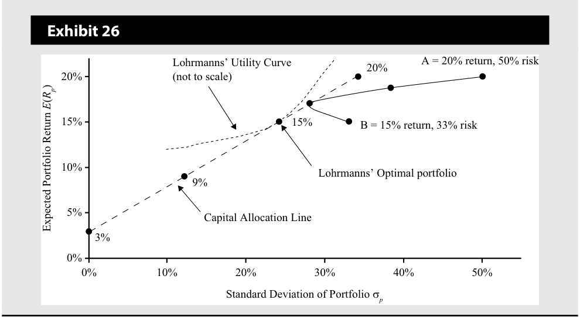
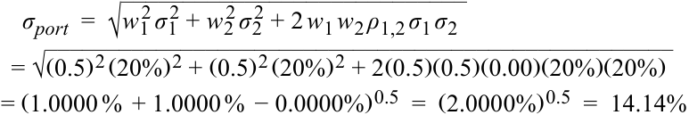

# Volume 9: Portfolio Management
## Learning Module 1 Portfolio Risk and Return: Part I
### Part 4/4: Summary (PDF Pages 57–70)

---

<!-- PDF Page 57 -->

the highest utility: 0.0774. Finally, Exhibit 26 shows the indifference curve that is tangent to the capital allocation line to generate Lohrmanns’ optimal investor portfolio. 

<!-- Start of picture text -->
Exhibit 26 Lohrmanns’ Utility Curve 20% A = 20% return, 50% risk 20% (not to scale) 15% 15% B = 15% return, 33% risk 10% Lohrmanns’ Optimal portfolio 9% 5% Capital Allocation Line 3% 0% 0% 10% 20% 30% 40% 50% Standard Deviation of Portfolio σ p Expected Portfolio Return () ER p <!-- End of picture text -->

### **Investor Preferences and Optimal Portfolios** 

The location of an optimal investor portfolio depends on the investor’s risk preferences. A highly risk-averse investor may invest a large proportion, even 100 percent, of his/her assets in the risk-free asset. The optimal portfolio in this investor’s case will be located close to the _y_ -axis. A less risk-averse investor, however, may invest a large portion of his/her wealth in the optimal risky asset. The optimal portfolio in this investor’s case will lie closer to Point P in Exhibit 22. 

Some less risk-averse investors (i.e., with a high risk tolerance) may wish to accept even more risk because of the chance of higher return. Such an investor may borrow money to invest more in the risky portfolio. If the investor borrows 25 percent of his wealth, he/she can invest 125 percent in the optimal risky portfolio. The optimal investor portfolio for such an investor will lie to the right of Point P on the capital allocation line. 

Thus, moving from the risk-free asset along the capital allocation line, we encounter investors who are willing to accept more risk. At Point P, the investor is 100 percent invested in the optimal risky portfolio. Beyond Point P, the investor accepts even more risk by borrowing money and investing in the optimal risky portfolio. 

Note that we are able to accommodate all types of investors with just two portfolios: the risk-free asset and the optimal risky portfolio. Exhibit 22 is also an illustration of the two-fund separation theorem. Portfolio P is the optimal risky portfolio that is selected without regard to investor preferences. The optimal investor portfolio is selected on the capital allocation line by overlaying the indifference curves that incorporate investor preferences. 

# **~~SUMMARY~~** 

This reading provides a description and computation of investment characteristics, such as risk and return, that investors use in evaluating assets for investment. This was followed by sections about portfolio construction, selection of an optimal risky portfolio, and an understanding of risk aversion and indifference curves. Finally, 

<!-- PDF Page 58 -->

the tangency point of the indifference curves with the capital allocation line allows identification of the optimal investor portfolio. Key concepts covered in the reading include the following: 

- Holding period return is most appropriate for a single, predefined holding period. 

- Multiperiod returns can be aggregated in many ways. Each return computation has special applications for evaluating investments. 

- Risk-averse investors make investment decisions based on the risk–return trade-off, maximizing return for the same risk, and minimizing risk for the same return. They may be concerned, however, by deviations from a normal return distribution and from assumptions of financial markets’ operational efficiency. 

- Investors are risk averse, and historical data confirm that financial markets price assets for risk-averse investors. 

- The risk of a two-asset portfolio is dependent on the proportions of each asset, their standard deviations and the correlation (or covariance) between the assets’ returns. As the number of assets in a portfolio increases, the correlation among asset risks becomes a more important determinant of portfolio risk. 

- Combining assets with low correlations reduces portfolio risk. 

- The two-fund separation theorem allows us to separate decision making into two steps. In the first step, the optimal risky portfolio and the capital allocation line are identified, which are the same for all investors. In the second step, investor risk preferences enable us to find a unique optimal investor portfolio for each investor. 

- The addition of a risk-free asset creates portfolios that are dominant to portfolios of risky assets in all cases except for the optimal risky portfolio. 

By successfully understanding the content of this reading, you should be comfortable calculating an investor’s optimal portfolio given the investor’s risk preferences and universe of investable assets available. 

<!-- PDF Page 59 -->

# **~~REFERENCES~~** 

_2009 Ibbotson Stocks, Bonds, Bills, and Inflation (SBBI) Classic Yearbook_ . 2009. Chicago, IL: Morningstar. 

Bogle, John C. 2008. “Black Monday and Black Swans.” _Financial Analysts Journal_ 64, vol. , no. 2: 30–40. 10.2469/faj.v64.n2.9 

Dimson, Elroy, Paul Marsh, and Mike Staunton. 2009. _Credit Suisse Global Investment Returns Sourcebook_ . _2009._ Zurich, Switzerland: Credit Suisse Research Institute. 

Taleb, Nassim N. 2007. _The Black Swan: The Impact of the Highly Improbable_ . New York: Random House Inc. 

<!-- PDF Page 60 -->

# **~~PRACTICE PROBLEMS~~** 

**1.** With respect to trading costs, liquidity is _least likely_ to impact the: 

   - **A.** stock price. 

   - **B.** bid–ask spreads. 

   - **C.** brokerage commissions. 

**2.** Evidence of risk aversion is _best_ illustrated by a risk–return relationship that is: 

   - **A.** negative. 

   - **B.** neutral. 

   - **C.** positive. 

**3.** With respect to risk-averse investors, a risk-free asset will generate a numerical utility that is: 

   - **A.** the same for all individuals. 

   - **B.** positive for risk-averse investors. 

   - **C.** equal to zero for risk seeking investors. 

**4.** With respect to utility theory, the most risk-averse investor will have an indifference curve with the: 

   - **A.** most convexity. 

   - **B.** smallest intercept value. 

   - **C.** greatest slope coefficient. 

**5.** With respect to an investor’s utility function expressed as: _U_ = _E_ ( _r)_ −_ 21_Aσ_2 , which of the following values for the measure for risk aversion has the _least_ amount of risk aversion? 

   - **A.** −4. 

   - **B.** 0. 

**C.** 4. 

## **The following information relates to questions 6-7** 

A financial planner has created the following data to illustrate the application of utility theory to portfolio selection: 

<!-- PDF Page 61 -->

|**Investment**|**Expected** **Return (%)**|**Expected** **Standard Deviation (%)**|
|---|---|---|
|1|18|2|
|2|19|8|
|3|20|15|
|4|18|30|

**6.** A risk-neutral investor is _most likely_ to choose: 

   - **A.** Investment 1. 

   - **B.** Investment 2. 

   - **C.** Investment 3. 

**7.** If an investor’s utility function is expressed as _U_ = _E_ ( _r)_ −_1 2_Aσ_2 and the measure for risk aversion has a value of −2, the risk-seeking investor is _most likely_ to choose: 

   - **A.** Investment 2. 

   - **B.** Investment 3. 

   - **C.** Investment 4. 

**8.** If an investor’s utility function is expressed as _U_ = _E_ ( _r_ ) −_1 2_Aσ_2 and the measure for risk aversion has a value of 2, the risk-averse investor is _most likely_ to choose: 

   - **A.** Investment 1. 

   - **B.** Investment 2. 

   - **C.** Investment 3. 

**9.** If an investor’s utility function is expressed as _U_ = _E_ ( _r)_ −_1 2_Aσ_2 and the measure for risk aversion has a value of 4, the risk-averse investor is _most likely_ to choose: 

   - **A.** Investment 1. 

   - **B.** Investment 2. 

   - **C.** Investment 3. 

**10.** With respect to the mean–variance portfolio theory, the capital allocation line, CAL, is the combination of the risk-free asset and a portfolio of all: 

   - **A.** risky assets. 

   - **B.** equity securities. 

   - **C.** feasible investments. 

**11.** Two individual investors with different levels of risk aversion will have optimal portfolios that are: 

   - **A.** below the capital allocation line. 

<!-- PDF Page 62 -->

   - **B.** on the capital allocation line. 

   - **C.** above the capital allocation line. 

**12.** With respect to capital market theory, which of the following asset characteristics is _least likely_ to impact the variance of an investor’s equally weighted portfolio? 

   - **A.** Return on the asset. 

   - **B.** Standard deviation of the asset. 

   - **C.** Covariances of the asset with the other assets in the portfolio. 

**13.** A portfolio manager creates the following portfolio: 

|**Security**|**Security Weight (%)**|**Expected** **Standard Deviation** **(%)**|
|---|---|---|
|1|30|20|
|2|70|12|

If the correlation of returns between the two securities is 0.40, the expected standard deviation of the portfolio is _closest_ to: 

**A.** 10.7%. 

   - **B.** 11.3%. 

   - **C.** 12.1%. 

**14.** A portfolio manager creates the following portfolio: 

|**Security**|**Security Weight (%)**|**Expected** **Standard Deviation** **(%)**|
|---|---|---|
|1|30|20|
|2|70|12|

If the covariance of returns between the two securities is −0.0240, the expected standard deviation of the portfolio is _closest_ to: 

**A.** 2.4%. 

- **B.** 7.5%. 

- **C.** 9.2%. 

## **The following information relates to questions 15-16** 

A portfolio manager creates the following portfolio: 

<!-- PDF Page 63 -->

|||**Expected**|
|---|---|---|
|**Security**|**Security Weight (%)**|**Standard Deviation (%)**|
|1|30|20|
|2|70|12|

**15.** If the standard deviation of the portfolio is 14.40%, the correlation between the two securities is equal to: 

**A.** -1.0. 

**B.** 0.0. 

**C.** 1.0. 

**16.** If the standard deviation of the portfolio is 14.40%, the covariance between the two securities is equal to: 

   - **A.** 0.0006. 

   - **B.** 0.0240. 

   - **C.** 1.0000. 

## **The following information relates to questions 17-19** 

A portfolio manager creates the following portfolio: 

|**Security**|**Expected Annual Return (%)**|**Expected Standard Deviation (%)**|
|---|---|---|
|1|16|20|
|2|12|20|

**17.** If the portfolio of the two securities has an expected return of 15%, the proportion invested in Security 1 is: 

   - **A.** 25%. 

   - **B.** 50%. 

   - **C.** 75%. 

**18.** If the correlation of returns between the two securities is −0.15, the expected standard deviation of an equal-weighted portfolio is _closest_ to: 

   - **A.** 13.04%. 

   - **B.** 13.60%. 

   - **C.** 13.87%. 

**19.** If the two securities are uncorrelated, the expected standard deviation of an 

<!-- PDF Page 64 -->

equal-weighted portfolio is _closest_ to: 

- **A.** 14.00%. 

- **B.** 14.14%. 

- **C.** 20.00%. 

## **The following information relates to questions 20-21** 

An analyst has made the following return projections for each of three possible outcomes with an equal likelihood of occurrence: 

||**Outcome 1**|**Outcome 2**|**Outcome 3**|**Expected Return**|
|---|---|---|---|---|
|**Asset**|**(%)**|**(%)**|**(%)**|**(%)**|
|1|12|0|6|6|
|2|12|6|0|6|
|3|0|6|12|6|

**20.** If the analyst constructs two-asset portfolios that are equally-weighted, which pair of assets has the _lowest_ expected standard deviation? 

   - **A.** Asset 1 and Asset 2. 

   - **B.** Asset 1 and Asset 3. 

   - **C.** Asset 2 and Asset 3. 

**21.** If the analyst constructs two-asset portfolios that are equally weighted, which pair of assets provides the _least_ amount of risk reduction? 

   - **A.** Asset 1 and Asset 2. 

   - **B.** Asset 1 and Asset 3. 

   - **C.** Asset 2 and Asset 3. 

**22.** As the number of assets in an equally-weighted portfolio increases, the contribution of each individual asset’s variance to the volatility of the portfolio: 

   - **A.** increases. 

   - **B.** decreases. 

   - **C.** remains the same. 

**23.** With respect to an equally weighted portfolio made up of a large number of assets, which of the following contributes the _most_ to the volatility of the portfolio? 

   - **A.** Average variance of the individual assets. 

   - **B.** Standard deviation of the individual assets. 

   - **C.** Average covariance between all pairs of assets. 

<!-- PDF Page 65 -->

**24.** The correlation between assets in a two-asset portfolio increases during a market decline. If there is no change in the proportion of each asset held in the portfolio or the expected standard deviation of the individual assets, the volatility of the portfolio is _most likely_ to: 

   - **A.** increase. 

   - **B.** decrease. 

   - **C.** remain the same. 

**25.** Which of the following statements is _least_ accurate? The efficient frontier is the set of all attainable risky assets with the: 

   - **A.** highest expected return for a given level of risk. 

   - **B.** lowest amount of risk for a given level of return. 

   - **C.** highest expected return relative to the risk-free rate. 

**26.** The portfolio on the minimum-variance frontier with the lowest standard deviation is: 

   - **A.** unattainable. 

   - **B.** the optimal risky portfolio. 

   - **C.** the global minimum-variance portfolio. 

**27.** The set of portfolios on the minimum-variance frontier that dominates all sets of portfolios below the global minimum-variance portfolio is the: 

   - **A.** capital allocation line. 

   - **B.** Markowitz efficient frontier. 

   - **C.** set of optimal risky portfolios. 

**28.** The dominant capital allocation line is the combination of the risk-free asset and the: 

   - **A.** optimal risky portfolio. 

   - **B.** levered portfolio of risky assets. 

   - **C.** global minimum-variance portfolio. 

**29.** Compared to the efficient frontier of risky assets, the dominant capital allocation line has higher rates of return for levels of risk greater than the optimal risky portfolio because of the investor’s ability to: 

   - **A.** lend at the risk-free rate. 

   - **B.** borrow at the risk-free rate. 

   - **C.** purchase the risk-free asset. 

**30.** With respect to the mean–variance theory, the optimal portfolio is determined by each individual investor’s: 

   - **A.** risk-free rate. 

<!-- PDF Page 66 -->

- **B.** borrowing rate. 

- **C.** risk preference. 

<!-- PDF Page 67 -->

# **~~SOLUTIONS~~** 

1. C is correct. Brokerage commissions are negotiated with the brokerage firm. A security’s liquidity impacts the operational efficiency of trading costs. Specifically, liquidity impacts the bid–ask spread and can impact the stock price (if the ability to sell the stock is impaired by the uncertainty associated with being able to sell the stock). 

2. C is correct. Historical data over long periods of time indicate that there exists a positive risk–return relationship, which is a reflection of an investor’s risk aversion. 

3. A is correct. A risk-free asset has a variance of zero and is not dependent on whether the investor is risk neutral, risk seeking or risk averse. That is, given that the utility function of an investment is expressed as _U_ = _E_ ( _r)_ −_ 21_Aσ_2 , where_A_is the measure of risk aversion, then the sign of _A_ is irrelevant if the variance is zero (like that of a risk-free asset). 

4. C is correct. The most risk-averse investor has the indifference curve with the greatest slope. 

5. A is correct. A negative value in the given utility function indicates that the investor is a risk seeker. 

6. C is correct. Investment 3 has the highest rate of return. Risk is irrelevant to a risk-neutral investor, who would have a measure of risk aversion equal to 0. Given the utility function, the risk-neutral investor would obtain the greatest amount of utility from Investment 3. 

||**Expected**|**Expected**|**Utility**|
|---|---|---|---|
|**Investment**|**Return (%)**|**Standard Deviation (%)**|**_A_ = 0**|
|1|18|2|0.1800|
|2|19|8|0.1900|
|3|20|15|0.2000|
|4|18|30|0.1800|

7. C is correct. Investment 4 provides the highest utility value (0.2700) for a risk-seeking investor, who has a measure of risk aversion equal to −2. 

||**Expected**|**Expected**|**Utility**|
|---|---|---|---|
|**Investment**|**Return (%)**|**Standard Deviation (%)**|**_A_ = –2**|
|1|18|2|0.1804|
|2|19|8|0.1964|
|3|20|15|0.2225|
|4|18|30|0.2700|

8. B is correct. Investment 2 provides the highest utility value (0.1836) for a risk-averse investor who has a measure of risk aversion equal to 2. 

<!-- PDF Page 68 -->

|**Investment**|**Expected** **Return (%)**|**Expected** **Standard Deviation (%)**|**Utility** **_A_ = 2**|
|---|---|---|---|
|1|18|2|0.1796|
|2|19|8|0.1836|
|3|20|15|0.1775|
|4|18|30|0.0900|

9. A is correct. Investment 1 provides the highest utility value (0.1792) for a risk-averse investor who has a measure of risk aversion equal to 4. 

|**Investment**|**Expected** **Return (%)**|**Expected** **Standard Deviation (%)**|**Utility** **_A_ = 4**|
|---|---|---|---|
|1|18|2|0.1792|
|2|19|8|0.1772|
|3|20|15|0.1550|
|4|18|30|0.0000|

10. A is correct. The CAL is the combination of the risk-free asset with zero risk and the portfolio of all risky assets that provides for the set of feasible investments. Allowing for borrowing at the risk-free rate and investing in the portfolio of all risky assets provides for attainable portfolios that dominate risky assets below the CAL. 

11. B is correct. The CAL represents the set of all feasible investments. Each investor’s indifference curve determines the optimal combination of the risk-free asset and the portfolio of all risky assets, which must lie on the CAL. 

12. A is correct. The asset’s returns are not used to calculate the portfolio’s variance [only the assets’ weights, standard deviations (or variances), and covariances (or correlations) are used]. 

13. C is correct. 

_σport_ =  √___________________________ w_ 12 _σ_ 12 + _w_ 22 _σ_ 22 + 2 _w_ 1 _w_ 2 _ρ_ 1,2 _σ_ 1 _σ_ 2 

=  √___________________________________________________(0.3)2 (20%)2 +  (0.7)2 (12%)2 + 2 (0.3)(0.7)(0.40)(20%)(12%) =( 0.3600 %  + 0.7056 %  + 0.4032%)0.5 =( 1.4688%)0.5 = 12.11% 

14. A is correct. 

<!-- Formula Text: σ port  =  √ ______________________________ w 1 2 σ 1 2 + w 2 2 σ 2 2 + 2 w 1 w 2 Cov(R 1 R 2) -->

=  √____________________________________________(0.3)2 (20%)2 +  (0.7)2 (12%)2 + 2 (0.3)(0.7)(− 0.0240) 

=( 0.3600 %  + 0.7056 %  − 1.008%)0.5 =( 0.0576%)0.5 = 2.40% 

15. C is correct. A portfolio standard deviation of 14.40% is the weighted average, which is possible only if the correlation between the securities is equal to 1.0. 

16. B is correct. A portfolio standard deviation of 14.40% is the weighted average, which is possible only if the correlation between the securities is equal to 1.0. If the correlation coefficient is equal to 1.0, then the covariance must equal 0.0240, calculated as: Cov( _R_ 1, _R_ 2) = ρ12σ1σ2 = (1.0)(20%)(12%) = 2.40% = 0.0240. 

<!-- PDF Page 69 -->

17. C is correct. 

_Rp_ = _w_ 1 × _R_ 1 +  (1  − _w_ 1) × _R_ 2 _Rp_ = _w_ 1 × 16 %  +  (1 − _w_ 1) × 12% 15 %  = 0.75( 16%) + 0.25( 12%) 

18. A is correct. 

_σport_ =  √___________________________ w_ 12 _σ_ 12 + _w_ 22 _σ_ 22 + 2 _w_ 1 _w_ 2 _ρ_ 1,2 _σ_ 1 _σ_ 2 =  √____________________________________________________(0.5)2 (20%)2 +  (0.5)2 (20%)2 + 2 (0.5)(0.5)(− 0.15)(20%)(20%) =( 1.0000 %  + 1.0000 %  − 0.3000%)0.5 =( 1.7000%)0.5 = 13.04% 

19. B is correct. 

<!-- Formula Text: σ port  =  √ ____________________________ w 1 2 σ 1 2 + w 2 2 σ 2 2 + 2 w 1 w 2 ρ 1,2 σ 1 σ 2 = √ ___________________________________________________ (0.5) 2 (20%) 2 + (0.5) 2 (20%) 2 + 2(0.5)(0.5)(0.00)(20%)(20%) = (1.0000 %  + 1.0000 %  − 0.0000%) 0.5  =  (2.0000%) 0.5  =  14.14% -->

20. C is correct. An equally weighted portfolio of Asset 2 and Asset 3 will have the lowest portfolio standard deviation, because for each outcome, the portfolio has the same expected return (they are perfectly negatively correlated). 

21. A is correct. An equally weighted portfolio of Asset 1 and Asset 2 has the highest level of volatility of the three pairs. All three pairs have the same expected return; however, the portfolio of Asset 1 and Asset 2 provides the least amount of risk reduction. 

22. B is correct. The contribution of each individual asset’s variance (or standard deviation) to the portfolio’s volatility decreases as the number of assets in the equally weighted portfolio increases. The contribution of the co-movement measures between the assets increases (i.e., covariance and correlation) as the number of assets in the equally weighted portfolio increases. The following equation for the variance of an equally weighted portfolio illustrates these points: _σp_2 =  __σ__ _N_2+ __N_− 1 _N COV_‾ =  __σ__ _N_2+ __N_− 1 _N ρ__ _σ__2 . 

23. C is correct. The co-movement measures between the assets increases (i.e., covariance and correlation) as the number of assets in the equally weighted portfolio increases. The contribution of each individual asset’s variance (or standard deviation) to the portfolio’s volatility decreases as the number of assets in the equally weighted portfolio increases. The following equation for the variance of an equally weighted portfolio illustrates these points: 

<!-- Formula Text: σ p 2  =    _ σ  2 _ N  +  N − 1 _ N   ‾ COV   =    _ σ  2 _ N  +  N − 1 _ N   _ ρ    _ σ  2. -->

24. A is correct. Higher correlations will produce less diversification benefits provided that the other components of the portfolio standard deviation do not change (i.e., the weights and standard deviations of the individual assets). 

25. C is correct. The efficient frontier does not account for the risk-free rate. The efficient frontier is the set of all attainable risky assets with the highest expected return for a given level of risk or the lowest amount of risk for a given level of return. 

26. C is correct. The global minimum-variance portfolio is the portfolio on the minimum-variance frontier with the lowest standard deviation. Although 

<!-- PDF Page 70 -->

the portfolio is attainable, when the risk-free asset is considered, the global minimum-variance portfolio is not the optimal risky portfolio. 

27. B is correct. The Markowitz efficient frontier has higher rates of return for a given level of risk. With respect to the minimum-variance portfolio, the Markowitz efficient frontier is the set of portfolios above the global minimum-variance portfolio that dominates the portfolios below the global minimum-variance portfolio. 

28. A is correct. The use of leverage and the combination of a risk-free asset and the optimal risky asset will dominate the efficient frontier of risky assets (the Markowitz efficient frontier). 

29. B is correct. The CAL dominates the efficient frontier at all points except for the optimal risky portfolio. The ability of the investor to purchase additional amounts of the optimal risky portfolio by borrowing (i.e., buying on margin) at the risk-free rate makes higher rates of return for levels of risk greater than the optimal risky asset possible. 

30. C is correct. Each individual investor’s optimal mix of the risk-free asset and the optimal risky asset is determined by the investor’s risk preference. 

