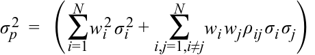
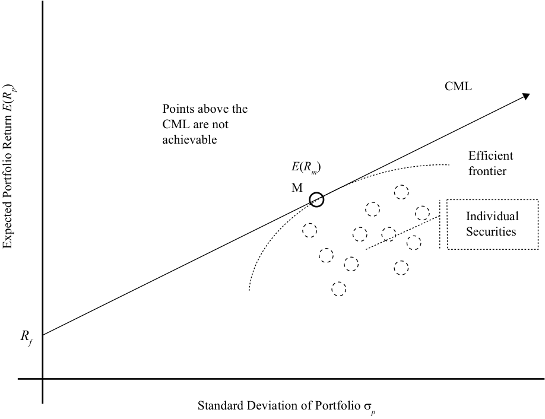
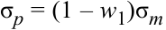
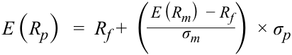
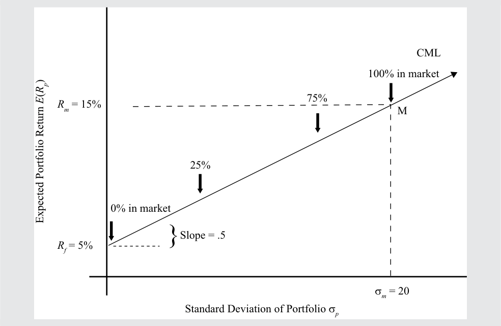
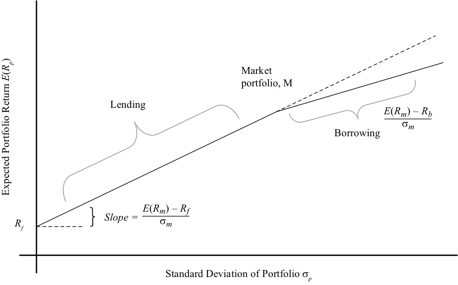

# Volume 9: Portfolio Management
## Learning Module 2 Portfolio Risk and Return: Part II
### Part 1/4: Introduction (PDF Pages 71–86)

---

<!-- PDF Page 71 -->

#### L E A R N I N G M O D U L E 

# **<mark>2</mark>** 

### **Portfolio Risk and Return: Part II** 

###### **by Vijay Singal, PhD, CFA.** 

_Vijay Singal, PhD, CFA, is at Virginia Tech (USA)._ 

|**LEARNI**|**NG OUTCOMES**|
|---|---|
|**_Mastery_**|**_The candidate should be able to:_**|
||describe the implications of combining a risk-free asset with a portfolio of risky assets|
||explain the capital allocation line (CAL) and the capital market line (CML)|
||explain systematic and nonsystematic risk, including why an investor should not expect to receive additional return for bearing nonsystematic risk|
||explain return generating models (including the market model) and their uses|
||calculate and interpret beta|
||explain the capital asset pricing model (CAPM), including its assumptions, and the security market line (SML)|
||calculate and interpret the expected return of an asset using the CAPM|
||describe and demonstrate applications of the CAPM and the SML|
||calculate and interpret the Sharpe ratio, Treynor ratio,_M_2, and Jensen’s alpha|

<!-- Start of picture text -->
1 <!-- End of picture text -->

##### **INTRODUCTION** 

Our objective in this reading is to identify the optimal risky portfolio for all investors by using the capital asset pricing model (CAPM). The foundation of this reading is the computation of risk and return of a portfolio and the role that correlation plays in diversifying portfolio risk and arriving at the efficient frontier. The efficient frontier and the capital allocation line consist of portfolios that are generally acceptable 

<!-- PDF Page 72 -->

to all investors. By combining an investor’s individual indifference curves with the market-determined capital allocation line, we are able to illustrate that the only optimal risky portfolio for an investor is the portfolio of all risky assets (i.e., the market). 

Additionally, we discuss the capital market line, a special case of the capital allocation line that is used for passive investor portfolios. We also differentiate between systematic and nonsystematic risk, and explain why investors are compensated for bearing systematic risk but receive no compensation for bearing nonsystematic risk. We discuss in detail the CAPM, which is a simple model for estimating asset returns based only on the asset’s systematic risk. Finally, we illustrate how the CAPM allows security selection to build an optimal portfolio for an investor by changing the asset mix beyond a passive market portfolio. 

The reading is organized as follows. In Section 2, we discuss the consequences of combining a risk-free asset with the market portfolio and provide an interpretation of the capital market line. Section 3 decomposes total risk into systematic and nonsystematic risk and discusses the characteristics of and differences between the two kinds of risk. We also introduce return-generating models, including the single-index model, and illustrate the calculation of beta. In Section 4, we introduce the capital asset pricing model and the security market line. Our focus on the CAPM does not suggest that the CAPM is the only viable asset pricing model. Although the CAPM is an excellent starting point, more advanced readings expand on these discussions and extend the analysis to other models that account for multiple explanatory factors. Section 5 covers several post-CAPM developments in theory. Section 6 covers measures for evaluating the performance of a portfolio which take account of risk. Section 7 covers some applications of the CAPM in portfolio construction. A summary and practice problems conclude the reading. 

## **<mark>2</mark>** 

##### **CAPITAL MARKET THEORY: RISK-FREE AND RISKY ASSETS** 

describe the implications of combining a risk-free asset with a portfolio of risky assets 

explain the capital allocation line (CAL) and the capital market line (CML) 

You have learned how to combine a risk-free asset with one risky asset and with many risky assets to create a capital allocation line. In this section, we will expand our discussion of multiple risky assets and consider a special case of the capital allocation line, called the capital market line. While discussing the capital market line, we will define the market and its role in passive portfolio management. Using these concepts, we will illustrate how leveraged portfolios can enhance both risk and return. 

###### **Portfolio of Risk-Free and Risky Assets** 

Although investors desire an asset that produces the highest return and carries the lowest risk, such an asset does not exist. As the risk–return capital market theory illustrates, one must assume higher risk in order to earn a higher return. We can improve an investor’s portfolio, however, by expanding the opportunity set of risky assets because this allows the investor to choose a superior mix of assets. 

<!-- PDF Page 73 -->

Similarly, an investor’s portfolio improves if a risk-free asset is added to the mix. In other words, a combination of the risk-free asset and a risky asset can result in a better risk–return trade-off than an investment in only one type of asset because the risk-free asset has zero correlation with the risky asset. The combination is called the **capital allocation line** (and is depicted in Exhibit 2). Superimposing an investor’s indifference curves on the capital allocation line will lead to the optimal investor portfolio. 

Investors with different levels of risk aversion will choose different portfolios. Highly risk-averse investors choose to invest most of their wealth in the risk-free asset and earn low returns because they are not willing to assume higher levels of risk. Less risk-averse investors, in contrast, invest more of their wealth in the risky asset, which is expected to yield a higher return. Obviously, the higher return cannot come without higher risk, but the less risk-averse investor is willing to accept the additional risk. 

###### **_Combining a Risk-Free Asset with a Portfolio of Risky Assets_** 

We can extend the analysis of one risky asset to a portfolio of risky assets. For convenience, assume that the portfolio contains all available risky assets ( _N)_ , although an investor may not wish to include all of these assets in the portfolio because of the investor’s specific preferences. If an asset is not included in the portfolio, its weight will be zero. The risk–return characteristics of a portfolio of _N_ risky assets are given by the following equations: 

<!-- Formula Text: E (R p)   =  ∑ i=1 N w i E (R i) σ p 2  =   (  ∑ i=1,j=1 N w i w j Cov (i, j) ) ,  and ∑ i=1 N w i  =  1 -->

The expected return on the portfolio, _E_ ( _Rp_ ), is the weighted average of the expected returns of individual assets, where _wi_ is the fractional weight in asset _i_ and _Ri_ is the expected return of asset _i_ . The risk of the portfolio (σ _p_ ), however, depends on the weights of the individual assets, the risk of the individual assets, and their interrelationships. The **covariance** between assets _i_ and _j_ , Cov( _i_ , _j_ ), is a statistical measure of the interrelationship between each pair of assets in the portfolio and can be expressed as follows, where ρ _ij_ is the **correlation** between assets _i_ and _j_ and σ _i_ is the risk of asset _i_ : 

Cov( _i_ , _j_ ) = ρ _ij_ σ _i_ σ _j_ 

Note from the equation below that the correlation of an asset with itself is 1; therefore: 

Cov( _i_ , _i_ ) = ρ _ii_ σ _i_ σ _i_ = _σi_2 

By substituting the above expressions for covariance, we can rewrite the portfolio variance equation as 

<!-- Formula Text: σ p 2  =   (∑ i=1 N w i 2 σ i 2 +   ∑ i,j=1,i≠j N w i w j ρ ij σ i σ j) -->

The suggestion that portfolios have lower risk than the assets they contain may seem counterintuitive. These portfolios can be constructed, however, as long as the assets in the portfolio are not perfectly correlated. As an illustration of the effect of asset weights on portfolio characteristics, consider a simple two-asset portfolio with zero weights in all other assets. Assume that Asset 1 has a return of 10 percent and a standard deviation (risk) of 20 percent. Asset 2 has a return of 5 percent and a standard deviation (risk) of 10 percent. Furthermore, the correlation between the two assets is zero. Exhibit 1 shows risks and returns for Portfolio X with a weight of 25 percent in Asset 1 and 75 percent in Asset 2, Portfolio Y with a weight of 50 percent in each of the two assets, and Portfolio Z with a weight of 75 percent in Asset 1 and 25 percent in Asset 2. 

<!-- PDF Page 74 -->

**Exhibit 1: Portfolio Risk and Return** 

|**Portfolio**|**Weight in** **Asset 1** **(%)**|**Weight in** **Asset 2** **(%)**|**Portfolio** **Return** **(%)**|**Portfolio** **Standard** **Deviation (%)**|
|---|---|---|---|---|
|X|25.0|75.0|6.25|9.01|
|Y|50.0|50.0|7.50|11.18|
|Z|75.0|25.0|8.75|15.21|
|Return|10.0|5.0|||
|Standard deviation|20.0|10.0|||
|Correlation between Assets 1 and 2||0.0|||

From this example we observe that the three portfolios are quite different in terms of their risk and return. Portfolio X has a 6.25 percent return and only 9.01 percent standard deviation, whereas the standard deviation of Portfolio Z is more than two-thirds higher (15.21 percent), although the return is only slightly more than one-third higher (8.75 percent). These portfolios may become even more dissimilar as other assets are added to the mix. 

Consider three portfolios of risky assets, A, B, and C, as in Exhibit 2, that may have been presented to a representative investor by three different investment advisers. Each portfolio is combined with the risk-free asset to create three capital allocation lines, CAL(A), CAL(B), and CAL(C). The exhibit shows that Portfolio C is superior to the other two portfolios because it has a greater expected return for any given level of risk. As a result, an investor will choose the portfolio that lies on the capital allocation line for Portfolio C. The combination of the risk-free asset and the risky Portfolio C that is selected for an investor depends on the investor’s degree of risk aversion. 

**Exhibit 2: Risk-Free Asset and Portfolio of Risky Assets** 

<!-- Start of picture text -->
Indifference CAL(C) Curve C CAL(B) CAL(A) B A Rf Expected Portfolio Return ()  ER p <!-- End of picture text -->

Portfolio Standard Deviation (σ _p_ ) 

<!-- PDF Page 75 -->

###### **_Does a Unique Optimal Risky Portfolio Exist?_** 

We assume that all investors have the same economic expectation and thus have the same expectations of prices, cash flows, and other investment characteristics. This assumption is referred to as **homogeneity of expectations** . Given these investment characteristics, everyone goes through the same calculations and should arrive at the same optimal risky portfolio. Therefore, assuming homogeneous expectations, only one optimal portfolio exists. If investors have different expectations, however, they might arrive at different optimal risky portfolios. To illustrate, we begin with an expression for the price of an asset: 

<!-- Formula Text: P  =  ∑ t=0 T CF t _ (1 + r t) t -->

where _CFt_ is the cash flow at the end of period _t_ and _rt_ is the discount rate or the required rate of return for that asset for period _t_ . Period _t_ refers to all periods beginning from now until the asset ceases to exist at the end of time _T_ . Because the current time is the end of period 0, which is the same as the beginning of period 1, there are ( _T_ + 1) cash flows and ( _T_ + 1) required rates of return. These conditions are based on the assumption that a cash flow, such as an initial investment, can occur now ( _t_ = 0). Ordinarily, however, _CF_ 0 is zero. 

We use the formula for the price of an asset to estimate the intrinsic value of an asset. Assume that the asset we are valuing is a share of Siemens AG which trades on Xetra. In the case of corporate stock, there is no expiration date, so _T_ could be extremely large, meaning we will need to estimate a large number of cash flows and rates of return. Fortunately, the denominator reduces the importance of distant cash flows, so it may be sufficient to estimate, say, 20 annual cash flows and 20 rates of returns. How much will Siemens earn next year and the year after next? What will the product markets Siemens operates in look like in five years’ time? Different analysts and investors will have their own estimates that may be quite different from one another. Also, as we delve further into the future, more serious issues in estimating future revenue, expenses, and growth rates arise. Therefore, to assume that cash flow estimates for Siemens will vary among these investors is reasonable. In addition to the numerator (cash flows), it is also necessary to estimate the denominator, the required rates of return. We know that riskier companies will require higher returns because risk and return are positively correlated. Siemens stock is riskier than a risk-free asset, but by how much? And what should the compensation for that additional risk be? Again, it is evident that different analysts will view the riskiness of Siemens differently and, therefore, arrive at different required rates of return. 

Siemens closed at €111.84 on Xetra on 31 August 2018. The traded price represents the value that a marginal investor attaches to a share of Siemens, say, corresponding to Analyst A’s expectation. Analyst B may think that the price should be €95, however, and Analyst C may think that the price should be €125. Given a price of €111.84, the expected returns of Siemens are quite different for the three analysts. Analyst B, who believes the price should be €95, concludes that Siemens is overvalued and may assign a weight of zero to Siemens in the recommended portfolio even though the market capitalization of Siemens was in excess of €100 billion as of the date of the quotation. In contrast, Analyst C, with a valuation of €125, thinks Siemens is undervalued and may significantly overweight Siemens in a portfolio. 

Our discussion illustrates that analysts can arrive at different valuations that necessitate the assignment of different asset weights in a portfolio. Given the existence of many asset classes and numerous assets in each asset class, one can visualize that each investor will have his or her own optimal risky portfolio depending on his or her assumptions underlying the valuation computations. Therefore, market participants will have their own and possibly different optimal risky portfolios. 

<!-- PDF Page 76 -->

If investors have different valuations of assets, then the construction of a unique optimal risky portfolio is not possible. If we make a simplifying assumption of homogeneity in investor expectations, we will have a single optimal risky portfolio as previously mentioned. Even if investors have different expectations, market prices are a proxy of what the marginal, informed investor expects, and the market portfolio becomes the base case, the benchmark, or the reference portfolio that other portfolios can be judged against. For Siemens, the market price was €111.84 per share and the market capitalization was about €108 billion. In constructing the market portfolio, Siemens’s weight in the market portfolio will be equal to its market value divided by the value of all other assets included in the market portfolio. 

## **<mark>3</mark>** 

##### **CAPITAL MARKET THEORY: THE CAPITAL MARKET LINE** 

explain the capital allocation line (CAL) and the capital market line (CML) 

In the previous section, we discussed how the risk-free asset could be combined with a risky portfolio to create a capital allocation line (CAL). In this section, we discuss a specific CAL that uses the market portfolio as the optimal risky portfolio and is known as the capital market line. We also discuss the significance of the market portfolio and applications of the capital market line (CML). 

###### **Passive and Active Portfolios** 

In the above subsection, we hypothesized three possible valuations for each share of Siemens: €95, €111.84, and €125. Which one is correct? 

If the market is an **informationally efficient market** , the price in the market, €111.84, is an unbiased estimate of all future discounted cash flows (recall the formula for the price of an asset). In other words, the price aggregates and reflects all information that is publicly available, and investors cannot expect to earn a return that is greater than the required rate of return for that asset. If, however, the price reflects all publicly available information and there is no way to outperform the market, then there is little point in investing time and money in evaluating Siemens to arrive at your price using your own estimates of cash flows and rates of return. 

In that case, a simple and convenient approach to investing is to rely on the prices set by the market. Portfolios that are based on the assumption of unbiased market prices are referred to as passive portfolios. Passive portfolios most commonly replicate and track market indexes, which are passively constructed on the basis of market prices and market capitalizations. Examples of market indexes are the S&P 500 Index, the Nikkei 300, and the CAC 40. Passive portfolios based on market indexes are called index funds and generally have low costs because no significant effort is expended in valuing securities that are included in an index. 

In contrast to passive investors’ reliance on market prices and index funds, active investors may not rely on market valuations. They have more confidence in their own ability to estimate cash flows, growth rates, and discount rates. Based on these estimates, they value assets and determine whether an asset is fairly valued. In an actively managed portfolio, assets that are undervalued, or have a chance of offering above-normal returns, will have a positive weight (i.e., overweight compared to the market weight in the benchmark index), whereas other assets will have a zero weight, 

<!-- PDF Page 77 -->

or even a negative weight if short selling is permitted (i.e., some assets will be underweighted compared with the market weight in the benchmark index). ( **Short selling** is a transaction in which borrowed securities are sold with the intention to repurchase them at a lower price at a later date and return them to the lender.) This style of investing is called active investment management, and the portfolios are referred to as active portfolios. Most open-end mutual funds and hedge funds practice active investment management, and most analysts believe that active investing adds value. Whether these analysts are right or wrong is the subject of continuing debate. 

###### **What Is the “Market”?** 

In the previous discussion, we referred to the “market” on numerous occasions without actually defining the market. The optimal risky portfolio and the capital market line depend on the definition of the market. So what is the market? 

Theoretically, the market includes all risky assets or anything that has value, which includes stocks, bonds, real estate, and even human capital. Not all assets are tradable, however, and not all tradable assets are investable. For example, the Taj Mahal in India is an asset but is not a tradable asset. Similarly, human capital is an asset that is not tradable. Moreover, assets may be tradable but not investable because of restrictions placed on certain kinds of investors. For example, all stocks listed on the Shanghai Stock Exchange are tradable. However, whereas Class A shares are listed in RMB and open to domestic investors and qualified foreign investors, Class B shares are listed in USD and open to foreign investors and domestic investors holding foreign currency dealing accounts. 

If we consider all stocks, bonds, real estate assets, commodities, etc., probably hundreds of thousands of assets are tradable and investable. The “market” should contain as many assets as possible; we emphasize the word “possible” because it is not practical to include all assets in a single risky portfolio. Even though advancements in technology and interconnected markets have made it much easier to span the major equity markets, we are still not able to easily invest in other kinds of assets like bonds and real estate except in the most developed countries. 

For the rest of this reading, we will define the “market” quite narrowly because it is practical and convenient to do so. Typically, a local or regional stock market index is used as a proxy for the market because of active trading in stocks and because a local or regional market is most visible to the local investors. For our purposes, we will use the S&P 500 Index as the market’s proxy. The S&P 500 is commonly used by analysts as a benchmark for market performance throughout the United States. It contains 500 of the largest stocks that are domiciled in the United States, and these stocks are weighted by their market capitalization (price times the number of outstanding shares). 

As of mid-2018, the stocks in the S&P 500 account for approximately 80 percent of the total equity market capitalization in the United States, and because the US stock markets represent about 40 percent of the world markets, the S&P 500 represents roughly 32 percent of worldwide publicly traded equity. Our definition of the market does not include non-US stock markets, bond markets, real estate, and many other asset classes, and therefore, “market” return and the “market” risk premium refer to US equity return and the US equity risk premium, respectively. The use of this proxy, however, is sufficient for our discussion, and is relatively easy to expand to include other tradable assets. 

###### **The Capital Market Line (CML)** 

A capital allocation line includes all possible combinations of the risk-free asset and an investor’s optimal risky portfolio. The **capital market line** is a special case of the capital allocation line, where the risky portfolio is the market portfolio. The risk-free 

<!-- PDF Page 78 -->

asset is a debt security with no default risk, no inflation risk, no liquidity risk, no interest rate risk, and no risk of any other kind. US Treasury bills are usually used as a proxy of the risk-free return, _Rf_ . 

The S&P 500 is a proxy of the market portfolio, which is the optimal risky portfolio. Therefore, the expected return on the risky portfolio is the expected market return, expressed as _E_ ( _Rm_ ). The capital market line is shown in Exhibit 3, where the standard deviation (σ _p_ ), or total risk, is on the _x_ -axis and expected portfolio return, _E_ ( _Rp_ ), is on the _y_ -axis. Graphically, the market portfolio is the point on the Markowitz efficient frontier where a line from the risk-free asset is tangent to the Markowitz efficient frontier. All points on the interior of the Markowitz efficient frontier are inefficient portfolios in that they provide the same level of return with a higher level of risk or a lower level of return with the same amount of risk. When plotted together, the point at which the CML is tangent to the Markowitz efficient frontier is the optimal combination of risky assets, on the basis of market prices and market capitalizations. The optimal risky portfolio is the market portfolio. 

**Exhibit 3: Capital Market Line** 

<!-- Start of picture text -->
CML Points above the CML are not achievable Efficient E ( Rm ) frontier M Individual Securities Rf Standard Deviation of Portfolio σ p Expected Portfolio Return ()  ER p <!-- End of picture text -->

The CML’s intercept on the _y_ -axis is the risk-free return ( _Rf_ ) because that is the return associated with zero risk. The CML passes through the point represented by the market return, _E_ ( _Rm_ ). With respect to capital market theory, any point above the CML is not achievable and any point below the CML is dominated by and inferior to any point on the CML. 

Note that we identify the CML and CAL as lines even though they are a combination of two assets. Unlike a combination of two risky assets, which is usually not a straight line, a combination of the risk-free asset and a risky portfolio is a straight line, as illustrated below by computing the combination’s risk and return. 

Risk and return characteristics of the portfolio represented by the CML can be computed by using the return and risk expressions for a two-asset portfolio: 

_E_ ( _Rp_ ) = _w_ 1 _Rf_ + (1 – _w_ 1) _E_ ( _Rm_ ), 

<!-- PDF Page 79 -->

and 

<!-- Formula Text: σ p  =  √ ___________________________________________ w 1 2 σ f 2 + (1 − w 1) 2 σ m 2  + 2 w 1 (1 − w 1) Cov (R f, R m) -->

The proportion invested in the risk-free asset is given by _w_ 1, and the balance is invested in the market portfolio, (1 – _w_ 1). The risk of the risk-free asset is given by σ _f_ , the risk of the market is given by σ _m_ , the risk of the portfolio is given by σ _p_ , and the covariance between the risk-free asset and the market portfolio is represented by Cov( _Rf_ , _Rm_ ). By definition, the standard deviation of the risk-free asset is zero. Because its risk is zero, the risk-free asset does not co-vary or move with any other asset. Therefore, its covariance with all other assets, including the market portfolio, is zero, making the first and third terms under the square root sign zero. As a result, the portfolio return and portfolio standard deviation can be simplified and rewritten as: 

_E_ ( _Rp_ ) = _w_ 1 _Rf_ + (1 – _w_ 1) _E_ ( _Rm_ ), 

and 

<!-- Formula Text: σp = (1 – w1)σm -->

By substitution, we can express _E_ ( _Rp_ ) in terms of σ _p_ . Substituting for _w_ 1, we get: 

<!-- Formula Text: E (R p)   =  R f +  ( E (R m)  − R f _ σ m )  × σ p -->

Note that the expression is in the form of a line, _y_ = _a_ + _bx_ . The _y_ -intercept is the risk-free rate, and the slope of the line referred to as the market price of risk is [ _E_ ( _Rm_ ) – _Rf_ ]/σ _m_ . The CML has a positive slope because the market’s risky return is larger than the risk-free return. As the amount of the total investment devoted to the market increases—that is, as we move up the line—both standard deviation (risk) and expected return increase. 

###### **EXAMPLE 1** 

###### **Risk and Return on the CML** 

Mr. Miles is a first time investor and wants to build a portfolio using only US T-bills and an index fund that closely tracks the S&P 500 Index. The T-bills have a return of 5 percent. The S&P 500 has a standard deviation of 20 percent and an expected return of 15 percent. 

1. Draw the CML and mark the points where the investment in the market is 0 percent, 25 percent, 75 percent, and 100 percent. 

###### **Solution:** 

We calculate the equation for the CML as _E_ ( _Rp_ ) = 5% + 0.50 × σ _p_ by substituting the given information into the general CML equation. The intercept of the line is 5 percent, and its slope is 0.50. We can draw the CML by arbitrarily taking any two points on the line that satisfy the above equation. 

Alternatively, the CML can be drawn by connecting the risk-free return of 5 percent on the _y_ -axis with the market portfolio at (20 percent, 15 percent). The CML is shown in Exhibit 4. 

<!-- PDF Page 80 -->

###### **Exhibit 4: Risk and Return on the CML** 

<!-- Start of picture text -->
CML 100% in market 75% Rm  = 15% M 25% 0% in market Slope = .5 Rf  = 5% σ m  = 20 Standard Deviation of Portfolio σ p Expected Portfolio Return () ER p <!-- End of picture text -->

2. Mr. Miles is also interested in determining the exact risk and return at each point. 

###### **Solution:** 

Return with 0 percent invested in the market 

= 5 percent, which is the risk-free return. 

Standard deviation with 0 percent invested in the market 

= 0 percent because T-bills are not risky. 

Return with 25 percent invested in the market = (0.75 × 5%) + (0.25 × 15%) = 7.5%. 

Standard deviation with 25 percent invested in the market = 0.25 × 20% = 5%. Return with 75 percent invested in the market = (0.25 × 5%) + (0.75 × 15%) = 12.50%. 

Standard deviation with 75 percent invested in the market = 0.75 × 20% = 15%. 

Return with 100 percent invested in the market 

= 15 percent, which is the return on the S&P 500. 

Standard deviation with 100 percent invested in the market = 20 percent, which is the risk of the S&P 500. 

<!-- PDF Page 81 -->

##### **CAPITAL MARKET THEORY: CML - LEVERAGED PORTFOLIOS** 

## **<mark>4</mark>** 

explain the capital allocation line (CAL) and the capital market line (CML) 

In the previous example, Mr. Miles evaluated an investment of between 0 percent and 100 percent in the market and the balance in T-bills. The line connecting _Rf_ and _M_ (market portfolio) in Exhibit 4 illustrates these portfolios with their respective levels of investment. At _Rf_ , an investor is investing all of his or her wealth into risk-free securities, which is equivalent to lending 100 percent at the risk-free rate. At Point _M_ he or she is holding the market portfolio and not lending any money at the risk-free rate. The combinations of the risk-free asset and the market portfolio, which may be achieved by the points between these two limits, are termed “lending” portfolios. In effect, the investor is lending part of his or her wealth at the risk-free rate. 

If Mr. Miles is willing to take more risk, he may be able to move to the right of the market portfolio (Point _M_ in Exhibit 4) by borrowing money and purchasing more of Portfolio M. Assume that he is able to borrow money at the same risk-free rate of interest, _Rf_ , at which he can invest. He can then supplement his available wealth with borrowed money and construct a borrowing portfolio. If the straight line joining _Rf_ and _M_ is extended to the right of Point _M_ , this extended section of the line represents borrowing portfolios. As one moves further to the right of Point _M_ , an increasing amount of borrowed money is being invested in the market. This means that there is _negative_ investment in the risk-free asset, which is referred to as a _leveraged position_ in the risky portfolio. The particular point chosen on the CML will depend on the individual’s utility function, which, in turn, will be determined by his risk and return preferences. 

###### **EXAMPLE 2** 

###### **Risk and Return of a Leveraged Portfolio with Equal Lending and Borrowing Rates** 

1. Mr. Miles decides to set aside a small part of his wealth for investment in a portfolio that has greater risk than his previous investments because he anticipates that the overall market will generate attractive returns in the future. He assumes that he can borrow money at 5 percent and achieve the same return on the S&P 500 as before: an expected return of 15 percent with a standard deviation of 20 percent. 

Calculate his expected risk and return if he borrows 25 percent, 50 percent, and 100 percent of his initial investment amount. 

###### **Solution:** 

The leveraged portfolio’s standard deviation and return can be calculated in the same manner as before with the following equations: 

_E_ ( _Rp_ ) = _w_ 1 _Rf_ + (1 – _w_ 1) _E_ ( _Rm_ ) 

and 

<!-- PDF Page 82 -->

σ _p_ = (1 – _w_ 1)σ _m_ 

The proportion invested in T-bills becomes negative instead of positive because Mr. Miles is borrowing money. If 25 percent of the initial investment is borrowed, _w_ 1 = –0.25, and (1 – _w_ 1) = 1.25, etc. 

Return with _w_ 1 = –0.25 = (–0.25 × 5%) + (1.25 × 15%) = 17.5%. Standard deviation with _w_ 1 = –0.25 = 1.25 × 20% = 25%. Return with _w_ 1 = –0.50 = (–0.50 × 5%) + (1.50 × 15%) = 20.0%. Standard deviation with _w_ 1 = –0.50 = 1.50 × 20% = 30%. 

Return with _w_ 1 = –1.00 = (–1.00 × 5%) + (2.00 × 15%) = 25.0%. 

Standard deviation with _w_ 1 = –1.00 = 2.00 × 20% = 40%. 

Note that negative investment (borrowing) in the risk-free asset provides a higher expected return for the portfolio but that higher return is also associated with higher risk. 

###### **Leveraged Portfolios with Different Lending and Borrowing Rates** 

Although we assumed that Mr. Miles can borrow at the same rate as the US government, it is more likely that he will have to pay a higher interest rate than the government because his ability to repay is not as certain as that of the government. Now consider that although Mr. Miles can invest (lend) at _Rf_ , he can borrow at only _Rb_ , a rate that is higher than the risk-free rate. 

With different lending and borrowing rates, the CML will no longer be a single straight line. The line will have a slope of [ _E_ ( _Rm_ ) – _Rf_ ]/σ _m_ between Points _Rf_ and _M_ , where the lending rate is _Rf_ , but will have a smaller slope of [ _E_ ( _Rm_ ) – _Rb_ ]/σ _m_ at points to the right of _M_ , where the borrowing rate is _Rb_ . Exhibit 5 illustrates the CML with different lending and borrowing rates. 

<!-- PDF Page 83 -->

###### **Exhibit 5: CML with Different Lending and Borrowing Rates** 

<!-- Start of picture text -->
Market portfolio, M Lending E ( Rm )  – Rb σ m Borrowing E ( Rm )  – Rf Rf Slope = σ m Standard Deviation of Portfolio σ p Expected Portfolio Return () ER p <!-- End of picture text -->

The equations for the two lines are given below. 

<!-- Formula Text: w 1  ≥  0: E (R p)   =  R f +  ( E (R m)  − R f _ σ m )  × σ p d w 1  <  0: E (R p)   =  R b +  ( E (R m)  − R b _ σ m )  × σ p -->

and 

The first equation is for the line where the investment in the risk-free asset is zero or positive—that is, at _M_ or to the left of _M_ in Exhibit 5. The second equation is for the line where borrowing, or negative investment in the risk-free asset, occurs. Note that the only difference between the two equations is in the interest rates used for borrowing and lending. 

All passive portfolios will lie on the kinked CML, although the investment in the risk-free asset may be positive (lending), zero (no lending or borrowing), or negative (borrowing). Leverage allows less risk-averse investors to increase the amount of risk they take by borrowing money and investing more than 100 percent in the passive portfolio. 

###### **EXAMPLE 3** 

###### **Leveraged Portfolio with Different Lending and Borrowing Rates** 

1. Mr. Miles approaches his broker to borrow money against securities held in his portfolio. Even though Mr. Miles’ loan will be secured by the securities in his portfolio, the broker’s rate for lending to customers is 7 percent. Assuming a risk-free rate of 5 percent and a market return of 15 percent with a standard deviation of 20 percent, estimate Mr. Miles’ expected return and risk if he invests 25 percent and 75 percent in the market and if he decides 

<!-- PDF Page 84 -->

to borrow 25 percent and 75 percent of his initial investment and invest the money in the market. 

###### **Solution:** 

The unleveraged portfolio’s standard deviation and return are calculated using the same equations as before: 

_E_ ( _Rp_ ) = _w_ 1 _Rf_ + (1 – _w_ 1) _E_ ( _Rm_ ), and 

σ _p_ = (1 – _w_ 1)σ _m_ 

The results are unchanged. The slope of the line for the unleveraged portfolio is 0.50, just as before: 

Return with 25 percent invested in the market = (0.75 × 5%) + (0.25 × 15%) = 7.5%. 

Standard deviation with 25 percent invested in the market = 0.25 × 20% = 5%. Return with 75 percent invested in the market = (0.25 × 5%) + (0.75 × 15%) = 12.5%. 

Standard deviation with 75 percent invested in the market = 0.75 × 20% = 15%. For the leveraged portfolio, everything remains the same except that _Rf_ is replaced with _Rb_ . 

_E_ ( _Rp_ ) = _w_ 1 _Rb_ + (1 – _w_ 1) _E_ ( _Rm_ ), 

and 

σ _p_ = (1 – _w_ 1)σ _m._ 

Return with _w_ 1 = –0.25 = (–0.25 × 7%) + (1.25 × 15%) = 17.0%. 

Standard deviation with _w_ 1 = –0.25 = 1.25 × 20% = 25%. 

Return with _w_ 1 = –0.75 = (–0.75 × 7%) + (1.75 × 15%) = 21.0%. Standard deviation with _w_ 1 = –0.75 = 1.75 × 20% = 35%. 

The risk and return of the leveraged portfolio is higher than that of the unleveraged portfolio. As Mr. Miles borrows more money to invest in the market, the expected return increases but so does the standard deviation of the portfolio. The slope of the line for the leveraged portfolio is 0.40, compared with 0.50 for the unleveraged portfolio, which means that for every 1 percent increase in risk, the investor gets a 0.40 percent increase in expected return in the leveraged part of the portfolio, compared with a 0.50 percent increase in expected return in the unleveraged part of the portfolio. Only investors who are less risk averse will choose leveraged portfolios. 

<!-- PDF Page 85 -->

##### **SYSTEMATIC AND NONSYSTEMATIC RISK** 

## **<mark>5</mark>** 

explain systematic and nonsystematic risk, including why an investor should not expect to receive additional return for bearing nonsystematic risk 

In constructing a portfolio, it is important to understand the concept of correlation and how less than perfect correlation can diversify the risk of a portfolio. As a consequence, the risk of an asset held alone may be greater than the risk of that same asset when it is part of a portfolio. Because the risk of an asset varies from one environment to another, which kind of risk should an investor consider and how should that risk be priced? This section addresses the question of pricing of risk by decomposing the total risk of a security or a portfolio into systematic and nonsystematic risk. The meaning of these risks, how they are computed, and their relevance to the pricing of assets are also discussed. 

###### **Systematic Risk and Nonsystematic Risk** 

Systematic risk, also known as non-diversifiable or market risk, is the risk that affects the entire market or economy. In contrast, nonsystematic risk is the risk that pertains to a single company or industry and is also known as company-specific, industry-specific, diversifiable, or idiosyncratic risk. 

**Systematic risk** is risk that cannot be avoided and is inherent in the overall market. It is non-diversifiable because it includes risk factors that are innate within the market and affect the market as a whole. Examples of factors that constitute systematic risk include interest rates, inflation, economic cycles, political uncertainty, and widespread natural disasters. These events affect the entire market, and there is no way to avoid their effect. Systematic risk can be magnified through selection or by using leverage, or diminished by including securities that have a low correlation with the portfolio, assuming they are not already part of the portfolio. 

**Nonsystematic risk** is risk that is local or limited to a particular asset or industry that need not affect assets outside of that asset class. Examples of nonsystematic risk could include the failure of a drug trial or an airliner crash. All these events will directly affect their respective companies and possibly industries, but have no effect on assets that are far removed from these industries. Investors can avoid nonsystematic risk through diversification by forming a portfolio of assets that are not highly correlated with one another. 

We will derive expressions for each kind of risk later in this reading. You will see that the sum of systematic variance and nonsystematic variance equals the total variance of the security or portfolio: 

Total variance = Systematic variance + Nonsystematic variance 

Although the equality relationship is between variances, you will find frequent references to total risk as the sum of systematic risk and nonsystematic risk. In those cases, the statements refer to variance, not standard deviation. 

###### **_Pricing of Risk_** 

Pricing or valuing an asset is equivalent to estimating its expected rate of return. If an asset has a known terminal value, such as the face value of a bond, then a lower current price implies a higher future return and a higher current price implies a lower 

<!-- PDF Page 86 -->

future return. The relationship between price and return can also be observed in the valuation expression shown in Section 2.1.2. Therefore, we will occasionally use price and return interchangeably when discussing the price of risk. 

Consider an asset with both systematic and nonsystematic risk. Assume that both kinds of risk are priced—that is, you receive a return for both systematic risk and nonsystematic risk. What will you do? Realizing that nonsystematic risk can be diversified away, you would buy assets that have a large amount of nonsystematic risk. Once you have bought those assets with nonsystematic risk, you would diversify, or reduce that risk, by including other assets that are not highly correlated. In the process, you will minimize nonsystematic risk and eventually eliminate it altogether from your portfolio. You would now have a diversified portfolio with only systematic risk, yet you would be compensated for nonsystematic risk that you no longer have. Just like everyone else, you would have an incentive to take on more and more diversifiable risk because you are compensated for it even though you can get rid of it. The demand for diversifiable risk would keep increasing until its price becomes infinite and its expected return falls to zero. This means that our initial assumption of a non-zero return for diversifiable risk was incorrect and that the correct assumption is zero return for diversifiable risk. Therefore, according to theory, in an efficient market no incremental reward is earned for taking on diversifiable risk. 

We have argued that investors should not be compensated for taking on nonsystematic risk. Therefore, investors who have nonsystematic risk must diversify it away by investing in many industries, many countries, and many asset classes. Because future returns are unknown and it is not possible to pick only winners, diversification helps in offsetting poor returns in one asset class by garnering good returns in another asset class, thereby reducing the overall risk of the portfolio. In contrast, investors must be compensated for accepting systematic risk because that risk cannot be diversified away. If investors do not receive a return commensurate with the amount of systematic risk they are taking, they will refuse to accept systematic risk. 

In summary, according to theory, systematic or non-diversifiable risk is priced and investors are compensated for holding assets or portfolios based only on that investment’s systematic risk. Investors do not receive any return for accepting nonsystematic or diversifiable risk. Therefore, it is in the interest of risk-averse investors to hold only well-diversified portfolios. 

###### **EXAMPLE 4** 

###### **Systematic and Nonsystematic Risk** 

**1.** Describe the systematic and nonsystematic risk components of the following assets: 

   - **A.** A risk-free asset, such as a three-month Treasury bill 

   - **B.** The market portfolio, such as the S&P 500. 

**2.** Consider two assets, A and B. Asset A has twice the amount of total risk as Asset B. For Asset A, systematic risk comprises two-thirds of total risk. For Asset B, all of total risk is systematic risk. Which asset should have a higher expected rate of return? 

###### **Solution to 1A:** 

By definition, a risk-free asset has no risk. Therefore, a risk-free asset has zero systematic risk and zero nonsystematic risk. 

