# Volume 9: Portfolio Management
## Learning Module 2 Portfolio Risk and Return: Part II
### Part 2/4: Return Generating Models (PDF Pages 87–100)

---

<!-- PDF Page 87 -->

#### **Solution to 1B:** 

As we mentioned earlier, a market portfolio is a diversified portfolio, one in which no more risk can be diversified away. We have also described it as an efficient portfolio. Therefore, a market portfolio does not contain any nonsystematic risk. 

#### **Solution to 2:** 

Based on the facts given, Asset A’s systematic risk is one-third greater than Asset B’s systematic risk. Because only systematic risk is priced or receives a return, the expected rate of return must be higher for Asset A. 

## **RETURN GENERATING MODELS** 

# **<mark>6</mark>** 

explain return generating models (including the market model) and their uses 

As previously mentioned, in order to form the market portfolio, you should combine all available risky assets. Knowledge of the correlations among those assets allows us to estimate portfolio risk. You also learned that a fully diversified portfolio will include all asset classes and essentially all assets in those asset classes. The work required for construction of the market portfolio is formidable. For example, for a portfolio of 1,000 assets, we will need 1,000 return estimates, 1,000 standard deviation estimates, and 499,500 (1,000 × 999 ÷ 2) correlations. Other related questions that arise with this analysis are whether we really need all 1,000 assets and what happens if there are errors in these estimates. 

An alternate method of constructing an optimal portfolio is simpler and easier to implement. An investor begins with a known portfolio, such as the S&P 500, and then adds other assets one at a time on the basis of the asset’s standard deviation, expected return, and impact on the portfolio’s risk and return. This process continues until the addition of another asset does not have a significant impact on the performance of the portfolio. The process requires only estimates of systematic risk for each asset because investors will not be compensated for nonsystematic risk. Expected returns can be calculated by using return-generating models, as we will discuss in this section. In addition to using return-generating models, we will also decompose total variance into systematic variance and nonsystematic variance and establish a formal relationship between systematic risk and return. In the next section, we will expand on this discussion and introduce the CAPM as the preferred return-generating model. 

### **Return-Generating Models** 

A **return-generating model** is a model that can provide an estimate of the expected return of a security given certain parameters. If systematic risk is the only relevant parameter for return, then the return-generating model will estimate the expected return for any asset given the level of systematic risk. 

As with any model, the quality of estimates of expected return will depend on the quality of input estimates and the accuracy of the model. Because it is difficult to decide which factors are appropriate for generating returns, the most general form of a return-generating model is a multi-factor model. A **multi-factor model** allows more than one variable to be considered in estimating returns and can be built using different kinds of factors, such as macroeconomic, fundamental, and statistical factors. 

<!-- PDF Page 88 -->

Macroeconomic factor models use economic factors that are correlated with security returns. These factors may include economic growth, the interest rate, the inflation rate, productivity, employment, and consumer confidence. Past relationships with returns are estimated to obtain parameter estimates, which are, in turn, used for computing expected returns. Fundamental factor models analyze and use relationships between security returns and the company’s underlying fundamentals, such as, for example, earnings, earnings growth, cash flow generation, investment in research, advertising, and number of patents. Finally, in a statistical factor model, historical and cross-sectional return data are analyzed to identify factors that explain variance or covariance in observed returns. These statistical factors, however, may or may not have an economic or fundamental connection to returns. For example, the conference to which the American football Super Bowl winner belongs, whether the American Football Conference or the National Football Conference, may be a factor in US stock returns, but no obvious economic connection seems to exist between the winner’s conference and US stock returns. Moreover, data mining may generate many spurious factors that are devoid of any economic meaning. Because of this limitation, analysts prefer the macroeconomic and fundamental factor models for specifying and estimating return-generating models. 

A general return-generating model is expressed in the following manner: 

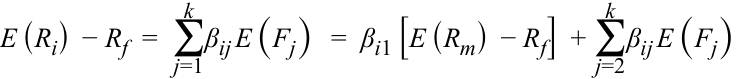

<!-- Formula Text: E (R i)  − R f  =  ∑ j=1 k β ij E (F j)   =  β i1 [E (R m)  − R f]  + ∑ j=2 k β ij E (F j) -->

The model has _k_ factors, _E_ ( _F_ 1), _E_ ( _F_ 2), ... _E_ ( _Fk_ ). The coefficients, β _ij_ , are the factor weights (sometimes called factor loadings) associated with each factor. The left-hand side of the model has the expected excess return (i.e., the expected return over the risk-free rate). The right-hand side provides the risk factors that would generate the return or premium required to assume that risk. We have separated out one factor, _E_ ( _Rm_ ), which represents the market return. All models contain return on the market portfolio as a key factor. 

##### **_Three-Factor and Four-Factor Models_** 

Eugene Fama and Kenneth French1 suggested that a return-generating model for stock returns should include relative market capitalization of the company (“size”) relative book-to-market value of the company in addition to beta. Fama and French found that past returns could be explained better with their model than with other models available at that time, most notably, the capital asset pricing model. Mark Carhart (1997) extended the Fama and French model by adding another factor: momentum, defined as relative past stock returns. 

##### **_The Single-Index Model_** 

The simplest form of a return-generating model is a single-factor linear model, in which only one factor is considered. The most common implementation is a single-index model, which uses the market factor in the following form: _E_ ( _Ri_ ) – _Rf_ = β _i_ [ _E_ ( _Rm_ ) – _Rf_ ]. 

Although the single-index model is simple, it fits nicely with the capital market line. Recall that the CML is linear, with an intercept of _Rf_ and a slope of [ _E_ ( _Rm_ ) – _Rf_ ]/σ _m_ . We can rewrite the CML by moving the intercept to the left-hand side of the equation, rearranging the terms, and generalizing the subscript from _p_ to _i_ , for any security: 

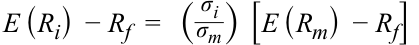

<!-- Formula Text: E (R i)  − R f  =   ( σ i _ σ m )  [E (R m)  − R f] -->

<!-- PDF Page 89 -->

The factor loading or factor weight, σ _i_ /σ _m_ , refers to the ratio of total security risk to total market risk. To obtain a better understanding of factor loading and to illustrate that the CML reduces to a single-index model, we decompose total risk into its components. 

### **Decomposition of Total Risk for a Single-Index Model** 

With the introduction of return-generating models, particularly the single-index model, we are able to decompose total variance into systematic and nonsystematic variances. Instead of using expected returns in the single index, let us use realized returns. The difference between expected returns and realized returns is attributable to non-market changes, as an error term, _ei_ , in the second equation below: 

<!-- Formula Text: E(Ri) – Rf = βi[E(Rm) – Rf] -->

and 

<!-- Formula Text: Ri – Rf = βi(Rm – Rf) + ei -->

The variance of realized returns can be expressed in the equation below (note that _Rf_ is a constant). We can further drop the covariance term in this equation because, by definition, any non-market return is uncorrelated with the market. Thus, we are able to decompose total variance into systematic and nonsystematic variances in the second equation below: 

<!-- Formula Text: σ i 2  =  β i 2 σ m 2  + σ e 2 + 2Cov (R m, e i) -->

Total variance = Systematic variance + Nonsystematic variance, which can be written as 

<!-- Formula Text: σ i 2  =  β i 2 σ m 2  + σ e 2 -->

Total risk can be expressed as 

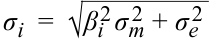

<!-- Formula Text: σ i  =  √ _ β i 2 σ m 2  + σ e 2 -->

Because nonsystematic risk is zero for well-diversified portfolios, such as the market portfolio, the total risk of a market portfolio and other similar portfolios is only systematic risk, which is β _i_ σ _m_ . We can now return to the CML discussed in the previous subsection and replace σ _i_ with β _i_ σ _m_ because the CML assumes that the market is a diversified portfolio. By making this substitution for the above equation, we get the following single-index model: 

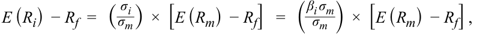

<!-- Formula Text: E (R i)  − R f  =   ( σ i _ σ m )  ×  [E (R m)  − R f]   =   ( β i σ m _ σ m  )  ×  [E (R m)  − R f] , -->

_E_ ( _Ri_ ) – _Rf_ = β _i_ [ _E_ ( _Rm_ ) – _Rf_ ] 

Thus, the CML, which holds only for well-diversified portfolios, is fully consistent with a single-index model. 

In summary, total variance may be decomposed into systematic and nonsystematic variances and the CML is the same as a single-index model for diversified portfolios. 

### **Return-Generating Models: The Market Model** 

The most common implementation of a single-index model is the **market model** , in which the market return is the single factor or single index. In principle, the market model and the single-index model are similar. The difference is that the market model is easier to work with and is normally used for estimating beta risk and computing abnormal returns. The market model is 

_Ri_ = α _i_ + β _iRm_ + _ei_ 

<!-- PDF Page 90 -->

To be consistent with the previous section, α _i_ = _Rf_ (1 – β). The intercept, α _i_ , and slope coefficient, β _i_ , can be estimated by using historical security and market returns. These parameter estimates are then used to predict company-specific returns that a security may earn in a future period. Assume that a regression of Wal-Mart’s historical daily returns on S&P 500 daily returns gives an α _i_ of 0.0001 and a β _i_ of 0.9. Thus, Wal-Mart’s expected daily return = 0.0001 + 0.90 × _Rm_ . If, on a given day the market rises by 1 percent and Wal-Mart’s stock rises by 2 percent, then Wal-Mart’s company-specific return ( _ei_ ) for that day = _Ri_ − _E_ ( _Ri_ ) = _Ri_ – (α _i_ + β _iRm_ ) = 0.02 – (0.0001 + 0.90 × 0.01) = 0.0109, or 1.09%. In other words, Wal-Mart earned an abnormal return of 1.09 percent on that day. 

# **<mark>7</mark> CALCULATION AND INTERPRETATION OF BETA** 

calculate and interpret beta 

We begin with the single-index model introduced earlier using realized returns and rewrite it as 

<!-- Formula Text: Ri = (1 – βi)Rf + βi × Rm + ei -->

Because systematic risk depends on the correlation between the asset and the market, we can arrive at a measure of systematic risk from the covariance between _Ri_ and _Rm_ , where _Ri_ is defined using the above equation. Note that the risk-free rate is a constant, so the first term in _Ri_ drops out. 

<!-- Formula Text: Cov (R i, R m)    =   Cov (β i × R m + e i, R m) = β i Cov (R m, R m)   +  Cov (e i, R m) = β i σ m 2  + 0 -->

The first term is beta multiplied by the variance of _Rm_ . Because the error term is uncorrelated with the market, the second term drops out. Then, we can rewrite the equation in terms of beta as follows: 

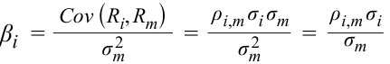

<!-- Formula Text: β i  = Cov (R i, R m) _ σ m 2 = ρ i,m σ i σ m _ σ m 2 = ρ i,m σ i _ σ m -->

The above formula shows the expression for beta, β _i_ , which is similar to the factor loading in the single-index model presented earlier. For example, if the correlation between an asset and the market is 0.70 and the asset and market have standard deviations of return of 0.25 and 0.15, respectively, the asset’s beta would be (0.70)(0.25)/0.15 = 1.17. If the asset’s covariance with the market and market variance were given as 0.026250 and 0.02250, respectively, the calculation would be 0.026250/0.02250 = 1.17. The beta in the market model includes an adjustment for the correlation between asset _i_ and the market because the market model covers all assets whereas the CML works only for fully diversified portfolios. 

As shown in the above equation, **beta** is a measure of how sensitive an asset’s return is to the market as a whole and is calculated as the covariance of the return on _i_ and the return on the market divided by the variance of the market return; that expression is equivalent to the product of the asset’s correlation with the market with a ratio of standard deviations of return (i.e., the ratio of the asset’s standard deviation to the market’s). As we have shown, beta captures an asset’s systematic risk, or the portion of an asset’s risk that cannot be eliminated by diversification. The variances and correlations required for the calculation of beta are usually based on historical returns. 

<!-- PDF Page 91 -->

A positive beta indicates that the return of an asset follows the general market trend, whereas a negative beta shows that the return of an asset generally follows a trend that is opposite to that of the market. In other words, a positive beta indicates that the return of an asset moves in the same direction of the market, whereas a negative beta indicates that the return of an asset moves in the opposite direction of the market. A risk-free asset’s beta is zero because its covariance with other assets is zero. In other words, a beta of zero indicates that the asset’s return has no correlation with movements in the market. The market’s beta can be calculated by substituting σ _m_ for σ _i_ in the numerator. Also, any asset’s correlation with itself is 1, so the beta of the market is 1: 

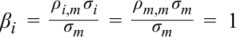

<!-- Formula Text: β i  = ρ i,m σ i _ σ m    = ρ m,m σ m _ σ m    =  1 -->

Because the market’s beta is 1, the average beta of stocks in the market, by definition, is 1. In terms of correlation, most stocks, especially in developed markets, tend to be highly correlated with the market, with correlations in excess of 0.70. Some US broad market indexes, such as the S&P 500, the Dow Jones 30, and the NASDAQ 100, have even higher correlations that are in excess of 0.90. The correlations among different sectors are also high, which shows that companies have similar reactions to the same economic and market changes. As a consequence and as a practical matter, finding assets that have a consistently negative beta is unusual because of the market’s broad effects on all assets. 

##### **EXAMPLE 5** 

### **Calculation of Beta** 

Assuming that the risk (standard deviation) of the market is 25 percent, calculate the beta for the following assets: 

<mark>_</mark> _ρi_ , _m σi_ We use the formula for beta in answering the above questions: _βi_ = _σm_ 

1. A short-term US Treasury bill. 

#### **Solution:** 

By definition, a short-term US Treasury bill has zero risk. Therefore, its beta is zero. 

2. Gold, which has a standard deviation equal to the standard deviation of the market but a zero correlation with the market. 

#### **Solution:** 

Because the correlation of gold with the market is zero, its beta is zero. 

3. A new emerging market that is not currently included in the definition of “market”—the emerging market’s standard deviation is 60 percent, and the correlation with the market is –0.1. 

#### **Solution:** 

Beta of the emerging market is –0.1 × 0.60 ÷ 0.25 = –0.24. 

<!-- PDF Page 92 -->

4. An initial public offering or new issue of stock with a standard deviation of 40 percent and a correlation with the market of 0.7 (IPOs are usually very risky but have a relatively low correlation with the market). 

#### **Solution:** 

Beta of the initial public offering is 0.7 × 0.40 ÷ 0.25 = 1.12. 

### **Estimation of Beta** 

An alternative and more practical approach is to estimate beta directly by using the market model described above. The market model, _Ri_ = α _i_ + β _iRm_ + _ei_ , is estimated by using regression analysis, which is a statistical process that evaluates the relationship between a given variable (the dependent variable) and one or more other (independent) variables. Historical security returns ( _Ri_ ) and historical market returns ( _Rm_ ) are inputs used for estimating the two parameters α _i_ and β _i_ . 

Regression analysis is similar to plotting all combinations of the asset’s return and the market return ( _Ri_ , _Rm_ ) and then drawing a line through all points such that it minimizes the sum of squared linear deviations from the line. Exhibit 6 illustrates the market model and the estimated parameters. The intercept, α _i_ (sometimes referred to as the constant), and the slope term, β _i_ , are all that is needed to define the security characteristic line and obtain beta estimates. 

**Exhibit 6: Beta Estimation Using a Plot of Security and Market Returns** 

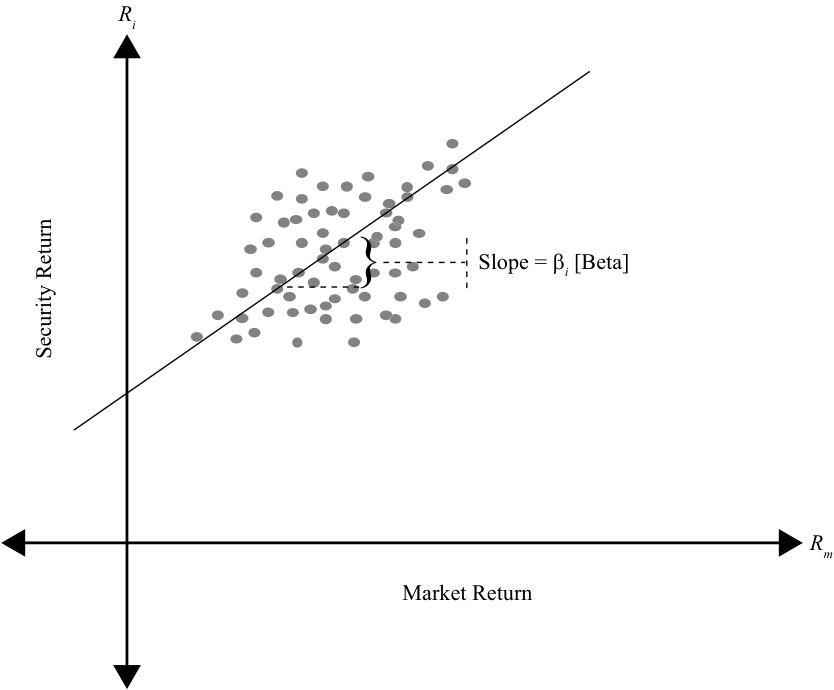

<!-- Start of picture text -->
Ri Slope = β i  [Beta] Rm Market Return Security Return <!-- End of picture text -->

Although beta estimates are important for forecasting future levels of risk, there is much concern about their accuracy. In general, shorter periods of estimation (e.g., 12 months) represent betas that are closer to the asset’s current level of systematic risk. Shorter period beta estimates, however, are also less accurate than beta estimates measured over three to five years because they may be affected by special events in that 

<!-- PDF Page 93 -->

short period. Although longer period beta estimates are more accurate, they may be a poor representation of future expectations, especially if major changes in the asset have occurred. Therefore, it is necessary to recognize that estimates of beta, whether obtained through calculation or regression analysis, may or may not represent current or future levels of an asset’s systematic risk. 

### **Beta and Expected Return** 

Although the single-index model, also called the **capital asset pricing model** (CAPM), will be discussed in greater detail in the next section, we will use the CAPM in this section to estimate returns, given asset betas. The CAPM is usually written with the risk-free rate on the right-hand side: 

_E_ ( _Ri_ ) = _Rf_ + β _i_ [ _E_ ( _Rm_ ) – _Rf_ ] 

The model shows that the primary determinant of expected return for a security is its beta, or how well the security correlates with the market. The higher the beta of an asset, the higher its expected return will be. Assets with a beta greater than 1 have an expected return that is higher than the market return, whereas assets with a beta of less than 1 have an expected return that is less than the market return. 

In certain cases, assets may require a return less than the risk-free return. For example, if an asset’s beta is negative, the required return will be less than the risk-free rate. When combined with the market, the asset reduces the risk of the overall portfolio, which makes the asset very valuable. Insurance is one such asset. Insurance gives a positive return when the insured’s wealth is reduced because of a catastrophic loss. In the absence of such a loss or when the insured’s wealth is growing, the insured is required to pay an insurance premium. Thus, insurance has a negative beta and a negative expected return, but helps in reducing overall risk. 

##### **EXAMPLE 6** 

### **Calculation of Expected Return** 

Alpha Natural Resources (ANR), a coal producer, buys a large but privately held coal producer in China. As a result of the cross-border acquisition of a private company, ANR’s standard deviation of returns is reduced from 50 percent to 30 percent and its correlation with the market falls from 0.95 to 0.75. Assume that the standard deviation and return of the market remain unchanged at 25 percent and 10 percent, respectively, and that the risk-free rate is 3 percent. 

1. Calculate the beta of ANR stock and its expected return before the acquisition. 

#### **Solution:** 

Using the formula for β _i_ , we can calculate β _i_ and then the return. 

<!-- Formula Text: β i  = ρ i,m σ i _ σ m    =   0.95 × 0.50 _ 0.25 =  1.90 E(Ri) = Rf + βi[E(Rm) – Rf] = 0.03 + 1.90 × (0.10 – 0.03) = 0.163 = 16.3% -->

2. Calculate the expected return after the acquisition. 

#### **Solution:** 

We follow the same procedure but with the after-acquisition correlation and risk. 

<!-- PDF Page 94 -->

<!-- Formula Text: β i  = ρ i,m σ i _ σ m    =   0.75 × 0.30 _ 0.25 =  0.90 -->

_E_ ( _Ri_ ) = _Rf_ + β _i_ [ _E_ ( _Rm_ ) – _Rf_ ] = 0.03 + 0.90 × (0.10 – 0.03) = 0.093 = 9.3% 

The market risk premium is 7 percent (10% – 3%). As the beta changes, the change in the security’s expected return is the market risk premium multiplied by the change in beta. In this scenario, ANR’s beta decreased by 1.0, so the new expected return for ANR is 7 percentage points lower. 

Mr. Miles observes the strong demand for iPods and iPhones and wants to invest in Apple stock. Unfortunately, Mr. Miles doesn’t know the return he should expect from his investment. He has been given a risk-free rate of 3 percent, a market return of 10 percent, and Apple’s beta of 1.5. 

3. Calculate Apple’s expected return. 

#### **Solution:** 

_E_ ( _Ri_ ) = _Rf_ + β _i_ [ _E_ ( _Rm_ ) – _Rf_ ] = 0.03 + 1.5 × (0.10 – 0.03) = 0.135 = 13.5% 

4. An analyst looking at the same information decides that the past performance of Apple is not representative of its future performance. He decides that, given the increase in Apple’s market capitalization, Apple acts much more like the market than before and thinks Apple’s beta should be closer to 1.1. What is the analyst’s expected return for Apple stock? 

#### **Solution:** 

_E_ ( _Ri_ ) = _Rf_ + β _i_ [ _E_ ( _Rm_ ) – _Rf_ ] = 0.03 + 1.1 × (0.10 – 0.03) = 0.107 = 10.7% 

This example illustrates the lack of connection between estimation of past returns and projection into the future. Investors should be aware of the limitations of using past returns for estimating future returns. 

# **<mark>8</mark>** 

## **CAPITAL ASSET PRICING MODEL: ASSUMPTIONS AND THE SECURITY MARKET LINE** 

explain the capital asset pricing model (CAPM), including its assumptions, and the security market line (SML) calculate and interpret the expected return of an asset using the CAPM 

The capital asset pricing model is one of the most significant innovations in portfolio theory. The model is simple, yet powerful; is intuitive, yet profound. The CAPM was introduced independently by William Sharpe, John Lintner, Jack Treynor, and Jan Mossin and builds on Harry Markowitz’s earlier work on diversification and modern portfolio theory.2 The model provides a linear expected return–beta relationship that 

<!-- PDF Page 95 -->

precisely determines the expected return given the beta of an asset. In doing so, it makes the transition from total risk to systematic risk, the primary determinant of expected return. Recall the following equation: 

_E_ ( _Ri_ ) = _Rf_ + β _i_ [ _E_ ( _Rm_ ) – _Rf_ ] 

The CAPM asserts that the expected returns of assets vary only by their systematic risk as measured by beta. Two assets with the same beta will have the same expected return irrespective of the nature of those assets. Given the relationship between risk and return, all assets are defined only by their beta risk, which we will explain as the assumptions are described. 

In the remainder of this section, we will examine the assumptions made in arriving at the CAPM and the limitations those assumptions entail. Second, we will implement the CAPM through the security market line to price any portfolio or asset, both efficient and inefficient. Finally, we will discuss ways in which the CAPM can be applied to investments, valuation, and capital budgeting. 

### **Assumptions of the CAPM** 

Similar to all other models, the CAPM ignores many of the complexities of financial markets by making simplifying assumptions. These assumptions allow us to gain important insights into how assets are priced without complicating the analysis. Once the basic relationships are established, we can relax the assumptions and examine how our insights need to be altered. Some of these assumptions are constraining, whereas others are benign. And other assumptions affect only a particular set of assets or only marginally affect the hypothesized relationships. 

**1.** **_Investors are risk-averse, utility-maximizing, rational individuals._** 

Risk aversion means that investors expect to be compensated for accepting risk. Note that the assumption does not require investors to have the same degree of risk aversion; it only requires that they are averse to risk. Utility maximization implies that investors want higher returns, not lower returns, and that investors always want more wealth (i.e., investors are never satisfied). Investors are understood to be rational in that they correctly evaluate and analyze available information to arrive at rational decisions. Although rational investors may use the same information to arrive at different estimates of expected risk and expected returns, homogeneity among investors (see Assumption 4) requires that investors be rational individuals. 

Risk aversion and utility maximization are generally accepted as reflecting a realistic view of the world. Yet, rationality among investors has been questioned because investors may allow their personal biases and experiences to disrupt their decision making, resulting in suboptimal investments. Nonetheless, the model’s results are unaffected by such irrational behavior as long as it does not affect prices in a significant manner (i.e., the trades of irrational investors cancel each other or are dominated by the trades of rational investors). 

**2.** **_Markets are frictionless, including no transaction costs and no taxes._** 

Frictionless markets allow us to abstract the analysis from the operational characteristics of markets. In doing so, we do not allow the risk–return relationship to be affected by, for example, the trading volume on the New York Stock Exchange or the difference between buying and selling prices. Specifically, frictionless markets do not have transaction costs, taxes, or any costs or restrictions on short selling. We also assume that borrowing and lending at the risk-free rate is possible. 

<!-- PDF Page 96 -->

The transaction costs of many large institutions are negligible, and many institutions do not pay taxes. Even the presence of non-zero transaction costs, taxes, or the inability to borrow at the risk-free rate does not materially affect the general conclusions of the CAPM. Costs of short selling or restrictions on short selling, however, can introduce an upward bias in asset prices, potentially jeopardizing important conclusions of the CAPM. 

##### **3.** **_Investors plan for the same single holding period._** 

The CAPM is a single-period model, and all investor decisions are made on the basis of that one period. The assumption of a single period is applied for convenience because working with multi-period models is more difficult. A single-period model, however, does not allow learning to occur, and bad decisions can persist. In addition, maximizing utility at the end of a multi-period horizon may require decisions in certain periods that may seem suboptimal when examined from a single-period perspective. Nonetheless, the single holding period does not severely limit the applicability of the CAPM to multi-period settings. 

##### **4.** **_Investors have homogeneous expectations or beliefs._** 

This assumption means that all investors analyze securities in the same way using the same probability distributions and the same inputs for future cash flows. In addition, given that they are rational individuals, the investors will arrive at the same valuations. Because their valuations of all assets are identical, they will generate the same optimal risky portfolio, which we call the market portfolio. 

The assumption of homogeneous beliefs can be relaxed as long as the differences in expectations do not generate significantly different optimal risky portfolios. 

**5.** **_All investments are infinitely divisible._** 

This assumption implies that an individual can invest as little or as much as he or she wishes in an asset. This supposition allows the model to rely on continuous functions rather than on discrete jump functions. The assumption is made for convenience only and has an inconsequential impact on the conclusions of the model. 

**6.** **_Investors are price takers._** 

The CAPM assumes that there are many investors and that no investor is large enough to influence prices. Thus, investors are price takers, and we assume that security prices are unaffected by investor trades. This assumption is generally true because even though investors may be able to affect prices of small stocks, those stocks are not large enough to affect the primary results of the CAPM. 

The main objective of these assumptions is to create a marginal investor who rationally chooses a mean–variance-efficient portfolio in a predictable fashion. We assume away any inefficiency in the market from both operational and informational perspectives. Although some of these assumptions may seem unrealistic, relaxing most of them will have only a minor influence on the model and its results. Moreover, the CAPM, with all its limitations and weaknesses, provides a benchmark for comparison and for generating initial return estimates. 

<!-- PDF Page 97 -->

### **The Security Market Line** 

In this subsection, we apply the CAPM to the pricing of securities. The **security market line** (SML) is a graphical representation of the capital asset pricing model with beta, reflecting systematic risk, on the _x_ -axis and expected return on the _y_ -axis. Using the same concept as the capital market line, the SML intersects the _y_ -axis at the risk-free rate of return, and the slope of this line is the market risk premium, _Rm_ – _Rf_ . Recall that the capital market line (CML) does not apply to all securities or assets but only to portfolios on the efficient frontier. The efficient frontier gives optimal combinations of expected return and total risk. In contrast, the security market line applies to any security, efficient or not. Total risk and systematic risk are equal only for efficient portfolios because those portfolios have no diversifiable risk remaining. 

Exhibit 7 is a graphical representation of the CAPM, the security market line. As shown earlier in this reading, the beta of the market is 1 ( _x_ -axis) and the market earns an expected return of _Rm_ ( _y_ -axis). Using this line, it is possible to calculate the expected return of an asset. The next example illustrates the beta and return calculations. 

**Exhibit 7: The Security Market Line** 

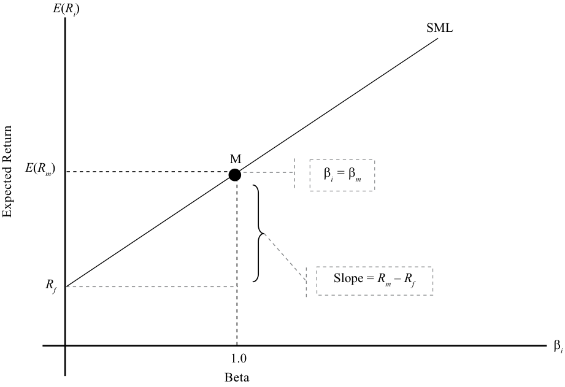

<!-- Start of picture text -->
E ( Ri ) SML M E ( Rm ) β i =  β m Slope =  Rm  –  Rf Rf β i 1.0 Beta Expected Return <!-- End of picture text -->

##### **EXAMPLE 7** 

### **Security Market Line and Expected Return** 

1. Suppose the risk-free rate is 3 percent, the expected return on the market portfolio is 13 percent, and its standard deviation is 23 percent. An Indian company, Bajaj Auto, has a standard deviation of 50 percent but is uncorrelated with the market. Calculate Bajaj Auto’s beta and expected return. 

#### **Solution:** 

Using the formula for β _i_ , we can calculate β _i_ and then the return. 

<!-- PDF Page 98 -->

<!-- Formula Text: β i  = ρ i,m σ i _ σ m    =   0.0 × 0.50 _ 0.23    =  0 -->

_E_ ( _Ri_ ) = _Rf_ + β _i_ [ _E_ ( _Rm_ ) – _Rf_ ] = 0.03 + 0 × (0.13 – 0.03) = 0.03 = 3.0% 

Because of its zero correlation with the market portfolio, Bajaj Auto’s beta is zero. Because the beta is zero, the expected return for Bajaj Auto is the riskfree rate, which is 3 percent. 

2. Suppose the risk-free rate is 3 percent, the expected return on the market portfolio is 13 percent, and its standard deviation is 23 percent. A German company, Mueller Metals, has a standard deviation of 50 percent and a correlation of 0.65 with the market. Calculate Mueller Metal’s beta and expected return. 

#### **Solution:** 

Using the formula for β _i_ , we can calculate β _i_ and then the return. 

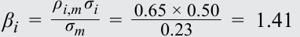

<!-- Formula Text: β i  = ρ i,m σ i _ σ m    =   0.65 × 0.50 _ 0.23 =  1.41 -->

_E_ ( _Ri_ ) = _Rf_ + β _i_ [ _E_ ( _Rm_ ) – _Rf_ ] = 0.03 + 1.41× (0.13 – 0.03) = 0.171 = 17.1% Because of the high degree of correlation with the market, the beta for Mueller Metals is 1.41 and the expected return is 17.1 percent. Because Mueller Metals has systematic risk that is greater than that of the market, it has an expected return that exceeds the expected return of the market. 

##### **_Portfolio Beta_** 

As we stated above, the security market line applies to all securities. But what about a combination of securities, such as a portfolio? Consider two securities, 1 and 2, with a weight of _wi_ in Security 1 and the balance in Security 2. The return for the two securities and return of the portfolio can be written as: 

<!-- Formula Text: E (R 1)   =  R f + β 1 [E (R m)  − R f] E (R 2)   =  R f + β 2 [E (R m)  − R f] -->

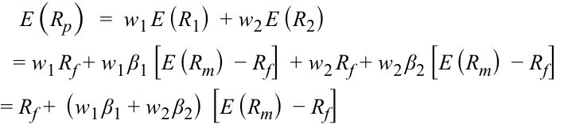

<!-- Formula Text: E (R p)   =  w 1 E (R 1)  + w 2 E (R 2) = w 1 R f + w 1 β 1 [E (R m)  − R f]  + w 2 R f + w 2 β 2 [E (R m)  − R f] = R f +  (w 1 β 1 + w 2 β 2)  [E (R m)  − R f] -->

The last equation gives the expression for the portfolio’s expected return. From this equation, we can conclude that the portfolio’s beta = _w_ 1β1 + _w_ 2β2. In general, the portfolio beta is a weighted sum of the betas of the component securities and is given by: 

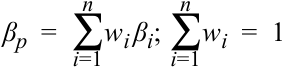

<!-- Formula Text: β p  =  ∑ i=1 n w i β i; ∑ i=1 n w i  =  1 -->

The portfolio’s return given by the CAPM is 

<!-- Formula Text: E(Rp) = Rf + βp[E(Rm) – Rf] -->

This equation shows that a linear relationship exists between the expected return of a portfolio and the systematic risk of the portfolio as measured by β _p_ . 

<!-- PDF Page 99 -->

##### **EXAMPLE 8** 

### **Portfolio Beta and Return** 

1. You invest 20 percent of your money in the risk-free asset, 30 percent in the market portfolio, and 50 percent in RedHat, a US stock that has a beta of 2.0. Given that the risk-free rate is 4 percent and the market return is 16 percent, what are the portfolio’s beta and expected return? 

### **Solution:** 

The beta of the risk-free asset = 0, the beta of the market = 1, and the beta of RedHat is 2.0. The portfolio beta is 

β _p_ = _w_ 1β1 + _w_ 2β _2_ + _w_ 3β3 = (0.20 × 0.0) + (0.30 × 1.0) + (0.50 × 2.0) = 1.30 

_E_ ( _Rp_ ) = _Rf_ + β _i_ [ _E_ ( _Rm_ ) – _Rf_ ] = 0.04 + 1.30 × (0.16 – 0.04) = 0.196 = 19.6% The portfolio beta is 1.30, and its expected return is 19.6 percent. 

### **Alternate Method:** 

Another method for calculating the portfolio’s return is to calculate individual security returns and then use the portfolio return formula (i.e., weighted average of security returns) to calculate the overall portfolio return. 

Return of the risk-free asset = 4 percent; return of the market = 16 percent RedHat’s return based on its beta = 0.04 + 2.0 × (0.16 – 0.04) = 0.28 Portfolio return = (0.20 × 0.04) + (0.30 × 0.16) + (0.50 × 0.28) = 0.196 = 19.6% 

Not surprisingly, the portfolio return is 19.6 percent, as calculated in the first method. 

## **CAPITAL ASSET PRICING MODEL: APPLICATIONS** 

# **<mark>9</mark>** 

calculate and interpret the expected return of an asset using the CAPM 

describe and demonstrate applications of the CAPM and the SML 

The CAPM offers powerful and intuitively appealing predictions about risk and the relationship between risk and return. The CAPM is not only important from a theoretical perspective but is also used extensively in practice. In this section, we will discuss some common applications of the model. When applying these tools to different scenarios, it is important to understand that the CAPM and the SML are functions that give an indication of what the return in the market _should_ be, given a certain level of risk. The actual return may be quite different from the expected return. 

<!-- PDF Page 100 -->

Applications of the CAPM include estimates of the expected return for capital budgeting, comparison of the actual return of a portfolio or portfolio manager with the CAPM return for performance appraisal, and the analysis of alternate return estimates and the CAPM returns as the basis for security selection. The applications are discussed in more detail in this section. 

### **Estimate of Expected Return** 

Given an asset’s systematic risk, the expected return can be calculated using the CAPM. Recall that the price of an asset is the sum of all future cash flows discounted at the required rate of return, where the discount rate or the required rate of return is commensurate with the asset’s risk. The expected rate of return obtained from the CAPM is normally the first estimate that investors use for valuing assets, such as stocks, bonds, real estate, and other similar assets. The required rate of return from the CAPM is also used for capital budgeting and determining the economic feasibility of projects. Again, recall that when computing the net present value of a project, investments and net revenues are considered cash flows and are discounted at the required rate of return. The required rate of return, based on the project’s risk, is calculated using the CAPM. 

Because risk and return underlie almost all aspects of investment decision making, it is not surprising that the CAPM is used for estimating expected return in many scenarios. Other examples include calculating the cost of capital for regulated companies by regulatory commissions and setting fair insurance premiums. The next example shows an application of the CAPM to capital budgeting. 

##### **EXAMPLE 9** 

### **Application of the CAPM to Capital Budgeting** 

GlaxoSmithKline Plc is examining the economic feasibility of developing a new medicine. The initial investment in Year 1 is $500 million. The investment in Year 2 is $200 million. There is a 50 percent chance that the medicine will be developed and will be successful. If that happens, GlaxoSmithKline must spend another $100 million in Year 3, but its income from the project in Year 3 will be $500 million, not including the third-year investment. In Years 4, 5, and 6, it will earn $400 million a year if the medicine is successful. At the end of Year 6, it intends to sell all rights to the medicine for $600 million. If the medicine is unsuccessful, none of GlaxoSmithKline’s investments can be salvaged. Assume that the market return is 12 percent, the risk-free rate is 2 percent, and the beta risk of the project is 2.3. All cash flows occur at the end of each year. 

1. Calculate the expected annual cash flows using the probability of success. 

#### **Solution:** 

There is a 50 percent chance that the cash flows in Years 3–6 will occur. Taking that into account, the expected annual cash flows are: 

Year 1: –$500 million (outflow) 

Year 2: –$200 million (outflow) 

Year 3: 50% of –$100 million (outflow) + 50% of $500 million = $200 million 

Year 4: 50% of $400 million = $200 million 

Year 5: 50% of $400 million = $200 million 

