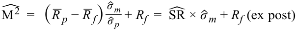
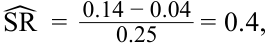
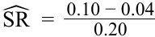
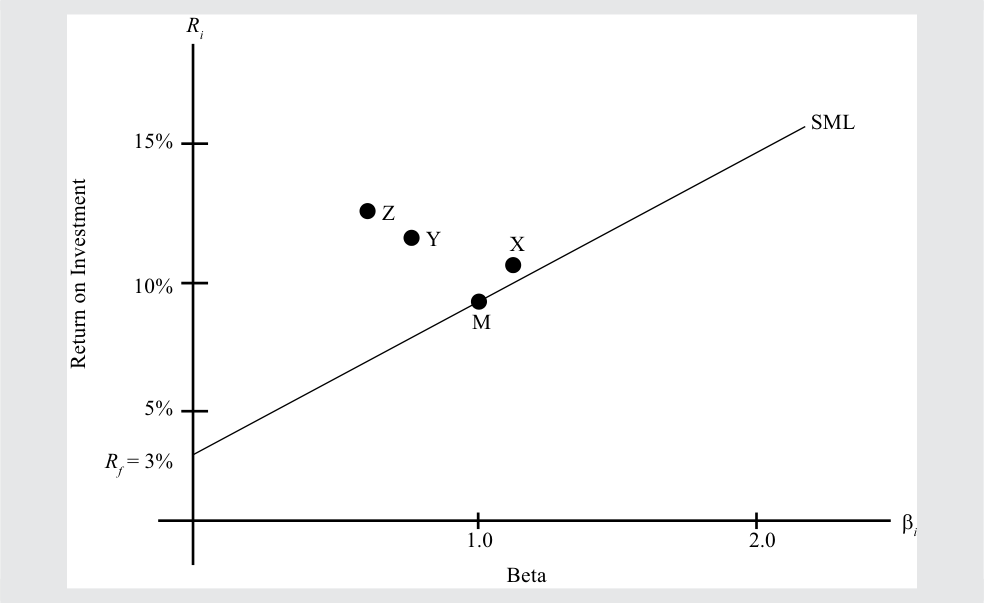

# Volume 9: Portfolio Management
## Learning Module 2 Portfolio Risk and Return: Part II
### Part 3/4: Beyond CAPM: Limitations and Extensions of CAPM (PDF Pages 101–115)

---

<!-- PDF Page 101 -->

Year 6: 50% of $400 million + 50% of $600 million = $500 million 

2. Calculate the expected return. 

#### **Solution:** 

The expected or required return for the project can be calculated using the CAPM, which is = 0.02 + 2.3 × (0.12 – 0.02) = 0.25. 

3. Calculate the net present value. 

#### **Solution:** 

The net present value is the discounted value of all cash flows: 

_NPV_ =  ∑ _T_  C Ft t t_ =0( 1 + _rt_ ) _ _− 200 _200 _200 =− 500( 1 + 0.25)+  ( 1 + 0.25)2 +  ( 1 + 0.25)3 +  ( 1 + 0.25)4 +  _( 1 + 0.25 200)5 + _( 1 + 0.25 500)6 = − 400 − 128 + 102.40 + 81.92 + 65.54 + 131.07 = − 147.07. 

Because the net present value is negative (–$147.07 million), the project should not be accepted by GlaxoSmithKline. 

## **BEYOND CAPM: LIMITATIONS AND EXTENSIONS OF CAPM** 

# **<mark>10</mark>** 

describe and demonstrate applications of the CAPM and the SML 

In general, return-generating models allow us to estimate an asset’s return given its characteristics, where the asset characteristics required for estimating the return are specified in the model. Estimating an asset’s return is important for investment decision making. These models are also important as a benchmark for evaluating portfolio, security, or manager performance. The return-generating models were briefly introduced in Section 3.2.1, and one of those models, the capital asset pricing model, was discussed in detail in Section 4. 

The purpose of this section is to make readers aware that, although the CAPM is an important concept and model, the CAPM is not the only return-generating model. In this section, we revisit and highlight the limitations of the CAPM and preview return-generating models that address some of those limitations. 

### **Limitations of the CAPM** 

The CAPM is subject to theoretical and practical limitations. Theoretical limitations are inherent in the structure of the model, whereas practical limitations are those that arise in implementing the model. 

<!-- PDF Page 102 -->

##### **_Theoretical Limitations of the CAPM_** 

- Single-factor model: Only systematic risk or beta risk is priced in the CAPM. Thus, the CAPM states that no other investment characteristics should be considered in estimating returns. As a consequence, it is prescriptive and easy to understand and apply, although it is very restrictive and inflexible. 

- Single-period model: The CAPM is a single-period model that does not consider multi-period implications or investment objectives of future periods, which can lead to myopic and suboptimal investment decisions. For example, it may be optimal to default on interest payments in the current period to maximize current returns, but the consequences may be negative in the next period. A single-period model like the CAPM is unable to capture factors that vary over time and span several periods. 

##### **_Practical Limitations of the CAPM_** 

In addition to the theoretical limitations, implementation of the CAPM raises several practical concerns, some of which are listed below. 

- Market portfolio: The true market portfolio according to the CAPM includes all assets, financial and nonfinancial, which means that it also includes many assets that are not investable, such as human capital and assets in closed economies. Richard Roll3 noted that one reason the CAPM is not testable is that the true market portfolio is unobservable. 

- Proxy for a market portfolio: In the absence of a true market portfolio, market participants generally use proxies. These proxies, however, vary among analysts, the country of the investor, etc. and generate different return estimates for the same asset, which is impermissible in the CAPM. 

- Estimation of beta risk: A long history of returns (three to five years) is required to estimate beta risk. The historical state of the company, however, may not be an accurate representation of the current or future state of the company. More generally, the CAPM is an _ex ante_ model, yet it is usually applied using _ex post_ data. In addition, using different periods for estimation results in different estimates of beta. For example, a three-year beta is unlikely to be the same as a five-year beta, and a beta estimated with daily returns is unlikely to be the same as the beta estimated with monthly returns. Thus, we are likely to estimate different returns for the same asset depending on the estimate of beta risk used in the model. 

- The CAPM is a poor predictor of returns: If the CAPM is a good model, its estimate of asset returns should be closely associated with realized returns. However, empirical support for the CAPM is weak.4 In other words, tests of the CAPM show that asset returns are not determined only by systematic risk. Poor predictability of returns when using the CAPM is a serious limitation because return-generating models are used to estimate future returns. 

- Homogeneity in investor expectations: The CAPM assumes that homogeneity exists in investor expectations for the model to generate a single optimal risky portfolio (the market) and a single security market line. Without this assumption, there will be numerous optimal risky portfolios and numerous security market lines. Clearly, investors can process the same information in a rational manner and arrive at different optimal risky portfolios. 

<!-- PDF Page 103 -->

### **Extensions to the CAPM** 

Given the limitations of the CAPM, it is not surprising that other models have been proposed to address some of these limitations. These new models are not without limitations of their own, which we will mention while discussing the models. We divide the models into two categories—theoretical models and practical models—and provide one example of each type. 

##### **_Theoretical Models_** 

Theoretical models are based on the same principle as the CAPM but expand the number of risk factors. The best example of a theoretical model is the arbitrage pricing theory (APT), which was developed by Stephen Ross.5 Like the CAPM, APT proposes a linear relationship between expected return and risk: 

_E_ ( _Rp_ ) = _RF_ + λ1β _p_ ,1 + ... + λ _K_ β _p_ , _K_ 

where 

- _E_ ( _Rp_ ) = the expected return of portfolio _p_ 

- _RF_ = the risk-free rate 

- λ _j_ = the risk premium (expected return in excess of the risk-free rate) for factor _j_ 

- β _p_ , _j_ = the sensitivity of the portfolio to factor _j_ 

- _K_ = the number of risk factors 

Unlike the CAPM, however, APT allows numerous risk factors—as many as are relevant to a particular asset. Moreover, other than the risk-free rate, the risk factors need not be common and may vary from one asset to another. A no-arbitrage condition in asset markets is used to determine the risk factors and estimate betas for the risk factors. 

Although it is theoretically elegant, flexible, and superior to the CAPM, APT is not commonly used in practice because it does not specify any of the risk factors and it becomes difficult to identify risk factors and estimate betas for each asset in a portfolio. So from a practical standpoint, the CAPM is preferred to APT. 

##### **_Practical Models_** 

If beta risk in the CAPM does not explain returns, which factors do? Practical models seek to answer this question through extensive research. As mentioned in Section 3.2.1, the best example of such a model is the four-factor model proposed by Fama and French (1992) and Carhart (1997). 

Based on an analysis of the relationship between past returns and a variety of different factors, Fama and French (1992) proposed that three factors seem to explain asset returns better than just systematic risk. Those three factors are relative size, relative book-to-market value, and beta of the asset. With Carhart’s (1997) addition of relative past stock returns, the model can be written as follows: 

_E_ ( _Rit_ )  = _αi_ + _βi_ , _MKT MK Tt_ + _βi_ , _SMB SM Bt_ + _βi_ , _HML HM Lt_ + _βi_ , _UMD UM Dt_ 

<!-- PDF Page 104 -->

where 

- _E_ ( _Ri_ ) = the return on an asset in excess of the one-month T-bill return 

- _MKT_ = the excess return on the market portfolio 

- _SMB_ = the difference in returns between small-capitalization stocks and large-capitalization stocks (size) 

- _HML =_ the difference in returns between high-book-to-market stocks and low-book-to-market stocks (value versus growth) 

- _UMD_ = the difference in returns of the prior year’s winners and losers (momentum) 

Historical analysis shows that the coefficient on _MKT_ is not significantly different from zero, which implies that stock return is unrelated to the market. The factors that explain stock returns are size (smaller companies outperform larger companies), book-to-market ratio (value companies outperform glamour companies), and momentum (past winners outperform past losers). 

The four-factor model has been found to predict asset returns much better than the CAPM and is extensively used in estimating returns for US stocks. 

Two observations are in order. First, the model is not underpinned by a theory of market equilibrium, as is the case for the CAPM. Second, there is no assurance that the model will continue to work well in the future. 

# **<mark>11</mark>** 

## **PORTFOLIO PERFORMANCE APPRAISAL MEASURES** 

calculate and interpret the Sharpe ratio, Treynor ratio, _M_2 , and Jensen’s alpha 

In the investment industry, **performance evaluation** refers to the measurement, attribution, and appraisal of investment results. In particular, performance evaluation provides information about the return and risk of investment portfolios over specified investment period(s). By providing accurate data and analysis on investment decisions and their consequences, performance evaluation allows portfolio managers to take corrective measures to improve investment decision-making and management processes. Performance evaluation information helps in understanding and controlling investment risk and should, therefore, lead to improved risk management. Performance evaluation seeks to answer the following questions: 

- What was the investment portfolio’s past performance, and what may be expected in the future? 

Answering this question is the subject of performance measurement. _Performance measurement is concerned with the measurement of return and risk_ . 

- How did the investment portfolio produce its observed performance, and what are the expected sources of expected future performance? 

<!-- PDF Page 105 -->

Answering this question is the subject of performance attribution. _Performance attribution is concerned with identifying and quantifying the sources of performance of a portfolio_ . 

- Was the observed investment portfolio’s performance the result of investment skill or luck? 

Answering this question is the subject of performance appraisal. _Performance appraisal is concerned with identifying and measuring investment skill_ . 

The information provided by performance evaluation is of great interest to all stakeholders in the investment management process because of its value in evaluating the overall quality of the investment management process as well as individual investment decisions. 

In this reading, performance appraisal is based only on the CAPM. However, it is easy to extend this analysis to multi-factor models that may include industry or other special factors. Four ratios are commonly used in performance appraisal. 

### **The Sharpe Ratio** 

Performance has two components, risk and return. Although return maximization is a laudable objective, comparing just the return of a portfolio with that of the market is not sufficient. Because investors are risk averse, they will require compensation for higher risk in the form of higher returns. A commonly used measure of performance is the **Sharpe ratio** , which is defined as the portfolio’s risk premium divided by its risk. An appealing feature of the Sharpe ratio is that its use can be justified on a theoretical _ex ante_ (before the fact) basis and _ex post_ (after the fact) values can easily be determined by using readily available market data. The Sharpe ratio is also easy to interpret, essentially being an efficiency ratio relating reward to risks taken. It is the most widely recognized and used appraisal measure. 

The equation below defines the _ex ante_ Sharpe ratio in terms of three inputs: (1) the portfolio’s expected return, _E_ ( _Rp_ ); (2) the risk-free rate of interest, _Rf_ ; and (3) the portfolio’s _ex ante_ standard deviation of returns (return volatility), σ _p_ , a quantitative measure of total risk. 

<!-- Formula Text: SR  = E (R p)  − R F _ σ p -->

The Sharpe ratio can also be used on an _ex post_ basis to evaluate historical risk-adjusted returns. Assume we have a sample of historical data that can be used to determine the sample mean portfolio return, _R__ _p_ ; the standard deviation of the sample returns, here denoted by _σ_ ˆ _p_ ( _sp_ is a familiar notation in other contexts); and the sample mean risk-free rate, _R__ _f_ . The _ex post_ (or realized or historical) Sharpe ratio can then be determined by using the following: 

<!-- Formula Text: ˆ SR   = _ R  p − _ R  F _ ˆ σ  p -->

Recalling the CAL from earlier in the reading, one can see that the Sharpe ratio, also called the reward-to-variability ratio, is simply the slope of the capital allocation line. Note, however, that the ratio uses the _total risk_ of the portfolio, not its systematic risk. The use of total risk is appropriate if the portfolio is an investor’s total portfolio—that is, the investor does not own any other assets. Sharpe ratios of the market and other portfolios can also be calculated in a similar manner. The portfolio with the highest Sharpe ratio has the best risk-adjusted performance, and the one with the lowest Sharpe ratio has the worst risk-adjusted performance, provided that the numerator is positive for all comparison portfolios. If the numerator is negative, the ratio will be less negative for riskier portfolios, resulting in incorrect rankings. 

<!-- PDF Page 106 -->

The Sharpe ratio, however, suffers from two limitations. First, it uses total risk as a measure of risk when only systematic risk is priced. Second, the ratio itself (e.g., 0.2 or 0.3) is not informative. To rank portfolios, the Sharpe ratio of one portfolio must be compared with the Sharpe ratio of another portfolio. Nonetheless, the ease of computation makes the Sharpe ratio a popular tool. 

### **The Treynor Ratio** 

The **Treynor ratio** is a simple extension of the Sharpe ratio and resolves the Sharpe ratio’s first limitation by substituting beta (systematic risk) for total risk. The _ex ante_ and _ex post_ Treynor ratios are provided below. 

<!-- Formula Text: TR  = E (R p)  − R f _ β p ˆ TR   = _ R  p − _ R  f _ ˆ β  p -->

Just like the Sharpe ratio, the numerators must be positive for the Treynor ratio to give meaningful results. In addition, the Treynor ratio does not work for negative-beta assets—that is, the denominator must also be positive for obtaining correct estimates and rankings. Although both the Sharpe and Treynor ratios allow for ranking of portfolios, neither ratio gives any information about the economic significance of differences in performance. For example, assume the Sharpe ratio of one portfolio is 0.75 and the Sharpe ratio for another portfolio is 0.80. The second portfolio is superior, but is that difference meaningful? In addition, we do not know whether either of the portfolios is better than the passive market portfolio. The remaining two measures, M2 and Jensen’s alpha, attempt to address that problem by comparing portfolios while also providing information about the extent of the overperformance or underperformance. 

### **M****2** **: Risk-Adjusted Performance (RAP)** 

**M****2** provides a measure of portfolio return that is adjusted for the total risk of the portfolio relative to that of some benchmark. In 1997, Nobel Prize winner Franco Modigliani and his granddaughter, Leah Modigliani, developed what they called a risk-adjusted performance measure, or RAP. The RAP measure has since become more commonly known as M2 reflecting the Modigliani names. It is related to the Sharpe ratio and ranks portfolios identically, but it has the useful advantage of being denominated in familiar terms of percentage return advantage assuming the same level of total risk as the market. 

M2 borrows from capital market theory by assuming a portfolio is leveraged or de-leveraged until its volatility (as measured by standard deviation) matches that of the market. This adjustment produces a portfolio-specific leverage ratio that equates the portfolio’s risk to that of the market. The portfolio’s excess return times the leverage ratio plus the risk-free rate is then compared with the markets actual return to determine whether the portfolio has outperformed or underperformed the market on a risk-adjusted basis. 

The equations below provide the _ex ante_ and _ex post_ formulas for M2 , where σ _m_ is the standard deviation of the market portfolio and σ _m_ /σ _p_ is the portfolio-specific leverage ratio. Because the Sharpe ratio is defined as 

<!-- Formula Text: E (R p)  − R f _ σ p -->

<!-- PDF Page 107 -->

the equation shows that M2 can be thought of as a rescaling of the Sharpe ratio that allows for easier comparisons among different portfolios. The reason that M2 and Sharpe ratios rank portfolios identically is because, in a given time period—and for any given comparison of the market portfolio—both the risk-free rate and the market volatility are constant across all comparisons. Only the Sharpe ratio differs, so it determines all rankings. 

<!-- Formula Text: M 2  =   [E (R p)  − R f] σ m _ σ p  + R f  =  SR × σ m + R f (ex ante) -->

<!-- Formula Text: ˆ M 2  =   ( _ R  p − _ R  f) ˆ σ  m _ ˆ σ  p  + R f  =  ˆ SR ×  ˆ σ  m + R f (ex post) -->

For example, assume that _R__ _f_ = 4.0%, _R__ _p_ = 14.0%, _σ_ ˆ _p_ = 25.0% and _σ_ ˆ _m_ = 20.0%. The Sharpe ratio is 0.4, 

<!-- Formula Text: ˆ SR  =   0.14 − 0.04 _ 0.25 = 0.4, -->

andˆ _M_2 is 12.0%,ˆ _M_2 = 0.4(0.2) + 0.04 = 0.12 = 12.0%. If the market return was 10%, then the portfolio outperformed the market on a risk-adjusted basis by 12.0% − 10.0% = 2.0%. This difference between the risk-adjusted performance of the portfolio and the performance of the market is frequently referred to as **M****2** **alpha** . 

The Sharpe ratio of the market portfolio is 

<!-- Formula Text: ˆ SR  =   0.10 − 0.04 _ 0.20 -->

= 0.3. Comparing the Sharpe ratio of the portfolio with the Sharpe ratio of the market portfolio shows that the fund outperformed the market. But the 2.0% difference between M2 and the market’s return tells us the risk-adjusted outperformance as a percentage return. 

### **Jensen’s Alpha** 

Like the Treynor ratio, Jensen’s alpha is based on systematic risk. We can measure a portfolio’s systematic risk by estimating the market model, which is done by regressing the portfolio’s daily return on the market’s daily return. The coefficient on the market return is an estimate of the beta risk of the portfolio. We can calculate the risk-adjusted return of the portfolio using the beta of the portfolio and the CAPM. The difference between the actual portfolio return and the calculated risk-adjusted return is a measure of the portfolio’s performance relative to the market portfolio and is called Jensen’s alpha. By definition, α _m_ of the market is zero. Jensen’s alpha is also the vertical distance from the SML measuring the excess return for the same risk as that of the market and is given by 

α _p_ = _Rp_ – { _Rf_ + β _p_ [E( _Rm_ )– _Rf_ ]} 

If the period is long, it may contain different risk-free rates, in which case _Rf_ represents the average risk-free rate. Furthermore, the returns in the equation are all realized, actual returns. The sign of α _p_ indicates whether the portfolio has outperformed the market. If α _p_ is positive, then the portfolio has outperformed the market; if α _p_ is negative, the portfolio has underperformed the market. Jensen’s alpha is commonly used for evaluating most institutional managers, pension funds, and mutual funds. Values of alpha can be used to rank different managers and the performance of their portfolios, as well as the magnitude of underperformance or overperformance. For example, if a portfolio’s alpha is 2 percent and another portfolio’s alpha is 5 percent, the second portfolio has outperformed the first portfolio by 3 percentage points and the market by 5 percentage points. Jensen’s alpha is the maximum amount that you should be willing to pay the manager to manage your money. As with other performance appraisal measures, Jensen’s alpha has _ex ante_ and _ex post_ forms. The use 

<!-- PDF Page 108 -->

context usually clarifies which one is being referred to. Where we want to underscore a reference to _ex post_ Jensen’s alpha based on an estimated beta, _β_ˆ _p_ , and an average 

market return, the notation _α_ ˆ _p_ is used. 

##### **EXAMPLE 10** 

### **Portfolio Performance Evaluation** 

1. A British pension fund has employed three investment managers, each of whom is responsible for investing in one-third of all asset classes so that the pension fund has a well-diversified portfolio. Information about the managers is given below. 

|**Manager**|**Average Return**|ˆ _σ_|ˆ _β_|
|---|---|---|---|
|X|10%|20%|1.1|
|Y|11|10|0.7|
|Z|12|25|0.6|
|Market (M)|9|19||
|Risk-free rate (_Rf_)|3|||

Calculate the expected return for each manager, based on using the average market return and the CAPM. Then also calculate for the managers (ex post) Sharpe ratio, Treynor ratio, M2 alpha, and Jensen’s alpha. Analyze your results and plot the returns and betas of these portfolios. 

### **Solution:** 

In each case, the calculations are shown only for Manager X. All answers are tabulated below. Note that the β of the market is 1 and the σ and β of the risk-free rate are both zero. 

Expected return: _E_ ( _RX_ )  = _Rf_ + _βX_ [ _E_ ( _Rm_ )  − _Rf_ ]  = 0.03 + 1.10 ×( 0.09 − 0.03) = 0.096 = 9.6%  R_  x_ − _R_  f_ _ˆ SR = =0.10 − 0.03 = 0.35 _σ_ ˆ _x_ 0.20  R_  x_ − _R_  f_ _ˆ TR = =0.10 − 0.03 = 0.064 _β_ˆ _x_ 1.1 _ _  σ_ ˆ _m_ _ _ˆ _M_2 =   ( _R x_ − _R f_ ) _σ_ ˆ _x_+ _R f_ = _SR_ˆ × _σ_ ˆ _m_ + _R f_ = 0.35 × 0.19 + 0.03 = 0.0965 = 9.65% 

Since the market return is 9%, M2 alpha is 0.65% (9.65% – 9%). 

_α_ˆ _X_ = _RX_ −   [ _R_  f_ + _β_ˆ _X_ ( _R_  m_ − _R_  f_ ) ]  = 0.10 −( 0.03 + 1.1 × 0.06) = 0.004 = 0.40% 

<!-- PDF Page 109 -->

**Exhibit 8: Measures of Portfolio Performance Evaluation** 

|**Manager**|**_** _R_ _i_|ˆ _σi_|ˆ _βi_|**_E_(****_Ri_)**|**Sharpe Ratio**|**Treynor Ratio**|**M****2****alpha**|ˆ _αi_|
|---|---|---|---|---|---|---|---|---|
|X|10.0%|20.0%|1.10|9.6%|0.35|0.064|0.65%|0.40%|
|Y|11.0|10.0|0.70|7.2|0.80|0.114|9.20|3.80|
|Z|12.0|25.0|0.60|6.6|0.36|0.150|0.84|5.40|
|M|9.0|19.0|1.00|9.0|0.32|0.060|0.00|0.00|
|_Rf_|3.0|0.0|0.00|3.0|–|–|–|0.00|

Let us begin with an analysis of the risk-free asset. Because the risk-free asset has zero risk and a beta of zero, calculating the Sharpe ratio, Treynor ratio, or M2 is not possible because they all require the portfolio risk in the denominator. The risk-free asset’s alpha, however, is zero. Turning to the market portfolio, we see that the absolute measures of performance, the Sharpe ratio and the Treynor ratio, are positive for the market portfolio. These ratios are positive as long as the portfolio earns a return that is in excess of that of the risk-free asset.  Mˆ 2 alpha and _α_ ˆ _i_ are performance measures relative to the market, so they are both equal to zero for the market portfolio. 

All three managers have Sharpe and Treynor ratios greater than those of the market, and all three managers’ M2 alpha and α _i_ are positive; therefore, the pension fund should be satisfied with their performance. Among the three managers, Manager X has the worst performance, irrespective of whether total risk or systematic risk is considered for measuring performance. The relative rankings are depicted in Exhibit 9. 

**Exhibit 9: Ranking of Portfolios by Performance Measure** 

|**Rank**|**Sharpe Ratio**|**Treynor Ratio**|**M****2****alpha**|**α****_i_**|
|---|---|---|---|---|
|1|Y|Z|Y|Z|
|2|Z|Y|Z|Y|
|3|X|X|X|X|
|4|M|M|M|M|
|5|–|–|–|_Rf_|

Comparing Y and Z, we can observe that Y performs much better than Z when total risk is considered. Y has a Sharpe ratio of 0.80, compared with a Sharpe ratio of 0.36 for Z. Similarly, M2 alpha is higher for Y (9.20 percent) than for Z (0.84 percent). In contrast, when systematic risk is used, Z outperforms Y. The Treynor ratio is higher for Z (0.150) than for Y (0.114), and Jensen’s alpha is also higher for Z (5.40 percent) than for Y (3.80 percent), which indicates that Z has done a better job of generating excess return relative to systematic risk than Y. 

Exhibit 10 confirms these observations in that all three managers outperform the benchmark because all three points lie above the SML. Among the three portfolios, Z performs the best when we consider risk-adjusted returns because it is the point in Exhibit 10 that is located northwest relative to the portfolios X and Y. 

<!-- PDF Page 110 -->

##### **Exhibit 10: Portfolios Along the SML** 

<!-- Start of picture text -->
Ri SML 15% Z Y X 10% M 5% Rf  = 3% β i 1.0 2.0 Beta Return on Investment <!-- End of picture text -->

When do we use total risk performance measures like the Sharpe ratio and M2 , and when do we use beta risk performance measures like the Treynor ratio and Jensen’s alpha? Total risk is relevant for an investor when he or she holds a portfolio that is not fully diversified, which is not a desirable portfolio. In such cases, the Sharpe ratio and M2 are appropriate performance measures. Thus, if the pension fund were to choose only one fund manager to manage all its assets, it should choose Manager Y. Performance measures relative to beta risk—Treynor ratio and Jensen’s alpha—are relevant when the investor holds a well-diversified portfolio with negligible diversifiable risk. In other words, if the pension fund is well diversified and only the systematic risk of the portfolio matters, the fund should choose Manager Z. 

The measures of performance evaluation assume that the market portfolio is the correct benchmark. As a result, an error in the benchmark may cause the results to be misleading. For example, evaluating a real estate fund against the S&P 500 is incorrect because real estate has different characteristics than equity. In addition to errors in benchmarking, errors could occur in the measurement of risk and return of the market portfolio and the portfolios being evaluated. Finally, many estimates are based on historical data. Any projections based on such estimates assume that this level of performance will continue in the future. 

# **<mark>12</mark>** 

## **APPLICATIONS OF THE CAPM IN PORTFOLIO CONSTRUCTION** 

calculate and interpret the expected return of an asset using the CAPM 

describe and demonstrate applications of the CAPM and the SML 

<!-- PDF Page 111 -->

This section introduces applications of the CAPM in portfolio construction. First, the security characteristic line, which graphically indicates _ex post_ Jensen’s alpha, is described. If we relax the assumption that investors have the same expectations about risk and return, a positive Jensen’s alpha can be interpreted as an indication of superior information or investment ability. The section on security selection covers that possibility. The last section summarizes how the CAPM and related concepts can be applied to portfolio construction. 

### **Security Characteristic Line** 

Similar to the SML, we can draw a **security characteristic line** (SCL) for a security. The SCL is a plot of the excess return of the security on the excess return of the market. In Exhibit 8, Jensen’s alpha is the intercept and the beta is the slope. The equation of the line can be obtained by rearranging the terms in the expression for Jensen’s alpha and replacing the subscript _p_ with _i_ : 

_Ri_ – _Rf_ = α _i_ + β _i_ ( _Rm_ – _Rf_ ) 

As an example, the SCL is drawn in Exhibit 11 using Manager X’s portfolio from Exhibit 8. The security characteristic line can also be estimated by regressing the excess security return, _Ri_ – _Rf_ , on the excess market return, _Rm_ – _Rf_ . 

**Exhibit 11: The Security Characteristic Line** 

<!-- Start of picture text -->
Ri  –  Rf Slope = β i  [Beta] α i Rm  –  Rf Excess Market Return Excess Security Return <!-- End of picture text -->

### **Security Selection** 

When discussing the CAPM, we assumed that investors have homogeneous expectations and are rational, risk-averse, utility-maximizing investors. With these assumptions, we were able to state that all investors assign the same value to all assets and, therefore, have the same optimal risky portfolio, which is the market portfolio. In other words, we assumed that there is commonality among beliefs about an asset’s 

<!-- PDF Page 112 -->

future cash flows and the required rate of return. Given the required rate of return, we can discount the future cash flows of the asset to arrive at its current value, or price, which is agreed upon by all or most investors. 

In this section, we introduce heterogeneity in beliefs of investors. Because investors are price takers, it is assumed that such heterogeneity does not significantly affect the market price of an asset. The difference in beliefs can relate to future cash flows, the systematic risk of the asset, or both. Because the current price of an asset is the discounted value of the future cash flows, the difference in beliefs could result in an investor-estimated price that is different from the CAPM-calculated price. The CAPM-calculated price is the current market price because it reflects the beliefs of all other investors in the market. If the investor-estimated current price is higher (lower) than the market price, the asset is considered undervalued (overvalued). Therefore, the CAPM is an effective tool for determining whether an asset is undervalued or overvalued and whether an investor should buy or sell the asset. 

Although portfolio performance evaluation is backward looking and security selection is forward looking, we can apply the concepts of portfolio evaluation to security selection. The best measure to apply is Jensen’s alpha because it uses systematic risk and is meaningful even on an absolute basis. A positive Jensen’s alpha indicates a superior security, whereas a negative Jensen’s alpha indicates a security that is likely to underperform the market when adjusted for risk. 

Another way of presenting the same information is with the security market line. Potential investors can plot a security’s expected return and beta against the SML and use this relationship to decide whether the security is overvalued or undervalued in the market.6 Exhibit 12 shows a number of securities along with the SML. All securities that reflect the consensus market view are points directly on the SML (i.e., properly valued). If a point representing the estimated return of an asset is above the SML (Points A and C), the asset has a low level of risk relative to the amount of expected return and would be a good choice for investment. In contrast, if the point representing a particular asset is below the SML (Point B), the stock is considered overvalued. Its return does not compensate for the level of risk and should not be considered for investment. Of course, a short position in Asset B can be taken if short selling is permitted. 

> 6 In this reading, we do not consider transaction costs, which are important whenever deviations from a passive portfolio are considered. Thus, the magnitude of undervaluation or overvaluation should be considered in relation to transaction costs prior to making an investment decision. 

<!-- PDF Page 113 -->

##### **Exhibit 12: Security Selection Using SML** 

<!-- Start of picture text -->
Ri 25% SML C  ( R  = 20%, β = 1.2) 15% A  ( R  = 11%, β = 0.5) B  ( R  = 12%, β = 1.0) Rf  = 5% β m  = 1.0 Beta Return on Investment <!-- End of picture text -->

### **Implications of the CAPM for Portfolio Construction** 

Based on the CAPM, investors should hold a combination of the risk-free asset and the market portfolio. The true market portfolio consists of a large number of securities, and an investor would have to own all of them in order to be completely diversified. Because owning all existing securities is not practical, in this section, we will consider an alternate method of constructing a portfolio that may not require a large number of securities and will still be sufficiently diversified. Exhibit 13 shows the reduction in risk as we add more and more securities to a portfolio. As can be seen from the exhibit, much of the nonsystematic risk can be diversified away in as few as 30 securities. These securities, however, should be randomly selected and represent different asset classes for the portfolio to effectively diversify risk. Otherwise, one may be better off using an index (e.g., the S&P 500 for a diversified large-cap equity portfolio and other indexes for other asset classes). 

<!-- PDF Page 114 -->

##### **Exhibit 13: Diversification with Number of Stocks** 

<!-- Start of picture text -->
Non-Systematic Variance Total Variance Variance of Market Portfolio Systematic Variance 1 5 10 20 30 Number of Stocks Variance <!-- End of picture text -->

Let’s begin constructing the optimal portfolio with a portfolio of securities like the S&P 500. Although the S&P 500 is a portfolio of 500 securities, it is a good starting point because it is readily available as a single security for trading. In contrast, it represents only the large corporations that are traded on the US stock markets and, therefore, does not encompass the global market entirely. Because the S&P 500 is the base portfolio, however, we treat it is as the market for the CAPM. 

Any security not included in the S&P 500 can be evaluated to determine whether it should be integrated into the portfolio. That decision is based on the α _i_ of the security, which is calculated using the CAPM with the S&P 500 as the market portfolio. Note that security _i_ may not necessarily be priced incorrectly for it to have a non-zero α _i_ ; α _i_ can be positive merely because it is not well correlated with the S&P 500 and its return is sufficient for the amount of systematic risk it contains. For example, assume a new stock market, ABC, opens to foreign investors only and is being considered for inclusion in the portfolio. We estimate ABC’s model parameters relative to the S&P 500 and find an α _i_ of approximately 3 percent, with a β _i_ of 0.60. Because α _i_ is positive, ABC should be added to the portfolio. Securities with a significantly negative α _i_ may be short sold to maximize risk-adjusted return. For convenience, however, we will assume that negative positions are not permitted in the portfolio. 

In addition to the securities that are correctly priced but enter the portfolio because of their risk–return superiority, securities already in the portfolio (S&P 500) may be undervalued or overvalued based on investor expectations that are incongruent with the market. Securities in the S&P 500 that are overvalued (negative α _i_ ) should be dropped from the S&P 500 portfolio, if it is possible to exclude individual securities, and positions in securities in the S&P 500 that are undervalued (positive α _i_ ) should be increased. 

This brings us to the next question: What should the relative weight of securities in the portfolio be? Because we are concerned with maximizing risk-adjusted return, securities with a higher α _i_ should have a higher weight, and securities with greater nonsystematic risk should be given less weight in the portfolio. A complete analysis of portfolio optimization is beyond the scope of this reading, but the following 

<!-- PDF Page 115 -->

principles are helpful. The weight in each nonmarket security should be proportional to  __α_ 2_i_, where the denominator is the nonsystematic variance of security_i_. The total _σei_ 

weight of nonmarket securities in the portfolio is proportional to 

_N_ ∑ _wi αi_  Ni_ =1 . ∑ _wi_2 _σei_ 2 _i_ =1 

The weight in the market portfolio is a function of 

 E_ ( _R_ 2 _m_. ) _σm_ 

_ The information ratio, _σ__α_ _ei__i_(i.e., alpha divided by nonsystematic risk), measures the abnormal return per unit of risk added by the security to a well-diversified portfolio. The larger the information ratio is, the more valuable the security. 

##### **EXAMPLE 11** 

### **Optimal Investor Portfolio with Heterogeneous Beliefs** 

A Japanese investor is holding the Nikkei 225 index, which is her version of the market. She thinks that three stocks, P, Q, and R, which are not in the Nikkei 225, are undervalued and should form a part of her portfolio. She has the following information about the stocks, the Nikkei 225, and the risk-free rate (the information is given as expected return, standard deviation, and beta): 

P: 15%, 30%, 1.5 Q: 18%, 25%, 1.2 R: 16%, 23%, 1.1 Nikkei 225: 12%, 18%, 1.0 Risk-free rate: 2%, 0%, 0.0 

1. Calculate Jensen’s alpha for P, Q, and R. 

### **Solution:** 

Stock P’s α: _Ri_ – [ _Rf_ + β _i_ ( _Rm_ – _Rf_ )] = 0.15 – (0.02 + 1.5 × 0.10) = –0.02 Stock Q’s α: _Ri_ – [ _Rf_ + β _i_ ( _Rm_ – _Rf_ )] = 0.18 – (0.02 + 1.2 × 0.10) = 0.04 Stock R’s α: _Ri_ – [ _Rf_ + β _i_ ( _Rm_ – _Rf_ )] = 0.16 – (0.02 + 1.1 × 0.10) = 0.03 

2. Calculate nonsystematic variance for P, Q, and R. 

### **Solution:** 

Total variance = Systematic variance + Nonsystematic variance. From Section 3.2.2, we write the equation as _σei_ 2 = _σi_ 2 − _βi_ 2 _σm_ 2 . 

Stock P’s nonsystematic variance = (0.30 × 0.30) – (1.5 × 1.5 × 0.18 × 0.18) = 0.09 – 0.0729 

