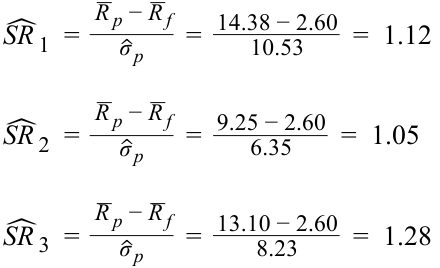

# Volume 9: Portfolio Management
## Learning Module 2 Portfolio Risk and Return: Part II
### Part 4/4: Summary (PDF Pages 116–130)

---

<!-- PDF Page 116 -->

#### = 0.0171 

Stock Q’s nonsystematic variance = (0.25 × 0.25) – (1.2 × 1.2 × 0.18 × 0.18) = 0.0625 – 0.0467 

= 0.0158 

Stock R’s nonsystematic variance = (0.23 × 0.23) – (1.1 × 1.1 × 0.18 × 0.18) = 0.0529 – 0.0392 

= 0.0137 

3. Should any of the three stocks be included in the portfolio? If so, which stock should have the highest weight in the portfolio? 

### **Solution:** 

Stock P has a negative α and should not be included in the portfolio, unless a negative position can be assumed through short selling. Stocks Q and R have a positive α; therefore, they should be included in the portfolio with positive weights. 

The relative weight of Q is 0.04/0.0158 = 2.53. 

The relative weight of R is 0.03/0.0137 = 2.19. 

Stock Q will have the largest weight among the nonmarket securities to be added to the portfolio. In relative terms, the weight of Q will be 15.5 percent greater than the weight of R (2.53/2.19 = 1.155). As the number of securities increases, the analysis becomes more complex. However, the contribution of each additional security toward improvement in the risk–return tradeoff will decrease and eventually disappear, resulting in a well-diversified portfolio. 

# **~~SUMMARY~~** 

In this reading, we discussed the capital asset pricing model in detail and covered related topics such as the capital market line. The reading began with an interpretation of the CML, uses of the market portfolio as a passive management strategy, and leveraging of the market portfolio to obtain a higher expected return. Next, we discussed systematic and nonsystematic risk and why one should not expect to be compensated for taking on nonsystematic risk. The discussion of systematic and nonsystematic risk was followed by an introduction to beta and return-generating models. This broad topic was then broken down into a discussion of the CAPM and, more specifically, the relationship between beta and expected return. The final section included applications of the CAPM to capital budgeting, portfolio performance evaluation, and security selection. The highlights of the reading are as follows: 

- The capital market line is a special case of the capital allocation line, where the efficient portfolio is the market portfolio. 

- Obtaining a unique optimal risky portfolio is not possible if investors are permitted to have heterogeneous beliefs because such beliefs will result in heterogeneous asset prices. 

<!-- PDF Page 117 -->

- Investors can leverage their portfolios by borrowing money and investing in the market. 

- Systematic risk is the risk that affects the entire market or economy and is not diversifiable. 

- Nonsystematic risk is local and can be diversified away by combining assets with low correlations. 

- Beta risk, or systematic risk, is priced and earns a return, whereas nonsystematic risk is not priced. 

- The expected return of an asset depends on its beta risk and can be computed using the CAPM, which is given by _E_ ( _Ri_ ) = _Rf_ + β _i_ [ _E_ ( _Rm_ ) – _Rf_ ]. 

- The security market line is an implementation of the CAPM and applies to all securities, whether they are efficient or not. 

- Expected return from the CAPM can be used for making capital budgeting decisions. 

- Portfolios can be evaluated by several CAPM-based measures, such as the Sharpe ratio, the Treynor ratio, M2 , and Jensen’s alpha. 

- The SML can assist in security selection and optimal portfolio construction. 

By successfully understanding the content of this reading, you should feel comfortable decomposing total variance into systematic and nonsystematic variance, analyzing beta risk, using the CAPM, and evaluating portfolios and individual securities. 

<!-- PDF Page 118 -->

# **~~REFERENCES~~** 

- Carhart, Mark. 1997. “On Persistence in Mutual Fund Performance.” _Journal of Finance_ 52, vol. , no. 1:57–82. 10.2307/2329556 

- Fama, Eugene and Kenneth French. 1992. “The Cross-Section of Expected Stock Returns.” _Journal of Finance_ 47, vol. , no. 2:427–466. 10.2307/2329112 

<!-- PDF Page 119 -->

# **~~PRACTICE PROBLEMS~~** 

**1.** The line depicting the total risk and expected return of portfolio combinations of a risk-free asset and any risky asset is the: 

   - **A.** security market line. 

   - **B.** capital allocation line. 

   - **C.** security characteristic line. 

**2.** The portfolio of a risk-free asset and a risky asset has a better risk-return tradeoff than investing in only one asset type because the correlation between the risk-free asset and the risky asset is equal to: 

   - **A.** −1.0. 

   - **B.** 0.0. 

**C.** 1.0. 

**3.** With respect to capital market theory, an investor’s optimal portfolio is the combination of a risk-free asset and a risky asset with the highest: 

   - **A.** expected return. 

   - **B.** indifference curve. 

   - **C.** capital allocation line slope. 

**4.** Highly risk-averse investors will _most likely_ invest the majority of their wealth in: 

   - **A.** risky assets. 

   - **B.** risk-free assets. 

   - **C.** the optimal risky portfolio. 

**5.** The capital market line (CML) is the graph of the risk and return of portfolio combinations consisting of the risk-free asset and: 

   - **A.** any risky portfolio. 

   - **B.** the market portfolio. 

   - **C.** the leveraged portfolio. 

**6.** Which of the following statements _most accurately_ defines the market portfolio in capital market theory? The market portfolio consists of all: 

   - **A.** risky assets. 

   - **B.** tradable assets. 

   - **C.** investable assets. 

**7.** With respect to capital market theory, the optimal risky portfolio: 

   - **A.** is the market portfolio. 

<!-- PDF Page 120 -->

|**B.**has the highest expected return. **C.**has the lowest expected variance.|
|---|
|**8.**Relative to portfolios on the CML, any portfolio that plots above the CML is considered:|
|**A.**inferior.|
|**B.**inefficient.|
|**C.**unachievable.|
|**9.**A portfolio on the capital market line with returns greater than the returns on the market portfolio represents a(n):|
|**A.**lending portfolio.|
|**B.**borrowing portfolio.|
|**C.**unachievable portfolio.|
|**10.**With respect to the capital market line, a portfolio on the CML with returns less than the returns on the market portfolio represents a(n):|
|**A.**lending portfolio.|
|**B.**borrowing portfolio.|
|**C.**unachievable portfolio.|
|**11.**Which of the following types of risk is_most likely_avoided by forming a diversi- fied portfolio?|
|**A.**Total risk.|
|**B.**Systematic risk.|
|**C.**Nonsystematic risk.|
|**12.**Which of the following events is_most likely_an example of nonsystematic risk?|
|**A.**A decline in interest rates.|
|**B.**The resignation of chief executive officer.|
|**C.**An increase in the value of the US dollar.|
|**13.**With respect to the pricing of risk in capital market theory, which of the follow- ing statements is_most accurate_?|
|**A.**All risk is priced.|
|**B.**Systematic risk is priced.|
|**C.**Nonsystematic risk is priced.|
|**14.**The sum of an asset’s systematic variance and its nonsystematic variance of re- turns is equal to the asset’s: **A.**beta.|

<!-- PDF Page 121 -->

- **B.** total risk. 

- **C.** total variance. 

## **The following information relates to questions 15-17** 

An analyst gathers the following information: 

|**Security**|**Expected** **Annual Return (%)**|**Expected** **Standard Deviation (%)** |**Correlation between** **Security and the** **Market**|
|---|---|---|---|
|Security 1|11|25|0.6|
|Security 2|11|20|0.7|
|Security 3|14|20|0.8|
|Market|10|15|1.0|

**15.** Which security has the _highest_ total risk? 

   - **A.** Security 1. 

   - **B.** Security 2. 

   - **C.** Security 3. 

**16.** Which security has the _highest_ beta measure? 

   - **A.** Security 1. 

   - **B.** Security 2. 

   - **C.** Security 3. 

**17.** Which security has the _least_ amount of market risk? 

   - **A.** Security 1. 

   - **B.** Security 2. 

   - **C.** Security 3. 

**18.** With respect to return-generating models, the intercept term of the market model is the asset’s estimated: 

   - **A.** beta. 

   - **B.** alpha. 

   - **C.** variance. 

**19.** With respect to return-generating models, the slope term of the market model is an estimate of the asset’s: 

   - **A.** total risk. 

<!-- PDF Page 122 -->

   - **B.** systematic risk. 

   - **C.** nonsystematic risk. 

**20.** With respect to return-generating models, which of the following statements is _most accurate_ ? Return-generating models are used to directly estimate the: **A.** expected return of a security. **B.** weights of securities in a portfolio. 

   - **C.** parameters of the capital market line. 

**21.** With respect to capital market theory, the average beta of all assets in the market is: 

   - **A.** less than 1.0. 

   - **B.** equal to 1.0. **C.** greater than 1.0. 

**22.** With respect to the capital asset pricing model, the primary determinant of expected return of an individual asset is the: 

   - **A.** asset’s beta. **B.** market risk premium. **C.** asset’s standard deviation. 

**23.** With respect to the capital asset pricing model, which of the following values of beta for an asset is _most likely_ to have an expected return for the asset that is less than the risk-free rate? 

- **A.** −0.5 **B.** 0.0 **C.** 0.5 

- **24.** With respect to the capital asset pricing model, the market risk premium is: **A.** less than the excess market return. **B.** equal to the excess market return. **C.** greater than the excess market return. 

- **25.** The graph of the capital asset pricing model is the: **A.** capital market line. **B.** security market line. **C.** security characteristic line. 

**26.** With respect to capital market theory, correctly priced individual assets can be plotted on the: **A.** capital market line. 

<!-- PDF Page 123 -->

- **B.** security market line. 

- **C.** capital allocation line. 

## **The following information relates to questions 27-30** 

An analyst gathers the following information: 

|**Security**|**Expected** **Standard Deviation (%)**|**Beta**|
|---|---|---|
|Security 1|25|1.50|
|Security 2|15|1.40|
|Security 3|20|1.60|

**27.** With respect to the capital asset pricing model, if the expected market risk premium is 6% and the risk-free rate is 3%, the expected return for Security 1 is _closest_ to: 

   - **A.** 9.0%. 

   - **B.** 12.0%. 

   - **C.** 13.5%. 

**28.** With respect to the capital asset pricing model, if expected return for Security 2 is equal to 11.4% and the risk-free rate is 3%, the expected return for the market is _closest_ to: 

   - **A.** 8.4%. 

   - **B.** 9.0%. 

   - **C.** 10.3%. 

**29.** With respect to the capital asset pricing model, if the expected market risk premium is 6% the security with the _highest_ expected return is: 

   - **A.** Security 1. 

   - **B.** Security 2. 

   - **C.** Security 3. 

**30.** With respect to the capital asset pricing model, a decline in the expected market return will have the _greatest_ impact on the expected return of: 

   - **A.** Security 1. 

   - **B.** Security 2. 

   - **C.** Security 3. 

<!-- PDF Page 124 -->

**31.** With respect to capital market theory, which of the following statements _best_ describes the effect of the homogeneity assumption? Because all investors have the same economic expectations of future cash flows for all assets, investors will invest in: 

   - **A.** the same optimal risky portfolio. 

   - **B.** the Standard and Poor’s 500 Index. 

   - **C.** assets with the same amount of risk. 

**32.** With respect to capital market theory, which of the following assumptions allows for the existence of the market portfolio? All investors: 

   - **A.** are price takers. 

   - **B.** have homogeneous expectations. 

   - **C.** plan for the same, single holding period. 

**33.** Three equity fund managers have performance records summarized in the following table: 

||**Mean Annual Return (%)**|**Standard Deviation of** **Return (%)**|
|---|---|---|
|Manager 1|14.38|10.53|
|Manager 2|9.25|6.35|
|Manager 3|13.10|8.23|

Given a risk-free rate of return of 2.60%, which manager performed best based on the Sharpe ratio? 

   - **A.** Manager 1 

   - **B.** Manager 2 

   - **C.** Manager 3 

**34.** Which of the following performance measures is consistent with the CAPM? 

   - **A.** _M_2 . 

   - **B.** Sharpe ratio. 

   - **C.** Jensen’s alpha. 

**35.** Which of the following performance measures does _not_ require the measure to be compared to another value? 

   - **A.** Sharpe ratio. 

   - **B.** Treynor ratio. 

   - **C.** Jensen’s alpha. 

**36.** Which of the following performance measures is _most_ appropriate for an investor who is _not_ fully diversified? 

   - **A.** _M_2 . 

<!-- PDF Page 125 -->

   - **B.** Treynor ratio. 

   - **C.** Jensen’s alpha. 

**37.** The slope of the security characteristic line is an asset’s: 

   - **A.** beta. 

   - **B.** excess return. 

   - **C.** risk premium. 

**38.** Analysts who have estimated returns of an asset to be greater than the expected returns generated by the capital asset pricing model should consider the asset to be: 

   - **A.** overvalued. 

   - **B.** undervalued. 

   - **C.** properly valued. 

**39.** The intercept of the best fit line formed by plotting the excess returns of a manager’s portfolio on the excess returns of the market is _best_ described as Jensen’s: 

   - **A.** beta. 

   - **B.** ratio. 

   - **C.** alpha. 

**40.** Portfolio managers who are maximizing risk-adjusted returns will seek to invest _more_ in securities with: 

   - **A.** lower values of Jensen’s alpha. 

   - **B.** values of Jensen’s alpha equal to 0. 

   - **C.** higher values of Jensen’s alpha. 

**41.** Portfolio managers, who are maximizing risk-adjusted returns, will seek to invest _less_ in securities with: 

   - **A.** lower values for nonsystematic variance. 

   - **B.** values of nonsystematic variance equal to 0. 

   - **C.** higher values for nonsystematic variance. 

<!-- PDF Page 126 -->

# **~~SOLUTIONS~~** 

1. B is correct. A capital allocation line (CAL) plots the expected return and total risk of combinations of the risk-free asset and a risky asset (or a portfolio of risky assets). 

2. B is correct. A portfolio of the risk-free asset and a risky asset or a portfolio of risky assets can result in a better risk-return tradeoff than an investment in only one type of an asset, because the risk-free asset has zero correlation with the risky asset. 

3. B is correct. Investors will have different optimal portfolios depending on their indifference curves. The optimal portfolio for each investor is the one with highest utility; that is, where the CAL is tangent to the individual investor’s highest possible indifference curve. 

4. B is correct. Although the optimal risky portfolio is the market portfolio, highly risk-averse investors choose to invest most of their wealth in the risk-free asset. 

5. B is correct. Although the capital allocation line includes all possible combinations of the risk-free asset and any risky portfolio, the capital market line is a special case of the capital allocation line, which uses the market portfolio as the optimal risky portfolio. 

6. A is correct. The market includes all risky assets, or anything that has value; however, not all assets are tradable, and not all tradable assets are investable. 

7. A is correct. The optimal risky portfolio is the market portfolio. Capital market theory assumes that investors have homogeneous expectations, which means that all investors analyze securities in the same way and are rational. That is, investors use the same probability distributions, use the same inputs for future cash flows, and arrive at the same valuations. Because their valuations of all assets are identical, all investors will invest in the same optimal risky portfolio (i.e., the market portfolio). 

8. C is correct. Theoretically, any point above the CML is not achievable and any point below the CML is dominated by and inferior to any point on the CML. 

9. B is correct. As one moves further to the right of point M on the capital market line, an increasing amount of borrowed money is being invested in the market portfolio. This means that there is negative investment in the risk-free asset, which is referred to as a leveraged position in the risky portfolio. 

10. A is correct. The combinations of the risk-free asset and the market portfolio on the CML where returns are less than the returns on the market portfolio are termed ‘lending’ portfolios. 

11. C is correct. Investors are capable of avoiding nonsystematic risk by forming a portfolio of assets that are not highly correlated with one another, thereby reducing total risk and being exposed only to systematic risk. 

12. B is correct. Nonsystematic risk is specific to a firm, whereas systematic risk affects the entire economy. 

13. B is correct. Only systematic risk is priced. Investors do not receive any return for accepting nonsystematic or diversifiable risk. 

<!-- PDF Page 127 -->

14. C is correct. The sum of systematic variance and nonsystematic variance equals the total variance of the asset. References to total risk as the sum of systematic risk and nonsystematic risk refer to variance, not to risk. 

15. A is correct. Security 1 has the highest total risk = 0.25 compared to Security 2 and Security 3 with a total risk of 0.20. 

16. C is correct. Security 3 has the highest beta value; 

 ρ_ 3, _m σ_ 3 _ 1.07 = =( 0.80 )( 20% ) _σm_ 15% 

compared to Security 1 and Security 2 with beta values of 1.00 and 0.93, respectively. 

17. B is correct. Security 2 has the lowest beta value; 

 ρ_ 2, _m σ_ 2 _ 0.93 = =( 0.70 )( 20% ) _σm_ 15% 

compared to Security 1 and 3 with beta values of 1.00 and 1.07, respectively. 

18. B is correct. In the market model, _Ri_ = α _i_ + β _iRm_ + _ei_ , the intercept, α _i,_ and slope coefficient, β _i_ , are estimated using historical security and market returns. 

19. B is correct. In the market model, _Ri_ = α _i_ + β _iRm_ + _ei_ , the slope coefficient, β _i_ , is an estimate of the asset’s systematic or market risk. 

20. A is correct. In the market model, _Ri_ = α _i_ + β _iRm_ + _ei_ , the intercept, α _i,_ and slope coefficient, β _i_ , are estimated using historical security and market returns. These parameter estimates then are used to predict firm-specific returns that a security may earn in a future period. 

21. B is correct. The average beta of all assets in the market, by definition, is equal to 1.0. 

22. A is correct. The CAPM shows that the primary determinant of expected return for an individual asset is its beta, or how well the asset correlates with the market. 

23. A is correct. If an asset’s beta is negative, the required return will be less than the risk-free rate in the CAPM. When combined with a positive market return, the asset reduces the risk of the overall portfolio, which makes the asset very valuable. Insurance is an example of a negative beta asset. 

24. B is correct. In the CAPM, the market risk premium is the difference between the return on the market and the risk-free rate, which is the same as the return in excess of the market return. 

25. B is correct. The security market line (SML) is a graphical representation of the capital asset pricing model, with beta risk on the x-axis and expected return on the y-axis. 

26. B is correct. The security market line applies to any security, efficient or not. The CAL and the CML use the total risk of the asset (or portfolio of assets) rather than its systematic risk, which is the only risk that is priced. 

27. B is correct. The expected return of Security 1, using the CAPM, is 12.0% = 3% + 1.5(6%); _E_ ( _Ri_ ) = _Rf_ + β _i_ [ _E_ ( _Rm_ ) – _Rf_ ]. 

28. B is correct. The expected risk premium for Security 2 is 8.4%, (11.4% − 3%), indicates that the expected market risk premium is 6%; therefore, since the risk-free 

<!-- PDF Page 128 -->

rate is 3% the expected rate of return for the market is 9%. That is, using the CAPM, _E_ ( _Ri_ ) = _Rf_ + β _i_ [ _E_ ( _Rm_ ) – _Rf_ ], 11.4% = 3% + 1.4(X%), where X% = (11.4% − 3%)/1.4 = 6.0% = market risk premium. 

29. C is correct. Security 3 has the highest beta; thus, regardless of the value for the risk-free rate, Security 3 will have the highest expected return: 

_E_ ( _Ri_ ) = _Rf_ + β _i_ [ _E_ ( _Rm_ ) – _Rf_ ] 

30. C is correct. Security 3 has the highest beta; thus, regardless of the risk-free rate the expected return of Security 3 will be most sensitive to a change in the expected market return. 

31. A is correct. The homogeneity assumption refers to all investors having the same economic expectation of future cash flows. If all investors have the same expectations, then all investors should invest in the same optimal risky portfolio, therefore implying the existence of only one optimal portfolio (i.e., the market portfolio). 

32. B is correct. The homogeneous expectations assumption means that all investors analyze securities in the same way and are rational. That is, they use the same probability distributions, use the same inputs for future cash flows, and arrive at the same valuations. Because their valuation of all assets is identical, they will generate the same optimal risky portfolio, which is the market portfolio. 

33. C is correct. The Sharpe ratio   (SRˆ )  is the mean excess portfolio return per unit of risk, where a higher Sharpe ratio indicates better performance: 

<!-- Formula Text: ˆ SR  1  = _ R  p − _ R  f _ ˆ σ  p    =   14.38 − 2.60 _ 10.53 =  1.12 ˆ SR  2  = _ R  p − _ R  f _ ˆ σ  p    =   9.25 − 2.60 _ 6.35 =  1.05 ˆ SR  3  = _ R  p − _ R  f _ ˆ σ  p    =   13.10 − 2.60 _ 8.23 =  1.28 -->

34. C is correct. Jensen’s alpha adjusts for systematic risk, and _M_2 and the Sharpe Ratio adjust for total risk. 

35. C is correct. The sign of Jensen’s alpha indicates whether or not the portfolio has outperformed the market. If alpha is positive, the portfolio has outperformed the market; if alpha is negative, the portfolio has underperformed the market. 

36. A is the correct. _M_2 adjusts for risk using standard deviation (i.e., total risk). 

37. A is correct. The security characteristic line is a plot of the excess return of the security on the excess return of the market. In such a graph, Jensen’s alpha is the intercept and the beta is the slope. 

38. B is correct. If the estimated return of an asset is above the SML (the expected return), the asset has a lower level of risk relative to the amount of expected return and would be a good choice for investment (i.e., undervalued). 

39. C is correct. This is because of the plot of the excess return of the security on the excess return of the market. In such a graph, Jensen’s alpha is the intercept and the beta is the slope. 

<!-- PDF Page 129 -->

40. C is correct. Since managers are concerned with maximizing risk-adjusted returns, securities with a higher value of Jensen’s alpha, α _i_ , should have a higher weight. 

41. C is correct. Since managers are concerned with maximizing risk-adjusted returns, securities with greater nonsystematic risk should be given less weight in the portfolio. 

<!-- PDF Page 130 -->

