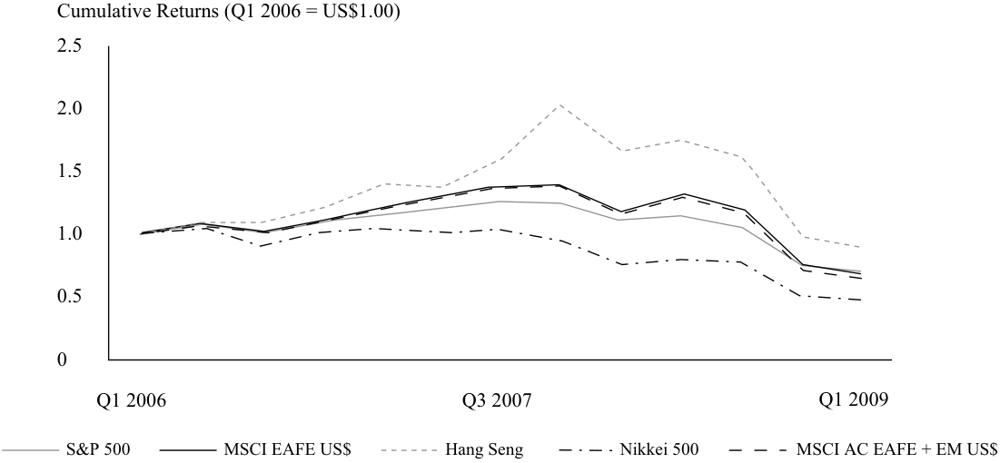

# Volume 9: Portfolio Management
## Learning Module 3 Portfolio Management: An Overview
### Part 1/3: Introduction (PDF Pages 131–144)

---

<!-- PDF Page 131 -->

#### L E A R N I N G M O D U L E 

# **<mark>3</mark>** 

### **Portfolio Management: An Overview** 

**by Owen M. Concannon, CFA, Robert M. Conroy, DBA, CFA, Alistair Byrne, PhD, CFA, and Vahan Janjigian, PhD, CFA.** 

_Owen M. Concannon, CFA, is at Neuberger Berman (USA). Robert M. Conroy, DBA, CFA, is at the Darden School of Business, University of Virginia (USA). Alistair Byrne, PhD, CFA, is at State Street Global Advisors (United Kingdom). Vahan Janjigian, PhD, CFA, is at Greenwich Wealth Management, LLC (USA)._ 

###### **<mark>LEARNING OUTCOMES</mark>** 

|**_Mastery_**|**_The candidate should be able to:_**|
|---|---|
||describe the portfolio approach to investing|
||describe the steps in the portfolio management process|
||describe types of investors and distinctive characteristics and needs of each|
||describe defined contribution and defined benefit pension plans|
||describe aspects of the asset management industry|
||describe mutual funds and compare them with other pooled investment products|

<!-- Start of picture text -->
1 <!-- End of picture text -->

##### **INTRODUCTION** 

This reading provides an overview of portfolio management and the asset management industry, including types of investors and investment plans and products. A portfolio approach is important to investors in achieving their financial objectives. We outline the steps in the portfolio management process in managing a client’s investment portfolio. We next compare the financial needs of different types of investors: individual and institutional investors. We then describe both defined contribution and defined benefit pension plans. The asset management1 industry, which serves as a critical 

> 1 Note that both “investment management” and “asset management” are commonly used throughout the CFA Program curriculum. The terms are often used interchangeably in practice. 

<!-- PDF Page 132 -->

link between providers and seekers of investment capital around the world, is broadly discussed. Finally, we describe mutual funds and other types of pooled investment products offered by asset managers. 

## **<mark>2</mark>** 

##### **PORTFOLIO PERSPECTIVE: DIVERSIFICATION AND RISK REDUCTION** 

describe the portfolio approach to investing 

One of the biggest challenges faced by individuals and institutions is to decide how to invest for future needs. For individuals, the goal might be to fund retirement needs. For such institutions as insurance companies, the goal is to fund future liabilities in the form of insurance claims, whereas endowments seek to provide income to meet the ongoing needs of such institutions as universities. Regardless of the ultimate goal, all face the same set of challenges that extend beyond just the choice of what asset classes to invest in. They ultimately center on formulating basic principles that determine how to think about investing. One important question is: Should we invest in individual securities, evaluating each in isolation, or should we take a portfolio approach? By “portfolio approach,” we mean evaluating individual securities in relation to their contribution to the investment characteristics of the whole portfolio. In the following section, we illustrate a number of reasons why a diversified portfolio perspective is important. 

###### **Historical Example of Portfolio Diversification: Avoiding Disaster** 

Portfolio diversification helps investors avoid disastrous investment outcomes. This benefit is most convincingly illustrated by examining what may happen when individuals have _not_ diversified. 

We are usually not able to observe how individuals manage their personal investments. However, in the case of US 401(k) individual retirement portfolios,2 it is possible to see the results of individuals’ investment decisions. When we examine their retirement portfolios, we find that some individual participants make sub-optimal investment decisions. 

During the 1990s, Enron Corporation was one of the most admired corporations in the United States. A position in Enron shares returned over 27 percent per year from 1990 to September 2000, compared to 13 percent for the S&P 500 Index for the same time period. 

> 2 In the United States, 401(k) plans are employer-sponsored individual retirement savings plans. They allow individuals to save a portion of their current income and defer taxation until the time when the savings and earnings are withdrawn. In some cases, the sponsoring firm will also make matching contributions in the form of cash or shares. Individuals within certain limits have control of the invested funds and consequently can express their preferences as to which assets to invest in. 

<!-- PDF Page 133 -->

**Exhibit 1: Value of US$1 Invested from January 1990 to September 2000 Enron vs. S&P 500 Composite Index (01/01/1990 = US$1.00)** 

<!-- Start of picture text -->
$18.00 $16.00 $14.00 $12.00 $10.00 $8.00 Enron $6.00 S&P 500 $4.00 $2.00 $0.00 Jan-90 Oct-90 Jul-91 Apr-92 Jan-93 Oct-93 Jul-94 Apr-95 Jan-96 Oct-96 Jul-97 Apr-98 Jan-99 Oct-99 Jul-00 <!-- End of picture text -->

_Source_ : Thomson Reuters Datastream. 

During this time period, thousands of Enron employees participated in the company’s 401(k) retirement plan. The plan allowed employees to set aside some of their earnings in a tax-deferred account. Enron participated by matching the employees’ contributions. Enron made the match by depositing required amounts in the form of Enron shares. Enron restricted the sale of its contributed shares until an employee turned 50 years old. In January 2001, the employees’ 401(k) retirement accounts were valued at over US$2 billion, of which US$1.3 billion (or 62 percent) was in Enron shares. Although Enron restricted the sale of shares it contributed, less than US$150 million of the total of US$1.3 billion in shares had this restriction. The implication was that Enron employees continued to hold large amounts of Enron shares even though they were free to sell them and invest the proceeds in other assets. 

A typical individual was Roger Bruce,3 a 67-year-old Enron retiree who held all of his US$2 million in retirement funds in Enron shares. Between January 2001 and January 2002, Enron’s share price fell from about US$90 per share to zero. 

<!-- PDF Page 134 -->

**Exhibit 2: Value of US$1 Invested from January 1990 to January 2002 Enron vs. S&P 500 Composite Index (1/1/1990 = US$1.00)** 

<!-- Start of picture text -->
18 16 14 12 10 Enron 8 S&P 500 6 4 2 0 Source : Thomson Reuters Datastream. 01/01/1990 01/09/1990 01/05/1991 01/01/1992 01/09/1992 01/05/1993 01/01/1994 01/09/1994 01/05/1995 01/01/1996 01/09/1996 01/05/1997 01/01/1998 01/09/1998 01/05/1999 01/01/2000 01/09/2000 01/05/2001 01/01/2002 <!-- End of picture text -->

Employees and retirees who had invested all or most of their retirement savings in Enron shares, just like Mr. Bruce, experienced financial ruin. The hard lesson that the Enron employees learned from this experience was to “not put all your eggs in one basket.”4 Unfortunately, the typical Enron employee did have most of his or her eggs in one basket. Most employees’ wages and financial assets were dependent on Enron’s continued viability; hence, any financial distress on Enron would have a material impact on an employee’s financial health. The bankruptcy of Enron resulted in the closing of its operations, the dismissal of thousands of employees, and its shares becoming worthless. Hence, the failure of Enron was disastrous to the typical Enron employee. 

Enron employees were not the only ones to be victims of over-investment in a single company’s shares. In the defined contribution retirement plans at Owens Corning, Northern Telecom, Corning, and ADC Telecommunications, employees all held more than 25 percent of their assets in the company’s shares during a time (March 2000 to December 2001) in which the share prices in these companies fell by almost 90 percent. The good news in this story is that the employees participating in employer-matched 401(k) plans since 2001 have significantly reduced their holdings of their employers’ shares. 

Thus, by taking a diversified portfolio approach, investors can spread away some of the risk. Rational investors are concerned about the risk–return trade-off of their investments. The portfolio approach provides investors with a way to reduce the risk associated with their wealth without necessarily decreasing their expected rate of return. 

###### **Portfolios: Reduce Risk** 

In addition to avoiding a potential disaster associated with over investing in a single security, portfolios also generally offer equivalent expected returns with lower overall **volatility** of returns—as represented by a measure such as standard deviation. Consider 

<!-- PDF Page 135 -->

this simple example: Suppose you wish to make an investment in companies listed on the Hong Kong Stock Exchange (HKSE) and you start with a sample of five companies.5 The cumulative returns for 16 fiscal quarters are shown in Exhibit 3. 

**Exhibit 3: Cumulative Wealth Index of Sample of Shares Listed on HKSE (initial amount= US$1.00)** 

<!-- Start of picture text -->
Cumulative Wealth Index $4.50 $4.00 $3.50 $3.00 $2.50 $2.00 $1.50 $1.00 $0.50 $0.00 Yue Yuen Industrial Cathay Pacific Airways Hutchison Whampoa Li & Fung COSCO Pacific Q0 Q1 Q2 Q3 Q4 Q5 Q6 Q7 Q8 Q9 Q10 Q11 Q12 Q13 Q14 Q15 Q16 <!-- End of picture text -->

_Source_ : Thomson Reuters Datastream. 

The individual quarterly returns for each of the five shares are shown in Exhibit 4. The annualized means and annualized standard deviations for each are also shown.6 

**Exhibit 4: Quarterly Returns (in Percent) for Sample of HKSE Listed Shares over 16 Fiscal Quarters** 

||**Yue Yuen** **Industrial**|**Cathay** **Pacific** **Airways**|**Hutchison** **Whampoa**|**Li & Fung**|**COSCO Pacific**|**Equally** **Weighted** **Portfolio**|
|---|---|---|---|---|---|---|
|Q1|–11.1%|–2.3%|0.6%|–13.2%|–1.1%|–5.4%|
|Q2|–0.5|–5.4|10.8|1.7|21.0|5.5|
|Q3|5.7|6.8|19.1|13.8|15.5|12.2|
|Q4|5.3|4.6|–2.1|16.9|12.4|7.4|
|Q5|17.2|2.4|12.6|14.5|–7.9|7.8|
|Q6|–17.6|–10.4|–0.9|4.4|–16.7|–8.2|
|Q7|12.6|7.4|4.2|–10.9|15.4|5.7|
|Q8|7.5|–0.4|–3.6|29.2|21.9|10.9|
|Q9|–7.9|1.3|–5.1|–2.0|–1.6|–3.1|
|Q10|8.2|27.5|0.1|26.0|–10.1|10.3|
|Q11|18.3|24.3|16.5|22.8|25.7|21.5|
|Q12|0.1|–2.6|–6.7|–0.4|0.3|–1.8|

5 A sample of five companies from a similar industry group was arbitrarily selected for illustration purposes. 

> 6 Mean quarterly returns are annualized by multiplying the quarterly mean by 4. Quarterly standard deviations are annualized by taking the quarterly standard deviation and multiplying it by 2. 

<!-- PDF Page 136 -->

||**Yue Yuen** **Industrial**|**Cathay** **Pacific** **Airways**|**Hutchison** **Whampoa**|**Li & Fung**|**COSCO Pacific**|**Equally** **Weighted** **Portfolio**|
|---|---|---|---|---|---|---|
|Q13|–6.2|–4.2|16.7|11.9|11.1|5.8|
|Q14|–8.0|17.9|–1.8|12.4|8.4|5.8|
|Q15|3.5|–20.1|–8.5|–20.3|–31.5|–15.4|
|Q16|2.1|–11.8|–2.6|24.2|–6.1|1.2|
|Mean annual return|7.3%|8.7%|12.3%|32.8%|14.2%|15.1%|
|Annual standard|20.2%|25.4%|18.1%|29.5%|31.3%|17.9%|
|deviation i|||||||
|Diversification ratio||||||71.9%|

_Source:_ Thomson Reuters Datastream. 

Suppose you want to invest in one of these five securities next year. There is a wide variety of risk–return trade-offs for the five shares selected. If you believe that the future will replicate the past, then choosing Li & Fung would be a good choice. For the prior four years, Li & Fung provided the best trade-off between return and risk. In other words, it provided the most return per unit of risk. However, if there is no reason to believe that the future will replicate the past, it is more likely that the risk and return on the one security selected will be more like selecting one randomly. When we randomly selected one security each quarter, we found an average annualized return of 15.1 percent and an average annualized standard deviation of 24.9 percent, which would now become your expected return and standard deviation, respectively. 

Alternatively, you could invest in an equally weighted portfolio of the five shares, which means that you would invest the same dollar amount in each security for each quarter. The quarterly returns on the equally weighted portfolio are just the average of the returns of the individual shares. As reported in Exhibit 4, the equally weighted portfolio has an average return of 15.1 percent and a standard deviation of 17.9 percent. As expected, the equally weighted portfolio’s return is the same as the return on the randomly selected security. However, the same does not hold true for the portfolio standard deviation. That is, the standard deviation of an equally weighted portfolio is not simply the average of the standard deviations of the individual shares. In a more advanced reading we will demonstrate in greater mathematical detail how such a portfolio offers a lower standard deviation of return than the average of its individual components due to the correlations or interactions between the individual securities. 

Because the mean return is the same, a simple measure of the value of diversification is calculated as the ratio of the standard deviation of the equally weighted portfolio to the standard deviation of the randomly selected security. This ratio may be referred to as the **diversification ratio** . In this case, the equally weighted portfolio’s standard deviation is approximately 72 percent of the average standard deviation of the 5 stocks (24.9%). The diversification ratio of the portfolio’s standard deviation to the individual asset’s standard deviation measures the risk reduction benefits of a simple portfolio construction method, equal weighting. Even though the companies were chosen from a similar industry grouping, we see significant risk reduction. An even greater portfolio effect (i.e., lower diversification ratio) could have been realized if we had chosen companies from completely different industries. 

This example illustrates one of the critical ideas about portfolios: Portfolios affect risk more than returns. In the prior section portfolios helped avoid the effects of downside risk associated with investing in a single company’s shares. In this section we extended the notion of risk reduction through portfolios to illustrate why individuals and institutions should hold portfolios. 

<!-- PDF Page 137 -->

##### **PORTFOLIO PERSPECTIVE: RISK-RETURN TRADE-OFF, DOWNSIDE PROTECTION, MODERN PORTFOLIO THEORY** 

## **<mark>3</mark>** 

describe the portfolio approach to investing 

In the previous section we compared an equally weighted portfolio to the selection of a single security. In this section we examine additional combinations of the same set of shares and observe the trade-offs between portfolio volatility of returns and expected return (for short, their risk–return trade-offs). If we select the portfolios with the best combination of risk and return (taking historical statistics as our expectations for the future), we produce the set of portfolios shown in Exhibit 5. 

**Exhibit 5: Optimal Portfolios for Sample of HKSE Listed Shares** 

<!-- Start of picture text -->
Expected Return 0.35 0.3 Li & Fung 0.25 Equally weighted portfolio 0.2 0.15 Hutchison Whampoa COSCO Pacific 0.1 0.05 0 Yue Yuen Industrial Cathay Pacific Airways 0.12 0.17 0.22 0.27 0.32 0.37 Standard Deviation <!-- End of picture text -->

_Source_ : Thomson Reuters Datastream. 

In addition to illustrating that the diversified portfolio approach reduces risk, Exhibit 5 also shows that the composition of the portfolio matters. For example, an equally weighted portfolio (20 percent of the portfolio in each security) of the five shares has an expected return of 15.1 percent and a standard deviation of 17.9 percent. Alternatively, a portfolio with 25 percent in Yue Yuen Industrial (Holdings), 3 percent in Cathay Pacific, 52 percent in Hutchison Whampoa, 20 percent in Li & Fung, and 0 percent in COSCO Pacific produces a portfolio with an expected return of 15.1 percent and a standard deviation of 15.6 percent. Compared to a simple equally weighted portfolio, this provides an improved trade-off between risk and return because a lower level of risk was achieved for the same level of return. 

###### **Historical Portfolio Example: Not Necessarily Downside Protection** 

A major reason that portfolios can effectively reduce risk is that combining securities whose returns do not move together provides diversification. Sometimes a subset of assets will go up in value at the same time that another will go down in value. The 

<!-- PDF Page 138 -->

fact that these may offset each other creates the potential diversification benefit we attribute to portfolios. However, an important issue is that the co-movement or correlation pattern of the securities’ returns in the portfolio can change in a manner unfavorable to the investor. We use historical return data from a set of global indexes to show the impact of changing co-movement patterns. 

When we examine the returns of a set of global equity indexes over the last 15 years, we observe a reduction in the diversification benefit due to a change in the pattern of co-movements of returns. Exhibit 6 and Exhibit 7 show the cumulative returns for a set of five global indexes7 for two different time periods. Comparing the first time period, from Q4 1993 through Q3 2000 (as shown in Exhibit 6), with the last time period, from Q1 2006 through Q1 2009 (as shown in Exhibit 7), we show that the degree to which these global equity indexes moved together increased over time. 

**Exhibit 6: Returns to Global Equity Indexes Q4 1993–Q3 2000** 

<!-- Start of picture text -->
Cumulative Return (Q4 1993 = US$1.00) 4.0 3.5 3.0 2.5 2.0 1.5 1.0 0.5 0 Q4 1993 Q4 1995 Q4 1997 Q4 1999 S&P 500 MSCI EAFE US$ Hang Seng Nikkei 500 MSCI AC EAFE + EM US$ <!-- End of picture text -->

_Source_ : Thomson Reuters Datastream. 

> 7 The S&P 500, Hang Seng, and Nikkei 500 are broad-based composite equity indexes designed to measure the performance of equities in the United States, Hong Kong SAR, and Japan. MSCI stands for Morgan Stanley Capital International. EAFE refers to developed markets in Europe, Australasia, and the Far East. AC indicates all countries, and EM is emerging markets. All index returns are in US dollars. 

<!-- PDF Page 139 -->

**Exhibit 7: Returns to Global Equity Indexes Q1 2006–Q1 2009** 

<!-- Start of picture text -->
Cumulative Returns (Q1 2006 = US$1.00) 2.5 2.0 1.5 1.0 0.5 0 Q1 2006 Q3 2007 Q1 2009 S&P 500 MSCI EAFE US$ Hang Seng Nikkei 500 MSCI AC EAFE + EM US$ <!-- End of picture text -->

_Source_ : Thomson Reuters Datastream. 

The latter part of the second time period, from Q4 2007 to Q1 2009, was a period of dramatic declines in global share prices. Exhibit 8 shows the mean annual returns and standard deviation of returns for this time period. 

**Exhibit 8: Returns to Global Equity Indexes** 

||**Q4 1993–**|**Q3 2000**|**Q1 2006–**|**Q1 2009**|**Q4 200**|**7–Q1 2009**|
|---|---|---|---|---|---|---|
|**Global Index**|**Mean**|**Stand.** **Dev.**|**Mean**|**Stand.** **Dev.**|**Mean**|**Stand. Dev.**|
|S&P 500|20.5%|13.9%|–6.3%|21.1%|–40.6%|23.6%|
|MSCI EAFE US$|10.9|14.2|–3.5|29.4|–48.0|35.9|
|Hang Seng|20.4|35.0|5.1|34.2|–53.8|34.0|
|Nikkei 500|3.3|18.0|–13.8|27.6|–48.0|30.0|
|MSCI AC EAFE + EM US$|7.6|13.2|–4.9|30.9|–52.0|37.5|
|Randomly selected index|12.6%|18.9%|–4.7%|28.6%|–48.5%|32.2%|
|Equally weighted portfolio|12.6%|14.2%|–4.7%|27.4%|–48.5%|32.0%|
|Diversification ratio||75.1%||95.8%||99.4%|

_Source:_ Thomson Reuters Datastream. 

During the period Q4 2007 through Q1 2009, the average return for the equally weighted portfolio, including dividends, was −48.5 percent. Other than reducing the risk of earning the return of the worst performing market, the diversification benefits were small. Exhibit 9 shows the cumulative quarterly returns of each of the five indexes over this time period. All of the indexes declined in unison. The lesson is that although portfolio diversification generally does reduce risk, it does not necessarily provide the same level of risk reduction during times of severe market turmoil as it does when the economy and markets are operating ‘normally’. In fact, if the economy or markets fail totally (which has happened numerous times around the world), then diversification is a false promise. In the face of a worldwide contagion, diversification was ineffective, as illustrated at the end of 2008. 

<!-- PDF Page 140 -->

###### **Exhibit 9: Return to Global Equity Indexes Q4 2007–Q1 2009** 

<!-- Start of picture text -->
Cumulative Returns (Q4 2007 = US$1.00) 1.2 1.0 0.8 0.6 0.4 0.2 0 Q4 2007 Q1 2008 Q2 2008 Q3 2008 Q4 2008 Q1 2009 S&P 500 MSCI EAFE US$ Hang Seng Nikkei 500 MSCI AC EAFE + EM US$ <!-- End of picture text -->

_Source_ : Thomson Reuters Datastream. 

###### **KNOWLEDGE CHECK** 

Portfolios are _most likely_ to provide: 

- **A.** risk reduction. 

- **B.** risk elimination. 

- **C.** downside protection. 

###### **Solution:** 

A is correct. Combining assets into a portfolio should reduce the portfolio’s volatility. However, the portfolio approach does not necessarily provide downside protection or eliminate all risk. 

###### **Portfolios: Modern Portfolio Theory** 

The concept of diversification has been around for a long time and has a great deal of intuitive appeal. However, the actual theory underlying this basic concept and its application to investments only emerged in 1952 with the publication of Harry Markowitz’s classic article on portfolio selection.8 The article provided the foundation for what is now known as **modern portfolio theory** (MPT). The main conclusion of MPT is that investors should not only hold portfolios but should also focus on how individual securities in the portfolios are related to one another. In addition to the diversification benefits of portfolios to investors, the work of William Sharpe (1964), John Lintner (1965), and Jack Treynor (1961) demonstrated the role that portfolios play in determining the appropriate individual asset risk premium (i.e., the return in excess of the risk-free return expected by investors as compensation for the asset’s 

<!-- PDF Page 141 -->

risk). According to capital market theory, the priced risk of an individual security is affected by holding it in a well-diversified portfolio. The early research provided the insight that an asset’s risk should be measured in relation to the remaining systematic or non-diversifiable risk, which should be the only risk that affects the asset’s price. This view of risk is the basis of the capital asset pricing model, or CAPM, which is discussed in greater detail in other readings. Although MPT has limitations, the concepts and intuitions illustrated in the theory continue to be the foundation of knowledge for portfolio managers. 

##### **STEPS IN THE PORTFOLIO MANAGEMENT PROCESS** 

## **<mark>4</mark>** 

describe the steps in the portfolio management process 

In the previous section we discussed a portfolio approach to investing. When establishing and managing a client’s investment portfolio, certain critical steps are followed in the process. We describe these steps in this section. 

- The Planning Step 

   - Understanding the client’s needs 

   - Preparation of an investment policy statement (IPS) 

- The Execution Step 

   - Asset allocation 

   - Security analysis 

   - Portfolio construction 

- The Feedback Step 

   - Portfolio monitoring and rebalancing 

   - Performance measurement and reporting 

###### **Step One: The Planning Step** 

The first step in the investment process is to understand the client’s needs (objectives and constraints) and develop an **investment policy statement** (IPS). A portfolio manager is unlikely to achieve appropriate results for a client without a prior understanding of the client’s needs. The IPS is a written planning document that describes the client’s investment objectives and the constraints that apply to the client’s portfolio. The IPS may state a benchmark—such as a particular rate of return or the performance of a particular market index—that can be used in the feedback stage to assess the performance of the investments and whether objectives have been met. The IPS should be reviewed and updated regularly (for example, either every three years or when a major change in a client’s objectives, constraints, or circumstances occurs). 

<!-- PDF Page 142 -->

###### **Step Two: The Execution Step** 

The next step is for the portfolio manager to construct a suitable portfolio based on the IPS of the client. The portfolio execution step consists of first deciding on a target asset allocation, which determines the weighting of asset classes to be included in the portfolio. This step is followed by the analysis, selection, and purchase of individual investment securities. 

###### **_Asset Allocation_** 

The next step in the process is to assess the risk and return characteristics of the available investments. The analyst forms economic and capital market expectations that can be used to form a proposed allocation of asset classes suitable for the client. Decisions that need to be made in the **asset allocation** of the portfolio include the distribution between equities, fixed-income securities, and cash; sub-asset classes, such as corporate and government bonds; and geographical weightings within asset classes. Alternative assets—such as real estate, commodities, hedge funds, and private equity—may also be included. 

Economists and market strategists may set the top down view on economic conditions and broad market trends. The returns on various asset classes are likely to be affected by economic conditions; for example, equities may do well when economic growth has been unexpectedly strong whereas bonds may do poorly if inflation increases. The economists and strategists will attempt to forecast these conditions. 

**Top down** —A **top-down analysis** begins with consideration of macroeconomic conditions. Based on the current and forecasted economic environment, analysts evaluate markets and industries with the purpose of investing in those that are expected to perform well. Finally, specific companies within these industries are considered for investment. 

**Bottom up** —Rather than emphasizing economic cycles or industry analysis, a **bottom-up analysis** focuses on company-specific circumstances, such as management quality and business prospects. It is less concerned with broad economic trends than is the case for top-down analysis, but instead focuses on company specifics. 

###### **_Security Analysis_** 

The top-down view can be combined with the bottom-up insights of security analysts who are responsible for identifying attractive investments in particular market sectors. They will use their detailed knowledge of the companies and industries they cover to assess the expected level and risk of the cash flows that each security will produce. This knowledge allows the analysts to assign a valuation to the security and identify preferred investments. 

###### **_Portfolio Construction_** 

The portfolio manager will then construct the portfolio, taking account of the target asset allocation, security analysis, and the client’s requirements as set out in the IPS. A key objective will be to achieve the benefits of diversification (i.e., to avoid putting all the eggs in one basket). Decisions need to be taken on asset class weightings, sector weightings within an asset class, and the selection and weighting of individual securities or assets. The relative importance of these decisions on portfolio performance depends at least in part on the investment strategy selected; for example, consider 

<!-- PDF Page 143 -->

an investor that actively adjusts asset sector weights in relation to forecasts of sector performance and one who does not. Although all decisions have an effect on portfolio performance, the asset allocation decision is commonly viewed as having the greatest impact. 

Exhibit 10 shows the broad portfolio weights of the endowment funds of Yale University and the University of Virginia as of June 2017. As you can see, the portfolios have a heavy emphasis on such alternative assets as hedge funds, private equity, and real estate—Yale University particularly so. 

**Exhibit 10: Endowment Portfolio Weights, June 2017** 

|**Asset Class**|**Yale University** **Endowment**|**University of Virginia** **Endowment**|
|---|---|---|
|Public equity|19.1%|26.7%|
|Fixed income|4.6|9.1|
|Private equity|14.2|15.7|
|Real assets (e.g., real estate)|18.7|12.1|
|Absolute return (e.g., hedge funds)|25.1|19.6|
|Cash|1.2|2.3|
|Other|17.2|14.5|
|Portfolio value|US$27.2bn|US$8.6bn|

_Sources:_ “2017 Yale Endowment Annual Report” (p. 2): www .yale .edu/ investments/ Yale _Endowment _17 .pdf; “University of Virginia Investment Management Company Annual Report 2017” (p. 26): http:// uvm -web .eservices .virginia .edu/ public/ reports/ FinancialStatements _2017 .pdf. 

Risk management is an important part of the portfolio construction process. The client’s risk tolerance will be set out in the IPS, and the portfolio manager must make sure the portfolio is consistent with it. As noted above, the manager will take a diversified portfolio perspective: What is important is not the risk of any single investment, but rather how all the investments perform as a portfolio. 

The endowments shown above are relatively risk tolerant investors. Contrast the asset allocation of the endowment funds with the portfolio mix of the insurance companies shown in Exhibit 11. You will notice that the majority of the insurance assets are invested in fixed-income investments, typically of high quality. Note that the Yale University portfolio has less than 5 percent invested in fixed income, with the remainder invested in such growth assets as equity, real estate, and hedge funds. This allocation is in sharp contrast to the Massachusetts Mutual Life Insurance Company (MassMutual) portfolio, which is 80 percent invested in bonds, mortgages, loans, and cash—reflecting the differing risk tolerance and constraints (life insurers face regulatory constraints on their investments). 

<!-- PDF Page 144 -->

**Exhibit 11: MassMutual Portfolio, December 2017****9** 

|**Asset Classes**|**Portfolio %**|
|---|---|
|Bonds|56%|
|Preferred and common shares|9|
|Mortgages|14|
|Real estate|1|
|Policy loans|8|
|Partnerships|5|
|Other assets|5|
|Cash|2|

_Source:_ “MassMutual Financial Group 2017 Annual Report” (p. 8): www .massmutual .com/ mmfg/ docs/ annual _report/ index .html. 

The portfolio construction phase also involves trading. Once the portfolio manager has decided which securities to buy and in what amounts, the securities must be purchased. In many investment firms, the portfolio manager will pass the trades to a buy-side trader—a colleague who specializes in securities trading—who will contact a stockbroker or dealer to have the trades executed. 

###### **Step Three: The Feedback Step** 

Finally, the feedback step assists the portfolio manager in rebalancing the portfolio due to a change in, for example, market conditions or the circumstances of the client. 

###### **_Portfolio Monitoring and Rebalancing_** 

Once the portfolio has been constructed, it needs to be monitored and reviewed and the composition revised as the security analysis changes because of changes in security prices and changes in fundamental factors. When security and asset weightings have drifted from the intended levels as a result of market movements, some rebalancing may be required. The portfolio may also need to be revised if it becomes apparent that the client’s needs or circumstances have changed. 

###### **_Performance Evaluation and Reporting_** 

Finally, the performance of the portfolio must be evaluated, which will include assessing whether the client’s objectives have been met. For example, the investor will wish to know whether the return requirement has been achieved and how the portfolio has performed relative to any benchmark that has been set. Analysis of performance may suggest that the client’s objectives need to be reviewed and perhaps changes made to the IPS. As we will discuss in the next section, there are numerous investment products that clients can use to meet their investment needs. Many of these products are diversified portfolios that an investor can purchase. 

> 9 Asset class definitions: Bonds—Debt instruments of corporations and governments as well as various types of mortgage- and asset-backed securities; Preferred and Common Shares—Investments in preferred and common equities; Mortgages—Mortgage loans secured by various types of commercial property as well as residential mortgage whole loan pools; Real Estate—Investments in real estate; Policy Loans—Loans by policyholders that are secured by insurance and annuity contracts; Partnerships—Investments in partnerships and limited liability companies; Cash—Cash, short-term investments, receivables for securities, and derivatives. Cash equivalents have short maturities (less than one year) or are highly liquid and able to be readily sold. 

